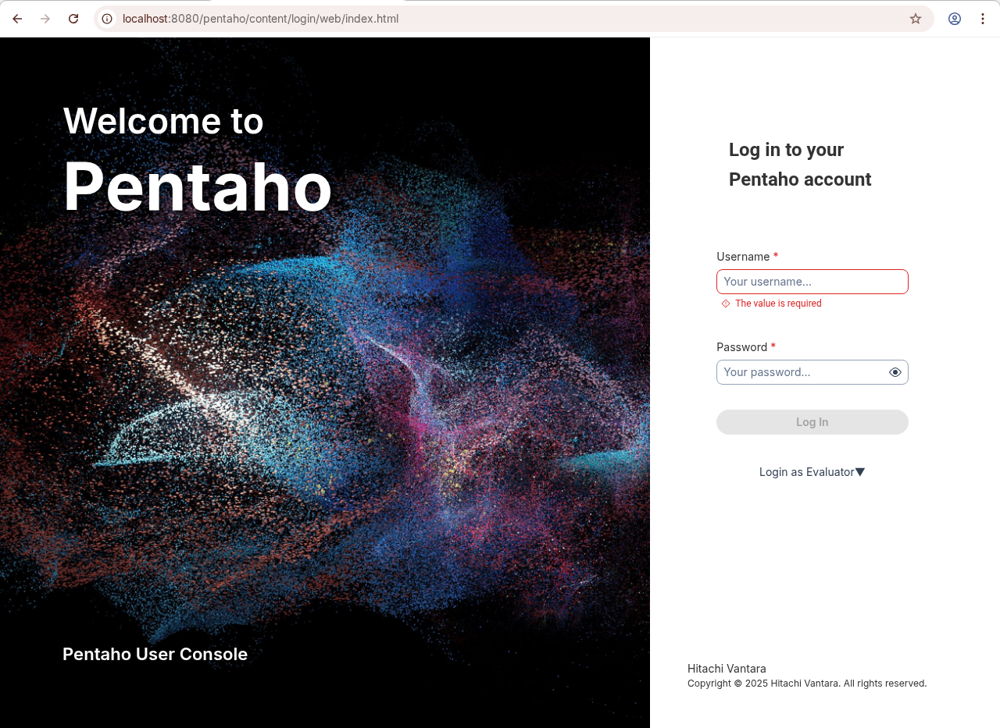
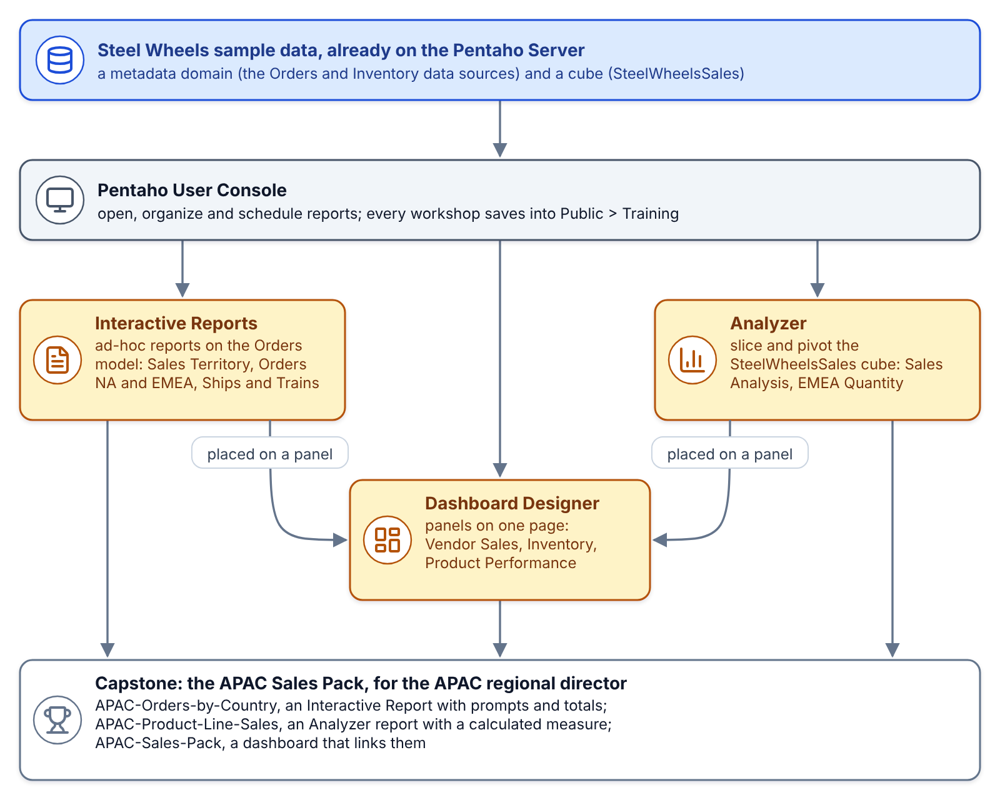

# Before You Start

> **Note:**
>
> #### Get Ready — Before You Start
>
> Before the first workshop, check that the Pentaho Server is running
> on this Ubuntu machine. The course builds reports,
> analyses and dashboards in the Pentaho User Console against the Steel
> Wheels sample data, and **none of the lab time should go on setup**:
> this page does it in advance.
>
> **What you'll do:**
>
> * Learn how the guide works: progress, copy buttons, the assistant.
> * Confirm the Pentaho Server starts and the User Console signs you in.
> * Know where the lab files go: your *Downloads* folder, and *~/Workshop-BA-Practitioner* for the capstone.
>
> **Estimated Time:** 5 minutes on a lab VM; about 15 minutes the first
> time on your own machine.

## Meet your lab guide

This panel stays beside your tools for the whole workshop:

- **Float or dock** — drag the title bar to move the window anywhere
  (any monitor), or use the dock button to pin it to the right edge of
  the screen so maximized apps make room for it.
- **The sidebar** lists every section and lab. A <span data-icon="video"></span> badge means the lab
  includes a video; the `~15 min` tag is a time estimate.
- Use the **font-size** and **reading-mode** controls in the toolbar if
  you're on a small VM screen.

## Track your progress

Each workshop's steps sit in a numbered row at the top of the lab, one
dot per step. Work through them in order: the button at the end of a
step names the next one, and moving on puts a check mark on the step
you leave. Your progress is saved on this machine and survives
restarts, so you can pick up exactly where you left off. (This page has
no steps: tracking starts in the first workshop.)

## Copy code with one click

Every code block has a **copy button** — hover over the block and select
it, then paste into your tool. Try it:

```sql
SELECT 'hello from the lab guide' AS greeting;
```

## Set up your environment

Launch your main tool straight from the guide:

<button data-launch="puc">Start the Pentaho User Console</button>

If it is already open from a previous session, the button focuses
the running window instead of starting a second copy.

### Do you need to set anything up?

:::: tabs

### I'm using a lab VM

Nothing to install. Everything is already on the machine, and the
Pentaho Server starts by itself with it.

> **Note:** **Give the Pentaho Server time to load.** It starts its
> repository database first and then needs **3 to 5 minutes** to finish,
> so it will not answer the moment you sign in. **Check your
> environment**, directly below these tabs, shows **Starting up** while it
> loads and turns green by itself. **Please don't click anything or
> restart anything while it says so**: that only makes the server start
> again from the beginning.

If something looks wrong later, tell your instructor rather than
reinstalling anything.

### I'm installing on my own machine

Everything here is a **one-off setup** for your own Ubuntu 24.04 machine. Work through
the tabs in order — the last one is a reference card of ports and
logins, for when you come back to it later.

> **Note:** This course needs no containers, no MySQL and no extra
> downloads. Everything runs inside the Pentaho Server you already
> have — every lab reads from the bundled Steel Wheels sample data,
> and nothing writes to it.

::: tabs

### 1. Start the Pentaho Server

This course expects a Pentaho Server 11 installed in
`/opt/pentaho/server/pentaho-server`, with the PostgreSQL database that
holds its repository, both running as services (the Installation course
sets a machine up this way). You start them rather than install anything.

1. Open a terminal and start the repository database, then the server:

   ```bash
   sudo systemctl start postgresql
   sudo systemctl start pentaho-server
   ```

2. Wait for it to finish booting. It takes 3 to 5 minutes after the
   database is up; nothing needs to stay open while it loads.

3. Confirm it is up by browsing to **http://localhost:8080/pentaho**.
   You should get a sign-in page.

To shut it down later, run `sudo systemctl stop pentaho-server`.

<details>
<summary>Troubleshooting</summary>

**The browser cannot reach localhost:8080.** The server is still
starting, or it stopped. `systemctl status pentaho-server` says which;
while it loads, watch for `Server startup in ... ms` at the end of
the log:

```bash
tail -f /opt/pentaho/server/pentaho-server/tomcat/logs/catalina.out
```

**It starts but never finishes.** The repository database is down.
Check `systemctl status postgresql`, start it, then restart the server
with `sudo systemctl restart pentaho-server`.

**"Port 8080 already in use".** Something else has the port, often a
second Pentaho Server or another Tomcat. `sudo ss -ltnp 'sport = :8080'`
names it; stop it, or change the port in `tomcat/conf/server.xml`.

**It stops straight away.** The server could not find a usable Java.
It checks `PENTAHO_JAVA_HOME` first, then `JAVA_HOME`: check
`echo $PENTAHO_JAVA_HOME` and `java -version` (Pentaho 11 needs Java 21),
and see `set-pentaho-env.sh` in the server folder for what it expects.

**Sample data is missing.** The bundled HSQLDB `sampledata` starts
with the server on port 9001. If the server started but reports
cannot find their data, stop the server, make sure nothing else owns
9001, and start it again.

</details>

### 2. Sign in to the User Console

1. Open the User Console — use the button at the top of this page, or
   browse to **http://localhost:8080/pentaho**.

2. Sign in as **`admin`** with the password **`password`**.

3. You should land on the Home perspective, with **Browse Files** and
   **Create New** available.

<div align="center">
<figure>

<figcaption>The User Console sign-in page</figcaption>
</figure>
</div>

Use `admin` for every lab in this course. The server also ships with
sample users for other roles — they matter when you are designing
security, but they only get in the way while you are learning the
tools, so stick with `admin`.

<details>
<summary>The other sample users</summary>

All five ship with the server, and all use the password `password`:

| Role                | User    | Username  |
| ------------------- | ------- | --------- |
| Administrator       | Admin   | `admin`   |
| Power User          | Suzy    | `suzy`    |
| Business Analyst    | Pat     | `pat`     |
| Report Author       | Tiffany | `tiffany` |
| Schedule Power User | Bob     | `bob`     |

They differ in what they may do — Business Analyst can only publish
content, whereas Power User can also schedule, read, create and
execute. That is why the labs use `admin`: it has every permission, so
nothing you try is blocked for a reason unrelated to the lesson.

</details>

### 3. Lab files

Each workshop's finished answer is under **Lab Files** at the end of
its page: select it and it saves to your **Downloads** folder. These
are repository files (`.prpti`, `.xanalyzer`, `.xdash`), not
programs: you open one by uploading it to the User Console, and each
Solution section gives the steps.

The capstone is the one place that needs a folder of its own, because
its accreditation checks read your files from
`~/Workshop-BA-Practitioner/capstone`. Make it now:

```bash
mkdir -p ~/Workshop-BA-Practitioner/capstone/solution ~/Workshop-BA-Practitioner/capstone/out
```

### 4. Ports and logins

Everything this course uses, in one place. All of it is local to your
machine.

| Service               | Address                                   | Username       | Password   |
| --------------------- | ----------------------------------------- | -------------- | ---------- |
| Pentaho User Console  | http://localhost:8080/pentaho             | `admin`        | `password` |
| HSQLDB `sampledata`   | `jdbc:hsqldb:hsql://localhost/sampledata` | `pentaho_user` | `password` |
| Ollama — the Chat tab | `127.0.0.1:11434`                         | *none*         | *none*     |

The Steel Wheels sample data lives in the bundled HSQLDB and starts
with the server — you will not normally connect to it directly, since
the reports and dashboards reach it through the server's own data
sources.

> **Caution:** These are the stock Pentaho workshop credentials and are
> widely known. Change them on any server that is reachable beyond
> your own machine.

:::

When the last tab is done, **Check your environment** directly below these
tabs should be all green. Nothing else is required.

::::

## Check your environment

This panel probes the machine live — the Pentaho Server, the User
Console, the repository database behind it, and the Java it runs on —
whichever tab above you chose. Each row reports one of four states:

* **<span class="pcm-c-ok">Green</span>** — the check passed; that piece is present and answering.
* **<span class="pcm-c-warn">Amber</span>** — usable, but worth tidying before the session.
* **<span class="pcm-c-danger">Red</span>** — it will block a lab, and the row tells you the exact fix.
* **<span class="pcm-c-muted">Grey</span>** — skipped, because this course doesn't use it.

The row that matters most is **Pentaho Server (8080)**: every lab runs in
the User Console. It is green only once the sign-in page really answers.

A row with a turning circle and **Starting up** is not broken: the
Pentaho Server is still loading (3 to 5 minutes), and the list checks
again by itself every few seconds. Wait for it. Only when a row is
**red** is something wrong, and the row names the command that fixes it.

<div data-env-check="ubuntu-server"></div>

## Check the capstone folder

There is nothing to unpack for the workshops: every lab's solution
downloads from its own **Lab Files** section when you want it. Your own
work never lives on disk either: you build it in the User Console and
save it to **Public > Training** on the server.

The capstone is the exception. Its checks read your finished pack from
this folder, so confirm it exists before you start:

```text
~/Workshop-BA-Practitioner
└── capstone
    ├── solution        your APAC folder, downloaded from the User Console
    └── out             the report's PDF export
```

If `ls ~/Workshop-BA-Practitioner/capstone` does not list `solution` and
`out`, run the `mkdir` command from **3. Lab files** above.

## Ask the AI assistant

The **Chat** tab in the bottom panel answers questions about Pentaho,
grounded in the official docs — ask it anything from "what does this
step do?" to "why did my transformation fail?". It runs on a local
model, so it works even when the VM is offline.

## How this course is organized

Each section starts with an **overview page** (<span data-icon="page"></span> — background reading,
no checkboxes) followed by **hands-on workshops** (<span data-icon="workshop"></span> — tracked steps).
Head to the first section whenever you're ready.

The whole course on one page: the tools you meet, the workshops you
build in each, and how the capstone draws on them:

<div align="center">
<figure>

<figcaption>The Level 1 toolset on the Steel Wheels data, and how the capstone draws on it</figcaption>
</figure>
</div>

Read the diagram from the top down. The Steel Wheels data is already on
the server, so every workshop starts in the User Console. Interactive
Reports builds reports on the Orders model and Analyzer analyses on the
cube, and Dashboard Designer puts reports from both on one page. The
capstone builds one of each and links them in a dashboard for the APAC
regional director.

---

> **Tip:** You can revisit this lab any time from the sidebar.
