# Pentaho User Console

> **Warning:**
>
> #### Workshop - Pentaho User Console
>
> The Pentaho User Console (PUC) is the web-based hub where report viewing, content management, and platform administration converge.
>
> In this workshop, you navigate the different User Console perspectives, organize your workspace with a custom folder and Favorites, schedule a report, explore the administrative capabilities, and locate the platform's help resources.
>
> **What you'll do**
>
> * Sign in to the Pentaho User Console, in its Modern Design and in the classic console
> * Navigate and describe the purpose of the User Console perspectives (Home, Browse Files, Schedules, Administration)
> * Create the **Public > Training** folder that every later workshop saves into
> * Add a report to your Favorites list
> * Schedule a report, and find the schedule in the Schedules perspective
> * Explore the Users & Roles settings and locate the online documentation
>
> **Prerequisites:** The Pentaho Server running, as set up in [Before You Start](../00-before-you-start/guide.md)
>
> **Estimated time:** 15 minutes

1. Make sure the Pentaho Server is running. On a lab VM it already is; on your own machine start it as in [Before You Start](../00-before-you-start/guide.md):

```powershell
C:\Pentaho\server\pentaho-server\start-pentaho.bat
```

It takes a few minutes; the console is ready when http://localhost:8080/pentaho opens the login page.

Select the Pentaho User Console version:

::::: tabs

### 1. Modern Design

> **Note:**
>
> #### Pentaho User Console 11
>
> The Modern Design of the Pentaho User Console (PUC) offers an improved user experience that is intuitive, responsive, and secure.

<div align="center">
<figure>
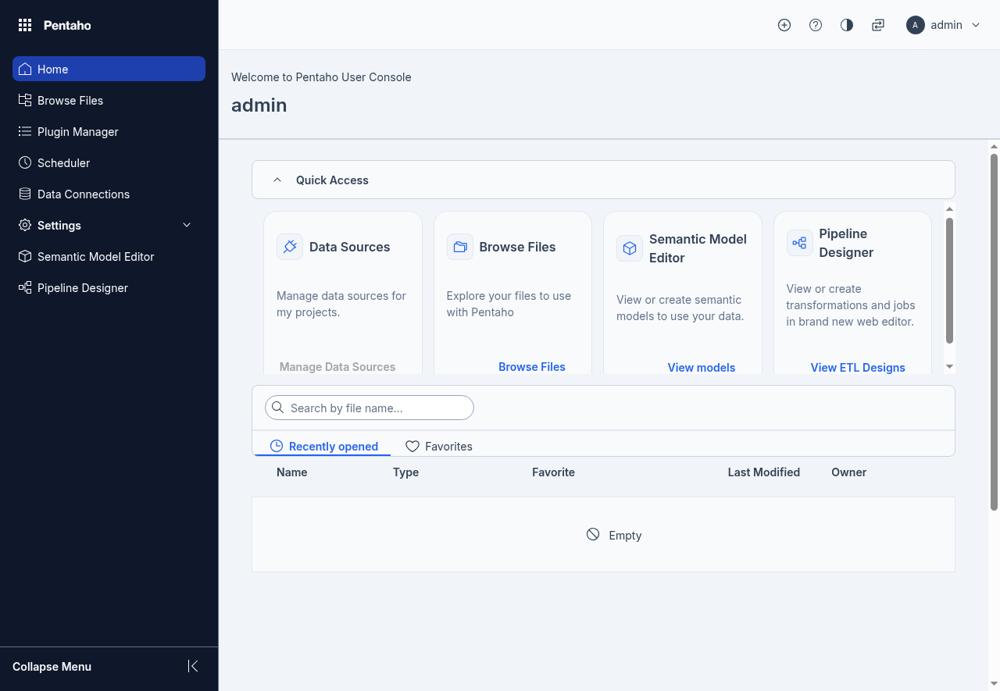
<figcaption>PUC - Modern Design</figcaption>
</figure>
</div>

1. Open the Modern Design sign-in page from the card below, and sign in as `admin` (the Power User `suzy` works too):

<div class="pcm-embed-card" data-href="http://localhost:8080/pentaho/content/login/web/index.html" data-title="localhost"></div>

| Role          | Username | Password |
| ------------- | -------- | -------- |
| Administrator | admin    | password |
| Power User    | suzy     | password |

> **Success:** Checkpoint: the Modern Design **Home** page opens, with its **Quick Access** cards and the menu on the left.

Select a menu option:

::: tabs

### Home

> **Note:**
>
> #### Home
>
> The Home page is your central access point for Pentaho tools and features within the Modern Design of the Pentaho User Console (PUC). Its **Quick Access** cards open **Data Sources**, **Browse Files** and **Pipeline Designer**, and the left-hand menu reaches **Home**, **Browse Files**, **Plugin Manager**, **Scheduler**, **Data Connections** and **Pipeline Designer**. A server with more plugins installed shows more: the picture below comes from one with a **Semantic Model Editor** card and a **Settings** menu.
>
> The Home page also lists your recently opened and favorite files, such as transformations and jobs, so you can launch or manage them without navigating elsewhere.

1. In the menu on the left, select **Home**.

<div align="center">
<figure>
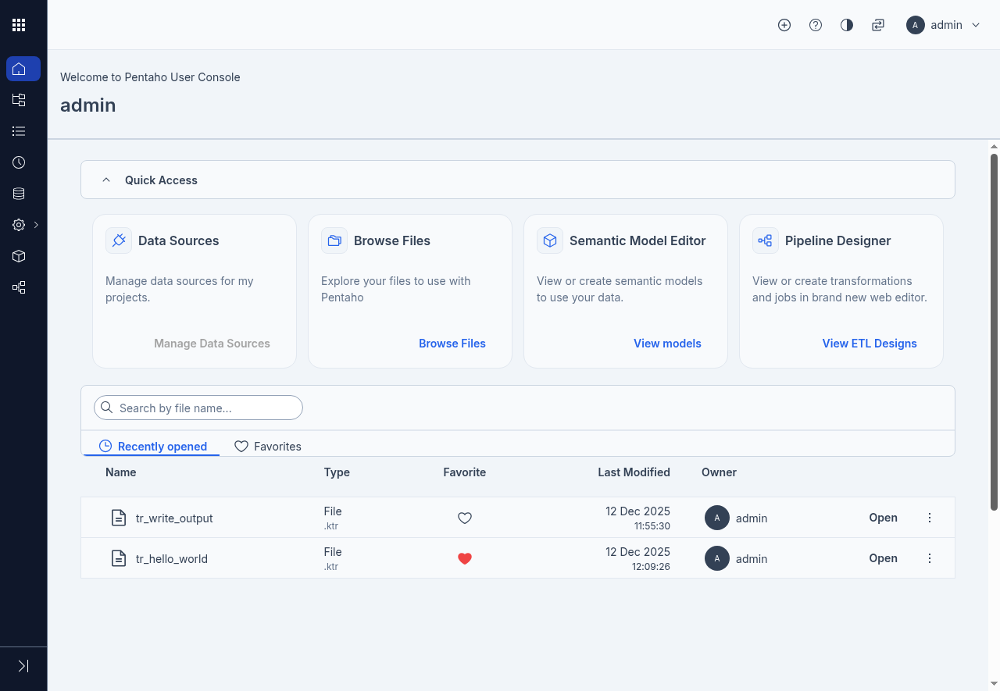
<figcaption>Pentaho User Console - Modern Design</figcaption>
</figure>
</div>

### Browse Files

> **Note:**
>
> #### Browse Files
>
> The Browse Files page organizes your files and folders for efficient retrieval and use. The folders, files, and actions you see on this page depend on your assigned role and permissions.

1. In the menu on the left, select **Browse Files**.

<div align="center">
<figure>
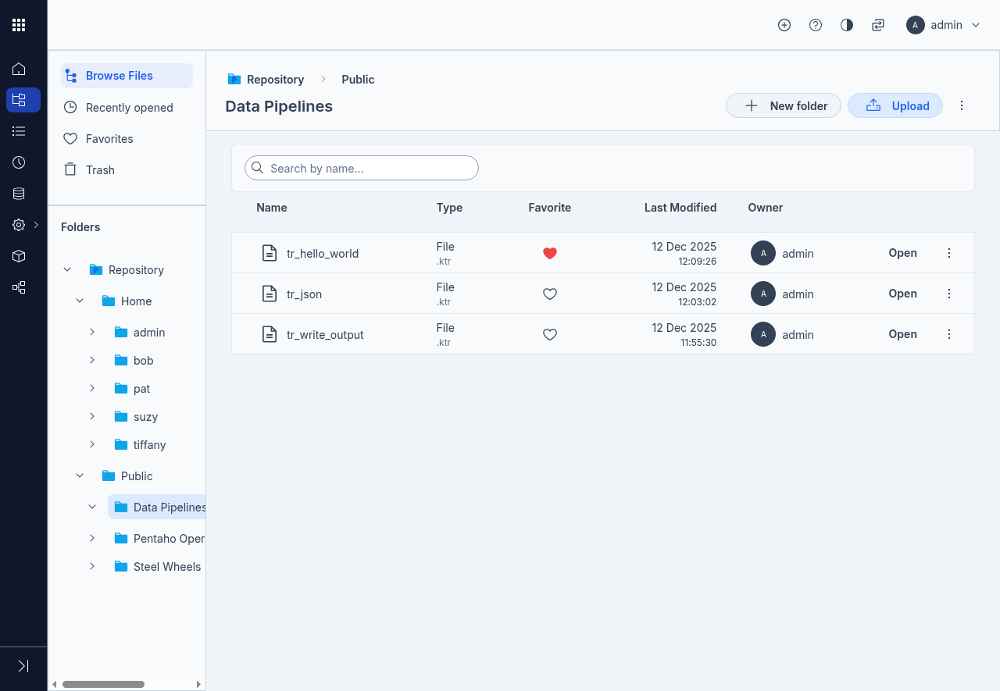
<figcaption>Browse Files</figcaption>
</figure>
</div>

| Menu option     | Description                                                                                                                                                                                                                      |
| --------------- | -------------------------------------------------------------------------------------------------------------------------------------------------------------------------------------------------------------------------------- |
| Browse Files    | Makes the **Folders** menu navigable so that you can search for or browse to a folder that contains one or more files that you want to view. When you select a folder, the main pane displays the files contained in the folder. |
| Recently opened | Displays a list of recently opened files in the main pane.                                                                                                                                                                       |
| Favorites       | Displays a list of files that you have specified as a favorite in the main pane.                                                                                                                                                 |
| Trash           | Displays a list of files that you moved to the trash.                                                                                                                                                                            |

### Plugin Manager

> **Note:**
>
> #### Plugin Manager
>
> You can extend the **Pentaho User Console (PUC)** by installing plugins that add new capabilities, such as new visualizations, dashboards, and content access extensions. The recommended method for installing, updating, and managing plugins is the Plugin Manager.
>
> You can use the Plugin Manager to:
>
> * **Install plugins**: extend platform functionality with new platform plugins, visualizations, dashboards, and content access extensions.
> * **Update plugins**: update existing plugins to the latest versions.
> * **Uninstall plugins**: remove plugins that are no longer needed.

1. In the menu on the left, select **Plugin Manager**.

<div align="center">
<figure>
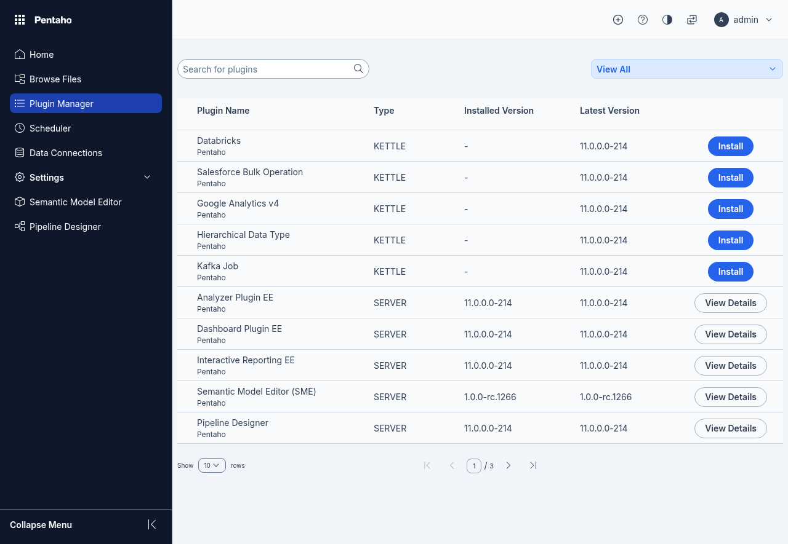
<figcaption>Plugin Manager</figcaption>
</figure>
</div>

### Scheduler

> **Note:**
>
> #### Scheduler
>
> The Scheduler lists every scheduled run: what runs, when it runs next, and where its output goes. You create a schedule from a file's actions; the classic console's Schedules perspective, in the next tab, walks through one.

1. In the menu on the left, select **Scheduler**.

<div align="center">
<figure>
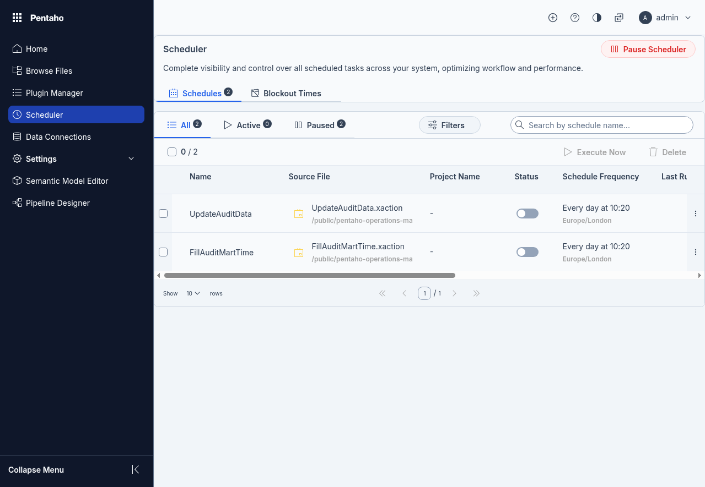
<figcaption>Scheduler</figcaption>
</figure>
</div>

:::

### 2. Classic User Console

> **Note:**
>
> #### Pentaho User Console
>
> The classic console is still available alongside the Modern Design, and is where Interactive Reports, Analyzer and Dashboard Designer content opens in this course.

1. Open the classic console from the card below, and sign in as `admin` with the same password:

<div class="pcm-embed-card" data-href="http://localhost:8080/pentaho/Home" data-title="localhost"></div>

> **Success:** Checkpoint: the **Home** perspective opens, with the **Browse Files**, **Create New**, **Manage Data Sources** and **Documentation** buttons, and your **Recents** and **Favorites** below them.

#### Perspectives

:::: tabs

### Home

> **Note:** The Home perspective gives quick access to common actions, recently viewed content, and your favorite content. The **Getting Started** section at the top is a good place for new users to browse samples of Pentaho reports, analysis views, and dashboards, or to learn how to create your own content through a series of short 3-5-minute video tutorials.

<div align="center">
<figure>
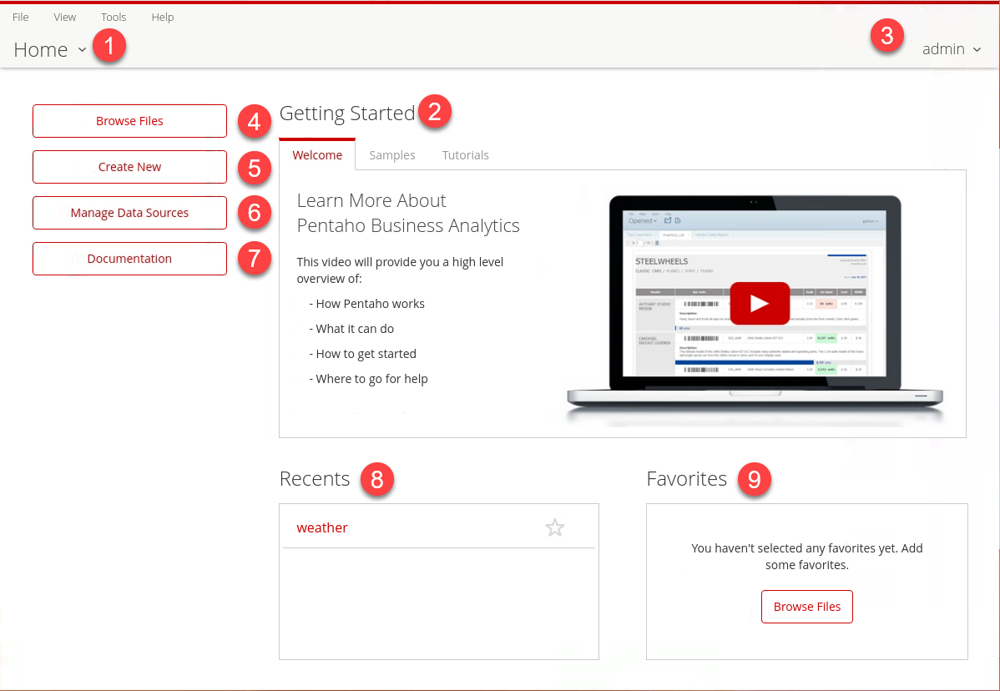
<figcaption>Pentaho User Console - PUC</figcaption>
</figure>
</div>

<table><thead><tr><th width="82">Item</th><th width="180">Name</th><th>Function</th></tr></thead><tbody><tr><td>1</td><td>Home indicator</td><td>Indicates the current User Console perspective that you are using. The Home menu lets you move from page to page, or return to your Home page.</td></tr><tr><td>2</td><td>Getting Started</td><td>Displays some resources to help you get familiar with the User Console. The Welcome tab shows an introductory video about Pentaho products. The Samples tab holds a variety of small sample reports and dashboards that you can use to get familiar with the software. The Tutorials tab contains a number of tutorial videos that give you a visual guide to the software.</td></tr><tr><td>3</td><td>Current User</td><td>Shows the name of the person currently logged in to the User Console. Select the arrow next to the name to log out of the User Console.</td></tr><tr><td>4</td><td>Browse Files</td><td>Brings you to the Browse Files perspective, where you can locate your files using the Folders and Files panes, and manage them using the Actions pane.</td></tr><tr><td>5</td><td>Create New</td><td>Gives you the option to create a new report in <a href="https://docs.hitachivantara.com/r/IWGVG8qV~XMn3ekqEIpjTw/DMmWA4vfu43ddn~aj9PJUA">Pentaho Interactive Reports</a>, <a href="https://docs.hitachivantara.com/r/IWGVG8qV~XMn3ekqEIpjTw/peN6X2OgzB_40iLFljBFeA">Pentaho Analyzer</a>, or <a href="https://docs.hitachivantara.com/r/IWGVG8qV~XMn3ekqEIpjTw/z1sO8VcaROLgS_EgylsScA">Pentaho Dashboard Designer</a>. If you have permissions to work with data sources, this button also gives you the option to create a new data source.</td></tr><tr><td>6</td><td>Manage Data Sources</td><td>Opens the Manage Data Sources dialog, where users with the Manage Data Sources permission view, create, edit and delete data sources.</td></tr><tr><td>7</td><td>Documentation</td><td>Documentation for Pentaho products.</td></tr><tr><td>8</td><td>Recents</td><td>Shows a list of your most recently opened files. Select the star icon next to a recently opened file to add it to your Favorites list.</td></tr><tr><td>9</td><td>Favorites</td><td>Shows a list of your favorite files for quick access.</td></tr></tbody></table>

### Browse Files

> **Note:** **Browse Files** is where you access and manage all the content that you create or have access to in Pentaho. The **Folders** pane on the left shows the repository's folders, including your own home folder and the **Public** folder where you share content with other users and groups. Selecting a folder lists its files in the **Files** pane in the middle. The actions pane on the right gives fast access to the actions for the selected folder or file, such as opening content, scheduling a report, or adding an item to your Favorites list.

1. Select the perspective drop-down at the top left (it reads **Home**), and select **Browse Files**.

<div align="center">
<figure>
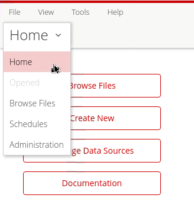
<figcaption>Browse Files</figcaption>
</figure>
</div>

> **Success:** Checkpoint: the **Browse Files** perspective opens, with the **Folders** pane, the **Files** pane and the **Folder Actions** pane side by side.

2. In the **Folders** pane, select **Public > Steel Wheels** to see the sample content this course uses.

<div align="center">
<figure>
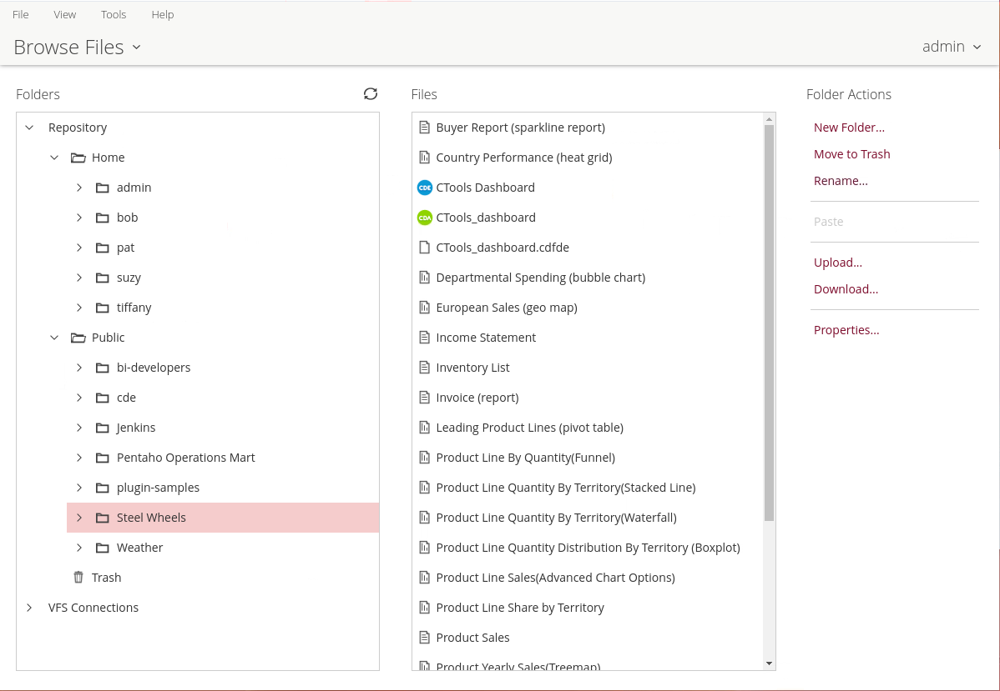
<figcaption>Browse Files</figcaption>
</figure>
</div>

***

**Create a Training Folder**

Create a folder named `Training` under **Public**. Every report, analysis and dashboard you build in this course is saved there.

3. In the **Folders** pane, select **Public**.
4. In the **Folder Actions** pane, select **New Folder...**.

<div align="center">
<figure>
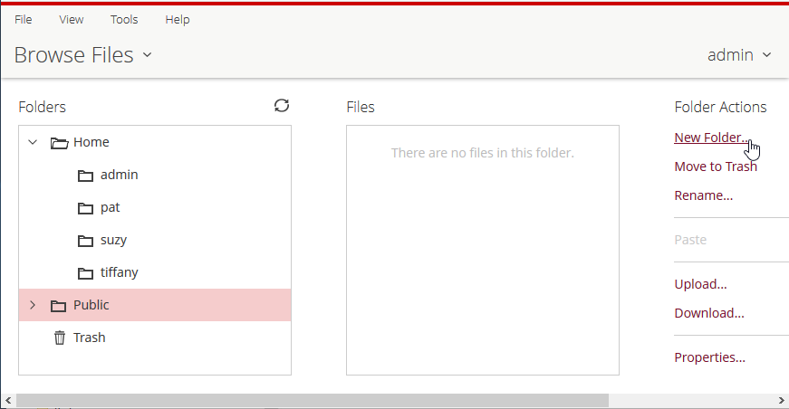
<figcaption>New Folder in the Folder Actions pane</figcaption>
</figure>
</div>

5. In the **New Folder** dialog, set **Name** to `Training`, and select **OK**.

<div align="center">
<figure>
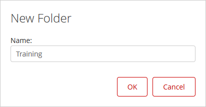
<figcaption>The New Folder dialog</figcaption>
</figure>
</div>

> **Success:** Checkpoint: **Training** appears under **Public** in the **Folders** pane.

**Add a Favorite and find the documentation**

6. In the **Folders** pane, select **Public > Steel Wheels**.
7. In the **Files** pane, select **Leading Product Lines (pivot table)**, and in the **File Actions** pane select **Add to Favorites**.
8. Select the perspective drop-down and select **Home**.

> **Success:** Checkpoint: **Leading Product Lines (pivot table)** is listed under **Favorites** on the Home perspective.

9. Select **Help > Documentation...** to open the Pentaho documentation.

### Schedules

> **Note:** The Schedules perspective is where you view and manage all scheduled activities. Its **Manage Schedules** table shows what is scheduled and when, where the content generated by each schedule is placed, the last time a schedule ran, and when it runs next. Selecting the output link for a schedule takes you to the Browse Files perspective, so you can open any documents the schedule generated.

<div align="center">
<figure>
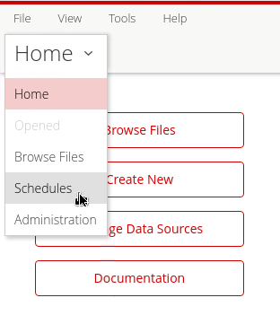
<figcaption>Schedules</figcaption>
</figure>
</div>

1. Select the perspective drop-down, select **Browse Files**, and in the **Folders** pane select **Public > Steel Wheels**.
2. In the **Files** pane, select **Vendor Sales Report (interactive report)**, and in the **File Actions** pane select **Schedule...**.

The first page of the **New Schedule** dialog names the schedule and its output. It offers several options for the generated content:

* **Append timestamp to generated content**
* Save it in another **Generated Content Location**, and overwrite files with the same name
* Change the report **Owner**

<div align="center">
<figure>
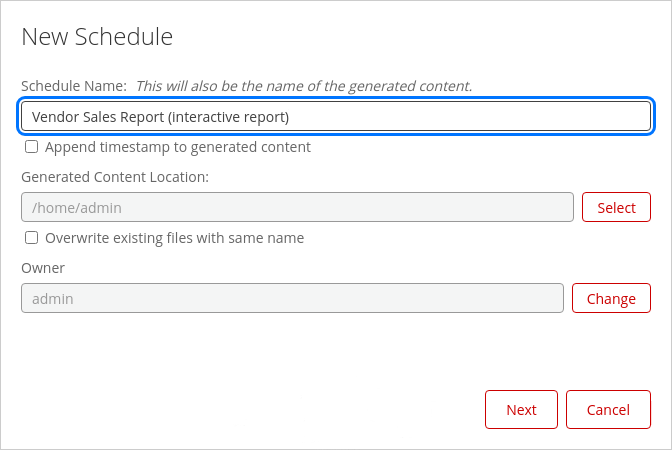
<figcaption>Schedule options</figcaption>
</figure>
</div>

3. Keep the defaults and select **Next**.

The second page sets when and how often the schedule runs, and the performance metrics and logging level of each run.

<div align="center">
<figure>
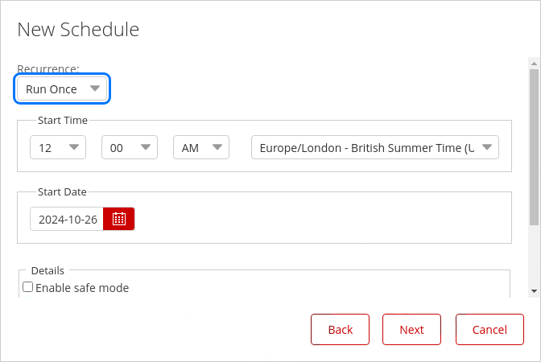
<figcaption>Schedule recurrence</figcaption>
</figure>
</div>

4. Keep the defaults and select **Next**.

The last page sets the report's own parameters. **Product Line** takes one value at a time.

<div align="center">
<figure>
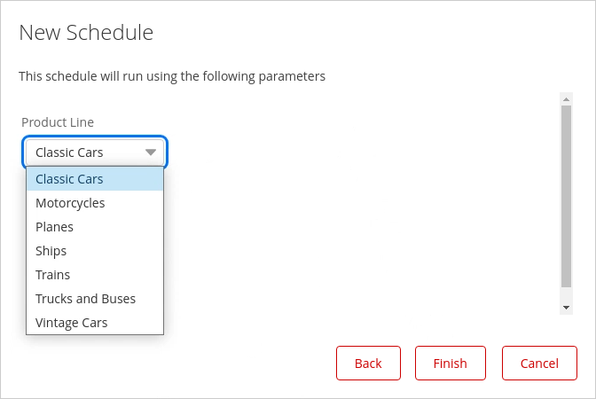
<figcaption>Set Parameter - Classic Cars</figcaption>
</figure>
</div>

5. Keep **Classic Cars** and select **Finish**.
6. Select the perspective drop-down and select **Schedules**.

> **Success:** Checkpoint: the **Manage Schedules** table lists the new **Vendor Sales Report (interactive report)** schedule, with its recurrence, its next run and its output location.

<div align="center">
<figure>
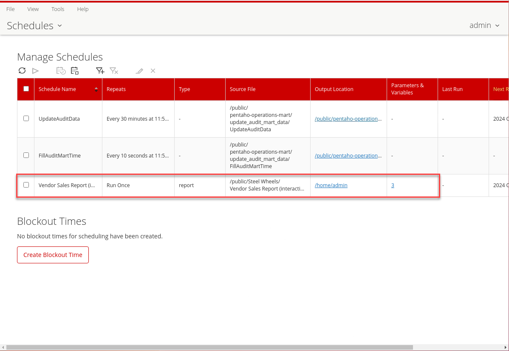
<figcaption>Schedule Perspective</figcaption>
</figure>
</div>

### Administration

> **Note:** The Administration perspective is where the system administrator manages and configures the Pentaho Server:
>
> * user and role security, including LDAP or Active Directory
> * the mail server settings
> * the Pentaho enterprise license keys
> * clean-up routines, run manually or on a schedule, for the content the scheduling system generates

1. Select the perspective drop-down and select **Administration**.

<div align="center">
<figure>
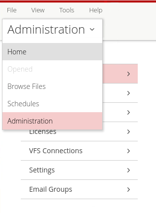
<figcaption>The Administration perspective</figcaption>
</figure>
</div>

::: tabs

### Users & Roles

> **Note:** The Users & Roles page in the Pentaho User Console (PUC) is a point-and-click interface for managing system access and permissions. Only administrators or users with the Administer Security permission can manage these settings. The system comes with default user and role assignments that can serve as templates.
>
> Before making any security changes, back up the system. For wizard installations, this means backing up the Pentaho Business Analytics and Server directories. For manual or archive installations, also back up the WAR files and solutions.
>
> The interface lets administrators add, edit, and delete users and roles, and file and folder permissions are set from the Browse Files perspective. For organizations with multiple tenants, there is an option to hide individual users' Home folders. More detailed information is in the Administer Pentaho Data Integration and Analytics documentation.

1. In the Administration perspective, select **Users & Roles**.
2. On the **Manage Users** tab, select `admin` in the users list. The roles available to it, and the roles it holds, show beside the list.

<div align="center">
<figure>
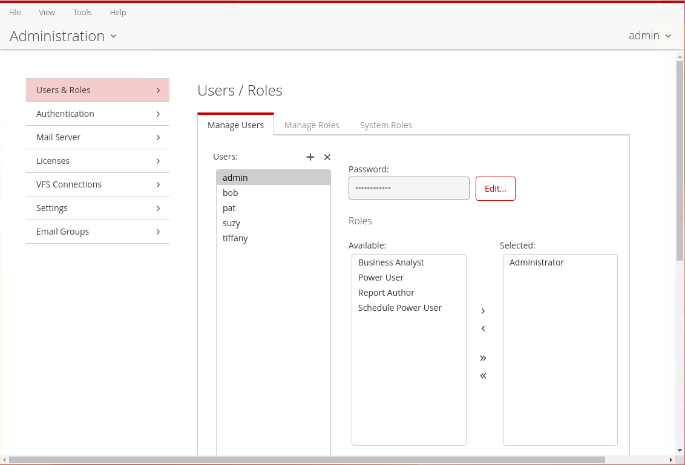
<figcaption>Users &#x26; Roles</figcaption>
</figure>
</div>

> **Success:** Checkpoint: `admin` holds the **Administrator** role.

You can use the following sample users as templates for adding your own users:

<table><thead><tr><th width="147">Sample User</th><th width="196">Default Role</th><th>Default Operation Permissions</th></tr></thead><tbody><tr><td>admin</td><td>Administrator</td><td><ul><li>Administer Security</li><li>Schedule Content</li><li>Read Content</li><li>Execute Schedules</li><li>Publish Content</li><li>Create Content</li><li>Execute</li><li>Manage Data Sources</li></ul></td></tr><tr><td>bob</td><td>Schedule Power user</td><td><ul><li>Read Content</li><li>Execute Schedules</li></ul></td></tr><tr><td>pat</td><td>Business Analyst</td><td><ul><li>Publish Content</li></ul></td></tr><tr><td>suzy</td><td>Power User</td><td><ul><li>Schedule Content</li><li>Read Content</li><li>Publish Content</li><li>Create Content</li><li>Execute</li></ul></td></tr><tr><td>tiffany</td><td>Report Author</td><td><ul><li>Schedule Content</li><li>Publish Content</li></ul></td></tr></tbody></table>

3. Open the **Manage Roles** tab and select **Administrator**.

<div align="center">
<figure>
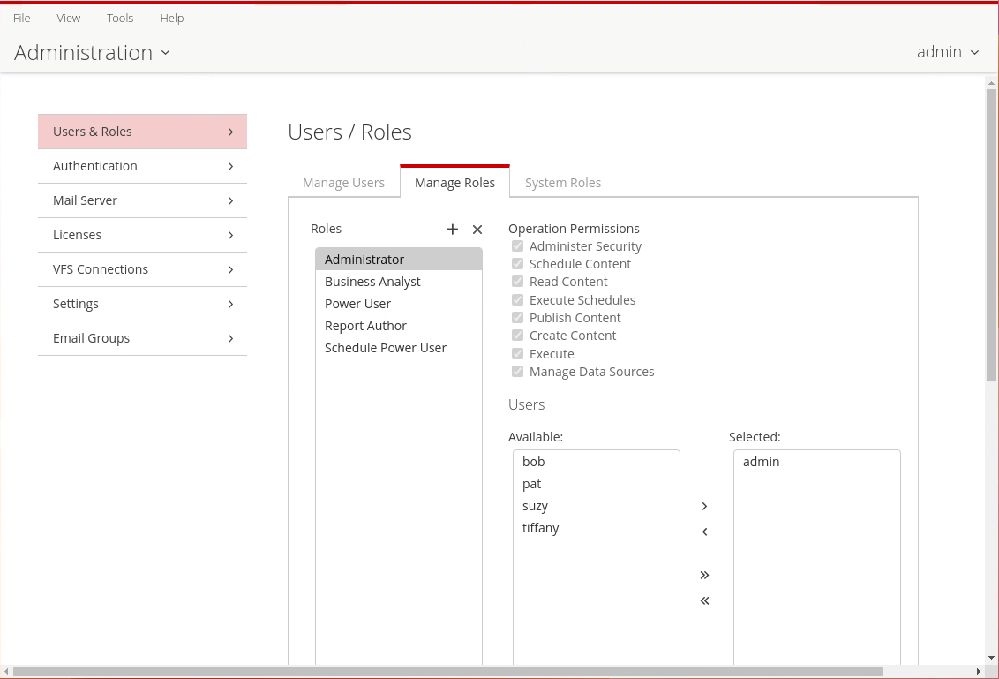
<figcaption>Manage Roles</figcaption>
</figure>
</div>

> **Success:** Checkpoint: all eight operation permissions are selected for **Administrator**, the same eight the table above lists for `admin`.

You can alter or remove these roles, and create roles based on need. Each default role and sample user comes with a standard set of permissions, which define a specific set of capabilities in the Pentaho tools and the Pentaho Server:

<table><thead><tr><th width="213">Operation Permission</th><th>Definition</th></tr></thead><tbody><tr><td>Administer Security</td><td><p>The default Administrator role automatically conveys full operation permissions to users assigned to that role, even if the check box next to it is cleared. These permissions include the Read Content and Create Content permissions, which are required for accessing the Administration perspective.</p><p>This permission has the following capabilities:</p><ul><li>Access to the Administration perspective of PUC.</li><li>Access and manage all content in the Browse perspective.</li><li>View and work with all user schedules in the Schedules perspective.</li><li>Create server block out times in the Schedules perspective.</li></ul></td></tr><tr><td>Schedule Content</td><td><ul><li>Schedule reports and content.</li><li>View, edit, or delete their own schedules using the Schedules perspective.</li></ul></td></tr><tr><td>Read Content</td><td><ul><li>View content in the Browse perspective.</li><li>View content through the File > Open dialog box.</li></ul></td></tr><tr><td>Execute Schedules</td><td><ul><li>View all scheduled reports from all users.</li><li>Pause and resume all scheduled reports</li><li>Run scheduled reports and content if that user has access to data source material used for the reports.</li></ul></td></tr><tr><td>Publish Content</td><td><p>This permission includes the following capabilities for tools such as Report Designer, Schema Workbench, and Metadata Editor.</p><ul><li>Allows client tools to store reports or data models in the Pentaho Repository.</li><li>When held in conjunction with Write permission on the target folder, upload supported content types. See the <em>Administer Pentaho Data Integration and Analytics</em> document for details.</li></ul></td></tr><tr><td>Create Content</td><td><ul><li>Create, import, delete, and save reports to the repository.</li><li>See a list of data sources which are used to create reports or dashboards.</li></ul></td></tr><tr><td>Execute</td><td>Read and execute transformations and jobs.</td></tr><tr><td>Manage Data Sources</td><td><ul><li>Create, edit, or delete new data sources.</li><li>See a list of data sources that are used to create reports or dashboards.</li><li><p>Also includes the following capabilities while working with Analysis Reports:</p><ul><li>Make inline model editing changes including modifying existing (base) measures.</li><li>Add and edit calculated measures to the data model.</li><li>Hide and show fields.</li></ul></li></ul><p>Note: This operation permission does not include Metadata Editor data sources. </p></td></tr></tbody></table>

:::

::::

:::::

> **Under the hood:**
>
> #### Every folder you selected is a node in a content repository
>
> Browse Files isn't a file share. The Pentaho Server keeps its content
> in a JCR repository (Apache Jackrabbit, configured under
> `pentaho-solutions/system/jackrabbit`): every report, dashboard and
> folder is a node with properties, a version history and an
> access-control list. Creating a folder created a node whose ACL is
> inherited from its parent; adding a Favorite wrote a per-user
> setting, not a copy of anything.
>
> The console itself is a browser client of the server's REST API
> (`/pentaho/api/...`). Everything it shows arrives over HTTP, and the
> server checks the ACL on every request — hiding a button never hides
> data. The Schedules perspective lists jobs the server's scheduler
> will run: the same report through the same engine, with its output
> written back into the repository.
>
> **Why it matters:** the console is one client among many — Report
> Designer, Pentaho Data Integration and scripts hit the same API — so a permission set here
> is the permission everywhere.

## Lab Files

_No bundled files for this lab._
