# Sales Territory

> **Warning:**
>
> #### Workshop - Sales Territory
>
> Build a Sales Territory report from the ground up with Pentaho Interactive Reporting, turning raw sales data into an organized report that shows revenue across territories, countries, and customers.
>
> In this workshop, you work through the complete lifecycle of an Interactive Report, from selecting a data source and template to saving the finished report to the repository, with grouping, sorting, filtering, prompts, totals and formatting along the way.
>
> **What you'll do**
>
> * Select a data source and a report template
> * Add data columns (Customer Name, City, Order Date, Order Number, Total) and arrange them
> * Group the report by Territory and Country, and sort it
> * Filter the report, and turn a filter into a prompt
> * Add subtotals and a grand total, and a calculated Tax column
> * Format the title, header, columns and numbers, and switch the page to landscape
> * Save the report to the repository
>
> **Prerequisites:** The **Public > Training** folder from [Pentaho User Console](../04-user-console-puc/guide.md), and the Steel Wheels sample data on the Pentaho Server
>
> **Estimated time:** 20 minutes

<figure>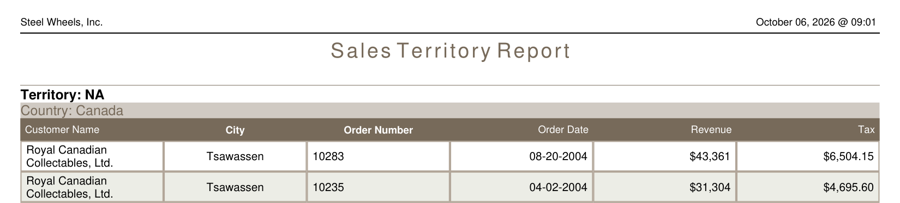<figcaption>
Sales Territory Report
</figcaption></figure>

***

:::: tabs

### 1. Vendor Sales Report

> **Note:**
>
> #### Vendor Sales Report
>
> Start with a finished Interactive Report from the samples. The Vendor Sales Report shows Product Name, Scale, Items Sold, and Sales, grouped by Territory and Product Vendor.
>
> It includes subtotals for each Product Vendor, and the Sales column is formatted as currency with no decimal places.

1. Select **Browse Files**. In the **Folders** pane, select **Public > Steel Wheels**, and in the **Files** pane, double-click **Vendor Sales Report (interactive report)**.

<figure>

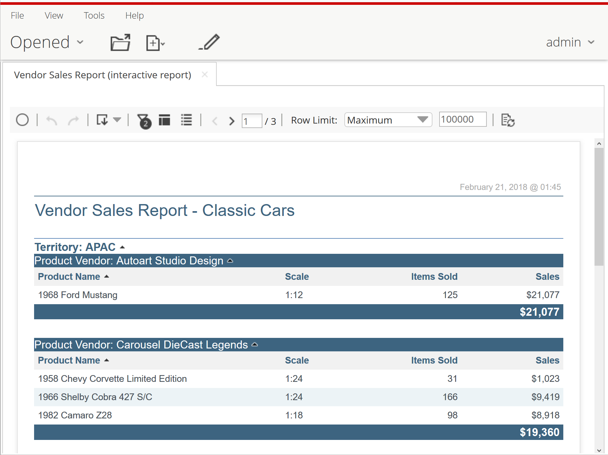

<figcaption><em>The Vendor Sales Report</em></figcaption>

</figure>

> **Success:** Checkpoint: the report opens in its own tab, grouped by Territory and Product Vendor, with a subtotal for each vendor.

The **Interactive Toolbar** above the report has buttons to undo or redo changes, export the report, show the **Filters** or **Layout** panels, create prompts, and move through the report pages.

<figure>

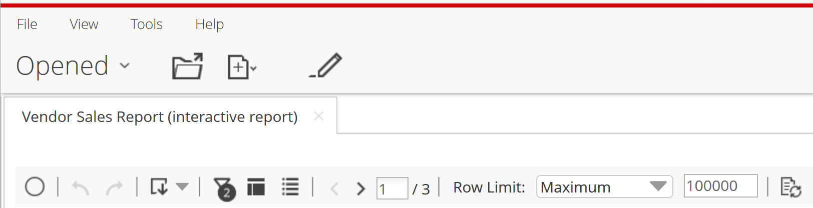

<figcaption><em>The Interactive Toolbar</em></figcaption>

</figure>

2. On the main toolbar, select **Edit Content** to see the fields the report is built from.

<figure>

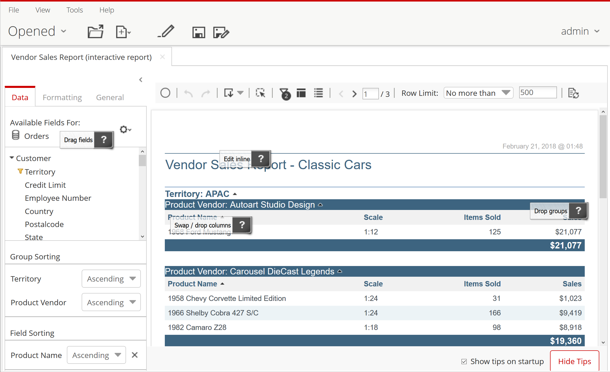

<figcaption><em>Edit mode</em></figcaption>

</figure>

> **Success:** Checkpoint: the report switches to edit mode, and the **Data** tab on the left lists the fields available from the **Orders** data source, with the report's grouping and sorting below them.

The pane on the left also has a **Formatting** tab for individual report elements and a **General** tab for report-wide preferences. In its lower-right corner, **Show tips on startup** and **Hide Tips** control the tips.

3. On the Interactive Toolbar, select the drop-down arrow beside **Export** to see the formats the report exports to.

<figure>

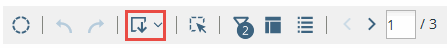

<figcaption><em>Export formats</em></figcaption>

</figure>

4. On the Interactive Toolbar, select **Filters** to show the **Filters** panel.

<figure>

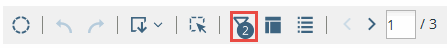

<figcaption><em>The Filters button</em></figcaption>

</figure>

5. On the Interactive Toolbar, select **Layout** to show the **Layout** panel.

<figure>

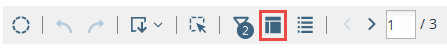

<figcaption><em>The Layout button</em></figcaption>

</figure>

The toolbar also holds **Row Limit**: **Maximum**, or **No more than** a number of rows that you enter.

<figure>

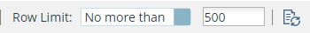

<figcaption><em>Row Limit</em></figcaption>

</figure>

### 2. Sales Territory Report

> **Note:**
>
> #### Sales Territory
>
> One of the standard corporate reports is a breakdown of the total customer revenue by sales territory. This tab builds it, one part per tab below.

<figure>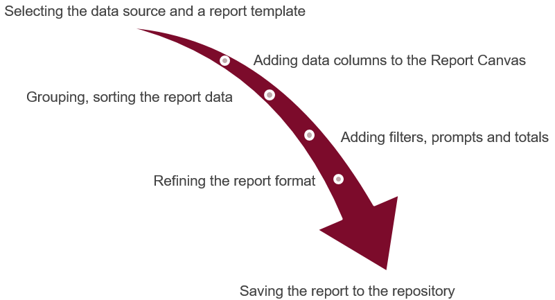<figcaption>
The Interactive Report workflow
</figcaption></figure>

::: tabs

### 1. Data Source & Templates

> **Note:**
>
> #### Data Sources & Templates
>
> The first step in creating an Interactive Report is selecting a data source. Data sources are provided to you by an administrator or authorized user.
>
> A report template sets the report's look. You select one on the **General** tab, which also has **Sticky HTML headers rows**: it freezes the header row when you view the report as HTML (Single Page), like Freeze Top Row in Excel. You can design your own templates in Pentaho Report Designer.

<figure>

<figcaption class="pcm-video-caption">Walkthrough: coming soon</figcaption>

</figure>

***

1. Select the perspective drop-down and select **Home**, then select **Create New > Interactive Report**.

<figure>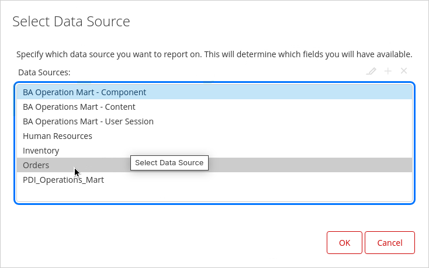<figcaption>
Orders - Data Source
</figcaption></figure>

2. In the **Select Data Source** dialog, select **Orders**, and select **OK**.

> **Success:** Checkpoint: a new report named **Untitled** opens in edit mode, with the **Orders** fields on the **Data** tab and an empty canvas.

3. Open the **General** tab.

> **Under the hood:**
>
> #### Orders is a metadata model, not a database
>
> Nothing in that list is a table. Each entry is a business model from
> a Pentaho Metadata domain — for Steel Wheels, `steel-wheels/metadata.xmi`,
> model `BV_ORDERS` — built in Metadata Editor or generated by the Data
> Source Wizard and published to the server. The model holds business
> tables and columns (names, types, formats, a default aggregation) and
> the relationships between them, which is where the join conditions
> live. Choosing Orders told Interactive Reporting which model to
> query; the database connection behind it belongs to the model, and
> you will never see it.
>
> **Why it matters:** business names and joins are defined once by
> whoever owns the model, and every report built on it inherits them —
> nobody building a report needs to know a key column.

4. Next to **Template**, select **Select...**.

<figure>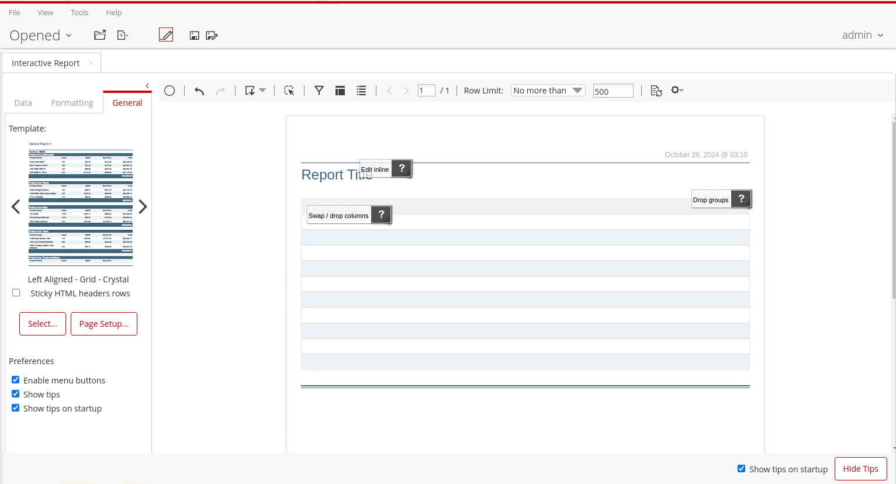<figcaption>
Select - Report Template
</figcaption></figure>

5. Use the left and right arrows to scroll through the templates, and select **Left Aligned - Grid - Nickel**.

<figure>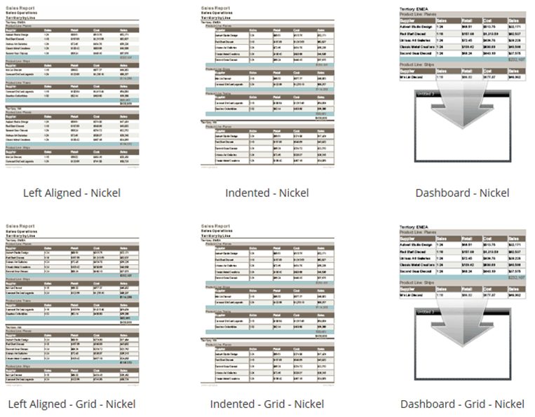<figcaption>
Report Templates
</figcaption></figure>

<figure>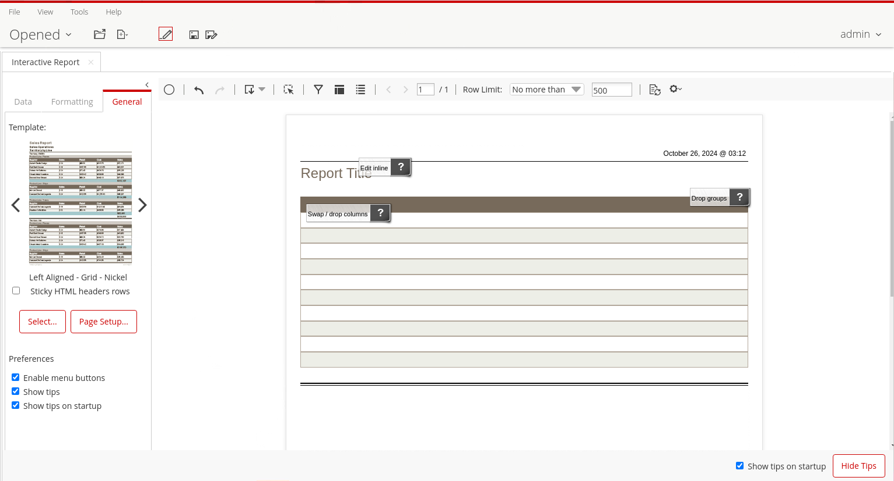<figcaption>
Left Aligned - Grid - Nickel
</figcaption></figure>

> **Success:** Checkpoint: the **General** tab shows **Left Aligned - Grid - Nickel**, and the empty report takes on its brown header band.

### 2. Adding Data

> **Note:**
>
> #### Adding Data
>
> When you first open an Interactive Report, the categories and fields of the data source you selected are listed on the **Data** tab. There are several ways to add a field to the report as a column:
>
> * Drag the field onto the report canvas.
> * Show the **Layout** panel and drag the field to the **Columns** line.
> * Right-click the field on the **Data** tab and select **Add to Columns**.
> * Double-click the field on the **Data** tab.
>
> To add several fields at once, hold `Shift` or `Ctrl` while you select them. As you drag, a blue vertical or horizontal line shows where the field will be placed.

<figure>

<figcaption class="pcm-video-caption">Walkthrough: coming soon</figcaption>

</figure>

> **Tip:** If a drag does not take (it can be fiddly over a remote desktop), every drag in this lab has an alternative. Right-click a field on the **Data** tab and select **Add to Columns** or **Add to Groups**; to remove a column, select the arrow on its header and select **Remove**; to move one, use the same arrow and select **Move**.

***

1. Open the **Data** tab.

<figure>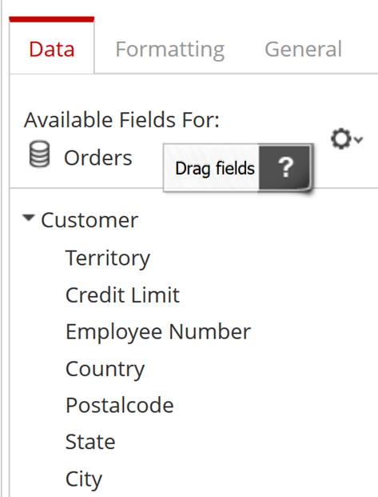<figcaption>
Data Fields
</figcaption></figure>

2. Drag **Country** from the **Data** tab onto the report canvas. A blue vertical line shows where the column will be placed.

<figure>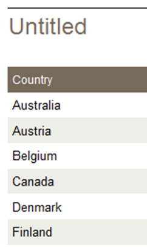<figcaption>
Country as the first column
</figcaption></figure>

> **Success:** Checkpoint: the report has a single **Country** column.

3. Remove **Country** again: drag the **Country** column header to the trash can in the lower-right corner of the canvas, and drop it there.

<figure>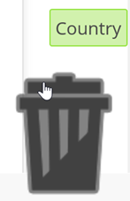<figcaption>
Delete Country
</figcaption></figure>

4. On the Interactive Toolbar, select **Layout** to show the **Layout** panel.

<figure>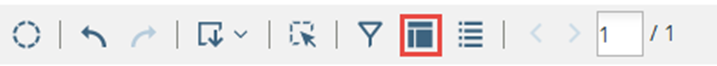<figcaption>
Interactive Toolbar
</figcaption></figure>

5. Drag **Country** from the **Data** tab to the **Columns** line of the **Layout** panel.

<figure>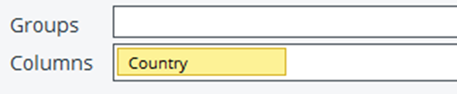<figcaption>
Layout Panel
</figcaption></figure>

6. Drag **City** from the **Data** tab onto the report canvas, and drop it to the *right* of **Country**. The blue line shows whether the field will be a column or a group.
7. On the **Data** tab, double-click **Customer Name**.
8. Select **Order Date**, hold `Ctrl` and select **Order Number** and **Total**, then right-click and select **Add to Columns**.

> **Success:** Checkpoint: the **Columns** line of the **Layout** panel reads **Country**, **City**, **Customer Name**, **Order Date**, **Order Number** and **Total**.

9. On the **Columns** line of the **Layout** panel, drag **Customer Name** *between* **Country** and **City**.

<figure>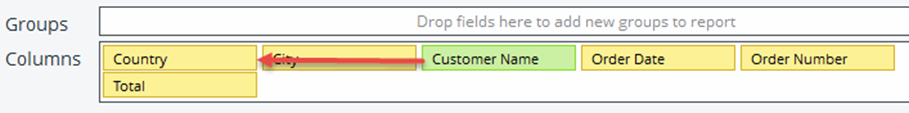<figcaption>
Rearrange Fields in Layout
</figcaption></figure>

10. On the report canvas, drag the **Order Number** column header *between* **City** and **Order Date**.

<figure>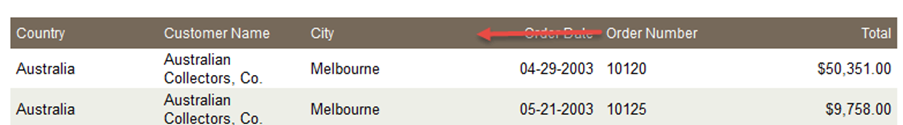<figcaption>
Rearrange Fields on Canvas
</figcaption></figure>

> **Success:** Checkpoint: the columns read **Country**, **Customer Name**, **City**, **Order Number**, **Order Date** and **Total**.

11. Widen **Customer Name**: drag the resize bar *between* the **Customer Name** and **City** column headers to the right.

<figure>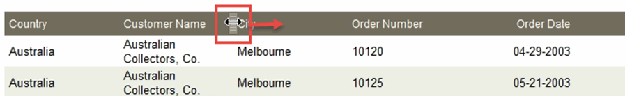<figcaption>
Resize columns
</figcaption></figure>

12. Drag the resize bars of the **Order Number** and **Order Date** columns to make them narrower.

> **Under the hood:**
>
> #### Each column you dropped became a line in an MQL query
>
> Beside the layout, Interactive Reporting keeps a query document
> written in MQL, Pentaho's XML query language for metadata models:
> `<selections>` for the columns, `<constraints>` for filters,
> `<orders>` for sorting, and a row `<limit>`. Every drop edits that
> document and, with Auto Refresh on, re-runs it. The metadata layer
> walks the model's relationships to find a join path between the
> business tables your columns come from, then generates SQL in the
> dialect of the model's database — `SELECT DISTINCT` by default, so
> identical detail rows collapse into one. The canvas shows the result
> of that SQL.
>
> **Why it matters:** six columns from three business tables became
> one correct join without anyone writing it. The join knowledge lives
> in the model, not in the report — change it there and every report
> follows.

### 3. Grouping & Sorting

> **Note:**
>
> #### Grouping & Sorting
>
> Grouping organizes the report by one or more fields. To create a group, drag a field from the **Data** tab and drop it above the column headers on the report canvas: the blue horizontal line shows that the field will be used for grouping.
>
> If the field is already a column in your report, drag its column header up above the other headers. You can also drag a field to the **Groups** line of the **Layout** panel. Nested groups are created by stacking fields on the report canvas, or by adding more fields to the **Groups** line.
>
> You can sort the report by group and by individual column. Groups are sorted in ascending order by default; change the order under **Group Sorting** on the **Data** tab. To sort a column, select the drop-down arrow on its header and select **Sort > Ascending**, **Sort > Descending** or **Sort > None**.

<figure>

<figcaption class="pcm-video-caption">Walkthrough: coming soon</figcaption>

</figure>

***

1. Drag **Territory** from the **Data** tab to the **Groups** line of the **Layout** panel.

<figure>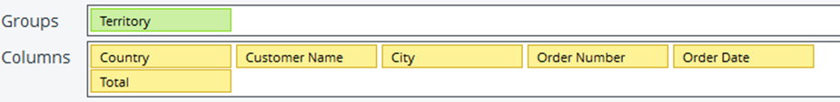<figcaption>
Grouping
</figcaption></figure>

2. On the report canvas, drag the **Country** column header *below* the **Territory** group heading.

<figure>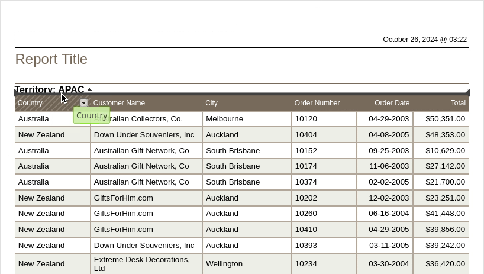<figcaption>
Country sub-group
</figcaption></figure>

> **Success:** Checkpoint: the report is grouped by Territory and then Country, starting with **APAC** and **Australia**. **Territory** and **Country** are on the **Groups** line of the **Layout** panel and under **Group Sorting** at the bottom of the **Data** tab, both **Ascending**.

3. Under **Group Sorting** at the bottom of the **Data** tab, set **Territory** to **Descending**.

<figure>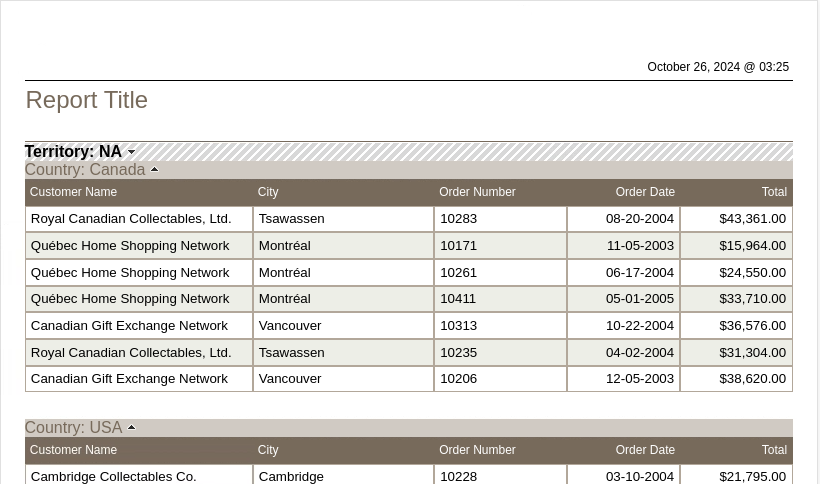<figcaption>
Descending sort on Territory
</figcaption></figure>

> **Under the hood:**
>
> #### Groups belong to the report engine, so the sort belongs to the database
>
> A group here is a group band in the Pentaho Reporting engine — the
> same engine that runs Report Designer output: a header when the value
> changes, a footer when it ends. The engine spots a change by
> comparing consecutive rows, so it needs the rows already ordered by
> the group fields. That is why Territory and Country sit under Group
> Sorting: they go into the query's `<orders>` ahead of any column
> sort, and the database does the ordering (`ORDER BY territory DESC,
> country`, then the column sort you add next). Nothing is re-sorted
> in memory.
>
> **Why it matters:** a million-row report groups correctly with the
> same memory as a hundred-row one — and a column sort can never break
> a group, because group keys always sort first.

4. Select the drop-down arrow on the **Customer Name** column header, and select **Sort > Descending**.

<figure>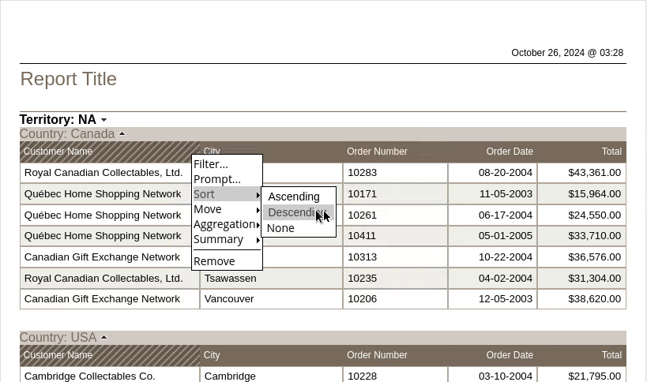<figcaption>
Descending sort on Customer Name
</figcaption></figure>

> **Success:** Checkpoint: **NA** is now the first territory, with **Canada** and then **USA**, and under **Field Sorting** the **Data** tab shows **Customer Name** sorted **Descending**, with an **X** that removes the sort.

<figure>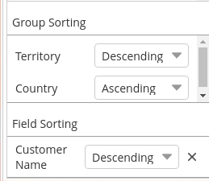<figcaption>
Data tab - sorting
</figcaption></figure>

### 4. Filters & Prompts

> **Note:**
>
> #### Filters
>
> Filters restrict the data a report presents. When you create a filter, you either select values from a list, or specify a condition by typing a value and choosing a constraint. There are several ways to create a filter:
>
> * Show the **Filters** panel and drag a field to it.
> * Select the drop-down arrow on a column header and select **Filter...**.
> * Right-click a field on the **Data** tab and select **Filter...**.
>
> Here you filter the report to the North American (NA) territory, to the USA, and to orders since January 1, 2004.

1. Make the layout match the picture below, with no groups: on the **Layout** panel, drag **Territory** and **Country** from the **Groups** line to the start of the **Columns** line.

<figure><figcaption>
Report layout
</figcaption></figure>

2. On the Interactive Toolbar, select **Filters**.

<figure><figcaption>
Filter
</figcaption></figure>

3. Drag **Territory** from the **Data** tab to the **Filters** panel.

<figure>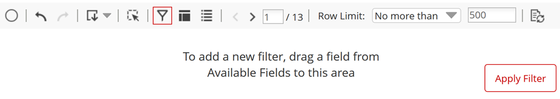<figcaption>
Filter Panel
</figcaption></figure>

4. In the **Filter on Territory** dialog, select **Select from a list**, select **NA** in the list of values, select the right arrow to move it to the **Currently Included** list, and select **OK**.

<figure>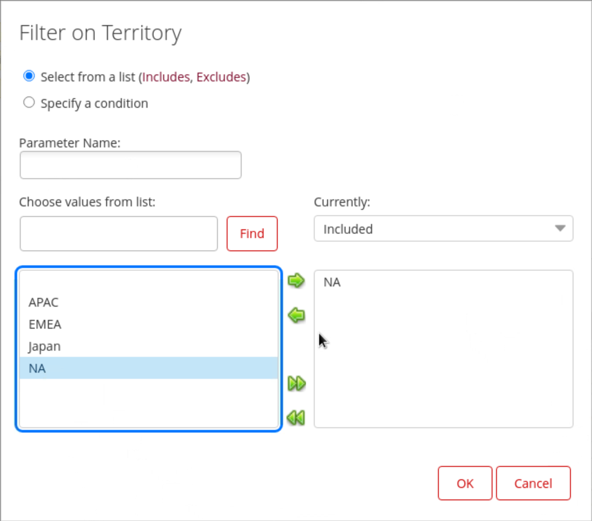<figcaption>
Filter on Territory
</figcaption></figure>

> **Success:** Checkpoint: the **Filters** panel shows **Territory Exactly matches NA**, and the report lists only customers in Canada and the USA.

The filter dialog's **Parameter Name** field turns a filter into a parameter. Dashboard Designer lists the parameter on its **Parameters** tab when you use the report in a dashboard, and Report Designer shows it and lets you edit it.

<figure>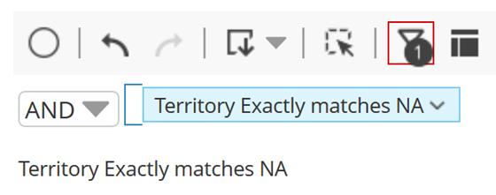<figcaption>
Filter Panel
</figcaption></figure>

5. Drag the **Country** column header to the **Filters** panel.
6. In the **Filter on Country** dialog, select **Specify a condition**, select **Begins with** in the constraint list, enter `US` in the text box, and select **OK**.

<figure>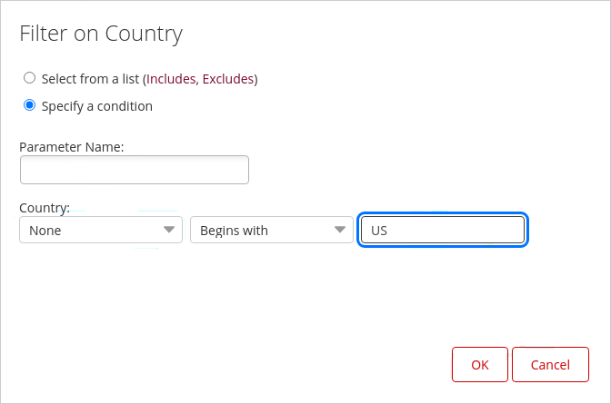<figcaption>
Filter on Country
</figcaption></figure>

7. Drag the **Order Date** column header to the **Filters** panel.

<figure>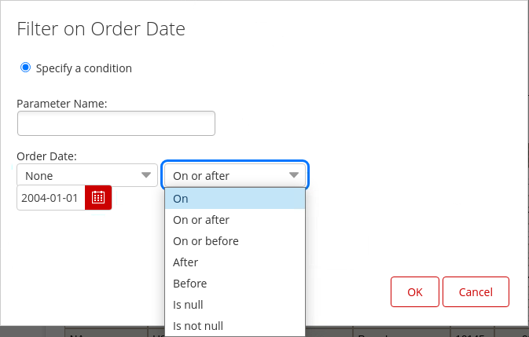<figcaption>
Filter on Order Date
</figcaption></figure>

8. In the **Filter on Order Date** dialog, select **On or after** in the constraint list, enter `2004-01-01` in the date box (or select January 1, 2004 from the calendar), and select **OK**.

> **Success:** Checkpoint: the **Filters** panel lists the Territory, Country and Order Date filters, joined by **AND**, and the report lists only USA customers, with orders from January 1, 2004 on.

Filters are combined with the operator shown at the left of the **Filters** panel:

| Operator | Definition                                                                  |
| -------- | --------------------------------------------------------------------------- |
| AND      | 
Finds records that match both values.

<strong>1 AND 2</strong>
 |
| OR       | 
Finds records that match either value.

<strong>1 OR 2</strong>
 |

A filter icon appears beside each filtered field on the **Data** tab.

<figure>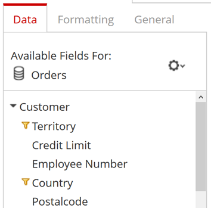<figcaption>
Filter icons on the Data tab
</figcaption></figure>

> **Under the hood:**
>
> #### Three filters became one WHERE clause
>
> Each filter is an MQL `<constraint>`. The three are combined with
> AND, and rendered into the generated SQL's WHERE clause — territory
> equals NA, country `LIKE 'US%'`, order date on or after the first of
> January 2004 — in the dialect of the model's database. Rows that
> don't match never leave the database, which is a different thing
> from a filter applied to a spreadsheet after the fact.
>
> The "Select from a list" values you picked from came from their own
> query, a `SELECT DISTINCT` on that column, capped by the plugin's
> search-list limit (500 by default).
>
> **Why it matters:** filters cost nothing at the report end and save
> everything at the database end. The filter icon on a field in the
> Data panel is the one place to see what the SQL is being asked.

***

**Prompts**

A prompt filters a report interactively: whoever runs the report picks the value. Create a prompt for Territory, keeping the layout as it is.

<figure>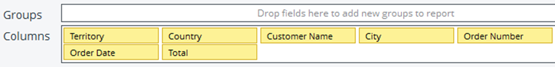<figcaption>
Report Layout
</figcaption></figure>

9. Delete the **Territory** filter and the **Country** filter, and keep **Order Date**: select the drop-down arrow on each filter, and select **Delete**.

<figure>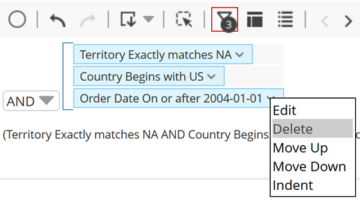<figcaption>
Delete Filters
</figcaption></figure>

10. On the Interactive Toolbar, select **Prompts** to show the **Prompts** panel.

<figure>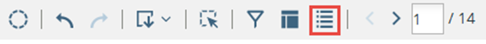<figcaption>
Prompts
</figcaption></figure>

11. Drag **Territory** from the **Data** tab to the **Prompts** panel. The prompt is a drop-down list by default.

<figure>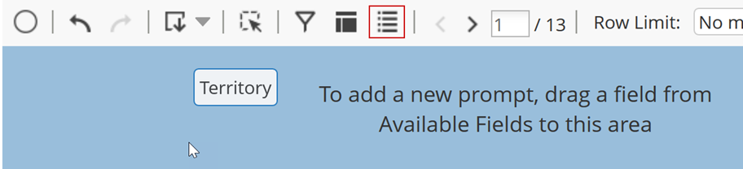<figcaption>
Prompts Panel
</figcaption></figure>

> **Under the hood:**
>
> #### A prompt is a filter whose value arrives at run time
>
> Dragging Territory to Prompts created a report parameter — the same
> parameter framework Report Designer uses, saved in the bundle's data
> definition — whose list of allowed values is itself a small metadata
> query on the Territory column. When you pick NA, the value is bound
> into an MQL constraint before the SQL is generated, so the database
> still does the filtering; only the value comes from the user.
>
> That is also what the **Parameter Name** field above is for: a filter
> defined as a parameter uses the same mechanism, and it is the hook
> Dashboard Designer binds a dashboard prompt to.
>
> **Why it matters:** one report serves every territory. Scheduling, a
> dashboard and a URL link all set the parameter the same way, so there
> is never a second copy of the report to maintain.

12. In the **Territory** prompt's drop-down list, select **NA**.

<figure>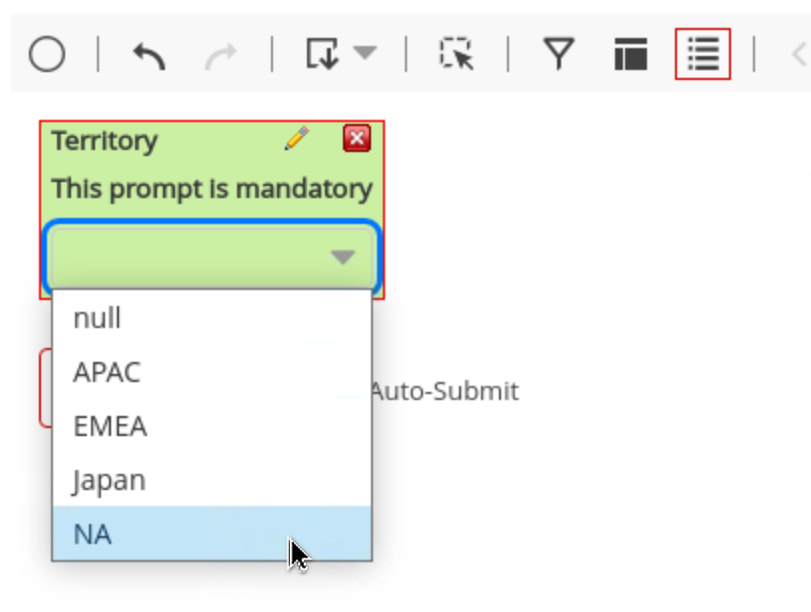<figcaption>
Select Territory = NA
</figcaption></figure>

> **Success:** Checkpoint: the report lists only customers in Canada and the USA, with orders from January 1, 2004 on.

### 5. Totals

> **Note:**
>
> #### Totals
>
> A summary function on a numeric column adds subtotals and grand totals to your report. Select the drop-down arrow on the column header, select **Summary**, and select one of the functions: **None**, **Average**, **Count**, **Count Distinct**, **Maximum**, **Minimum** or **Sum**.
>
> After the total is added to the report, you can enter a label in the cell next to it.

1. In the **Filters** panel, delete both filters: select the drop-down arrow on each, and select **Delete**. Deleting the **Territory** filter also removes its prompt, after you confirm.

<figure>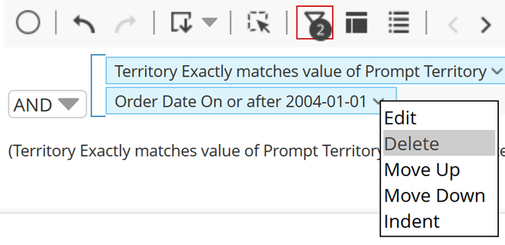<figcaption>
Remove all Filters
</figcaption></figure>

2. Group the report again: on the **Layout** panel, drag **Territory** and then **Country** from the **Columns** line to the **Groups** line.

<figure>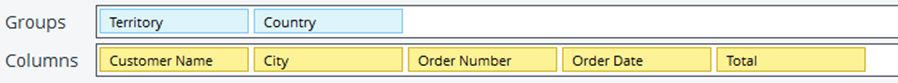<figcaption>
Report layout
</figcaption></figure>

3. Under **Group Sorting** at the bottom of the **Data** tab, check that **Territory** is still **Descending**, and set it again if it is not.
4. On the Interactive Toolbar, select **Filters** to hide the **Filters** panel.
5. Select the drop-down arrow on the **Total** column header, and select **Summary > Sum**.

<figure>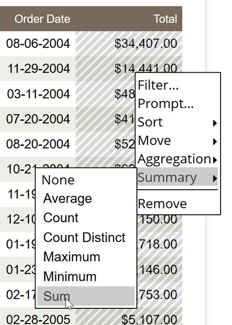<figcaption>
Add Totals
</figcaption></figure>

> **Under the hood:**
>
> #### Totals are computed by the report engine, not the database
>
> The query still returns detail rows. Total arrives summed per row
> (the saved query gives it a SUM aggregation, grouped by the other
> columns), but nothing in the SQL computes a subtotal.
> Choosing Summary > Sum wrote an aggregation function into the
> report's wizard specification — the saved bundle records it as
> `ItemSumFunction` — and at render time the engine runs it as rows
> stream through: reset at each Country footer, again at each Territory
> footer, and once more for the grand total. Average, Count and Count
> Distinct work the same way.
>
> **Why it matters:** totals follow the grouping automatically, three
> levels from one click. And because the engine only holds running
> totals, a report with a hundred thousand detail rows costs no extra
> memory to summarize.

6. Label the country subtotals: double-click the empty cell to the left of the first **Country** subtotal (Canada's), enter `Country Subtotal`, and press `Enter`.

<figure>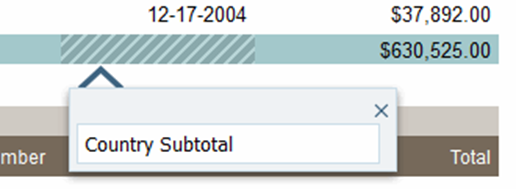<figcaption>
Add caption
</figcaption></figure>

7. Label the territory subtotals the same way with `Territory Subtotal`, and the grand total on the last page with `Grand Total`.

> **Success:** Checkpoint: the first group, Territory NA > Canada, has a Country Subtotal of $224,085.00, and the Grand Total on the last page is $10,644,855.00.

***

**Calculated Fields**

You can create calculated fields from the fields of the data source and from other calculated fields. Each one is added to the **Calculated Fields** list, and you can add it to the columns or groups of the layout. A generic function such as `now()` or `2+5` cannot be added to an empty layout: the layout needs at least one column or group from a data source field first. Filter, Prompt, Sort, and Aggregation are not supported for calculated fields.

8. Scroll to the bottom of the **Data** tab, to the **Calculated Fields** entry.

<figure>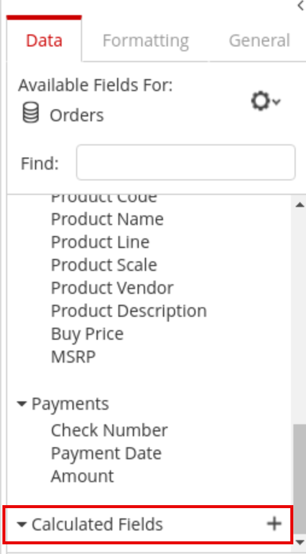<figcaption>
Calculated Fields
</figcaption></figure>

9. Select the **+** beside **Calculated Fields**.
10. In the **Create Calculated Field** dialog, set **Display Name** to `Tax`, enter `=[BC_ORDERDETAILS_TOTAL]*0.15` in **Formula**, and set **Data Format** to **Numeric** (the dialog does not close without a data format). Select **OK**.

<figure>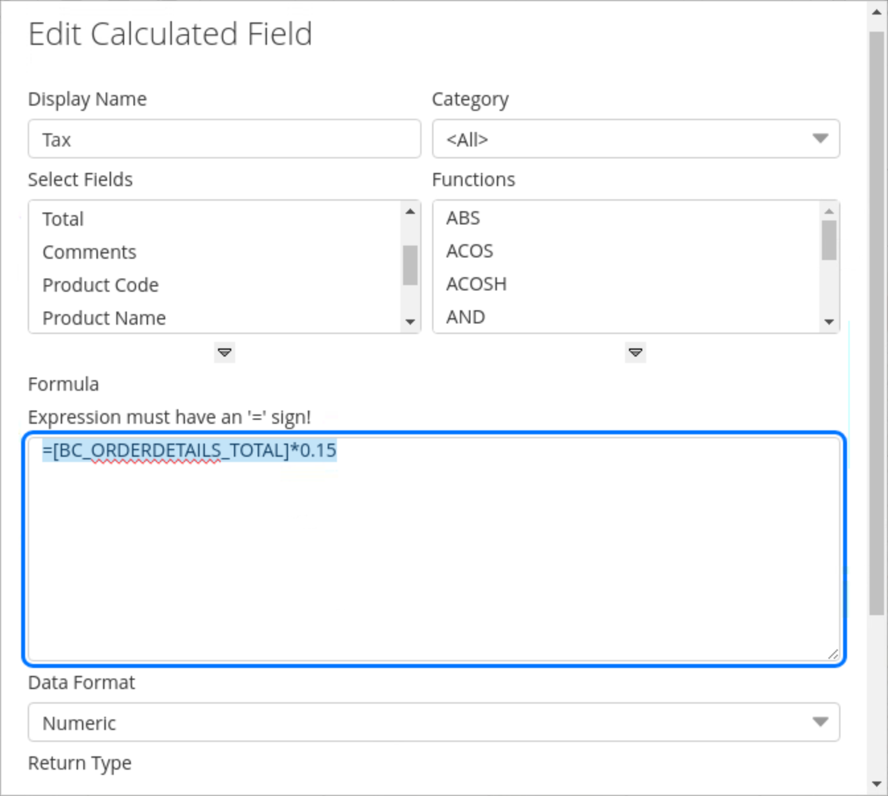<figcaption>
Calculated Measure - Tax
</figcaption></figure>

> **Under the hood:**
>
> #### A calculated field lives in the report engine, which is why it can't filter or sort
>
> `=[BC_ORDERDETAILS_TOTAL]*0.15` is an OpenFormula expression —
> LibFormula, the same library behind Report Designer's formulas —
> evaluated by the reporting engine for every row *after* the data has
> arrived. The database never sees it: there is no Tax column in the
> SQL, so there is nothing for a WHERE, an ORDER BY, a parameter or a
> GROUP BY to reference. That is the whole of the restriction above.
>
> Define the same expression as a formula column in the metadata model
> instead and the metadata layer renders it into the SQL — at which
> point it filters, sorts, prompts and aggregates like any other
> column.
>
> **Why it matters:** quick arithmetic belongs here. Anything two
> reports will share, or anyone will want to filter on, belongs in the
> model — so if you create a lot of calculated fields, add them to the
> model as formula columns.

11. Double-click **Tax** under **Calculated Fields** (or drag it onto the report canvas).

> **Success:** Checkpoint: **Tax** is added as the last column, 15% of each row's **Total**.

### 6. Format & Save

> **Note:**
>
> #### Format & Save
>
> You add a report title, or text in the report header and footer, by double-clicking the label in that area on the first page of the report.
>
> Formatting options such as font, font size, color, background color, and text alignment are on the **Formatting** tab, with buttons to copy, paste, and remove formatting. Select the object in the report first: the buttons that apply to it become active. Numeric values take a **Numeric Format** there too, such as a currency symbol; formatting that comes from the data source's metadata can be overridden.
>
> Interactive Reporting starts with a Letter page (8.5 x 11 in) in portrait. The **Page Setup...** button on the **General** tab changes the page format, orientation, and margins.
>
> To finish the report, you:
>
> * add a title and center it
> * add text to the report header
> * format column headers and data
> * format the Total and Tax columns as currency, and rename Total
> * change the page layout to landscape

1. Double-click **Untitled** in the title area, enter `Sales Territory Report`, and press `Enter`.

<figure>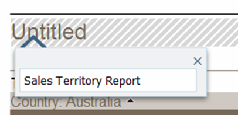<figcaption>
Add a Report Title
</figcaption></figure>

2. With the title selected, open the **Formatting** tab, and select **Align Center**.

<figure>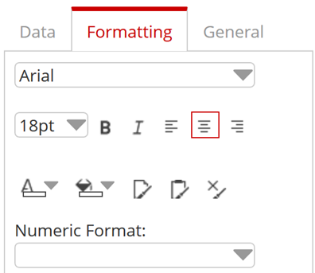<figcaption>
Formatting options
</figcaption></figure>

3. Double-click the *left* side of the header area, enter `Steel Wheels, Inc.`, and press `Enter`.

<figure>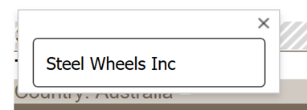<figcaption>
Report Title
</figcaption></figure>

4. Select the **City** column header, and on the **Formatting** tab, select **Bold** and then **Align Center**.
5. Select a cell in the **City** column, and select **Align Center**.

<figure>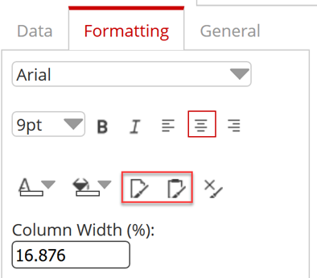<figcaption>
Copy and paste formatting
</figcaption></figure>

6. Copy the **City** header's formatting to the **Order Number** header: select the **City** column header, select **Copy formatting**, select the **Order Number** column header, and select **Paste formatting**.
7. Select a cell in the **Total** column, and set **Numeric Format** to **$#,###**.
8. Select a cell in the **Tax** column, set **Numeric Format** to **$#,###.00**, and select **Align Right**. Then select the **Tax** column header, and select **Align Right**.
9. Double-click the **Total** column header, enter `Revenue`, and press `Enter`.
10. Open the **General** tab, select **Page Setup...**, select **Landscape**, and select **OK**.

<figure>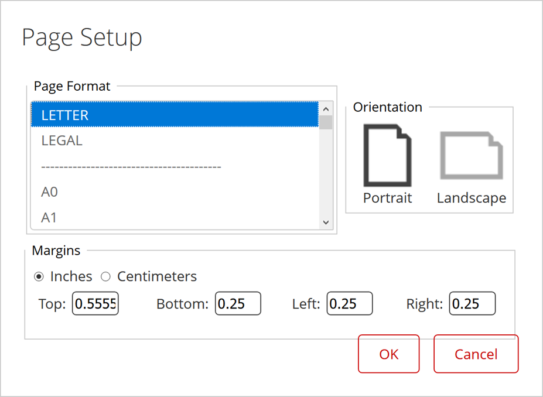<figcaption>
Page setup
</figcaption></figure>

> **Success:** Checkpoint: the centered title reads **Sales Territory Report**, the header reads **Steel Wheels, Inc.**, the **Revenue** column shows whole dollars and **Tax** shows cents, and the page is landscape.

***

You save a report with the **Save** or **Save As** toolbar icons, or with **File > Save** or **File > Save As**. Either way you give it a filename and a repository location.

11. On the toolbar, select the **Save** icon.

<figure>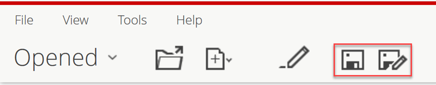<figcaption>
The Save and Save As icons
</figcaption></figure>

12. In the **Save As** dialog, set **Filename** to `Sales Territory Report - Demo`. Select the **Up One Level** icon twice, double-click **Public**, double-click **Training**, and select **Save**.

<figure>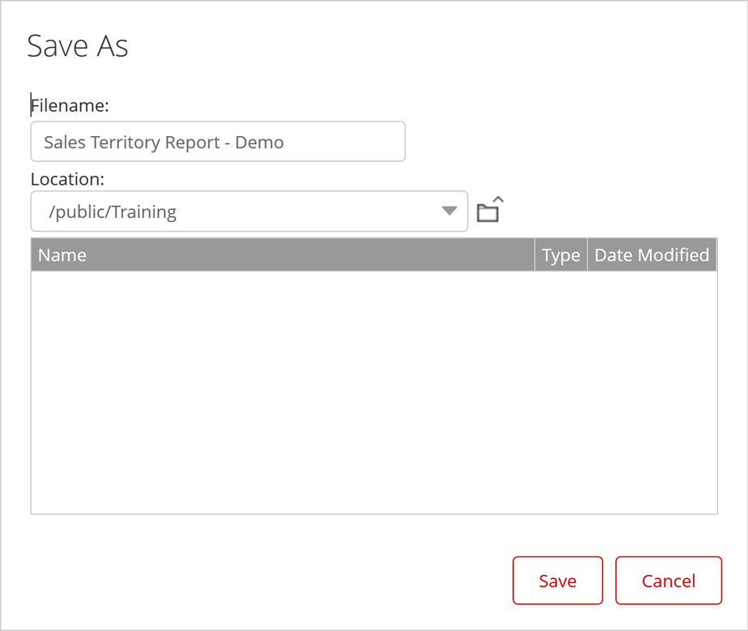<figcaption>
Save Report
</figcaption></figure>

> **Under the hood:**
>
> #### What you saved is a bundle of definitions, not a snapshot
>
> A `.prpti` is a zip. Inside: `layout.xml` and `styles.xml` for what
> you formatted, `wizard-specification.xml` for the columns, groups and
> summaries, `datadefinition.xml` for prompts, and
> `datasources/pmd-ds.xml` holding the MQL query and the model it
> targets. No rows. Opening the report re-runs the query, so it always
> shows current data — which is also why it can be scheduled and
> emailed, and why Report Designer can open it: it reads the same
> bundle format, and once it adds things the wizard can't express, the
> file becomes a `.prpt` that Interactive Reporting no longer edits.
>
> The repository stored it as a node under Public/Training, inheriting
> that folder's permissions.
>
> **Why it matters:** a report is a small, versionable definition —
> copy it, share it, re-point it at another model — and it never
> carries data anywhere it shouldn't.

13. Select the perspective drop-down, select **Browse Files**, and in the **Folders** pane select **Public > Training**.

> **Success:** Checkpoint: **Sales Territory Report - Demo** is listed in the **Files** pane.

:::

### 3. Query Settings

> **Note:**
>
> #### Query Settings
>
> The **Query Settings** dialog opens from the **Data** tab. It holds the settings that control the query behind the report:
>
> * **Row limit and query timeout.** You can limit the number of rows the report displays, and the number of seconds a query runs before it times out. Row limits and timeouts avoid out-of-memory errors, and processes that consume too many resources on the database server.
> * **Auto-Refresh.** With **Auto-Refresh** cleared, you design the report layout first, including calculations and filtering, without querying the database. When the layout is complete, select **Auto-Refresh** again: the data is retrieved once and the report displays it. Clear it to reduce the number of queries run against the data source, or when you know the data source returns data slowly.

<figure>

<figcaption class="pcm-video-caption">Walkthrough: coming soon</figcaption>

</figure>

1. On the **Data** tab, select the small icon in the upper-right corner to open the **Query Settings** dialog.

> **Success:** Checkpoint: the **Query Settings** dialog opens, with **Select Distinct**, **Query Timeout** and **Auto-Refresh** among its settings.

2. Close the dialog without changing anything.

> **Under the hood:**
>
> #### Row limit, timeout and Auto Refresh all act on the query, not the display
>
> The row limit is written into the MQL `<limit>` and rendered as the
> database's own limit clause where the dialect has one, so the
> database stops after that many rows. Interactive Reporting applies
> a starting row limit of 500 and a ceiling of 10,000 rows in edit and view
> mode that only an administrator can raise (query-limit in the plugin's
> settings.xml). The timeout is handed to the JDBC driver as a statement
> timeout, which cancels a runaway query on the database side rather
> than abandoning it in the browser. Auto Refresh off means the
> MQL keeps being edited with every drop but is not executed until you
> turn it back on.
>
> **Why it matters:** the query is the expensive part. Design against
> a small slice, then lift the limit for the real run — and remember
> that a limit truncates *before* totals are computed.

::::

---

## Lab Files

Click a file to download it.

### Solution <!-- no-step -->

The finished report for this lab: grouped by Territory and Country, with the three totals, the Tax calculated field, the formatting and the landscape page. Open it alongside your own to compare.

Also on disk at `C:\Workshop-BA-Practitioner\03-interactive-reports\06-interactive-reports-sales-territory\solution`.

[Sales Territory Report - Demo.prpti](./files/Sales%20Territory%20Report%20-%20Demo.prpti)

To open it in the User Console:

1. In **Browse Files**, select your own folder under **Home** (Home > admin, say), so the solution sits apart from your own report in Public > Training.
2. In the **Folder Actions** pane, select **Upload...**, select **Browse...** and choose the `.prpti` file, and then select **OK**.
3. If the file is not listed under **Files** yet, select the **Refresh** icon (the circular arrow beside **Folders**).
4. Double-click **Sales Territory Report - Demo** to run it, and select **Edit** on the toolbar to see how it is built.
