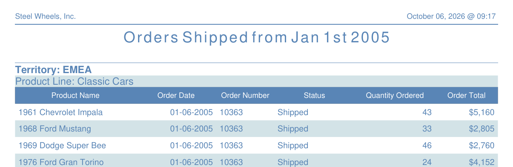
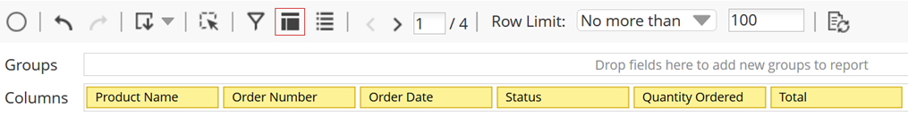
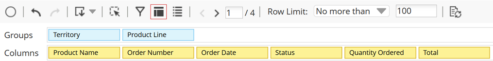
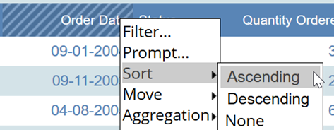
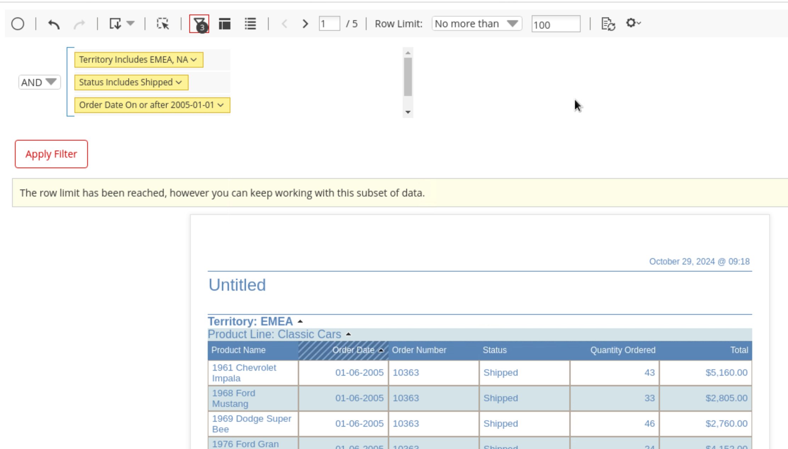
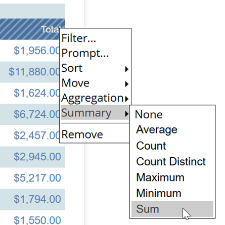
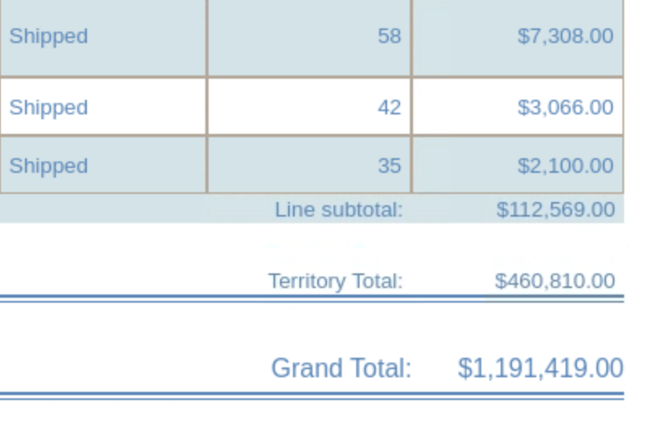
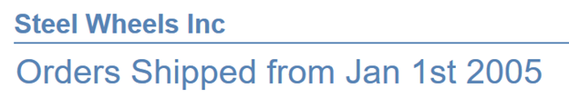
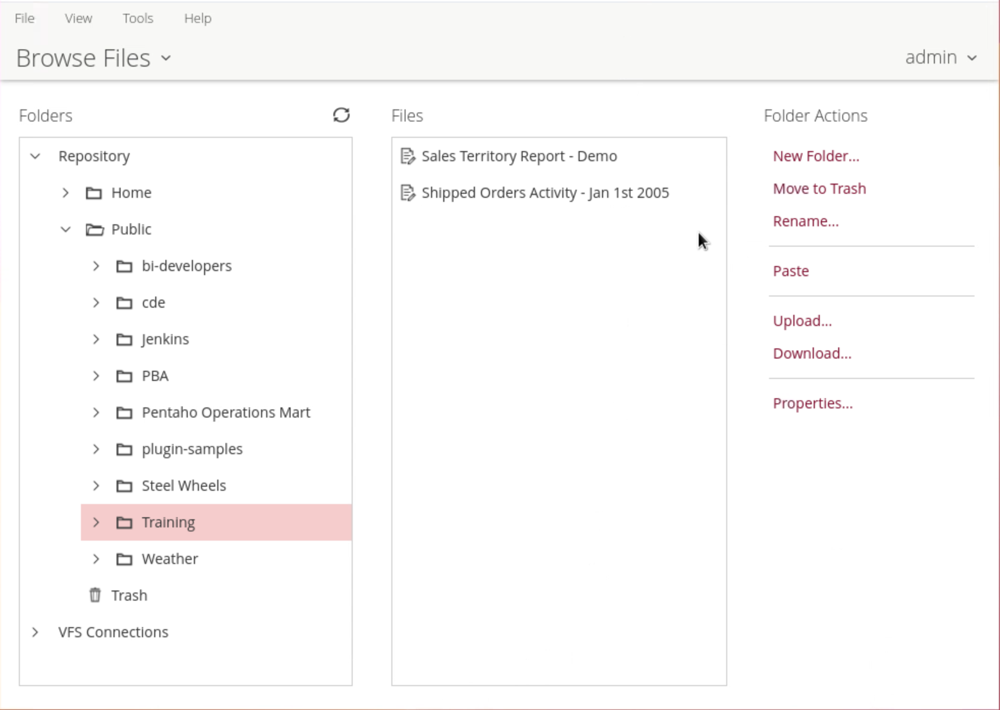

# Orders — NA and EMEA

> **Warning:**
>
> #### Workshop - Orders — NA and EMEA
>
> Business reporting often means filtering data to specific regions and time periods to support decision-making. In this workshop, you build a filtered report for Steel Wheels showing order details for the EMEA and NA territories, for orders shipped on or after January 1, 2005.
>
> It extends your Interactive Reporting skills with multiple filters, nested groups, and summary totals at several levels.
>
> **What you'll do**
>
> * Start a report on the Orders data source with the Left Aligned - Cobalt template
> * Add and reorder six columns: Product Name, Order Date, Order Number, Status, Quantity Ordered and Total
> * Group by Territory and Product Line, and sort by Order Date
> * Filter to Shipped orders from EMEA and NA on or after January 1, 2005
> * Add labeled subtotals and a grand total, and see what a row limit does to them
> * Format the title, header, columns and currency, and save the report to Public > Training
>
> **Prerequisites:** [Sales Territory](../06-interactive-reports-sales-territory/guide.md), and the **Public > Training** folder from [Pentaho User Console](../04-user-console-puc/guide.md)
>
> **Estimated time:** 20 minutes

<figure><figcaption>
Orders Shipped
</figcaption></figure>

***

::: tabs

### 1. Data Source & Data

> **Note:**
>
> #### Data Source and Columns
>
> Start a new report on the Orders data source with the Left Aligned - Cobalt template, limit it to 100 rows while you design it, and add its six columns.

1. Select the perspective drop-down and select **Home**, then select **Create New > Interactive Report**.
2. In the **Select Data Source** dialog, select **Orders**, and select **OK**.
3. Open the **General** tab, and next to **Template**, select **Select...**.
4. Use the left and right arrows to scroll through the templates, and select **Left Aligned - Cobalt**.
5. On the Interactive Toolbar, set **Row Limit** to **No more than**, and enter `100` in the box.

> **Success:** Checkpoint: the **General** tab shows **Left Aligned - Cobalt**, and **Row Limit** reads **No more than** `100`.

***

Next, add Product Name, Order Number, Order Date, Status, Quantity Ordered, and Total to the report.

> **Tip:** If a drag does not take, use the alternatives: double-click a field to add it as a column, or right-click it and select **Add to Columns**, **Add to Groups** or **Filter...**.

6. Open the **Data** tab.
7. Drag **Product Name** from the **Data** tab onto the report canvas.
8. Drag **Order Number** onto the report canvas, and drop it to the *right* of **Product Name**.
9. Hold `Ctrl` and select **Order Date**, **Status**, **Quantity Ordered**, and **Total**. Right-click and select **Add to Columns**.
10. On the Interactive Toolbar, select **Layout**.
11. On the **Columns** line of the **Layout** panel, drag **Order Date** *between* **Product Name** and **Order Number**.

<figure><figcaption>
Report layout
</figcaption></figure>

> **Success:** Checkpoint: the columns read **Product Name**, **Order Date**, **Order Number**, **Status**, **Quantity Ordered** and **Total**.

### 2. Group, Sort & Filter

> **Note:**
>
> #### Groups, Sort and Filters
>
> Group the report by Territory with a Product Line subgroup, sort it by Order Date, and filter it to shipped orders on or after January 1, 2005 for EMEA and NA.

1. Drag **Territory** from the **Data** tab onto the report canvas, and drop it *above* the column headers.
2. Drag **Product Line** from the **Data** tab onto the canvas, and drop it *below* the **Territory** group.

<figure><figcaption>
Group - Territory &#x26; Product Line
</figcaption></figure>

> **Success:** Checkpoint: the report is grouped by Territory and then Product Line, starting with **APAC** and **Classic Cars**.

3. Select the drop-down arrow on the **Order Date** column header, and select **Sort > Ascending**.

<figure><figcaption>
Sort - Ascending on Order Date
</figcaption></figure>

4. On the Interactive Toolbar, select **Filters**.
5. Drag **Territory** from the **Data** tab to the **Filters** panel.
6. In the **Filter on Territory** dialog, select **Select from a list**. Hold `Ctrl` and select **EMEA** and **NA** in the list of values, select the right arrow to move them to the **Currently Included** list, and select **OK**.
7. Drag the **Status** column header to the **Filters** panel.
8. In the **Filter on Status** dialog, select **Select from a list**, select **Shipped**, select the right arrow to move it to the **Currently Included** list, and select **OK**.
9. Drag the **Order Date** column header to the **Filters** panel.
10. In the **Filter on Order Date** dialog, select **On or after** in the constraint list, and enter `2005-01-01` in the date box (the calendar button opens at today's month, so typing is quicker than paging back to January 2005). Select **OK**.

<figure><figcaption>
Filters
</figcaption></figure>

> **Success:** Checkpoint: the **Filters** panel lists the Territory, Status and Order Date filters, joined by **AND**, and the report now starts with **EMEA**.

### 3. Totals

> **Note:**
>
> #### Totals
>
> Add a sum to the Total column, lift the row limit so every group is counted, and label the subtotal and grand total lines.

1. Select the drop-down arrow on the **Total** column header, and select **Summary > Sum**.

<figure><figcaption>
Sum - Totals
</figcaption></figure>

2. On the Interactive Toolbar, set **Row Limit** to **Maximum**. The filtered report has 316 rows, so at 100 the later groups and the grand total are missing.

> **Under the hood:**
>
> #### Why the totals look wrong at 100 rows
>
> A row limit is a `<limit>` on the query, so the database stopped
> after 100 rows in `ORDER BY` order — and the summary functions summed
> only what arrived. The first territory's subtotals look plausible;
> later groups are missing or short, with no error anywhere, because
> from the engine's point of view the data ended there. Maximum
> removes your limit (the plugin's own 10,000 default still applies).
>
> **Why it matters:** any total on a limited report is a total of the
> sample. Limits are for designing; take them off before you trust a
> number.

3. Label the Product Line subtotals: double-click the empty cell to the left of the first one (it follows EMEA > Classic Cars, around page 4), enter `Line subtotal:`, and press `Enter`.
4. Label the Territory subtotals the same way with `Territory Total:` (the NA one is on the last page, just above the grand total).
5. Label the grand total on the last page with `Grand Total:`.

> **Success:** Checkpoint: the first Line subtotal (EMEA > Classic Cars) is $324,125.00, the NA Territory Total is $460,810.00 and the Grand Total is $1,191,419.00, so EMEA comes to $730,609.00.

<figure><figcaption>
Totals
</figcaption></figure>

### 4. Refine Report & Save

> **Note:**
>
> #### Refine and Save
>
> Add a report title and header text, size the columns, format the column headers and the Total column, and save the report to the repository.

1. Double-click **Untitled** in the title area, enter `Orders Shipped from Jan 1st 2005`, and press `Enter`.
2. With the title selected, open the **Formatting** tab, and select **Align Center**.
3. Double-click the *left* side of the header area, enter `Steel Wheels, Inc.`, and press `Enter`.

<figure><figcaption>
Title
</figcaption></figure>

4. Select the **Product Name** column header, and on the **Formatting** tab set **Column Width (%)** to `25`, so product names fit on one line. Then select the **Order Number** column header and set **Column Width (%)** to `12`.
5. Select each column header in turn, and select **Align Center**.
6. Select a cell in the **Total** column, and set **Numeric Format** to **$#,###**.
7. Double-click the **Total** column header, enter `Order Total`, and press `Enter`.

> **Success:** Checkpoint: the centered title reads **Orders Shipped from Jan 1st 2005** under **Steel Wheels, Inc.**, product names fit on one line, the column headers are centered, and **Order Total** shows whole dollars.

8. On the toolbar, select the **Save** icon.
9. In the **Save As** dialog, set **Filename** to `Shipped Orders Activity - Jan 1st 2005`. Select the **Up One Level** icon twice, double-click **Public**, double-click **Training**, and select **Save**.
10. Select the perspective drop-down, select **Browse Files**, and in the **Folders** pane select **Public > Training**.

<figure><figcaption>
Reports
</figcaption></figure>

> **Success:** Checkpoint: **Public > Training** holds **Sales Territory Report - Demo** and **Shipped Orders Activity - Jan 1st 2005**.

:::

---

## Lab Files

Click a file to download it.

### Solution <!-- no-step -->

The finished report for this lab: EMEA and NA shipped orders since January 1, 2005, grouped by Territory and Product Line, with the three totals and the formatting above. Open it alongside your own to compare.

Also on disk at `C:\Workshop-BA-Practitioner\03-interactive-reports\07-interactive-reports-orders-na-and-emea\solution`.

[Shipped Orders Activity - Jan 1st 2005.prpti](./files/Shipped%20Orders%20Activity%20-%20Jan%201st%202005.prpti)

To open it in the User Console:

1. In **Browse Files**, select your own folder under **Home** (Home > admin, say), so the solution sits apart from your own report in Public > Training.
2. In the **Folder Actions** pane, select **Upload...**, select **Browse...** and choose the `.prpti` file, and then select **OK**.
3. If the file is not listed under **Files** yet, select the **Refresh** icon (the circular arrow beside **Folders**).
4. Double-click **Shipped Orders Activity - Jan 1st 2005** to run it, and select **Edit** on the toolbar to see how it is built.
