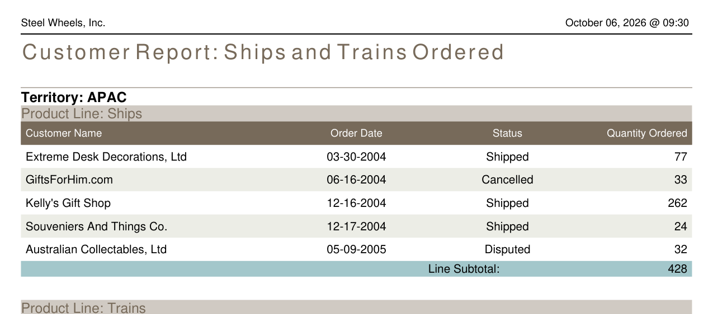

# Ships and Trains

> **Warning:**
>
> #### Workshop - Ships and Trains Ordered
>
> The Steel Wheels sales manager needs visibility into the Ships and Trains product lines. You build a filtered, grouped, and summarized Interactive Report from the manager's requirements, making your own decisions about layout and formatting.
>
> Try it from the guidelines first. The steps after them build one solution, part by part, for when you want to check your work or get unstuck.
>
> **What you'll do**
>
> * Start a report on the Orders data source with the Left Aligned - Nickel template
> * Add Customer Name, Order Date, Status, and Quantity Ordered
> * Filter the report to the Ships and Trains product lines
> * Group by Territory and Product Line, sort by Order Date, and total Quantity Ordered
> * Add text to the page header and footer, and size and align the columns
> * Save the report to Public > Training
>
> **Prerequisites:** [Sales Territory](../06-interactive-reports-sales-territory/guide.md) and [Orders — NA and EMEA](../07-interactive-reports-orders-na-and-emea/guide.md)
>
> **Estimated time:** 20 minutes

<figure>

<figcaption>Report - Ships &#x26; Trains</figcaption>
</figure>

> **Note:**
>
> #### Report Guidelines
>
> * Use the Orders data source and the Left Aligned - Nickel template.
> * Show Customer Name, Order Date, Status, and Quantity Ordered, for the Ships and Trains product lines only.
> * Group by Territory, then Product Line, and sort by Order Date.
> * Show a Quantity Ordered subtotal for each Product Line within each Territory, a subtotal for each Territory, and a grand total.
> * Add text to the page header and footer.
> * Change the column sizes and refine the report format appropriately.
> * Save it as `Ships and Trains Ordered` in **Public > Training**.

Everything here was done in the last two workshops: a Product Line filter (**Select from a list**: Ships and Trains), Territory and Product Line groups, **Sort > Ascending** on Order Date, **Summary > Sum** on Quantity Ordered, and a double-click to label each total.

## Start the Report

1. Select the perspective drop-down and select **Home**, then select **Create New > Interactive Report**.
2. In the **Select Data Source** dialog, select **Orders**, and select **OK**.
3. Open the **General** tab, and next to **Template**, select **Select...**. Scroll to **Left Aligned - Nickel**, and select it.
4. Open the **Data** tab, and double-click **Customer Name**, **Order Date**, **Status**, and **Quantity Ordered**, in that order.

> **Success:** Checkpoint: the report has four columns: **Customer Name**, **Order Date**, **Status** and **Quantity Ordered**.

## Filter, Group and Sort

1. On the Interactive Toolbar, select **Filters**, and drag **Product Line** from the **Data** tab to the **Filters** panel.
2. In the **Filter on Product Line** dialog, select **Select from a list**. Hold `Ctrl` and select **Ships** and **Trains**, select the right arrow to move them to the **Currently Included** list, and select **OK**.
3. Drag **Territory** from the **Data** tab onto the report canvas, and drop it *above* the column headers. Then drag **Product Line** from the **Data** tab, and drop it *below* the **Territory** group.
4. Select the drop-down arrow on the **Order Date** column header, and select **Sort > Ascending**.

> **Success:** Checkpoint: the report is grouped by Territory and then Product Line, starting with **APAC** and **Ships**, and the only product lines are Ships and Trains.

## Add the Totals

1. On the Interactive Toolbar, set **Row Limit** to **Maximum**, so no group is cut short.
2. Select the drop-down arrow on the **Quantity Ordered** column header, and select **Summary > Sum**.

> **Under the hood:**
>
> #### Two sums: one in the SQL, one in the report engine
>
> The saved query gives Quantity Ordered a SUM aggregation, so the
> generated SQL already adds it up, grouped by every other column in
> the report: a row is one customer's order date, status and product
> line, not one order line. The Product Line filter became an `IN`
> constraint in the WHERE clause, and Territory, Product Line and
> Order Date became the ORDER BY. **Summary > Sum** then added the
> report engine's running totals over those rows, reset at each
> Product Line and Territory footer.
>
> **Why it matters:** a detail row is whatever the query groups it
> to. Before you count rows or average a column, check which columns
> the query aggregates.

3. Label the totals: double-click the empty cell to the left of the first Product Line subtotal, enter `Line Subtotal:`, and press `Enter`. Label the first Territory subtotal `Territory subtotal:` and the grand total on the last page `Grand Total:` the same way.

> **Success:** Checkpoint: APAC's Ships subtotal is 428, the first Territory subtotal (APAC) is 567, and the grand total on the last page is 11,317.

## Format and Save

1. Double-click **Untitled** in the title area, enter `Customer Report: Ships and Trains Ordered`, and press `Enter`.
2. Double-click the *left* side of the page header, enter `Steel Wheels, Inc.`, and press `Enter`.
3. Double-click the *left* side of the page footer at the bottom of the page, enter `Prepared for the Sales Manager`, and press `Enter`.
4. Size and align the columns as the solution does: select each column header, and on the **Formatting** tab set **Column Width (%)**, then select the header and a cell of the column and select the alignment:

| Column           | Column Width (%) | Header and cells |
| ---------------- | ---------------- | ---------------- |
| Customer Name    | `40`             | **Align Left**   |
| Order Date       | `20`             | **Align Center** |
| Status           | `25`             | **Align Center** |
| Quantity Ordered | `15`             | **Align Right**  |

5. On the toolbar, select the **Save** icon. In the **Save As** dialog, set **Filename** to `Ships and Trains Ordered`. Select the **Up One Level** icon twice, double-click **Public**, double-click **Training**, and select **Save**.

> **Success:** Checkpoint: the report's pages carry **Steel Wheels, Inc.** at the top and **Prepared for the Sales Manager** at the bottom, and **Ships and Trains Ordered** is saved in **Public > Training**.

---

## Lab Files

Click a file to download it.

### Solution <!-- no-step -->

One finished version of this report: Left Aligned - Nickel, grouped by Territory and Product Line, sorted by Order Date, with labeled subtotals, a grand total, and text in the page header and footer. Yours can differ in layout and wording; the totals should not.

Also on disk at `C:\Workshop-BA-Practitioner\03-interactive-reports\08-interactive-reports-ships-and-trains\solution`.

[Ships and Trains Ordered.prpti](./files/Ships%20and%20Trains%20Ordered.prpti)

To open it in the User Console:

1. In **Browse Files**, select your own folder under **Home** (Home > admin, say), so the solution sits apart from your own report in Public > Training.
2. In the **Folder Actions** pane, select **Upload...**, select **Browse...** and choose the `.prpti` file, and then select **OK**.
3. If the file is not listed under **Files** yet, select the **Refresh** icon (the circular arrow beside **Folders**).
4. Double-click **Ships and Trains Ordered** to run it, and select **Edit** on the toolbar to see how it is built.
