# Sales Analysis

> **Warning:**
>
> #### Workshop - Sales Analysis
>
> Pentaho Analyzer is the OLAP tool for building drag-and-drop analyses that business users explore on demand, drilling from summary to detail without returning to IT.
>
> In this workshop, you explore two sample analyses, then build your own pivot table on the Steel Wheels sample data, showing sales across territories, product lines, and time periods, and extend it with filters, totals, calculations, formatting, charts, and export.
>
> **What you'll do**
>
> * Explore a sample pivot table and heat grid: keep only, drill down, chart, and export
> * Build an analysis from measures and levels on rows and columns
> * Filter it by territory, time, and a Top 5 numeric filter, and apply conditional formatting
> * Add subtotals and grand totals, a % of Sales measure, a calculated measure, and drill-through links
> * Rename and format columns, and save the analysis
> * Explore the export, report, chart, and administration options
>
> **Prerequisites:** The **Public > Training** folder from [Pentaho User Console](../04-user-console-puc/guide.md), and the Steel Wheels sample data with its SteelWheels analysis schema on the Pentaho Server
>
> **Estimated time:** 30 minutes

<div align="center">
<figure>
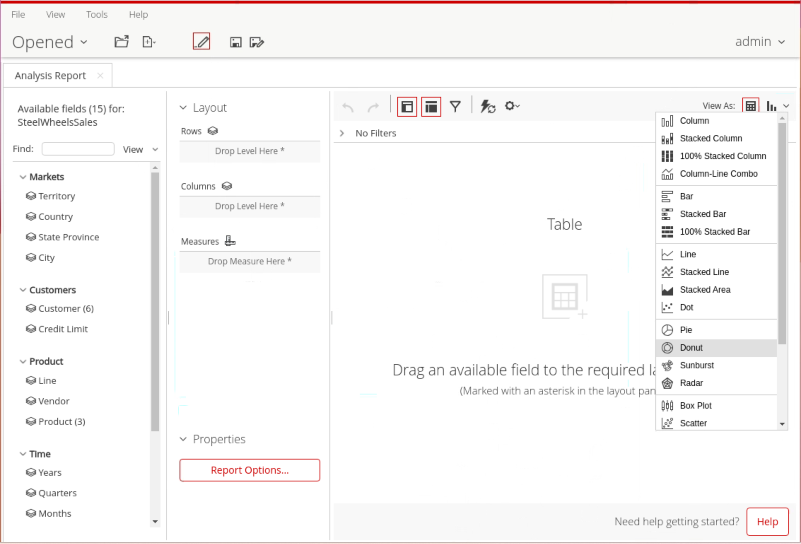
<figcaption>Analyzer Reports</figcaption>
</figure>
</div>

***

:::: tabs

### 1. Leading Product Lines

> **Note:**
>
> #### Leading Product Lines
>
> The Leading Product Lines sample shows Sales, Quantity, and Unit Sales for each year by Territory and Line, with subtotal lines for each Territory and a grand total line. The Quantity column has data bars to compare values at a glance.
>
> The background color of the Unit Sales column follows a color scale, and the values are links that drill down to the supporting data.

1. Select **Browse Files**. In the **Folders** pane, select **Public > Steel Wheels**, and in the **Files** pane, double-click **Leading Product Lines (pivot table)**.

<div align="center">
<figure>
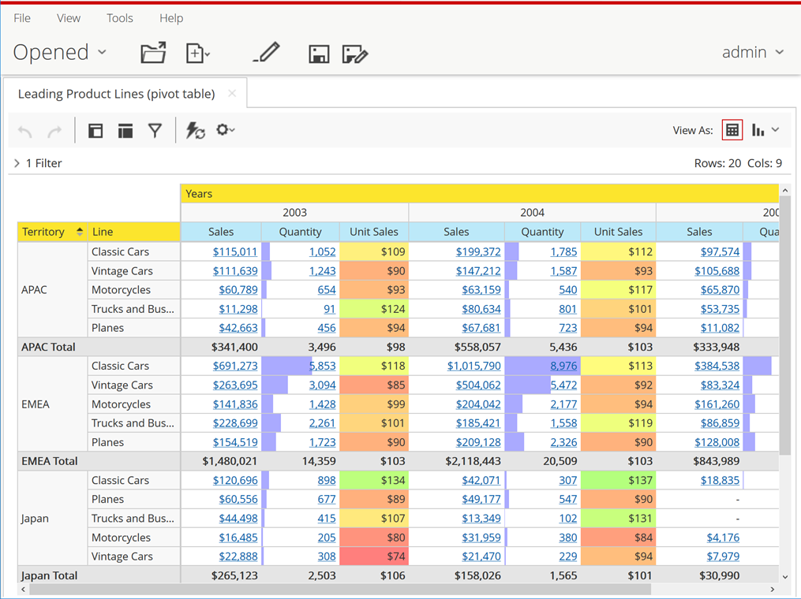
<figcaption>Leading Product Lines</figcaption>
</figure>
</div>

> **Success:** Checkpoint: the analysis opens in its own tab, with Sales, Quantity data bars, and color-scaled Unit Sales by Territory and Line for each year.

The interactive toolbar has toggle buttons to add more fields to the report, rearrange the fields on it, and show the filters in use, and buttons to undo or redo changes. **More actions and options** holds export, report and chart options, and reset.

2. On the toolbar, select **Add more fields onto the report** (`Ctrl+Alt+F`).

<div align="center">
<figure>
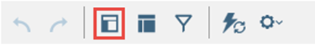
<figcaption>Available fields</figcaption>
</figure>
</div>

The **Available Fields** pane shows the data source and its fields, listed by category. Its **View** drop-down lists them by type (**Measure - Level - Time**) or by **Schema** instead.

3. On the toolbar, select **Rearrange fields on the report** (`Ctrl+Alt+Y`).

<div align="center">
<figure>
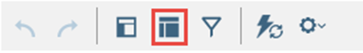
<figcaption>Layout</figcaption>
</figure>
</div>

The **Layout** panel shows the rows, columns, and measures of the report, with **Report Options...** at the bottom.

4. On the canvas, right-click the **2003** column header and select **Keep Only 2003**.

<div align="center">
<figure>
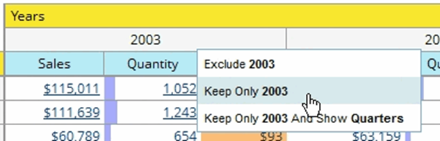
<figcaption>Filter - 2003</figcaption>
</figure>
</div>

5. Double-click the **2003** column header to drill down to the quarters.

<div align="center">
<figure>
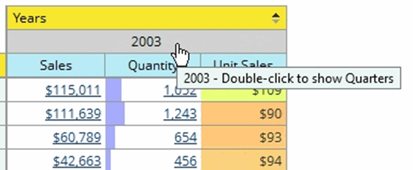
<figcaption>Drill down - Quarters</figcaption>
</figure>
</div>

> **Success:** Checkpoint: only 2003 is left, and its columns are now **QTR1** to **QTR4**.

6. Beside **View As**, open the chart drop-down and select **Column**.

<div align="center">
<figure>
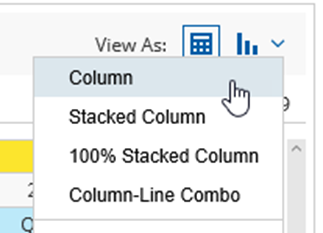
<figcaption>Chart options</figcaption>
</figure>
</div>

> **Under the hood:**
>
> #### Keep Only and drill-down rewrote an MDX query
>
> Analyzer never shows you SQL because its language is MDX. The report
> is a definition — measures, row and column attributes, filters, each
> stored as a schema formula such as `[Time].[Years]` — and every
> gesture edits it and sends a new MDX query to Mondrian, the server's
> OLAP engine. Keep Only 2003 narrowed the column axis to
> `{[Time].[2003]}`; double-clicking asked for `[Time].[2003].Children`,
> the quarters, which exist because the Time hierarchy in the
> SteelWheels schema is Years > Quarters > Months. Mondrian translates
> each MDX statement into SQL against the fact and dimension tables and
> hands back cells. Administration > Log shows exactly that MDX.
>
> **Why it matters:** the hierarchy in the schema is what makes
> drilling a double-click instead of a rebuilt query. Design the schema
> well once and every report inherits the navigation.

7. Beside **View As**, select **Switch to table format** (`Ctrl+Alt+C`).

<div align="center">
<figure>
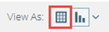
<figcaption>Switch to Table format</figcaption>
</figure>
</div>

***

> **Note:**
>
> #### Chart Types
>
> Analyzer shows an analysis as a table or as one of many chart types. The Country Performance sample is a heat grid: open it and explore it from the top down.

8. On the main toolbar, select **Open**.

<div align="center">
<figure>
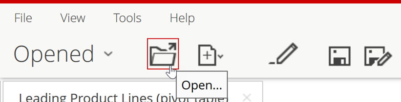
<figcaption>The Open button</figcaption>
</figure>
</div>

9. In the **Open** dialog, select the **Up One Level** icon twice, and double-click **Public**.
10. Double-click **Steel Wheels**, select **Country Performance (heat grid)**, and select **Open**.

<div align="center">
<figure>
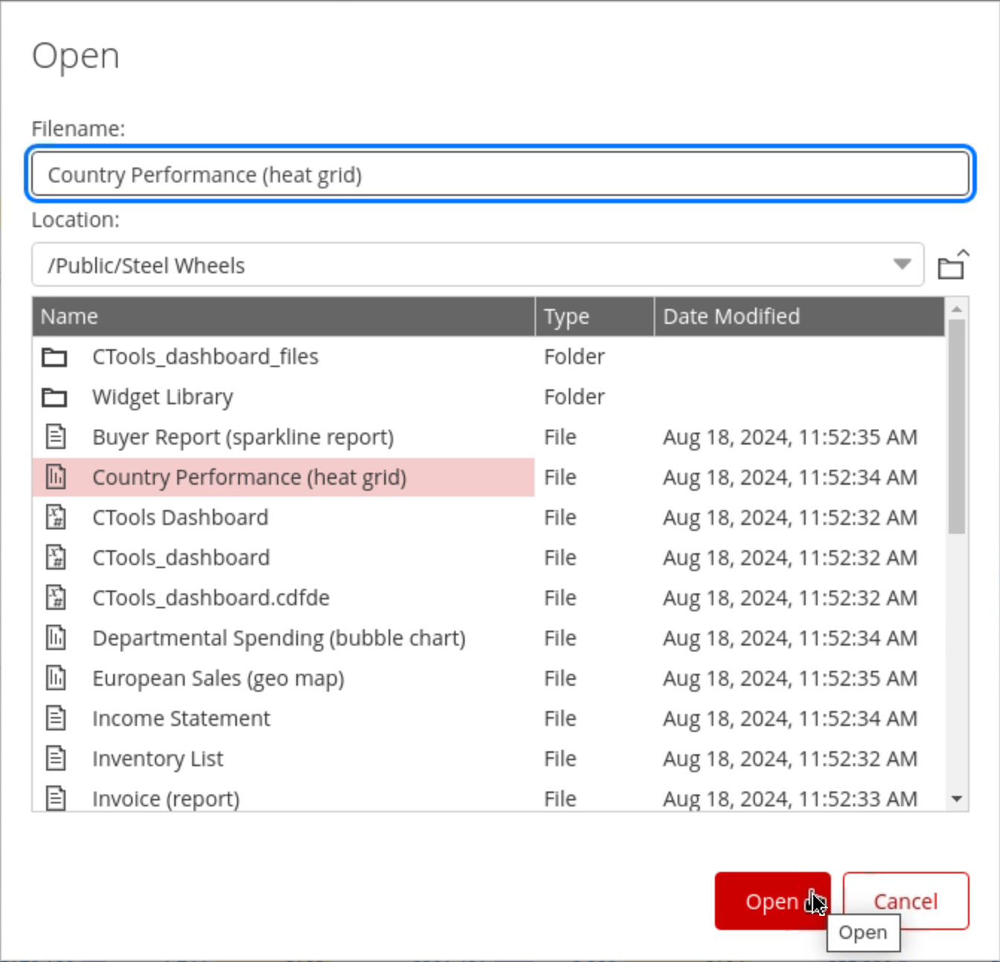
<figcaption>Report List</figcaption>
</figure>
</div>

> **Success:** Checkpoint: the **Country Performance** heat grid opens, with Sales by year and quarter for each country, each square colored from red through yellow to green.

<div align="center">
<figure>
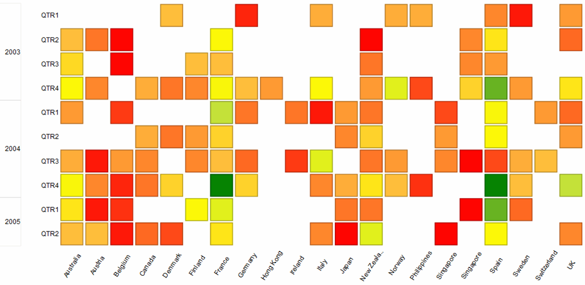
<figcaption>Heat Grid - Country Performance</figcaption>
</figure>
</div>

The colors tell the story at a glance: Belgium's sales have been consistently low and France's fair, France had a good fourth quarter in 2004, and Spain has had several good quarters.

11. Hover over the red square for Belgium, 2003, QTR2 to see its details.

<div align="center">
<figure>
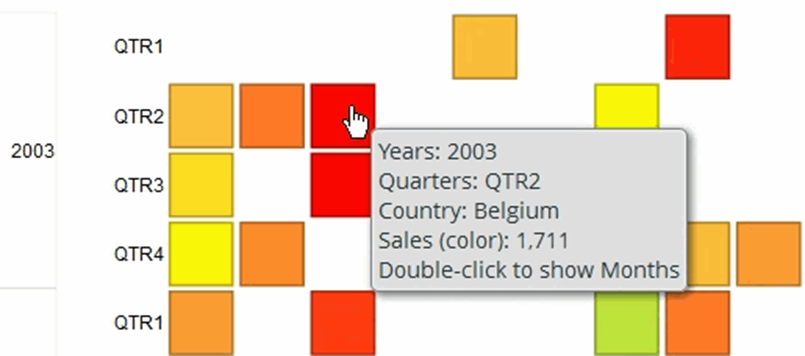
<figcaption>Belgium - 2003 - QTR2</figcaption>
</figure>
</div>

> **Success:** Checkpoint: the tooltip reads Years 2003, Quarters QTR2, Country Belgium, and Sales 1,711.

12. Select the **Spain** label.

<div align="center">
<figure>
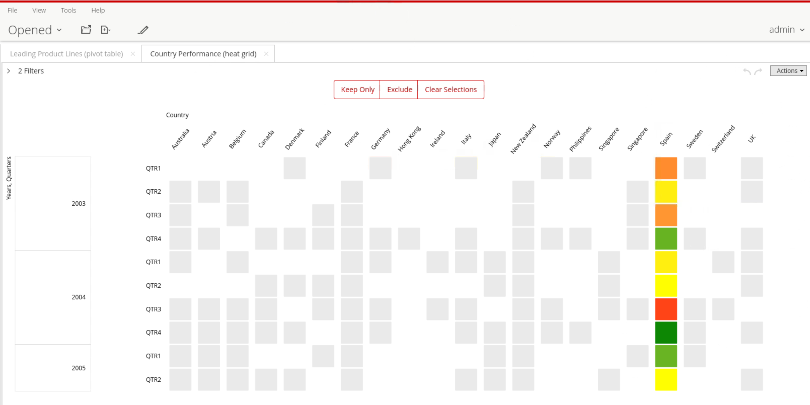
<figcaption>Spain data</figcaption>
</figure>
</div>

> **Success:** Checkpoint: Spain's squares stay in color and the rest of the chart is dimmed. **Keep Only**, **Exclude** and **Clear Selections** appear at the top of the heat grid, to include or exclude the selected data.

13. At the top of the heat grid, select **Keep Only**.
14. On the toolbar, select **Add more fields onto the report** and **Rearrange fields on the report**.

<div align="center">
<figure>

<figcaption>Fields &#x26; Layout</figcaption>
</figure>
</div>

15. To see Spain's sales by product line, drag **Line** from **Available Fields** to the **X-axis** area of the **Layout** panel.

<div align="center">
<figure>
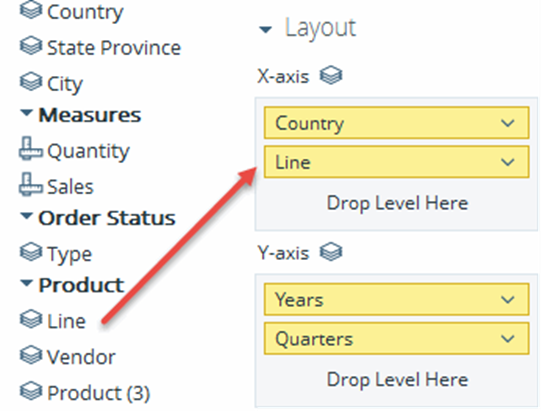
<figcaption>Add Line</figcaption>
</figure>
</div>

> **Success:** Checkpoint: Spain's heat grid splits by product line. Sales of Classic Cars were best in 2005 QTR1, and began to improve in 2004 QTR4.

<div align="center">
<figure>
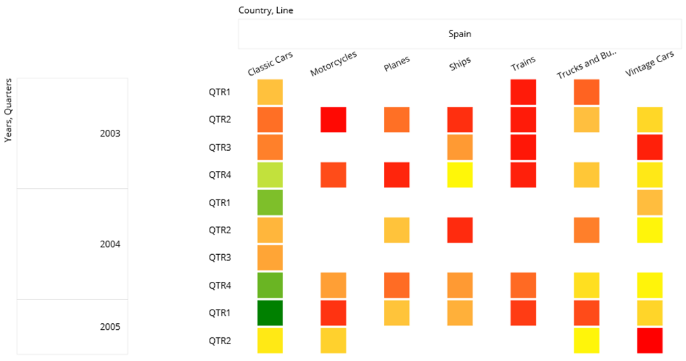
<figcaption>Spain by product line</figcaption>
</figure>
</div>

16. Double-click the green square for Classic Cars, 2004, QTR4 to drill down to the months.

<div align="center">
<figure>
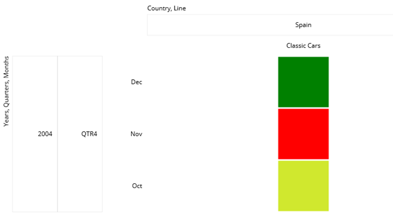
<figcaption>Drill down into Classic Cars, 2004, QTR4</figcaption>
</figure>
</div>

> **Success:** Checkpoint: December was the best month of the quarter.

17. Double-click the green square for December to drill down to the vendors.

<div align="center">
<figure>
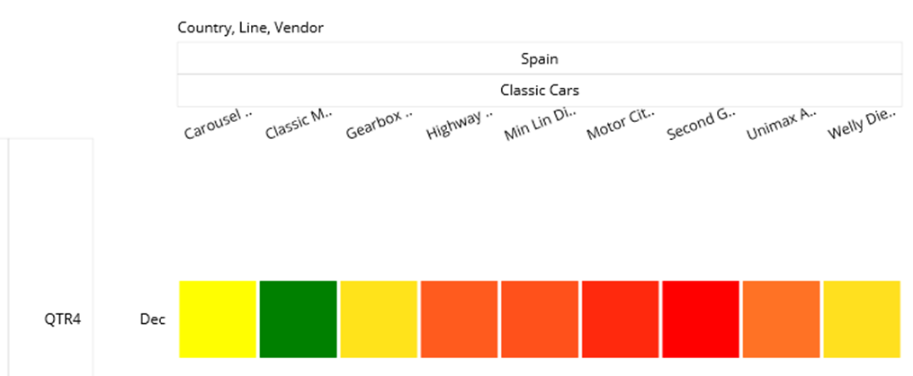
<figcaption>Drill down into December for Vendor</figcaption>
</figure>
</div>

> **Success:** Checkpoint: Classic Metal Creations was the highest-performing vendor.

18. You could keep drilling down, but a table suits exporting the sales data: beside **View As**, select **Switch to table format**.

<div align="center">
<figure>
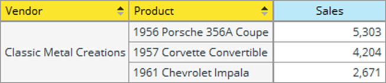
<figcaption>Table</figcaption>
</figure>
</div>

> **Under the hood:**
>
> #### The cells you had already seen were not fetched again
>
> Mondrian keeps a segment cache: blocks of cell values keyed by the
> measure and the members that identify them. When you kept only Spain
> and added Line, then drilled into 2004 QTR4 and into December, only
> the new coordinates — finer levels, this country — needed SQL; the
> coarser cells came from cache, which is why later drills feel faster
> than the first. Switching between heat grid, chart and table doesn't
> query at all: the visualization is drawn in the browser from the same
> result.
>
> **Why it matters:** exploration is cheap after the first query, and
> the cache is shared across users, so the tenth analyst on the same
> cube mostly never touches the database — which is also why Clear
> Cache exists for the moment the data changes.

19. On the toolbar, select **More actions and options**, then **Export > To PDF...**. In the **Export to PDF** dialog, select **Export**.

<div align="center">
<figure>
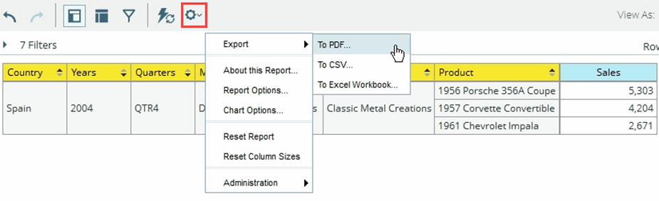
<figcaption>Export as PDF</figcaption>
</figure>
</div>

> **Success:** Checkpoint: the PDF opens in a new browser window, where you can save or print it. The table lists Classic Metal Creations' three products, with Sales of 5,303, 4,204 and 2,671.

20. Close the PDF browser window.
21. On the toolbar, select **More actions and options**, then **Reset Report**.

### 2. Sales Analysis

> **Note:**
>
> #### Sales Analysis
>
> Build your own analysis: Sales Revenue by Territory and Product Line, over time.

<div align="center">
<figure>
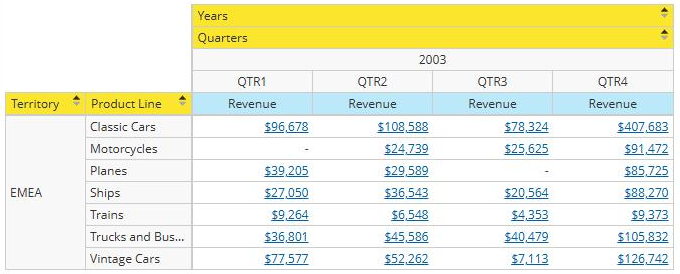
<figcaption>Final Table - EMEA: Revenue by Product Line Yr2003</figcaption>
</figure>
</div>

::: tabs

### 1. Data Source

> **Note:**
>
> #### Data Types
>
> When you first open Analyzer, the fields of the data source you select are listed in the **Available Fields** panel, as measures and levels:
>
> * **Measures** are the numeric data that can be calculated, shown with the ruler icon.
> * **Dimensions** are the different aspects of the calculated data, shown with the stacked squares icon. A number in parentheses next to a dimension means it has associated properties.
> * **Properties** are single data items related to a database object. The schema associates one or more properties with each entity: a product can have color, shape, size, and weight properties.

1. Select the perspective drop-down and select **Home**, then select **Create New > Analysis Report**.
2. In the **Select Data Source** dialog, select **SteelWheels: SteelWheelsSales**, and select **OK**.

<div align="center">
<figure>
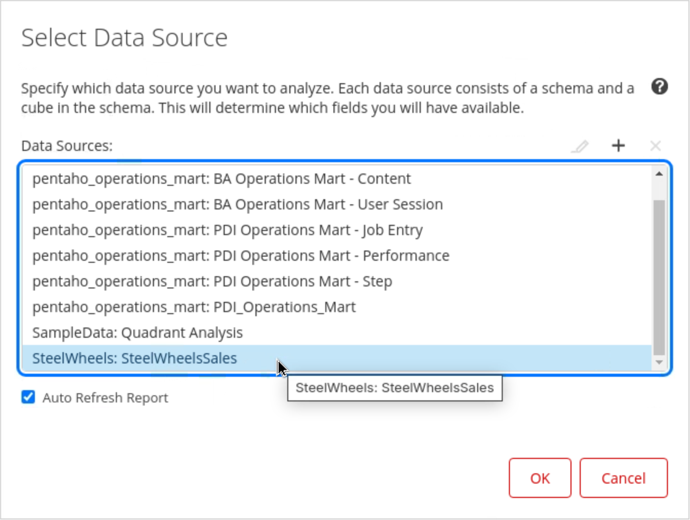
<figcaption>SteelWheels: SteelWheelsSales</figcaption>
</figure>
</div>

> **Success:** Checkpoint: a new, empty analysis opens, with the SteelWheelsSales fields in **Available Fields** and empty **Rows**, **Columns** and **Measures** drop zones.

<div align="center">
<figure>
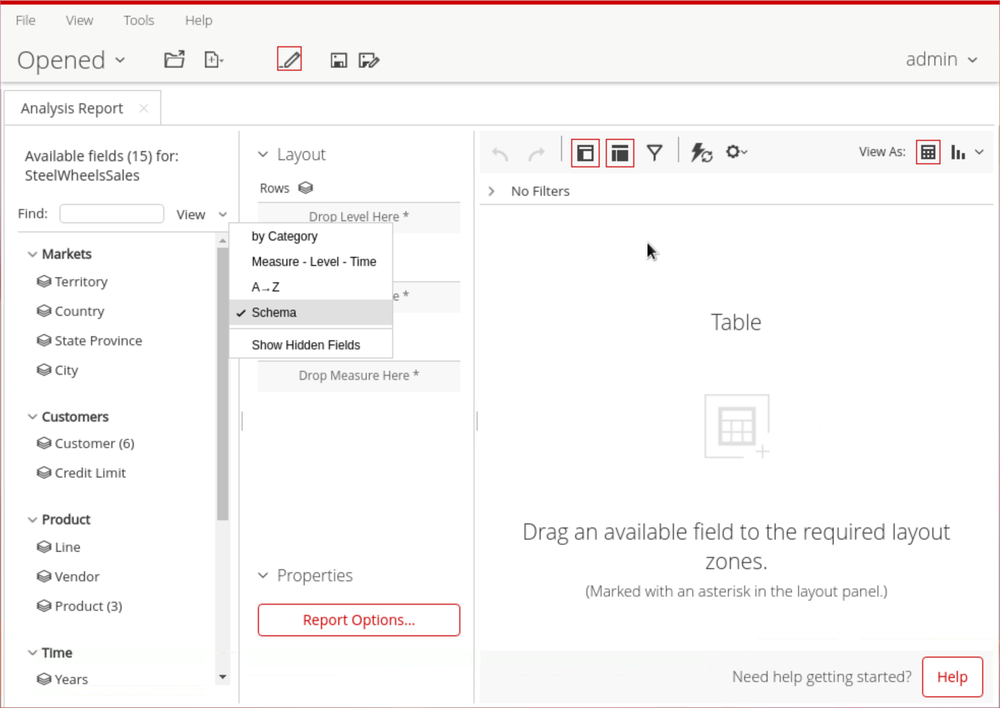
<figcaption>The View drop-down of Available Fields</figcaption>
</figure>
</div>

> **Tip:** Right-click a field and select **Add to Report** to place it without dragging: a level goes to **Rows** (or to **Columns**, under a level of the same hierarchy that is already there) and a measure goes to **Measures**. Moving a level onto **Columns** the first time still needs a drag, to the **Columns** drop zone or onto the column headers.

3. Drag **Country** from the **Available Fields** panel to the **Rows** drop zone of the **Layout** panel.

<div align="center">
<figure>
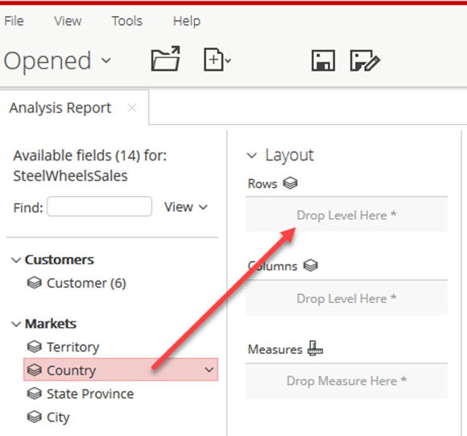
<figcaption>Add Country field</figcaption>
</figure>
</div>

4. Remove **Country** again: drag the **Country** header to the trash can in the lower-right corner of the canvas, and drop it there.

<div align="center">
<figure>

<figcaption>The trash can</figcaption>
</figure>
</div>

5. Drag **Sales** to the **Measures** drop zone of the **Layout** panel.
6. In the **Available Fields** panel, double-click **Territory**.
7. Drag **Years** to the **Columns** drop zone of the **Layout** panel.
8. Drag **Quarters** to the **Columns** drop zone, and drop it *below* **Years**.

<div align="center">
<figure>
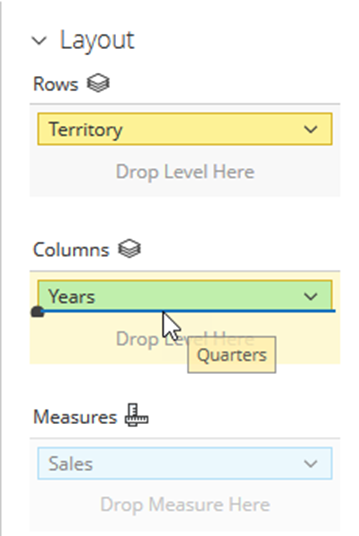
<figcaption>Quarters below Years</figcaption>
</figure>
</div>

9. Drag **Line** to the **Rows** drop zone, and drop it *above* **Territory**.

<div align="center">
<figure>
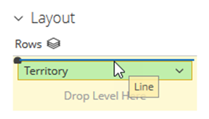
<figcaption>Line above Territory</figcaption>
</figure>
</div>

> **Under the hood:**
>
> #### Aggregation happens in the database, at exactly the levels on your axes
>
> Territory and Line on rows with Years and Quarters on columns
> produced MDX that Mondrian turned into one SQL statement: select
> territory, line, year and quarter with `SUM(total)`, grouped by all
> four, across the fact table and its dimension tables. `SUM` came from
> the measure's aggregator in the schema; the grain came from your
> layout. Moving Line above Territory changed only the axis order, not
> the SQL. That is what "dynamically aggregates" means: the cube
> defines what can be added up, the layout decides at which level, and
> the database does the arithmetic.
>
> **Why it matters:** a hundred-million-row fact table comes back as a
> few dozen cells. The analyst never pays for the rows, only for the
> answer.

10. On the **Layout** panel, drag **Territory** *above* **Line**.

<div align="center">
<figure>
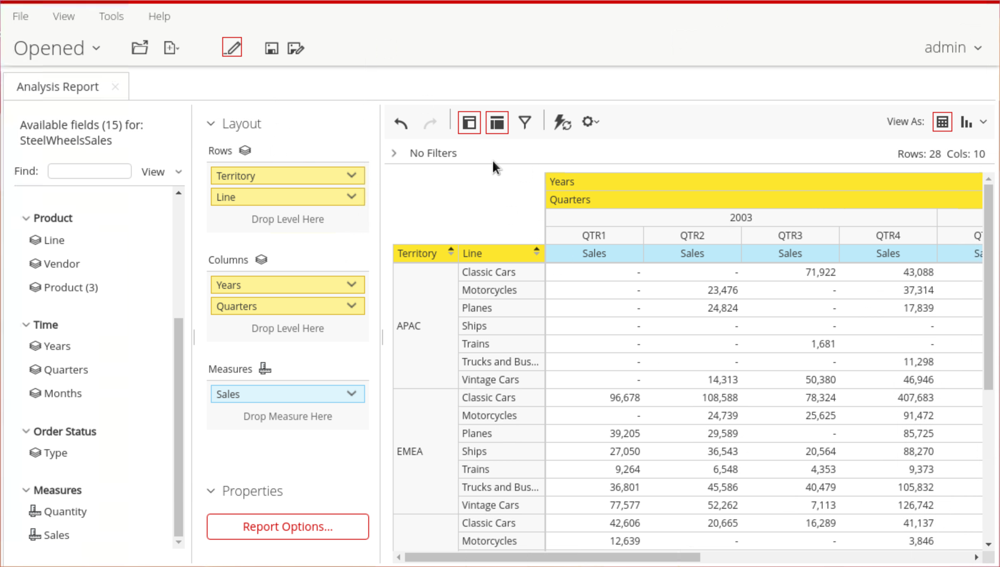
<figcaption>Report - Territory Sales Analysis</figcaption>
</figure>
</div>

> **Success:** Checkpoint: **Rows** holds **Territory** and then **Line**, **Columns** holds **Years** and **Quarters**, and **Measures** holds **Sales**. Analyzer aggregates Sales to each combination as you add fields.

### 2. Filter & Conditional Formatting

> **Note:**
>
> #### Filters
>
> Filters restrict the data an analysis presents. For a text field, you select values from a list, or match a value you type with a constraint (**Contains** or **Doesn't Contain**). For a time period, you choose a commonly used period, select from a list, or select a range.

1. On the toolbar, select **Show all filters in use and add new filters** (`Ctrl+Alt+T`).

<div align="center">
<figure>
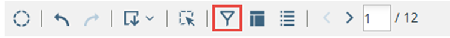
<figcaption>Filter option</figcaption>
</figure>
</div>

2. Drag **Territory** from the **Available Fields** panel to the **Filters** panel.

<div align="center">
<figure>
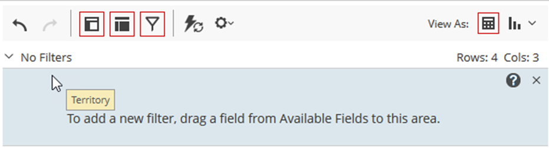
<figcaption>Filter Panel</figcaption>
</figure>
</div>

3. In the **Filter on Territory** dialog, select **Select from a list**, select **EMEA**, select the right arrow to move it to the **Currently Included** list, and select **OK**.

<div align="center">
<figure>
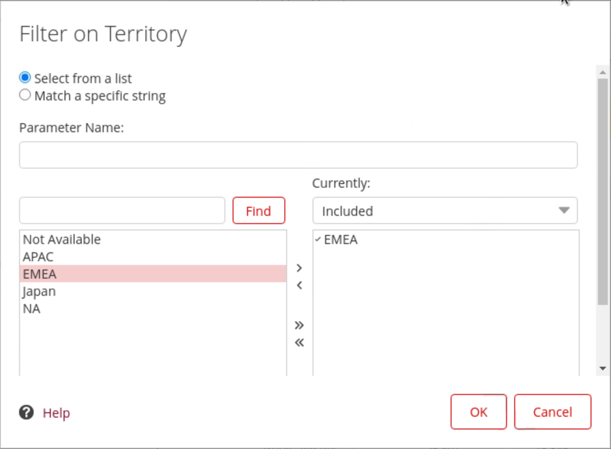
<figcaption>Filter - EMEA</figcaption>
</figure>
</div>

The filter dialog's **Parameter Name** field turns the filter into a prompt.

4. In the **Available Fields** panel, right-click **Years** and select **Filter...**.

<div align="center">
<figure>
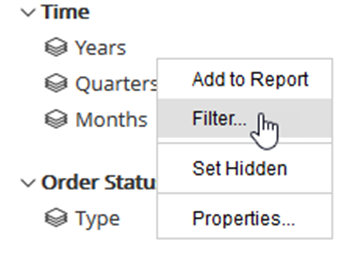
<figcaption>Filter - Years</figcaption>
</figure>
</div>

5. In the **Filter on Years** dialog, select **Select from a list**, select **2003**, select the right arrow to move it to the **Currently Included** list, and select **OK**.

<div align="center">
<figure>
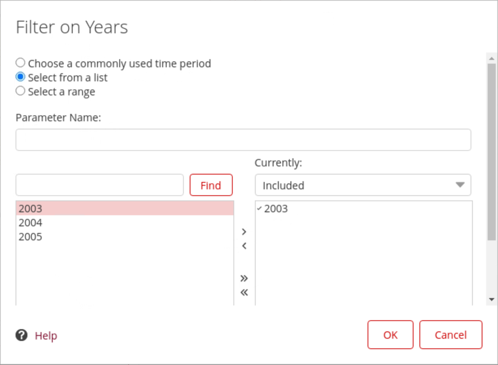
<figcaption>Filter - 2003</figcaption>
</figure>
</div>

6. On the canvas, right-click the **Quarters** header and select **Filter...**.

<div align="center">
<figure>
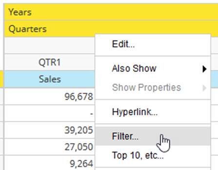
<figcaption>Filter - Quarters</figcaption>
</figure>
</div>

7. In the **Filter on Quarters** dialog, select **Select from a list**.

<div align="center">
<figure>
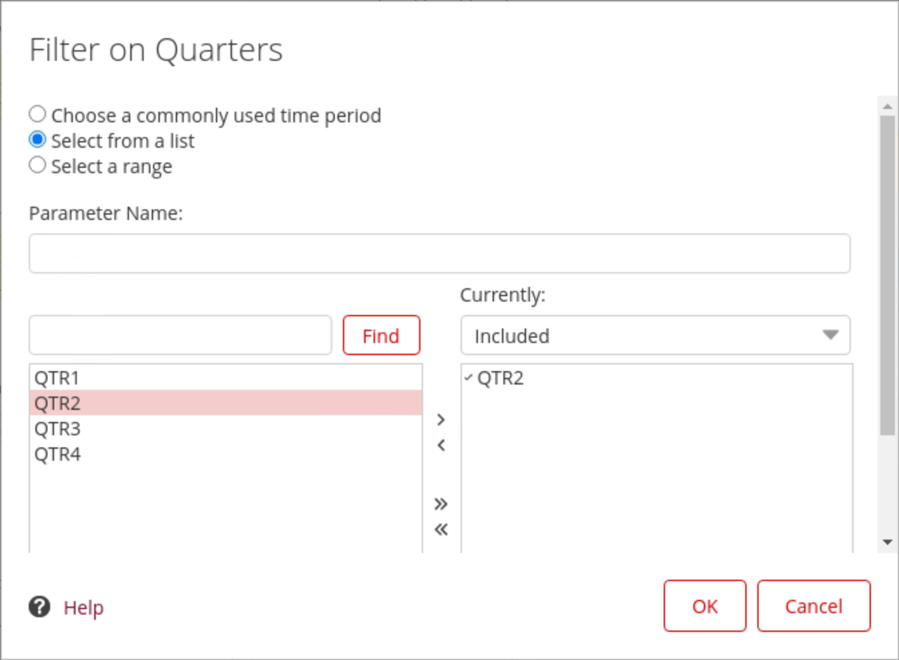
<figcaption>Filter - QTR 2</figcaption>
</figure>
</div>

8. Select **QTR2**, select the right arrow to move it to the **Currently Included** list, and select **OK**.

<div align="center">
<figure>
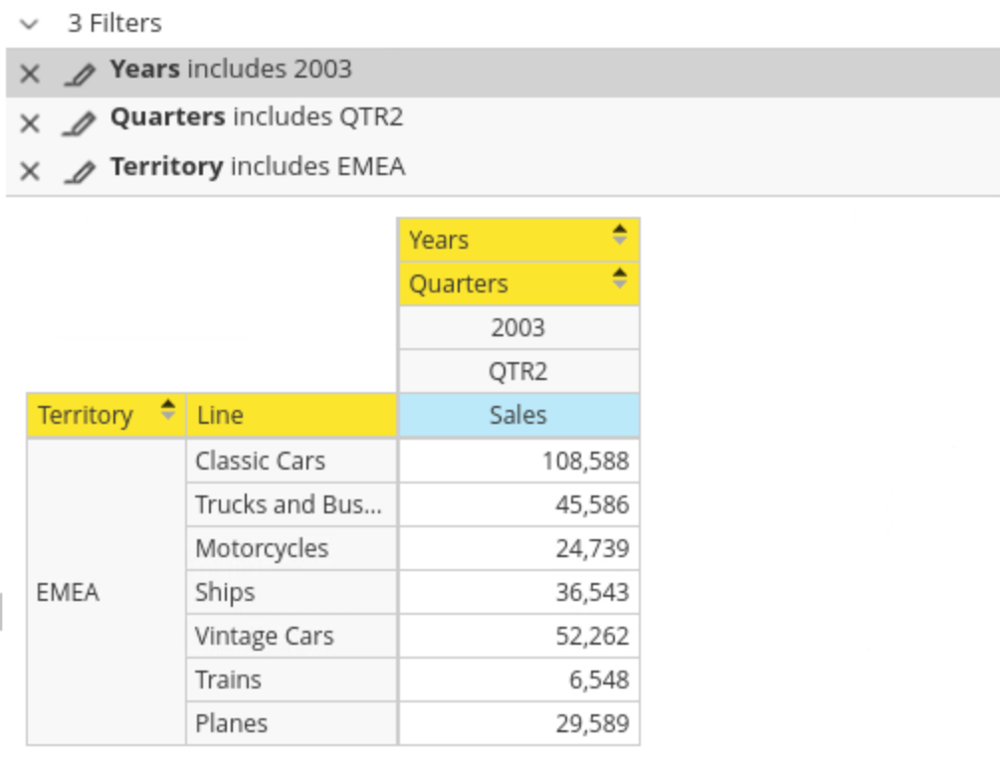
<figcaption>Filters</figcaption>
</figure>
</div>

> **Success:** Checkpoint: the **Filters** panel shows Years includes 2003, Quarters includes QTR2, and Territory includes EMEA, and the table shows EMEA's sales by line for 2003 QTR2.

9. On the canvas, drag the **Sales** header *up* to the **Filters** panel.
10. Keep the five best product lines with sales over 10,000. In the **Numeric Filter** dialog:

| Setting                                | Value                                 |
| -------------------------------------- | ------------------------------------- |
| **Greater / Less Than, Equal to, etc.** | Selected: **Greater Than** `10000`    |
| **Top 10, etc.**                       | Selected: **Top** `5` Line by Sales  |

Select **OK**.

<div align="center">
<figure>
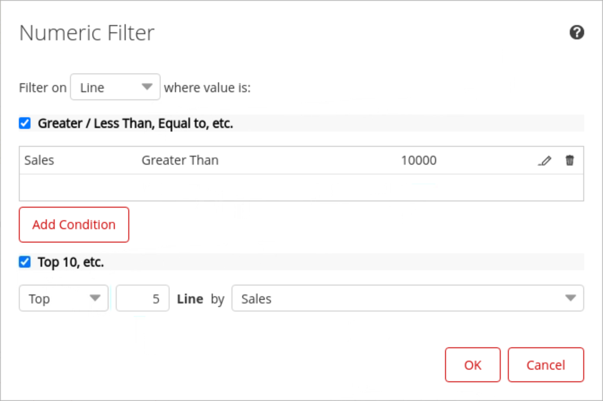
<figcaption>Numeric Filter - Top 5 Lines by Sales</figcaption>
</figure>
</div>

> **Success:** Checkpoint: five lines are left, Classic Cars first at 108,588, then Vintage Cars, Trucks and Buses, Ships, and Planes.

<div align="center">
<figure>
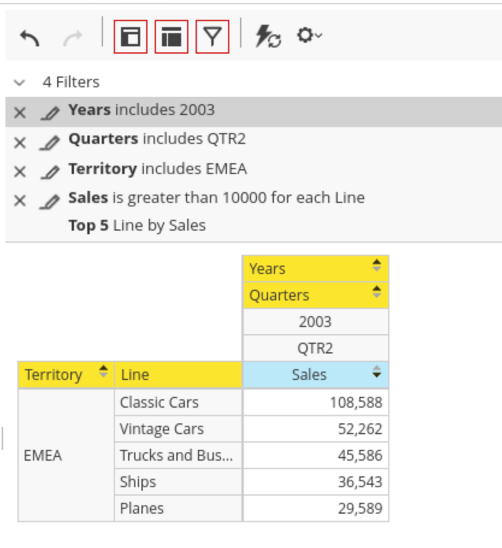
<figcaption>EMEA: Top 5 Product Lines by Sales 2003 QTR2</figcaption>
</figure>
</div>

11. On the canvas, right-click the **QTR2** header and select **Show All Quarters**.

<div align="center">
<figure>
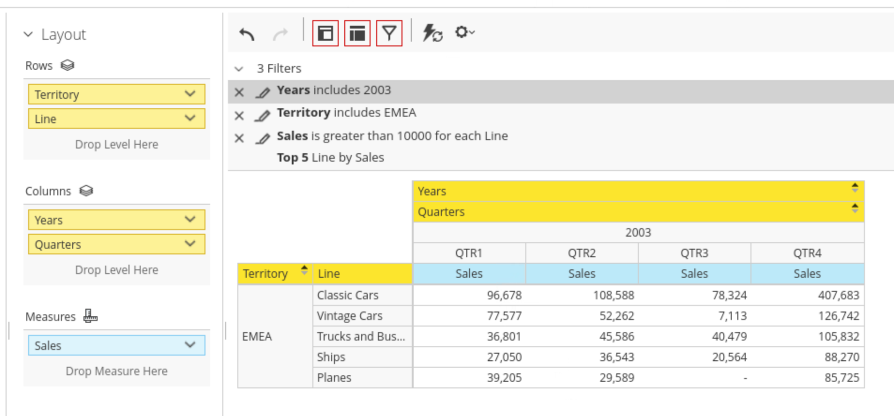
<figcaption>EMEA: Top 5 Product Line by Sales for 2003</figcaption>
</figure>
</div>

> **Under the hood:**
>
> #### Top 5 is an MDX TopCount, evaluated after the slice
>
> A filter on a measure doesn't become a WHERE clause; it becomes MDX
> set functions — in effect `TopCount(Filter([Product].[Line].Members,
> [Measures].[Sales] > 10000), 5, [Measures].[Sales])`. Mondrian
> evaluates that in the current context — EMEA, 2003, QTR2 — so "top
> five lines" meant top five within that slice, ranked on cells that
> were already aggregated. Show All Quarters changed the context, and
> the same expression re-ranked against the whole year. Here the same
> five lines win both times (Motorcycles is sixth for the year), but the
> ranking was recomputed, and on another slice the members could change.
>
> **Why it matters:** rank-and-threshold questions are one dialog here
> and a subquery with a window function in SQL — and they re-evaluate
> correctly every time the surrounding filters change.

***

> **Note:**
>
> #### Conditional Formatting
>
> Conditional formatting changes how a cell looks according to the data it contains. The most common form is stoplight reporting, where cell backgrounds are colored red, green, or yellow against thresholds. Analyzer formats numeric data with a **Color Scale**, a **Data Bar**, or a **Trend Arrow**.

12. Right-click one of the **Sales** headers, and select **Conditional Formatting > Color Scale: Green-Yellow-Red**.

<div align="center">
<figure>
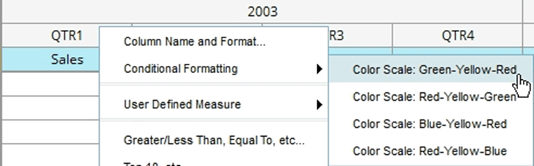
<figcaption>Apply Conditional Formatting</figcaption>
</figure>
</div>

<div align="center">
<figure>
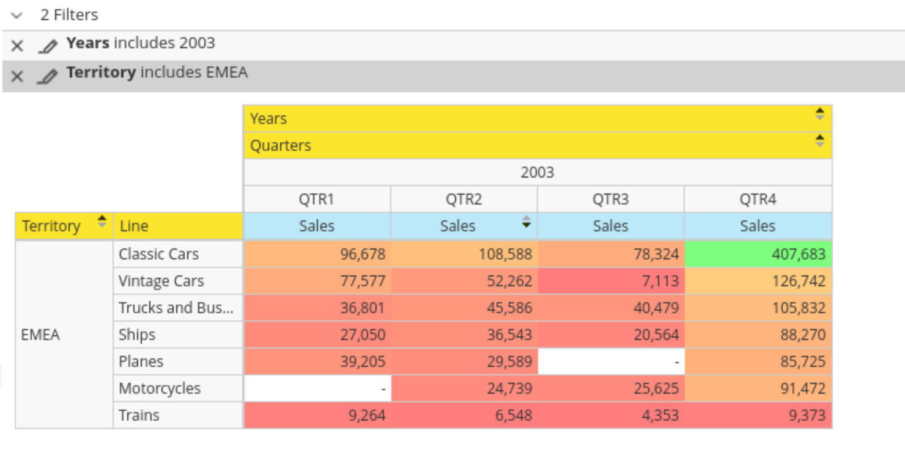
<figcaption>Conditional Formatting</figcaption>
</figure>
</div>

> **Success:** Checkpoint: the Sales cells are colored from red to green, and Classic Cars in QTR4 (407,683) is the greenest.

13. Remove the conditional formatting: right-click one of the **Sales** headers, and select **Conditional Formatting > Color Scale: Green-Yellow-Red** again to clear it.

### 3. Calculations & Drill-Through

> **Note:**
>
> #### Totals
>
> Grand totals and subtotals summarize the values of the detail rows or columns, as an **Aggregate**, **Sum**, **Average**, **Max** or **Min**.

1. Remove all the filters: on the **Filters** panel, remove each filter with its **Remove filter** button.
2. Right-click one of the **Sales** headers, and select **Subtotals (Sums, Averages, etc.)**.

<div align="center">
<figure>
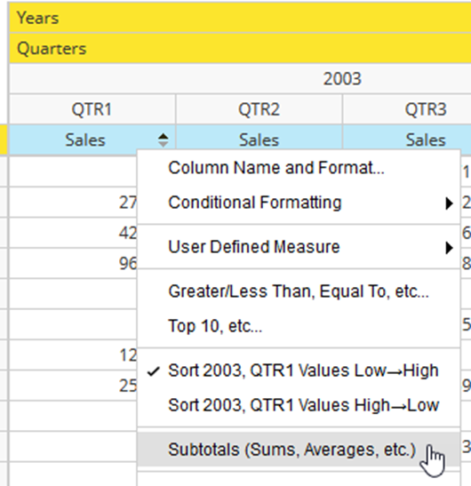
<figcaption>Subtotals</figcaption>
</figure>
</div>

3. In the **Average, Max, Min, etc.** dialog, select **Average** (keep **Sum** selected), and select **OK**.

<div align="center">
<figure>
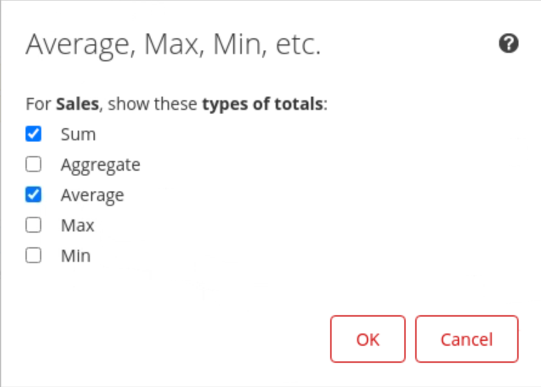
<figcaption>Calculations</figcaption>
</figure>
</div>

4. Right-click the **Territory** header, and select **Show Subtotals**.

<div align="center">
<figure>
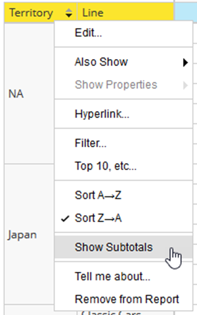
<figcaption>Show Subtotals</figcaption>
</figure>
</div>

> **Success:** Checkpoint: a Sum row and an Average row follow each territory. Subtotals appear only once a level shows them.

<div align="center">
<figure>
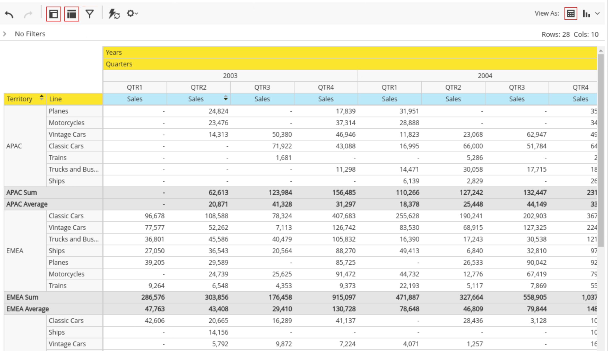
<figcaption>Subtotals &#x26; Averages</figcaption>
</figure>
</div>

5. On the **Layout** panel, select **Report Options...**.
6. In the **Report Options** dialog, select **Grand Totals for Rows** and **Grand Totals for Columns**.

<div align="center">
<figure>
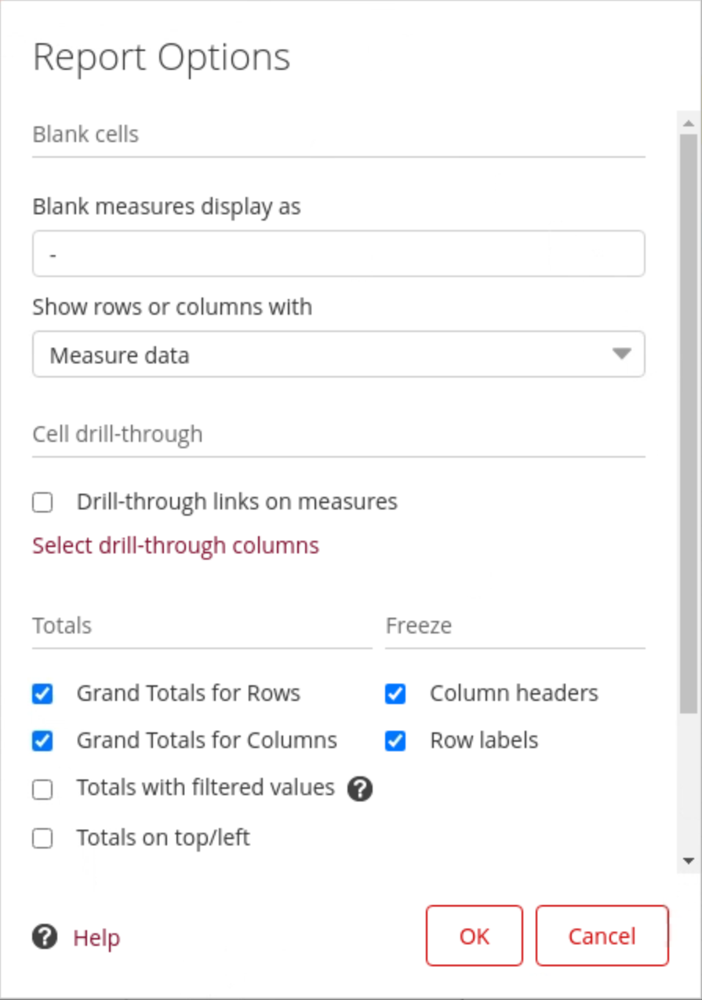
<figcaption>Grand Totals - Rows &#x26; Columns</figcaption>
</figure>
</div>

7. Select **OK**.

<div align="center">
<figure>
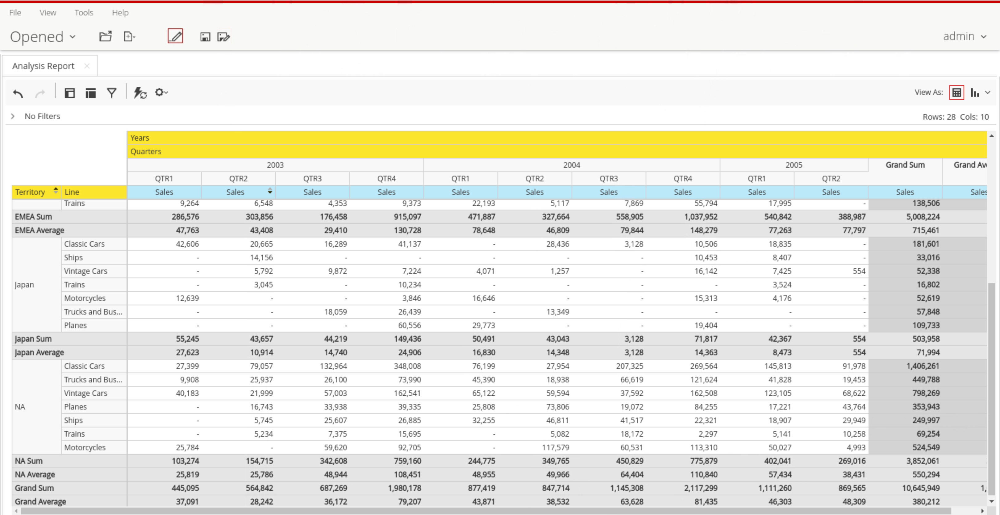
<figcaption>Grand Totals for Rows &#x26; Columns</figcaption>
</figure>
</div>

> **Success:** Checkpoint: grand total rows and columns appear, and the Grand Sum of all sales is 10,645,949.

8. Remove the totals again: right-click a **Sales** header, select **Subtotals (Sums, Averages, etc.)**, clear **Average**, and select **OK**. Right-click the **Territory** header and select **Show Subtotals** to clear it. Then select **Report Options...**, clear **Grand Totals for Rows** and **Grand Totals for Columns**, and select **OK**.

> **Under the hood:**
>
> #### Aggregate and Sum are two different totals
>
> A subtotal has two possible sources. **Aggregate** asks Mondrian for
> the parent's own cell — `[Markets].[EMEA]` — computed from the fact
> rows with the measure's aggregator, which makes it right even for
> measures that don't add up, such as distinct counts. **Sum**,
> **Average**, **Max** and **Min** are Analyzer's own arithmetic over
> the cells you can see. Two consequences: Average is over displayed
> cells, so blank versus zero (Report Options) changes it; and by
> default Analyzer uses *visual* totals, so an Aggregate is recomputed
> over the members left after your filters — select **Totals with
> filtered values** in Report Options and it becomes the cube's full
> parent value, filtered members included.
>
> **Why it matters:** choose Aggregate when the number must match the
> cube, the arithmetic options when it must match the page — and know
> which you chose before someone tries to reconcile the two.

***

**User Defined Measures**

Analyzer creates three types of measure inside an analysis: % of, rank, running sum, or % of running sum; calculated measures; and trend measures. Here you add the percent of sales for each product line, and a calculated measure for sales plus 6% tax.

9. Filter the analysis again to **Territory** EMEA and **Years** 2003, as in steps 2 to 5 of the previous tab.
10. Right-click one of the **Sales** headers, and select **User Defined Measure > % of, Rank, Running Sum...**.

<div align="center">
<figure>
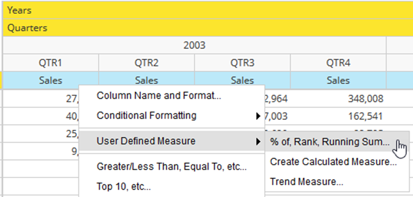
<figcaption>User Defined Measure</figcaption>
</figure>
</div>

11. In the **New % of, Rank, Running Sum, etc.** dialog, select **% of Sales**, and select **Next**.

<div align="center">
<figure>
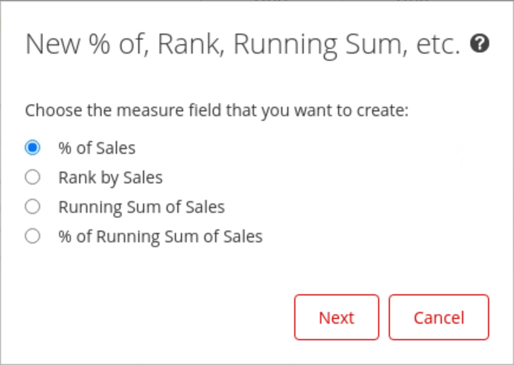
<figcaption>% of Sales</figcaption>
</figure>
</div>

12. Set **Decimal Places** to `0`, and select **Done**.

<div align="center">
<figure>
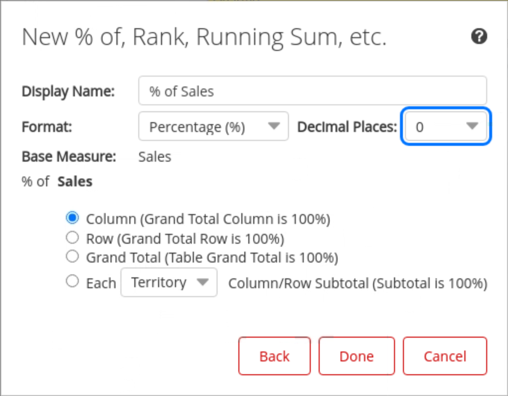
<figcaption>% of Sales</figcaption>
</figure>
</div>

<div align="center">
<figure>
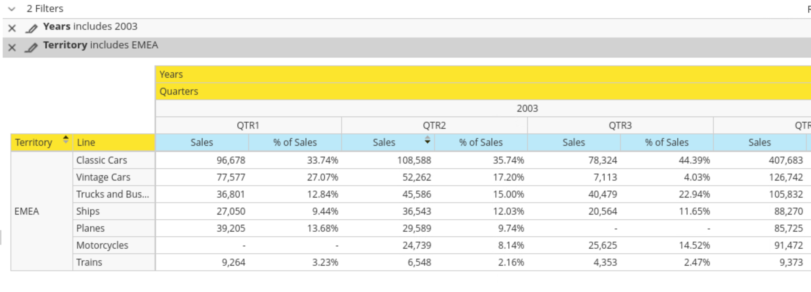
<figcaption>% of Sales</figcaption>
</figure>
</div>

> **Success:** Checkpoint: a **% of Sales** column follows each **Sales** column, and Classic Cars has 34% of EMEA's sales in QTR1.

13. Right-click one of the **Sales** headers, and select **User Defined Measure > Create Calculated Measure...**.

<div align="center">
<figure>
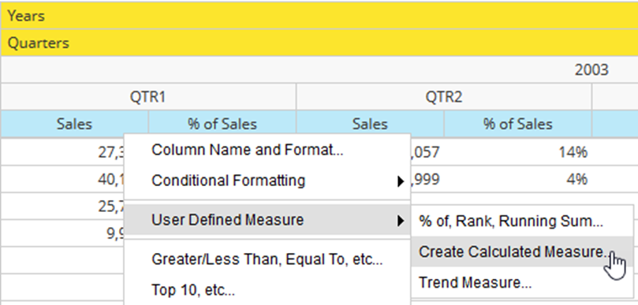
<figcaption>Calculated Measure</figcaption>
</figure>
</div>

The panel on the left lists the measures you can use in the calculation; the formula pane is where you write the MDX expression for the new measure.

14. In the **Create Calculated Measure** dialog, fill in the settings, and select **OK**:

| Setting            | Value                                                           |
| ------------------ | --------------------------------------------------------------- |
| **Display Name**   | `Sales + 6% Tax`                                                |
| **Format**         | **Currency**                                                    |
| **Decimal Places** | `0`                                                             |
| Formula            | Click in the formula pane to the right of `[Measures].[Sales]`, and enter `* 1.06` |

<div align="center">
<figure>

<figcaption>Calculated Measure - 6% Tax</figcaption>
</figure>
</div>

> **Under the hood:**
>
> #### A calculated measure is an MDX calculated member
>
> Sales + 6% Tax went into the query as `WITH MEMBER [Measures].[Sales
> + 6% Tax] AS [Measures].[Sales] * 1.06`. Mondrian evaluates it per
> cell *after* aggregating Sales, so it is correct at every level —
> territory, line, quarter — and through every drill, with no extra
> SQL. % of Sales and Rank are generated the same way, as MDX over the
> axis set. The member lives in this report's definition; the same
> member declared in the Mondrian schema would be available to every
> report on the cube, with its own format.
>
> **Why it matters:** a derived measure costs one expression and stays
> right as the layout changes — the exact failure mode of a spreadsheet
> formula that breaks when a row moves.

<div align="center">
<figure>

<figcaption>Sales + 6% Tax</figcaption>
</figure>
</div>

> **Success:** Checkpoint: a **Sales + 6% Tax** column appears, and Classic Cars shows $102,479 in QTR1.

***

**Drill-Through**

Drill-through links turn every non-calculated measure into a link. Selecting a value opens a data table with the details behind that data point.

15. Remove the **Sales + 6% Tax** and **% of Sales** columns: drag each header to the trash can in the lower-right corner of the canvas.
16. On the **Layout** panel, select **Report Options...**, select **Drill-through links on measures**, and select **OK**.

<div align="center">
<figure>

<figcaption>Drill-through on measures</figcaption>
</figure>
</div>

17. Select the value for EMEA, Classic Cars, 2003, QTR1 (96,678).

<div align="center">
<figure>

<figcaption>Drill-through - Classic Cars</figcaption>
</figure>
</div>

> **Success:** Checkpoint: a **Drill-Through** window opens, listing the detail rows behind EMEA, Classic Cars, 2003, QTR1.

18. Close the **Drill-Through** window.

> **Under the hood:**
>
> #### Drill-through is a SQL query Mondrian built from the cell's coordinates
>
> Selecting 96,678 asked Mondrian for the rows behind one cell. It took
> the cell's members — EMEA, Classic Cars, 2003, QTR1 — and generated a
> `SELECT` on the fact table joined to its dimension tables with a
> `WHERE` for each member, returning order-line rows rather than
> aggregates. That is why only non-calculated measures get links: a
> calculated member has no fact rows of its own to point at.
>
> **Why it matters:** the summary and its evidence are one click apart,
> and the evidence is live — there is no separate detail report to
> build or keep in sync.

### 4. Formatting

> **Note:**
>
> #### Formatting
>
> You can resize columns, rename column and row headers, and change the data format.
>
> * To resize a column, drag the line between the column headers to the left or right. **More actions and options > Reset Column Sizes** resets them all.
> * To rename a column or row header for a text or time field, right-click it and select **Edit...**.
> * To format numeric data, right-click its column header and select **Column Name and Format...**.

1. Right-click the **Line** column header, and select **Edit...**.

<div align="center">
<figure>

<figcaption>Edit the Line header</figcaption>
</figure>
</div>

2. Set **Display Name** to `Product Line`, and select **OK**.

<div align="center">
<figure>

<figcaption>Edit header cells</figcaption>
</figure>
</div>

3. Right-click one of the **Sales** headers, and select **Column Name and Format...**.

<div align="center">
<figure>

<figcaption>Format Column</figcaption>
</figure>
</div>

4. Fill in the settings, and select **OK**:

| Setting            | Value        |
| ------------------ | ------------ |
| **Display Name**   | `Revenue`    |
| **Format**         | **Currency** |
| **Decimal Places** | `0`          |
| **Symbol**         | `$`          |

<div align="center">
<figure>

<figcaption>Revenue as currency</figcaption>
</figure>
</div>

<div align="center">
<figure>

<figcaption>Formatting</figcaption>
</figure>
</div>

> **Success:** Checkpoint: with the EMEA and 2003 filters, Classic Cars shows $96,678 in QTR1 and $407,683 in QTR4, and Motorcycles has no QTR1 sales (a dash).

5. On the toolbar, select the **Save** icon. In the **Save As** dialog, select the **Up One Level** icon twice, double-click **Public** and then **Training**, set **Filename** to `EMEA Revenue by Product Line Yr2003`, and select **Save**.

***

**Chart Options**

An analysis shows one format at a time, and the buttons beside **View As** switch between them.

6. Beside **View As**, select **Switch to chart format**, and select **Pie** from the chart list.

<div align="center">
<figure>

<figcaption>Pie Charts for each Product Line</figcaption>
</figure>
</div>

> **Success:** Checkpoint: the analysis is drawn as pie charts instead of a table.

7. Select **Switch to table format** to return to the table.

:::

### 3. Actions & Options

> **Note:**
>
> #### Actions & Options
>
> **More actions and options**, the gear button on the toolbar, holds the export formats, the report and chart options, the administration tools, and reset.

<div align="center">
<figure>

<figcaption>Actions &#x26; Options</figcaption>
</figure>
</div>

::: tabs

### Export

> **Note:**
>
> #### Export Options
>
> Analyzer exports an analysis in several formats. **To PDF...** opens the analysis in a new window, where you can save or print the PDF. **To Excel Workbook...** exports it to an Excel workbook.
>
> **To CSV...** downloads the analysis data in CSV format, with numbers at the full precision available, so you avoid rounding errors when you keep working with the data in Excel.

1. On the toolbar, select **More actions and options**, then **Export**.

<div align="center">
<figure>

<figcaption>Export options</figcaption>
</figure>
</div>

### Report Options

> **Note:**
>
> #### Report Options
>
> Report Options set how blank measures display, which drill-through columns to use, and whether totals show for columns and rows.
>
> A number field, such as Sales, broken down by a text field, such as Product Name, can have no value: a product that did not sell shows as zero dollars, or as a blank or a dash (`-`). In some reports the absence of a value means the same as zero; in others zero means something different. Calculations treat the two differently: an average counts zeros but not blanks.

1. On the toolbar, select **More actions and options**.
2. Select **Report Options...**.

<div align="center">
<figure>

<figcaption>Report Options</figcaption>
</figure>
</div>

### Chart Options

> **Note:**
>
> #### Chart Options
>
> As an administrator, you can set default chart options that apply whenever a new chart is created. Adding default chart options does not change existing charts.
>
> You can change the options of one chart without affecting the defaults, and set a chart back to the defaults with **Reset to default** in the **Chart Options** dialog.

1. On the toolbar, select **More actions and options**.
2. Select **Chart Options...**.

<div align="center">
<figure>

<figcaption>Chart Options</figcaption>
</figure>
</div>

### Administration

> **Note:**
>
> #### Administration
>
> Users with the Administrator role have extra options that help troubleshoot and tune Analyzer reports: **XML**, **Log**, **MDX**, and **Clear Cache**.

1. On the toolbar, select **More actions and options**.
2. Select **Administration**.

<div align="center">
<figure>

<figcaption>Administration options</figcaption>
</figure>
</div>

***

**XML**

Administrators can set the default value of non-standard properties of the current visualization, for one report. This is useful for properties that a global configuration hides from the user interface. Enter the JSON in the **Visualization state JSON** field of the **Report Definition** dialog (**Administration > XML**). This JSON, for example, changes the colors many of the standard visualizations use, through the `palette` property:

```json
[ { "palette": {"colors": ["red", "green", "blue"]} } ]
```

3. Select **More actions and options > Administration > XML**.

<div align="center">
<figure>

<figcaption>The Report Definition dialog</figcaption>
</figure>
</div>

***

**Log**

The log helps you troubleshoot and tune Analyzer reports. Its first half shows the XML of the report definition; its second half shows the MDX query and the time each stage of it took.

4. Select **More actions and options > Administration > Log**.

<div align="center">
<figure>

<figcaption>Log</figcaption>
</figure>
</div>

***

**MDX**

The MDX page opens the log file, clears the cache, checks AnalyzerDateFormat, and runs MDX queries.

5. Select **More actions and options > Administration > MDX**. The page opens with an empty query box.
6. In the log from step 4, copy the report's MDX query, the block that starts with `WITH`, and paste it into the box.

<div align="center">
<figure>

<figcaption>MDX</figcaption>
</figure>
</div>

7. Select **Execute MDX** to run the report's query. The result opens in a new tab.

<div align="center">
<figure>

<figcaption>MDX - output</figcaption>
</figure>
</div>

> **Success:** Checkpoint: the query's result grid appears, above the log of how long each stage of the query took.

8. Close the MDX page and its result.

> **Under the hood:**
>
> #### The log is the whole pipeline in one place
>
> Administration shows the layers that produced the page: the report
> definition (the `.xanalyzer` XML, each field a schema formula), the
> MDX Analyzer generated from it, and the time Mondrian took to answer.
> Execute MDX runs your own statement against the same cube. Clear
> Cache flushes both Analyzer's and Mondrian's caches — the segment
> cache of cell values and the member cache — so fact rows loaded since
> the last query appear without a restart.
>
> **Why it matters:** when a report is slow or stale, this tab is where
> the answer is. Read the MDX for an accidental crossjoin, and clear the
> cache before blaming the ETL.

:::

::::

---

## Lab Files

Click a file to download it.

### Solution <!-- no-step -->

The finished analysis from the Sales Analysis tab: Territory and Product Line by Years and Quarters, filtered to EMEA and 2003, with Revenue as currency and drill-through links on. Open it alongside your own to compare.

Also on disk at `C:\Workshop-BA-Practitioner\04-analyzer-reports\10-analyzer-reports-sales-analysis\solution`.

[EMEA Revenue by Product Line Yr2003.xanalyzer](./files/EMEA%20Revenue%20by%20Product%20Line%20Yr2003.xanalyzer)

To open it in the User Console:

1. In **Browse Files**, select your own folder under **Home** (Home > admin, say), so the solution sits apart from your own analysis in Public > Training.
2. In the **Folder Actions** pane, select **Upload...**, select **Browse...** and choose the `.xanalyzer` file, and then select **OK**.
3. If the file is not listed under **Files** yet, select the **Refresh** icon (the circular arrow beside **Folders**).
4. Double-click **EMEA Revenue by Product Line Yr2003** to open it, and select **Edit** on the toolbar to see its layout and filters.
