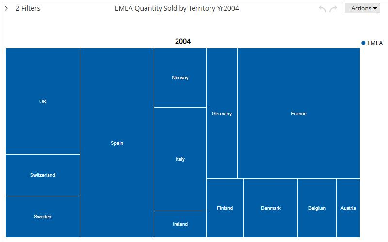

# EMEA Quantity

> **Warning:**
>
> #### Workshop - EMEA Quantity
>
> Steel Wheels management needs visibility into product quantity performance across the EMEA region for 2004. This workshop applies your Analyzer skills with less step-by-step guidance, to build a complete analysis that shows which countries drive volume in that territory.
>
> **What you'll do**
>
> * Start an analysis on the SteelWheels: SteelWheelsSales data source
> * Show Quantity by Territory and Country, with Years as columns
> * Filter the analysis to the EMEA territory and the year 2004
> * Add a green data bar to Quantity, a Rank by Quantity measure, and column grand totals
> * Switch to a chart, such as a Treemap
> * Save the analysis to Public > Training as EMEA Quantity Sold by Territory Yr2004
>
> **Prerequisites:** [Sales Analysis](../10-analyzer-reports-sales-analysis/guide.md), and the Steel Wheels sample data on the Pentaho Server
>
> **Estimated time:** 25 minutes

<figure>

<figcaption>EMEA: Quantity Sold by Territory Yr2004 - Tree Map</figcaption>
</figure>

***

## Data Source

1. Select the perspective drop-down and select **Home**, then select **Create New > Analysis Report**. With other reports open, the same choices are under the **File** menu on the menu bar.
2. In the **Select Data Source** dialog, select **SteelWheels: SteelWheelsSales**, and select **OK**.
3. From the **View** drop-down above **Available Fields**, select **Schema**.

> **Success:** Checkpoint: a new, empty analysis opens, with **Available Fields** listed by the schema's dimensions.

## Add Data Columns and Rows to the Analysis

Add Quantity, Territory, Country, and Years to the analysis.

> **Tip:** As in the last workshop, right-click a field and select **Add to Report** to place it without dragging. Years then lands on **Rows**; drag its chip from **Rows** to the **Columns** drop zone on the **Layout** panel.

1. Drag **Quantity** to the **Measures** drop zone on the **Layout** panel.
2. Drag **Territory** to the **Rows** drop zone.
3. Drag **Country** to the **Rows** drop zone, and drop it *below* **Territory**.
4. Drag **Years** to the **Columns** drop zone.

> **Success:** Checkpoint: the table shows Quantity by Territory and Country, with a column for each year.

## Filter the Analysis Data

Filter the analysis to EMEA and 2004.

1. On the toolbar, select **Show all filters in use and add new filters** to show the **Filters** panel.
2. Drag **Territory** from **Available Fields** to the **Filters** panel.
3. In the **Filter on Territory** dialog, select **Select from a list**, select **EMEA**, select the right arrow to move it to the **Currently Included** list, and select **OK**.
4. Drag **Years** from **Available Fields** to the **Filters** panel.
5. In the **Filter on Years** dialog, select **Select from a list**, select **2004**, select the right arrow to move it to the **Currently Included** list, and select **OK**.

> **Success:** Checkpoint: the **Filters** panel shows the two filters, and the table shows only EMEA countries, in a single 2004 column.

## Apply Conditional Formatting

1. Right-click the **Quantity** header, and select **Conditional Formatting > Data Bar: Green**.

> **Success:** Checkpoint: each Quantity cell carries a green bar sized by its value.

## Rank

Add a column with each country's rank by Quantity.

1. Right-click the **Quantity** header, and select **User Defined Measure > % of, Rank, Running Sum...**.
2. In the **New % of, Rank, Running Sum, etc.** dialog, select **Rank by Quantity**, and select **Next**.
3. Select **Done**.

> **Under the hood:**
>
> #### Rank is an MDX Rank over the visible set
>
> Rank by Quantity added a calculated member built on MDX's `Rank`
> function: for each country, its position in the set of countries
> ordered by Quantity. Mondrian evaluates it in the report's filter
> context, so the ranks are within EMEA for 2004, and they recompute
> the moment either filter changes or a country is excluded.
>
> **Why it matters:** a ranking that follows the filters for free is
> the difference between an analysis tool and a spreadsheet export.

## Add Totals

1. On the **Layout** panel, select **Report Options...**.
2. In the **Report Options** dialog, select **Grand Totals for Columns**, and select **OK**.

> **Success:** Checkpoint: in the table view, France has the most units (5,632, rank 1), Spain is second (4,962), and the Grand Total for EMEA in 2004 is 23,630.

## Switch to Chart Format

1. Beside **View As**, select **Switch to chart format**.
2. Select the arrow next to it, and select a chart type. Try a few; the picture at the top of this page is a **Treemap**, which needs no extra fields.

> **Success:** Checkpoint: the chart shows the 2004 EMEA countries, sized by Quantity.

## Save the Report

Analyzer has no separate title field: the title shown above the chart is the report's name, so saving gives the report its title, `EMEA Quantity Sold by Territory Yr2004`.

1. On the toolbar, select the **Save As** icon.
2. In the **Save As** dialog, set **Filename** to `EMEA Quantity Sold by Territory Yr2004`. Select the **Up One Level** icon twice, double-click **Public**, double-click **Training**, and select **Save**.

> **Success:** Checkpoint: the chart's title reads **EMEA Quantity Sold by Territory Yr2004**.

***

## Lab Files

Click a file to download it.

### Solution <!-- no-step -->

One finished version of this analysis: Quantity by Territory and Country for EMEA in 2004, with a green data bar, column grand totals, Rank by Quantity, and the Tree Map view. Your chart type can differ; the figures should not.

Also on disk at `C:\Workshop-BA-Practitioner\04-analyzer-reports\11-analyzer-reports-emea-quantity\solution`.

[EMEA Quantity Sold by Territory Yr2004.xanalyzer](./files/EMEA%20Quantity%20Sold%20by%20Territory%20Yr2004.xanalyzer)

To open it in the User Console:

1. In **Browse Files**, select your own folder under **Home** (Home > admin, say), so the solution sits apart from your own analysis in Public > Training.
2. In the **Folder Actions** pane, select **Upload...**, select **Browse...** and choose the `.xanalyzer` file, and then select **OK**.
3. If the file is not listed under **Files** yet, select the **Refresh** icon (the circular arrow beside **Folders**).
4. Double-click **EMEA Quantity Sold by Territory Yr2004** to open it, and select **Edit** on the toolbar to see its layout and filters.
