# Vendor Sales

> **Warning:**
>
> #### Workshop - Vendor Sales
>
> Dashboards bring several reports, analyses, and visualizations together into a single, interactive business view. In this workshop you build a report-based dashboard with Pentaho Dashboard Designer, combining existing reports and adding dashboard prompts that filter them.
>
> **What you'll do**
>
> * Select the 2 over 1 layout template and the Ruby theme, and title the dashboard
> * Resize the dashboard panels
> * Add three existing reports to the panels: European Sales (geo map), the Vendor Sales interactive report, and the Inventory List
> * Create Territory and Product Line prompts from metadata queries on the Orders data source
> * Connect the prompts to the Vendor Sales report's parameters, and test them
> * Save the dashboard to Public > Training
>
> **Prerequisites:** The **Public > Training** folder from [Pentaho User Console](../04-user-console-puc/guide.md), and the Steel Wheels sample reports (European Sales, Vendor Sales Report, Inventory List) in **Public > Steel Wheels**
>
> **Estimated time:** 35 minutes

<figure>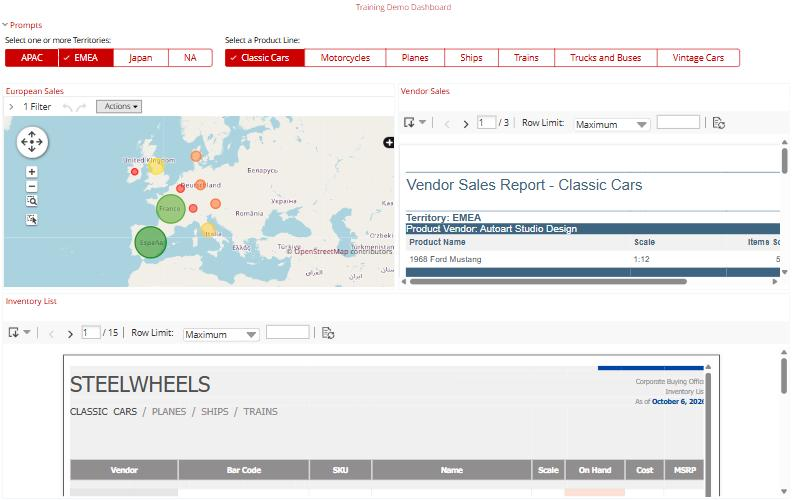<figcaption>
Vendor Sales - prompts
</figcaption></figure>

::: tabs

### 1. Template

> **Note:**
>
> #### Dashboard Templates
>
> Creating a dashboard in Dashboard Designer starts with choosing a layout template, a theme, and the content you want to display.

1. Select the perspective drop-down and select **Home**, then select **Create New > Dashboard**.

<figure>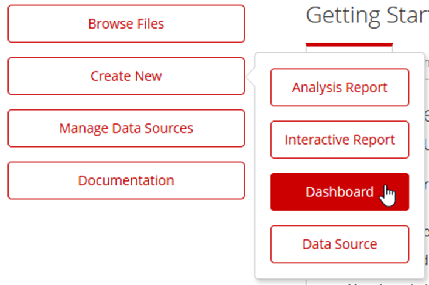<figcaption>
Dashboard Designer
</figcaption></figure>

2. On the **Templates** tab, select **2 over 1**.

<figure>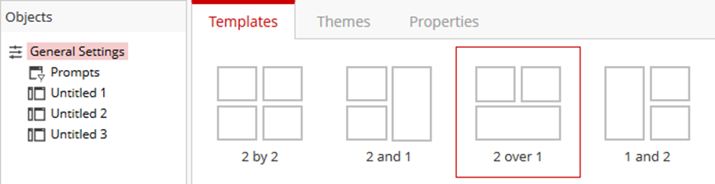<figcaption>
Dashboard Templates
</figcaption></figure>

3. Open the **Themes** tab to see the available themes.

<figure>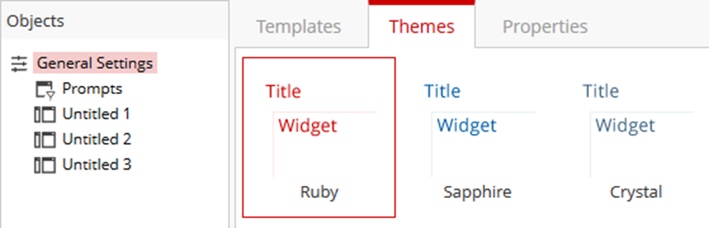<figcaption>
Themes
</figcaption></figure>

4. Keep the default **Ruby** theme.
5. Open the **Properties** tab, and set **Page Title** to `Training Demo Dashboard`.

<figure>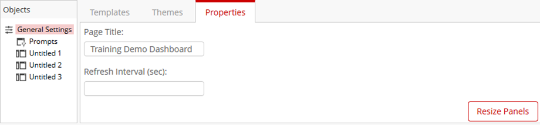<figcaption>
Dashboard Properties
</figcaption></figure>

> **Success:** Checkpoint: the canvas shows three panels, **Untitled 1** and **Untitled 2** side by side over **Untitled 3**, under the title **Training Demo Dashboard**.

The **Properties** tab also has **Resize Panels** and **Refresh Interval (sec)**.

6. Select **Resize Panels**. Blue horizontal and vertical bars appear between the panels.
7. Drag the vertical bar about an inch to the left, to make the **Untitled 1** panel smaller.
8. In the lower-right corner of the canvas, select **Close**.

<figure>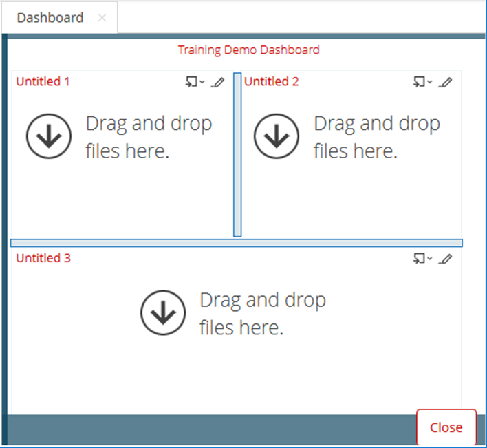<figcaption>
Resize Dashboard
</figcaption></figure>

### 2. Content

> **Note:**
>
> #### Dashboard Content
>
> You add reports created with Interactive Reporting, Analyzer, and Report Designer to a dashboard by dragging them from the **Files** pane onto a panel, or by selecting **Insert Content** on the panel's title bar and then **File**.

1. Select the **Untitled 1** panel.
2. Select the **Insert Content** icon at the top right of the panel, and select **File**.

<figure>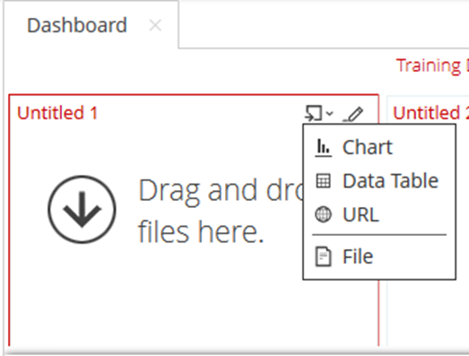<figcaption>
Add content from Repository
</figcaption></figure>

3. In the **Select** dialog, go to **Public > Steel Wheels**, and double-click **European Sales (geo map)**.

<figure>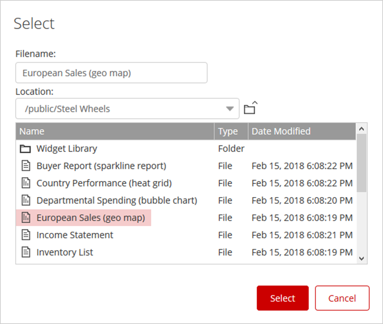<figcaption>
Add European Sales (geomap)
</figcaption></figure>

4. Set **Title** to `European Sales`, and select **Apply**.

<figure>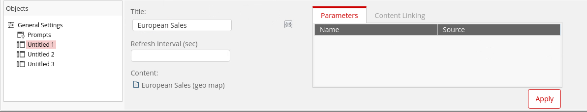<figcaption>
Title
</figcaption></figure>

5. In the **Folders** pane of the browse panel, select **Public > Steel Wheels**. Drag **Vendor Sales Report (interactive report)** from the **Files** pane onto the **Untitled 2** panel (or select **Insert Content > File** on that panel, as for **Untitled 1**).
6. Set **Title** to `Vendor Sales`, and select **Apply**.

<figure>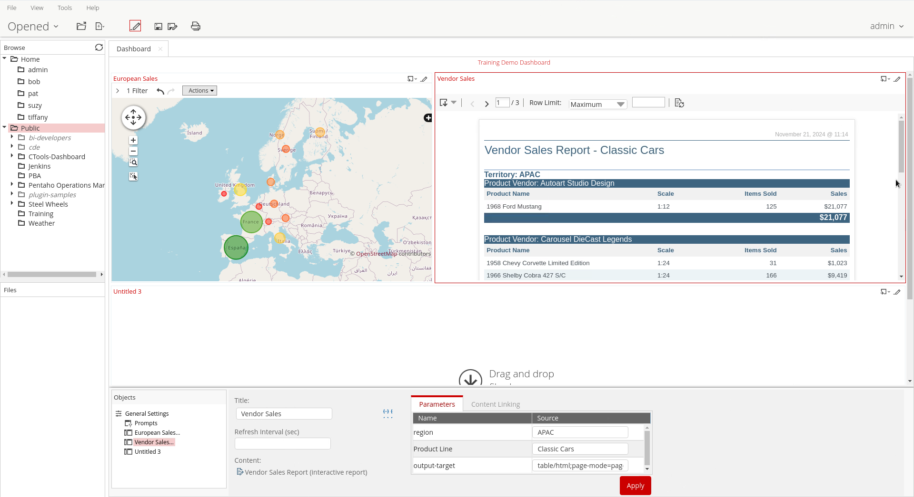<figcaption>
Vendor Sales
</figcaption></figure>

> **Success:** Checkpoint: the **Vendor Sales** panel shows the Vendor Sales Report, and the pane below lists its parameters, including **region** and **Product Line**. You use those parameters with dashboard prompts later.

7. Drag **Inventory List (report)** from the **Files** pane onto the **Untitled 3** panel (or select **Insert Content > File**).
8. Set **Title** to `Inventory List`, and select **Apply**. The Inventory List report fills the bottom panel.

<figure>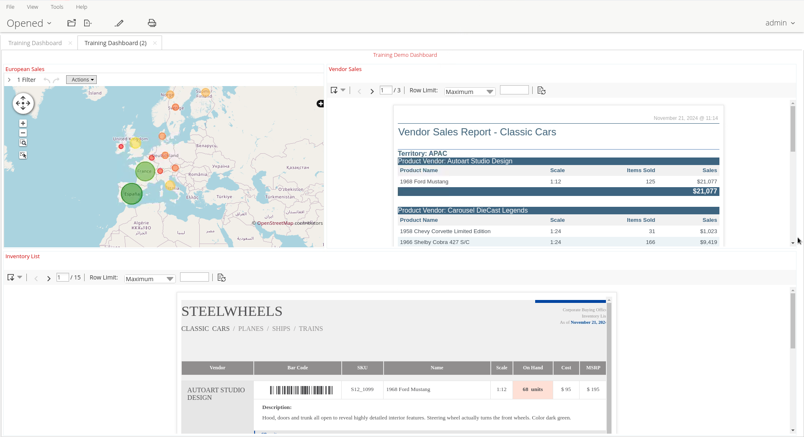<figcaption>
Training Demo Dashboard
</figcaption></figure>

> **Under the hood:**
>
> #### Each panel is the report's own viewer, embedded
>
> The dashboard didn't copy anything. Each panel is an iframe that
> loads the repository file you chose through that content type's
> viewer — the Analyzer viewer for the geo map, the reporting viewer
> for the `.prpti` and the `.prpt` — so every panel is rendered by its
> own engine, with current data and the permissions of whoever is
> looking. What gets saved is an `.xdash`: the layout template (a XUL
> file), the theme, and for each widget the repository path plus its
> input and output parameters.
>
> **Why it matters:** fix a report once and every dashboard showing it
> updates. And a user who can't open a report can't see it here either.

### 3. Prompts

> **Note:**
>
> #### Dashboard Prompts
>
> Dashboard prompts apply to the content of the whole dashboard. A prompt reaches an individual report only when that report's filter is set up as a parameter.
>
> Here you create dashboard prompts for Territory and Product Line, and apply them to the Vendor Sales Report.

1. In the **Objects** list in the bottom pane, select **Prompts**, and select **Show Prompt Toolbar**.

<figure>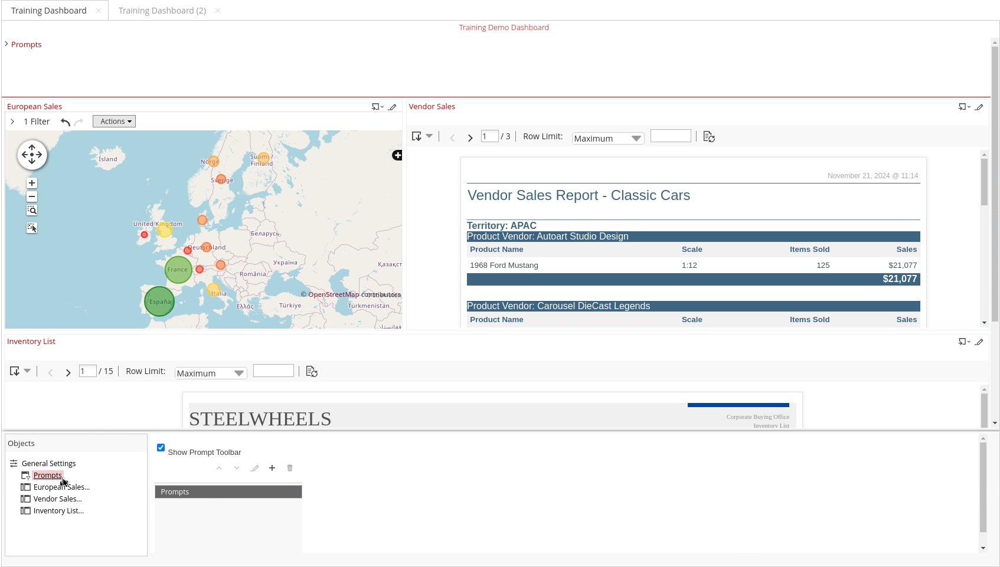<figcaption>
Show Prompt Toolbar
</figcaption></figure>

> **Success:** Checkpoint: an empty **Prompts** toolbar appears at the top of the dashboard. Its height is set on the **Properties** tab of **General Settings**.

2. In the bottom pane, select the **+** (**Add**) icon.

The **Prompt** dialog opens. **Name** is what the Prompts toolbar shows, so a prompt such as `Select one or more Territories:` makes a good name. The **Control** area shows the types of prompt: drop-down, list, radio buttons, check box, buttons, text field, and date picker. The **Data** area sets where the prompt's values come from: a static list you type, a SQL query against a database connection, or a metadata list from a defined data source. **Control Properties** shows options for the selected type of prompt.

<figure>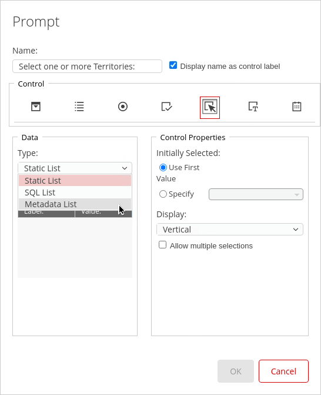<figcaption>
Orders - Metadata List
</figcaption></figure>

3. Set **Name** to `Select one or more Territories:`.
4. In the **Control** area, select the **Buttons** icon.
5. In the **Data** area, set **Type** to **Metadata List**, and select **Select...**.
6. In the **Select Data Source** dialog, select **Orders**, and select **OK**.

<figure>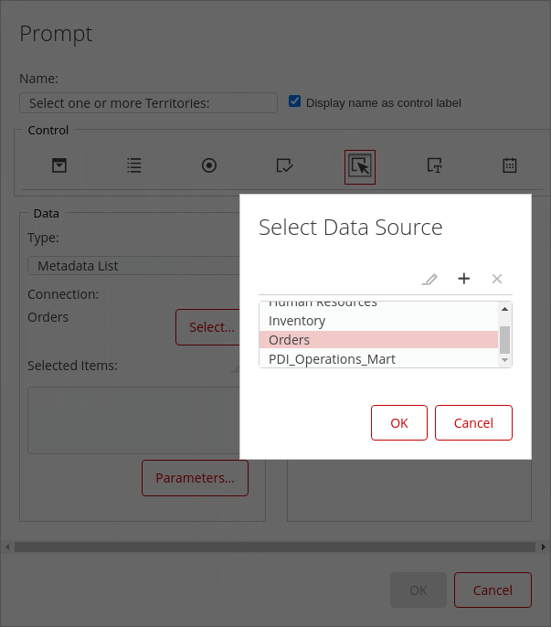<figcaption>
Select the Orders data source
</figcaption></figure>

The **Query Editor** opens. (If it does not, select **Edit MQL Query**, the pencil beside **Selected Items**.) Build a query that lists the territories from the Customer table, leaving out null values.

<figure>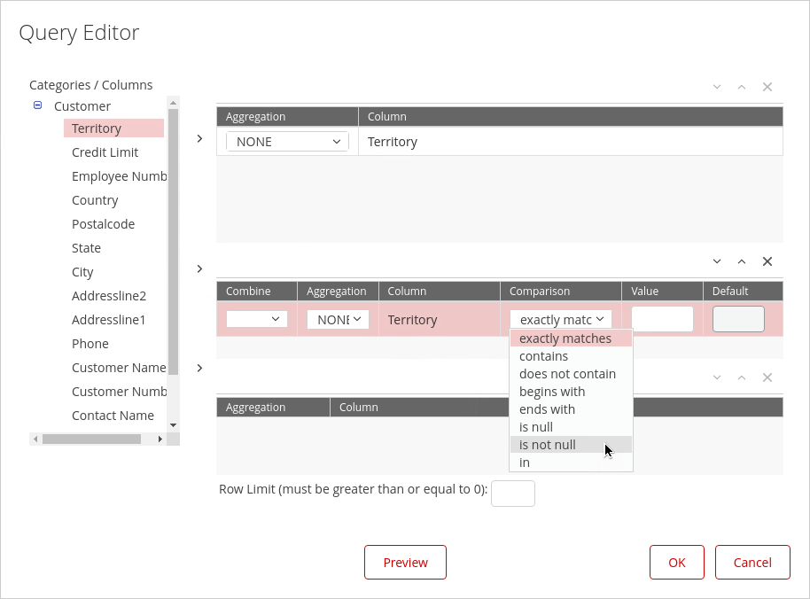<figcaption>
Metadata Query - Territory
</figcaption></figure>

7. In the **Categories / Columns** list, select the plus sign beside **Customer**, select **Territory**, and select the `>` arrow to move it to **Selected Columns**.
8. Add a condition that keeps the territories that are not null: with **Territory** still selected, select the middle arrow (the one beside **Switch to Advanced...**) to move it to **Conditions**, and set **Comparison** to **is not null**. The bottom arrow adds a column to **Order By** instead.
9. Select **Preview**, and check the list.

<figure>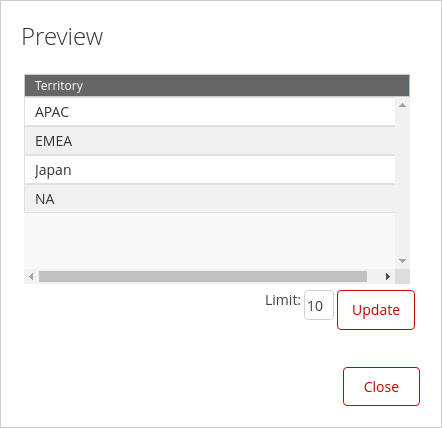<figcaption>
Preview List
</figcaption></figure>

> **Success:** Checkpoint: the preview lists **APAC**, **EMEA**, **Japan** and **NA**.

10. Select **Close**, and then select **OK**.
11. In the **Control Properties** area, set **Display** to **Horizontal**, select **Allow multiple selections**, and select **OK**.

The two prompts this lab builds, side by side:

| Setting                       | Territory prompt                                   | Product Line prompt                                  |
| ----------------------------- | -------------------------------------------------- | ---------------------------------------------------- |
| **Name**                      | `Select one or more Territories:`                  | `Select a Product Line:`                             |
| Control                       | **Buttons**                                        | **Buttons**                                          |
| **Type**                      | **Metadata List**, data source **Orders**          | **Metadata List**, data source **Orders**            |
| Query                         | **Customer > Territory**, condition **is not null** | **Products > Product Line**, condition **is not null** |
| **Display**                   | **Horizontal**                                     | **Horizontal**                                       |
| **Allow multiple selections** | Selected                                           | Cleared                                              |
| Vendor Sales parameter        | **region**                                         | **Product Line**                                     |

<figure>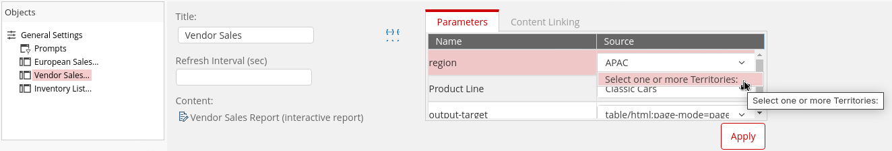<figcaption>
Associate the prompt with Vendor Sales report.
</figcaption></figure>

12. Apply the Territory prompt to the Vendor Sales Report: in the **Objects** list in the bottom pane, select **Vendor Sales Report**. On the **Parameters** tab, set the **Source** of **region** to **Select one or more Territories:**, and select **Apply**.

> **Under the hood:**
>
> #### A dashboard prompt is a parameter handed to the report
>
> The Metadata List ran an MQL query — Territory from the Customer
> table, `is not null` — to fetch the button labels. Selecting buttons
> sets a dashboard-level parameter, and the association you just made
> maps it onto the Vendor Sales report's own `region` parameter, which
> exists only because that report's filter was defined as a parameter.
> The panel reloads the report with `region=EMEA`, and the report's
> engine applies it as a WHERE constraint exactly as it would from its
> own prompt.
>
> **Why it matters:** one selection drives several reports because
> they share a parameter contract, not because the dashboard knows
> anything about their data.

13. Test the prompt: in the row of prompt buttons, select **APAC** to clear it, and select **EMEA**.

> **Success:** Checkpoint: the **Vendor Sales** panel reloads and shows the report for **Territory: EMEA**.

14. Repeat steps 2 to 12 for Product Line, with the settings in the table above: name it `Select a Product Line:`, select **Buttons** and a **Metadata List** on **Orders** with **Products > Product Line** (**is not null**), set **Display** to **Horizontal**, leave **Allow multiple selections** cleared (the report's Product Line parameter takes one value), and set it as the **Source** of the Vendor Sales Report's **Product Line** parameter.
15. Select **Classic Cars** in the new row of buttons, and view the result in the **Vendor Sales** panel.
16. On the toolbar, select the **Save** icon. Select the **Up One Level** icon twice, double-click **Public** and then **Training**, set **Filename** to `Training Demo Dashboard`, and select **Save**.

<figure><figcaption>
Vendor Sales
</figcaption></figure>

> **Success:** Checkpoint: the Territory buttons are APAC, EMEA, Japan and NA, the Product Line buttons run from Classic Cars to Vintage Cars, and with EMEA and Classic Cars selected the Vendor Sales panel shows Territory: EMEA.

:::

---

## Lab Files

Click a file to download it.

### Solution <!-- no-step -->

The finished dashboard: 2 over 1 with the Ruby theme, European Sales, Vendor Sales and Inventory List panels, and Territory and Product Line prompts wired to the Vendor Sales report's region and Product Line parameters. The panels show the Steel Wheels sample reports, so they must be in Public > Steel Wheels on your server.

Also on disk at `C:\Workshop-BA-Practitioner\05-dashboard-designer\13-dashboard-designer-vendor-sales\solution`.

[Training Demo Dashboard.xdash](./files/Training%20Demo%20Dashboard.xdash)

To open it in the User Console:

1. In **Browse Files**, select your own folder under **Home** (Home > admin, say), so the solution sits apart from your own dashboard in Public > Training.
2. In the **Folder Actions** pane, select **Upload...**, select **Browse...** and choose the `.xdash` file, and then select **OK**.
3. If the file is not listed under **Files** yet, select the **Refresh** icon (the circular arrow beside **Folders**).
4. Double-click **Training Demo Dashboard** to run it, and select **Edit** on the toolbar to see its panels and prompts.
