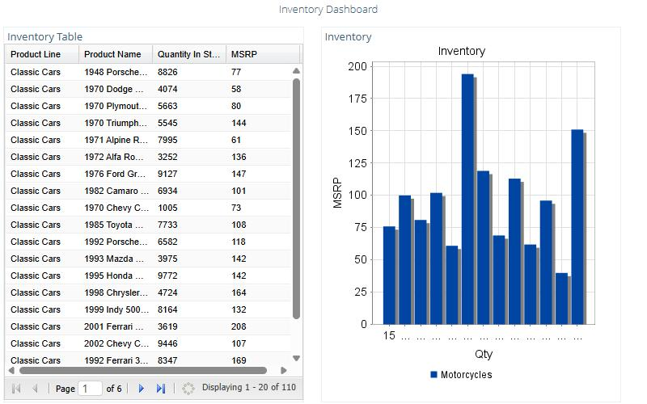
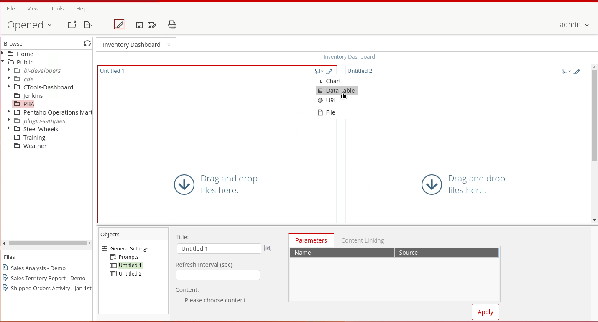
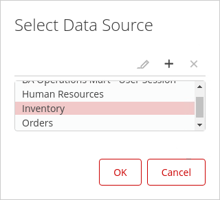
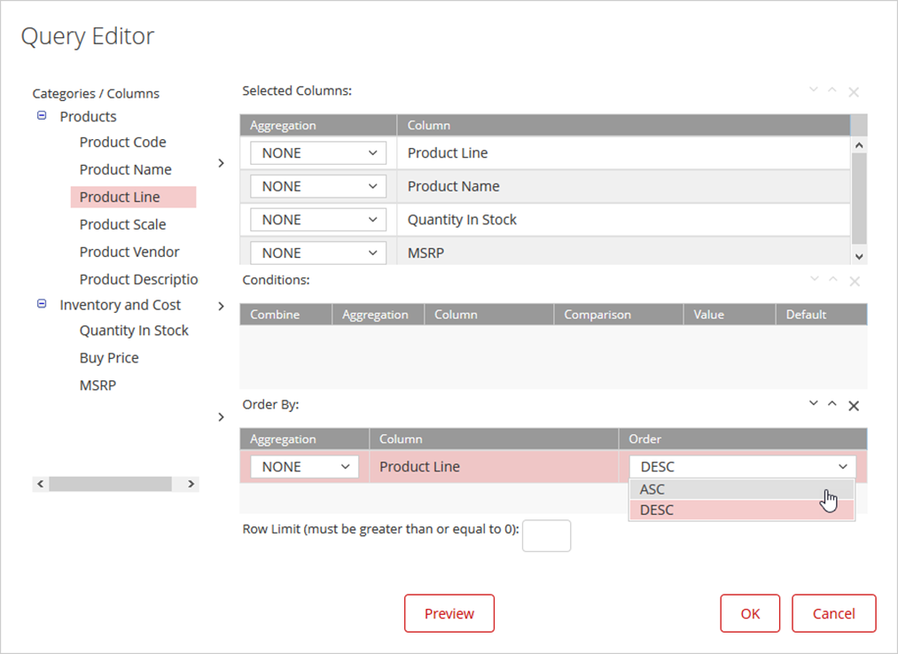
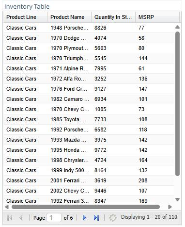
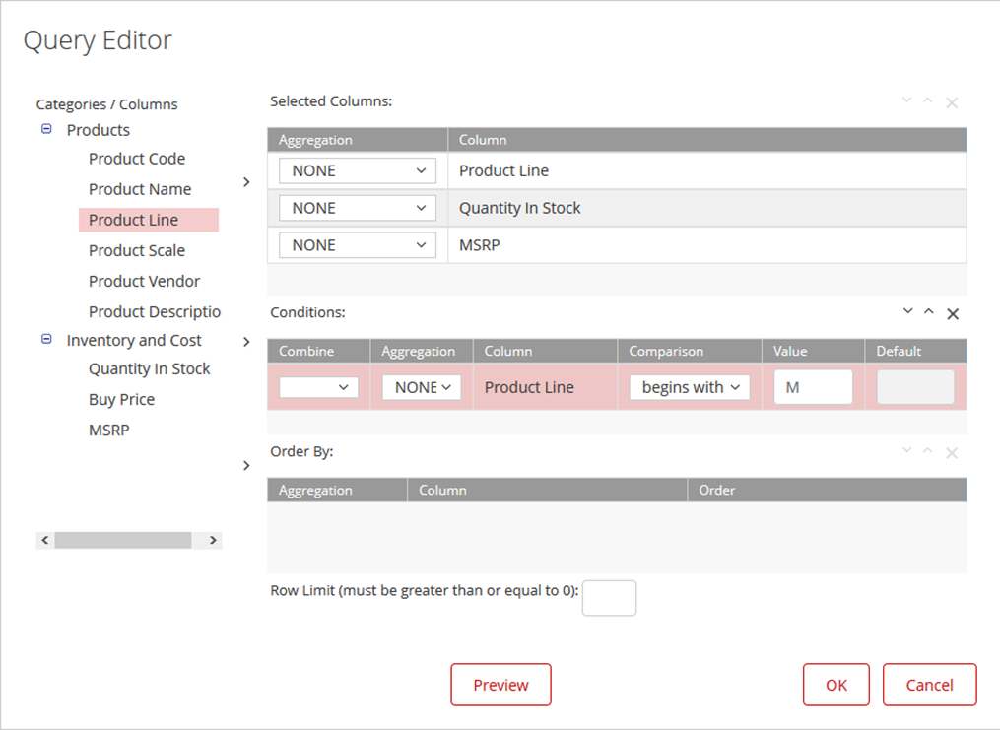
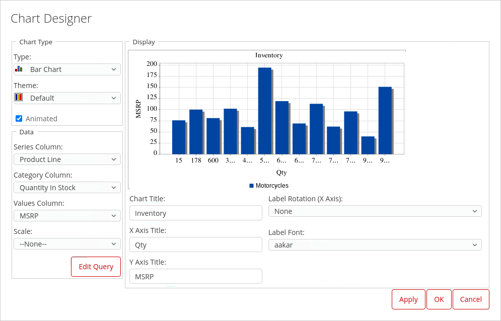

# Inventory

> **Warning:**
>
> #### Workshop - Inventory
>
> Query-based dashboards in Dashboard Designer build data tables and charts directly from a data source, without existing reports: useful for custom data views or rapid prototyping.
>
> In this workshop, you build a query-based Inventory dashboard in the Pentaho User Console, writing metadata queries on the Inventory data source and turning them into a data table and a chart.
>
> **What you'll do**
>
> * Select the 2 Column layout template and the Crystal theme, and title the dashboard
> * Build a data table from a metadata query on the Inventory data source: Product Line, Product Name, Quantity In Stock, and MSRP, sorted by Product Line
> * Build a chart from a second query, with a condition that keeps the product lines beginning with M
> * Map the query's columns onto the chart in the Chart Designer, and title the chart and its axes
> * Save the dashboard to Public > Training
>
> **Prerequisites:** [Vendor Sales](../13-dashboard-designer-vendor-sales/guide.md), and the Steel Wheels Inventory data source on the Pentaho Server
>
> **Estimated time:** 30 minutes

<figure><figcaption>
Inventory Dashboard
</figcaption></figure>

::: tabs

### 1. Template & Data Source

> **Note:**
>
> #### Dashboard Templates
>
> Creating a dashboard in Dashboard Designer starts with choosing a layout template, a theme, and the content you want to display.

<figure><figcaption>
Template - 2 column
</figcaption></figure>

1. Select the perspective drop-down and select **Home**, then select **Create New > Dashboard**.
2. On the **Templates** tab, select **2 Column**.
3. On the **Themes** tab, select **Crystal**.
4. Open the **Properties** tab, and set **Page Title** to `Inventory Dashboard`.
5. Select the **Insert Content** icon at the top right of the **Untitled 1** panel, and select **Data Table**.
6. In the **Select Data Source** dialog, select **Inventory**, and select **OK**.

<figure><figcaption>
Inventory - data source
</figcaption></figure>

> **Success:** Checkpoint: the **Query Editor** opens on the Inventory data source, with its categories in the **Categories / Columns** list.

### 2. Content

> **Note:**
>
> #### Data Table and Chart
>
> Build the left panel's data table and the right panel's chart, each from its own metadata query on the Inventory data source.

**Data Table**

<figure><figcaption>
Product Queries
</figcaption></figure>

1. In the **Categories / Columns** list, expand **Products**, select **Product Line**, and select the top arrow to move it to **Selected Columns**.
2. Add **Products > Product Name**, **Inventory and Cost > Quantity In Stock**, and **Inventory and Cost > MSRP** to **Selected Columns** the same way.
3. Sort the table by Product Line: select **Product Line** in the **Categories / Columns** list, and select the bottom arrow to move it to **Order By**. In the **Order By** area, set **Order** to **ASC** (the Query Editor adds an order as **DESC**). Select **OK**.

> **Under the hood:**
>
> #### The query editor wrote MQL, and the metadata layer wrote SQL
>
> Selected Columns became MQL `<selections>` and Order By an `<orders>`
> entry, and the metadata layer resolved the join between Products and
> Inventory and Cost from the model's relationships — you never named
> a key. The generated SQL ran on the Inventory model's connection and
> the data table rendered the rows it returned.
>
> **Why it matters:** a business user joined two tables correctly by
> clicking, because the join was decided once, by the model's author.

4. Set **Title** to `Inventory Table`, and select **Apply**.

<figure><figcaption>
Inventory Table
</figcaption></figure>

> **Success:** Checkpoint: the Inventory Table opens on Classic Cars (Vintage Cars come last) and reads Displaying 1 - 20 of 110.

***

**Chart**

5. Select the **Insert Content** icon at the top right of the **Untitled 2** panel, and select **Chart**.
6. In the **Select Data Source** dialog, select **Inventory**, and select **OK**.

<figure><figcaption>
Condition: Product Line begins with M
</figcaption></figure>

7. In the **Categories / Columns** list, expand **Products**, select **Product Line**, and select the top arrow to move it to **Selected Columns**. Expand **Inventory and Cost**, and move **Quantity In Stock** and then **MSRP** to **Selected Columns** the same way.
8. Add a condition on Product Line: select **Product Line** in the **Categories / Columns** list, and select the middle arrow (the one beside **Switch to Advanced...**) to move it to **Conditions**. The bottom arrow adds it to **Order By** instead. Set **Comparison** to **begins with**, and enter `M` in **Value**.
9. Select **OK**. The **Chart Designer** opens.
10. Fill in the **Chart Designer** fields, and select **OK**:

<figure><figcaption>
Chart
</figcaption></figure>

| Field           | Entry             |
| --------------- | ----------------- |
| Chart Type      | **Bar Chart**     |
| Theme           | **Default**       |
| Series Column   | Product Line      |
| Category Column | Quantity In Stock |
| Values Column   | MSRP              |
| Chart Title     | `Inventory`       |
| X Axis Title    | `Qty`             |
| Y Axis Title    | `MSRP`            |

11. Set **Title** to `Inventory`, and select **Apply**.

> **Success:** Checkpoint: the Inventory chart has a single series, Motorcycles, the only product line that begins with M.

12. On the toolbar, select the **Save** icon. Select the **Up One Level** icon twice, double-click **Public** and then **Training**, set **Filename** to `Inventory Dashboard`, and select **Save**.

> **Under the hood:**
>
> #### The condition ran in the database; the chart only saw matching rows
>
> "Product Line begins with M" became an MQL `<constraint>`, rendered
> as `LIKE 'M%'` in the generated WHERE clause, so non-matching rows
> were never returned. The Chart Designer then mapped the three result
> columns onto series, category and value — no second query, no
> filtering in the browser.
>
> **Why it matters:** filters here are query filters, not chart
> filters. Put the selective condition in the query and the chart stays
> fast however large the table grows.

:::

---

## Lab Files

Click a file to download it.

### Solution <!-- no-step -->

The finished dashboard: 2 Column with the Crystal theme, the Inventory Table data table (Product Line, Product Name, Quantity In Stock and MSRP, sorted ascending by Product Line) and the Inventory bar chart of Motorcycles stock against MSRP. Both panels query the Inventory model in the Steel Wheels sample data, so it must be on your server.

Also on disk at `C:\Workshop-BA-Practitioner\05-dashboard-designer\14-dashboard-designer-inventory\solution`.

[Inventory Dashboard.xdash](./files/Inventory%20Dashboard.xdash)

To open it in the User Console:

1. In **Browse Files**, select your own folder under **Home** (Home > admin, say), so the solution sits apart from your own dashboard in Public > Training.
2. In the **Folder Actions** pane, select **Upload...**, select **Browse...** and choose the `.xdash` file, and then select **OK**.
3. If the file is not listed under **Files** yet, select the **Refresh** icon (the circular arrow beside **Folders**).
4. Double-click **Inventory Dashboard** to run it, and select **Edit** on the toolbar to see each panel's query.
