# Product Performance

> **Warning:**
>
> #### Workshop - Product Performance
>
> Content linking connects Dashboard Designer panels, so a selection in one panel filters and updates the others.
>
> In this workshop, you build a three-panel dashboard in the Pentaho User Console that connects an analysis report, a pie chart, and a bar chart through parameters: selecting a product updates a territory sales chart, and selecting a territory refines an order status summary.
>
> **What you'll do**
>
> * Select the 1 and 2 layout template and the Ruby theme, and title the dashboard
> * Add the Product Sales by Year analysis, and enable content linking on its Product field
> * Build a pie chart of sales by territory from a metadata query with a `{PRODUCT}` parameter
> * Build a bar chart of order status that counts distinct orders, filtered by `{PRODUCT}` and `{TERRITORY}`
> * Map each chart's parameters to the panel that publishes them, and put them in the panel titles
> * Save the dashboard and test the cascade by selecting a product and a territory
>
> **Prerequisites:** [Vendor Sales](../13-dashboard-designer-vendor-sales/guide.md) and [Inventory](../14-dashboard-designer-inventory/guide.md), and the Product Sales by Year analysis in **Public > Steel Wheels > Widget Library > Analysis Views**
>
> **Estimated time:** 45 minutes

<figure>

<figcaption class="pcm-video-caption">Walkthrough: coming soon</figcaption>

</figure>

---

<figure>
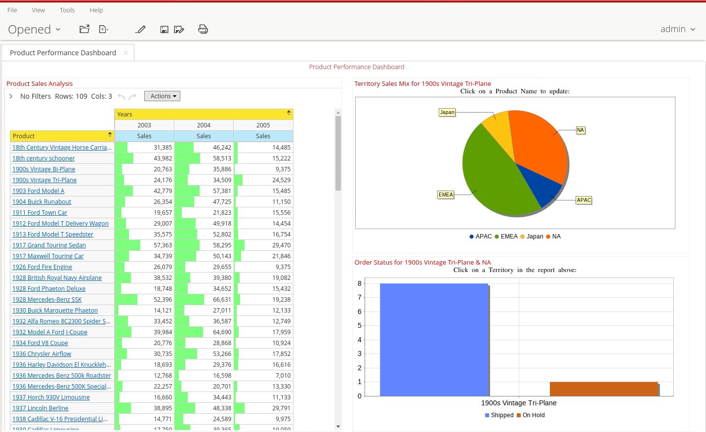
<figcaption>Content Linking</figcaption>
</figure>

::: tabs

### 1. Template & Reports

> **Note:**
>
> #### Dashboard Templates
>
> Creating a dashboard in Dashboard Designer starts with choosing a layout template, a theme, and the content you want to display.

<figure>
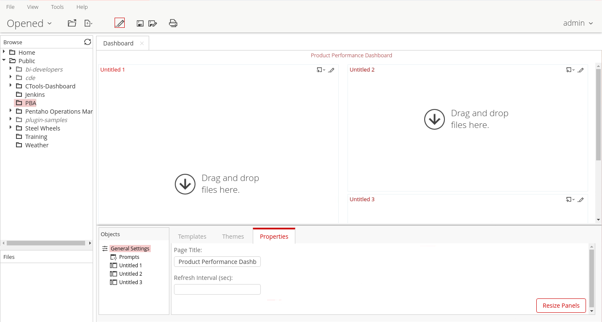
<figcaption>Template - 1 and 2</figcaption>
</figure>

1. Select the perspective drop-down and select **Home**, then select **Create New > Dashboard**.
2. On the **Templates** tab, select **1 and 2**.
3. Open the **Themes** tab, and select **Ruby**.
4. Open the **Properties** tab, and set **Page Title** to `Product Performance Dashboard`.

> **Success:** Checkpoint: the canvas shows a tall **Untitled 1** panel beside **Untitled 2** and **Untitled 3**.

***

**Product Sales by Year**

<figure>
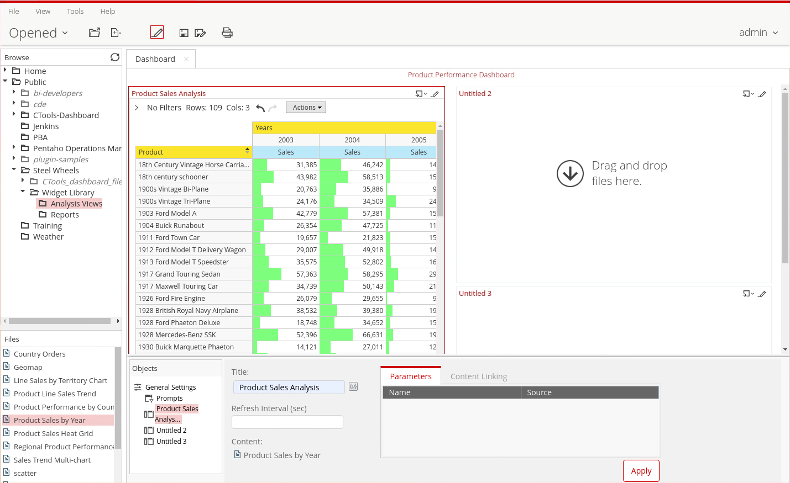
<figcaption>Product Sales Analysis</figcaption>
</figure>

5. In the **Folders** pane of the browse panel, expand **Public > Steel Wheels > Widget Library > Analysis Views**.
6. Drag **Product Sales by Year** from the **Files** pane onto the **Untitled 1** panel. (Or select the **Insert Content** icon on the **Untitled 1** panel, select **File**, and double-click **Product Sales by Year** in **Public > Steel Wheels > Widget Library > Analysis Views**.)

> **Success:** Checkpoint: the panel shows Product Sales by Year, with sales by product for 2003 to 2005.

7. Set **Title** to `Product Sales Analysis`.

To let dashboard viewers select a product in the report and have the chart on the right update with that product's values, enable content linking.

8. In the bottom pane, open the **Content Linking** tab, select **Enabled** for **Product**, and select **Apply**.

<figure>
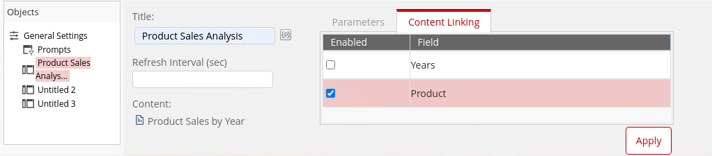
<figcaption>Content Linking - Product</figcaption>
</figure>

> **Under the hood:**
>
> #### Content linking turns a click into a published parameter
>
> Enabling Product declared an output parameter on the Analyzer panel
> — the saved `.xdash` records it as the schema level the field comes
> from — which the panel emits whenever a viewer clicks a member of
> that level. Nothing is listening yet: the click is published, not
> acted on.
>
> **Why it matters:** the report knows nothing about the chart, which
> is exactly what lets you wire any panel to any other later without
> touching the report.

### 2. Content Linking

> **Note:**
>
> #### Territory Sales Mix
>
> Add a pie chart of sales by territory for the product a viewer selects in Product Sales Analysis, and make its territories selectable in turn.

<figure>
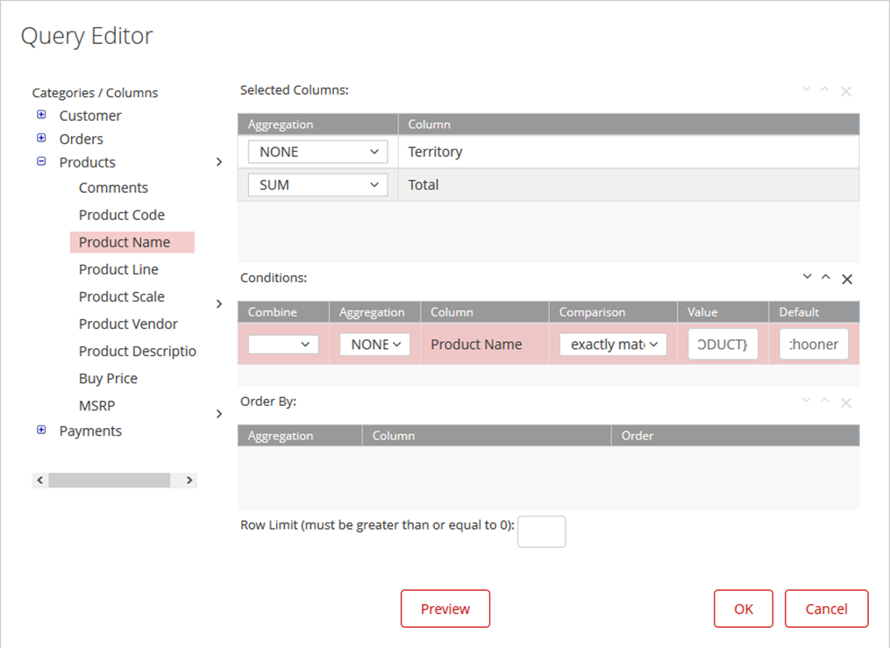
<figcaption>The Territory Sales Mix query</figcaption>
</figure>

1. Select the **Insert Content** icon at the top right of the **Untitled 2** panel, and select **Chart**.
2. In the **Select Data Source** dialog, select **Orders**, and select **OK**.
3. In the **Categories / Columns** list, select **Customer > Territory**, and select the top arrow to move it to **Selected Columns**. Select **Orders > Total**, and move it the same way. Set the **Aggregation** of **Total** to **SUM**, if it is not already.
4. Add a condition on Product Name: select **Products > Product Name** in the **Categories / Columns** list, and select the middle arrow (the one beside **Switch to Advanced...**) to move it to **Conditions**. The bottom arrow adds it to **Order By** instead. Keep **Comparison** at **exactly matches**, enter `{PRODUCT}` in **Value** and `18th century schooner` in **Default**, and select **OK**.
5. Fill in the **Chart Designer** fields, and select **OK**:

<figure>
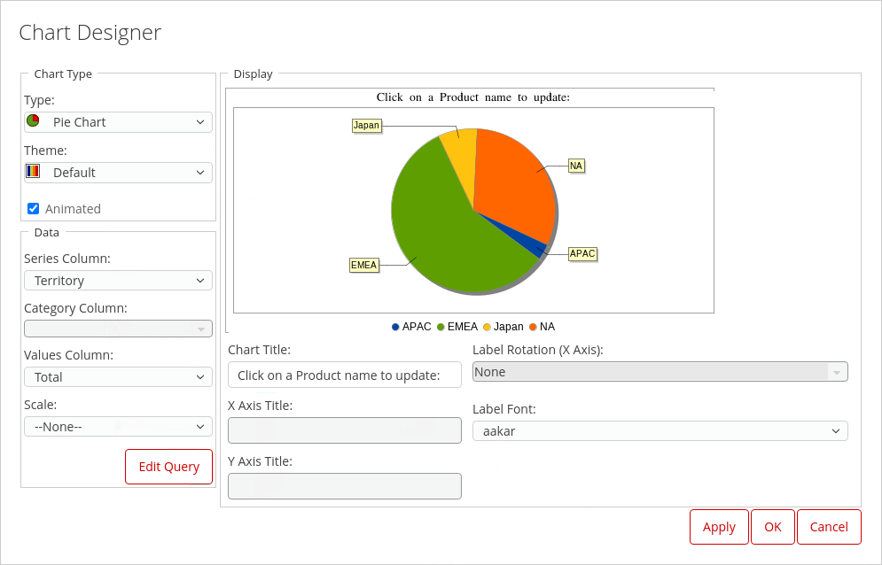
<figcaption>Pie Chart - Territory Sales</figcaption>
</figure>

| Field         | Entry                                |
| ------------- | ------------------------------------ |
| Chart Type    | **Pie Chart**                        |
| Theme         | **Legacy**                           |
| Series Column | Territory                            |
| Values Column | Total                                |
| Chart Title   | `Click on a Product Name to update:` |

> **Success:** Checkpoint: the pie shows the sales of the default product, 18th century schooner, split into APAC, EMEA, Japan and NA.

6. Set **Title** to `Territory Sales Mix for`, and select the **Add parameters to title** icon beside it. The icon adds `{PRODUCT}` to the end of the title.

<figure>
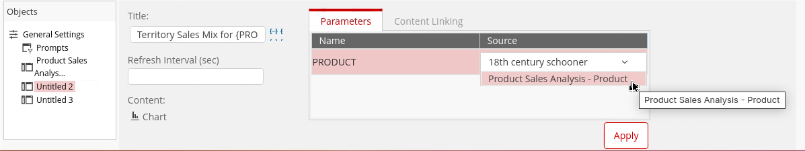
<figcaption>Add {PRODUCT} param to Title &#x26; pickup for Pie Chart.</figcaption>
</figure>

7. Take the product from the Product Sales Analysis report: in the bottom pane, open the **Parameters** tab, and set the **Source** of **PRODUCT** to **Product Sales Analysis - Product**.

<figure>
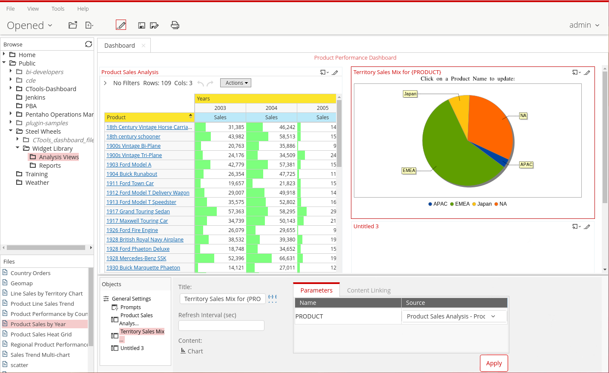
<figcaption>Pass {PRODUCT} from Product Sales Analysis</figcaption>
</figure>

8. Open the **Content Linking** tab, select **Enabled** for **Territory**, and select **Apply**.

> **Under the hood:**
>
> #### {PRODUCT} is substituted before the query runs
>
> The condition Product Name = `{PRODUCT}` is a parameterized
> constraint; the default (18th century schooner) fills it when the
> dashboard opens. Mapping the chart's PRODUCT source to *Product Sales
> Analysis – Product* subscribes the panel to the report's output: each
> click sets the parameter, the panel re-runs its metadata query with
> the new value in the WHERE clause, and the pie redraws. Enabling
> content linking on Territory makes the pie a publisher in turn.
>
> **Why it matters:** the parameter is the only contract between
> panels. The chart never touches the cube and the report never touches
> the SQL, so each can change without breaking the other.

***

**Bar Chart**

Last, add a bar chart of the number of orders for the product selected in Product Sales by Year and the territory selected in the pie.

9. Select the **Insert Content** icon at the top right of the **Untitled 3** panel, and select **Chart**.
10. In the **Select Data Source** dialog, select **Orders**, and select **OK**.

<figure>
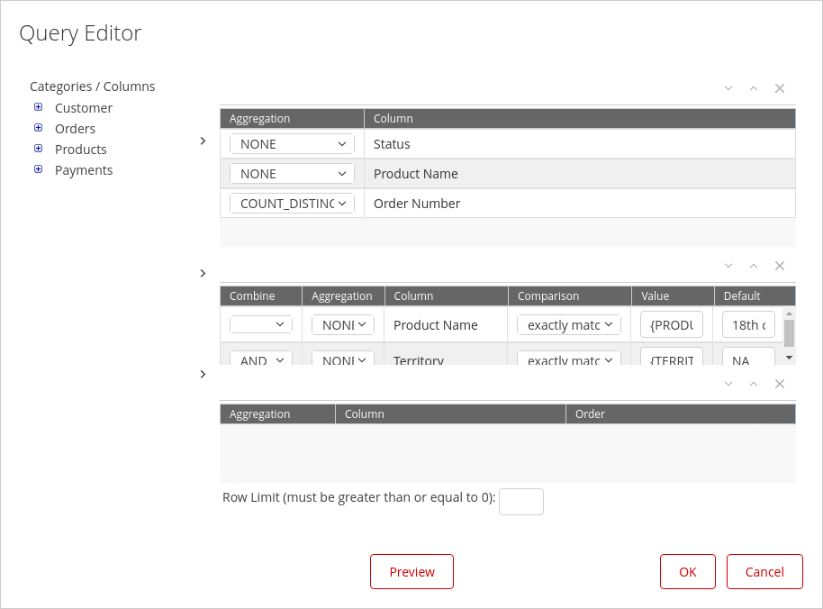
<figcaption>Query - Order Status</figcaption>
</figure>

11. In the **Categories / Columns** list, select **Orders > Status** and select the top arrow to move it to **Selected Columns**. Move **Products > Product Name** and **Orders > Order Number** to **Selected Columns** the same way.
12. To count distinct orders, set the **Aggregation** of **Order Number** to **COUNT_DISTINCT**.
13. Add two conditions: select each column in the **Categories / Columns** list and select the middle arrow (the one beside **Switch to Advanced...**) to move it to **Conditions**, then fill in its row. Select **OK**.

| Column                  | Comparison          | Value         | Default                 |
| ----------------------- | ------------------- | ------------- | ----------------------- |
| Products > Product Name | **exactly matches** | `{PRODUCT}`   | `18th century schooner` |
| Customer > Territory    | **exactly matches** | `{TERRITORY}` | `NA`                    |

14. Fill in the **Chart Designer** fields, and select **OK**:

<figure>
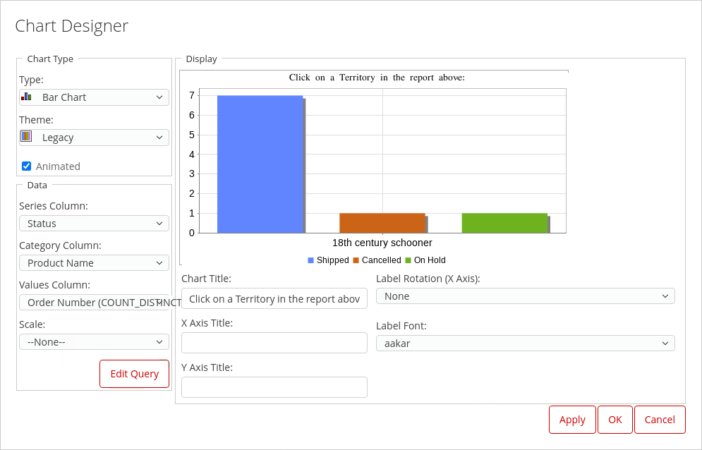
<figcaption>The Order Status bar chart in the Chart Designer</figcaption>
</figure>

| Field           | Entry                                       |
| --------------- | ------------------------------------------- |
| Chart Type      | **Bar Chart**                               |
| Theme           | **Legacy**                                  |
| Series Column   | Status                                      |
| Category Column | Product Name                                |
| Values Column   | Order Number (COUNT\_DISTINCT)              |
| Chart Title     | `Click on a Territory in the report above:` |

> **Success:** Checkpoint: with the defaults, 18th century schooner in NA, the bar chart shows 7 `Shipped` orders, 1 `On Hold` and 1 `Cancelled`.

<figure>
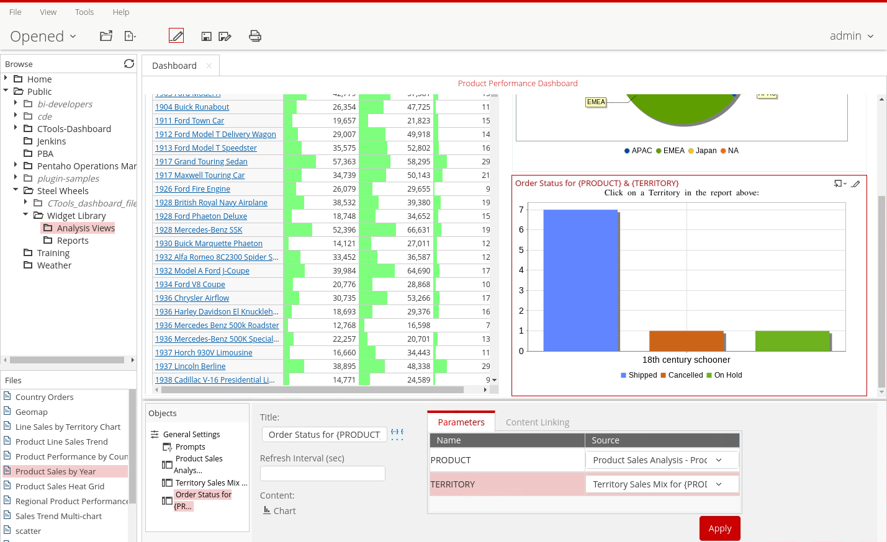
<figcaption>The Order Status panel and its parameters</figcaption>
</figure>

15. Set **Title** to `Order Status for`, and select the **Add parameters to title** icon. The icon adds `{PRODUCT} & {TERRITORY}`.
16. Take both parameters from the other panels: on the **Parameters** tab, set the **Source** of **PRODUCT** to **Product Sales Analysis - Product**, and the **Source** of **TERRITORY** to **Territory Sales Mix for {PRODUCT} - Territory**. Select **Apply**.

> **Under the hood:**
>
> #### COUNT_DISTINCT became a GROUP BY in the generated SQL
>
> Choosing an aggregation on Order Number changed that MQL selection's
> aggregation from NONE to COUNT_DISTINCT, and the metadata layer
> emitted a `SELECT` of status and product name with
> `COUNT(DISTINCT ordernumber)`, both parameterized constraints in the
> WHERE clause, and a `GROUP BY` on the non-aggregated columns. The two
> parameters come from two different publishers, so a click on the
> report re-runs the pie and then the bar; a click on the pie re-runs
> only the bar.
>
> **Why it matters:** three panels, one distinct count in the right
> place (the database), and a cascade you can trace by reading which
> panel publishes what.

***

17. On the toolbar, select the **Save** icon. Select the **Up One Level** icon twice, double-click **Public** and then **Training**, set **Filename** to `Product Performance Dashboard`, and select **Save**.

Content linking works only once the dashboard is saved. Try it:

18. On the main toolbar, select **Edit Content** to leave edit mode.

> **Success:** Checkpoint: until you click, the two chart titles read **&lt;default&gt;** where the parameters go, and the charts use the defaults (18th century schooner, NA).

19. In the Product Sales Analysis report, select **1900s Vintage Tri-Plane**.
20. In the **Territory Sales Mix** chart, select **NA**.

> **Success:** Checkpoint: after the two clicks, the pie shows EMEA 47% and NA 34% for 1900s Vintage Tri-Plane, and the bar chart shows 8 Shipped orders and 1 On Hold, as in the picture below.

<figure>

<figcaption>The dashboard after selecting a product and a territory</figcaption>
</figure>

:::

---

## Lab Files

Click a file to download it.

### Solution <!-- no-step -->

The finished dashboard: 1 and 2 with the Ruby theme, the Product Sales by Year analysis publishing Product, the Territory Sales Mix pie (Orders, filtered on {PRODUCT}) publishing Territory, and the Order Status bar chart filtered on both. The report panel opens Public > Steel Wheels > Widget Library > Analysis Views > Product Sales by Year, so that sample must be on your server.

Also on disk at `C:\Workshop-BA-Practitioner\05-dashboard-designer\15-dashboard-designer-product-performance\solution`.

[Product Performance Dashboard.xdash](./files/Product%20Performance%20Dashboard.xdash)

To open it in the User Console:

1. In **Browse Files**, select your own folder under **Home** (Home > admin, say), so the solution sits apart from your own dashboard in Public > Training.
2. In the **Folder Actions** pane, select **Upload...**, select **Browse...** and choose the `.xdash` file, and then select **OK**.
3. If the file is not listed under **Files** yet, select the **Refresh** icon (the circular arrow beside **Folders**).
4. Double-click **Product Performance Dashboard** to run it, select a product and then a territory, and select **Edit** on the toolbar to see each panel's parameters and content linking.
