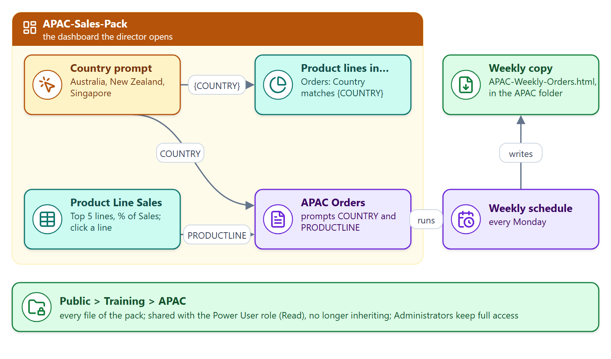
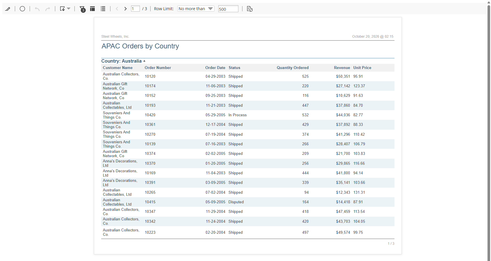
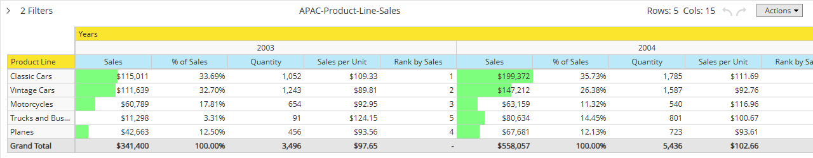
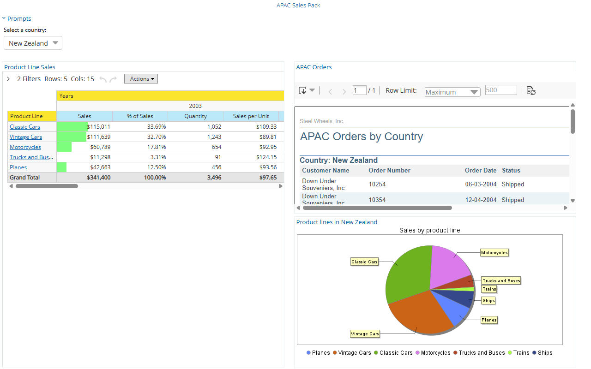

# APAC Sales Pack

> **Capstone Project — bring it all together.**

You're the analyst for Steel Wheels' APAC regional director. Every
quarter the director reviews the region with its three country
managers, and this time the pack is yours to build: an order listing
each manager can narrow to their own country, an analysis of how every
product line sells across the region's years, and one dashboard where
the director can do both without asking you.

This capstone exercises every module of the course: the User Console,
Interactive Reports, Analyzer and Dashboard Designer.

> **Objectives:**
>
> - Build an **Interactive Report**, an **Analyzer report** and a **dashboard** on the Steel Wheels sample data, each saved in your own `Public > Training > APAC` folder.
> - Make them work together: one prompt that drives two panels, and a click on the analysis that narrows the report.
> - Make the pack run itself and keep it private: a weekly schedule that drops a copy of the report into the folder, and a folder only the Power User role and administrators can open.
> - Hand the work in the way the checks read it: the folder downloaded into the capstone folder, and the report exported as the PDF the director receives.
> - Produce something portfolio-worthy ("I built this for my Practitioner course accreditation").
>
> **Estimated time:** 90 minutes for a clean, well-named pack. Re-shape and revisit as you'd like.

Here is the pack you will build, and how its pieces connect:

<div align="center">
<figure>

<figcaption>What you will build: the APAC Sales Pack</figcaption>
</figure>
</div>

Read the diagram from the prompt. The Country prompt is the one choice
the director makes, and it reaches two panels: the report through its
`COUNTRY` parameter, the chart through its own `{COUNTRY}` condition. The
analysis adds the second choice, a product line, by a click. The
schedule needs no one: it runs the same report every Monday and drops a
copy beside it. Everything lives in one folder that only Power Users and
administrators can open.

---

> **Warning:**
>
> #### Required for your course accreditation: nine checks on your own folders
>
> The course accreditation is issued only when all nine of these checks
> pass. They read your workshop folder, so put your work in exactly
> these places **before you take the exam**:
>
> | # | What must be there | Where |
> | --- | --- | --- |
> | 1 | Your Interactive Report, `APAC-Orders-by-Country.prpti` | `~/Workshop-BA-Practitioner/capstone/solution/APAC/` |
> | 2 | Your report exported to PDF, `APAC-Orders-by-Country.pdf` | `~/Workshop-BA-Practitioner/capstone/out/` |
> | 3 | Your Analyzer report, `APAC-Product-Line-Sales.xanalyzer`, filtered to the APAC territory | `~/Workshop-BA-Practitioner/capstone/solution/APAC/` |
> | 4 | Your dashboard, `APAC-Sales-Pack.xdash`, showing that analysis | `~/Workshop-BA-Practitioner/capstone/solution/APAC/` |
> | 5 | Your analysis with a **% of Sales** measure | `.../solution/APAC/APAC-Product-Line-Sales.xanalyzer` |
> | 6 | Your analysis limited to the **Top 5** product lines by Sales | `.../solution/APAC/APAC-Product-Line-Sales.xanalyzer` |
> | 7 | Your dashboard's chart, its query taking the `COUNTRY` parameter | `.../solution/APAC/APAC-Sales-Pack.xdash` |
> | 8 | The weekly schedule's first copy, `APAC-Weekly-Orders.html` | `~/Workshop-BA-Practitioner/capstone/solution/APAC/` |
> | 9 | Your `APAC` folder shared with the **Power User** role | `~/Workshop-BA-Practitioner/capstone/solution/exportManifest.xml` |
>
> Files 1, 3, 4 and 8 and the manifest arrive together when you download your `APAC` folder
> from the User Console and extract it into `capstone/solution/`
> (stage 5). File 2 is the report's own PDF export, saved into
> `capstone/out/`. Use these names exactly: the checks look for them,
> and a space in a repository name comes out of the download as a `+`.
> Select **Run checks** under **Verification checks** to see where you
> stand.

## Inputs

There is nothing to download. Every input is already on your Pentaho
Server, where the course's workshops left it:

| Source                | What it is                                                                             | Where you use it                                                           |
| --------------------- | -------------------------------------------------------------------------------------- | -------------------------------------------------------------------------- |
| **Orders**            | The Steel Wheels metadata model: customers, orders, order lines, products              | The Interactive Report, the dashboard's prompt, and any Query Editor chart |
| **SteelWheelsSales**  | The Steel Wheels cube: Markets, Product and Time, with the Sales and Quantity measures | The Analyzer report                                                        |
| **Public > Training** | The folder you made in [Pentaho User Console](../04-user-console-puc/guide.md)         | Holds your `APAC` folder                                                   |

The APAC territory holds three countries: Australia (5 customers), New
Zealand (4) and Singapore (1), with orders from April 2003 to May 2005.
Japan, Hong Kong and the Philippines are a separate territory, so they
stay out of this pack.

---

## Required behavior

Build the pack in five stages. Each maps to a module of the course, so
you can look back at the workshop that taught it.

### 1. A home for the pack *(User Console)*

Create the folder `APAC` under **Public > Training**, and save every
file of the pack there. The pack is for the regional team, not the
whole company: share the folder with the **Power User** role, with
**Read** only, and with no one else. It stops inheriting the
permissions of **Training**; administrators keep their access through
their own role. Prove it: sign in as `suzy` (a Power User), who sees
`APAC`, and as `bob` (Schedule Power User), who does not. When the
dashboard is done, add it to your **Favorites**.

### 2. The order listing *(Interactive Reports)*

An Interactive Report on the **Orders** data source, saved as
`APAC-Orders-by-Country`:

- Columns, in this order: **Customer Name**, **Order Number**, **Order Date**, **Status**, **Quantity Ordered**, **Total**. One row per order.
- Grouped by **Country**, ascending.
- Limited to the **APAC** territory. This filter is fixed: the director never sees a Territory prompt.
- Two parameters, each a filter picked from a list with a **Parameter Name**: **Country** as `COUNTRY`, with Australia included, and **Product Line** as `PRODUCTLINE`, with Classic Cars included. The included value is the default; the dashboard feeds both.
- A calculated field, `Unit Price`: the line's Total divided by its Quantity Ordered, as a number with two decimal places.
- A **Sum** on Total and on Quantity Ordered, for each country and for the whole report.
- The title `APAC Orders by Country`, the header `Steel Wheels, Inc.`, the Total column shown as whole-dollar currency and renamed `Revenue`, and a landscape page.

### 3. The director's copy *(Interactive Reports)*

The director's copy covers the whole region. Open the report, and in
the **Filters** panel edit the two parameter filters so that all three
countries and all seven product lines are included. Export the report
to **PDF** and save the file as `APAC-Orders-by-Country.pdf` in
`~/Workshop-BA-Practitioner/capstone/out/`. The checks look for it
there. Close the report without saving, so its defaults stay Australia
and Classic Cars.

From then on a weekly copy should arrive without you: **schedule** the
report to run every **Monday**, into your `APAC` folder, under the name
`APAC-Weekly-Orders`, with no date added to the name. Then run the
schedule once now, so the first copy is already in the folder when you
hand the pack in. A scheduled Interactive Report is written as a web
page, `APAC-Weekly-Orders.html`, and it runs with the parameters'
default values: the weekly copy shows Australia and Classic Cars, not
the whole region. That is what the director's PDF above is for.

### 4. The product-line analysis *(Analyzer Reports)*

An Analyzer report on the **SteelWheelsSales** cube, saved as
`APAC-Product-Line-Sales`:

- **Line** (product line) on the rows, **Years** on the columns, **Sales** and **Quantity** as the measures.
- Filtered to the **APAC** territory.
- A calculated measure, `Sales per Unit`: Sales divided by Quantity, with two decimal places.
- A **Rank** on Sales, and a data bar on Sales.
- A **% of Sales** measure: each product line's share of its year, so the column for every year adds up to 100%.
- Only the **Top 5** product lines by Sales: a numeric filter on the product line level.
- Grand totals for the rows and for the columns, so the region's total for all three years is one column.
- Saved as a **table**: that is what the dashboard shows, and a click on a product line in it is what links the report. Try the chart view on the way, and come back to the table before you save.

### 5. The dashboard, and handing it in *(Dashboard Designer, User Console)*

A dashboard saved as `APAC-Sales-Pack`:

- A template with three panels, a theme, and the page title `APAC Sales Pack`.
- Three panels: your analysis, your report, and a chart.
- The chart is a **Query Editor** chart on the **Orders** model: **Total** by **Product Line**, with a condition that **Country** exactly matches `{COUNTRY}`, so the chart shows one country's product lines. Its panel title names the country: `Product lines in {COUNTRY}`.
- A dashboard prompt, **Country**, listing only the APAC countries, wired to the report's `COUNTRY` parameter **and** to the chart's. One choice in the prompt changes both panels.
- Content linking: the analysis publishes the product line a viewer clicks, and the report's `PRODUCTLINE` parameter takes it.

Then hand the pack in: in **Browse Files**, select your `APAC` folder,
**Download...** it, and extract `APAC.zip` into
`~/Workshop-BA-Practitioner/capstone/solution/`, so that the three
files and the weekly copy sit in `solution/APAC/` and the download's
`exportManifest.xml` sits in `solution/`.

---

## Suggested shape

```text
Public > Training > APAC                 (the User Console)
├── APAC-Orders-by-Country               Interactive Report; parameters COUNTRY and PRODUCTLINE
├── APAC-Product-Line-Sales              Analyzer; Line by Years, Top 5, % of Sales, APAC only
├── APAC-Sales-Pack                      Dashboard; prompt → report and chart, analysis → report
└── APAC-Weekly-Orders.html              the schedule's output, every Monday
                                         (the folder: shared with Power User, Read)

~/Workshop-BA-Practitioner/capstone/    (your machine)
├── solution/APAC/                       the folder above, downloaded: three files with a .locale each, and the weekly copy
│                                        (and solution/exportManifest.xml beside the folder: it records the sharing)
└── out/APAC-Orders-by-Country.pdf       the report's PDF export
```

Make the two folders before you start, in a terminal:

```bash
mkdir -p ~/Workshop-BA-Practitioner/capstone/solution ~/Workshop-BA-Practitioner/capstone/out
```

`~` is your home folder, so the full path is
`/home/<your user name>/Workshop-BA-Practitioner/capstone`. The repository
folder is yours to create.

---

## Hints for the tricky bits

- **A parameter is a filter with a name.** In the filter dialog, **Parameter Name** turns the filter into a parameter that a dashboard can feed; without it the filter stays fixed. The report's own viewer shows no prompt for it, so you change its values in the **Filters** panel. The fixed APAC filter can be typed as a condition; the two parameters are better picked from a list, so the dashboard can offer the same values. The list offers every country in the world: include the APAC ones.
- **One row per order.** With no product column in the report, the lines of each order are summed into one row. Add a product column and the rows split by product again.
- **The two tools' totals differ, and both are right.** The Orders model's Total is each line's quantity times its unit price; the cube's Sales measure is the fact table's total price. Over APAC the gap is a few hundred dollars. See the figures under **Verification checks**.
- **Content linking has two ends.** The analysis publishes a level once **Content Linking** is enabled for it; the report receives it only through a parameter it already has. Build the report's parameters first.
- **The dashboard prompt's list** can be a **Static List** of the three countries, each with the same label and value. A **Metadata List** from the Orders model also works, with a condition that Territory exactly matches APAC; without the condition every country in the world is offered.
- **Every parameter has a value.** A parameter picked from a list always passes its included values, so the report never shows "everything" by itself. To see the whole region, edit both filters in the **Filters** panel and include every value. A list filter you reopen may show as **Specify a condition**: select **Select from a list** again to add values.
- **A Top 5 changes the totals.** With the numeric filter on, the Grand Total and each year's 100% are the five lines shown, not the whole region. Take the filter off for a moment to see all seven lines and the region's full total.
- **One prompt, two parameters.** A prompt feeds every panel whose parameter takes it as its **Source**. The chart's parameter exists once its query has a condition whose value is `{COUNTRY}`; give it a default value, such as Australia, so the chart has something to show before anyone chooses.
- **A schedule's output name.** The schedule dialog's **Schedule Name** is also the name of what it generates, and **Generated Content Location** is chosen with **Select**. Leave **Append timestamp to generated content** clear, or the file will not be called `APAC-Weekly-Orders.html`; **Overwrite existing files with same name** keeps one file if you run it twice. The parameters step is empty, because the report's parameters keep their defaults. The **Schedules** perspective lists your schedule: select its check box, and the toolbar's run button runs it now.
- **Sharing a folder.** A folder's **Properties** has a **Share** tab. Clear **Inherits folder permissions** before you change anything, remove the roles that should not see it, and add the one that should, with **Read**.
- **Download names.** The download writes a space in a file name as `+`. Keep the dashes.
- **The PDF export** downloads a file named after the report. Save it under the name the check expects, in `capstone/out/`.

---

## Lab Files

_No bundled files for this lab._ The data is the Steel Wheels sample
on your server, your work lives in **Public > Training > APAC**, and
the accreditation checks read `~/Workshop-BA-Practitioner/capstone/`.
Nothing else in the capstone is supplied: the pack is yours to build.

---

## Verification checks

> **Warning:** These nine checks decide your course accreditation, and
> they look only in `~/Workshop-BA-Practitioner/capstone/`: in
> `solution/APAC/` your `APAC-Orders-by-Country.prpti`, your
> `APAC-Product-Line-Sales.xanalyzer` (filtered to APAC, with a % of
> Sales measure and a Top 5), your `APAC-Sales-Pack.xdash` (showing that
> analysis, and a chart that takes `COUNTRY`) and the schedule's
> `APAC-Weekly-Orders.html`; in `solution/` the download's
> `exportManifest.xml`, which records the folder shared with Power User;
> and in `out/` your `APAC-Orders-by-Country.pdf`. Download and export
> your work there before you take the exam.

After downloading the folder and exporting the PDF, select **Run
checks** below to confirm each file landed where expected. The checks
confirm that the files exist, that the analysis is filtered to the APAC
territory with a % of Sales measure and a Top 5, that the dashboard
shows your own analysis and a chart that takes the `COUNTRY` parameter,
that the schedule has delivered its first copy, and that the folder is
shared with the Power User role. Check
the numbers yourself: with all three countries and all seven product
lines included in its filters, a correct report lists 38 orders and
these totals, whichever template and formatting you chose:

| Country     | Orders | Quantity Ordered | Revenue        |
| ----------- | -----: | ---------------: | -------------: |
| Australia   | 19     | 6,246            | $630,525       |
| New Zealand | 15     | 5,396            | $535,481       |
| Singapore   | 4      | 1,236            | $115,426       |
| **Total**   | **38** | **12,878**       | **$1,281,432** |

The analysis shows these figures for the region's top five product
lines. Its **Grand Total** column carries the three years together; the
Quantity, Sales per Unit and Rank sit under each year:

| Product line     | Sales, all years | % of Sales, all years | Sales 2003   | Sales 2004   | Sales 2005   |
| ---------------- | ---------------: | --------------------: | -----------: | -----------: | -----------: |
| Classic Cars     | $411,956         | 33.40%                | $115,011     | $199,372     | $97,574      |
| Vintage Cars     | $364,539         | 29.56%                | $111,639     | $147,212     | $105,688     |
| Motorcycles      | $189,818         | 15.39%                | $60,789      | $63,159      | $65,870      |
| Trucks and Buses | $145,666         | 11.81%                | $11,298      | $80,634      | $53,735      |
| Planes           | $121,426         | 9.84%                 | $42,663      | $67,681      | $11,082      |
| **Grand Total**  | **$1,233,405**   | **100.00%**           | **$341,400** | **$558,057** | **$333,948** |

The year totals for Quantity are 3,496, 5,436 and 3,379, so 12,311 units
for the five lines. Classic Cars ranks first by Sales in 2003 and 2004,
and Vintage Cars in 2005, when its Sales per Unit is $99.05. Ships
($38,393) and Trains ($9,907) are the two lines the Top 5 leaves out:
with the filter off, the region's Grand Total is $1,281,706 for 12,878
units.

On the dashboard, with **Australia** chosen in the prompt and
**Classic Cars** clicked in the analysis, the report shows 12 orders
and a revenue of $192,986, and the chart is titled **Product lines in
Australia**. Choose **New Zealand** and both the report and the chart
change.

> **Under the hood:**
>
> #### Why the report says $1,281,432 and the analysis, without its Top 5, $1,281,706
>
> The two tools read the same database through different models. The
> Orders metadata model computes **Total** for each order line as its
> quantity times its unit price, in whole dollars, so the report's
> revenue is a sum of those. The SteelWheelsSales cube's **Sales**
> measure sums the fact table's own total-price column, which keeps the
> cents and a few line-level corrections. Over 370 APAC order lines the
> gap is $274.
>
> **Why it matters:** when two reports disagree, the first question is
> which model each one reads, not which one is wrong. A business
> analyst who can explain a $274 difference in one sentence is trusted
> with the next one.

---

## Deliverables

Your `APAC` folder in the repository, and the capstone folder on disk:

1. `APAC-Orders-by-Country` — the Interactive Report, with its two parameters, its calculated field and its totals
2. `APAC-Product-Line-Sales` — the Analyzer report, filtered to APAC, with its calculated measure, % of Sales, rank, data bar and Top 5
3. `APAC-Sales-Pack` — the dashboard: the Country prompt feeding the report and the chart, and the analysis linked to the report
4. `APAC-Weekly-Orders.html` — the weekly schedule's first run, in the folder
5. The `APAC` folder itself, shared with the Power User role
6. `~/Workshop-BA-Practitioner/capstone/solution/` — the folder downloaded: `APAC/` with the three files and the weekly copy, and `exportManifest.xml`
7. `~/Workshop-BA-Practitioner/capstone/out/APAC-Orders-by-Country.pdf` — the report's PDF export

> **Warning:** Download into `capstone/solution/`, not into the course
> folder. Course content is refreshed from the repository on every
> launch, so anything you leave there will be overwritten. Reinstalling
> or upgrading the course never touches `capstone/solution/` or
> `capstone/out/`.

This becomes a portfolio piece: name things clearly, keep the folder
tidy, and be ready to explain the $274.

---

## Build outline and hints <!-- no-step -->

One section per piece, in the order you build them. Each says what the
piece must do, which requirement it meets, and what a correct build
shows. The hints name a dialog or a technique; the settings are yours
to work out.

:::: tabs

### 1. The APAC folder

**Must do:** a folder named `APAC` under **Public > Training**, shared
with the Power User role (Read) and no longer inheriting. Requirement 1.

> **Success:** Checkpoint: signed in as `suzy`, **Public > Training** shows `APAC`; signed in as `bob`, it does not.

<details>
<summary>Hints</summary>

- **Browse Files**, then **New Folder...** in the **Folder Actions** pane, as you did for `Training` itself.
- Every **Save As** in the pack ends in this folder: **Public > Training > APAC**.
- Sharing is on the folder's **Properties**, **Share** tab, as the [Pentaho User Console](../04-user-console-puc/guide.md) workshop showed for users and roles. Sign out and back in as another user to see what they see; sign back in as `admin` to carry on.

</details>

### 2. APAC-Orders-by-Country

**Must do:** the report of requirement 2, saved as
`APAC-Orders-by-Country` in your `APAC` folder.

> **Success:** Checkpoint: with the defaults, Australia and Classic Cars, 12 orders and $192,986. With every APAC country and every product line included in the filters, three country groups, 38 order rows, and a report total of $1,281,432 with 12,878 units.

<details>
<summary>Hints</summary>

- A field reaches the report three ways: double-click it, drag it onto the canvas, or right-click it. The right-click menu is the quickest way to make a **group**.
- A filter picked **from a list** offers the values the model holds; a filter **specified as a condition** is typed. The Territory filter takes a condition; the two parameters take a list, each with a **Parameter Name** and one value in the included list as the default.
- **Create Calculated Field** needs a **Data Format** before it closes; **Numeric** is enough. Double-click a field in **Select Fields** to put its name in the formula.
- Number formats live on the **Formatting** tab, under **Numeric Format**, once you select a data cell of the column (not its header): `$#,###` for Revenue, `#,###.00` for Unit Price. The report's grand total is a cell of its own: select it and set its format too.
- Rename a column by double-clicking its header.
- A **Summary** is set on the drop-down arrow that appears on the column header; it appears for each group and for the report.
- The title and header are edited in place on the first page. Page orientation is under **Page Setup...** on the **General** tab.

</details>

### 3. The PDF, and the weekly copy

**Must do:** the report of stage 2 exported to PDF, saved as
`~/Workshop-BA-Practitioner/capstone/out/APAC-Orders-by-Country.pdf`;
and the report scheduled every Monday as
`APAC-Weekly-Orders` in your `APAC` folder, run once now. Requirement 3.

> **Success:** Checkpoint: the PDF opens with the three country groups and the report total; the row **Your report exported to PDF** turns green.

<details>
<summary>Hints</summary>

- Open the report from **Browse Files**, show the **Filters** panel, and **Edit** each parameter filter to include every value. The **Export** button's drop-down on the Interactive Toolbar lists the formats.
- The browser names the download after the report. Move or rename it so the path above is exact.
- **Schedule...** is in the **File Actions** pane once the report is selected in **Browse Files**, as in the [Pentaho User Console](../04-user-console-puc/guide.md) workshop. Its recurrence is **Weekly**, with **Monday** selected.
- The **Schedules** perspective lists the schedule; select its check box and run it now. Refresh **Browse Files** to see `APAC-Weekly-Orders` arrive.

</details>

### 4. APAC-Product-Line-Sales

**Must do:** the analysis of requirement 4, saved as
`APAC-Product-Line-Sales` in your `APAC` folder.

> **Success:** Checkpoint: five product lines, Classic Cars first by Sales at $411,956 and 33.40% of the five, a column grand total of $1,233,405 and 12,311 units.

<details>
<summary>Hints</summary>

- Drag the levels and measures to **Rows**, **Columns** and **Measures** in the **Layout** panel, as in [Sales Analysis](../10-analyzer-reports-sales-analysis/guide.md).
- The APAC filter is a filter on **Territory**, picked from a list, and this time it stays a filter: no parameter name.
- The calculated measure, the % of Sales and the rank are all under **User Defined Measure** on a measure header's right-click menu. The data bar is a **Conditional Formatting** choice on the same menu.
- The Top 5 is **Top 10...** on the **Line** header's right-click menu, which opens the **Numeric Filter** dialog of [Sales Analysis](../10-analyzer-reports-sales-analysis/guide.md): **Top** `5` Line by **Sales**.
- Grand totals live under **Report Options...** on the **Layout** panel.
- **View As** switches between the table and a chart; the chart type is in its drop-down. Switch back to the table before you save.

</details>

### 5. APAC-Sales-Pack

**Must do:** the dashboard of requirement 5, saved as `APAC-Sales-Pack`
in your `APAC` folder.

> **Success:** Checkpoint: with **Australia** in the prompt and **Classic Cars** clicked in the analysis, the report shows 12 orders and $192,986, and the chart is **Product lines in Australia**. Select **Vintage Cars** in the analysis and the report shows 14 orders and $189,632; switch the prompt to **New Zealand** and it shows 9 orders and $155,606, and the chart becomes **Product lines in New Zealand**.

<details>
<summary>Hints</summary>

- Drag your two files from the **Files** pane onto the panels, or use **Insert Content > File** on each panel. The report's parameters, `COUNTRY` and `PRODUCTLINE`, are listed under the panel once it is placed.
- The prompt is built on the **Prompts** toolbar, as in [Vendor Sales](../13-dashboard-designer-vendor-sales/guide.md): a **Metadata List** from the **Orders** model, with a condition on Territory. Its name is what the viewer reads.
- Linking is two steps, as in [Product Performance](../15-dashboard-designer-product-performance/guide.md): on the analysis panel's **Content Linking** tab select **Enabled** for **Line**, then set the **Source** of the report's `PRODUCTLINE` parameter to that panel. The `COUNTRY` parameter's source is the prompt.
- A panel's **Title** is in the bottom pane when the panel is selected: type it, press `Enter`, and select **Apply**. Without `Enter` the title is not kept.
- Three panels need a three-panel template; changing the template keeps the panels you have filled.
- The chart is **Insert Content > Chart** on the third panel, as in [Product Performance](../15-dashboard-designer-product-performance/guide.md): the Query Editor first, then the Chart Designer. Its condition's value is `{COUNTRY}`, and the panel's **Parameters** tab then lists `COUNTRY` for you to give a **Source**: the prompt.

</details>

### 6. Hand in the pack

**Must do:** your `APAC` folder downloaded and extracted into
`~/Workshop-BA-Practitioner/capstone/solution/`, and the PDF of
stage 3 in `capstone/out/`. Requirement 5, and the nine checks.

> **Success:** Checkpoint: `solution/APAC/` holds the three files, each beside a `.locale` file, and `APAC-Weekly-Orders.html`; `solution/` holds the `exportManifest.xml` the download adds; every check under **Verification checks** is green.

<details>
<summary>Hints</summary>

- With the folder selected in **Browse Files**, **Download...** is in the **Folder Actions** pane. The browser saves `APAC.zip`.
- Extract it with the destination set to `capstone/solution/` exactly; the zip carries the `APAC/` folder itself. In a terminal: `unzip ~/Downloads/APAC.zip -d ~/Workshop-BA-Practitioner/capstone/solution`
- If a check fails, its message says which file it looked for and where. Rename or move, and **Run checks** again.

</details>

::::

---

## Stretch: the pack without a single click <!-- no-step -->

Not part of the accreditation. Next quarter the director wants the same
pack for EMEA, and the quarter after for NA. Could you set up the
folder, its sharing, the weekly schedule and the hand-in **without the
User Console**, so that a second region takes minutes? Think about it
before you open the panel: which parts of your pack are files, and
which are settings the server keeps?

> **Under the hood:**
>
> #### One answer: the server's REST API
>
> Everything the User Console does, it does by calling the Pentaho
> Server's REST API, so anything you clicked can be scripted with
> `curl` and a user who may do it. Four calls cover the pack:
>
> | What you clicked | The call |
> | --- | --- |
> | **Save As** each file into **Public > Training > APAC** (or **Upload...** a zip of them) | `POST /pentaho/api/repo/files/import`, a form with `importDir` and the zip as `fileUpload` |
> | **Properties > Share**, Power User with **Read** | `PUT /pentaho/api/repo/files/:public:Training:APAC/acl`, an XML `repositoryFileAclDto`: `entriesInheriting` false, an ace for `Power User` with permission `0` (Read) |
> | **Schedule...**, **Weekly**, **Monday**, and **Run Now** | `POST /pentaho/plugin/scheduler-plugin/api/scheduler/job` with the input file, the output file and a `complexJobTrigger`, then `POST .../scheduler/triggerNow` with the job id it returns |
> | **Download...** the folder | `GET /pentaho/api/repo/files/:public:Training:APAC/download?withManifest=true` |
>
> A repository path is written with colons, `/public/Training/APAC`
> as `:public:Training:APAC`. The ACL call accepts XML only, and the job
> is named exactly like its output file: with any other name the
> scheduler writes into your home folder instead.
>
> What the API does not do for you is the thinking. The report, the
> analysis and the dashboard are files you designed, so a new region
> starts from copies of them with the filters changed. And the
> director's whole-region PDF stays an export from the report viewer:
> the report's parameters are hidden, so a scheduled or scripted run
> gets only their defaults.
>
> **Why it matters:** the first pack is design work; the tenth is
> operations. A business analyst who knows that every click is an API
> call can hand the repetitive part to a script, or to the team that
> runs the server, and keep the design work.

---

## Optional: Screenshots of One Solution

> **Note:**
>
> #### Use these only if you are stuck
>
> These are the three pieces of one working pack, as the User Console
> shows them. They show what each piece contains, not how any dialog
> was filled in: the settings are yours to work out from the outline
> and hints above. Your pack may look different and still pass every
> check.

<details>
<summary>Show the screenshots of one solution</summary>

<div align="center">
<figure>

<figcaption>APAC-Orders-by-Country</figcaption>
</figure>
</div>

<div align="center">
<figure>

<figcaption>APAC-Product-Line-Sales</figcaption>
</figure>
</div>

<div align="center">
<figure>

<figcaption>APAC-Sales-Pack</figcaption>
</figure>
</div>

</details>
