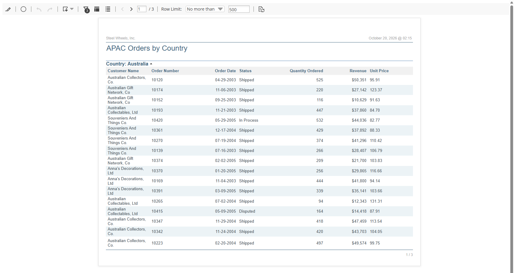
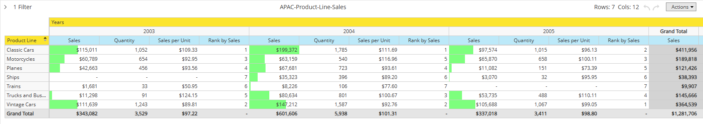
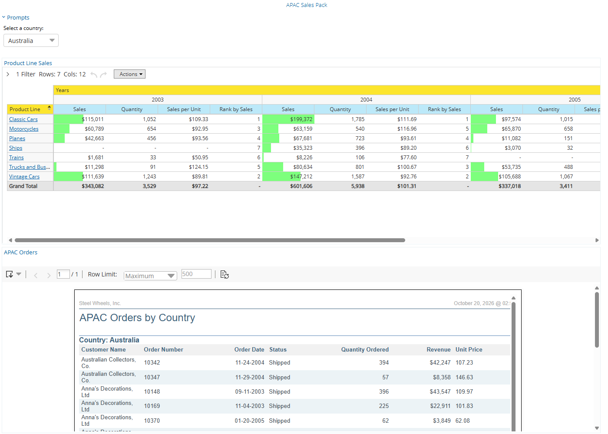

# APAC Sales Pack

> **Capstone Project — bring it all together.**

You're the analyst for Steel Wheels' APAC regional director. Every
quarter the director reviews the region with its three country
managers, and this time the pack is yours to build: an order listing
each manager can narrow to their own country, an analysis of how every
product line sells across the region's years, and one dashboard where
the director can do both without asking you.

This capstone exercises every module of the course: the User Console,
Interactive Reports, Analyzer and Dashboard Designer.

> **Objectives:**
>
> - Build an **Interactive Report**, an **Analyzer report** and a **dashboard** on the Steel Wheels sample data, each saved in your own `Public > Training > APAC` folder.
> - Make them work together: prompts the director can use, and a click on the analysis that narrows the report.
> - Hand the work in the way the checks read it: the folder downloaded into the capstone folder, and the report exported as the PDF the director receives.
> - Produce something portfolio-worthy ("I built this for my Practitioner course accreditation").
>
> **Estimated time:** 90-120 minutes for a clean, well-named pack. Re-shape and revisit as you'd like.

---

> **Warning:**
>
> #### Required for your course accreditation: four checks on your own folders
>
> The course accreditation is issued only when all four of these checks
> pass. They read your workshop folder, so put your work in exactly
> these places **before you take the exam**:
>
> | # | What must be there | Where |
> | --- | --- | --- |
> | 1 | Your Interactive Report, `APAC-Orders-by-Country.prpti` | `C:\Workshop-BA-Practitioner\capstone\solution\APAC\` |
> | 2 | Your report exported to PDF, `APAC-Orders-by-Country.pdf` | `C:\Workshop-BA-Practitioner\capstone\out\` |
> | 3 | Your Analyzer report, `APAC-Product-Line-Sales.xanalyzer`, filtered to the APAC territory | `C:\Workshop-BA-Practitioner\capstone\solution\APAC\` |
> | 4 | Your dashboard, `APAC-Sales-Pack.xdash`, showing that analysis | `C:\Workshop-BA-Practitioner\capstone\solution\APAC\` |
>
> Files 1, 3 and 4 arrive together when you download your `APAC` folder
> from the User Console and extract it into `capstone\solution\`
> (stage 5). File 2 is the report's own PDF export, saved into
> `capstone\out\`. Use these names exactly: the checks look for them,
> and a space in a repository name comes out of the download as a `+`.
> Select **Run checks** under **Verification checks** to see where you
> stand.

## Inputs

There is nothing to download. Every input is already on your Pentaho
Server, where the course's workshops left it:

| Source | What it is | Where you use it |
| --- | --- | --- |
| **Orders** | The Steel Wheels metadata model: customers, orders, order lines, products | The Interactive Report, the dashboard's prompt, and any Query Editor chart |
| **SteelWheelsSales** | The Steel Wheels cube: Markets, Product and Time, with the Sales and Quantity measures | The Analyzer report |
| **Public > Training** | The folder you made in [Pentaho User Console](../04-user-console-puc/guide.md) | Holds your `APAC` folder |

The APAC territory holds three countries: Australia (5 customers), New
Zealand (4) and Singapore (1), with orders from April 2003 to May 2005.
Japan, Hong Kong and the Philippines are a separate territory, so they
stay out of this pack.

---

## Required behavior

Build the pack in five stages. Each maps to a module of the course, so
you can look back at the workshop that taught it.

### 1. A home for the pack *(User Console)*

Create the folder `APAC` under **Public > Training**, and save every
file of the pack there. When the dashboard is done, add it to your
**Favorites**, and put the report on a weekly **schedule** so the
director's copy arrives without you (its output can go to your home
folder).

### 2. The order listing *(Interactive Reports)*

An Interactive Report on the **Orders** data source, saved as
`APAC-Orders-by-Country`:

- Columns, in this order: **Customer Name**, **Order Number**, **Order Date**, **Status**, **Quantity Ordered**, **Total**. One row per order.
- Grouped by **Country**, ascending.
- Limited to the **APAC** territory. This filter is fixed: the director never sees a Territory prompt.
- Two prompts, each picked from a list: **Country**, with the parameter name `COUNTRY`, and **Product Line**, with the parameter name `PRODUCTLINE`. The dashboard feeds both.
- A calculated field, `Unit Price`: the line's Total divided by its Quantity Ordered, as a number with two decimal places.
- A **Sum** on Total and on Quantity Ordered, for each country and for the whole report.
- The title `APAC Orders by Country`, the header `Steel Wheels, Inc.`, the Total column shown as whole-dollar currency and renamed `Revenue`, and a landscape page.

### 3. The director's copy *(Interactive Reports)*

The director's copy covers the whole region: with all three countries
and all seven product lines selected in the prompts, export the report
to **PDF** and save the file as `APAC-Orders-by-Country.pdf` in
`C:\Workshop-BA-Practitioner\capstone\out\`. The checks look for it
there.

### 4. The product-line analysis *(Analyzer Reports)*

An Analyzer report on the **SteelWheelsSales** cube, saved as
`APAC-Product-Line-Sales`:

- **Line** (product line) on the rows, **Years** on the columns, **Sales** and **Quantity** as the measures.
- Filtered to the **APAC** territory.
- A calculated measure, `Sales per Unit`: Sales divided by Quantity, with two decimal places.
- A **Rank** on Sales, and a data bar on Sales.
- Grand totals for the rows and for the columns, so the region's total for all three years is one column.
- Saved as a **table**: that is what the dashboard shows, and a click on a product line in it is what links the report. Try the chart view on the way, and come back to the table before you save.

### 5. The dashboard, and handing it in *(Dashboard Designer, User Console)*

A dashboard saved as `APAC-Sales-Pack`:

- A template with at least two panels, a theme, and the page title `APAC Sales Pack`.
- One panel showing your analysis, one showing your report. A third panel with a Query Editor chart of APAC sales by country, from the Orders model, is optional.
- A dashboard prompt, **Country**, listing only the APAC countries, wired to the report's `COUNTRY` parameter.
- Content linking: the analysis publishes the product line a viewer clicks, and the report's `PRODUCTLINE` parameter takes it.

Then hand the pack in: in **Browse Files**, select your `APAC` folder,
**Download...** it, and extract `APAC.zip` into
`C:\Workshop-BA-Practitioner\capstone\solution\`, so that the three
files sit in `solution\APAC\`.

---

## Suggested shape

```text
Public > Training > APAC                 (the User Console)
├── APAC-Orders-by-Country               Interactive Report; prompts COUNTRY and PRODUCTLINE
├── APAC-Product-Line-Sales              Analyzer; Line by Years, Sales and Quantity, APAC only
└── APAC-Sales-Pack                      Dashboard; prompt → report, analysis → report

C:\Workshop-BA-Practitioner\capstone\    (your machine)
├── solution\APAC\                       the folder above, downloaded: the three files, each with a .locale
│                                        (and solution\exportManifest.xml beside the folder)
└── out\APAC-Orders-by-Country.pdf       the report's PDF export
```

The installer makes `capstone\solution\` and `capstone\out\` for you,
empty. If `C:\Workshop-BA-Practitioner\` has no `capstone` folder (the
course was installed before the capstone was added), create
`capstone\solution\` and `capstone\out\` there yourself. The repository
folder is yours to create.

---

## Hints for the tricky bits

- **A prompt is a filter with a name.** In the filter dialog, **Parameter Name** turns the filter into a prompt; without it the filter stays fixed. The fixed APAC filter can be typed as a condition; a prompt is better picked from a list, so the dashboard can offer the same values.
- **One row per order.** With no product column in the report, the lines of each order are summed into one row. Add a product column and the rows split by product again.
- **The two tools' totals differ, and both are right.** The Orders model's Total is each line's quantity times its unit price; the cube's Sales measure is the fact table's total price. Over APAC the gap is a few hundred dollars. See the figures under **Verification checks**.
- **Content linking has two ends.** The analysis publishes a level once **Content Linking** is enabled for it; the report receives it only through a parameter it already has. Build the report's prompts first.
- **The dashboard prompt's list** can be a **Static List** of the three countries, each with the same label and value. A **Metadata List** from the Orders model also works, with a condition that Territory exactly matches APAC; without the condition every country in the world is offered.
- **Every prompt has a value.** A prompt picked from a list always passes at least one value, its default, so the report never shows "everything" by itself. To see the whole region, select every value in both prompts.
- **Download names.** The download writes a space in a file name as `+`. Keep the dashes.
- **The PDF export** downloads a file named after the report. Save it under the name the check expects, in `capstone\out\`.

---

## Lab Files

_No bundled files for this lab._ The data is the Steel Wheels sample
on your server, your work lives in **Public > Training > APAC**, and
the accreditation checks read `C:\Workshop-BA-Practitioner\capstone\`.
Nothing else in the capstone is supplied: the pack is yours to build.

---

## Verification checks

> **Warning:** These four checks decide your course accreditation, and
> they look only in `C:\Workshop-BA-Practitioner\capstone\`: in
> `solution\APAC\` your `APAC-Orders-by-Country.prpti`, your
> `APAC-Product-Line-Sales.xanalyzer` filtered to APAC, and your
> `APAC-Sales-Pack.xdash` showing that analysis; and in `out\` your
> `APAC-Orders-by-Country.pdf`. Download and export your work there
> before you take the exam.

After downloading the folder and exporting the PDF, select **Run
checks** below to confirm each file landed where expected. The checks
confirm that the four files exist, that the analysis is filtered to the
APAC territory, and that the dashboard shows your own analysis. Check
the numbers yourself: with all three countries and all seven product
lines selected in its prompts, a correct report lists 38 orders and
these totals, whichever template and formatting you chose:

| Country | Orders | Quantity Ordered | Revenue |
| --- | ---: | ---: | ---: |
| Australia | 19 | 6,246 | $630,525 |
| New Zealand | 15 | 5,396 | $535,481 |
| Singapore | 4 | 1,236 | $115,426 |
| **Total** | **38** | **12,878** | **$1,281,432** |

The analysis shows these figures for the region. Its **Grand Total**
column carries the three years' Sales together; the Quantity, Sales per
Unit and Rank sit under each year:

| Product line | Sales, all years | Sales 2003 | Sales 2004 | Sales 2005 |
| --- | ---: | ---: | ---: | ---: |
| Classic Cars | $411,956 | $115,011 | $199,372 | $97,574 |
| Vintage Cars | $364,539 | $111,639 | $147,212 | $105,688 |
| Motorcycles | $189,818 | $60,789 | $63,159 | $65,870 |
| Trucks and Buses | $145,666 | $11,298 | $80,634 | $53,735 |
| Planes | $121,426 | $42,663 | $67,681 | $11,082 |
| Ships | $38,393 | - | $35,323 | $3,070 |
| Trains | $9,907 | $1,681 | $8,226 | - |
| **Grand Total** | **$1,281,706** | **$343,082** | **$601,606** | **$337,018** |

The year totals for Quantity are 3,529, 5,938 and 3,411, so 12,878 units
in all. Classic Cars ranks first by Sales in 2003 and 2004, and Vintage
Cars in 2005, when its Sales per Unit is $99.05.

On the dashboard, with **Australia** chosen in the prompt and
**Classic Cars** clicked in the analysis, the report shows 12 orders
and a revenue of $192,986.

> **Under the hood:**
>
> #### Why the report says $1,281,432 and the analysis $1,281,706
>
> The two tools read the same database through different models. The
> Orders metadata model computes **Total** for each order line as its
> quantity times its unit price, in whole dollars, so the report's
> revenue is a sum of those. The SteelWheelsSales cube's **Sales**
> measure sums the fact table's own total-price column, which keeps the
> cents and a few line-level corrections. Over 370 APAC order lines the
> gap is $274.
>
> **Why it matters:** when two reports disagree, the first question is
> which model each one reads, not which one is wrong. A business
> analyst who can explain a $274 difference in one sentence is trusted
> with the next one.

---

## Deliverables

Your `APAC` folder in the repository, and the capstone folder on disk:

1. `APAC-Orders-by-Country` — the Interactive Report, with its two prompts, its calculated field and its totals
2. `APAC-Product-Line-Sales` — the Analyzer report, filtered to APAC, with its calculated measure, rank and data bar
3. `APAC-Sales-Pack` — the dashboard: the Country prompt feeding the report, and the analysis linked to it
4. `C:\Workshop-BA-Practitioner\capstone\solution\APAC\` — the three files, downloaded
5. `C:\Workshop-BA-Practitioner\capstone\out\APAC-Orders-by-Country.pdf` — the report's PDF export

> **Warning:** Download into `capstone\solution\`, not into the course
> folder. Course content is refreshed from the repository on every
> launch, so anything you leave there will be overwritten. Reinstalling
> or upgrading the course never touches `capstone\solution\` or
> `capstone\out\`.

This becomes a portfolio piece: name things clearly, keep the folder
tidy, and be ready to explain the $274.

---

## Build outline and hints <!-- no-step -->

One section per piece, in the order you build them. Each says what the
piece must do, which requirement it meets, and what a correct build
shows. The hints name a dialog or a technique; the settings are yours
to work out.

### 1. The APAC folder

**Must do:** a folder named `APAC` under **Public > Training**.
Requirement 1.

<details>
<summary>Hints</summary>

- **Browse Files**, then **New Folder...** in the **Folder Actions** pane, as you did for `Training` itself.
- Every **Save As** in the pack ends in this folder: **Public > Training > APAC**.

</details>

### 2. APAC-Orders-by-Country

**Must do:** the report of requirement 2, saved as
`APAC-Orders-by-Country` in your `APAC` folder.

> **Success:** Checkpoint: with every country and every product line selected in the prompts, three country groups, 38 order rows, and a report total of $1,281,432 with 12,878 units. With only Australia and Classic Cars selected, 12 orders and $192,986.

<details>
<summary>Hints</summary>

- A field reaches the report three ways: double-click it, drag it onto the canvas, or right-click it. The right-click menu is the quickest way to make a **group**.
- A filter picked **from a list** offers the values the model holds; a filter **specified as a condition** is typed. The Territory filter takes a condition; the two prompts take a list, each with a **Parameter Name** and one value in the included list as the default.
- **Create Calculated Field** needs a **Data Format** before it closes. Reference the two fields by the names the formula editor shows for them.
- A **Summary** is set on the column header's drop-down; it appears for each group and for the report.
- The title and header are edited in place on the first page. Page orientation is under **Page Setup...** on the **General** tab.

</details>

### 3. The PDF

**Must do:** the report of stage 2 exported to PDF, saved as
`C:\Workshop-BA-Practitioner\capstone\out\APAC-Orders-by-Country.pdf`.
Requirement 3.

> **Success:** Checkpoint: the PDF opens with the three country groups and the report total; the row **Your report exported to PDF** turns green.

<details>
<summary>Hints</summary>

- The **Export** button's drop-down on the Interactive Toolbar lists the formats.
- The browser names the download after the report. Move or rename it so the path above is exact.

</details>

### 4. APAC-Product-Line-Sales

**Must do:** the analysis of requirement 4, saved as
`APAC-Product-Line-Sales` in your `APAC` folder.

> **Success:** Checkpoint: seven product lines, Classic Cars first by Sales at $411,956, a column grand total of $1,281,706 and 12,878 units.

<details>
<summary>Hints</summary>

- Drag the levels and measures to **Rows**, **Columns** and **Measures** in the **Layout** panel, as in [Sales Analysis](../10-analyzer-reports-sales-analysis/guide.md).
- The APAC filter is a filter on **Territory**, picked from a list, and this time it stays a filter: no parameter name.
- The calculated measure and the rank are both under **User Defined Measure** on a measure header's right-click menu. The data bar is a **Conditional Formatting** choice on the same menu.
- Grand totals live under **Report Options...** on the **Layout** panel.
- **View As** switches between the table and a chart; the chart type is in its drop-down. Switch back to the table before you save.

</details>

### 5. APAC-Sales-Pack

**Must do:** the dashboard of requirement 5, saved as `APAC-Sales-Pack`
in your `APAC` folder.

> **Success:** Checkpoint: with **Australia** in the prompt and **Classic Cars** clicked in the analysis, the report shows 12 orders and $192,986. Select **Vintage Cars** in the analysis and it shows 14 orders and $189,632; switch the prompt to **New Zealand** and it shows 9 orders and $155,606.

<details>
<summary>Hints</summary>

- Drag your two files from the **Files** pane onto the panels, or use **Insert Content > File** on each panel. The report's parameters, `COUNTRY` and `PRODUCTLINE`, are listed under the panel once it is placed.
- The prompt is built on the **Prompts** toolbar, as in [Vendor Sales](../13-dashboard-designer-vendor-sales/guide.md): a **Metadata List** from the **Orders** model, with a condition on Territory. Its name is what the viewer reads.
- Linking is two steps, as in [Product Performance](../15-dashboard-designer-product-performance/guide.md): on the analysis panel's **Content Linking** tab select **Enabled** for **Line**, then set the **Source** of the report's `PRODUCTLINE` parameter to that panel. The `COUNTRY` parameter's source is the prompt.
- A panel's **Title** is in the bottom pane when the panel is selected: type it, press `Enter`, and select **Apply**. Without `Enter` the title is not kept.

</details>

### 6. Hand in the pack

**Must do:** your `APAC` folder downloaded and extracted into
`C:\Workshop-BA-Practitioner\capstone\solution\`, and the PDF of
stage 3 in `capstone\out\`. Requirement 5, and the four checks.

> **Success:** Checkpoint: `solution\APAC\` holds the three files, each beside a `.locale` file, and `solution\` holds the `exportManifest.xml` the download adds; every check under **Verification checks** is green.

<details>
<summary>Hints</summary>

- With the folder selected in **Browse Files**, **Download...** is in the **Folder Actions** pane. The browser saves `APAC.zip`.
- Extract it with the destination set to `capstone\solution\` exactly; the zip carries the `APAC\` folder itself.
- If a check fails, its message says which file it looked for and where. Rename or move, and **Run checks** again.

</details>

---

## Optional: Screenshots of One Solution

> **Note:**
>
> #### Use these only if you are stuck
>
> These are the three pieces of one working pack, as the User Console
> shows them. They show what each piece contains, not how any dialog
> was filled in: the settings are yours to work out from the outline
> and hints above. Your pack may look different and still pass every
> check.

<details>
<summary>Show the screenshots of one solution</summary>

<div align="center">
<figure>

<figcaption>APAC-Orders-by-Country</figcaption>
</figure>
</div>

<div align="center">
<figure>

<figcaption>APAC-Product-Line-Sales</figcaption>
</figure>
</div>

<div align="center">
<figure>

<figcaption>APAC-Sales-Pack</figcaption>
</figure>
</div>

</details>
