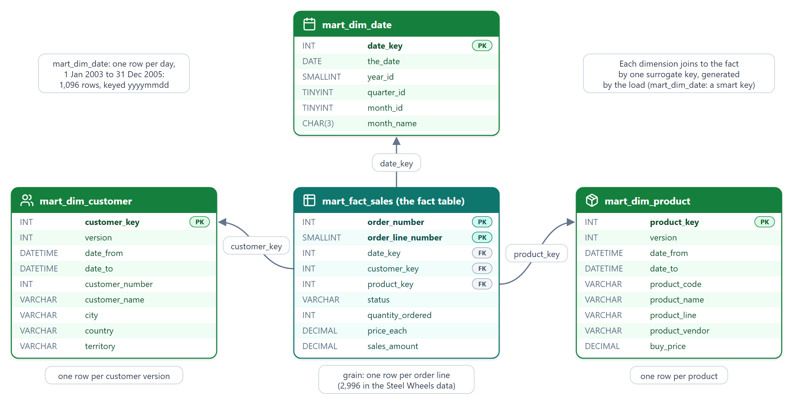
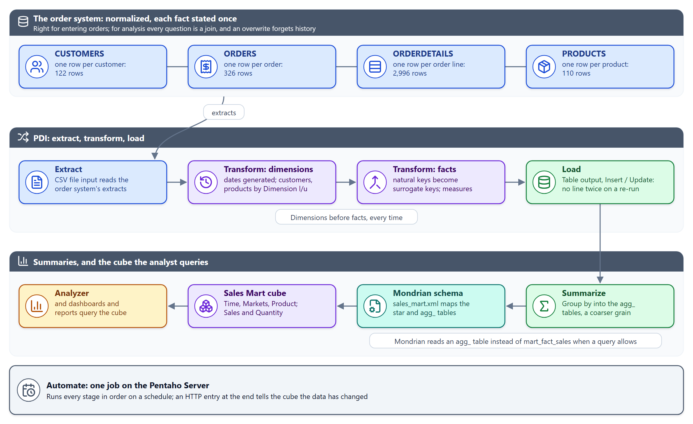

# From Source Data to a Star Schema

An order system stores its data to keep every order correct as it is entered: many small tables, each fact stated once. An analyst asks different questions, across years and across thousands of orders, and needs the data reshaped into a <dfn>star schema</dfn>. This page follows the Steel Wheels orders from the tables the order system keeps to the mart the rest of the course builds, and names the parts on the way.

**What You'll Learn**

* **The source** - the Steel Wheels order tables, and why their shape suits entering orders rather than analyzing them.
* **The star** - a <dfn>fact table</dfn> of order lines, surrounded by date, customer and product dimensions.
* **The route** - extract, transform, load: which part of PDI does each job in this course.
* **Where the cube fits** - a Mondrian schema maps the star to the cube that Analyzer and dashboards query.

:::: tabs

### 1. The Source: an Order System

> **Note:**
>
> #### **The Source: an Order System**
>
> Steel Wheels sells model cars, planes and ships to 122 customers. Its order system keeps each kind of thing in its own table, linked by keys, so a customer's address is stored once however many orders the customer places.

| Table | One row per | Rows | Linked to |
| ----- | ----------- | ---: | --------- |
| `ORDERS` | Order: its date, status and customer | 326 | `CUSTOMERS` by `CUSTOMERNUMBER` |
| `ORDERDETAILS` | Order line: product, quantity, price | 2,996 | `ORDERS` by `ORDERNUMBER`, `PRODUCTS` by `PRODUCTCODE` |
| `CUSTOMERS` | Customer: name, address, credit limit | 122 | `EMPLOYEES` by the sales rep's number |
| `PRODUCTS` | Product: name, line, vendor, prices | 110 | |

This shape is *normalized*: no fact is repeated, so an update touches one row. It is the right shape for entering orders. For analysis it has three problems:

* **Every question is a join.** "Sales by product line by quarter" needs `ORDERDETAILS`, `ORDERS` and `PRODUCTS`, and the quarter has to be worked out from each order date.
* **It forgets.** When a customer moves, the order system overwrites the address. Last year's sales then report under this year's city.
* **It is busy.** Long analytical queries compete with the users entering orders.

A data mart answers all three: a separate copy of the data, reshaped for questions, that keeps history and is loaded on a schedule.

### 2. The Star

> **Note:**
>
> #### **The Star**
>
> A star schema puts the measurements of one business process in a fact table, and everything you group or filter them by in dimension tables around it. Each dimension joins to the fact by one key.

The Sales Mart the course builds:

<figure>

<figcaption>The Sales Mart: one fact table at the order line grain, three dimensions, one surrogate key each</figcaption>
</figure>

In the diagram, **PK** marks each table's primary key and **FK** a column in `mart_fact_sales` that points at a dimension. The fact table's own key is the order line, `order_number` and `order_line_number` together; each of its three FK columns follows one labeled arrow to the dimension whose PK has the same name. `mart_dim_customer` and `mart_dim_product` also carry `version`, `date_from` and `date_to`, the columns that let one customer or product have more than one row.

| Table | Kind | Holds |
| ----- | ---- | ----- |
| `mart_fact_sales` | Fact | `quantity_ordered`, `price_each`, `sales_amount`, the order number and status, and the three keys |
| `mart_dim_date` | Dimension | Year, quarter, month and day of every date from 2003 to 2005 |
| `mart_dim_customer` | Dimension | Customer name, city, country and territory, one row per version |
| `mart_dim_product` | Dimension | Product name, line, vendor and prices |

Two ideas carry the design. The <dfn>grain</dfn> of the fact table is one order line: every measure is stated at that level, and every dimension describes it. And each dimension has its own <dfn>surrogate key</dfn>, generated by the load, instead of the order system's customer number or product code. The surrogate key is what lets a dimension keep two versions of one customer, which [Overview of Dimensional Modeling](../03-overview-of-dimensional-modeling/guide.md) explains.

### 3. The Route: Extract, Transform, Load

> **Note:**
>
> #### **The Route: Extract, Transform, Load**
>
> Building a mart is extract, transform and load (ETL): read the source, reshape it, and write the star. PDI does all three, and each workshop in the course is one piece of it.

| Stage | What happens | In this course |
| ----- | ------------ | -------------- |
| Extract | Read the source tables or files | **CSV file input** reads the order system's extracts |
| Transform: dimensions | Build or update each dimension, generating surrogate keys and keeping history | **Generate Rows** and **Calculator** for dates; **Dimension lookup/update** for customers and products |
| Transform: facts | Swap each natural key in an order line for the dimension's surrogate key, and compute the measures | **Database lookup**, **Dimension lookup/update** in lookup mode, **Calculator** |
| Load | Write the rows, without duplicating a line on a re-run | **Table output**, **Insert / Update** |
| Summarize | Build summary tables at a coarser grain | **Group by** into the aggregate tables |
| Automate | Run it all in order, on a schedule, and tell the cube | A job on the Pentaho Server, with an **HTTP** entry that refreshes the cube |

Dimensions load before facts, every time: a fact row can only carry a customer's key once that customer is in `mart_dim_customer`.

<figure>

<figcaption>From the order system to the cube: extract, transform dimensions before facts, load, summarize, then the cube</figcaption>
</figure>

Read the diagram from the top. The first band is the order system, four normalized tables linked by their keys, and only its extracts reach PDI. The second band is the stage table above in order, left to right, with the dimensions transformed before the facts. The third band reads right to left: Group by summarizes the loaded star into the `agg_` tables, the Mondrian schema `sales_mart.xml` maps the star and those tables to the Sales Mart cube, and Analyzer, dashboards and reports query the cube. The box at the bottom is the job that runs every stage on a schedule and ends by telling the cube the data has changed.

### 4. Where the Cube Fits

> **Note:**
>
> #### **Where the Cube Fits**
>
> An analyst rarely queries the star directly. A Mondrian schema maps its tables to a cube, with dimensions, levels and measures, and Analyzer, dashboards and reports query the cube.

| Mart | Cube |
| ---- | ---- |
| `mart_dim_date` columns `year_id`, `quarter_id`, `month_id` | The **Time** dimension, levels **Years**, **Quarters**, **Months** |
| `mart_dim_customer` columns `territory`, `country`, `city` | The **Markets** dimension |
| `mart_dim_product` columns `product_line`, `product_vendor` | The **Product** dimension |
| `mart_fact_sales` columns `sales_amount`, `quantity_ordered` | The **Sales** and **Quantity** measures |
| The `agg_` tables | Aggregate tables Mondrian reads instead of `mart_fact_sales` when a query allows |

Building the schema itself is the subject of the Pentaho BI Developer - SW course; this course ships a finished schema, `sales_mart.xml`, and concentrates on the data underneath it. What this course adds is the other half of the contract: a mart whose keys, history and summaries the cube can rely on, and a load that tells the cube when the data has changed.

::::

---

> **Tip:** Next, the design decisions behind each table of the star: grain, keys, and how a dimension keeps its history: [Overview of Dimensional Modeling](../03-overview-of-dimensional-modeling/guide.md).
