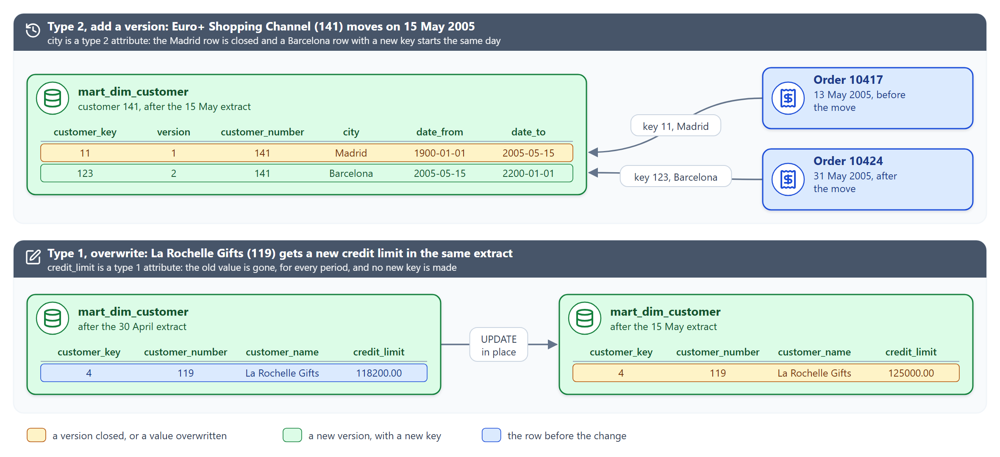

# Overview of Dimensional Modeling

Dimensional modeling is a short list of decisions, made in order: what one fact row stands for, which dimensions describe it, how each dimension is keyed, and what happens when a dimension's attributes change. This module makes those decisions for the Sales Mart and builds its dimensions: first a date dimension generated from nothing, then customer and product dimensions that keep their history.

**What You'll Learn**

* **Grain first** - why the fact table's grain is the first decision, and the Sales Mart's: one order line.
* **Natural and surrogate keys** - why each dimension generates its own key.
* **The date dimension** - why dates get a dimension of their own, built from generated rows.
* **Slowly Changing Dimensions** - type 1 overwrites, type 2 keeps history, followed through one customer who moves.
* **Dimension lookup/update** - the PDI step that maintains a type 1 or type 2 dimension.

:::: tabs

### 1. Grain First

> **Note:**
>
> #### **Grain First**
>
> The grain says what one row of the fact table stands for. Every other decision follows from it, so state it in one sentence before you design a column.

The Sales Mart's grain: **one row per order line**. That decides the rest:

| Decision | Follows from the grain |
| -------- | ---------------------- |
| The measures | What an order line knows: `quantity_ordered`, `price_each`, and `sales_amount` (the two multiplied) |
| The dimensions | What describes an order line: the date it was ordered, the customer, the product |
| The row count | 2,996 order lines in the Steel Wheels data, not 326 orders |
| What can be summed | Quantity and sales add up across any dimension; `price_each` does not, so the cube offers no sum of it |

A finer grain can always be summarized; a coarser one can never be split again. A mart at the order grain could not say which product lines sold, because an order mixes lines. When in doubt, choose the finest grain the source has, and build summary tables for speed later.

The order number and status describe the order line too, but they need no table of their own: they stay in the fact table as a *degenerate dimension*.

### 2. Natural and Surrogate Keys

> **Note:**
>
> #### **Natural and Surrogate Keys**
>
> A <dfn>natural key</dfn> is the key a row has in the source, such as customer number 141. A surrogate key is one the mart generates, such as `customer_key` 11. Each dimension keeps both, and the fact table stores only the surrogate.

Generating its own keys gives the mart three things the source keys cannot:

* **History.** One customer number can have several rows in the dimension, one per version, each with its own surrogate key. A fact row points at the version that was true when the order was placed.
* **An unknown member.** Key `0` is reserved for "not found", so a fact row whose customer is missing from the dimension still loads, and still adds up.
* **Independence.** If the order system renumbers customers, or a second source system arrives with its own numbers, the fact table does not change.

The exception is the date dimension. Its key is a *smart key*: the date written as the integer `yyyymmdd`, so 6 January 2003 is `20030106`. A date never changes its attributes, so it needs no versions, and the key can be worked out from any date without a lookup.

### 3. The Date Dimension

> **Note:**
>
> #### **The Date Dimension**
>
> Dates get a dimension of their own because analysts group by calendar attributes (year, quarter, month, day of week) that a raw date column does not hold. Its rows come from the calendar, not from the source system.

`mart_dim_date` holds one row per day from 1 January 2003 to 31 December 2005: 1,096 rows, 2004 being a leap year. Each row carries the attributes the cube's **Time** dimension needs:

| `date_key` | `the_date` | `year_id` | `quarter_id` | `quarter_name` | `month_id` | `month_name` | `day_of_month` | `day_of_week` |
| ---------- | ---------- | --------- | ------------ | -------------- | ---------- | ------------ | -------------- | ------------- |
| `20030101` | 2003-01-01 | 2003 | 1 | QTR1 | 1 | Jan | 1 | 4 |
| `20030106` | 2003-01-06 | 2003 | 1 | QTR1 | 1 | Jan | 6 | 2 |

Two consequences of building it from the calendar:

* **Every day has a row**, including days with no sales. A report of sales by day of week then shows a zero for a quiet Sunday instead of leaving the day out.
* **It is generated once.** PDI's **Generate Rows** makes one row per day, **Add sequence** numbers them, and **Calculator** turns each number into a date and its parts. [Build a Date Dimension](../04-build-a-date-dimension/guide.md) builds it.

### 4. Slowly Changing Dimensions

> **Note:**
>
> #### **Slowly Changing Dimensions**
>
> A customer's attributes change now and then: a new address, a new credit limit, a corrected name. A <dfn>SCD</dfn> (Slowly Changing Dimension) design decides, attribute by attribute, whether the mart overwrites the old value or keeps it.

Follow one customer. On 15 May 2005, Euro+ Shopping Channel (customer `141`) moves from Madrid to Barcelona. The same extract raises La Rochelle Gifts' credit limit and corrects a typo in another customer's name.

**Type 1: overwrite.** The old value is gone; every report, for every period, shows the new one. Right for corrections and for attributes nobody analyzes history by, such as a credit limit.

| `customer_key` | `customer_number` | `customer_name` | `credit_limit` |
| -------------- | ----------------- | --------------- | -------------- |
| 4 | 119 | La Rochelle Gifts | **125000.00** |

**Type 2: add a version.** The current row is closed at the date of the change, and a new row with a new surrogate key starts there. Orders placed before 15 May keep pointing at the Madrid row; orders from 15 May on point at the Barcelona row.

| `customer_key` | `version` | `customer_number` | `city` | `date_from` | `date_to` |
| -------------- | --------- | ----------------- | ------ | ----------- | --------- |
| 11 | 1 | 141 | Madrid | 1900-01-01 | **2005-05-15** |
| **123** | **2** | **141** | **Barcelona** | **2005-05-15** | 2200-01-01 |

Right for attributes that analysis depends on: a city, a territory, a sales region. Without type 2, Euro+'s 2004 sales would move to Barcelona in every report the day the extract arrives.

<figure>

<figcaption>One extract, two kinds of change: Euro+ gets a new version (type 2), La Rochelle Gifts an overwrite (type 1)</figcaption>
</figure>

The diagram follows both changes through the same extract. In the top panel, the amber row is the Madrid version, closed on 15 May 2005, and the green row is the new Barcelona version with its new key, 123. The two orders on the right show why that matters: order `10417` of 13 May finds key 11, Madrid, and order `10424` of 31 May finds key 123, Barcelona, each by the version valid on its own date. In the bottom panel, La Rochelle Gifts keeps key 4: the blue row is its credit limit after the 30 April extract, 118200.00, and the amber row is the same row after the 15 May extract, overwritten with 125000.00 and no trace of the old value.

The Sales Mart's choice, per attribute:

| Attribute | Type | Why |
| --------- | ---- | --- |
| `city`, `state`, `country`, `territory` | 2 | Sales are analyzed by where the customer was |
| `customer_name`, `contact_name`, `credit_limit` | 1 | Corrections and current values; nobody reports by last year's credit limit |

There are other types (type 0 never changes a value, type 3 keeps the previous value in a second column, and the higher types mix these), but types 1 and 2 cover most marts, and they are the two the course uses.

### 5. Dimension Lookup/Update

> **Note:**
>
> #### **Dimension Lookup/Update**
>
> **Dimension lookup/update** maintains a type 1 or type 2 dimension, field by field, in one step. In update mode it loads the dimension; with **Update the dimension?** cleared, it only looks keys up, which is how the fact load finds each order line's customer version.

For each row, in update mode, the step:

1. Looks up the version of the natural key that is valid at the row's date (the **Stream Datefield**).
2. If there is none, inserts version 1, with a new technical key.
3. If a field set to **Insert** differs, closes the current version at the stream date and inserts the next version (type 2).
4. If a field set to **Update** differs, overwrites it on the current version (type 1).
5. Passes the row on, with the technical key of the version it found or made.

The settings that make this work, which [Load Dimensions with Slowly Changing History](../05-load-dimensions-with-slowly-changing-history/guide.md) uses:

| Setting | Sales Mart value | What it does |
| ------- | ---------------- | ------------ |
| **Keys** tab | `customer_number` | The natural key the step looks rows up by |
| **Technical key field** | `customer_key` | The surrogate key it generates and returns |
| **Creation of technical key** | **Use table maximum + 1** | How it generates the next key |
| **Version field** | `version` | 1, 2, 3 ... per natural key |
| **Stream Datefield** | `extract_date` | The date a change takes effect |
| **Date range start field** / **Table date range end** | `date_from` / `date_to` | The validity of each version |
| **Fields** tab | One row per attribute, with **Insert** or **Update** | Type 2 or type 1, field by field |

The Pentaho Developer - DI Practitioner course's **Slowly Changing Dimensions** workshop walks through every **Type of dimension update** on a small table, punch through included. This course applies the step to a real dimension.

::::

---

> **Tip:** Next, the first dimension: one row for every day of 2003 to 2005, generated in Spoon: [Build a Date Dimension](../04-build-a-date-dimension/guide.md).
