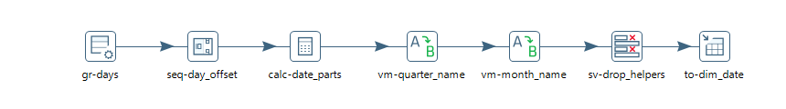
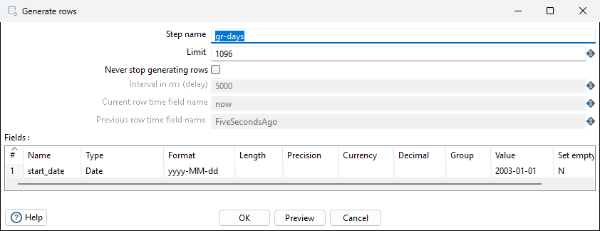
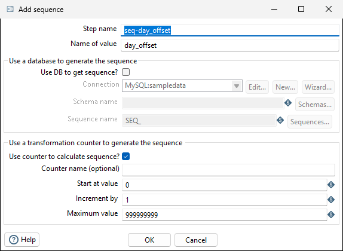
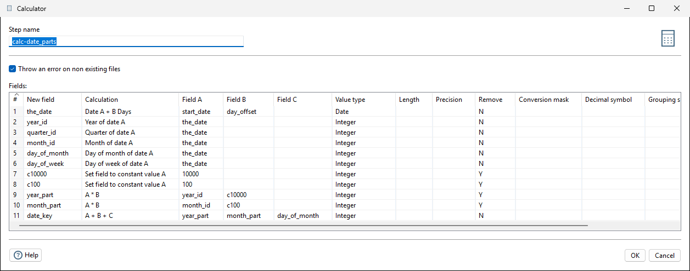
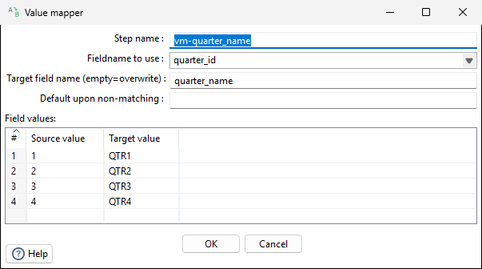
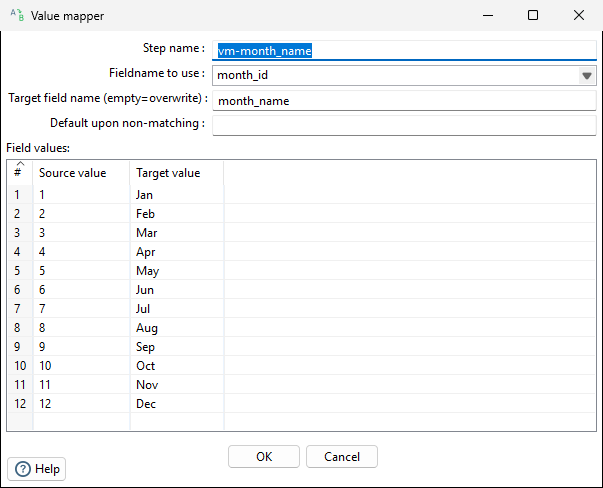
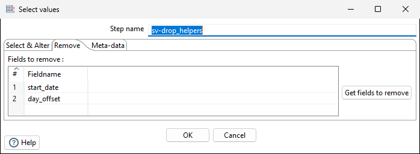
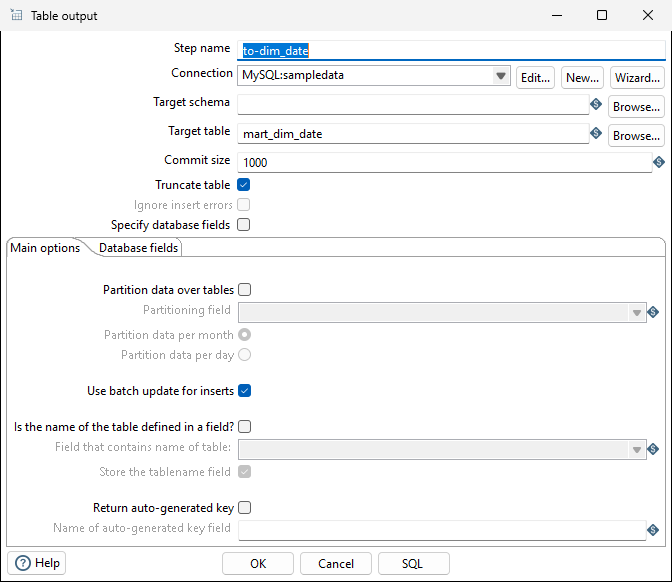

# Build a Date Dimension

> **Warning:**
>
> #### Workshop - Build a Date Dimension
>
> Generate `mart_dim_date`, one row for every day from 1 January 2003 to 31 December 2005, with the year, quarter, month and day attributes the cube's **Time** dimension reads. No source system holds these rows: you make them from the calendar, in one transformation you can run again whenever the range grows.
>
> **What you'll do**
>
> * Create the `mart_dim_date` table in the `sampledata` database.
> * Generate 1,096 rows with **Generate Rows** and number them with **Add sequence**.
> * Turn each number into a date, its parts and a `yyyymmdd` key with **Calculator**.
> * Name the quarters and months with **Value mapper**.
> * Load the table with **Table output**, and check it in DBeaver.
>
> **Prerequisites:** [Overview of Dimensional Modeling](../03-overview-of-dimensional-modeling/guide.md); the `MySQL:sampledata` connection described in [Before You Start](../01-before-you-start/guide.md); DBeaver connected to `sampledata` as `pentaho_admin`.
>
> **Estimated time:** 10 minutes

<figure>

<figcaption class="pcm-video-caption">Walkthrough: coming soon</figcaption>

</figure>

---

<div align="center">
<figure>

<figcaption>What you build</figcaption>
</figure>
</div>

:::: tabs

### 1. Create the Table

> **Note:**
>
> #### Create the Table
>
> `mart_dim_date` has one column per attribute and a primary key on `date_key`, the date as the integer `yyyymmdd`. The script drops the table first, so you can run it again to start over.

1. In DBeaver, open `dim_date.sql` from `C:\Workshop-DP-Specialty\02-modeling-the-star\04-build-a-date-dimension` (also under **Lab Files** below), with the `sampledata` connection selected.
2. Run the whole script: press `Alt+X` (**SQL Editor > Execute SQL Script**).
3. In DBeaver, run:

   ```sql
   SELECT COUNT(*) FROM mart_dim_date;
   ```

> **Success:** Checkpoint: the query returns `0`. `mart_dim_date` exists, empty, with nine columns from `date_key` to `day_of_week`.

### 2. Generate the Days

> **Note:**
>
> #### Generate the Days
>
> **Generate Rows** makes a fixed number of identical rows; **Add sequence** numbers them. Each row then carries the start date and its own offset from it, 0 to 1,095, which the next part turns into a date.

1. Start Spoon with the **Start Pentaho Data Integration** button below, or from PowerShell:

```powershell
Set-Location C:\Pentaho\design-tools\data-integration
.\spoon.bat
```

<button data-launch="spoon" data-path="">Start Pentaho Data Integration</button>

2. Select **File > New > Transformation** (`Ctrl+N`).
3. Select **File > Save as** and save it as `tr_dim_date.ktr` in `C:\Workshop-DP-Specialty\02-modeling-the-star\04-build-a-date-dimension`.
4. On the **Design** tab, open the **Input** folder and drag **Generate Rows** onto the canvas.
5. Double-click **Generate Rows**. Set **Step name** to `gr-days`.
6. Set **Limit** to `1096`, the number of days from 1 January 2003 to 31 December 2005.
7. Fill the **Fields** grid with one row:

   | Name | Type | Format | Value |
   | ---- | ---- | ------ | ----- |
   | `start_date` | Date | `yyyy-MM-dd` | `2003-01-01` |

<div align="center">
<figure>

<figcaption>gr-days: one row per day</figcaption>
</figure>
</div>

8. Select **OK**.
9. On the **Design** tab, open the **Transform** folder and drag **Add sequence** onto the canvas.
10. Create a hop from **gr-days** to **Add sequence**: hold `Shift` and drag from one step to the other.
11. Double-click **Add sequence**. Set **Step name** to `seq-day_offset`.
12. Set **Name of value** to `day_offset`. Leave **Use counter to calculate sequence?** selected, and set **Start at value** to `0` and **Increment by** to `1`.

<div align="center">
<figure>

<figcaption>seq-day_offset: the counter starts at 0</figcaption>
</figure>
</div>

13. Select **OK**.
14. Save the transformation (`Ctrl+S`).
15. Select **seq-day_offset** on the canvas, press `F10` (**Action > Preview**), and select **Quick Launch**.

> **Success:** Checkpoint: every row has `start_date` `2003/01/01 00:00:00.000`; `day_offset` runs `0`, `1`, `2` and on down the preview.

16. Select **Close**.

### 3. Calculate the Date Parts

> **Note:**
>
> #### Calculate the Date Parts
>
> **Calculator** adds new fields from functions of the fields a row already has. Its rows run in order, so a later row can use a field an earlier row made. Fields marked **Remove** are working values: the step drops them before it passes the row on.

1. On the **Design** tab, open the **Transform** folder and drag **Calculator** onto the canvas.
2. Create a hop from **seq-day_offset** to **Calculator**.
3. Double-click **Calculator**. Set **Step name** to `calc-date_parts`.
4. Fill the **Fields** grid with these eleven rows, in this order. Leave **Field B** and **Field C** empty where the table does, and **Remove** set to `N` unless the table says `Y`:

   | New field | Calculation | Field A | Field B | Field C | Value type | Remove |
   | --------- | ----------- | ------- | ------- | ------- | ---------- | ------ |
   | `the_date` | Date A + B Days | `start_date` | `day_offset` | | Date | N |
   | `year_id` | Year of date A | `the_date` | | | Integer | N |
   | `quarter_id` | Quarter of date A | `the_date` | | | Integer | N |
   | `month_id` | Month of date A | `the_date` | | | Integer | N |
   | `day_of_month` | Day of month of date A | `the_date` | | | Integer | N |
   | `day_of_week` | Day of week of date A | `the_date` | | | Integer | N |
   | `c10000` | Set field to constant value A | `10000` | | | Integer | Y |
   | `c100` | Set field to constant value A | `100` | | | Integer | Y |
   | `year_part` | A * B | `year_id` | `c10000` | | Integer | Y |
   | `month_part` | A * B | `month_id` | `c100` | | Integer | Y |
   | `date_key` | A + B + C | `year_part` | `month_part` | `day_of_month` | Integer | N |

   For **Set field to constant value A**, the constant itself goes in **Field A**.

<div align="center">
<figure>

<figcaption>calc-date_parts: eleven rows, four of them removed</figcaption>
</figure>
</div>

5. Select **OK**.
6. Save the transformation (`Ctrl+S`).
7. Select **calc-date_parts** on the canvas, press `F10` (**Action > Preview**), and select **Quick Launch**.

> **Success:** Checkpoint: the first row is `the_date` 2003/01/01, `year_id` 2003, `quarter_id` 1, `month_id` 1, `day_of_month` 1, `day_of_week` 4 and `date_key` 20030101. The working fields `c10000`, `c100`, `year_part` and `month_part` are not in the preview.

8. Select **Close**.

> **Under the hood:**
>
> #### The date key is arithmetic on the date's parts
>
> For each row, **Calculator** evaluates its grid top to bottom, writing each result into the row before it reads the next line. So `date_key` sees `year_id`, `month_id` and `day_of_month` already set, and computes 2003 × 10,000 + 1 × 100 + 1 = 20030101. **Day of week of date A** counts from Sunday, so 1 January 2003, a Wednesday, gives `4`. The constants and products exist only inside the step: the fields marked **Remove** are dropped from the row metadata before the step writes the row out.
>
> **Why it matters:** the fact load can compute the same `yyyymmdd` from any order date, so the date key never needs a table maintained by hand, and two loads can never disagree about which day a key means.

### 4. Name the Quarters and Months

> **Note:**
>
> #### Name the Quarters and Months
>
> **Value mapper** looks up the value of one field in a list and writes the match to a new field. Mapping the numbers to names here, instead of formatting the date, gives the same names whatever language Spoon runs in.

1. On the **Design** tab, open the **Transform** folder and drag **Value mapper** onto the canvas.
2. Create a hop from **calc-date_parts** to **Value mapper**.
3. Double-click **Value mapper**. Set **Step name** to `vm-quarter_name`.
4. Set **Fieldname to use** to `quarter_id` and **Target field name (empty=overwrite)** to `quarter_name`.
5. Fill the **Field values** grid:

   | Source value | Target value |
   | ------------ | ------------ |
   | `1` | `QTR1` |
   | `2` | `QTR2` |
   | `3` | `QTR3` |
   | `4` | `QTR4` |

<div align="center">
<figure>

<figcaption>vm-quarter_name: four values</figcaption>
</figure>
</div>

6. Select **OK**.
7. Drag a second **Value mapper** onto the canvas, and create a hop from **vm-quarter_name** to it.
8. Double-click the new step. Set **Step name** to `vm-month_name`, **Fieldname to use** to `month_id` and **Target field name (empty=overwrite)** to `month_name`.
9. Fill the **Field values** grid with twelve rows: `1` to `Jan`, `2` to `Feb`, `3` to `Mar`, `4` to `Apr`, `5` to `May`, `6` to `Jun`, `7` to `Jul`, `8` to `Aug`, `9` to `Sep`, `10` to `Oct`, `11` to `Nov` and `12` to `Dec`.

<div align="center">
<figure>

<figcaption>vm-month_name: twelve values</figcaption>
</figure>
</div>

10. Select **OK**.
11. Save the transformation (`Ctrl+S`).
12. Select **vm-month_name** on the canvas, press `F10` (**Action > Preview**), and select **Quick Launch**.

> **Success:** Checkpoint: the first row now ends with `quarter_name` `QTR1` and `month_name` `Jan`.

13. Select **Close**.

### 5. Write the Table

> **Note:**
>
> #### Write the Table
>
> **Table output** inserts every row it receives into one table. The row's field names must match the table's columns, so **Select values** first removes the two fields that only built the date.

1. On the **Design** tab, open the **Transform** folder and drag **Select values** onto the canvas.
2. Create a hop from **vm-month_name** to **Select values**.
3. Double-click **Select values**. Set **Step name** to `sv-drop_helpers`.
4. Open the **Remove** tab and fill the **Fields to remove** grid with two rows: `start_date` and `day_offset`.

<div align="center">
<figure>

<figcaption>sv-drop_helpers: the two fields to remove</figcaption>
</figure>
</div>

5. Select **OK**.
6. On the **Design** tab, open the **Output** folder and drag **Table output** onto the canvas.
7. Create a hop from **sv-drop_helpers** to **Table output**.
8. Double-click **Table output**. Set **Step name** to `to-dim_date`.
9. Set **Connection** to `MySQL:sampledata` and **Target table** to `mart_dim_date`.
10. Set **Commit size** to `1000`, and select **Truncate table** and **Use batch update for inserts**.

<div align="center">
<figure>

<figcaption>to-dim_date: truncate, then insert in batches</figcaption>
</figure>
</div>

11. Select **OK**.
12. Save the transformation (`Ctrl+S`).
13. Press `F9` (**Action > Run**), and select **Run** in the **Run Options** dialog.
14. In **Execution Results**, open the **Step Metrics** tab.

> **Success:** Checkpoint: **gr-days** shows 1,096 in **Written**, and **to-dim_date** shows 1,096 in **Output**, with no errors.

The table now holds every day of the three years. Here is what the last step did with them.

> **Under the hood:**
>
> #### Truncate, then batched inserts, then a commit every 1,000 rows
>
> When the transformation starts, **Table output** runs `TRUNCATE TABLE mart_dim_date` once, before the first row arrives. It then prepares one `INSERT` statement and sends the rows to MySQL in JDBC batches, committing after every 1,000 rows and once more at the end: two commits for 1,096 rows. Every step in the transformation runs at the same time, in its own thread, so the first rows are in the database while **gr-days** is still generating the last ones.
>
> **Why it matters:** with **Truncate table** selected the transformation is safe to run again. Extend the range to 2006 by changing **Limit**, run it, and the table is rebuilt whole rather than holding the old days twice.

15. In DBeaver, run:

    ```sql
    SELECT COUNT(*), MIN(date_key), MAX(date_key) FROM mart_dim_date;
    SELECT year_id, COUNT(*) FROM mart_dim_date GROUP BY year_id ORDER BY year_id;
    SELECT * FROM mart_dim_date WHERE date_key = 20051231;
    ```

> **Success:** Checkpoint: 1,096 rows from `20030101` to `20051231`; 365 days in 2003, 366 in 2004 and 365 in 2005. The last row is 31 December 2005: `QTR4`, `Dec`, `day_of_month` 31 and `day_of_week` 7, a Saturday.

::::

## Troubleshooting <!-- no-step -->

<details>

<summary>The run fails with "Unknown column 'start_date'"</summary>

**sv-drop_helpers** is not removing the working fields, or the hop goes around it. Check that the **Remove** tab lists `start_date` and `day_offset`, and that **vm-month_name** hops to **sv-drop_helpers**, not straight to **to-dim_date**.

</details>

<details>

<summary>quarter_name or month_name is empty</summary>

**Value mapper** compares the field's value as text with the **Source value**. If `quarter_id` or `month_id` has **Value type** Number in **calc-date_parts**, its text is `1.0`, which matches nothing. Set **Value type** to Integer.

</details>

<details>

<summary>"Duplicate entry" for the primary key</summary>

**Truncate table** is cleared, and the table still holds the rows of an earlier run. Select **Truncate table** and run again, or run `dim_date.sql` to recreate the table.

</details>

## Lab Files

Click a file to download. For `.ktr` and `.kjb` files, **Open in Pentaho Data Integration** launches Pentaho Data Integration with the file loaded. If Pentaho Data Integration is already running, the path is copied to your clipboard — switch to Pentaho Data Integration and press `Ctrl+O`, `Ctrl+V`, `Enter`.

The `CREATE TABLE mart_dim_date` script from part 1, for MySQL:

[dim_date.sql](./files/dim_date.sql)

### Solution <!-- no-step -->

The finished transformation for this lab. Open it alongside your own to compare, or run to see the expected result.

Also on disk at `C:\Workshop-DP-Specialty\02-modeling-the-star\04-build-a-date-dimension\solution`.

[tr_dim_date.ktr](./files/tr_dim_date.ktr) <button data-launch="spoon" data-path="files/tr_dim_date.ktr">Open in Pentaho Data Integration</button> <button data-graph="files/tr_dim_date.ktr">View graph</button>

---

> **Tip:** `mart_dim_date` is the one dimension that never changes. Next, two that do: customers who move and products that are renamed, with **Dimension lookup/update** keeping the history: [Load Dimensions with Slowly Changing History](../05-load-dimensions-with-slowly-changing-history/guide.md).
