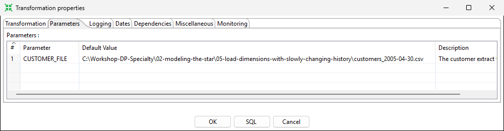
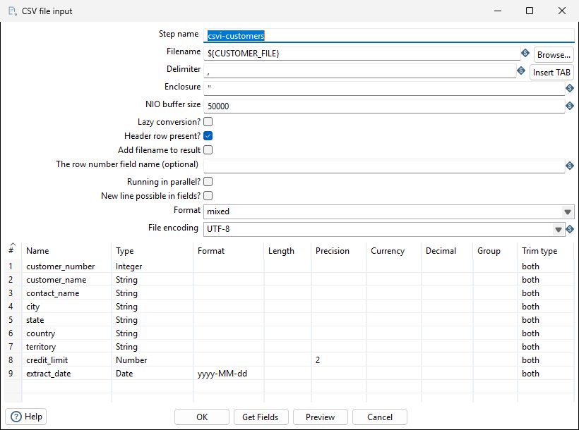
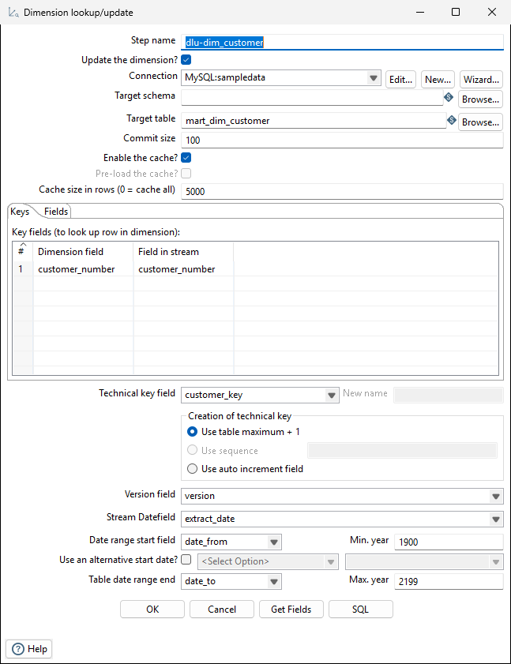
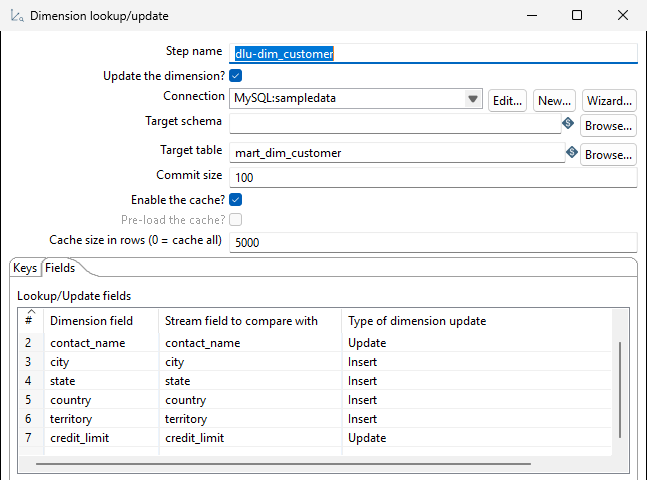
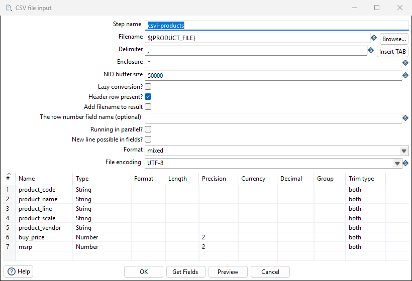
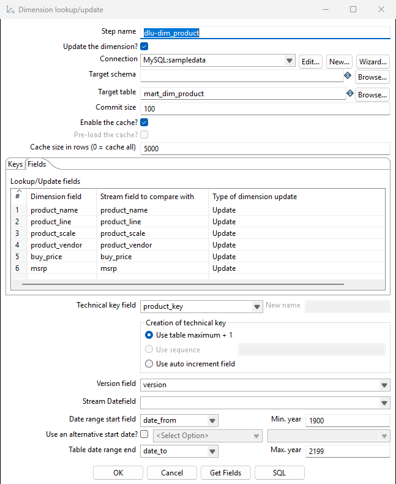

# Load Dimensions with Slowly Changing History

> **Warning:**
>
> #### Workshop - Load Dimensions with Slowly Changing History
>
> Load `mart_dim_customer` from two customer extracts, a month apart, with **Dimension lookup/update**: the first extract creates one version per customer, and the second moves a customer to a new city (a new version, type 2), raises a credit limit and corrects a name (overwrites, type 1), and adds a new customer. Then load `mart_dim_product` the same way, as a type 1 dimension.
>
> **What you'll do**
>
> * Create `mart_dim_customer` and `mart_dim_product`, each with a technical key, a version and a validity range.
> * Read a customer extract named by a transformation parameter, with **CSV file input**.
> * Configure **Dimension lookup/update**: type 2 for where a customer is, type 1 for everything else.
> * Load the 30 April extract, then the 15 May extract, and read the history the step kept.
> * Load the product dimension with every field set to overwrite.
>
> **Prerequisites:** [Build a Date Dimension](../04-build-a-date-dimension/guide.md); [Overview of Dimensional Modeling](../03-overview-of-dimensional-modeling/guide.md), for types 1 and 2 and the step's settings; DBeaver connected to `sampledata` as `pentaho_admin`.
>
> **Estimated time:** 30 minutes

<figure>

<figcaption class="pcm-video-caption">Walkthrough: coming soon</figcaption>

</figure>

---

<div align="center">
<figure>

<figcaption>What you build: tr_dim_customer</figcaption>
</figure>
</div>


<div align="center">
<figure>

<figcaption>What you build: tr_dim_product</figcaption>
</figure>
</div>

The two customer extracts differ in four rows:

| `customer_number` | Customer | 30 April 2005 | 15 May 2005 | Type |
| ----------------- | -------- | ------------- | ----------- | ---- |
| `141` | Euro+ Shopping Channel | city `Madrid` | city **`Barcelona`** | 2: a new version |
| `119` | La Rochelle Gifts | credit limit `118200.00` | **`125000.00`** | 1: overwrite |
| `282` | Souveniers And Things Co. | the name as the sample spells it | **`Souvenirs And Things Co.`** | 1: overwrite |
| `500` | Northwind Scale Models | not there | **a new customer** | A new key |

:::: tabs

### 1. Create the Tables

> **Note:**
>
> #### Create the Tables
>
> Both tables have the columns **Dimension lookup/update** needs for history: a technical key, a version, and `date_from` and `date_to`. The natural key is indexed, because the step looks every row up by it.

1. In DBeaver, open `dim_customer_product.sql` from `C:\Workshop-DP-Specialty\02-modeling-the-star\05-load-dimensions-with-slowly-changing-history` (also under **Lab Files** below), with the `sampledata` connection selected.
2. Run the whole script: press `Alt+X` (**SQL Editor > Execute SQL Script**).
3. In DBeaver, run:

   ```sql
   SELECT (SELECT COUNT(*) FROM mart_dim_customer) AS customers, (SELECT COUNT(*) FROM mart_dim_product) AS products;
   ```

> **Success:** Checkpoint: one row, `0` customers and `0` products.

### 2. Read the Customer Extract

> **Note:**
>
> #### Read the Customer Extract
>
> Each extract is a CSV file with one row per customer and the date it was taken, `extract_date`. A transformation parameter, `CUSTOMER_FILE`, names the file, so the same transformation loads either extract, and later the scheduled job can pass its own.

1. Start Spoon with the **Start Pentaho Data Integration** button below, or from PowerShell:

```powershell
Set-Location C:\Pentaho\design-tools\data-integration
.\spoon.bat
```

<button data-launch="spoon" data-path="">Start Pentaho Data Integration</button>

2. Select **File > New > Transformation** (`Ctrl+N`).
3. Select **File > Save as** and save it as `tr_dim_customer.ktr` in `C:\Workshop-DP-Specialty\02-modeling-the-star\05-load-dimensions-with-slowly-changing-history`.
4. Double-click an empty part of the canvas. The **Transformation properties** dialog opens.
5. Open the **Parameters** tab and fill the grid with one row:

   | Parameter | Default value | Description |
   | --------- | ------------- | ----------- |
   | `CUSTOMER_FILE` | `C:\Workshop-DP-Specialty\02-modeling-the-star\05-load-dimensions-with-slowly-changing-history\customers_2005-04-30.csv` | The customer extract to load |

<div align="center">
<figure>

<figcaption>CUSTOMER_FILE and its default value</figcaption>
</figure>
</div>

6. Select **OK**.
7. On the **Design** tab, open the **Input** folder and drag **CSV file input** onto the canvas.
8. Double-click **CSV file input**. Set **Step name** to `csvi-customers`.
9. Set **Filename** to `${CUSTOMER_FILE}`, **Delimiter** to `,`, **Enclosure** to `"` and **File encoding** to `UTF-8`. Leave **Header row present?** selected, and clear **Lazy conversion?**.
10. Select **Get Fields**, and select **OK** when Spoon offers to sample the file. Then set the **Fields** grid to these types:

    | Name | Type | Format | Precision | Trim type |
    | ---- | ---- | ------ | --------- | --------- |
    | `customer_number` | Integer | | | both |
    | `customer_name` | String | | | both |
    | `contact_name` | String | | | both |
    | `city` | String | | | both |
    | `state` | String | | | both |
    | `country` | String | | | both |
    | `territory` | String | | | both |
    | `credit_limit` | Number | | `2` | both |
    | `extract_date` | Date | `yyyy-MM-dd` | | both |

<div align="center">
<figure>

<figcaption>csvi-customers: credit_limit is a Number</figcaption>
</figure>
</div>

11. Select **Preview**, and select **OK** to preview 100 rows.

> **Success:** Checkpoint: the first row is customer `103`, `Atelier graphique`, `Carine Schmitt`, `Nantes`, no state, `France`, `EMEA`, credit limit `21000.00`, extract date `2005/04/30`. `Québec Home Shopping Network` keeps its accent: the file is UTF-8.

12. Select **Close**, then **OK**.
13. Save the transformation (`Ctrl+S`).

### 3. Configure Dimension Lookup/Update

> **Note:**
>
> #### Configure Dimension Lookup/Update
>
> One step does the whole job: it finds each customer's current version by `customer_number`, compares the fields, and inserts, closes or overwrites rows. `extract_date` is the **Stream Datefield**, the date a change takes effect.

1. On the **Design** tab, open the **Data Warehouse** folder and drag **Dimension lookup/update** onto the canvas.
2. Create a hop from **csvi-customers** to **Dimension lookup/update**: hold `Shift` and drag from one step to the other.
3. Double-click **Dimension lookup/update**. Set **Step name** to `dlu-dim_customer`, and leave **Update the dimension?** selected.
4. Set **Connection** to `MySQL:sampledata`, **Target table** to `mart_dim_customer` and **Commit size** to `100`.
5. On the **Keys** tab, fill the grid with one row:

   | Dimension field | Field in stream |
   | --------------- | --------------- |
   | `customer_number` | `customer_number` |

6. Below the tabs, set these fields:

   | Field | Value |
   | ----- | ----- |
   | **Technical key field** | `customer_key` |
   | **Creation of technical key** | **Use table maximum + 1** |
   | **Version field** | `version` |
   | **Stream Datefield** | `extract_date` |
   | **Date range start field** | `date_from` |
   | **Min. year** | `1900` |
   | **Table date range end** | `date_to` |
   | **Max. year** | `2199` |

<div align="center">
<figure>

<figcaption>dlu-dim_customer: the key, the technical key and the dates</figcaption>
</figure>
</div>

7. On the **Fields** tab, fill the grid with seven rows:

   | Dimension field | Stream field to compare with | Type of dimension update |
   | --------------- | ---------------------------- | ------------------------ |
   | `customer_name` | `customer_name` | Update |
   | `contact_name` | `contact_name` | Update |
   | `city` | `city` | Insert |
   | `state` | `state` | Insert |
   | `country` | `country` | Insert |
   | `territory` | `territory` | Insert |
   | `credit_limit` | `credit_limit` | Update |

<div align="center">
<figure>

<figcaption>The Fields tab, scrolled to the last row</figcaption>
</figure>
</div>

8. Select **OK**.
9. Save the transformation (`Ctrl+S`).

> **Success:** Checkpoint: two steps joined by a hop, **csvi-customers** and **dlu-dim_customer**, with no warning triangle on either.

### 4. Run 1: the First Extract

> **Note:**
>
> #### Run 1: the First Extract
>
> On an empty table every customer is new, so the step inserts 122 rows, each version 1, valid from the start of **Min. year** to the end of **Max. year**.

1. Press `F9` (**Action > Run**). In the **Run Options** dialog, open the **Parameters** tab: `CUSTOMER_FILE` shows its default, the 30 April extract. Select **Run**.
2. In **Execution Results**, open the **Step Metrics** tab.

> **Success:** Checkpoint: **csvi-customers** shows 122 in **Output**, and **dlu-dim_customer** has no errors.

3. In DBeaver, run:

   ```sql
   SELECT COUNT(*) FROM mart_dim_customer;
   SELECT customer_key, version, date_from, date_to, customer_number, customer_name, city
   FROM mart_dim_customer WHERE customer_key IN (0, 1, 11) ORDER BY customer_key;
   ```

> **Success:** Checkpoint: 123 rows, the 122 customers and row `0`.
>
> | customer_key | version | date_from | date_to | customer_number | customer_name | city |
> | ------------ | ------- | --------- | ------- | --------------- | ------------- | ---- |
> | 0 | 1 | NULL | NULL | 0 | NULL | NULL |
> | 1 | 1 | 1900-01-01 00:00:00 | 2200-01-01 00:00:00 | 103 | Atelier graphique | Nantes |
> | 11 | 1 | 1900-01-01 00:00:00 | 2200-01-01 00:00:00 | 141 | Euro+ Shopping Channel | Madrid |

The step writes the end of the range as 2199-12-31 23:59:59.999; MySQL's `DATETIME` rounds it to `2200-01-01 00:00:00`.

> **Under the hood:**
>
> #### Row 0 and the keys came from the step, not from the file
>
> The first time it writes to an empty table, **Dimension lookup/update** inserts row `0` for unknown keys, so a fact row that finds no customer can still carry a key. Then, for each input row, it looked `customer_number` up with the stream date, `extract_date`, between `date_from` and `date_to`, found nothing, and inserted version 1 with the next key from **Use table maximum + 1**: 1 for customer `103`, the first row of the file, and 11 for customer `141`, the eleventh. A new key's first version starts at **Min. year**, not at the extract date, so an order from 2003 still finds it.
>
> **Why it matters:** the technical key is the mart's own. Load the customers in a different order and the keys change, which is why the fact table must always look keys up and never derive them from `customer_number`.

### 5. Run 2: the Changes

> **Note:**
>
> #### Run 2: the Changes
>
> The 15 May extract holds all 122 customers again, three of them changed, plus one new one. Run the same transformation, with the parameter pointing at the new file.

1. Press `F9` (**Action > Run**). In the **Run Options** dialog, open the **Parameters** tab and set the **Value** of `CUSTOMER_FILE` to:

   ```text
   C:\Workshop-DP-Specialty\02-modeling-the-star\05-load-dimensions-with-slowly-changing-history\customers_2005-05-15.csv
   ```

2. Select **Run**.
3. In **Execution Results**, open the **Step Metrics** tab.

> **Success:** Checkpoint: **csvi-customers** shows 123 in **Output**, and **dlu-dim_customer** has no errors.

4. In DBeaver, run:

   ```sql
   SELECT COUNT(*) FROM mart_dim_customer;
   SELECT customer_key, version, date_from, date_to, customer_number, customer_name, city, credit_limit
   FROM mart_dim_customer WHERE customer_number IN (119, 141, 282, 500) ORDER BY customer_key;
   ```

> **Success:** Checkpoint: 125 rows. Euro+ Shopping Channel now has two versions; the other two changes overwrote their row; the new customer has key 124.
>
> | customer_key | version | date_from | date_to | customer_number | customer_name | city | credit_limit |
> | ------------ | ------- | --------- | ------- | --------------- | ------------- | ---- | ------------ |
> | 4 | 1 | 1900-01-01 00:00:00 | 2200-01-01 00:00:00 | 119 | La Rochelle Gifts | Nantes | **125000.00** |
> | 11 | 1 | 1900-01-01 00:00:00 | **2005-05-15 00:00:00** | 141 | Euro+ Shopping Channel | Madrid | 227600.00 |
> | 58 | 1 | 1900-01-01 00:00:00 | 2200-01-01 00:00:00 | 282 | **Souvenirs And Things Co.** | Chatswood | 93300.00 |
> | **123** | **2** | **2005-05-15 00:00:00** | 2200-01-01 00:00:00 | 141 | Euro+ Shopping Channel | **Barcelona** | 227600.00 |
> | **124** | **1** | 1900-01-01 00:00:00 | 2200-01-01 00:00:00 | **500** | **Northwind Scale Models** | **Lisboa** | **50000.00** |

The other 119 customers did not change, so the step wrote nothing for them.

> **Under the hood:**
>
> #### One extract, three kinds of change, decided field by field
>
> For each customer the step read the version valid on 15 May and compared the seven fields. For `141`, `city` differed and is an **Insert** field, so it ran an `UPDATE` setting key 11's `date_to` to the stream date, then an `INSERT` of version 2 from that date. For `119` and `282`, only **Update** fields differed, so it overwrote them on the current version, with no new key. Customer `500` had no version at all, so it was inserted like every row of run 1. Run the 15 May extract again and nothing changes: every field now matches.
>
> **Why it matters:** the fact load can now ask "which version of customer 141 was valid on 13 May?" and get key 11, Madrid, and on 31 May get key 123, Barcelona. Each order keeps the city it was placed from, while a corrected name shows in every period.

### 6. The Product Dimension

> **Note:**
>
> #### The Product Dimension
>
> Products change too, but nobody reports by last year's product name, so every field is type 1. The same step loads them: it still generates the technical key and row `0`, and a field can become type 2 later by changing its type to **Insert**.

1. Select **File > New > Transformation** (`Ctrl+N`).
2. Select **File > Save as** and save it as `tr_dim_product.ktr` in `C:\Workshop-DP-Specialty\02-modeling-the-star\05-load-dimensions-with-slowly-changing-history`.
3. Double-click an empty part of the canvas. On the **Parameters** tab of **Transformation properties**, add `PRODUCT_FILE` with the **Default value** `C:\Workshop-DP-Specialty\02-modeling-the-star\05-load-dimensions-with-slowly-changing-history\products.csv`. Select **OK**.
4. On the **Design** tab, open the **Input** folder and drag **CSV file input** onto the canvas.
5. Double-click **CSV file input**. Set **Step name** to `csvi-products` and **Filename** to `${PRODUCT_FILE}`, with the same **Delimiter**, **Enclosure** and **File encoding** as `csvi-customers`, and clear **Lazy conversion?**.
6. Select **Get Fields**, and set the **Fields** grid to these types, each with **Trim type** `both`:

   | Name | Type | Precision |
   | ---- | ---- | --------- |
   | `product_code` | String | |
   | `product_name` | String | |
   | `product_line` | String | |
   | `product_scale` | String | |
   | `product_vendor` | String | |
   | `buy_price` | Number | `2` |
   | `msrp` | Number | `2` |

<div align="center">
<figure>

<figcaption>csvi-products: seven fields</figcaption>
</figure>
</div>

7. Select **OK**.
8. On the **Design** tab, open the **Data Warehouse** folder and drag **Dimension lookup/update** onto the canvas, and create a hop from **csvi-products** to it.
9. Double-click **Dimension lookup/update**. Set **Step name** to `dlu-dim_product`, **Connection** to `MySQL:sampledata`, **Target table** to `mart_dim_product` and **Commit size** to `100`.
10. On the **Keys** tab, map the dimension field `product_code` to the stream field `product_code`.
11. Set **Technical key field** to `product_key`, **Creation of technical key** to **Use table maximum + 1**, **Version field** to `version`, **Date range start field** to `date_from` and **Table date range end** to `date_to`, with **Min. year** `1900` and **Max. year** `2199`. Leave **Stream Datefield** empty: the file has no date, so the step uses the time of the run.
12. On the **Fields** tab, fill the grid with six rows, `product_name`, `product_line`, `product_scale`, `product_vendor`, `buy_price` and `msrp`, each compared with the stream field of the same name, each with **Type of dimension update** set to **Update**.

<div align="center">
<figure>

<figcaption>dlu-dim_product: every field overwrites</figcaption>
</figure>
</div>

13. Select **OK**.
14. Save the transformation (`Ctrl+S`).
15. Press `F9` (**Action > Run**), and select **Run** in the **Run Options** dialog.
16. In DBeaver, run:

    ```sql
    SELECT COUNT(*) FROM mart_dim_product;
    SELECT product_key, product_code, product_name, product_line FROM mart_dim_product WHERE product_key IN (0, 1, 80);
    ```

> **Success:** Checkpoint: 111 rows, the 110 products and row `0`. Key `1` is `S10_1678`, 1969 Harley Davidson Ultimate Chopper, Motorcycles; key `80` is `S24_3969`, 1936 Mercedes Benz 500k Roadster, Vintage Cars.

::::

## Troubleshooting <!-- no-step -->

<details>

<summary>Run 2 adds a new version for every customer</summary>

A field that differs on every run is set to **Insert**. `extract_date` must not be on the **Fields** tab at all: it is the **Stream Datefield**. To repeat the runs, run `dim_customer_product.sql` and start again from run 1.

</details>

<details>

<summary>Every customer is updated on every run, though nothing changed</summary>

A compared field reads differently from the file and from the table: usually a string with trailing spaces. Set **Trim type** to `both` as in part 2.

</details>

<details>

<summary>Run 2 stops with "Error serializing row to byte array"</summary>

The message goes on to name `credit_limit` and a BigDecimal. `credit_limit` is BigNumber in **csvi-customers**, but PDI reads MySQL's `DECIMAL(10,2)` as Number, and **Dimension lookup/update** cannot put the overwritten value in its cache. Set the field to Number as in part 2, run `dim_customer_product.sql`, and load both extracts again.

</details>

<details>

<summary>Customer names with accents look wrong</summary>

**File encoding** is not `UTF-8`. Set it on **csvi-customers**, run `dim_customer_product.sql`, and load both extracts again.

</details>

## Lab Files

Click a file to download. For `.ktr` and `.kjb` files, **Open in Pentaho Data Integration** launches Pentaho Data Integration with the file loaded. If Pentaho Data Integration is already running, the path is copied to your clipboard — switch to Pentaho Data Integration and press `Ctrl+O`, `Ctrl+V`, `Enter`.

The `CREATE TABLE` script for `mart_dim_customer` and `mart_dim_product`, for MySQL:

[dim_customer_product.sql](./files/dim_customer_product.sql)

The customer extract of 30 April 2005, for run 1 (122 customers):

[customers_2005-04-30.csv](./files/customers_2005-04-30.csv)

The customer extract of 15 May 2005, for run 2 (123 customers, four of them changed or new):

[customers_2005-05-15.csv](./files/customers_2005-05-15.csv)

The product extract (110 products):

[products.csv](./files/products.csv)

### Solution <!-- no-step -->

The finished transformations for this lab. Open them alongside your own to compare, or run to see the expected result.

Also on disk at `C:\Workshop-DP-Specialty\02-modeling-the-star\05-load-dimensions-with-slowly-changing-history\solution`.

[tr_dim_customer.ktr](./files/tr_dim_customer.ktr) <button data-launch="spoon" data-path="files/tr_dim_customer.ktr">Open in Pentaho Data Integration</button> <button data-graph="files/tr_dim_customer.ktr">View graph</button>

[tr_dim_product.ktr](./files/tr_dim_product.ktr) <button data-launch="spoon" data-path="files/tr_dim_product.ktr">Open in Pentaho Data Integration</button> <button data-graph="files/tr_dim_product.ktr">View graph</button>

---

> **Tip:** The dimensions are ready, with their keys and their history. Before the fact table uses them, an overview of what a fact load has to do: [Overview of Loading Facts](../06-overview-of-loading-facts/guide.md).
