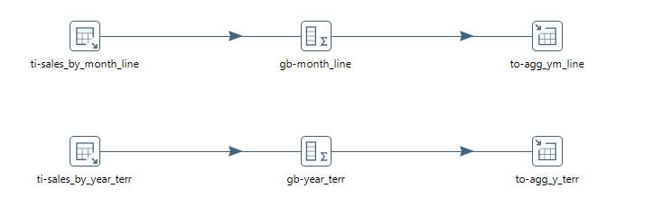
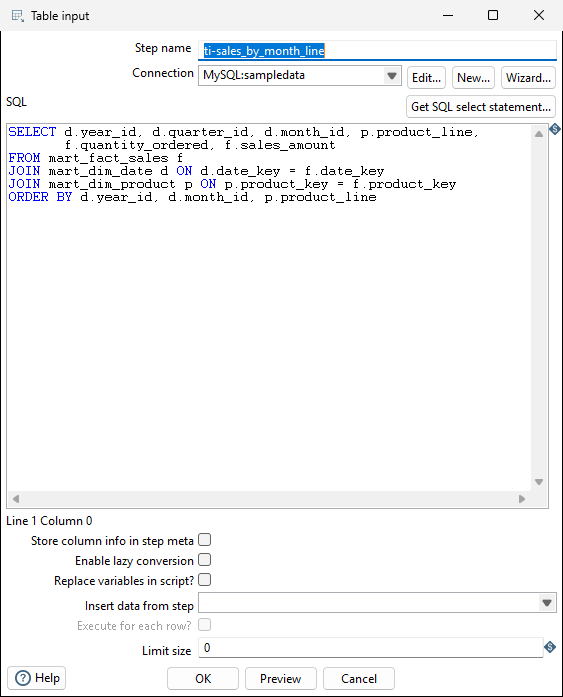
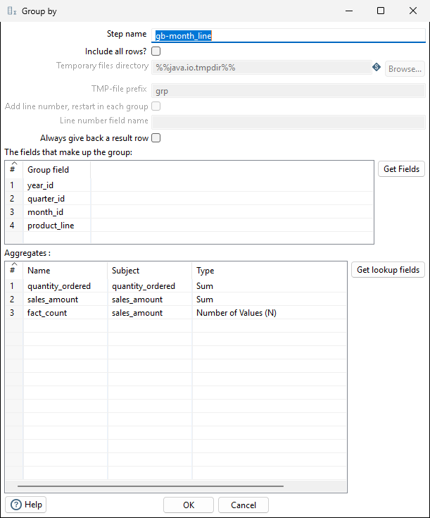
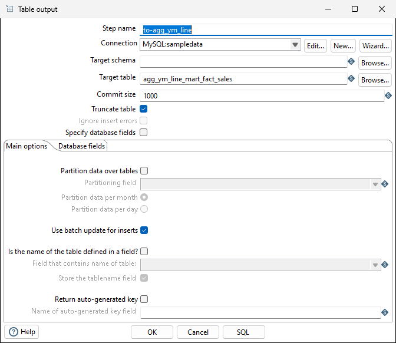
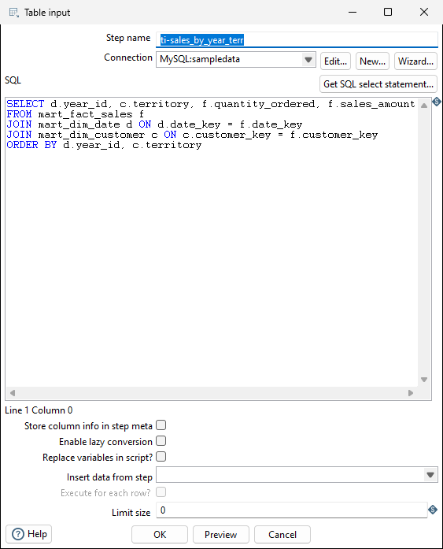
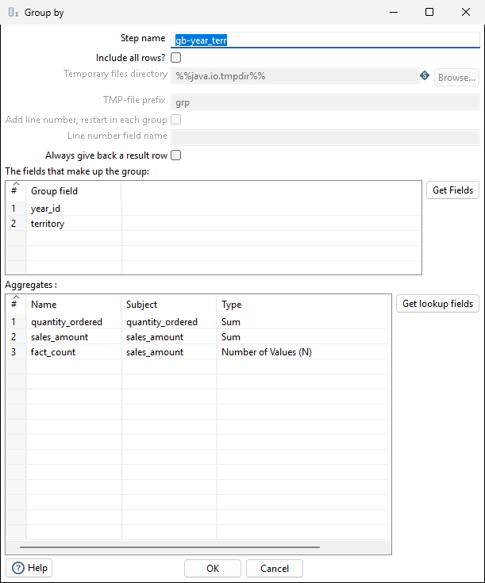
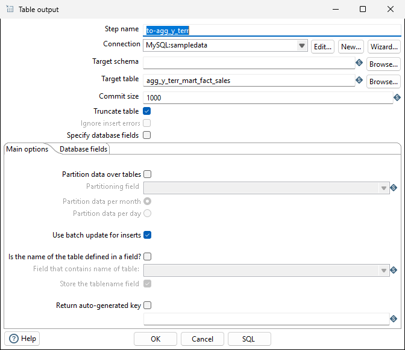

# Summary Tables for Aggregates

> **Warning:**
>
> #### Workshop - Summary Tables for Aggregates
>
> Build the Sales Mart's two summary tables from `mart_fact_sales`: sales by month and product line, and sales by year and territory. Their names and columns follow Mondrian's aggregate table conventions, so the cube in [Refresh the Cube After a Load](../10-refresh-the-cube-after-a-load/guide.md) reads 12 or 175 rows instead of 2,867 for its high-level views.
>
> **What you'll do**
>
> * Create two aggregate tables, named and shaped the way Mondrian expects.
> * Read the fact table joined to its dimensions, sorted for grouping, with **Table input**.
> * Sum the measures and count the fact rows with **Group by**.
> * Rebuild both tables on every run with **Table output**, and check that they add up to the fact table.
>
> **Prerequisites:** [Load the Fact Table](../07-load-the-fact-table/guide.md), with `mart_fact_sales` holding 2,867 order lines; [Overview of Loading Facts](../06-overview-of-loading-facts/guide.md), for the naming conventions; DBeaver connected to `sampledata` as `pentaho_admin`.
>
> **Estimated time:** 30 minutes

<figure>

<figcaption class="pcm-video-caption">Walkthrough: coming soon</figcaption>

</figure>

---

<div align="center">
<figure>

<figcaption>What you build: two independent flows</figcaption>
</figure>
</div>

:::: tabs

### 1. Create the Tables

> **Note:**
>
> #### Create the Tables
>
> Each summary table holds the level columns it keeps, the two measures summed, and `fact_count`, the number of fact rows behind each summary row. Their names end in the fact table's name, `mart_fact_sales`.

1. In DBeaver, open `agg_tables.sql` from `C:\Workshop-DP-Specialty\03-loading-facts\08-summary-tables-for-aggregates` (also under **Lab Files** below), with the `sampledata` connection selected.
2. Run the whole script: press `Alt+X` (**SQL Editor > Execute SQL Script**).

> **Success:** Checkpoint: two new, empty tables: `agg_ym_line_mart_fact_sales` with seven columns and `agg_y_terr_mart_fact_sales` with five.

Mondrian's names for what each table does to the cube's dimensions:

| Table | Time | Product | Markets |
| ----- | ---- | ------- | ------- |
| `agg_ym_line_mart_fact_sales` | *Collapsed* to Years, Quarters and Months: the level columns themselves, no `date_key` | Collapsed to Line | *Lost*: no column, so the table answers only queries that do not split by market |
| `agg_y_terr_mart_fact_sales` | Collapsed to Years | Lost | Collapsed to Territory |

### 2. Sales by Month and Product Line

> **Note:**
>
> #### Sales by Month and Product Line
>
> **Table input** joins the fact table to the two dimensions whose levels the summary keeps, and sorts the rows by them. **Group by** then sums each run of rows with the same year, quarter, month and product line into one row.

1. Start Spoon with the **Start Pentaho Data Integration** button below, or from PowerShell:

```powershell
Set-Location C:\Pentaho\design-tools\data-integration
.\spoon.bat
```

<button data-launch="spoon" data-path="">Start Pentaho Data Integration</button>

2. Select **File > New > Transformation** (`Ctrl+N`).
3. Select **File > Save as** and save it as `tr_agg_sales.ktr` in `C:\Workshop-DP-Specialty\03-loading-facts\08-summary-tables-for-aggregates`.
4. On the **Design** tab, open the **Input** folder and drag **Table input** onto the canvas.
5. Double-click **Table input**. Set **Step name** to `ti-sales_by_month_line` and **Connection** to `MySQL:sampledata`.
6. Enter this query in **SQL**:

   ```sql
   SELECT d.year_id, d.quarter_id, d.month_id, p.product_line,
          f.quantity_ordered, f.sales_amount
   FROM mart_fact_sales f
   JOIN mart_dim_date d ON d.date_key = f.date_key
   JOIN mart_dim_product p ON p.product_key = f.product_key
   ORDER BY d.year_id, d.month_id, p.product_line
   ```

<div align="center">
<figure>

<figcaption>ti-sales_by_month_line</figcaption>
</figure>
</div>

7. Select **OK**.
8. On the **Design** tab, open the **Statistics** folder and drag **Group by** onto the canvas.
9. Create a hop from **ti-sales_by_month_line** to **Group by**: hold `Shift` and drag from one step to the other.
10. Double-click **Group by**. Set **Step name** to `gb-month_line`.
11. Fill **The fields that make up the group** grid with four rows: `year_id`, `quarter_id`, `month_id` and `product_line`.
12. Fill the **Aggregates** grid with three rows:

    | Name | Subject | Type |
    | ---- | ------- | ---- |
    | `quantity_ordered` | `quantity_ordered` | Sum |
    | `sales_amount` | `sales_amount` | Sum |
    | `fact_count` | `sales_amount` | Number of Values (N) |

<div align="center">
<figure>

<figcaption>gb-month_line: four group fields, three aggregates</figcaption>
</figure>
</div>

13. Select **OK**.
14. On the **Design** tab, open the **Output** folder and drag **Table output** onto the canvas.
15. Create a hop from **gb-month_line** to **Table output**.
16. Double-click **Table output**. Set **Step name** to `to-agg_ym_line`, **Connection** to `MySQL:sampledata` and **Target table** to `agg_ym_line_mart_fact_sales`, and select **Truncate table**.

<div align="center">
<figure>

<figcaption>to-agg_ym_line: rebuilt on every run</figcaption>
</figure>
</div>

17. Select **OK**.
18. Save the transformation (`Ctrl+S`).
19. Select **gb-month_line** on the canvas, press `F10` (**Action > Preview**), and select **Quick Launch**.

> **Success:** Checkpoint: the first rows are January 2003: Classic Cars, 334 units, 41,191.78 and a `fact_count` of 10; then Trains, Trucks and Buses, and Vintage Cars, 572 units, 46,826.84 from 16 lines.

20. Select **Close**.

> **Under the hood:**
>
> #### Group by reads one sorted stream and writes a row each time the group changes
>
> **Group by** keeps one running total per aggregate. It compares each row's group fields with the previous row's; while they match it adds the row in, and when they change it writes the finished group and starts the next. That is why the input must be sorted by the group fields: unsorted, January's Classic Cars would come out as several rows, one per run of rows. The `ORDER BY` in **Table input** does the sort in MySQL. **Number of Values (N)** counts the rows with a value in the subject field, and `sales_amount` is never null, so `fact_count` is the number of order lines in the group.
>
> **Why it matters:** a summary with a split group still adds up, so the totals look right while the table holds duplicate keys. The primary key on `(year_id, month_id, product_line)` makes such a mistake fail the load instead.

### 3. Sales by Year and Territory

> **Note:**
>
> #### Sales by Year and Territory
>
> The second summary keeps the year and the customer's territory. The territory comes from the customer version each fact row points at, so a customer who moved territory is counted where it was when it ordered.

1. On the **Design** tab, open the **Input** folder and drag a second **Table input** onto the canvas.
2. Double-click it. Set **Step name** to `ti-sales_by_year_terr`, **Connection** to `MySQL:sampledata`, and enter this query in **SQL**:

   ```sql
   SELECT d.year_id, c.territory, f.quantity_ordered, f.sales_amount
   FROM mart_fact_sales f
   JOIN mart_dim_date d ON d.date_key = f.date_key
   JOIN mart_dim_customer c ON c.customer_key = f.customer_key
   ORDER BY d.year_id, c.territory
   ```

<div align="center">
<figure>

<figcaption>ti-sales_by_year_terr</figcaption>
</figure>
</div>

3. Select **OK**.
4. On the **Design** tab, open the **Statistics** folder and drag **Group by** onto the canvas, and create a hop from **ti-sales_by_year_terr** to it.
5. Double-click **Group by**. Set **Step name** to `gb-year_terr`. Fill **The fields that make up the group** grid with `year_id` and `territory`, and the **Aggregates** grid with the same three rows as `gb-month_line`.

<div align="center">
<figure>

<figcaption>gb-year_terr: two group fields</figcaption>
</figure>
</div>

6. Select **OK**.
7. On the **Design** tab, open the **Output** folder and drag **Table output** onto the canvas, and create a hop from **gb-year_terr** to it.
8. Double-click **Table output**. Set **Step name** to `to-agg_y_terr`, **Connection** to `MySQL:sampledata` and **Target table** to `agg_y_terr_mart_fact_sales`, and select **Truncate table**.

<div align="center">
<figure>

<figcaption>to-agg_y_terr</figcaption>
</figure>
</div>

9. Select **OK**.
10. Save the transformation (`Ctrl+S`).

> **Success:** Checkpoint: six steps in two lines of three, with no hop between the two lines.

### 4. Run and Check

> **Note:**
>
> #### Run and Check
>
> Both flows run at the same time, each truncating and refilling its table. A summary is only useful if it agrees with the fact table, so the last check compares all three.

1. Press `F9` (**Action > Run**), and select **Run** in the **Run Options** dialog.
2. In **Execution Results**, open the **Step Metrics** tab.

> **Success:** Checkpoint: both **Table input** steps show 2,867 rows; **to-agg_ym_line** shows 175 in **Output** and **to-agg_y_terr** 12.

3. In DBeaver, run:

   ```sql
   SELECT 'mart_fact_sales', COUNT(*), SUM(sales_amount) FROM mart_fact_sales
   UNION ALL SELECT 'agg_ym_line', SUM(fact_count), SUM(sales_amount) FROM agg_ym_line_mart_fact_sales
   UNION ALL SELECT 'agg_y_terr', SUM(fact_count), SUM(sales_amount) FROM agg_y_terr_mart_fact_sales;
   SELECT * FROM agg_y_terr_mart_fact_sales WHERE year_id = 2005 ORDER BY territory;
   ```

> **Success:** Checkpoint: all three rows read 2,867 and 10,161,912.81. For January to April 2005, APAC has 2,416 units and 252,493.31 from 63 lines; EMEA 6,747 and 657,404.39 from 181; Japan 380 and 42,920.94 from 11; NA 5,276 and 543,970.39 from 139.

The summaries agree with the fact table to the cent. The last question is how Mondrian will know to use them.

> **Under the hood:**
>
> #### Mondrian matches an aggregate table by its name and its columns
>
> When Mondrian loads a schema with aggregates switched on, it looks for tables whose names match `agg_<something>_<fact table>`, here `agg_..._mart_fact_sales`. It then maps each column: `fact_count` is the row count, a column named like a fact column (`sales_amount`, `quantity_ordered`) is that measure, and a column named like a level's column (`year_id`, `product_line`, `territory`) is that level, collapsed. The Sales Mart's schema also declares both tables explicitly with `AggName` elements, so it does not depend on the naming rules alone.
>
> **Why it matters:** an aggregate changes where Mondrian reads, never the answer, as long as the load rebuilds it after every fact load. That is the job of the next workshop.

::::

## Troubleshooting <!-- no-step -->

<details>

<summary>"Duplicate entry" in to-agg_ym_line</summary>

The rows reached **Group by** unsorted, so one group came out twice. Check the `ORDER BY` in **ti-sales_by_month_line**: it must sort by every group field that can change within a year (`year_id`, `month_id`, `product_line`).

</details>

<details>

<summary>The summaries are empty</summary>

`mart_fact_sales` is empty, or its keys match no dimension row, so the joins return nothing. Run the first query of part 4 against `mart_fact_sales` alone, and reload it with `tr_fact_sales.ktr` if it is empty.

</details>

## Lab Files

Click a file to download. For `.ktr` and `.kjb` files, **Open in Pentaho Data Integration** launches Pentaho Data Integration with the file loaded. If Pentaho Data Integration is already running, the path is copied to your clipboard — switch to Pentaho Data Integration and press `Ctrl+O`, `Ctrl+V`, `Enter`.

The `CREATE TABLE` script for both summary tables, for MySQL:

[agg_tables.sql](./files/agg_tables.sql)

### Solution <!-- no-step -->

The finished transformation for this lab. Open it alongside your own to compare, or run to see the expected result.

Also on disk at `C:\Workshop-DP-Specialty\03-loading-facts\08-summary-tables-for-aggregates\solution`.

[tr_agg_sales.ktr](./files/tr_agg_sales.ktr) <button data-launch="spoon" data-path="files/tr_agg_sales.ktr">Open in Pentaho Data Integration</button> <button data-graph="files/tr_agg_sales.ktr">View graph</button>

---

> **Tip:** The mart is complete: three dimensions, a fact table and two summaries. Next, the job that loads them all, in order, on the Pentaho Server's schedule: [Schedule the Load on the Pentaho Server](../09-schedule-the-load-on-the-pentaho-server/guide.md).
