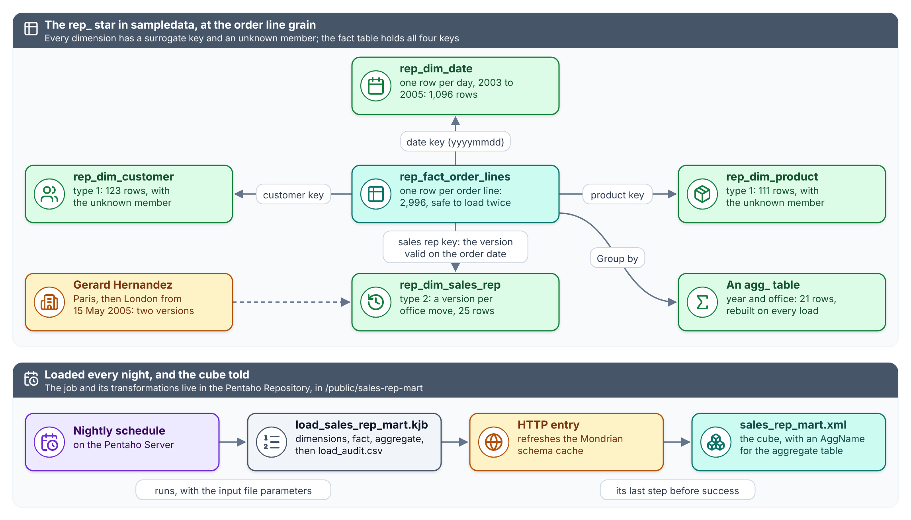

# Capstone: A Mart for the Sales Cube

> **Capstone Project — bring it all together.**

You're the data engineer for Steel Wheels' sales operations director.
Commissions are paid by office, and in May 2005 a sales rep moved from
the Paris office to London. The director wants a cube of sales by rep
and by office that credits each order to the office the rep worked in
when the order was placed, refreshed every night without anyone asking.

The raw material is the order system's own extracts: orders and order
lines in separate files, customers, products, offices, and two extracts
of the employee list taken a fortnight apart. The mart, the load and
the cube are yours to build.

> **Objectives:**
>
> - Build a star schema in the MySQL `sampledata` database for sales by sales rep: a date dimension, customer, product and sales rep dimensions, a fact table at the order line grain, and one aggregate table.
> - Keep the sales rep's history: a rep who changes office gets a new version, and every order line points at the version valid on its order date.
> - Load it with one parameterized job, stored in the Pentaho Repository, scheduled on the Pentaho Server, safe to run twice, and ending with a refreshed cube.
> - Publish a Mondrian schema on the mart that uses your aggregate table.
> - Produce something portfolio-worthy ("I built this for my Specialty course accreditation").
>
> **Estimated time:** 90 minutes for a clean, well-named solution. Re-shape and revisit as you'd like.

---

> **Warning:**
>
> #### Required for your course accreditation: five checks on your own folders
>
> The course accreditation is issued only when all five of these checks
> pass. They read your workshop folder, so save (or copy) your work into
> exactly these places **before you take the exam**:
>
> | # | What must be there | Where |
> | --- | --- | --- |
> | 1 | Your job, `load_sales_rep_mart.kjb`, running your transformations | `C:\Workshop-DP-Specialty\capstone\solution\` |
> | 2 | The same job, ending with an **HTTP** entry that refreshes the cube | `C:\Workshop-DP-Specialty\capstone\solution\` |
> | 3 | Your Mondrian schema, `sales_rep_mart.xml`, declaring your aggregate table | `C:\Workshop-DP-Specialty\capstone\solution\` |
> | 4 | Your load audit, `load_audit.csv`, written by the job | `C:\Workshop-DP-Specialty\capstone\out\` |
> | 5 | Your `README.md`: how to run, schedule and check the load | `C:\Workshop-DP-Specialty\capstone\solution\` |
>
> Build the job and its transformations in `solution\`, and upload them
> to the Pentaho Repository for the schedule.
> Your `solution\` folder starts with a **blank**
> transformation or job for each file named below: build each one and
> save it. A blank file passes no check. Select **Run checks** under
> **Verification checks** to see where you stand.

## Inputs

Download the files from **Lab Files** at the bottom of this page, or
use the copies the installer put in `C:\Workshop-DP-Specialty\capstone\data\`.
They are the Steel Wheels sample data, as an order system would extract
it.

| File | What it holds | Rows |
| ---- | ------------- | ---: |
| `orders.csv` | One row per order: order date, required and shipped dates, status, customer | 326 |
| `order_details.csv` | One row per order line: product, quantity, price | 2,996 |
| `customers.csv` | Customers, with their territory and the number of their sales rep | 122 |
| `products.csv` | Products, with line, vendor and prices | 110 |
| `offices.csv` | The seven sales offices, with city, country and territory | 7 |
| `employees_2005-04-30.csv` | The employee list on 30 April 2005, each with job title, office and manager | 23 |
| `employees_2005-05-15.csv` | The employee list on 15 May 2005: one sales rep has moved office | 23 |

The order lines carry no date and no customer: those are on the order.
Twenty-two customers have no sales rep; none of them has placed an
order.

---

## Required behavior

Build the mart in seven stages. Each maps to a module of the course, so
you can look back at the workshop that taught it. Name your tables with
a `rep_` prefix (`rep_dim_date`, `rep_fact_order_lines` and so on), so
they never clash with the Sales Mart of the workshops.

### 1. A date dimension *(Modeling the Star)*

`rep_dim_date`, one row per day from 1 January 2003 to 31 December
2005, generated, with a `yyyymmdd` integer key and at least the year,
quarter and month attributes your cube's time dimension needs.

### 2. Dimensions with history *(Modeling the Star)*

- `rep_dim_sales_rep`, loaded from the employee extracts, with the rep's office city, country and territory joined in from `offices.csv`. A change of office or job title is **type 2**: a new version from the extract date. A change of name is **type 1**.
- `rep_dim_customer` and `rep_dim_product`, each with a surrogate key and an unknown member. Type 1 throughout is fine for both.
- Load the 30 April employee extract first, then the 15 May one: the rep who moved must end with two versions.

### 3. The fact table *(Loading Facts)*

`rep_fact_order_lines`, one row per order line, with the keys of all
four dimensions, the quantity, the price, and the line's sales amount.
The sales rep key is the version of the customer's rep that was valid
on the order date. A line whose dimension row cannot be found still
loads, with the unknown member's key. Running the load twice leaves
every order line in the table once.

### 4. A summary table *(Loading Facts)*

At least one aggregate table of `rep_fact_order_lines`, named and shaped
the way Mondrian expects, rebuilt on every load. The director's main
view is sales by year and office, so that grain is the obvious first
choice.

### 5. One job, scheduled *(Automate and Publish)*

`load_sales_rep_mart.kjb`: the transformations in the order a star
needs, parameters for the input files, a failure path that stops the
load, and a last transformation that writes `load_audit.csv` to
`C:\Workshop-DP-Specialty\capstone\out\` with one row per mart table and
its row count. Store it and its transformations in the Pentaho
Repository, in `/public/sales-rep-mart`, and schedule it on the Pentaho
Server to run every night.

### 6. A cube that stays fresh *(Automate and Publish)*

`sales_rep_mart.xml`: a Mondrian schema with a cube on your fact table,
dimensions for time, sales rep (territory, office, rep) and product
line at least, the **Sales** and **Quantity** measures, and an
`AggName` for your aggregate table. Publish it on the Pentaho Server
against a data source on `sampledata`. The job's last step before
success is an **HTTP** entry that refreshes the Mondrian schema cache.

### 7. Hand it in

Keep the job and the transformations in `capstone\solution\`, put
your schema beside them, and write a `README.md` that says how to run
the load from Spoon and on the server, what the parameters are, and how
to check that the cube shows the rep's move.

---

## Suggested shape

<div align="center">
<figure>

<figcaption>The rep_ star, its aggregate, and the nightly job that ends by refreshing the cube</figcaption>
</figure>
</div>

Read the diagram in two parts. The top panel is the star you build: `rep_fact_order_lines` sits in the middle at one row per order line, and each labeled arrow is a key it holds, pointing at the dimension that key finds. The sales rep key is the one to get right, because it must point at the version of the customer's rep valid on the order date; the amber box is Gerard Hernandez, the rep who moved from Paris to London on 15 May 2005, so `rep_dim_sales_rep` holds two versions of him. The curved **Group by** arrow is the aggregate table, summed from the fact table at year and office and rebuilt on every load. The counts in each box are the ones the verification checks expect. The bottom panel reads left to right: the nightly schedule runs `load_sales_rep_mart.kjb` with the input file parameters, and the job's last step before success is the **HTTP** entry that refreshes the cache of the cube in `sales_rep_mart.xml`.

Name the aggregate table `agg_<grain>_rep_fact_order_lines`, so Mondrian recognizes it, and rebuild it after every load.

```text
C:\Workshop-DP-Specialty\capstone\
├── data\                          the seven input files
├── solution\
│   ├── load_sales_rep_mart.kjb    the job
│   ├── load_dim_date.ktr
│   ├── load_dim_customer.ktr
│   ├── load_dim_product.ktr
│   ├── load_dim_sales_rep.ktr
│   ├── load_fact_order_lines.ktr
│   ├── load_aggregates.ktr
│   ├── write_load_audit.ktr
│   ├── sales_rep_mart.xml         your Mondrian schema
│   └── README.md
└── out\
    └── load_audit.csv             written by every run of the job
```

Every `.ktr` and `.kjb` above is waiting for you in `solution\` as a
blank file, with no steps, parameters or connections: the names are
given, what goes in them is yours. The schema and `README.md` you
create. If `C:\Workshop-DP-Specialty\` has no `capstone` folder, create
`capstone\data\`, `capstone\solution\` and `capstone\out\` yourself.

---

## Hints for the tricky bits

- **Orders and lines.** The lines need the order's date and customer before any lookup can run. A **Stream lookup** on the order number, with the 326 orders as its lookup stream, brings them in; so does a **Merge join**, with both inputs sorted on the order number.
- **Two lookups for one key.** The fact row reaches its sales rep through its customer: first find the customer's rep number, then the rep's version on the order date. Keep the rep number in the stream for the second lookup.
- **The office on the rep.** Join the office's city, country and territory onto each employee row before **Dimension lookup/update**, and make them type 2 fields: the move is a change of office.
- **Which date drives the version.** The employee extracts carry `extract_date`; that is the dimension's **Stream Datefield** when you load it. In the fact load, the order date is.
- **Creating the tables.** The **SQL** button on **Table output**, **Insert / Update** and **Dimension lookup/update** shows the `CREATE TABLE` the step needs, and can run it. Check the column types before you run it: money is a decimal, never a float.
- **Two runs, one answer.** After the 15 May extract, run the fact load again: the lines placed after the move must change to the new rep key, and the row count must not.
- **The audit.** A **Table input** per table, or one query with a `UNION ALL` of counts, into a **Text file output**, gives the audit file. Write it last, after the aggregate.
- **The schedule's paths.** The server reads the input files from the paths your parameters give, and connects with its own MySQL driver.

---

## Lab Files

Click a file to download. Put all seven in `C:\Workshop-DP-Specialty\capstone\data\`
before you start, if the installer has not already. Beyond these and the
blank files in `solution\`, nothing in the capstone is supplied: the
mart, the job and the schema are yours to build.

[orders.csv](./files/orders.csv)

[order_details.csv](./files/order_details.csv)

[customers.csv](./files/customers.csv)

[products.csv](./files/products.csv)

[offices.csv](./files/offices.csv)

[employees_2005-04-30.csv](./files/employees_2005-04-30.csv)

[employees_2005-05-15.csv](./files/employees_2005-05-15.csv)

---

## Verification checks

> **Warning:** These five checks decide your course accreditation, and
> they look only in `C:\Workshop-DP-Specialty\capstone\`: in
> `solution\` your `load_sales_rep_mart.kjb`, running at least one
> transformation and an **HTTP** entry, your `sales_rep_mart.xml` with
> an `AggName`, and your `README.md`; and in `out\` your
> `load_audit.csv`. Save your work there before you take the
> exam.

After running your job with both employee extracts, select **Run
checks** below to confirm each file landed where expected. The checks
confirm that the files exist and hold the parts named above. Check the
numbers yourself: a correct mart holds these row counts, whatever you
named your columns.

| Table | Rows |
| ----- | ---: |
| `rep_dim_date` | 1,096 |
| `rep_dim_customer` | 123, with the unknown member |
| `rep_dim_product` | 111, with the unknown member |
| `rep_dim_sales_rep` | 25: 23 employees, the unknown member, and a second version for the rep who moved |
| `rep_fact_order_lines` | 2,996, in 326 orders, 105,331 units and 10,645,949.18 in sales |
| An aggregate at year and office | 21 |

The rep who moved is Gerard Hernandez, from Paris to London on 15 May
2005. Two of his customers' orders were placed after that date, 19
lines worth 78,918.03, and they must be credited to London. Sales by
office for 2005:

| Office | Order lines | Sales |
| ------ | ----------: | ----: |
| Boston | 35 | 134,537.47 |
| London | 74 | 278,179.27 |
| NYC | 27 | 111,860.44 |
| Paris | 176 | 651,649.78 |
| San Francisco | 110 | 424,659.36 |
| Sydney | 90 | 337,018.14 |
| Tokyo | 11 | 42,920.94 |
| **Total** | **523** | **1,980,825.40** |

Credit every line to the rep's current office instead and London drops
to 199,261.24 and Paris rises to 730,567.81: the most common mistake,
and the one the director would notice first. Your cube, after the
job's cache refresh, shows the same figures for 2005 by office.

> **Under the hood:**
>
> #### Why the same order lines give London two different totals
>
> A sales rep dimension keyed on the employee number has one row per
> rep, holding the rep's current office, so every order joins to London
> for Gerard Hernandez, including the 2003 ones. A type 2 dimension has
> one row per version, and the fact load picked the version valid on
> each order date, so only the 19 lines placed from 15 May on carry the
> London version's key. The cube then needs no date logic at all: it
> sums by the key the fact row already holds.
>
> **Why it matters:** commissions paid on the first figure would pay
> London for sales Paris made. Keeping history is a decision the fact
> load makes, row by row, at load time; no report can recover it later.

---

## Deliverables

Your `solution\` folder and your `out\` folder, under
`C:\Workshop-DP-Specialty\capstone\`:

1. `load_sales_rep_mart.kjb` — the job, with its parameters, its failure path and its **HTTP** cache refresh
2. `load_dim_date.ktr`, `load_dim_customer.ktr`, `load_dim_product.ktr`, `load_dim_sales_rep.ktr`, `load_fact_order_lines.ktr`, `load_aggregates.ktr` and `write_load_audit.ktr`
3. `sales_rep_mart.xml` — your Mondrian schema, with an `AggName` for your aggregate table
4. `README.md` — how to run and schedule the load, its parameters, and how to check the rep's move in the cube
5. `out\load_audit.csv` — one row per mart table with its row count, from your last run

> **Warning:** Save into `capstone\solution\`, not into the course
> folder. Course content is refreshed from the repository on every
> launch, so anything you leave there will be overwritten. Reinstalling
> or upgrading the course never touches `capstone\solution\` or
> `capstone\out\`, and only puts back a blank file you have deleted.

This becomes a portfolio
piece: name things clearly, keep the folder tidy, and be ready to
explain why London's 2005 figure is 278,179.27.

---

## Build outline and hints <!-- no-step -->

One section per file, in the order you build them. Each says what the
file must do, what it reads and writes, which requirement it meets, and
what a correct run shows. The hints name a step or a technique; the
settings are yours to work out. Each file starts blank in `solution\`:
open it in Spoon (**File > Open**), build it, save it, and store it in
the repository when the job is ready.

:::: tabs

### 1. load_dim_date.ktr

**Must do:** generate `rep_dim_date`, 2003 to 2005, and rebuild it
whole on each run. Requirement 1.

> **Success:** Checkpoint: 1,096 rows, from `20030101` to `20051231`.

<details>
<summary>Hints</summary>

- The same chain as [Build a Date Dimension](../04-build-a-date-dimension/guide.md): generated rows, a counter, date arithmetic, then the parts.
- The `yyyymmdd` key is arithmetic on the year, month and day.

</details>

### 2. load_dim_customer.ktr and load_dim_product.ktr

**Must do:** load `rep_dim_customer` from `customers.csv` and
`rep_dim_product` from `products.csv`, each with a surrogate key and an
unknown member. Keep the customer's sales rep number on the customer
row. Requirement 2.

> **Success:** Checkpoint: 123 customers and 111 products, each count including row `0`.

<details>
<summary>Hints</summary>

- **Dimension lookup/update** with every field on **Update** gives a type 1 dimension that still generates its keys and its unknown member.
- Name each file through a parameter, so the job can pass the paths.

</details>

### 3. load_dim_sales_rep.ktr

**Must do:** load `rep_dim_sales_rep` from the employee extract a
parameter names, with each rep's office attributes joined in, office
and job title type 2, name type 1. Requirement 2.

> **Success:** Checkpoint: after the 30 April extract, 24 rows; after the 15 May extract, 25, with Gerard Hernandez's first version ending on 2005-05-15 and his second, in London, starting there.

<details>
<summary>Hints</summary>

- `offices.csv` has seven rows: a **Stream lookup** on the office code is enough.
- `reports_to` is empty for the president. An empty field reads as null, and **Dimension lookup/update** compares nulls as equal.

</details>

### 4. load_fact_order_lines.ktr

**Must do:** read the orders and the order lines, bring each line its
order's date and customer, find the four dimension keys (the rep's as of
the order date), compute the sales amount, and write
`rep_fact_order_lines` so that a second run changes no count.
Requirement 3.

> **Success:** Checkpoint: 2,996 rows, 10,645,949.18 in sales, and no row with a `0` key.

<details>
<summary>Hints</summary>

- See **Orders and lines** and **Two lookups for one key** above.
- In lookup mode, with **Update the dimension?** cleared, **Dimension lookup/update** finds the version valid on the **Stream Datefield**.
- Keep money in **BigNumber** from the file to the table, and as the first factor of any product, so the sums agree to the cent.
- Keyed on the order line, **Insert / Update** makes the load safe to repeat, and moves a line to the new rep key when the second extract arrives.

</details>

### 5. load_aggregates.ktr

**Must do:** rebuild your aggregate table (or tables) from
`rep_fact_order_lines` and its dimensions. Requirement 4.

> **Success:** Checkpoint: the aggregate's `fact_count` sums to 2,996 and its sales to 10,645,949.18; at year and office it has 21 rows.

<details>
<summary>Hints</summary>

- Mondrian's conventions: `agg_<something>_rep_fact_order_lines`, a `fact_count` column, measure and level columns named like the columns they summarize. See [Summary Tables for Aggregates](../08-summary-tables-for-aggregates/guide.md).
- **Group by** needs its input sorted on the group fields.
- The office must be the office of the version on the fact row, not the rep's current one: join through the fact's rep key.

</details>

### 6. write_load_audit.ktr

**Must do:** write `C:\Workshop-DP-Specialty\capstone\out\load_audit.csv`,
one row per mart table with its row count, replacing the previous file.
Requirement 5.

> **Success:** Checkpoint: the file has a header and one row for each of your tables; the counts match the table under **Verification checks**.

<details>
<summary>Hints</summary>

- See **The audit** above. Pass the output folder as a parameter too.

</details>

### 7. load_sales_rep_mart.kjb

**Must do:** run the transformations in order, dimensions before facts
and the aggregate after them, pass the job's parameters down, stop on
the first failure, write the audit, and end with an **HTTP** entry that
refreshes the Mondrian schema cache. Store it in
`/public/sales-rep-mart`, schedule it nightly on the Pentaho Server, and
keep the same copy in `solution\`. Requirements 5 and 6.

> **Success:** Checkpoint: a scheduled run on the Pentaho Server completes, `out\load_audit.csv` is rewritten, and every check under **Verification checks** passes.

<details>
<summary>Hints</summary>

- The job of [Schedule the Load on the Pentaho Server](../09-schedule-the-load-on-the-pentaho-server/guide.md) is the pattern, with the **HTTP** entry of [Refresh the Cube After a Load](../10-refresh-the-cube-after-a-load/guide.md) before **Success**.
- Run it twice, once with each employee extract, and compare London's 2005 figure with the one above.

</details>

### 8. sales_rep_mart.xml

**Must do:** a Mondrian schema with a cube on `rep_fact_order_lines`,
the dimensions of requirement 6, and an `AggName` for your aggregate,
published on the Pentaho Server. Requirement 6.

> **Success:** Checkpoint: an Analyzer report of Sales by Years and office shows the 2005 figures under **Verification checks**, London 278,179.27.

<details>
<summary>Hints</summary>

- `sales_mart.xml` from [Refresh the Cube After a Load](../10-refresh-the-cube-after-a-load/guide.md) shows the shape: shared dimensions, a fact table with `AggName` elements, two measures.
- Key the sales rep level on the surrogate key, with the rep's name as its caption, so each version is its own member.
- If the schema will not load, the server log names the element at fault.

</details>

::::

---

> **Tip:** When every check passes, your mart, job and cube are the course's last deliverable. To look back at how any piece works, every workshop is in the sidebar, starting with the lab layout in [Before You Start](../01-before-you-start/guide.md).
