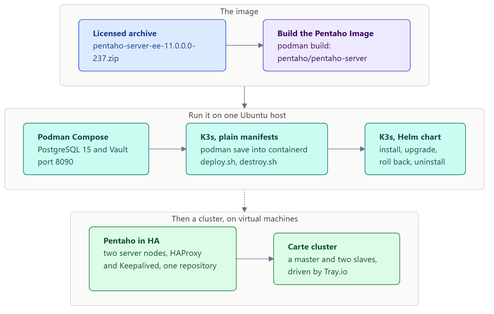

# Overview of Containers

A **container** is a process that runs from an image, fenced off from
the rest of the host but sharing the host's kernel. The **image** holds
everything that process needs: the files of a small operating system,
a Java runtime, the application and its configuration. Nothing is
emulated, so a container starts in seconds and costs little more than
the process itself.

## Images and containers

An image is read-only and built in **layers**, one for each instruction
in its `Containerfile` that changes files. A rebuild reuses every layer
whose instruction and inputs haven't changed, which is why the second
build of the Pentaho image takes under a minute while the first takes
several.

A container adds a thin writable layer on top of its image. Whatever a
container writes there disappears with the container. Data that has to
outlive it goes in a **volume**: a named volume that the engine manages,
or a folder of the host mounted into the container.

## Podman

This course runs every container with **Podman**, on Ubuntu 24.04:

- **No daemon.** Each `podman` command starts its container itself;
  there is no background service to start, and no group to join.
- **Rootless.** Containers run as your own user. `root` inside a
  container is you on the host, and the container's other users map to
  a range of subordinate IDs from `/etc/subuid`.
- **The same commands.** `podman build`, `podman run`, `podman ps` and
  `podman logs` take the options you may know from Docker. A
  `Containerfile` uses the Dockerfile instructions, and Podman builds it
  with Buildah.
- **Compose files** run through `podman compose`, which hands them to
  `podman-compose`.
- **Images named in full.** Podman on Ubuntu searches no registry for a
  short name, so this course writes `docker.io/library/postgres:15`, not
  `postgres:15`.

## Orchestration

One host running containers is enough for development and for small
deployments. **Kubernetes** runs them across a cluster: it schedules
pods onto nodes, restarts them when they fail, and connects them
through Services and ingress.

**K3s** is a certified Kubernetes in a single binary, light enough for
one machine. It runs containers with its own runtime, containerd, not
with Podman, so an image built with Podman is copied into it with
`podman save` and `k3s ctr images import`. **Helm** then packages the
same deployment as a chart: one release, with every change recorded as
a revision you can roll back.

## Where Pentaho fits

The Pentaho Server is a Tomcat web application whose state lives in a
database: the Jackrabbit content repository, the Quartz scheduler's
tables and the Hibernate platform data, three databases in PostgreSQL.
That split is what makes it a good fit for containers: the server is an
image that can be replaced at any time, and the repository is a
database on a volume that outlives it.

## The path through this course

<figure>

<figcaption>One image, three ways to run it, then a cluster</figcaption>
</figure>

You build the Pentaho Server image once, from the licensed archive, and
run it three ways: with Podman Compose against PostgreSQL and Vault, on
K3s from plain manifests, and on K3s again from a Helm chart. The High
Availability section then builds a cluster of servers on virtual
machines, with a Carte cluster for Pentaho Data Integration.
