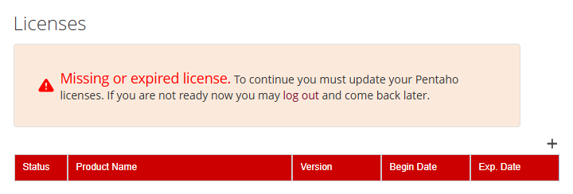

# Build the Pentaho Image

> **Warning:**
>
> #### Workshop - Build the Pentaho Image
>
> Build the Pentaho Server 11 Enterprise Edition (EE) image from the licensed archive with `build.sh`, then run it against PostgreSQL with `test-compose.yml` to prove it starts. The K3s and Helm workshops deploy this image.
>
> **What you'll do**
>
> * Copy the `pentaho-image` project to the Linux host and stage the Pentaho Server archive
> * Configure the build in `.env` and preview it with a dry run
> * Build `pentaho/pentaho-server:11.0.0.0-237` and check what the image runs
> * Smoke-test the image against PostgreSQL 15 with `test-compose.yml`
> * Stop the test stack and free its ports
>
> **Prerequisites:**
>
> * The Linux host with Podman and `podman-compose` from [Before You Start](../00-before-you-start/guide.md)
> * `pentaho-server-ee-11.0.0.0-237.zip`, downloaded from the Support Portal
> * About 10 GB of free disk space
>
> **Estimated time:** 45 minutes

:::: tabs

### 1. Stage the Archive

> **Note:**
>
> #### Stage the Archive
>
> The build copies everything in `stagedArtifacts/` into its first stage and stops if the archive it expects isn't there. The archive is licensed, so it never ships with the course.

1. Copy this lab's files to the Linux host. Run the block for where this guide runs. Both also copy the five repository scripts from the Compose workshop, which the smoke test needs.

::: tabs

### Guide on the Linux host

```bash
CONTENT=~/.local/share/com.pentaho.content-manager/content
cp -r "$CONTENT/03-image-build/files/pentaho-image" ~/pentaho-image
cp -r "$CONTENT/05-compose-postgresql/files/Pentaho-Server-PostgreSQL/db_init_postgres" ~/pentaho-image/
```

### Guide on Windows, host in WSL 2

```bash
CONTENT="$(wslpath "$(cmd.exe /c 'echo %APPDATA%' 2>/dev/null | tr -d '\r')")/com.pentaho.content-manager/content"
cp -r "$CONTENT/03-image-build/files/pentaho-image" ~/pentaho-image
cp -r "$CONTENT/05-compose-postgresql/files/Pentaho-Server-PostgreSQL/db_init_postgres" ~/pentaho-image/
```

:::

On a separate Linux VM, copy the same two folders across with `scp` or a shared folder. Each file is also in **Lab Files** below.

2. On the Linux host, go to the project and make its scripts executable. The build copies the entrypoint scripts into the image with the permissions they have here.

   ```bash
   cd ~/pentaho-image
   chmod +x build.sh entrypoint/*.sh
   ```

3. Copy the archive into `stagedArtifacts/`. The command assumes the archive is in `~/Downloads`; change the first path if you saved it elsewhere (on a WSL 2 host, your Windows downloads are under `/mnt/c/Users/`).

   ```bash
   cp ~/Downloads/pentaho-server-ee-11.0.0.0-237.zip stagedArtifacts/
   ls -lh stagedArtifacts/
   ```

> **Success:** Checkpoint: `stagedArtifacts/` lists `README.md` and `pentaho-server-ee-11.0.0.0-237.zip`, at `1.1G`.

The project stages no PostgreSQL JDBC driver: the archive already carries one, `pentaho-server/tomcat/lib/postgresql-42.5.6.jar`. A driver you add or replace goes in `softwareOverride/1_drivers/tomcat/lib/`, which this project doesn't have.

### 2. Configure the Build

> **Note:**
>
> #### Configure the Build
>
> `build.sh` reads every setting from `.env`. The template, `.env.example`, holds this course's values.

1. Create `.env` from the template:

   ```bash
   cp .env.example .env
   ```

2. Open `.env` in a text editor and check these values. Keep them as they are.

| Setting              | Value                                  | What it does                                                        |
| -------------------- | -------------------------------------- | ------------------------------------------------------------------- |
| `PENTAHO_VERSION`    | `11.0.0.0-237`                         | Must match the archive's file name                                  |
| `EDITION`            | `ee`                                   | Builds from `pentaho-server-ee-<version>.zip`                       |
| `INCLUDE_DEMO`       | `0`                                    | Removes the sample content (`default-content`) from the image       |
| `IMAGE_TAG`          | `pentaho/pentaho-server:11.0.0.0-237`  | The tag the K3s manifests and the Helm chart run                    |
| `UNPACK_BUILD_IMAGE` | `docker.io/library/debian:trixie-slim` | Base image of the stage that unpacks the archive                    |
| `PACK_BUILD_IMAGE`   | `docker.io/library/debian:trixie-slim` | Base image of the final image                                       |
| `BUILD_PLATFORM`     | `linux/amd64`                          | Target platform                                                     |
| `RUN_TESTS`          | `true`                                 | Runs two checks on the finished image                               |
| `PUSH_TO_REGISTRY`   | `false`                                | Leaves the image on this host                                       |
| `LOAD_INTO_K3S`      | `false`                                | The K3s workshop imports the image itself                           |

The runtime settings in the file, such as `PENTAHO_MIN_MEMORY` and `TZ`, are not build arguments: `build.sh` only prints them.

The base images are named in full, registry included. Podman on Ubuntu has no default registry to search, so a short name such as `debian:trixie-slim` only works for the few images Podman knows an alias for, and `postgres:15` fails with `short-name "postgres:15" did not resolve to an alias`. Every image this course pulls is written the long way.

3. Preview the build without running it:

   ```bash
   ./build.sh --dry-run
   ```

> **Success:** Checkpoint: after its `Configuration:` summary, the script prints the command it would run:
>
> ```text
> podman build \
>   --build-arg PENTAHO_VERSION=11.0.0.0-237 \
>   --build-arg PENTAHO_INSTALLER_NAME=pentaho-server-ee \
>   --build-arg IS_DEMO=0 \
>   --build-arg INSTALLATION_PATH=/opt/pentaho \
>   --build-arg UNPACK_BUILD_IMAGE=docker.io/library/debian:trixie-slim \
>   --build-arg PACK_BUILD_IMAGE=docker.io/library/debian:trixie-slim \
>   --platform linux/amd64 \
>   -t pentaho/pentaho-server:11.0.0.0-237 \
>   .
> ```

### 3. Build the Image

> **Note:**
>
> #### Build the Image
>
> The build runs `podman build`, which builds with Buildah: no daemon, and nothing in it needs root. The first build pulls Debian and its packages and takes several minutes; a rebuild reuses the cached layers and takes under a minute.

1. Start the build. The panel below explains what it does.

   ```bash
   ./build.sh
   ```

> **Under the hood:**
>
> #### Two stages: the archive is unpacked in one image and run from another
>
> The `Containerfile` has two stages. `install_unpack` starts from `debian:trixie-slim`, installs `unzip`, unpacks the archive into `/opt/pentaho`, unzips any Analyzer, Interactive Reporting or Dashboard Designer plugin it finds in `stagedArtifacts/`, and deletes `default-content` when `IS_DEMO` is `0`.
>
> `pack` starts again from a clean `debian:trixie-slim`. It creates the user `pentaho` (UID 5000), installs `openjdk-21-jre-headless` and `curl`, and copies only `/opt/pentaho` across from the first stage, owned by `pentaho`. Then it copies `entrypoint/` to `/` and `softwareOverride/` to `/docker-entrypoint-init`, exposes 8080 and 8443, and switches to `USER pentaho`.
>
> **Why it matters:** the 1.1 GB archive and `unzip` never reach the image you ship, and nothing in it runs as root. A rebuild after a configuration change reuses the cached unpack stage.

2. When the prompt returns, scroll back through the output to the `Testing Image` section.

> **Success:** Checkpoint: `Testing Image` runs `Test 1: Checking Java version...` and `Test 2: Verifying Pentaho installation...` and ends `All tests passed!`. The output then ends with `Build Complete!`, `Image built successfully: pentaho/pentaho-server:11.0.0.0-237` and `All done!`.

3. List the image:

   ```bash
   podman images pentaho/pentaho-server
   ```

> **Success:** Checkpoint: one image, tag `11.0.0.0-237`. Podman shows the repository as `localhost/pentaho/pentaho-server`: it prefixes `localhost/` to a name that has no registry.

4. Read the user, entrypoint and command the image runs with:

   ```bash
   podman image inspect --format '{{.Config.User}} {{.Config.Entrypoint}} {{.Config.Cmd}}' pentaho/pentaho-server:11.0.0.0-237
   ```

> **Success:** Checkpoint: `pentaho [/docker-entrypoint.sh] [./start-pentaho.sh]`: the `USER`, `ENTRYPOINT` and `CMD` lines of the `Containerfile`.

### 4. Smoke-Test the Image

> **Note:**
>
> #### Smoke-Test the Image
>
> `test-compose.yml` starts PostgreSQL 15, runs the five repository scripts you copied in step 1 against it, and then starts the image. The service is named `postgres` because the configuration baked into the image connects to `postgres:5432`.

1. Start the test stack. `podman compose` hands the file to `podman-compose`, which prints each `podman` command it runs. On a first start it also prints `Error: no such volume pentaho-image_postgres_test_data`: it looks for the volume before it creates it.

   ```bash
   podman compose -f test-compose.yml up -d
   ```

> **Under the hood:**
>
> #### Podman starts what a container requires, every time it starts
>
> `podman-compose` turns each `depends_on` into a `--requires` option on the container it creates. Podman then starts every required container that isn't running whenever the dependent one starts: the first time, and again after each stop. So `postgres-init` runs with `up` and again whenever `pentaho-k3s-server` starts, and the first and third scripts begin with `drop database if exists`. The job therefore counts the three repository databases first and stops when they exist.
>
> The job also has no `depends_on` of its own; it waits for PostgreSQL with `pg_isready`. Podman 4.9, the version in Ubuntu 24.04, cannot start a container whose required container has exited while that one's own requirement is still running: the server would stay `Created`, with `depends on container ... not found in input list`.
>
> **Why it matters:** with Podman, a one-off job that a service depends on is not one-off. Write it so a second run changes nothing, as `vault-init` in the Compose workshop does.

2. Read the output of the one-off database job:

   ```bash
   podman compose -f test-compose.yml logs postgres-init
   ```

> **Success:** Checkpoint: one `Executing:` line per script, from `1_create_jcr_postgresql.sql` to `5_pentaho_mart_postgresql.sql`, then `Database initialization complete!`. A later run of the job prints `The repository databases exist already: nothing to do.` instead.

3. Follow the server's log until Tomcat reports that it has started, then press `Ctrl+C` to stop following. The first start takes several minutes.

   ```bash
   podman logs -f pentaho-k3s-server
   ```

> **Success:** Checkpoint: near the top, `Processing configuration overlays from /docker-entrypoint-init...` and a `Copying` line each for `2_repository` and `4_others`; at the end, a line containing `Server startup in`.

4. Ask the server for its sign-in page:

   ```bash
   curl -s -o /dev/null -w "%{http_code}\n" http://127.0.0.1:8080/pentaho/Login
   ```

> **Under the hood:**
>
> #### The entrypoint lays the configuration over the server, then hands over to Tomcat
>
> `docker-entrypoint.sh` copies each folder of `/docker-entrypoint-init` over `/opt/pentaho/pentaho-server` in name order, skipping any folder that holds a `.ignore` file. `2_repository` brings the PostgreSQL `context.xml`, Jackrabbit, Quartz and Hibernate files; `4_others` brings security and web settings and a `tomcat/bin/startup.sh` with one line changed: `catalina.sh run` instead of `catalina.sh start`. The script then runs `extra-entrypoint.sh` if there is one, installs a license when `LICENSE_URL` is set, and `exec`s the command, `./start-pentaho.sh`.
>
> Tomcat therefore runs in the foreground as the container's main process. With the original `startup.sh`, Tomcat would start in the background, the script would end, and the container would stop with it.
>
> **Why it matters:** the image holds the server, and the overlay holds the site. The Compose workshop builds the same server without an overlay, mounts its own `softwareOverride` at `/docker-entrypoint-init` at start, and so connects it to a host named `repository` instead, with no change to the server files.

5. Open `http://localhost:8080/pentaho` in a browser and sign in as `admin` with the password `password`. On a WSL 2 host, the Windows browser reaches the server at the same address.

> **Success:** Checkpoint: `curl` printed `200`. After you sign in, the Pentaho User Console (PUC) opens on **Licenses** with *Missing or expired license.*: the image runs unlicensed until a license is added. The sign-in itself is the proof: the server found `admin` in the repository it keeps in PostgreSQL.

<div align="center">
<figure>

<figcaption>Signed in, no license yet</figcaption>
</figure>
</div>

To license a server, select **+** and enter your activation code or your licensing URL. This smoke test doesn't need one.

6. Stop the test stack and delete its database volume. The Compose workshop uses port 5432 too.

   ```bash
   podman compose -f test-compose.yml down -v
   ```

> **Success:** Checkpoint: `podman ps` lists neither `pentaho-k3s-server` nor `pentaho-k3s-postgresql`. The image stays: `podman images pentaho/pentaho-server` still lists it.

Podman gives the server 10 seconds to stop and then ends it, with the warning `StopSignal SIGTERM failed to stop container pentaho-k3s-server in 10 seconds, resorting to SIGKILL`. That is expected: the image's start script runs as the container's first process and does not pass the stop signal on to Tomcat.

::::

## Troubleshooting <!-- no-step -->

<details>
<summary>"/usr/bin/env: 'bash\r': No such file or directory"</summary>

The scripts reached the host with Windows line endings, from a copy of the course made before it pinned them to LF. Convert them and build again:

```bash
cd ~/pentaho-image
sed -i 's/\r$//' build.sh .env.example entrypoint/*.sh
```

</details>

<details>
<summary>short-name "..." did not resolve to an alias</summary>

Podman on Ubuntu has no default registry to search, so an image you add must be named in full: `docker.io/library/postgres:15`, not `postgres:15`.

</details>

<details>
<summary>"Pentaho package not found: stagedArtifacts/pentaho-server-ee-11.0.0.0-237.zip"</summary>

The archive is missing or named differently. The file name is built from `EDITION` and `PENTAHO_VERSION` in `.env`, and must match exactly.

</details>

<details>
<summary>The server container stops at once with "permission denied"</summary>

`docker-entrypoint.sh` lost its execute permission when you copied the project. Run `chmod +x entrypoint/*.sh` and build again.

</details>

<details>
<summary>The server never logs "Server startup in"</summary>

Check that the database job finished: `podman compose -f test-compose.yml logs postgres-init` must show `Database initialization complete!`. If it failed, run `podman compose -f test-compose.yml down -v` and start again, so that PostgreSQL starts from an empty volume.

</details>

<details>
<summary>The server stays "Created": "depends on container ... not found in input list"</summary>

A compose file gave a one-off job a `depends_on` of its own. Podman 4.9 cannot start the server once that job has exited while its own dependency still runs. Use the shipped `test-compose.yml`, where the job waits for PostgreSQL itself, then run `podman compose -f test-compose.yml down -v` and `up -d` again.

</details>

<details>
<summary>Old volumes pile up</summary>

Each run of `postgres-init` leaves an unnamed volume behind, because the `postgres` image declares one and `down -v` removes only the named volumes. Remove the unused ones with `podman volume prune`.

</details>

## Lab Files

Click a file to download. For `.ktr` and `.kjb` files, **Open in Pentaho Data Integration** launches Pentaho Data Integration with the file loaded. If Pentaho Data Integration is already running, the path is copied to your clipboard — switch to Pentaho Data Integration and press `Ctrl+O`, `Ctrl+V`, `Enter`.

The build script, its configuration template and the image definition:

[build.sh](./files/pentaho-image/build.sh)

[.env.example](./files/pentaho-image/.env.example)

[Containerfile](./files/pentaho-image/Containerfile)

[docker-entrypoint.sh](./files/pentaho-image/entrypoint/docker-entrypoint.sh)

[start-pentaho-docker.sh](./files/pentaho-image/entrypoint/start-pentaho-docker.sh)

The smoke test:

[test-compose.yml](./files/pentaho-image/test-compose.yml)

Two of the files the image bakes in from `softwareOverride/`, the repository connections and the foreground Tomcat start:

[context.xml](./files/pentaho-image/softwareOverride/2_repository/tomcat/webapps/pentaho/META-INF/context.xml)

[startup.sh](./files/pentaho-image/softwareOverride/4_others/tomcat/bin/startup.sh)

The project's own documentation:

[QUICK-START.md](./files/pentaho-image/QUICK-START.md)

[README.md](./files/pentaho-image/README.md)

[ENV-CONFIGURATION.md](./files/pentaho-image/ENV-CONFIGURATION.md)

[stagedArtifacts/README.md](./files/pentaho-image/stagedArtifacts/README.md)

### Solution <!-- no-step -->

The `pentaho-image` project is the finished build: staged with the archive, it builds the image this workshop describes. The repository scripts the smoke test runs are in [Pentaho Server + PostgreSQL](../05-compose-postgresql/guide.md).
