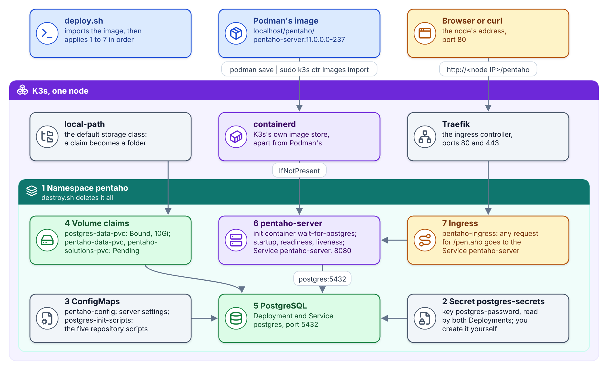

# Overview of K3s Deployment

K3s is a certified Kubernetes in a single binary. One command installs
a working single-node cluster with everything the Pentaho deployment
needs:

| Component                | Does                                                                       |
| ------------------------ | -------------------------------------------------------------------------- |
| containerd               | Runs the pods' containers. K3s has its own image store, apart from Podman's |
| `local-path` provisioner | The default storage class: a volume claim becomes a folder on the node     |
| Traefik                  | The ingress controller, on ports 80 and 443 of the node                    |
| CoreDNS                  | Service names such as `postgres` resolve inside the cluster                |
| metrics-server           | `kubectl top` shows each pod's CPU and memory                              |

## The image

The cluster can't see the image Podman built. `deploy.sh` copies it
across with `podman save` piped into `sudo k3s ctr images import`, and
containerd keeps the name Podman gave it:
`localhost/pentaho/pentaho-server:11.0.0.0-237`. The Deployment asks for
exactly that name with `imagePullPolicy: IfNotPresent`, so Kubernetes
uses the imported image and never looks for it on a registry.

## The manifests

The bundled manifests carry the deployment in layers, which `deploy.sh`
applies in order:

1. the `pentaho` namespace
2. the PostgreSQL password Secret, `postgres-secrets`, which you create
   yourself (the project ships none)
3. two ConfigMaps: the server's settings, and the five repository
   scripts for PostgreSQL's first start
4. the persistent volume claims
5. PostgreSQL: a Deployment and a Service named `postgres`, the host the
   image's configuration connects to
6. the Pentaho Server: a Deployment with an init container that waits
   for PostgreSQL, and startup, readiness and liveness probes that give
   a slow server time to start
7. the ingress, through Traefik

`destroy.sh` removes them, and finally the namespace with everything
left in it, the repository included.

<figure>

<figcaption>One image import, seven layers of manifests</figcaption>
</figure>

Read the diagram from the top. The image crosses from Podman into
containerd once, and the server Deployment finds it there by name. Each
K3s component serves the object under it: `local-path` the volume
claims, containerd the server, Traefik the ingress. The numbers are the
order of the list above. Only `postgres-data-pvc` is in use: the
server's two claims stay `Pending`, as the K3s workshop shows. The
server's init container waits for `postgres:5432` before the server
starts.

## Raw manifests, then Helm

The K3s workshop applies these files one by one. The Helm workshop
installs the same objects from the `pentaho` chart as one release,
with the settings in `values.yaml`, so a change is an upgrade you can
roll back.
