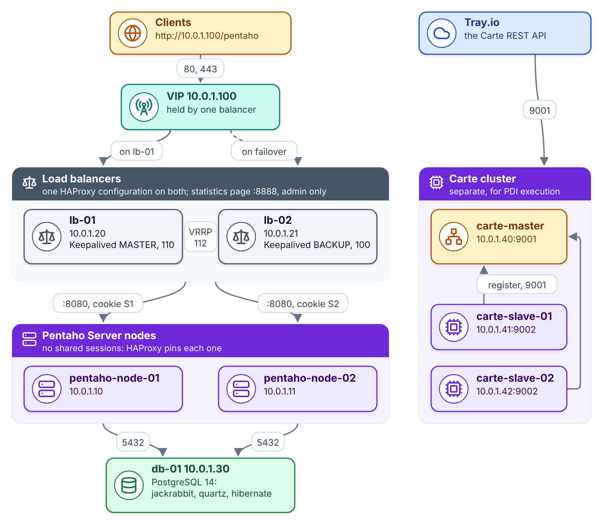

# Overview of Pentaho HA

The HA architecture in this course comes from the Pentaho HA
Installation Guide, bundled in [Deploy Pentaho in HA](../02-ha-deploy/guide.md):
two Pentaho application nodes behind an HAProxy load-balancer pair with a
Keepalived virtual IP, one shared PostgreSQL repository, and Carte
clustering for Pentaho Data Integration execution, with Tray.io driving
event-based ETL through the Carte REST API. It runs on virtual machines, one role per machine; the last page sketches
the same principles on K3s.

## Server roles

| Node   | Role                                             |
| ------ | ------------------------------------------------ |
| lb-01  | HAProxy primary + Keepalived MASTER (holds the VIP) |
| lb-02  | HAProxy secondary + Keepalived BACKUP             |
| pentaho-node-01 | Pentaho Server node 1                    |
| pentaho-node-02 | Pentaho Server node 2                    |
| db-01  | PostgreSQL 14 - the three repository databases    |
| carte-master, carte-slave-01, carte-slave-02 | Carte master and slaves for Pentaho Data Integration execution |

<figure>

<figcaption>The reference topology: the Pentaho cluster and the separate Carte cluster</figcaption>
</figure>

Read the diagram from the top. Clients only ever use the VIP, `10.0.1.100`, which Keepalived keeps on `lb-01` and moves to `lb-02` when `lb-01` stops sending its VRRP heartbeat. HAProxy on the balancer that holds it sends each session to one Pentaho node on Tomcat's port `8080`, marked by the cookie value `S1` or `S2`, and both nodes reach the shared repository on `db-01` on PostgreSQL's port `5432`. The Carte cluster on the right is a second, separate cluster: its two slaves register with the master on `9001`, and Tray.io calls the same master. [Deploy Pentaho in HA](../02-ha-deploy/guide.md) gives every address.

## The rules that make it work

- **Sticky sessions are mandatory** - Pentaho sessions are not
  replicated between nodes; HAProxy pins each session to one node.
- **The Jackrabbit cluster journal** must be enabled with a unique id
  per node - without it, concurrent JCR writes corrupt the repository.
- **Quartz clusters through its shared tables** - dynamic per-node
  instance ids, clustering enabled, matched table prefix - so
  schedules fire once across the cluster.
- **The base URL is the VIP**, never a node IP - redirects, report
  links and schedule callbacks must route through the balancer.
- **NTP everywhere** - mismatched clocks corrupt Quartz execution
  timestamps.
- **One Pentaho node per machine** - stacking nodes on one host adds
  no availability.

## Ports (firewall)

Tomcat HTTP between balancers and app nodes; the HAProxy frontend
client-facing; the stats page admin-only; PostgreSQL from app nodes;
Carte's port for Tray.io and the cluster master. The bundled guide's
section 1.3 has the full table. [Deploy Pentaho in HA](../02-ha-deploy/guide.md)
opens the Pentaho cluster's ports, and
[Carte Cluster for Pentaho Data Integration Execution HA](../03-carte-cluster/guide.md)
the Carte ports, `9001` on the master and `9002` on the slaves.
