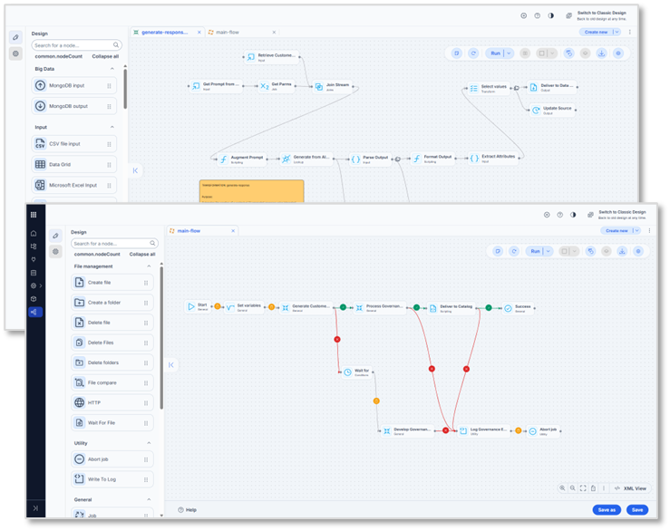
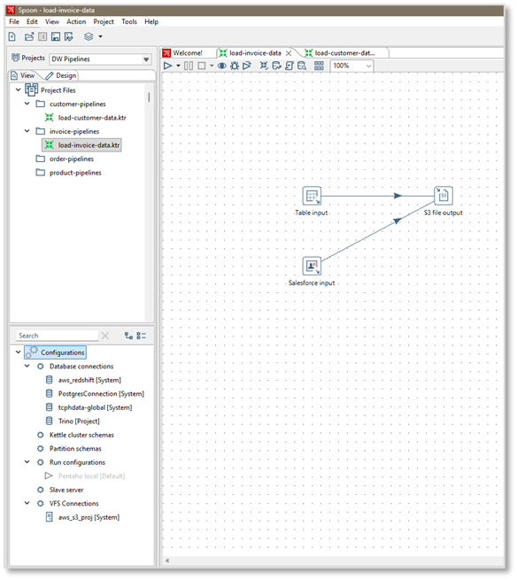
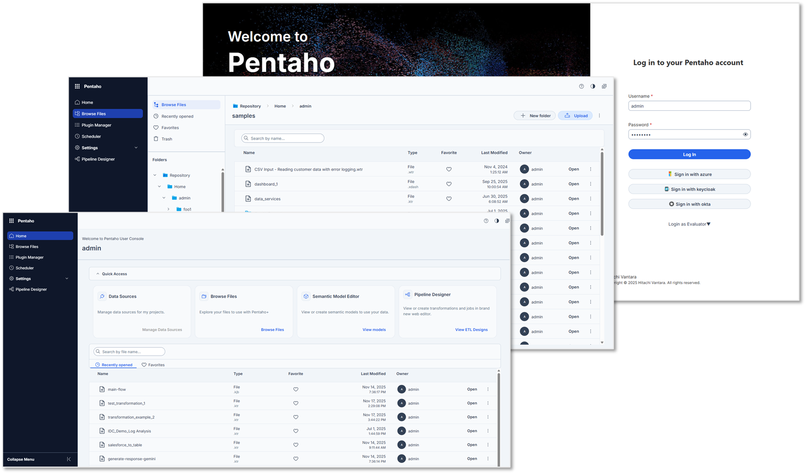
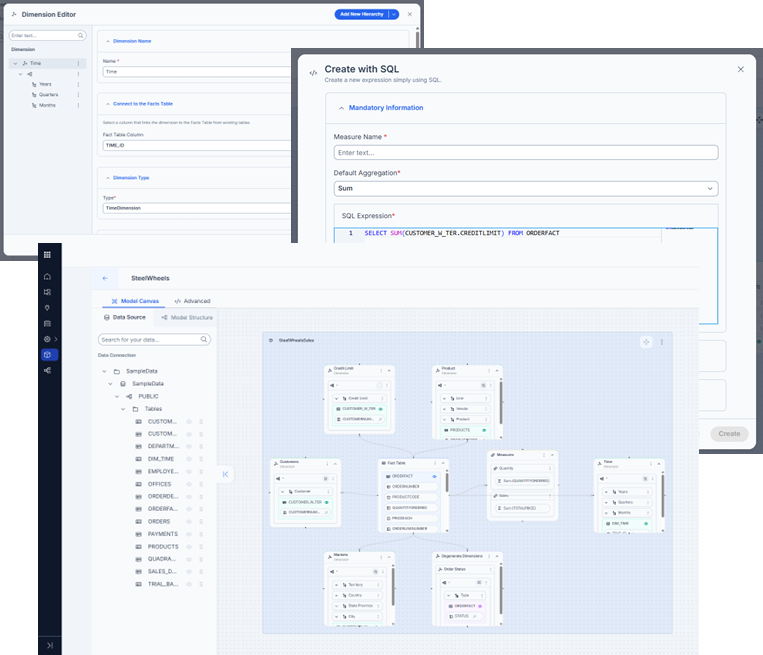
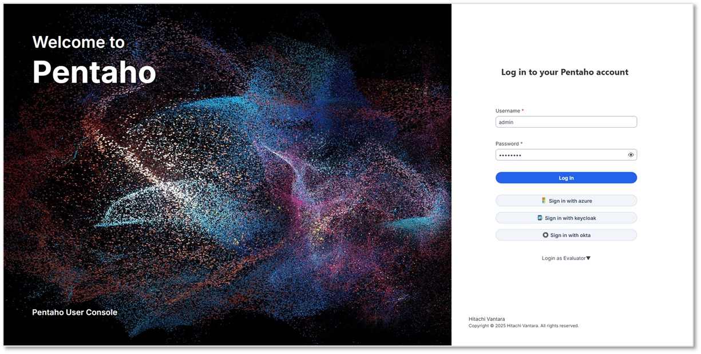
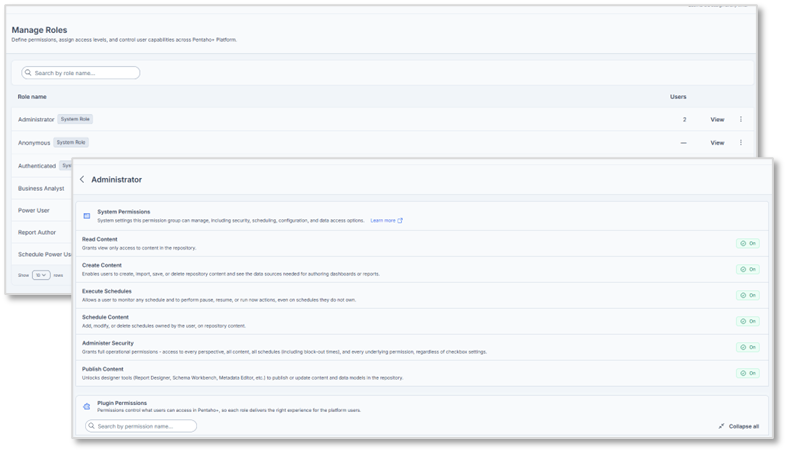
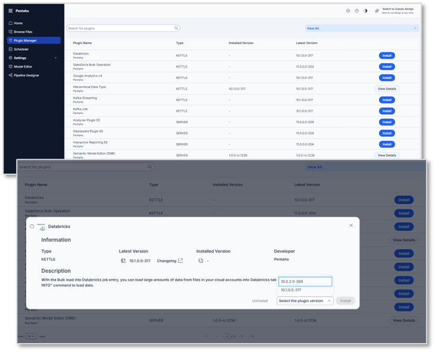

# What's New

Pentaho Data Integration 11.0 and Pentaho Business Analytics (PBA) 11.0 are a major release: a modern user interface, stronger security and simpler deployments. Several of these changes shape the install you do in this course, from Java 21 and Tomcat 10 to the Plugin Manager that installs the server plugins.

**What You'll Learn**

* **Pipeline Designer** - author ETL pipelines, Pentaho Data Integration transformations and jobs, in a web browser.
* **Projects** - organize and deploy ETL assets with project-based lifecycle management.
* **The modern User Console** - the redesigned Pentaho User Console (PUC), in preview.
* **Semantic Model Editor (SME)** - build Mondrian models in the browser.
* **Security** - single sign-on (SSO) with built-in OpenID Connect (OIDC) and OAuth 2.0, and more granular permissions.
* **Platform** - Java 21, Tomcat 10, standardized prebuilt container images, and features managed as plugins with the Plugin Manager.
* **Observability** - monitor ETL runs with OpenTelemetry.

11.0 is a long-term support (LTS) release. For service pack and update schedules, see the [Pentaho Support Lifecycle page](https://support.pentaho.com/hc/en-us/articles/205789159-Pentaho-Product-Lifecycle-Overview).

## Pipeline Designer

Pipeline Designer is a browser-based UI for authoring ETL pipelines: you build Pentaho Data Integration transformations and jobs in a web browser. It works like Spoon, on a modern framework, and stays compatible with transformations and jobs created in Spoon. Spoon remains available for legacy tooling.

<figure>

<figcaption>Pipeline Designer: transformations and jobs in the browser</figcaption>
</figure>

## Project-based lifecycle management

Before 11.0, Pentaho Data Integration had no defined structure for organizing transformations, jobs and configuration. That made collaboration and promotion between environments harder for ETL and DevOps teams, and configuration could resolve inconsistently. Projects address these gaps.

<figure>

<figcaption>A project in Spoon: its files and its configuration in one place</figcaption>
</figure>

## Modern Pentaho User Console (preview)

11.0 introduces a redesigned user experience (UX) for the Pentaho User Console (PUC). It aligns PUC with the rest of the Pentaho platform and addresses pain points in PUC 10.2 and earlier. The existing PUC stays available until the two reach feature parity.

> **Note:** This feature is in preview. Behavior and UI might change in later updates.

<figure>

<figcaption>The modern User Console: login, Browse Files and Home</figcaption>
</figure>

## Semantic Model Editor (SME)

Semantic Model Editor (SME) is a new tool for building and managing Mondrian data models. Previously you used Schema Workbench or the Data Source Wizard; SME provides a web-based workflow for new and advanced users. It improves modeling for PBA, Analyzer in particular, opens existing Mondrian models and adds new capabilities.

<figure>

<figcaption>Semantic Model Editor: a model canvas and its editors</figcaption>
</figure>

## Built-in OIDC and OAuth 2.0

11.0 supports OpenID Connect (OIDC) and OAuth 2.0 authentication for the Pentaho Server. This enables single sign-on (SSO) with identity providers such as Google, Okta and Azure, and with any OIDC-compliant identity provider (IdP).

<figure>

<figcaption>Identity providers on the login page</figcaption>
</figure>

## Granular permissions for Pentaho Server

11.0 adds more granular access control across the platform. It addresses long-standing limits:

* Permissions were not fine-grained enough. For example, **Read Content** lets users see content from any plugin; file and folder permissions can still block access.
* Permissions could not cleanly allow or block individual plugins.
* Permissions were too broad for data sources and similar assets.
* Execute permissions were too broad.

Combined with OIDC and OAuth 2.0, this gives the Pentaho Server a stronger authentication and authorization model.

<figure>

<figcaption>System and plugin permissions for a role</figcaption>
</figure>

## Simplified container deployment

11.0 introduces optimized, prebuilt images for on-premises Docker deployments and the major Kubernetes platforms: plain Docker, Kubernetes, EKS, AKS and GKE. The images use standardized installation paths and variables, and their entrypoint scripts accept runtime overrides for configuration files and licenses.

## Java 21 and Tomcat 10 support

11.0 supports Java 21: Oracle JDK, OpenJDK or another supported JVM. The Pentaho Server 11.0 ships with Tomcat 10, which addresses vulnerabilities and defects associated with Tomcat 9.

## Plugin Manager

11.0 introduces a Plugin Manager for both Pentaho Data Integration and PBA plugins. Pentaho will ship more functionality as plugins over time, and the Plugin Manager is where you find, deploy and update them.

<figure>

<figcaption>The Plugin Manager and a plugin's details</figcaption>
</figure>

## Karaf and OSGi removed, big data plugins delivered separately

In 11.0, Karaf and OSGi are removed from Pentaho Data Integration, and big data components are delivered as plugins. There is no separate Pentaho Data Integration distribution for big data add-ons: you deploy big data components the same way as other Pentaho Data Integration plugins. This reduces the size of both the Pentaho Data Integration client and the Pentaho Server deployment by more than 1 GB.

## OpenTelemetry-based observability

[OpenTelemetry](https://opentelemetry.io/docs/languages/java/) (OTel) is an open standard for sharing telemetry data such as traces, metrics and logs. Many tools consume OpenTelemetry data, including Datadog, Splunk, Elastic, Amazon CloudWatch and Azure Monitor.

With the OTel plugin you can monitor Pentaho ETL processes with:

* Logs, consolidated in a single place and represented hierarchically
* Traces, to view task timing, execution hierarchy and variables during execution
* Metrics, to track data flow trends at specified points of interest

## Other enhancements

11.0 also includes smaller enhancements and defect fixes. See the 11.0 release notes, linked at the top of this page, for details.
