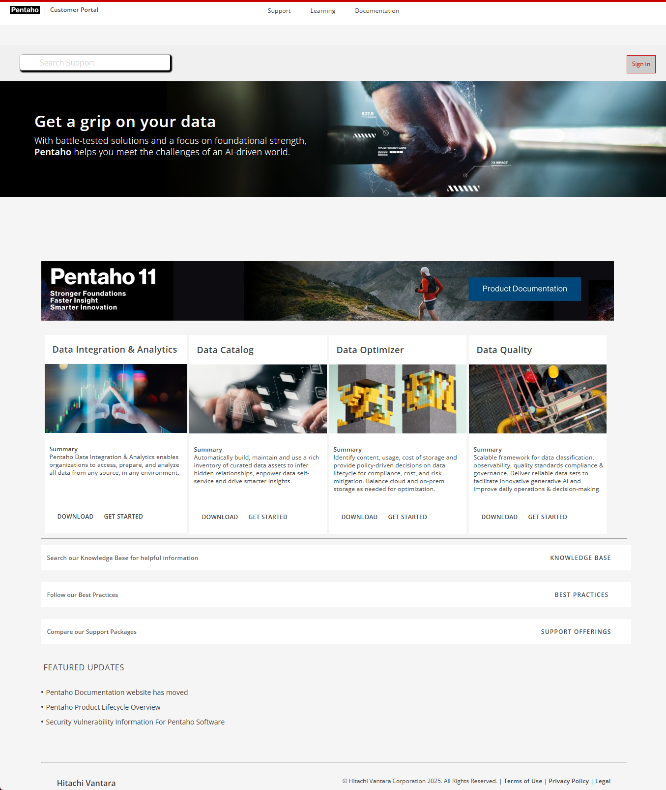
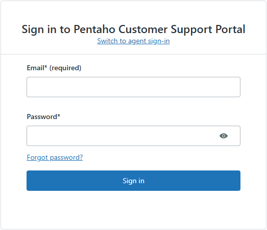
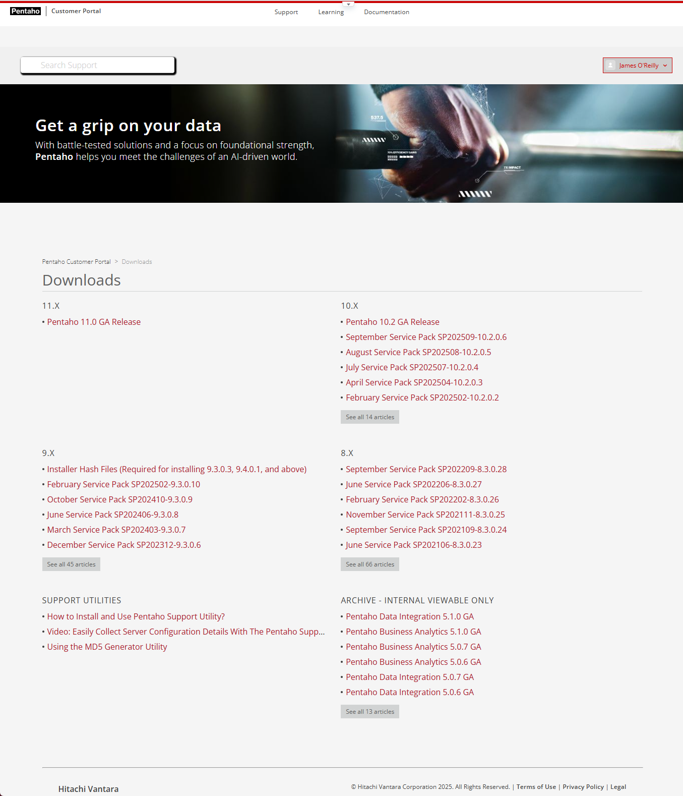
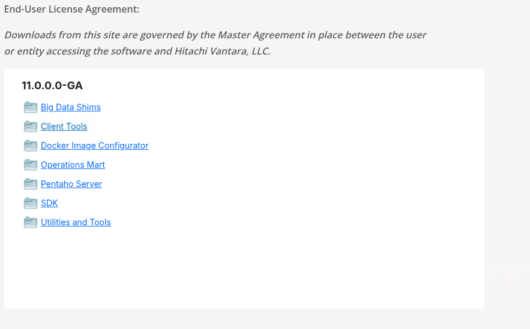

# Pentaho Support Portal

> **Warning:**
>
> #### Workshop - Pentaho Support Portal
>
> Download the Pentaho 11.0 Enterprise packages that the rest of this course installs: the Pentaho Server archive and the client tools.
>
> **What you'll do**
>
> * Sign in to the Pentaho Customer Portal
> * Open the Pentaho 11.0 GA release downloads
> * Download the server and client tool packages this course installs
>
> **Prerequisites:** A Pentaho Customer Portal account: your organization's principal account, which has access to the Enterprise downloads
>
> **Estimated time:** 5 minutes

---

> **Note:**
>
> #### Download the 11.0 packages
>
> The Customer Portal holds the Enterprise Edition (EE) downloads for every supported release. Each release has its own page, with one folder per kind of package.

:::: tabs

### 1. Sign in to the Customer Portal

1. Open the Pentaho Customer Portal:

<figure>

<figcaption>The Customer Portal home page</figcaption>
</figure>

2. Under **Data Integration & Analytics**, select **DOWNLOAD**.
3. The portal asks you to sign in. In **Sign in to Pentaho Customer Support Portal**, enter your email address in **Email** and your password in **Password**, and select **Sign in**.

<figure>

<figcaption>Sign in with your principal account</figcaption>
</figure>

> **Success:** Checkpoint: the **Downloads** page opens, with the releases listed by family, starting with **11.X**.

### 2. Download the Packages

1. Under **11.X**, select **Pentaho 11.0 GA Release**.

<figure>

<figcaption>Pentaho 11.0 GA Release under 11.X</figcaption>
</figure>

> **Success:** Checkpoint: the release page lists the folders of **11.0.0.0-GA**: **Big Data Shims**, **Client Tools**, **Docker Image Configurator**, **Operations Mart**, **Pentaho Server**, **SDK** and **Utilities and Tools**.

<figure>

<figcaption>The 11.0.0.0-GA folders</figcaption>
</figure>

2. Open each folder and download the packages in this table. Every file name ends in the release and build, `11.0.0.0-237`.

| Folder | Package | Installed in |
| --- | --- | --- |
| **Pentaho Server** | `pentaho-server-ee-11.0.0.0-237.zip` | [Install Pentaho Server](../06-installation-archive-pentaho-server/guide.md) |
| **Client Tools** | `pdi-ee-client-11.0.0.0-237.zip` (Pentaho Data Integration) | [Client Plugins](../10-installation-client-tools/guide.md) |
| **Client Tools** | `pad-ee-11.0.0.0-237.zip` (Aggregation Designer) | [Client Plugins](../10-installation-client-tools/guide.md) |
| **Client Tools** | `psw-ee-11.0.0.0-237.zip` (Schema Workbench) | [Client Plugins](../10-installation-client-tools/guide.md) |
| **Client Tools** | `pme-ee-11.0.0.0-237.zip` (Metadata Editor) | [Client Plugins](../10-installation-client-tools/guide.md) |
| **Client Tools** | `prd-ee-11.0.0.0-237.zip` (Report Designer) | [Client Plugins](../10-installation-client-tools/guide.md) |

> **Under the hood:**
>
> #### The build number ties the whole install together
>
> Every package in the table ends in `11.0.0.0-237`: release `11.0.0.0`, build `237`. The server archive and the client tools are separate downloads, but they come from the same build, and so do the server plugins, apart from Semantic Model Editor, which has its own version numbers. The same string comes back in [Server Plugins](../07-installation-archive-server-plugins/guide.md), in the **Installed Version** and **Latest Version** columns of the Plugin Manager.
>
> **Why it matters:** when a component misbehaves after an install or an update, compare its build number with the server's first. A plugin or client tool from another build is a mismatch you can rule out by name alone.

3. Optionally, download the packages that no lab in this course installs, if your organization will use them later:

| Folder | Package | Note |
| --- | --- | --- |
| **Pentaho Server** | `paz-plugin-ee-11.0.0.0-237.zip`, `pir-plugin-ee-11.0.0.0-237.zip`, `pdd-plugin-ee-11.0.0.0-237.zip`, `webttle-plugin-ee-11.0.0.0-237.zip`, `semantic-model-editor-plugin-assembly-1.0.0.zip`, `pas-scheduler-11.0.0.0-237.zip`, `webttle-carte-api-plugin-11.0.0.0-237.zip` | The server plugins. [Server Plugins](../07-installation-archive-server-plugins/guide.md) installs them from the Plugin Manager instead. |
| **Operations Mart** | `pentaho-operations-mart-11.0.0.0-237.zip` | Usage and performance reporting. |
| **Docker Image Configurator** | `on-prem-11.0.0.0-237.zip` | Container images; see [What's New](../01-overview-whats-new/guide.md). |

> **Success:** Checkpoint: you have the server archive and the five client tool archives. **Install Pentaho Server** copies the server archive from `~/Downloads/'Archive Build (Suggested Installation Method)'`, and **Client Plugins** reads each client tool from its own folder under `~/Downloads/'Client Tools'`. Save the files there, or change the paths in those labs' commands to where you saved them.

::::

## Lab Files

_No bundled files for this lab._
