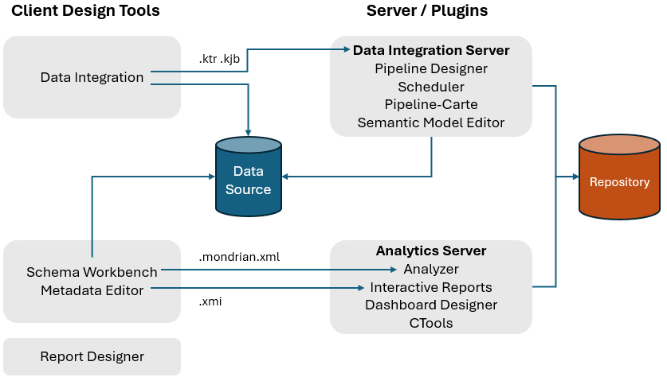
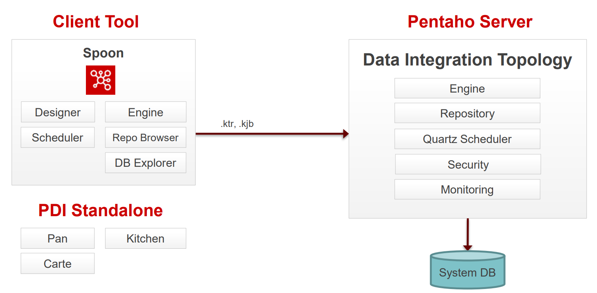
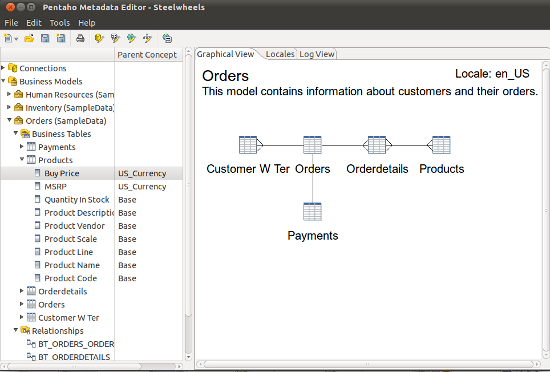
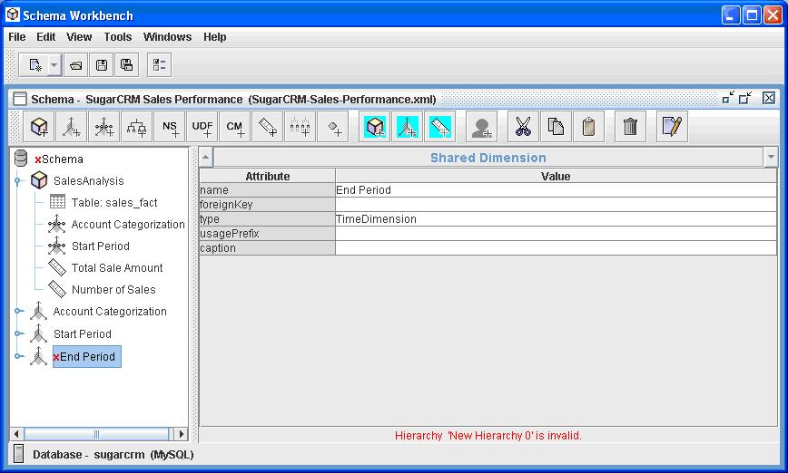
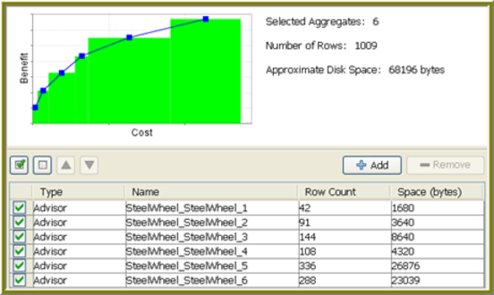
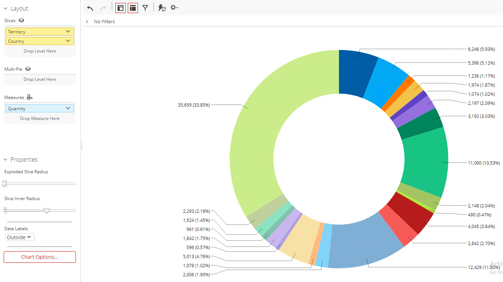
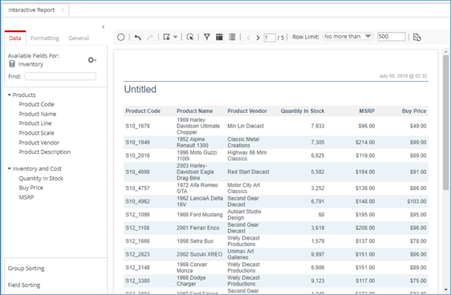
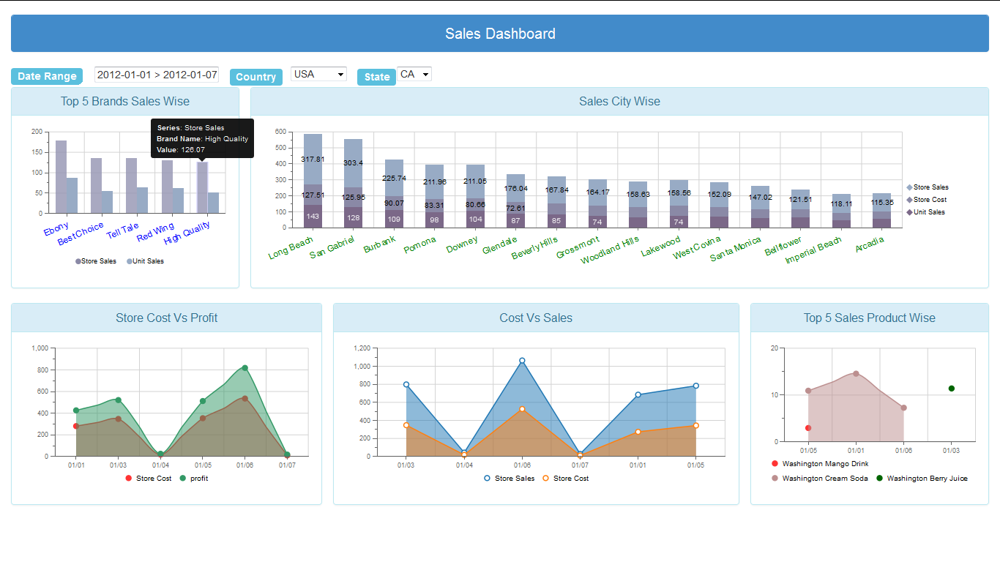
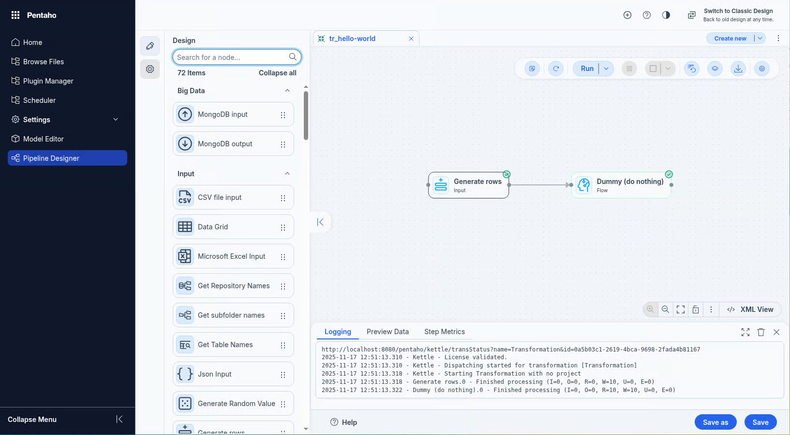
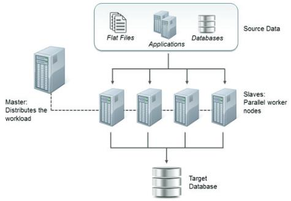

# Components

<div class="pcm-intro">

Pentaho is a client/server suite. Desktop design tools build transformations, jobs, models and reports; the Pentaho Server runs them, stores them in its repository and serves them to users in the browser. This page maps each component you install in this course to its place in that picture.

</div>

**What You'll Learn**

* **Client tools** - Spoon, Metadata Editor, Schema Workbench and Aggregation Designer, and what each one builds.
* **Pentaho Server** - the web application that hosts reports, analysis, dashboards and data integration, and the plugins that add them.
* **Carte** - the lightweight server that runs transformations and jobs remotely.
* **Pan and Kitchen** - the command-line tools that run transformations and jobs.
* **Ports** - the network ports an installed system listens on.

<div align="center">
<figure>

<figcaption>Pentaho architecture: client design tools, server plugins, data source and repository</figcaption>
</figure>
</div>

The ports an installed system uses:

| Port | Used by |
| --- | --- |
| `5432` | PostgreSQL, the repository database |
| `8080` | The Pentaho Server's Tomcat web server |
| `8005` / `8012` | The Pentaho Server's shutdown port: the `port` of `<Server>` in `server.xml` (`8005` in the archive, `8012` in installer builds) |
| `9001` | The HSQL server that holds the sample data |

:::: tabs

### 1. Pentaho Client Tools

> **Note:**
>
> #### Pentaho Client Tools
>
> The client tools are the desktop applications for designing data integration and analytics content. Pentaho Data Integration (PDI) builds extract, transform and load (ETL) processes in Spoon; Metadata Editor and Schema Workbench build the models that reports and analysis read; Aggregation Designer builds aggregate tables that speed up analysis.

::: tabs

### Data Integration

> **Note:**
>
> #### Data Integration
>
> Pentaho Data Integration (PDI), also known as Kettle, extracts, transforms and loads (ETL) data into databases, data warehouses and business applications. It reads a wide range of sources, from relational databases to unstructured formats and cloud storage. Several components work together in it.

<div align="center">
<figure>

<figcaption>Pentaho client / server architecture for data integration</figcaption>
</figure>
</div>

| Component | What it does |
| --- | --- |
| **Spoon** | The graphical client for designing and testing PDI transformations and jobs, visually, without writing code. |
| **Designer** | Builds pipelines and workflows by dragging steps onto a canvas. |
| **Scheduler** | Connects to the Quartz scheduler on the server. Transformations and jobs must be uploaded to the repository first. |
| **Repository Browser** | Manages the repository: the central store for PDI transformations, jobs and database connections, shared by a team. The repository is an Apache Jackrabbit content repository on a supported database: PostgreSQL, MSSQL Server, Oracle, MySQL or MariaDB. |
| **DB Explorer** | Database Explorer, for basic database operations. |

### Metadata Editor

> **Note:**
>
> #### Metadata Editor
>
> Pentaho Metadata Editor builds business models: a business-friendly layer over the database that reports and analysis read, so users work with business terms instead of tables and joins. In a model you define:
>
> * **Business models and relationships** - the tables, columns and joins, in business terms.
> * **Connections** - the relational data sources the model reads.
> * **Security** - constraints at the model level that control who sees what.
> * **Locales** - names and descriptions in several languages.

<div align="center">
<figure>

<figcaption>Metadata Editor: a business model and its relationships</figcaption>
</figure>
</div>

### Schema Workbench

> **Note:**
>
> #### Schema Workbench
>
> Schema Workbench creates and edits the Mondrian OLAP (Online Analytical Processing) schemas that Analyzer reads: the cubes, dimensions and measures of a multidimensional model, defined over a star schema.

<div align="center">
<figure>

<figcaption>Schema Workbench: a cube and its dimensions</figcaption>
</figure>
</div>

### Aggregation Designer

> **Note:**
>
> #### Aggregation Designer
>
> Aggregation Designer improves query performance by creating aggregate tables in a star schema database. It recommends aggregates, generates the SQL for the tables and deploys them, so analytical queries read summarized rows instead of the detail.

<div align="center">
<figure>

<figcaption>Aggregation Designer: recommended aggregates and their cost</figcaption>
</figure>
</div>

:::

### 2. Pentaho Server

> **Note:**
>
> #### Pentaho Server
>
> The Pentaho Server hosts and manages the Pentaho applications and services. Its parts:
>
> * **BI Server** - interactive reporting, analytics, dashboards and data exploration.
> * **Data Integration Server** - orchestration and scheduling of ETL processes.
> * **User Console** - the web interface for creating, viewing and managing content.
> * **Security** - authentication and authorization, integrated with enterprise security systems.
> * **Repository** - the store for every Pentaho asset, from reports and dashboards to transformations and jobs.

**Pentaho Server Reporting Suite**

::: tabs

### Analyzer

> **Note:**
>
> #### Analyzer
>
> Pentaho Analyzer explores OLAP data in the browser by drag and drop, as tables and charts, with no SQL. Its main features:
>
> * **Ad hoc analysis** - create and change a report to answer the question at hand.
> * **Drag and drop** - place levels and measures on the report's layout.
> * **Visualizations** - tables, charts and heat grids, among others.
> * **Sharing** - save reports to the repository and share them with other users.

<div align="center">
<figure>

<figcaption>An Analyzer report</figcaption>
</figure>
</div>

### Interactive Reports

> **Note:**
>
> #### Interactive Reports
>
> Pentaho Interactive Reports creates and edits ad hoc tabular reports in the browser, for business users who need a report without knowing the underlying data structure:
>
> * **Drag and drop** - select and arrange fields, with no SQL.
> * **Live data** - filter, sort and aggregate as you build.
> * **Layout** - adjust columns, groups and summaries.
> * **Export** - to PDF, Excel or CSV, among other formats.

<div align="center">
<figure>

<figcaption>An Interactive Report</figcaption>
</figure>
</div>

### Dashboard Designer

> **Note:**
>
> #### Dashboard Designer
>
> Pentaho Dashboard Designer builds interactive dashboards that combine charts, tables and filters from several sources on one page:
>
> * **Design** - drag and drop panels into a layout, with no code.
> * **Content** - charts, tables, filters, reports and web pages.
> * **Prompts** - one filter drives every panel that uses it.
> * **Sharing** - dashboards are saved to the repository, under its permissions.

<div align="center">
<figure>

<figcaption>A dashboard</figcaption>
</figure>
</div>

### Pipeline Designer

> **Note:**
>
> #### Pipeline Designer
>
> Pipeline Designer, new in 11.0, builds PDI transformations and jobs in a web browser. It works like Spoon on a modern interface and stays compatible with transformations and jobs created in Spoon, so teams can design ETL without installing a desktop client. It is installed as a server plugin.

<div align="center">
<figure>

<figcaption>Pipeline Designer</figcaption>
</figure>
</div>

### Semantic Model Editor

> **Note:**
>
> #### Semantic Model Editor
>
> Semantic Model Editor (SME), new in 11.0, builds and manages Mondrian data models, the semantic layer Analyzer reads, in the browser. It replaces the Schema Workbench and Data Source Wizard workflow for new and advanced users alike, and opens existing Mondrian models. It is installed as a server plugin.

:::

### 3. Carte Server

> **Note:**
>
> #### Carte Server
>
> Carte is a lightweight web server for running and monitoring PDI transformations and jobs remotely.
>
> It runs on Java with an embedded Jetty web server, reads an XML configuration file, and exposes its functions through a REST API, with a simple browser page for monitoring.
>
> Carte runs transformations and jobs remotely, supports clustering for load balancing, and reports progress as it runs. Scheduling is done by the Pentaho Server's Quartz scheduler, or by an external scheduler that calls Carte.
>
> You can deploy Carte as a standalone server, as a master with slave servers in a cluster, or behind a load balancer for high availability. It is usually started from the command line with a configuration file.

<div align="center">
<figure>

<figcaption>A Carte cluster: one master, several slaves</figcaption>
</figure>
</div>

### 4. APIs

> **Note:**
>
> #### Kitchen, Pan and the REST API
>
> **Kitchen** runs PDI jobs from the command line, and **Pan** runs transformations. Both suit batch processing and automated workflows: shell scripts and schedulers. The Pentaho Server also exposes a REST API, documented below.

From the `data-integration` folder, Kitchen runs a job (these paths are examples):

::: tabs

### Windows (PowerShell)

```powershell
.\Kitchen.bat /file:D:\Jobs\updateWarehouse.kjb /level:Basic
```

### macOS / Linux

```bash
./kitchen.sh -file=/PRD/updateWarehouse.kjb -level=Minimal
```

:::

Pan runs a transformation the same way:

::: tabs

### Windows (PowerShell)

```powershell
.\Pan.bat /file:"D:\Transformations\Customer Dimension.ktr" /level:Basic
```

### macOS / Linux

```bash
./pan.sh -file="/PRD/Customer Dimension.ktr" -level=Minimal
```

:::

<div class="pcm-embed-card" data-href="https://docs.pentaho.com/pentaho-rest-api" data-title="Pentaho REST API | Pentaho Documentation"></div>

::::
