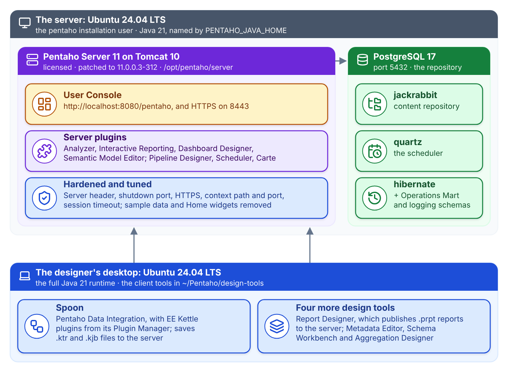
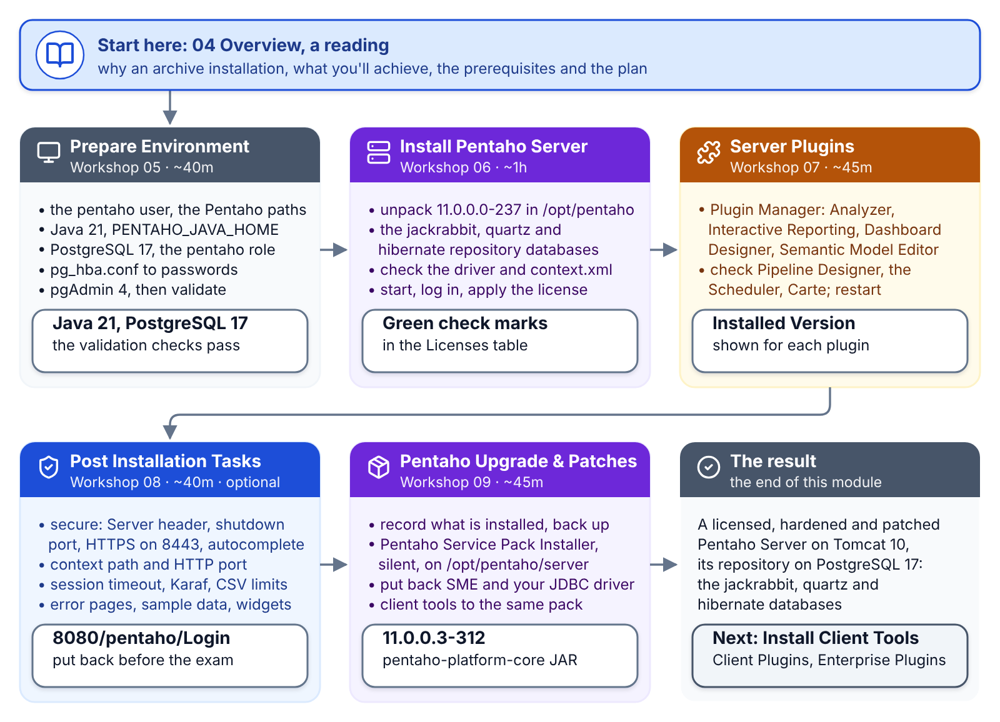

# Overview

An archive installation unpacks the Pentaho Server, already deployed in Tomcat 10, onto a Linux machine you prepare yourself. This module takes you through it end to end: the machine, the repository database, the server, its plugins and the client tools, then hardening and upgrades.

**What You'll Learn**

* **When to choose an archive installation** - and who it suits.
* **What you end up with** - a licensed Pentaho Server on Tomcat 10, with its repository on PostgreSQL 17.
* **The plan** - six steps, each one a lab in this module or the next.

:::: tabs

### 1. Why an Archive Installation

Choose the archive installation when you:

* Don't already run Tomcat and want an opinionated, faster setup.
* Need a straightforward path to migrate content from an existing Pentaho environment.

> **Note:** The archive ships Pentaho 11 already deployed in Tomcat 10, which makes setup faster than deploying Pentaho into an application server yourself.

### 2. What You'll Achieve

* The Pentaho Server running on Tomcat 10
* The Pentaho Repository configured on PostgreSQL 17
* The server plugins installed
* The client tools installed
* Licenses applied and validated

The diagram shows the installation you end the course with, all in one picture.

<figure>

<figcaption>What the course builds: the server, its repository and the designer's desktop</figcaption>
</figure>

Read the diagram from the top. The slate panel is the Ubuntu server you prepare in [Prepare Environment](../05-installation-archive-prepare-environment/guide.md); inside it, the violet Pentaho Server holds the User Console, the plugins from [Server Plugins](../07-installation-archive-server-plugins/guide.md) and the hardening from [Post Installation Tasks](../08-installation-post-installation/guide.md), and it reaches its three green repository databases in PostgreSQL 17. The blue panel at the foot is the designer's desktop from the next module, whose client tools save their work to the server.

### 3. Who Is This For

* Administrators who want a quick, supported Tomcat and Pentaho setup
* Teams migrating content from earlier Pentaho versions or from evaluation installs

### 4. Prerequisites

* Ubuntu 24.04 LTS, with `sudo` access
* Java 21 (OpenJDK): you install it and set `PENTAHO_JAVA_HOME` in [Prepare Environment](../05-installation-archive-prepare-environment/guide.md)
* A supported database for the Pentaho Repository: this course uses PostgreSQL 17, which you also install in [Prepare Environment](../05-installation-archive-prepare-environment/guide.md)
* The supported versions, checked in the Components Reference:

> **Danger:** Uninstall any evaluation version of Pentaho before you start.

### 5. The Plan

The module is one reading, this page, then five workshops in order, each ending on a checkpoint.

<figure>

<figcaption>The Archive Installation module, workshop by workshop, with the checkpoint for each</figcaption>
</figure>

Read the diagram like text: the blue bar is this page, then the first row runs from Prepare Environment to Server Plugins, and the arrow brings you back to the second row for Post Installation Tasks and Pentaho Upgrade & Patches. Each card names its workshop, number and time, lists what it does, and ends on the white checkpoint that shows it worked. The last card is the result, a licensed, hardened and patched Pentaho Server on Tomcat 10 with its repository on PostgreSQL 17, and the next module, Install Client Tools.

| Step | What you do | Lab |
| --- | --- | --- |
| 1. Prepare your environment | Create the `pentaho` installation user and set the Pentaho paths. Install Java 21 and set `PENTAHO_JAVA_HOME`. Install PostgreSQL 17 for the Pentaho Repository, create the `pentaho` role, configure `pg_hba.conf` and install pgAdmin 4. | [Prepare Environment](../05-installation-archive-prepare-environment/guide.md) |
| 2. Install the Pentaho Server | Unpack the archive under `/opt/pentaho`. Create the repository databases and check the server's connections to them. Start the server, open the User Console (PUC), and apply your licenses in the License Manager. | [Install Pentaho Server](../06-installation-archive-pentaho-server/guide.md) |
| 3. Install the server plugins | Add the reporting and visualization plugins your users need, Semantic Model Editor (SME) for data modeling, and check Pipeline Designer, Scheduler and Carte for building and running pipelines. Restart and check each one. | [Server Plugins](../07-installation-archive-server-plugins/guide.md) |
| 4. Harden the installation (recommended) | Secure the server, change its addresses and ports, tune it and prepare it for users. Every task is optional. | [Post Installation Tasks](../08-installation-post-installation/guide.md) |
| 5. Apply a service pack | Apply service pack 11.0.0.3-312 to the server and the client tools, and put back what it removes. | [Pentaho Upgrade & Patches](../09-installation-upgrade-and-patches/guide.md) |
| 6. Install the client tools (next module) | Install Pentaho Data Integration, Report Designer (PRD), Metadata Editor (PME), Schema Workbench (PSW) or the other client tools your team uses. | [Client Plugins](../10-installation-client-tools/guide.md) |

> **Note:** Migrating content? Plan your repository upgrade or restore, and test it, before you open the system to users.

::::
