# Prepare Environment

> **Warning:**
>
> #### Workshop - Prepare Environment
>
> Prepare an Ubuntu server for an archive installation of the Pentaho Server: the installation user, the paths, Java, and the PostgreSQL database that will hold the Pentaho Repository.
>
> **What you'll do**
>
> * Create a `pentaho` installation user with `sudo`
> * Set the Pentaho path variables and `PENTAHO_JAVA_HOME`
> * Install Java 21 (OpenJDK)
> * Install PostgreSQL 17 and create the `pentaho` database role
> * Switch local database connections to password authentication
> * Install pgAdmin 4 and register the server
>
> **Prerequisites:**
>
> * An Ubuntu 24.04 LTS machine (or VM) and an account with `sudo`
> * Outbound internet access, for the Ubuntu, PostgreSQL and pgAdmin package repositories
> * The plan in [Overview](../04-installation-archive-overview/guide.md)
>
> **Estimated time:** 15 minutes

---

> **Note:**
>
> #### Prepare Environment
>
> The supported Linux baseline for Pentaho 11.x is Ubuntu 24.04 LTS. Every command below runs in a terminal; each one uses `sudo` where it needs root. For the versions Pentaho supports, see the Components Reference.

<div class="pcm-embed-card" data-href="https://docs.pentaho.com/install/pdia-11.0-installation/components-reference" data-title="Components reference | Pentaho Documentation"></div>

:::: tabs

### 1. Install unzip and Set the Pentaho Paths

A minimal Ubuntu 24.04 does not include `unzip`, which the server and client archives need.

1. In a terminal, run:

```bash
sudo apt update && sudo apt install -y unzip
unzip -v | head -1
```

> **Success:** Checkpoint: the last line printed starts `UnZip 6.00`.

2. Open `/etc/environment`, the file Ubuntu reads at every login:

```bash
sudo nano /etc/environment
```

3. Add these lines at the end of the file. The labs use the variables to keep paths short and to avoid typing mistakes.

```properties
# Pentaho paths
PENTAHO_BASE=/opt/pentaho
PENTAHO_SERVER=/opt/pentaho/server/pentaho-server
TOMCAT_HOME=/opt/pentaho/server/pentaho-server/tomcat
```

4. Save the file: press `Ctrl+O`, `Enter`, then `Ctrl+X` to leave nano.

<div align="center">
<figure>
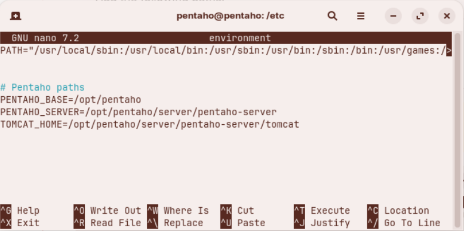
<figcaption>The Pentaho paths in /etc/environment</figcaption>
</figure>
</div>

> **Warning:** Variables in `/etc/environment` apply from your next login. Log out and back in, or load them into the current shell as step **4. Set PENTAHO_JAVA_HOME** shows.

### 2. Create the Pentaho Installation User

1. Update the installed packages (once):

```bash
sudo apt update -y && sudo apt upgrade -y
```

2. Add the user. Enter a password for `pentaho` when asked; the other questions are optional, so press `Enter` to skip them.

```bash
sudo adduser pentaho
```

3. Grant the user `sudo` rights:

```bash
sudo usermod -aG sudo pentaho
```

4. Switch to the new user and check its groups and `sudo` access:

```bash
su - pentaho
groups
sudo -v
```

> **Success:** Checkpoint: `groups` prints `pentaho sudo users`, and `sudo -v` asks for the `pentaho` password, then returns to the prompt with no error.

Work as `pentaho` from here on: the rest of the course installs and runs everything as this user.

> **Danger:** For production, use a dedicated installation account with only the privileges it needs, and never share its credentials.

### 3. Install Java 21 (OpenJDK)

Pentaho 11.x is certified with Java 21.

<details>

<summary>What's the difference between Oracle JDK &#x26; OpenJDK?</summary>

Oracle JDK and OpenJDK are both implementations of the Java Platform, but they differ in some important ways:

**Licensing and Cost:**

* **OpenJDK** is free and open source under the GPL license. You can use it for any purpose without restrictions.
* **Oracle JDK** changed its licensing model in 2019. It is free for development and personal use, but needs a paid subscription for commercial production use (Oracle Java SE Subscription).

**Source and Development:**

* **OpenJDK** is the reference implementation of Java and the base for most JDK distributions. Oracle contributes significantly to its development.
* **Oracle JDK** is built from the OpenJDK source code but includes some additional proprietary components and commercial features.

**Performance and Features:**

* In modern versions (Java 11 and later), the performance differences are negligible. Oracle has contributed most of its performance improvements back to OpenJDK.
* Oracle JDK used to include some additional tools (such as Java Flight Recorder and Java Mission Control), but many of these are now open source and available in OpenJDK.

**Support and Updates:**

* **OpenJDK** receives community support and updates for about 6 months per release (except LTS versions, which various vendors maintain).
* **Oracle JDK** offers Long Term Support (LTS) with commercial subscriptions, with updates and security patches for longer periods.

**Other Distributions:** Many vendors offer their own builds of OpenJDK with long-term support, including Amazon Corretto, Azul Zulu, Eclipse Temurin (formerly AdoptOpenJDK) and Red Hat OpenJDK.

For most developers and organizations, OpenJDK or a vendor-supported OpenJDK distribution is the usual choice, unless you need Oracle's commercial support.

</details>

Before the install, `java -version` reports that Java is not found and lists the packages that provide it:

<div align="center">
<figure>
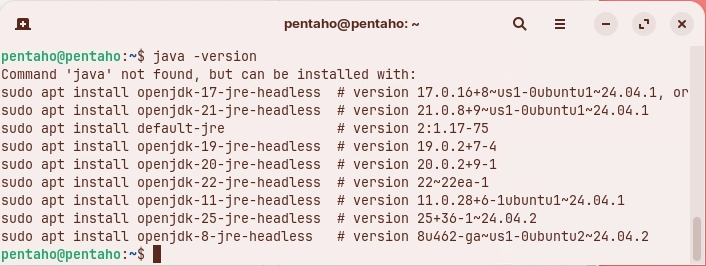
<figcaption>Before the install: the Java packages Ubuntu offers</figcaption>
</figure>
</div>

1. Install Java 21:

```bash
sudo apt install -y openjdk-21-jre-headless
```

2. Check the version and where the `java` command points:

```bash
java -version
which java
readlink -f $(which java)
```

<div align="center">
<figure>
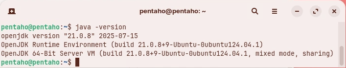
<figcaption>Java 21 installed</figcaption>
</figure>
</div>

> **Success:** Checkpoint: `java -version` starts `openjdk version "21.0.` (the update number after it depends on when you install), `which java` prints `/usr/bin/java`, and `readlink -f` prints `/usr/lib/jvm/java-21-openjdk-amd64/bin/java`.

3. If more than one Java version is installed, choose Java 21 as the default:

```bash
sudo update-alternatives --config java
```

### 4. Set PENTAHO_JAVA_HOME

Set `PENTAHO_JAVA_HOME` for the whole machine, so the Pentaho Server always runs on Java 21.

1. Open `/etc/environment`:

```bash
sudo nano /etc/environment
```

2. Add (or update) these lines:

```properties
# set PENTAHO_JAVA_HOME
PENTAHO_JAVA_HOME=/usr/lib/jvm/java-21-openjdk-amd64
```

<div align="center">
<figure>
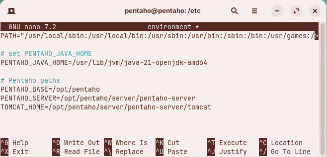
<figcaption>PENTAHO_JAVA_HOME in /etc/environment</figcaption>
</figure>
</div>

3. Save the file (`Ctrl+O`, `Enter`, `Ctrl+X`), then log out and back in: a new login reads `/etc/environment`. To load it into the current shell instead, export the variables as you read them:

```bash
set -a; source /etc/environment; set +a
```

4. Check the variables:

```bash
echo $PENTAHO_JAVA_HOME
echo $PENTAHO_SERVER
```

> **Success:** Checkpoint: `/usr/lib/jvm/java-21-openjdk-amd64`, then `/opt/pentaho/server/pentaho-server`.

5. Optionally, set the variable for the `pentaho` user only instead: open `~/.bashrc` (`nano ~/.bashrc`), add this line at the end, save, and load the file with `. ~/.bashrc`.

```bash
export PENTAHO_JAVA_HOME=/usr/lib/jvm/java-21-openjdk-amd64
```

> **Under the hood:**
>
> #### The server looks for PENTAHO_JAVA_HOME before any other Java
>
> `start-pentaho.sh` calls `set-pentaho-env.sh`, which picks the Java to run. It takes `PENTAHO_JAVA_HOME` first. Without it, it looks for a `jre` or `java` folder in the server's folder, one folder up and two folders up, then tries `JAVA_HOME` and `JRE_HOME`, and finally prints `WARNING: Using java from path` and runs whatever `java` the `PATH` finds.
>
> A variable that is only *set* is not passed to the programs a shell starts. A plain `source /etc/environment` sets the variables, so `echo` shows them, but `start-pentaho.sh` does not see them. `set -a` marks every variable assigned after it for export, and a new login exports them anyway.
>
> **Why it matters:** with `PENTAHO_JAVA_HOME` exported, a second JDK installed later for another application can't change the Java the server runs on.

### 5. Install PostgreSQL 17

Ubuntu 24.04's own repository provides PostgreSQL 16, not 17. To install 17, add the official PostgreSQL (PGDG) repository. If a different PostgreSQL is already installed, purge it first to avoid port and package conflicts: see the **Optional: Clean previous installs** tab.

::: tabs

### Install PostgreSQL 17

1. Bring the system up to date:

```bash
sudo apt update && sudo apt upgrade -y
```

2. Install the packages the next steps use:

```bash
sudo apt install -y curl ca-certificates gnupg
```

3. Import the PostgreSQL signing key into its own keyring:

```bash
curl -fsSL https://www.postgresql.org/media/keys/ACCC4CF8.asc | sudo gpg --dearmor -o /usr/share/keyrings/postgresql-keyring.gpg
```

4. Add the PostgreSQL repository, signed by that key:

```bash
echo "deb [signed-by=/usr/share/keyrings/postgresql-keyring.gpg] http://apt.postgresql.org/pub/repos/apt $(lsb_release -cs)-pgdg main" | sudo tee /etc/apt/sources.list.d/pgdg.list
```

> **Note:** Older guides pipe the key into `apt-key add`. Ubuntu 24.04 still accepts it but warns twice (`apt-key is deprecated` and `Key is stored in legacy trusted.gpg keyring`); a keyring per repository is the supported way.

5. Update the package list:

```bash
sudo apt update
```

6. Install PostgreSQL 17. The `postgresql-17` package is the database server with the client and the contrib extensions; there is no separate `postgresql-contrib-17` package any more.

```bash
sudo apt install -y postgresql-17
```

7. Check the service and the version:

```bash
sudo systemctl status postgresql --no-pager
psql --version
```

<div align="center">
<figure>
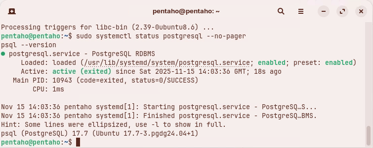
<figcaption>PostgreSQL 17 (the minor version you get will be newer)</figcaption>
</figure>
</div>

> **Success:** Checkpoint: the service shows `Active: active (exited)`, and `psql --version` prints `psql (PostgreSQL) 17.` followed by the minor version.

8. Optionally, tidy up:

```bash
sudo apt autoremove -y
```

### Optional: Install PostgreSQL 16

> **Warning:** This course is tested on PostgreSQL 17, and 15 is also supported for Pentaho 11. Use 16 only if the [Components Reference](https://docs.pentaho.com/install/pdia-11.0-installation/components-reference) lists it for your Pentaho version.

1. Bring the system up to date:

```bash
sudo apt update && sudo apt upgrade
```

2. Install the packages the next steps use:

```bash
sudo apt install dirmngr ca-certificates software-properties-common apt-transport-https lsb-release curl -y
```

3. Import the repository signing key:

```bash
sudo apt install curl ca-certificates gnupg
curl https://www.postgresql.org/media/keys/ACCC4CF8.asc | sudo gpg --dearmor | sudo tee /etc/apt/trusted.gpg.d/apt.postgresql.org.gpg >/dev/null
```

4. Create the repository configuration file:

```bash
echo "deb [signed-by=/etc/apt/trusted.gpg.d/apt.postgresql.org.gpg] http://apt.postgresql.org/pub/repos/apt/ noble-pgdg main" | sudo tee /etc/apt/sources.list.d/pgdg.list
```

5. Update the package list again, to include the new repository:

```bash
sudo apt update
```

6. Install the PostgreSQL 16 server and client packages:

```bash
sudo apt install -y postgresql-16 postgresql-client-16
psql --version
```

### Optional: Clean previous installs

If an unsupported PostgreSQL is installed, purge it first.

1. Run each command separately and review its output:

```bash
sudo apt-get --purge remove postgresql
sudo apt-get purge postgresql*
sudo apt-get --purge remove postgresql postgresql-doc postgresql-common
sudo apt autoremove -y
```

2. Check for packages left behind:

```bash
dpkg -l | grep -i postgres
```

:::

9. Check that PostgreSQL starts at boot, listens on port `5432` and answers a query:

```bash
sudo systemctl is-enabled postgresql
sudo ss -ltnp | grep 5432 || true
sudo -u postgres psql -c "SELECT version();"
```

> **Success:** Checkpoint: `enabled`; a `LISTEN` line for port `5432`; and one row that starts `PostgreSQL 17.`

### 6. Explore PostgreSQL as postgres

During the install, PostgreSQL creates a local superuser, `postgres`, and a Linux user of the same name that can connect without a password.

1. Switch to the `postgres` system user:

```bash
sudo -i -u postgres
```

2. Start the PostgreSQL interactive terminal:

```bash
psql
```

> **Success:** Checkpoint: the prompt changes to `postgres=#`.

3. List the databases:

```text
\l
```

> **Success:** Checkpoint: three rows, the default databases `postgres`, `template0` and `template1`, all owned by `postgres`.

4. If the list opened in a pager (a `:` or `(END)` at the bottom of the screen), press `q` to close it. Do not type `q` at the `postgres=#` prompt: psql takes it as the start of a query, and the next command fails with `syntax error at or near "q"`.
5. Check the PostgreSQL version from SQL:

```sql
SELECT version();
```

6. Quit psql:

```text
\q
```

7. Leave the `postgres` user's shell:

```bash
exit
```

### 7. Create the pentaho Database Role

Set a password for `postgres`, and create a `pentaho` role for the installation work.

> **Danger:** For production, avoid a permanent superuser for application use: use least-privilege roles and grant only what is needed. This workshop makes `pentaho` a superuser to keep the setup short.

<div align="center">
<figure>
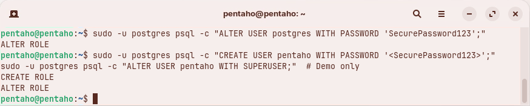
<figcaption>Creating the pentaho role (type the password without the angle brackets the screenshot shows)</figcaption>
</figure>
</div>

1. Set the `postgres` password:

```bash
sudo -u postgres psql -c "ALTER USER postgres WITH PASSWORD 'SecurePassword123';"
```

2. Create a `pentaho` user and grant it `SUPERUSER`:

```bash
sudo -u postgres psql -c "CREATE USER pentaho WITH PASSWORD 'SecurePassword123';"
sudo -u postgres psql -c "ALTER USER pentaho WITH SUPERUSER;" # Demo only
```

> **Success:** Checkpoint: psql prints `ALTER ROLE` for the first command, then `CREATE ROLE` and `ALTER ROLE`.

What each part of these commands does:

| Part | What it does |
| --- | --- |
| `sudo -u postgres` | Runs the command as the Linux user `postgres`, which connects to PostgreSQL without a password (until step **9. Configure pg_hba.conf** switches local connections to passwords) |
| `psql -c` | Runs a single SQL command and exits |
| `CREATE USER pentaho` | Creates a PostgreSQL role named `pentaho` that can log in |
| `WITH PASSWORD 'SecurePassword123'` | Sets the role's password |
| `ALTER USER pentaho` | Changes the existing `pentaho` role |
| `WITH SUPERUSER` | Grants full superuser rights: create databases and roles, and bypass every permission check |
| `# Demo only` | A shell comment: a reminder that a superuser application role is for this workshop only |

3. Test a connection as `pentaho`:

```bash
sudo -u pentaho psql -d postgres -c "\conninfo"
```

> **Success:** Checkpoint: `You are connected to database "postgres" as user "pentaho" via socket in "/var/run/postgresql" at port "5432".`

### 8. Optional: Allow Remote Connections

By default, PostgreSQL accepts only local connections. This course connects to PostgreSQL through `localhost`, so this section is for reference: skip it unless other machines must reach the database.

1. Back up `postgresql.conf` and open it:

```bash
sudo cp /etc/postgresql/17/main/postgresql.conf{,.bak}
sudo nano /etc/postgresql/17/main/postgresql.conf
```

2. Under **CONNECTIONS AND AUTHENTICATION**, set `listen_addresses = '*'` (a specific interface or IP address in production).

<div align="center">
<figure>
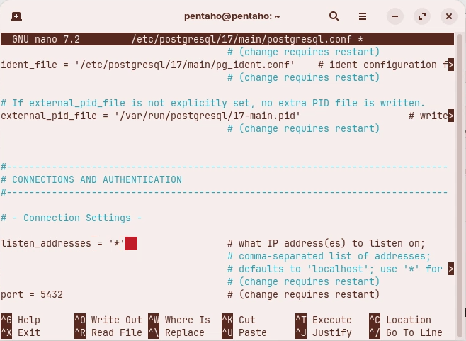
<figcaption>listen_addresses in postgresql.conf</figcaption>
</figure>
</div>

3. Save the file: press `Ctrl+O`, `Enter`, then `Ctrl+X`. The restart in the next section applies the change.

### 9. Configure pg_hba.conf

`pg_hba.conf` (PostgreSQL host-based authentication) decides who can connect to which database, from where, and how they prove who they are. Here you switch local connections to password authentication. In production, allow only the users and server addresses that need each database.

1. Back up `pg_hba.conf` and open it:

```bash
sudo cp /etc/postgresql/17/main/pg_hba.conf{,.bak}
sudo nano /etc/postgresql/17/main/pg_hba.conf
```

2. Change three lines, by hand or with a script:

::: tabs

### By hand

Change the method of the two `local` lines to `scram-sha-256`, and the first IPv4 `host` line to address `0.0.0.0/0` with method `md5`, as the highlighted values show. Then save the file (`Ctrl+O`, `Enter`, `Ctrl+X`).

<div align="center">
<figure>
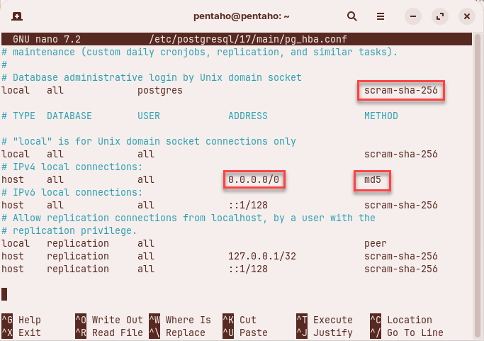
<figcaption>The changed lines in pg_hba.conf</figcaption>
</figure>
</div>

### With a script

Close nano without changes (`Ctrl+X`), then run this script. It makes its own backup, `pg_hba.conf.backup`, before it edits the file.

```bash
# Use the exact path
PG_HBA_PATH=/etc/postgresql/17/main/pg_hba.conf

# Verify the file exists
ls -la "$PG_HBA_PATH"

# If that works, then run:
sudo cp "$PG_HBA_PATH" "${PG_HBA_PATH}.backup"
sudo sed -i 's/^local[[:space:]]\+all[[:space:]]\+postgres[[:space:]]\+peer$/local   all             postgres                                scram-sha-256/' "$PG_HBA_PATH"
sudo sed -i 's/^local[[:space:]]\+all[[:space:]]\+all[[:space:]]\+peer$/local   all             all                                     scram-sha-256/' "$PG_HBA_PATH"
sudo sed -i '0,/^host[[:space:]]\+all[[:space:]]\+all[[:space:]]\+127\.0\.0\.1\/32[[:space:]]\+scram-sha-256$/s//host    all             all             0.0.0.0\/0               md5/' "$PG_HBA_PATH"
```

<div align="center">
<figure>
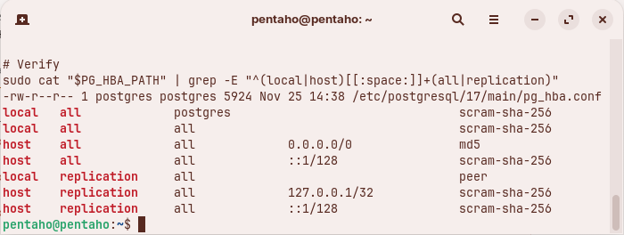
<figcaption>pg_hba.conf after the script</figcaption>
</figure>
</div>

:::

> **Under the hood:**
>
> #### PostgreSQL uses the first pg_hba.conf line that matches
>
> For every new connection, PostgreSQL reads `pg_hba.conf` from the top and takes the first line whose connection type (`local` for the Unix socket, `host` for TCP), database, user and address match; that line's method decides how the client must authenticate. The lines you changed used `peer`, which trusts the Linux user name: Linux user `postgres` became database user `postgres` with no password. `scram-sha-256` and `md5` ask for the database password instead.
>
> `scram-sha-256` hashes passwords more strongly than `md5`, so prefer it on a modern PostgreSQL. Keep `md5` only where a client's JDBC driver does not support SCRAM.
>
> **Why it matters:** the Pentaho Server connects over TCP to `localhost` with its own database users, so the `host` lines are the ones it meets. A login error from the server after a change here is a `pg_hba.conf` question first.

3. Check the result:

```bash
sudo grep -E "^(local|host)[[:space:]]+(all|replication)" /etc/postgresql/17/main/pg_hba.conf
```

> **Success:** Checkpoint: seven lines, the first three with the new methods:
>
> ```text
> local   all             postgres                                scram-sha-256
> local   all             all                                     scram-sha-256
> host    all             all             0.0.0.0/0               md5
> host    all             all             ::1/128                 scram-sha-256
> local   replication     all                                     peer
> host    replication     all             127.0.0.1/32            scram-sha-256
> host    replication     all             ::1/128                 scram-sha-256
> ```

4. Restart PostgreSQL to apply the change:

```bash
sudo systemctl restart postgresql
```

> **Warning:** From here on every local connection asks for a password, including `sudo -u postgres psql` (the `postgres` password, `SecurePassword123`) and `sudo -u pentaho psql` (`SecurePassword123`).

5. If the firewall is enabled, open port `5432`, then restart PostgreSQL and check that it listens:

```bash
sudo ufw allow 5432/tcp || true
sudo systemctl restart postgresql
sudo ss -ltnp | grep 5432
```

> **Success:** Checkpoint: a `LISTEN` line for port `5432`, owned by a `postgres` process.

### 10. Install pgAdmin 4 (Desktop)

Install the pgAdmin 4 desktop client from the official pgAdmin repository.

1. Add the repository and its key:

```bash
sudo install -d -m 0755 /etc/apt/keyrings
curl -fsS https://www.pgadmin.org/static/packages_pgadmin_org.pub | gpg --dearmor | sudo tee /etc/apt/keyrings/packages-pgadmin-org.gpg > /dev/null
source /etc/os-release
echo "deb [signed-by=/etc/apt/keyrings/packages-pgadmin-org.gpg] https://ftp.postgresql.org/pub/pgadmin/pgadmin4/apt/${UBUNTU_CODENAME} pgadmin4 main" | sudo tee /etc/apt/sources.list.d/pgadmin4.list
```

2. Install pgAdmin 4 (desktop):

```bash
sudo apt update -y && sudo apt upgrade -y
sudo apt install -y pgadmin4-desktop
```

3. Optionally, check the repository entry:

```bash
cat /etc/apt/sources.list.d/pgadmin4.list
```

> **Success:** Checkpoint: one line, ending `https://ftp.postgresql.org/pub/pgadmin/pgadmin4/apt/noble pgadmin4 main` (`noble` is Ubuntu 24.04's code name).

4. Start **pgAdmin 4** from your desktop's applications menu.

<div align="center">
<figure>
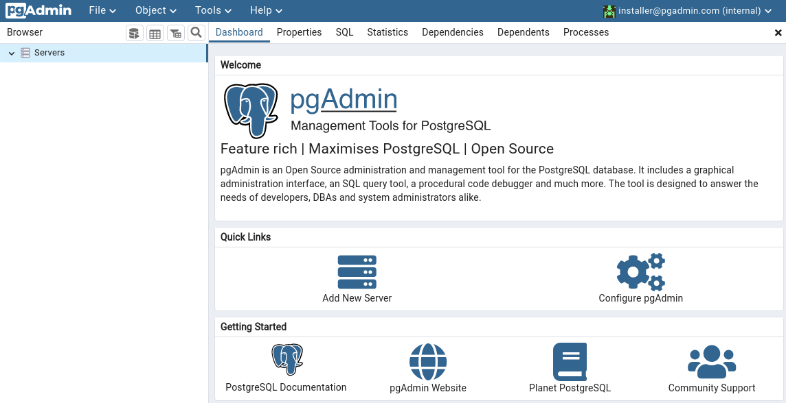
<figcaption>pgAdmin 4 before you register a server</figcaption>
</figure>
</div>

5. Right-click **Servers** and select **Register > Server**.
6. On the **General** tab, set **Name** to `Pentaho`.

<div align="center">
<figure>
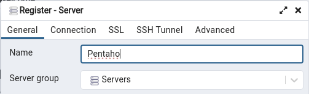
<figcaption>Register - Server, General tab</figcaption>
</figure>
</div>

7. Open the **Connection** tab and fill it in:

| Field | Value |
| --- | --- |
| **Host name/address** | `localhost` |
| **Port** | `5432` |
| **Maintenance database** | `postgres` |
| **Username** | `pentaho` |
| **Password** | `SecurePassword123` |

<div align="center">
<figure>
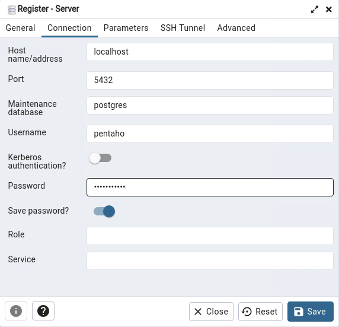
<figcaption>Register - Server, Connection tab</figcaption>
</figure>
</div>

> **Danger:** Do not save passwords in production: leave **Save password?** off, and prefer an OS-level keyring or a secure vault.

8. Select **Save**.

> **Success:** Checkpoint: the tree on the left shows **Servers (1) > Pentaho > Databases (1) > postgres**.

<div align="center">
<figure>
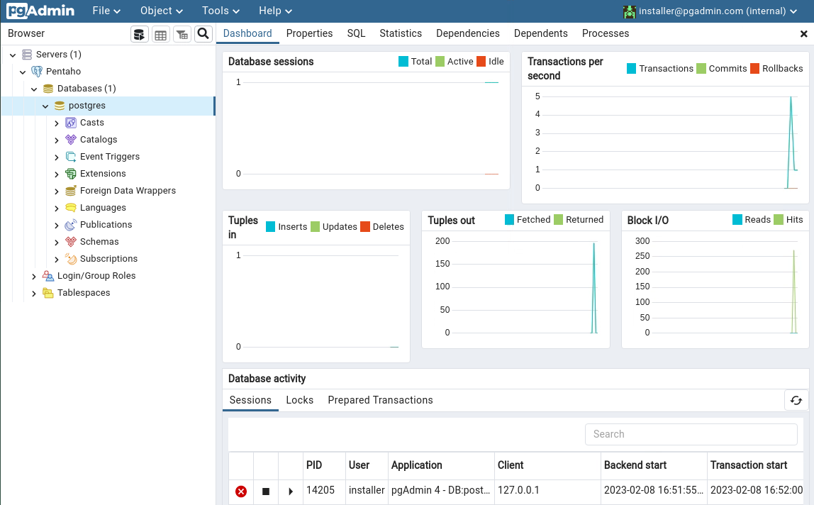
<figcaption>The Pentaho server registered in pgAdmin 4</figcaption>
</figure>
</div>

### 11. Validate the Environment

1. Run these checks to confirm the machine is ready for the next lab. The `psql` line asks for the `postgres` password, `SecurePassword123`.

```bash
# Java
java -version
[ "$PENTAHO_JAVA_HOME" = "/usr/lib/jvm/java-21-openjdk-amd64" ] && echo OK || echo "Check PENTAHO_JAVA_HOME"

# PostgreSQL (asks for the postgres password)
sudo -u postgres psql -c "SELECT version();"
sudo systemctl status postgresql --no-pager | sed -n '1,5p'
```

<div align="center">
<figure>
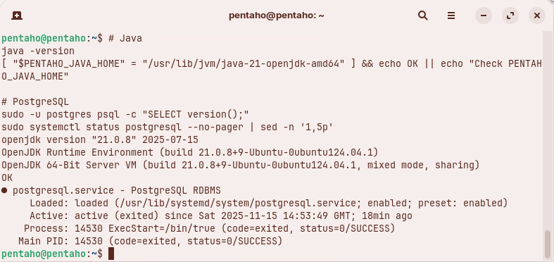
<figcaption>The validation checks</figcaption>
</figure>
</div>

> **Success:** Checkpoint: `java -version` reports `openjdk version "21.0.`..., the next line prints `OK`, `SELECT version()` returns one row starting `PostgreSQL 17.`, and the service shows `Active: active (exited)`.

::::

## Troubleshooting <!-- no-step -->

<details>
<summary>syntax error at or near "q"</summary>

You typed `q` at the `postgres=#` prompt, where psql reads it as the start of a query. Press `q` only to close a pager; to leave psql, type `\q`.

</details>

<details>
<summary>echo shows PENTAHO_JAVA_HOME, but the server does not use it</summary>

The variable was set with a plain `source /etc/environment`, so it is not exported to the programs you start. Log out and back in, or run `set -a; source /etc/environment; set +a`.

</details>

<details>
<summary>psql: fe_sendauth: no password supplied</summary>

Since step **9. Configure pg_hba.conf**, every local connection needs a password. Run the command in a terminal, where psql can ask for it: the `postgres` or `pentaho` password, `SecurePassword123`.

</details>

## Lab Files

_No bundled files for this lab._
