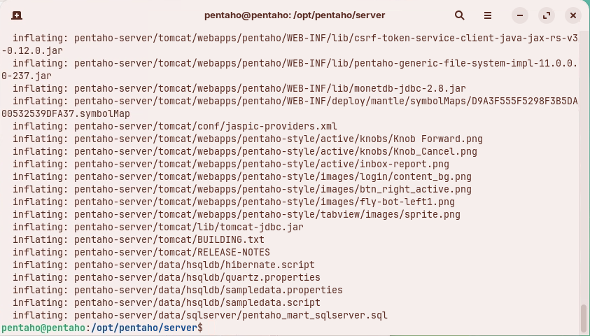
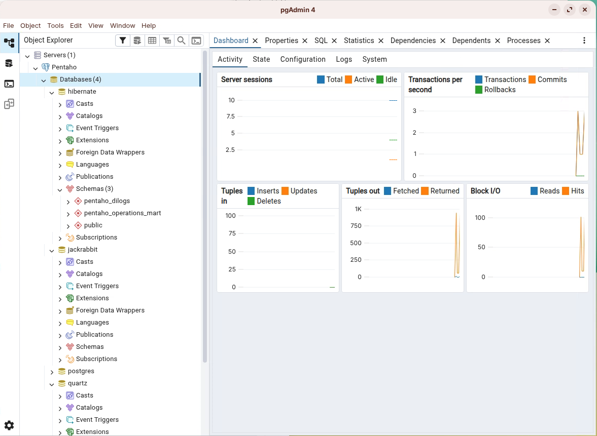
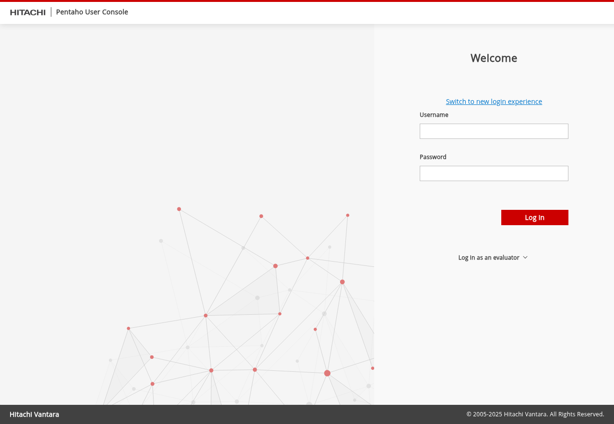
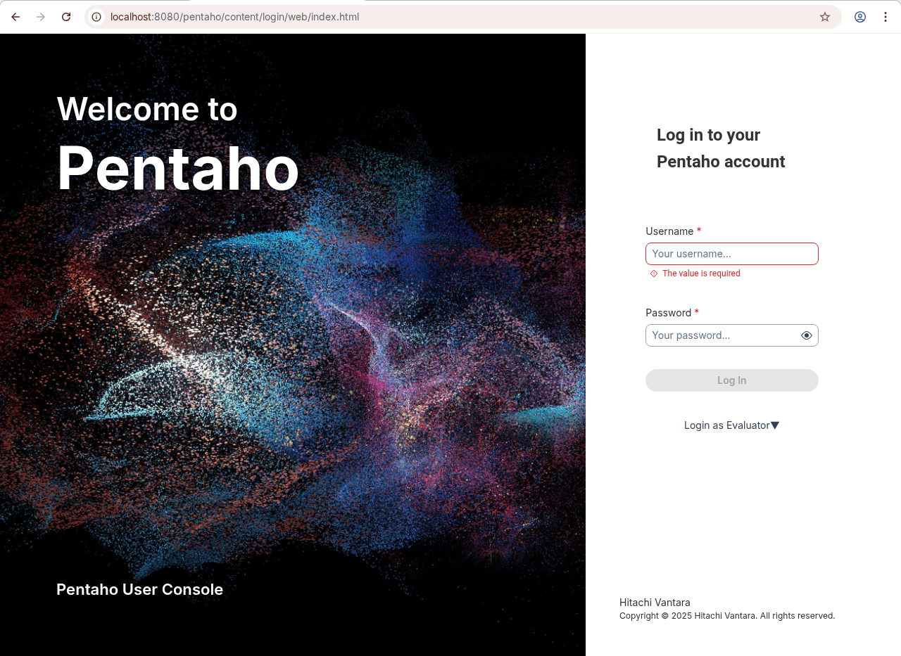
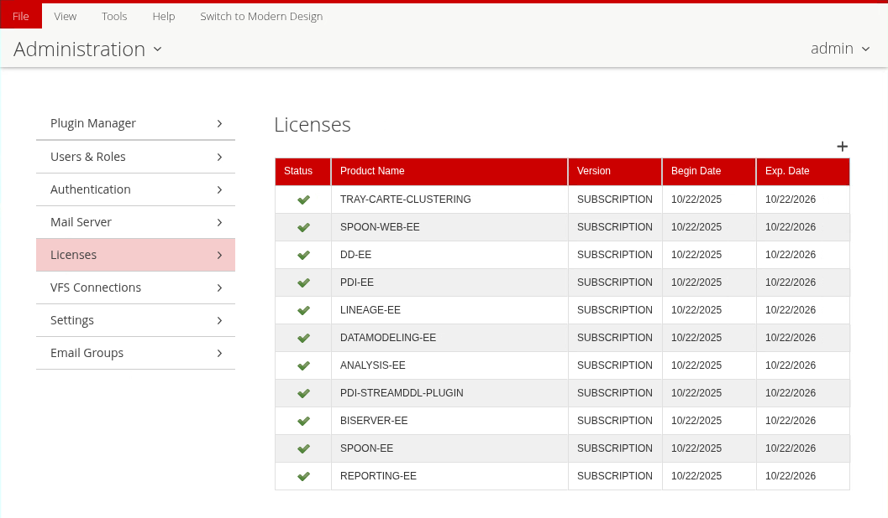
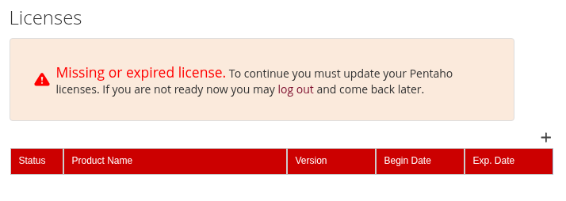
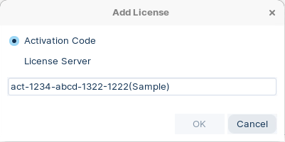

# Install Pentaho Server

> **Warning:**
>
> #### Workshop - Install Pentaho Server
>
> Install the Pentaho Server from its archive: unpack it, create its repository in PostgreSQL, check its connections, then start it, log in and license it.
>
> **What you'll do**
>
> * Unpack the Pentaho Server archive under `/opt/pentaho`
> * Create the Jackrabbit, Quartz and Hibernate repository databases
> * Check the repository configuration and Tomcat's JDBC drivers and `context.xml`
> * Start the server and log in to the Pentaho User Console
> * Apply a license and set the license path
>
> **Prerequisites:**
>
> * [Prepare Environment](../05-installation-archive-prepare-environment/guide.md): Ubuntu 24.04 LTS, Java 21 with `PENTAHO_JAVA_HOME` set, PostgreSQL 17 running, the `pentaho` user with `sudo`, and `unzip`
> * `pentaho-server-ee-11.0.0.0-237.zip` from [Pentaho Support Portal](../02-installation-getting-started-pentaho-support-portal/guide.md), and the JDBC driver JARs your server needs
>
> **Estimated time:** 20 minutes

---

> **Note:**
>
> #### Install Pentaho Server
>
> The tested baseline is Ubuntu 24.04 LTS with Java 21 (OpenJDK) and PostgreSQL 17. Work as the `pentaho` user throughout. For compatibility details, see the Components Reference.

<div class="pcm-embed-card" data-href="https://docs.pentaho.com/install/pdia-11.0-installation/components-reference" data-title="Components reference | Pentaho Documentation"></div>

<div align="center">
<figure>

<figcaption>Pentaho Data Integration Carte: tools, sources, targets and storage</figcaption>
</figure>
</div>

:::: tabs

### 1. Unpack the Server

> **Note:**
>
> #### Pentaho Server Directories
>
> The Pentaho Server is a web application running in an Apache Tomcat servlet container. The archive holds both, already deployed.

1. Create the base directories under `/opt/pentaho`:

```bash
sudo mkdir -p /opt/pentaho/{server,software}
```

```text
/opt/pentaho
├── server      # Unpacked server runtime (tomcat, pentaho-solutions, scripts)
└── software    # Installers, ZIPs, drivers (staging area)
```

2. Create the staging sub-directories in `/opt/pentaho/software`:

```bash
cd /opt/pentaho/software
sudo mkdir -p {db-drivers,docker,ee-client,ee-plugins,ops-mart,sdk,server,shims}
```

| Folder | Holds |
| --- | --- |
| `db-drivers` | JDBC drivers |
| `docker` | The Pentaho on-premises configuration and Dockerfiles |
| `ee-client` | Pentaho EE client plugins |
| `ee-plugins` | Pentaho EE server plugins |
| `ops-mart` | Operations Mart scripts |
| `sdk` | The Pentaho SDK kit |
| `server` | The Pentaho Server archive |
| `shims` | Hadoop shim collections |

3. Copy the server archive into staging:

```bash
sudo cp ~/Downloads/'Archive Build (Suggested Installation Method)'/* /opt/pentaho/software/server
```

4. Unpack it into `$PENTAHO_BASE/server`. `unzip` does it without a full JDK: the JRE has no `jar` tool.

```bash
cd "$PENTAHO_BASE/server"
sudo unzip /opt/pentaho/software/server/pentaho-server-ee-11.0.0.0-237.zip
```

<div align="center">
<figure>

<figcaption>Unpacking the Pentaho Server</figcaption>
</figure>
</div>

> **Under the hood:**
>
> #### The archive is the whole server, already deployed
>
> `pentaho-server` holds Tomcat 10 with the Pentaho web application already deployed in `tomcat/webapps/pentaho`, the start and stop scripts, and `pentaho-solutions`, whose `system` folder holds the server's configuration and its plugins. Beside it, `jdbc-distribution` is a tool for copying JDBC drivers and `license-installer` installs licenses from the command line. Unpacking registers nothing with the operating system: no service and no package, until you create a service in the **Start Server** tab.
>
> **Why it matters:** the whole installation is one folder tree, owned by `pentaho` after the next steps, so a backup, a move or a reinstall is a copy or an unzip, and file ownership is the first thing to check when the server can't write its logs.

5. List the folder:

```bash
ls -1 "$PENTAHO_BASE/server"
```

> **Success:** Checkpoint: three folders, `jdbc-distribution`, `license-installer` and `pentaho-server`.

6. Make every `.sh` file executable:

```bash
cd "$PENTAHO_BASE/server"
sudo find . -iname "*.sh" -exec chmod +x {} \;
```

7. Give `/opt/pentaho` to the `pentaho` user, so the server runs as a non-root user, and set the permissions:

```bash
sudo chown -R pentaho:pentaho /opt/pentaho
sudo find /opt/pentaho -type d -exec chmod 755 {} \;
sudo find /opt/pentaho -type f -exec chmod 644 {} \;
sudo find /opt/pentaho -name "*.sh" -exec chmod 755 {} \;
```

| Mode | The owner (`pentaho`) | Other users |
| --- | --- | --- |
| `755` (directories, scripts) | Read, write and run | Read and run, not change |
| `644` (other files) | Read and write | Read only |

8. Check three of the scripts:

```bash
ls -l "$PENTAHO_SERVER"/*.sh | head -3
```

> **Success:** Checkpoint: each line starts `-rwxr-xr-x 1 pentaho pentaho`, for `encr.sh`, `import-export.sh` and `set-pentaho-env.sh`.

### 2. Repository Databases

> **Note:**
>
> #### Pentaho Repository components
>
> The Pentaho Repository, on PostgreSQL by default, has four parts: Jackrabbit (the solution repository, security and content metadata), Quartz (the scheduler's data), Hibernate (audit logging) and the Pentaho Operations Mart (usage and performance reporting).

**Review the default passwords**

1. List the PostgreSQL scripts that ship with the server:

```bash
cd "$PENTAHO_SERVER/data/postgresql"
ls -1
```

> **Success:** Checkpoint: ten scripts:
>
> ```text
> alter_script_postgresql_BISERVER-13674.sql
> create_jcr_postgresql.sql
> create_quartz_postgresql.sql
> create_repository_postgresql.sql
> migrate_old_quartz_data_postgresql.sql
> pentaho_logging_postgresql.sql
> pentaho_mart_drop_postgresql.sql
> pentaho_mart_postgresql.sql
> pentaho_mart_upgrade_audit_postgresql.sql
> pentaho_mart_upgrade_postgresql.sql
> ```

2. Open a script to see the users and passwords it creates:

```bash
sed -n '1,120p' create_jcr_postgresql.sql
```

> **Danger:** For production, use unique, strong passwords, rotate them regularly, keep them in a secure vault, and never commit them to source control. Don't keep the workshop's default passwords in production.

**Create the repository databases**

3. Check that PostgreSQL is running:

```bash
sudo systemctl status postgresql --no-pager
```

4. Still in `$PENTAHO_SERVER/data/postgresql`, connect as the `pentaho` superuser. Its password is `SecurePassword123`.

```bash
sudo -u pentaho psql -d postgres
```

5. Run the first two scripts, one line at a time, then quit:

```sql
\i create_jcr_postgresql.sql
\i create_quartz_postgresql.sql
\q
```

6. Quit there: the Quartz script ends by connecting you as `pentaho_user`, who cannot create the next script's user (`permission denied to create role`). Back in the shell, still in `$PENTAHO_SERVER/data/postgresql`, reconnect:

```bash
sudo -u pentaho psql -d postgres
```

7. Run the other three scripts, then quit:

```sql
\i create_repository_postgresql.sql
\i pentaho_mart_postgresql.sql
\i pentaho_logging_postgresql.sql
\q
```

The scripts connect as each user they create, so psql asks for that user's password as it goes:

| User | Password |
| --- | --- |
| `postgres` | `SecurePassword123` |
| `pentaho` | `SecurePassword123` |
| `jcr_user` | `password` |
| `pentaho_user` | `password` |
| `hibuser` | `password` |

> **Under the hood:**
>
> #### Each script creates a database and its owner, then works as that owner
>
> `create_jcr_postgresql.sql` creates the `jackrabbit` database and its owner `jcr_user`; `create_quartz_postgresql.sql` creates `quartz`, owned by `pentaho_user`, and connects as that user to create the 11 `qrtz6_` tables; `create_repository_postgresql.sql` creates `hibernate`, owned by `hibuser`. The Operations Mart and PDI logging scripts start with `\connect hibernate hibuser` and create their tables in two schemas of `hibernate`, `pentaho_operations_mart` and `pentaho_dilogs`, not in databases of their own.
>
> **Why it matters:** these three users are the ones the server logs in as, through the JNDI resources in Tomcat's `context.xml` (the **Tomcat** tab). Change a password in PostgreSQL and you change it in `context.xml` too, or the server can't reach its repository.

8. Check the result: reconnect with `sudo -u pentaho psql -d postgres`, then list the databases and look inside them (press `q` to close a pager):

```sql
\l+ jackrabbit
\l+ quartz
\l+ hibernate
\c hibernate
\dn
\c quartz
\dt
```

> **Success:** Checkpoint:
>
> | Command | Shows |
> | --- | --- |
> | `\l+ jackrabbit` | One database, owner `jcr_user` |
> | `\l+ quartz` | One database, owner `pentaho_user` |
> | `\l+ hibernate` | One database, owner `hibuser` |
> | `\dn` in `hibernate` | Three schemas: `pentaho_dilogs`, `pentaho_operations_mart` and `public` |
> | `\dt` in `quartz` | 11 tables, from `qrtz6_blob_triggers` to `qrtz6_triggers` |
>
> The `jackrabbit` database has no tables yet: the server creates them, and the `hibernate` tables, on its first start.

9. Optionally, look at the databases in pgAdmin: under **Servers > Pentaho**, refresh and expand **Databases**.

<div align="center">
<figure>

<figcaption>The repository databases in pgAdmin</figcaption>
</figure>
</div>

> **Success:** Checkpoint: **Databases (4)**: `hibernate`, `jackrabbit`, `postgres` and `quartz`; under `hibernate`, **Schemas (3)**.

### 3. Repository Configuration

> **Note:**
>
> #### Point the server at PostgreSQL
>
> PostgreSQL is the default. If you kept the default passwords and port (`5432`), only check the settings below; otherwise, change the host, port, user and password to match your environment.

**Quartz: the PostgreSQL delegate and the JNDI data source**

1. Open the Quartz configuration:

```bash
cd "$PENTAHO_SERVER/pentaho-solutions/system/scheduler-plugin/quartz"
sudo nano -c quartz.properties
```

2. Check these values (`nano -c` shows line numbers; yours may differ), then press `Ctrl+X` to close the file:

```properties
org.quartz.jobStore.driverDelegateClass = org.quartz.impl.jdbcjobstore.PostgreSQLDelegate
org.quartz.jobStore.tablePrefix = QRTZ6_
org.quartz.dataSource.myDS.jndiURL = Quartz
```

**Hibernate: the PostgreSQL configuration file**

3. Open the Hibernate settings:

```bash
cd "$PENTAHO_SERVER/pentaho-solutions/system/hibernate"
sudo nano -c hibernate-settings.xml
```

4. Check that the file names the PostgreSQL configuration, then close it:

```xml
<config-file>system/hibernate/postgresql.hibernate.cfg.xml</config-file>
```

5. Open `postgresql.hibernate.cfg.xml`:

```bash
sudo nano -c postgresql.hibernate.cfg.xml
```

6. Check its driver, dialect and data source, then close it:

```xml
<property name="connection.driver_class">org.postgresql.Driver</property>
<property name="dialect">org.hibernate.dialect.PostgreSQLDialect</property>
<property name="hibernate.connection.datasource">java:comp/env/jdbc/Hibernate</property>
```

**Jackrabbit: PostgreSQL storage**

7. Open the Jackrabbit configuration:

```bash
cd "$PENTAHO_SERVER/pentaho-solutions/system/jackrabbit"
sudo nano -c repository.xml
```

8. Check that the PostgreSQL sections are the active ones, and that every other database's sections are commented out:

| Section | Active class | PostgreSQL setting |
| --- | --- | --- |
| `FileSystem` (repository, workspace and versioning) | `org.apache.jackrabbit.core.fs.db.DbFileSystem` | `schema` `postgresql` |
| `DataStore` | `org.apache.jackrabbit.core.data.db.DbDataStore` | `databaseType` `postgresql` |
| `PersistenceManager` (workspace and versioning) | `org.apache.jackrabbit.core.persistence.bundle.PostgreSQLPersistenceManager` | `schema` `postgresql` |
| `Journal` | `org.apache.jackrabbit.core.journal.DatabaseJournal` | `schema` `postgresql` |

> **Success:** Checkpoint: every active section has the `postgresql` value, and its `url` is `java:comp/env/jdbc/jackrabbit`.

The three files name their data sources by Java Naming and Directory Interface (JNDI) name, and Tomcat's `context.xml` defines them (the **Tomcat** tab). Cross-check the names, host and port (`5432` unless you changed it):

| Component | JNDI name it uses | Defined in `context.xml` as |
| --- | --- | --- |
| Quartz | `Quartz` | `jdbc/Quartz` |
| Hibernate | `java:comp/env/jdbc/Hibernate` | `jdbc/Hibernate` |
| Jackrabbit | `java:comp/env/jdbc/jackrabbit` | `jdbc/jackrabbit` |

### 4. Tomcat

> **Note:**
>
> #### Tomcat
>
> With the repository configured, connect the web application server (Tomcat 10) to it, through JDBC drivers and the JNDI resources in `context.xml`.

::: tabs

### 1. Database Drivers

> **Warning:**
>
> #### JDBC Drivers
>
> The server needs a JDBC driver for every database it connects to, the repository included. Licensing restrictions mean some drivers must be downloaded by hand.

<div class="pcm-embed-card" data-href="https://docs.pentaho.com/install/jdbc-drivers-reference" data-title="JDBC drivers reference | Pentaho Documentation"></div>

<div class="pcm-embed-card" data-href="https://jdbc.postgresql.org/download/postgresql-42.7.8.jar" data-title="PostgreSQL JDBC driver 42.7.8"></div>

1. Check that Tomcat's `lib` folder has the PostgreSQL JDBC driver, which the repository needs:

```bash
ls -1 "$TOMCAT_HOME/lib" | grep -i postgresql || echo "PostgreSQL driver not found"
```

> **Success:** Checkpoint: `postgresql-42.5.6.jar`, the driver the archive ships.

2. If it is missing, download the PostgreSQL JDBC driver (for example `postgresql-42.7.8.jar`, from the card above) and copy it into Tomcat's `lib` folder:

```bash
sudo cp ~/Downloads/'Database Drivers'/postgresql-*.jar "$TOMCAT_HOME/lib/"
sudo chown pentaho:pentaho "$TOMCAT_HOME"/lib/postgresql-*.jar
```

3. Stage the other JDBC drivers you downloaded, and copy the ones the server needs (MySQL here) into Tomcat's `lib` folder:

```bash
sudo cp ~/Downloads/'Database Drivers'/* /opt/pentaho/software/db-drivers
cd /opt/pentaho/software/db-drivers
sudo cp mysql-connector-j-9.0.0.jar "$TOMCAT_HOME/lib/" && sudo chown pentaho:pentaho "$TOMCAT_HOME/lib/mysql-connector-j-9.0.0.jar"
```

> **Under the hood:**
>
> #### distribute-files.sh copies to folders relative to its own parent
>
> The archive's `jdbc-distribution/distribute-files.sh` takes the **driver** as its argument (`./distribute-files.sh mysql-connector-j-9.0.0.jar`), not a target folder, and copies it to the folders listed in its `config.xml`. Those are relative to the folder above it (`server/pentaho-server/tomcat/lib`, `design-tools/...`), so with the archive unpacked under `/opt/pentaho/server` they point at paths that do not exist. It copies nothing there, yet still prints `You must restart your Pentaho Server and Client tools...`.
>
> **Why it matters:** a direct copy works whatever the layout, and the next step proves it. Trust the listing of `tomcat/lib`, not the script's message.

4. Check that the JARs are in Tomcat's `lib` folder:

```bash
ls -1 "$TOMCAT_HOME/lib" | grep -Ei 'mysql|postgresql' || echo "Not found"
```

> **Success:** Checkpoint: `mysql-connector-j-9.0.0.jar` and `postgresql-42.5.6.jar`.

Tomcat reads its `lib` folder when it starts, so restart the server (and any client tool that uses the driver) after you add a driver. A full system reboot is not required.

### 2. context.xml

> **Note:**
>
> #### context.xml
>
> `context.xml` holds the database connection details of the JNDI resources the server uses.

1. Open the file:

```bash
cd "$TOMCAT_HOME/webapps/pentaho/META-INF"
sudo nano -c context.xml
```

2. Check its `<Resource>` elements against the repository you created:

| Resource | Database | User |
| --- | --- | --- |
| `jdbc/Hibernate` | `hibernate` | `hibuser` |
| `jdbc/Audit` | `hibernate` | `hibuser` |
| `jdbc/Quartz` | `quartz` | `pentaho_user` |
| `jdbc/PDI_Operations_Mart` | `hibernate` | `hibuser` |
| `jdbc/pentaho_operations_mart` | `hibernate` | `hibuser` |
| `jdbc/live_logging_info` | `hibernate` (schema `pentaho_dilogs`) | `hibuser` |
| `jdbc/jackrabbit` | `jackrabbit` | `jcr_user` |
| `jdbc/SampleData`, `jdbc/SampleDataAdmin` | The HSQLDB sample database, `sampledata` | `pentaho_user`, `pentaho_admin` |

> **Success:** Checkpoint: nine `<Resource>` elements. The seven PostgreSQL ones use `org.postgresql.Driver` and a URL that starts `jdbc:postgresql://localhost:5432/`.

3. In production, check each resource's username, password, driver class, host and port against your environment, and that its name matches the Quartz, Hibernate and Jackrabbit configuration. Then press `Ctrl+X` to close the file (`Ctrl+O` first if you changed it).

:::

### 5. Start Server

> **Note:**
>
> #### Start Pentaho Server
>
> Run the server as the `pentaho` user, to avoid permission problems with the files it writes.

1. Start the server:

```bash
cd "$PENTAHO_SERVER"
./start-pentaho.sh
```

> **Success:** Checkpoint: before Tomcat starts, the script prints `DEBUG: Using PENTAHO_JAVA_HOME` and `DEBUG: _PENTAHO_JAVA=/usr/lib/jvm/java-21-openjdk-amd64/bin/java`: the Java you set in **Prepare Environment**.

2. Follow the Tomcat log:

```bash
tail -f "$TOMCAT_HOME/logs/catalina."*.log
```

> **Success:** Checkpoint: the log reaches `Starting ProtocolHandler ["http-nio-8080"]` and then `Server startup in [...] milliseconds`, with the time it took in the brackets.

3. Press `Ctrl+C` to stop following the log. The server keeps running.
4. Check that HTTP answers:

```bash
curl -I http://localhost:8080/pentaho/ | head -n 1
```

> **Success:** Checkpoint: `HTTP/1.1 401`: Tomcat is up, and the request sent no login.

5. Open the Pentaho User Console (PUC), the web interface for creating and viewing content:

<div class="pcm-embed-card" data-href="http://localhost:8080/pentaho" data-title="Pentaho User Console"></div>

<div align="center">
<figure>

<figcaption>The User Console login page</figcaption>
</figure>
</div>

6. Set **Username** to `admin` and **Password** to `password`, and select **Log In**. These are the default credentials: change them after your first login.

> **Success:** Checkpoint: you are logged in as `admin`. If no license is installed yet, the console shows **Licenses** with *Missing or expired license.*: the **License Manager** tab adds one.

7. Optionally, try the new login page: on the login page select **Switch to new login experience**, or open:

<div class="pcm-embed-card" data-href="http://localhost:8080/pentaho/content/login/web/index.html" data-title="Pentaho User Console: new login"></div>

<div align="center">
<figure>

<figcaption>The new login page</figcaption>
</figure>
</div>

Once a license is entered, logging in here takes you to the new User Console.

8. Optionally, for remote access, open the firewall port (adjust to your network policy) and test from a client machine:

```bash
sudo ufw allow 8080/tcp || true
```

**Check the repository after the first start**

9. Connect with `sudo -u pentaho psql -d postgres`, then count what the first start created:

```sql
\c quartz
SELECT COUNT(*) FROM qrtz6_locks;
\c hibernate
SELECT COUNT(*) FROM information_schema.tables WHERE table_schema = 'public';
\c jackrabbit
SELECT COUNT(*) FROM information_schema.tables WHERE table_schema = 'public';
```

> **Success:** Checkpoint: `5` lock rows in `quartz`, `17` tables in `hibernate` and `19` in `jackrabbit`.

10. Quit psql:

```text
\q
```

> **Under the hood:**
>
> #### The first start fills the repository
>
> Before the first start, `jackrabbit` had no tables at all. The server created them as it started: Jackrabbit's file system, data store, persistence managers and journal, each with the prefix its section of `repository.xml` names. Hibernate created its tables in `hibernate`, and Quartz wrote the lock rows it uses to coordinate the scheduler.
>
> **Why it matters:** an empty `jackrabbit` after a start means the server never reached its repository. Look in `catalina.*.log` for the JNDI resource that failed, and check it against `context.xml` and `pg_hba.conf`.

**Run the server as a service (optional)**

11. Create a systemd service, to start Pentaho at boot and restart it on failure. Open the unit file:

```bash
sudo nano /etc/systemd/system/pentaho-server.service
```

12. Paste this unit, then save the file (`Ctrl+O`, `Enter`, `Ctrl+X`):

```ini
[Unit]
Description=Pentaho Server
After=network-online.target
Wants=network-online.target

[Service]
Type=forking
User=pentaho
Group=pentaho
EnvironmentFile=-/etc/environment
# Optional fallback if not using PENTAHO_JAVA_HOME in /etc/environment
# Environment="JAVA_HOME=/usr/lib/jvm/java-21-openjdk-amd64"
WorkingDirectory=/opt/pentaho/server/pentaho-server
ExecStart=/opt/pentaho/server/pentaho-server/start-pentaho.sh
ExecStop=/opt/pentaho/server/pentaho-server/stop-pentaho.sh
TimeoutSec=500
Restart=on-failure
RestartSec=5
SuccessExitStatus=5 6
LimitNOFILE=65535

[Install]
WantedBy=multi-user.target
```

13. Stop the server you started in step 1, so the service can take port `8080`, then reload systemd, and start and enable the service:

```bash
cd "$PENTAHO_SERVER"
./stop-pentaho.sh
sudo systemctl daemon-reload
sudo systemctl start pentaho-server
sudo systemctl enable pentaho-server
```

14. Manage the service with:

```bash
sudo systemctl status pentaho-server
sudo systemctl restart pentaho-server
sudo systemctl stop pentaho-server
```

> **Success:** Checkpoint: `systemctl status pentaho-server` shows the service loaded from `/etc/systemd/system/pentaho-server.service`, enabled and active.

### 6. License Manager

> **Note:**
>
> #### Licensing
>
> Pentaho 11 uses a License Manager, in the cloud or local, to manage the PDI and Business Analytics entitlements and to verify the EE plugins.

<div align="center">
<figure>

<figcaption>Licenses in the Administration perspective</figcaption>
</figure>
</div>

::: tabs

### License Manager

> **Note:**
>
> #### Trial or Enterprise license
>
> A 30-day trial license is included if you downloaded from the [Pentaho 30-day Trial](https://pentaho.com/download/). If you downloaded the GA binaries from the [Pentaho Customer Portal](https://support.pentaho.com/hc/en-us), you need an Activation ID or your licensing URL. An air-gapped installation needs an offline license, which you request.
>
> If you are upgrading from 9.x or earlier, install the new product version before you activate licenses, and don't start the server before you upgrade the licenses.

1. In the User Console, select **Administration** from the perspective list at the top left (it shows **Home** after you log in), then select **Licenses**.
2. Select **+**, above the table on the right.

<div align="center">
<figure>

<figcaption>No license yet: select +</figcaption>
</figure>
</div>

3. In **Add License**, select **Activation Code** and enter your activation code, or select **License Server** and enter your licensing URL. Then select **OK**.

<div align="center">
<figure>

<figcaption>Add License</figcaption>
</figure>
</div>

> **Success:** Checkpoint: the **Licenses** table lists the products your license covers, each with a green check mark under **Status** and its **Version**, **Begin Date** and **Exp. Date**.

### Set the License Path

> **Note:**
>
> #### Set the license path variable
>
> Create a `PENTAHO_LICENSE_INFORMATION_PATH` environment variable, so the Pentaho Server always finds your license file.

1. Create the target directory and secure it:

```bash
sudo -u pentaho mkdir -p /home/pentaho/.pentaho
sudo chown -R pentaho:pentaho /home/pentaho/.pentaho
chmod 700 /home/pentaho/.pentaho
```

2. Open `/etc/environment`:

```bash
sudo nano /etc/environment
```

3. Add (or update) this line, with no `export`, then save the file (`Ctrl+O`, `Enter`, `Ctrl+X`):

```properties
PENTAHO_LICENSE_INFORMATION_PATH=/home/pentaho/.pentaho/.elmLicInfo.plt
```

4. Log out and back in (a new login reads `/etc/environment`), or load it into the current shell with `set -a`, then check it:

```bash
set -a; source /etc/environment; set +a
env | grep PENTAHO_LICENSE_INFORMATION_PATH
```

> **Success:** Checkpoint: `PENTAHO_LICENSE_INFORMATION_PATH=/home/pentaho/.pentaho/.elmLicInfo.plt`.

5. Restart the server from that shell (or with `sudo systemctl restart pentaho-server` if you created the service):

```bash
cd "$PENTAHO_SERVER"
./stop-pentaho.sh
./start-pentaho.sh
```

> **Under the hood:**
>
> #### start-pentaho.sh hands the license path to Tomcat
>
> When `PENTAHO_LICENSE_INFORMATION_PATH` is set in the shell that runs it, `start-pentaho.sh` adds `-Dpentaho.license.information.file=` and the path to `CATALINA_OPTS`, the Java options Tomcat starts with; the startup output shows `DEBUG: PENTAHO_LICENSE_INFORMATION_PATH=/home/pentaho/.pentaho/.elmLicInfo.plt`. When it is not set, `set-pentaho-env.sh` looks for a `.elmLicInfo.plt` file in the server's folder, one folder up and two folders up, and passes nothing if there is none.
>
> **Why it matters:** the variable puts the license file in the `pentaho` user's home, outside `/opt/pentaho`, where a reinstall or an upgrade of the server folder doesn't touch it. And because the script reads the variable at start, a running server picks up a change only after a restart from a new login.

:::

::::

## Troubleshooting <!-- no-step -->

<details>
<summary>HTTP 404 on /pentaho after startup</summary>

Confirm that `"$TOMCAT_HOME/webapps/pentaho"` exists, check `catalina.*.log` for deployment errors, and check the file permissions under `$PENTAHO_SERVER`.

</details>

<details>
<summary>Port 8080 already in use</summary>

Change the Tomcat port in `server.xml` (see [Post Installation Tasks](../08-installation-post-installation/guide.md)), or stop the service that holds the port.

</details>

<details>
<summary>JDBC driver not found</summary>

Check that the driver JARs (for example `postgresql-*.jar` and `mysql-*.jar`) are in `"$TOMCAT_HOME/lib"`, then restart the server.

</details>

<details>
<summary>Authentication to PostgreSQL fails</summary>

Prefer `scram-sha-256`; review `pg_hba.conf`, restart PostgreSQL, and test with `psql -h 127.0.0.1` as the user that fails.

</details>

<details>
<summary>Jackrabbit schema errors</summary>

Check again that the active sections of `repository.xml` are the `postgresql` ones (the **Repository Configuration** tab).

</details>

<details>
<summary>License activation errors</summary>

Look in the Tomcat logs in `tomcat/logs/` for `license` or `elm` messages.

</details>

## Lab Files

_No bundled files for this lab._
