# Server Plugins

> **Warning:**
>
> #### Workshop - Server Plugins
>
> Install the server plugins from the Plugin Manager in the modern Pentaho User Console, then try the plugins new in 11.0: Pipeline Designer, Semantic Model Editor, the Scheduler and Carte.
>
> **What you'll do**
>
> * Open the Plugin Manager in the modern User Console
> * Install Analyzer, Interactive Reporting and Dashboard Designer
> * Check Pipeline Designer, the Scheduler and the Carte API plugin, and install Semantic Model Editor
> * Run a test transformation in Pipeline Designer and follow it in Carte
> * Explore the server's data connections
>
> **Prerequisites:**
>
> * The server from [Install Pentaho Server](../06-installation-archive-pentaho-server/guide.md), running and licensed
> * Outbound HTTPS from the server to `download.pentaho.com`, where the Plugin Manager downloads plugins
>
> **Estimated time:** 15 minutes

---

> **Note:**
>
> #### Plugin Manager
>
> The modern User Console has a built-in Plugin Manager for the lifecycle of the server and client EE plugins. Its filter shows **View All**, **Update Available**, **Installed** or **Not Installed** plugins. It downloads from `download.pentaho.com`, so the server needs outbound HTTPS.

:::: tabs

### 1. Open the Plugin Manager

> **Note:**
>
> #### The modern User Console
>
> The left panel holds the main navigation: **Home**, **Browse Files**, **Plugin Manager**, **Scheduler**, **Data Connections** and **Settings**, then an entry for each plugin that adds one, such as **Semantic Model Editor** and **Pipeline Designer**. The **Home** page has a **Quick Access** section of cards and a list of recently opened files.

1. Open the new login page, set **Username** to `admin` and **Password** to `password`, and select **Log In**:

<div class="pcm-embed-card" data-href="http://localhost:8080/pentaho/content/login/web/index.html" data-title="Pentaho User Console: new login"></div>

   Or, logged in to the classic console, select **Switch to Modern Design** on the menu bar.

<div align="center">
<figure>
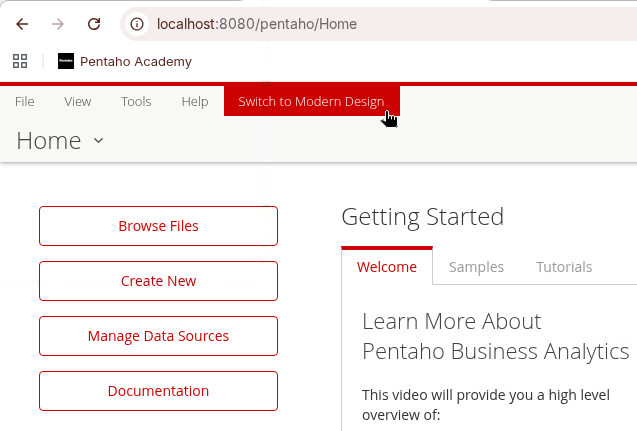
<figcaption>Switch to Modern Design, on the classic console's menu bar</figcaption>
</figure>
</div>

<div align="center">
<figure>
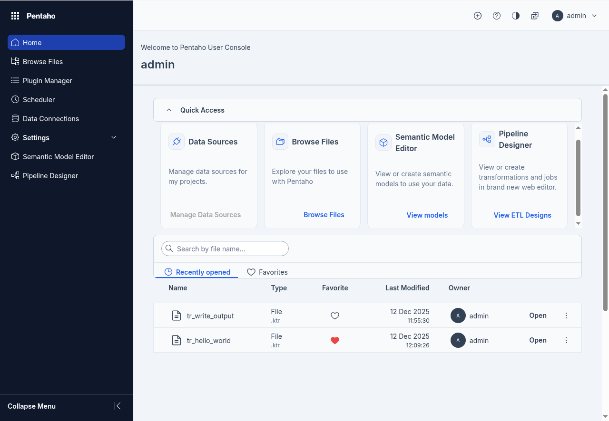
<figcaption>The modern User Console</figcaption>
</figure>
</div>

> **Success:** Checkpoint: the **Home** page opens with *Welcome to Pentaho User Console* and your user name, `admin`, and the left panel lists **Plugin Manager**.

2. Select **Plugin Manager**.

<div align="center">
<figure>
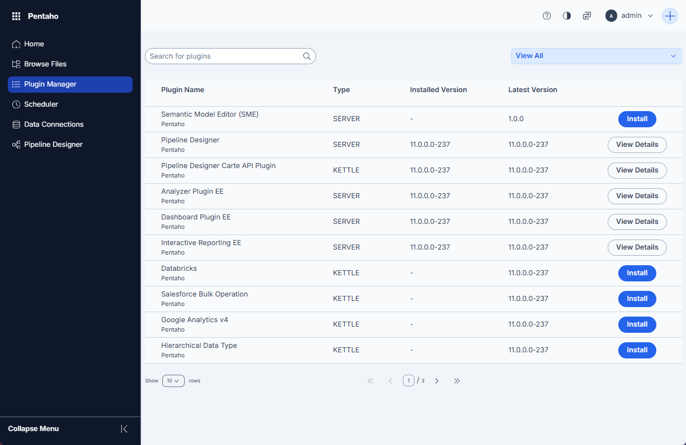
<figcaption>Plugin Manager: the View All filter and Search for plugins</figcaption>
</figure>
</div>

> **Success:** Checkpoint: the plugins are listed with **Plugin Name**, **Type** (`SERVER` or `KETTLE`), **Installed Version** and **Latest Version**. An installed plugin has a **View Details** button, the others an **Install** button.

3. Open the **View All** list to see the other filters, **Update Available**, **Installed** and **Not Installed**, then leave it on **View All**.

> **Under the hood:**
>
> #### The Plugin Manager unpacks each plugin into pentaho-solutions/system
>
> When you install a plugin, the Plugin Manager downloads it from `download.pentaho.com`, unpacks it into its own folder under `pentaho-solutions/system` (the folder each tab below checks for), and records its name, plugin ID and version in `pentaho-solutions/system/plugin-manifest.json`. The server loads its plugins when it starts, so every install ends with a restart: the Plugin Manager's own message says *You must restart the server to complete the installation/update*.
>
> **Why it matters:** the folder in `system` is the proof that a plugin is on disk, and the restart is what makes it appear in the console. A plugin whose folder exists but which the console doesn't show is a plugin the server hasn't loaded yet.

### 2. Analytic Plugins

> **Note:**
>
> #### Analytic Plugins
>
> Analyzer, Interactive Reporting and Dashboard Designer are not in the server archive. Install each one from the Plugin Manager, the recommended way to manage a plugin's lifecycle.

::: tabs

### 1. Analyzer

> **Note:**
>
> #### Analyzer
>
> Pentaho Analyzer is the web-based analysis tool of Pentaho Business Analytics. You analyze OLAP (Online Analytical Processing) cubes by drag and drop, with no SQL: drill down, slice and dice, and pivot, then show the result as a table or as a bar, line, pie or heat grid chart. Analyzer reports can be shared and embedded in dashboards.

1. In the Plugin Manager, select the **Analyzer Plugin EE** row.

<div align="center">
<figure>
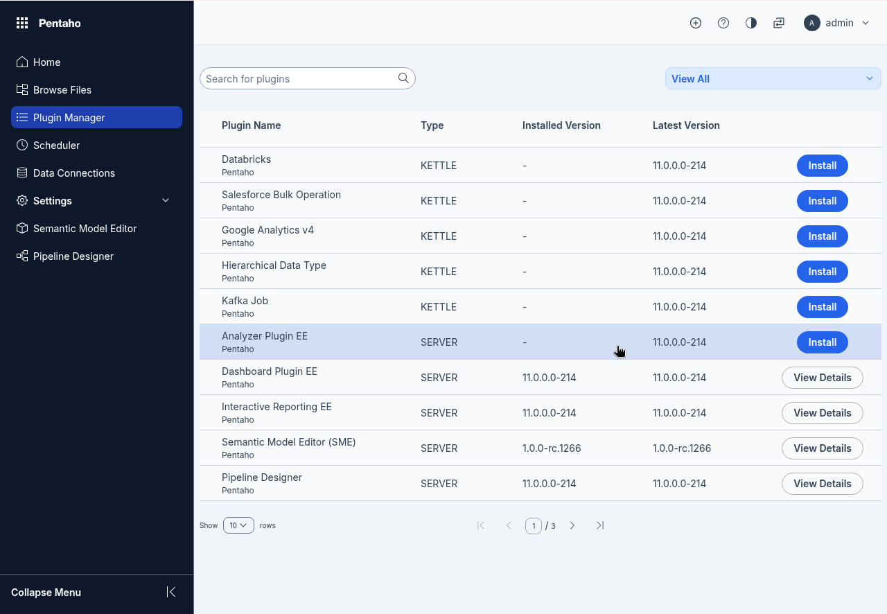
<figcaption>The Analyzer Plugin EE row</figcaption>
</figure>
</div>

2. In the plugin's details, open **Select the plugin version** and select the latest version (`11.0.0.0-237` for the GA release).

<div align="center">
<figure>
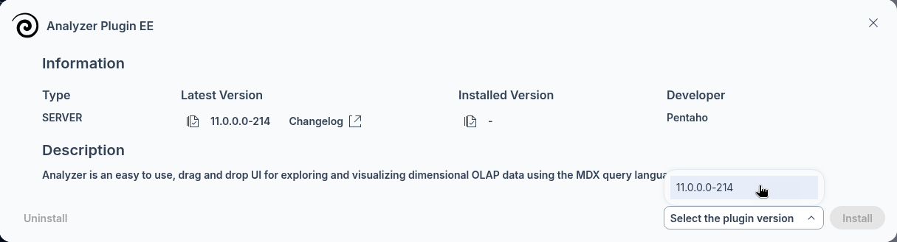
<figcaption>Analyzer Plugin EE: select the version</figcaption>
</figure>
</div>

3. Select **Install**.

> **Success:** Checkpoint: the Plugin Manager reports that the plugin *has been installed or updated successfully* and that *You must restart the server to complete the installation/update*.

4. In a terminal, check that the plugin's folder exists:

```bash
[ -d "$PENTAHO_SERVER/pentaho-solutions/system/analyzer" ] && echo OK || echo "Analyzer directory missing"
```

> **Success:** Checkpoint: `OK`.

5. Stop the server:

```bash
cd "$PENTAHO_SERVER"
./stop-pentaho.sh
```

6. When it has stopped, start it again:

```bash
cd "$PENTAHO_SERVER"
./start-pentaho.sh
```

7. Log in to the modern User Console again and select **Plugin Manager**:

<div class="pcm-embed-card" data-href="http://localhost:8080/pentaho/content/login/web/index.html" data-title="Pentaho User Console: new login"></div>

> **Success:** Checkpoint: **Analyzer Plugin EE** shows its version under **Installed Version**, and a **View Details** button instead of **Install**.

### 2. Interactive Reporting

> **Note:**
>
> #### Interactive Reporting
>
> Pentaho Interactive Reporting (PIR) is the web-based ad hoc reporting tool of Pentaho Business Analytics. In its WYSIWYG (What You See Is What You Get) editor, users build operational reports by drag and drop: they pick fields from a data source, group, sort and filter them, add calculated fields, charts, conditional formatting and prompts, and export the result to HTML, PDF, Excel or CSV. PIR reads relational databases and Pentaho data sources, live.

1. In the Plugin Manager, select the **Interactive Reporting EE** row.

<div align="center">
<figure>
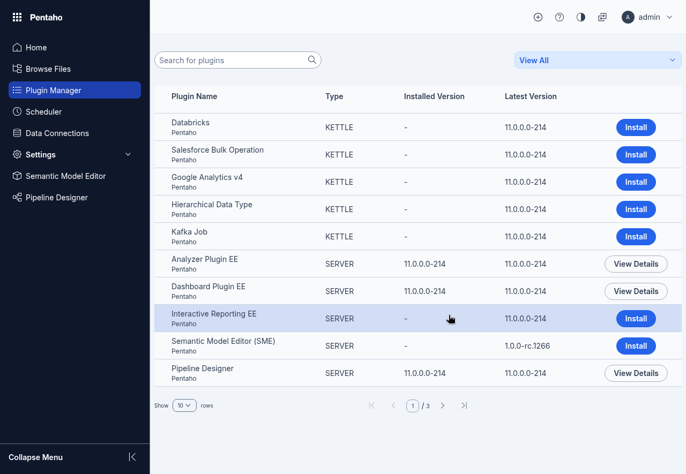
<figcaption>The Interactive Reporting EE row</figcaption>
</figure>
</div>

<div align="center">
<figure>
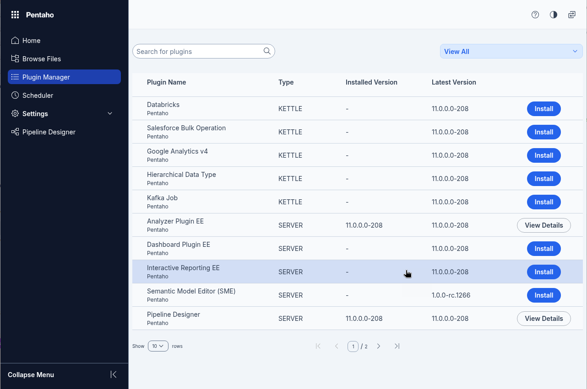
<figcaption>The same row on an earlier build</figcaption>
</figure>
</div>

2. In the plugin's details, open **Select the plugin version** and select the latest version.

<div align="center">
<figure>
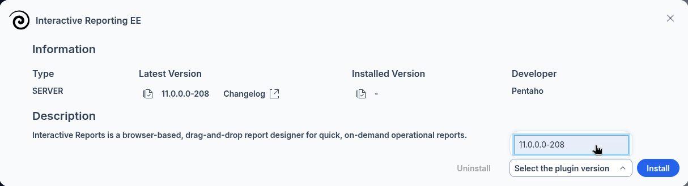
<figcaption>Interactive Reporting EE: select the version</figcaption>
</figure>
</div>

3. Select **Install**.

> **Success:** Checkpoint: the Plugin Manager reports that the plugin *has been installed or updated successfully* and that you must restart the server.

4. In a terminal, check that the plugin's folder exists:

```bash
[ -d "$PENTAHO_SERVER/pentaho-solutions/system/pentaho-interactive-reporting" ] && echo OK || echo "Interactive Reporting directory missing"
```

> **Success:** Checkpoint: `OK`.

5. Stop the server:

```bash
cd "$PENTAHO_SERVER"
./stop-pentaho.sh
```

6. When it has stopped, start it again:

```bash
cd "$PENTAHO_SERVER"
./start-pentaho.sh
```

7. Log in to the modern User Console again and select **Plugin Manager**:

<div class="pcm-embed-card" data-href="http://localhost:8080/pentaho/content/login/web/index.html" data-title="Pentaho User Console: new login"></div>

> **Success:** Checkpoint: **Interactive Reporting EE** shows its version under **Installed Version**, and a **View Details** button.

### 3. Dashboard Designer

> **Note:**
>
> #### Dashboard Designer
>
> Pentaho Dashboard Designer (PDD) builds dashboards in the User Console without code. You choose a layout template and a theme, then fill each panel with existing Interactive Reporting, Analyzer or Report Designer content, a chart built in Chart Designer, a data table, or a web page by its URL.
>
> Dashboard prompts filter every report whose filter is defined as a parameter, so one selection drives several panels, and content linking lets a click in one panel update another.
>
> It is a different product from CDE, the Community Dashboard Editor, which builds dashboards from HTML layouts, components and data sources and needs development skills.
>
> Dashboard Designer suits executive and operational dashboards: several related reports and charts on one page, filtered together, with detail a click away.

1. In the Plugin Manager, select the **Dashboard Plugin EE** row.

<div align="center">
<figure>
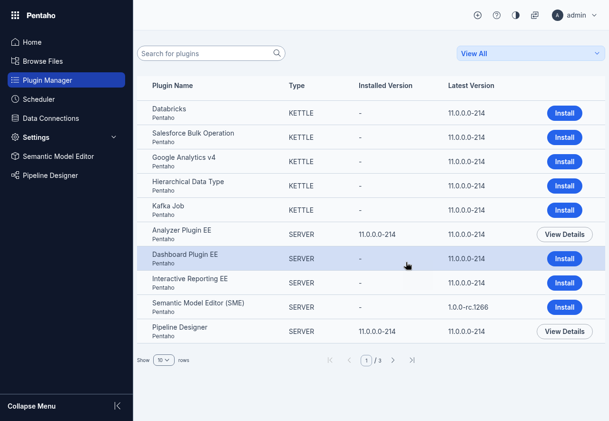
<figcaption>The Dashboard Plugin EE row</figcaption>
</figure>
</div>

2. In the plugin's details, open **Select the plugin version** and select the latest version.

<div align="center">
<figure>
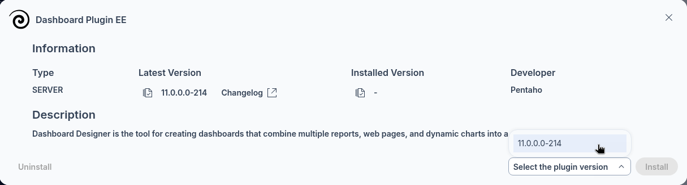
<figcaption>Dashboard Plugin EE: select the version</figcaption>
</figure>
</div>

3. Select **Install**.

> **Success:** Checkpoint: the Plugin Manager reports that the plugin *has been installed or updated successfully* and that you must restart the server.

4. In a terminal, check that the plugin's folder exists:

```bash
[ -d "$PENTAHO_SERVER/pentaho-solutions/system/dashboards" ] && echo OK || echo "Dashboard Designer directory missing"
```

> **Success:** Checkpoint: `OK`.

5. Stop the server:

```bash
cd "$PENTAHO_SERVER"
./stop-pentaho.sh
```

6. When it has stopped, start it again:

```bash
cd "$PENTAHO_SERVER"
./start-pentaho.sh
```

7. Log in to the modern User Console again and select **Plugin Manager**:

<div class="pcm-embed-card" data-href="http://localhost:8080/pentaho/content/login/web/index.html" data-title="Pentaho User Console: new login"></div>

> **Success:** Checkpoint: **Dashboard Plugin EE** shows its version under **Installed Version**, and a **View Details** button.

:::

### 3. New Plugins

> **Note:**
>
> #### Pentaho 11 Server Plugins
>
> The 11.0 server archive already contains Pipeline Designer, the Scheduler and the Carte API plugin: for those, you check them and update them from the Plugin Manager if it offers an update. Semantic Model Editor is installed from the Plugin Manager.

::: tabs

### 1. Pipeline Designer

> **Note:**
>
> #### Pipeline Designer
>
> Pentaho Pipeline Designer builds transformations and jobs by drag and drop, in the browser. The left panel is a searchable library of steps, such as CSV file input, MongoDB input or Generate rows; the center canvas is where you connect them into a flow; and the bottom panel shows the logging, a data preview and the step metrics of a run.

1. In a terminal, check whether Pipeline Designer is already installed:

```bash
[ -d "$PENTAHO_SERVER/pentaho-solutions/system/pentaho-webttle" ] && echo OK || echo "Pipeline Designer directory missing"
```

> **Success:** Checkpoint: `OK`: the 11.0 server archive ships Pipeline Designer (`pentaho-webttle`), so the Plugin Manager lists it with a version under **Installed Version** and a **View Details** button.

2. If the check printed the "missing" message instead, install it the way you installed Analyzer: select the **Pipeline Designer** row, select the latest version in **Select the plugin version**, select **Install**, and restart the server.

<div align="center">
<figure>
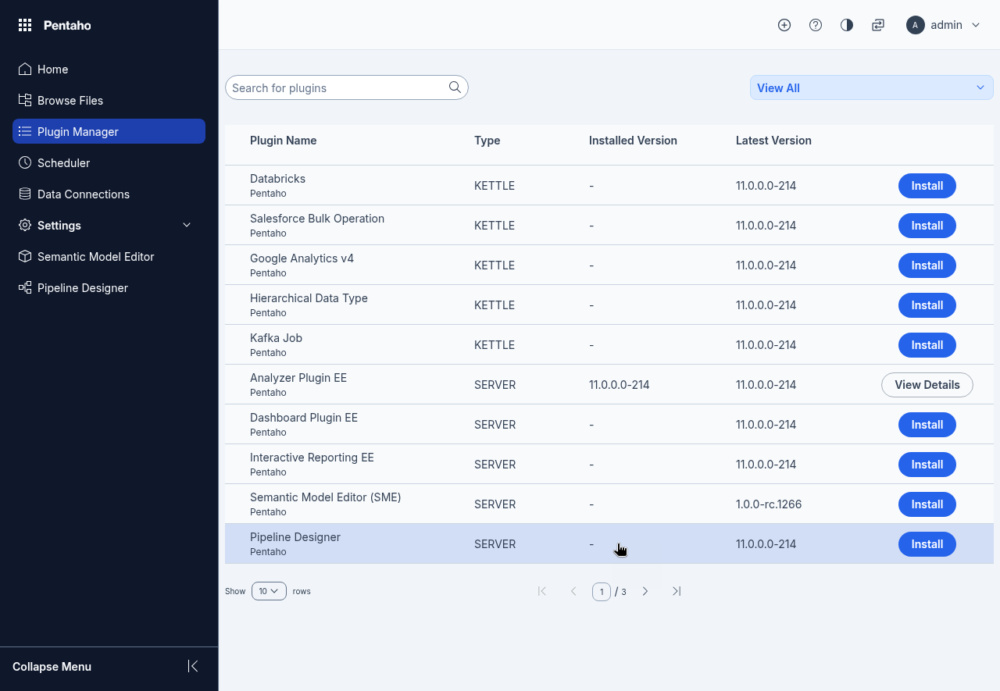
<figcaption>The Pipeline Designer row</figcaption>
</figure>
</div>

<div align="center">
<figure>
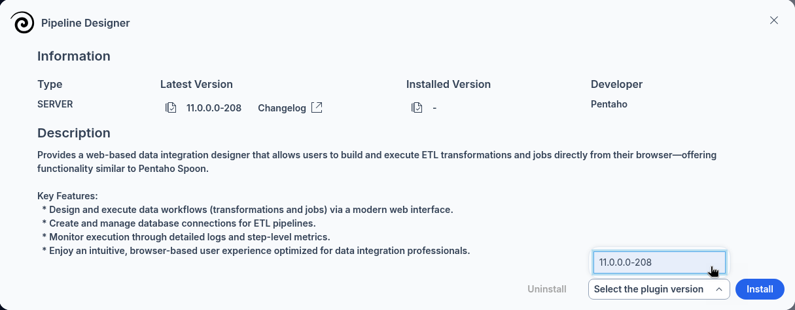
<figcaption>Pipeline Designer: select the version</figcaption>
</figure>
</div>

3. In the left panel, select **Pipeline Designer**.

<div align="center">
<figure>
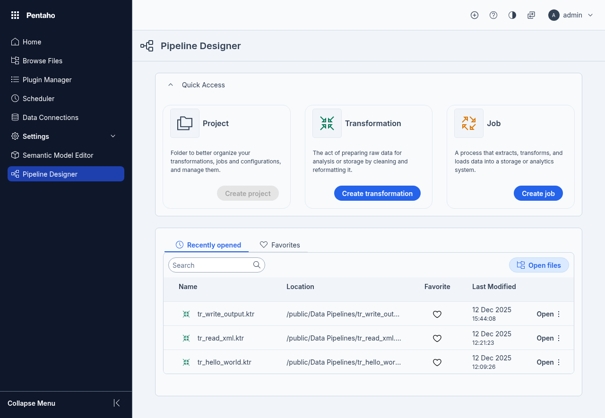
<figcaption>Pipeline Designer</figcaption>
</figure>
</div>

> **Success:** Checkpoint: the **Pipeline Designer** page shows **Quick Access** cards for **Project**, **Transformation** and **Job**, and a **Recently opened** list.

4. On the **Transformation** card, select **Create transformation**.
5. In the **Design** panel, find **Generate rows** in the **Input** group (or type `Generate rows` in **Search for a node...**) and drag it onto the canvas.
6. Find **Dummy (do nothing)** (type `Dummy` in **Search for a node...**) and drag it onto the canvas, to the right of **Generate rows**.
7. Drag from the dot on the right edge of **Generate rows** to **Dummy (do nothing)**, to create a hop between them.
8. Select **Save**, name the transformation `tr_hello_world`, and save it in a repository folder of your choice (the screenshots use `/public/Data Pipelines`).
9. Select **Run**.

<div align="center">
<figure>
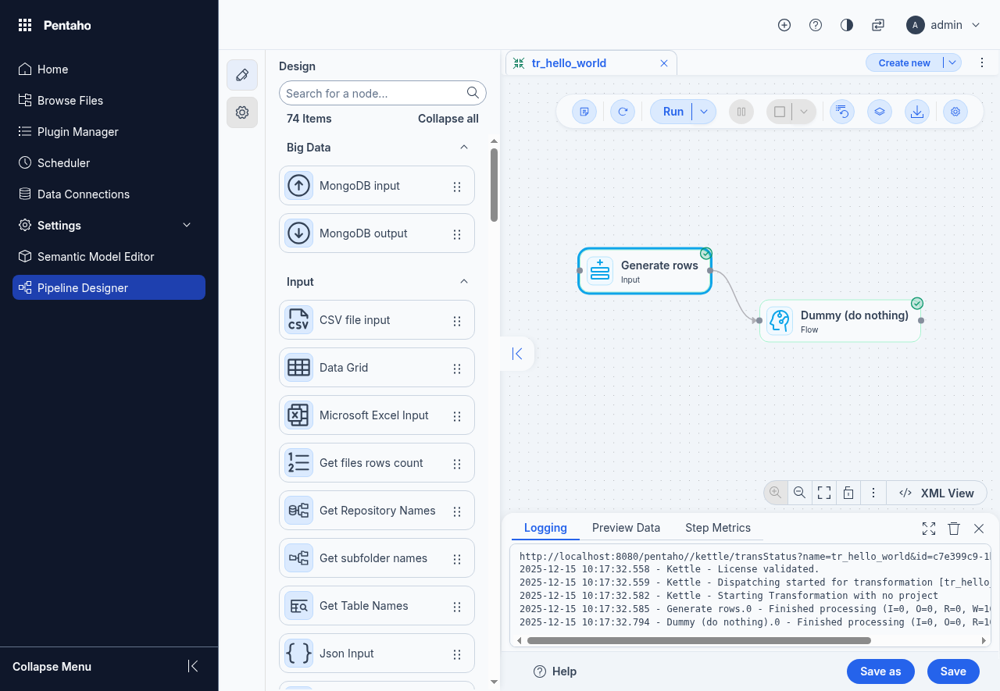
<figcaption>The test transformation after a run</figcaption>
</figure>
</div>

> **Success:** Checkpoint: both steps show a green check, and the last two lines of the **Logging** tab are `Generate rows.0 - Finished processing (I=0, O=0, R=0, W=10, U=0, E=0)` and `Dummy (do nothing).0 - Finished processing (I=0, O=0, R=10, W=10, U=0, E=0)`: **Generate rows** wrote its default 10 rows, and **Dummy (do nothing)** read them.

### 2. Semantic Model Editor

> **Note:**
>
> #### Semantic Model Editor
>
> The Semantic Model Editor (SME) creates the data models that define how your data is organized and analyzed for business intelligence. A model is a semantic layer between the raw data and the reports, so everyone in the organization uses the same business logic and definitions.

1. In the Plugin Manager, select the **Semantic Model Editor (SME)** row.

<div align="center">
<figure>
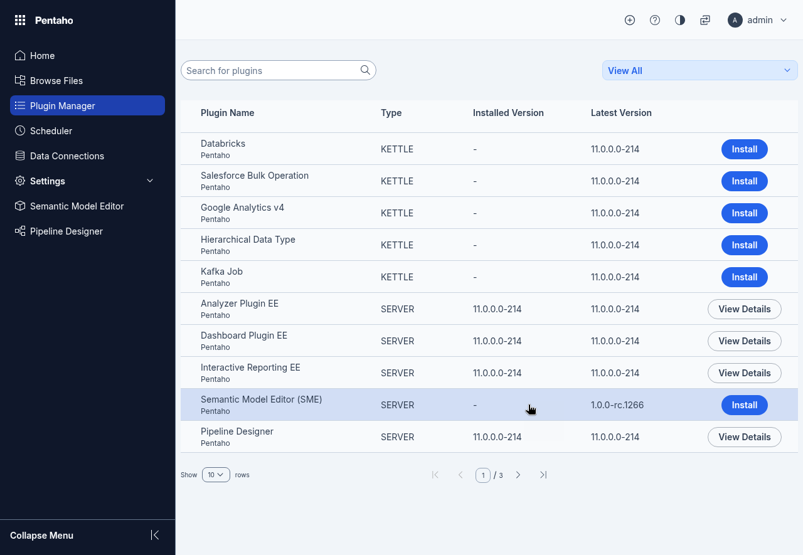
<figcaption>The Semantic Model Editor (SME) row</figcaption>
</figure>
</div>

2. In the plugin's details, open **Select the plugin version** and select the latest version.

<div align="center">
<figure>
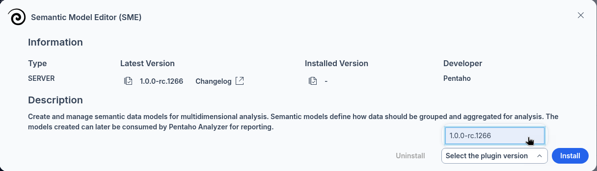
<figcaption>Semantic Model Editor (SME): select the version</figcaption>
</figure>
</div>

3. Select **Install**.

> **Success:** Checkpoint: the Plugin Manager reports that the plugin *has been installed or updated successfully* and that you must restart the server.

4. In a terminal, list the newest folders in `system`. The Semantic Model Editor's folder is among them:

```bash
ls -1t "$PENTAHO_SERVER/pentaho-solutions/system" | head -3
```

5. Stop the server:

```bash
cd "$PENTAHO_SERVER"
./stop-pentaho.sh
```

6. When it has stopped, start it again:

```bash
cd "$PENTAHO_SERVER"
./start-pentaho.sh
```

7. Log in to the modern User Console again:

<div class="pcm-embed-card" data-href="http://localhost:8080/pentaho/content/login/web/index.html" data-title="Pentaho User Console: new login"></div>

8. In the left panel, select **Semantic Model Editor**.

<div align="center">
<figure>
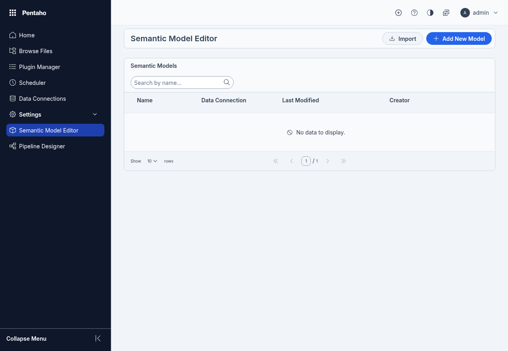
<figcaption>Semantic Model Editor, before any model</figcaption>
</figure>
</div>

> **Success:** Checkpoint: the **Semantic Model Editor** page, with **Import** and **Add New Model** buttons and an empty **Semantic Models** list: *No data to display.*

A model, once you add or import one, opens on a canvas of its fact table, measures and dimensions:

<div align="center">
<figure>
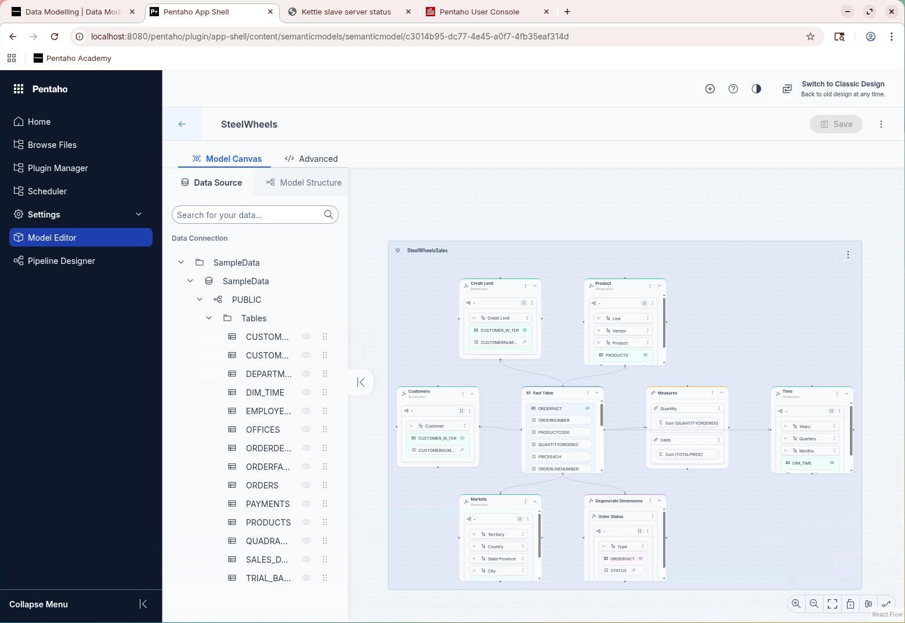
<figcaption>The SteelWheels model (an earlier build, whose menu read Model Editor)</figcaption>
</figure>
</div>

### 3. Scheduler

> **Note:**
>
> #### Scheduler
>
> The Pentaho Scheduler manages the scheduled tasks of the whole system. It lists every schedule with its source file, frequency (such as *Every day at 3:15 PM*), status (active or paused), last run and output location. You can filter by status, run a schedule now, set blockout times when no schedule may run, and pause or resume the whole scheduler.

1. Check whether the Scheduler is already installed: the 11.0 server archive ships it as `pas-scheduler`. If this prints `OK`, go to step 7.

```bash
[ -d "$PENTAHO_SERVER/pentaho-solutions/system/pas-scheduler" ] && echo OK || echo "Scheduler plugin directory missing"
```

2. Otherwise, in the Plugin Manager change **View All** to **Not Installed**, and enter `Scheduler` in **Search for plugins**. The Plugin Manager lists it as **Modern Pentaho User Console – Scheduler**.

<div align="center">
<figure>

<figcaption>Plugin Manager: the View All filter and Search for plugins</figcaption>
</figure>
</div>

3. Select its row. In the details, open **Select the plugin version** and select the latest version.
4. Select **Install**.
5. Check that the Scheduler's folder now exists:

```bash
[ -d "$PENTAHO_SERVER/pentaho-solutions/system/pas-scheduler" ] && echo OK || echo "Scheduler plugin directory missing"
```

6. Restart the server:

```bash
cd "$PENTAHO_SERVER"
./stop-pentaho.sh
```

   When it has stopped:

```bash
cd "$PENTAHO_SERVER"
./start-pentaho.sh
```

7. Log in to the modern User Console:

<div class="pcm-embed-card" data-href="http://localhost:8080/pentaho/content/login/web/index.html" data-title="Pentaho User Console: new login"></div>

8. In the left panel, select **Scheduler**.

<div align="center">
<figure>
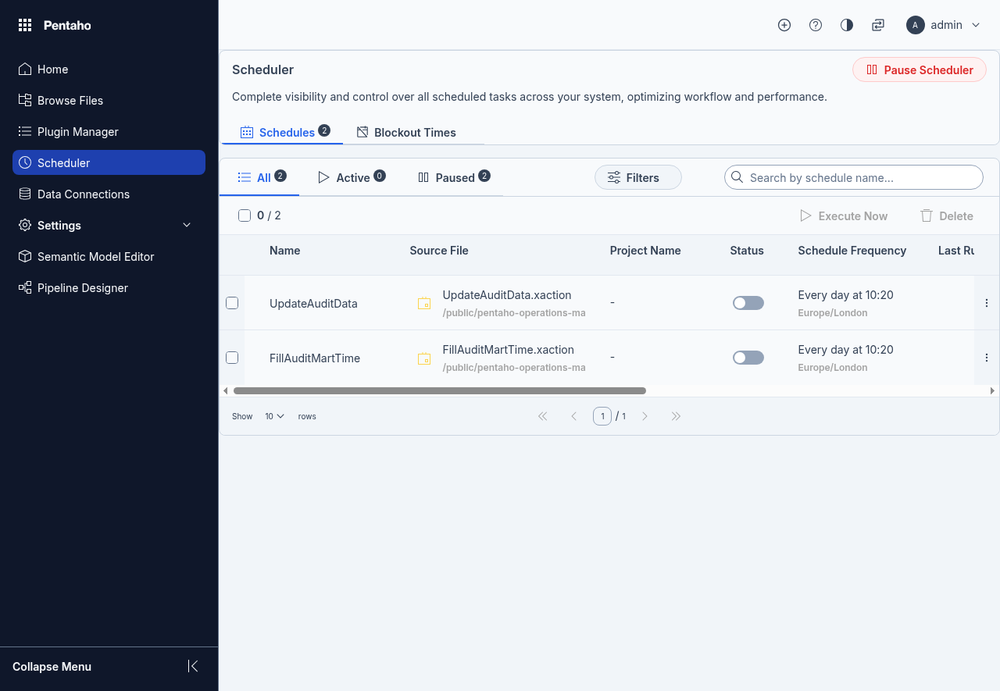
<figcaption>Scheduler</figcaption>
</figure>
</div>

> **Success:** Checkpoint: the **Scheduler** page, with the **Schedules** and **Blockout Times** tabs, the **All**, **Active** and **Paused** filters, and a **Pause Scheduler** button.

### 4. Carte

> **Note:**
>
> #### Pipeline Carte Server
>
> The Pentaho Carte server runs and monitors transformations and jobs. Its status page lists every running and finished transformation and job with its status, times and ID; a transformation's page shows each step's metrics (rows read and written, speed, errors), a preview of its canvas, and its log; and the configuration details show the log and object lifetime settings.

1. Check that the Carte API plugin is there. It ships in the 11.0 server archive, under the server's PDI plugins rather than in `system`:

```bash
[ -d "$PENTAHO_SERVER/pentaho-solutions/system/kettle/plugins/webttle-carte-api-plugin" ] && echo OK || echo "Carte API plugin directory missing"
```

> **Success:** Checkpoint: `OK`.

2. If the check printed the "missing" message instead, install **Pipeline Designer Carte API Plugin** from the Plugin Manager and restart the server.
3. Open the PDI status page:

<div class="pcm-embed-card" data-href="http://localhost:8080/pentaho/kettle/status" data-title="PDI Status"></div>

<div align="center">
<figure>
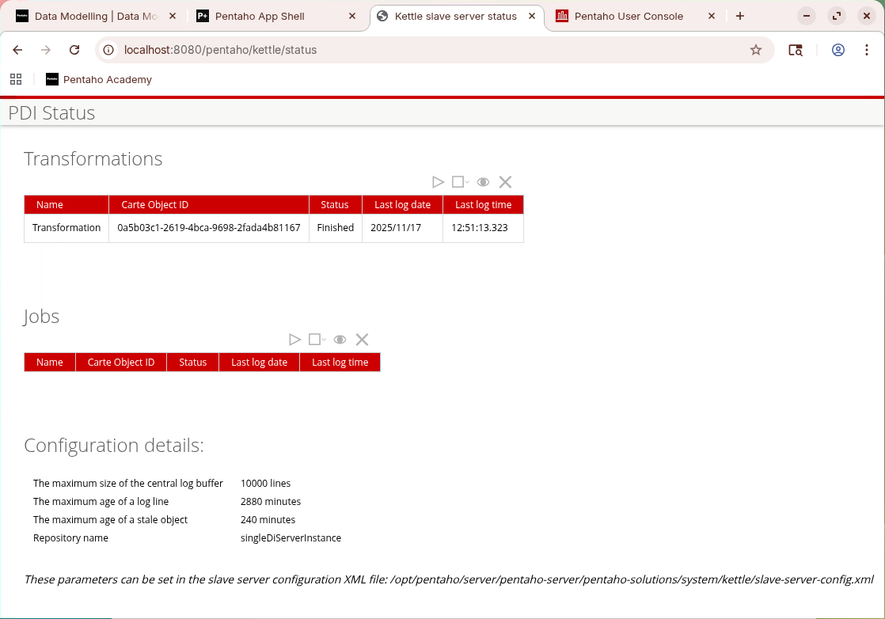
<figcaption>PDI Status</figcaption>
</figure>
</div>

> **Success:** Checkpoint: **PDI Status** lists the transformation you ran in the **Pipeline Designer** tab under **Transformations**, with **Status** `Finished`.

4. Open the `transStatus` link that the first line of Pipeline Designer's **Logging** tab shows, `http://localhost:8080/pentaho/kettle/transStatus?name=...`.

<div align="center">
<figure>
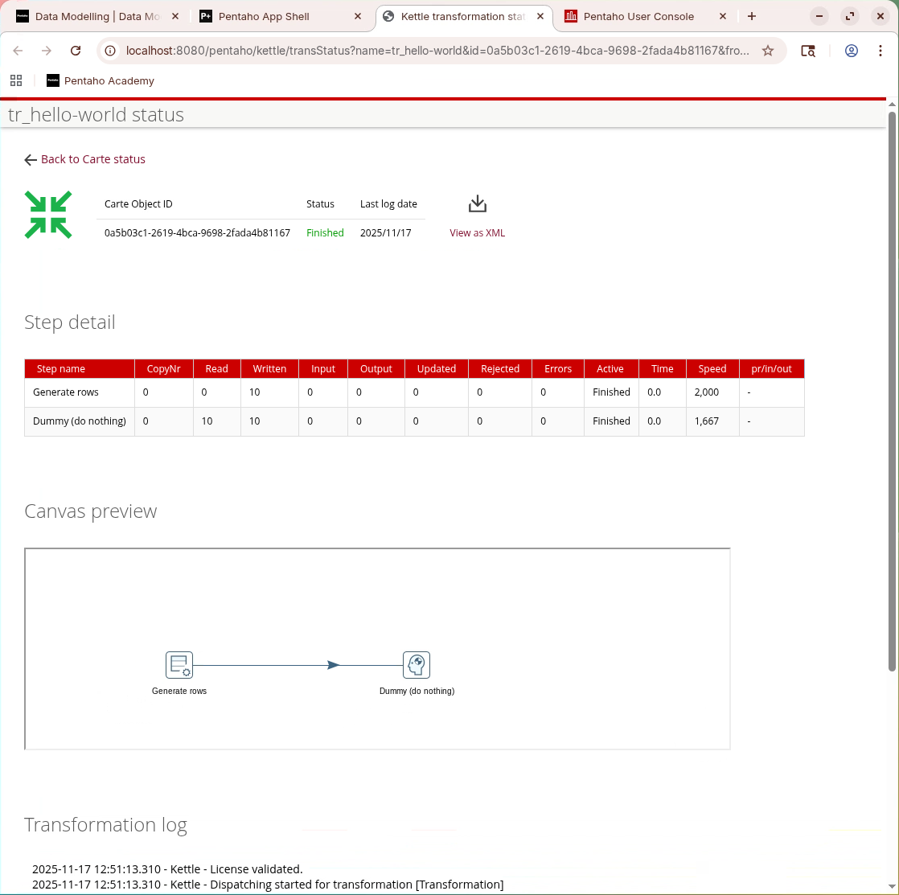
<figcaption>The transformation's status page</figcaption>
</figure>
</div>

> **Success:** Checkpoint: under **Step detail**, **Generate rows** shows **Written** `10`, and **Dummy (do nothing)** shows **Read** `10` and **Written** `10`, both **Finished**.

5. Select **Back to Carte status**.

> **Under the hood:**
>
> #### Pipeline Designer runs on the server's own Carte
>
> Pipeline Designer does not run a transformation in your browser. It hands it to the Carte service inside the Pentaho Server, at `/pentaho/kettle`, which the Carte API plugin connects it to: that is why the **Logging** tab starts with a `kettle/transStatus` link, and why **PDI Status** lists the run. The service's settings, such as how long it keeps log lines and finished objects, are in `pentaho-solutions/system/kettle/slave-server-config.xml`, as the bottom of the status page says.
>
> **Why it matters:** a pipeline run from the browser uses the server's Java, memory, JDBC drivers and PDI plugins, not your desktop's. When a step works in Spoon but fails in Pipeline Designer, check the server's drivers and plugins first.

:::

### 4. Data Connections

> **Note:**
>
> #### Data Connections
>
> **Data Connections** manages the system's data sources. Its page has a search bar that filters the connections by name, and an **Add connection** button. Each connection has a check box for selecting it, its name and an icon of its database type, an **Open** button, and more options in a menu.

1. In the left panel, select **Data Connections**.

<div align="center">
<figure>
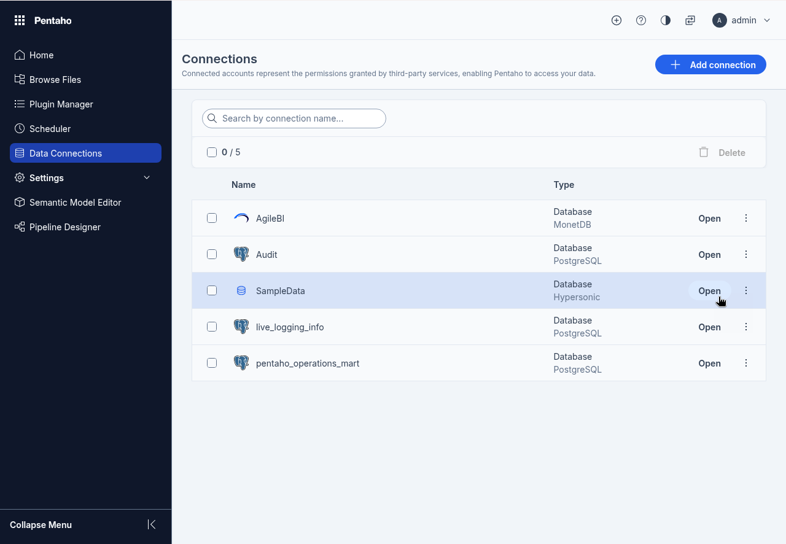
<figcaption>Data Connections</figcaption>
</figure>
</div>

> **Success:** Checkpoint: **Connections** lists the server's connections with their **Name** and **Type**, among them **SampleData**, a Hypersonic database.

2. In the **SampleData** row, select **Open**.

<div align="center">
<figure>
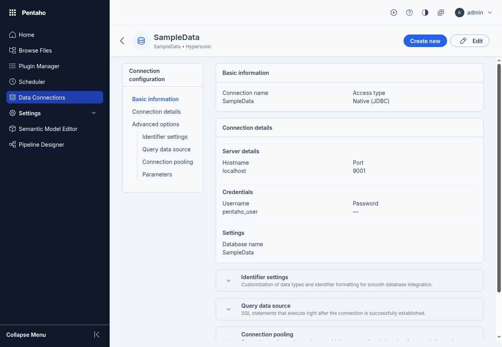
<figcaption>The SampleData connection's details</figcaption>
</figure>
</div>

> **Success:** Checkpoint: **Connection name** `SampleData`, **Access type** `Native (JDBC)`, **Hostname** `localhost`, **Port** `9001`, **Username** `pentaho_user` and **Database name** `SampleData`. The **Connection configuration** list on the left leads to the **Advanced options**, where you tune the connection.

3. Select **Create new**. The form for a new connection of the same type opens, **Hypersonic configuration**.

<div align="center">
<figure>
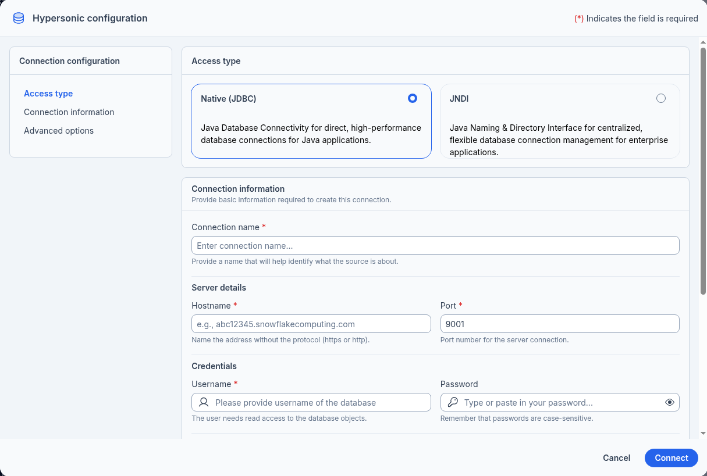
<figcaption>Create new: a new Hypersonic connection</figcaption>
</figure>
</div>

4. Select **Cancel**, then select the back arrow beside **SampleData** to return to the **Connections** list.

**Add Connection**

5. Select **Add connection**.

<div align="center">
<figure>
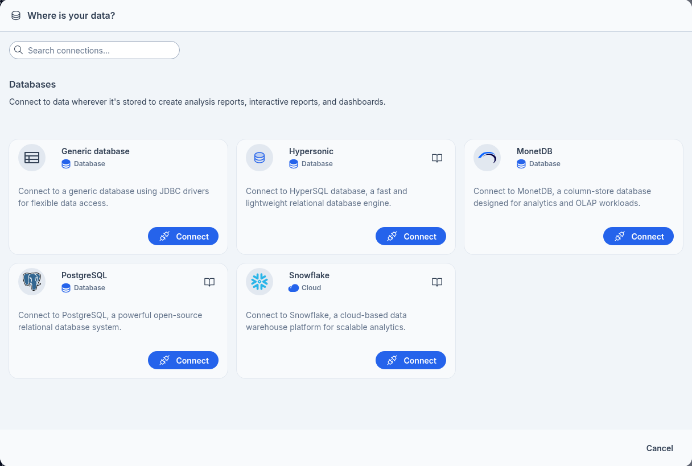
<figcaption>Add connection: Where is your data?</figcaption>
</figure>
</div>

> **Success:** Checkpoint: **Where is your data?** lists the database types, each with a **Connect** button.

6. On the **Generic database** card, select **Connect**.

<div align="center">
<figure>
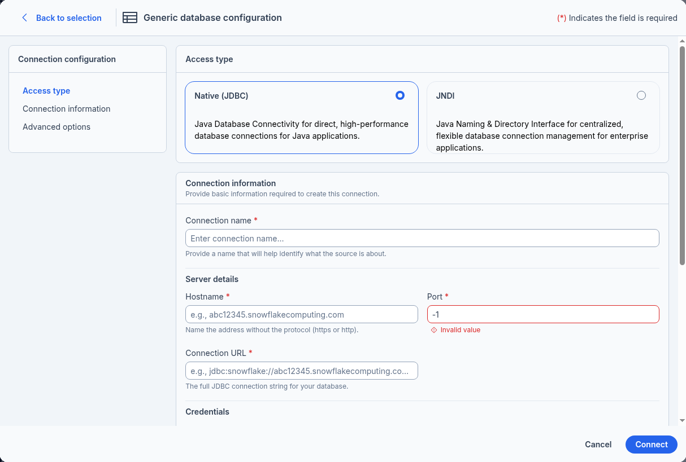
<figcaption>Configure the connection</figcaption>
</figure>
</div>

7. Look through the form's sections, **Access type**, **Connection information** and **Advanced options**, then select **Cancel**.

> **Warning:** A connection to a database type needs its JDBC driver in `/opt/pentaho/server/pentaho-server/tomcat/lib`, and a server restart, before it can connect (see the **Tomcat** tab of [Install Pentaho Server](../06-installation-archive-pentaho-server/guide.md)).

::::

## Plugin Matrix <!-- no-step -->

| Plugin | Package | What it does |
| --- | --- | --- |
| Analyzer | `paz-plugin` | Interactive OLAP analysis: drill, slice, pivot and chart Mondrian cubes in the browser. |
| Interactive Reporting | `pir-plugin` | Ad hoc tabular reports built from metadata models, exported to HTML, PDF, CSV or Excel. |
| Dashboard Designer | `pdd-plugin` | Dashboards of reports, analyses and charts, filtered together by shared prompts and content linking. |
| Pipeline Designer | `webttle-plugin` | Builds PDI transformations and jobs in the browser; compatible with those made in Spoon. |
| Pipeline Designer Carte | `webttle-carte-api-plugin` | Runs and monitors the transformations and jobs launched from Pipeline Designer. |
| Semantic Model Editor | | Builds and manages Mondrian models in the browser, including existing ones. |
| Scheduler | `pas-scheduler` | Manages schedules: run now, pause and resume, and blockout times. |
| Elastic MapReduce | | Amazon EMR support, one of the big data components 11.0 delivers as plugins. |

## Lab Files

_No bundled files for this lab._
