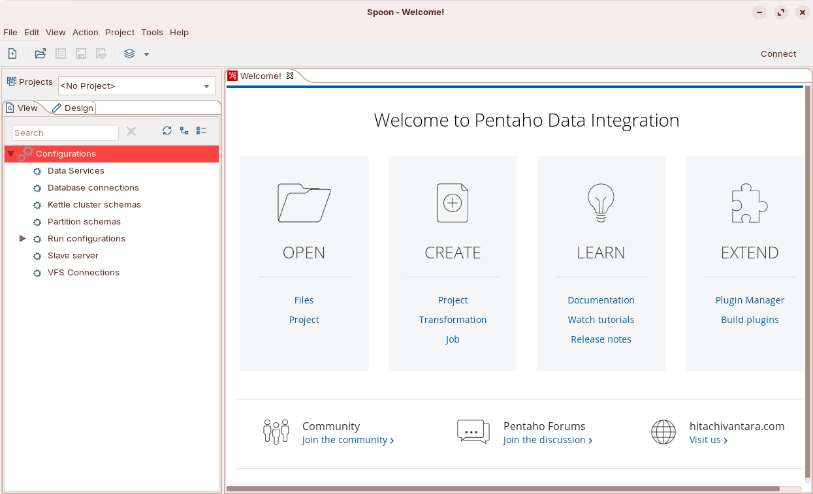
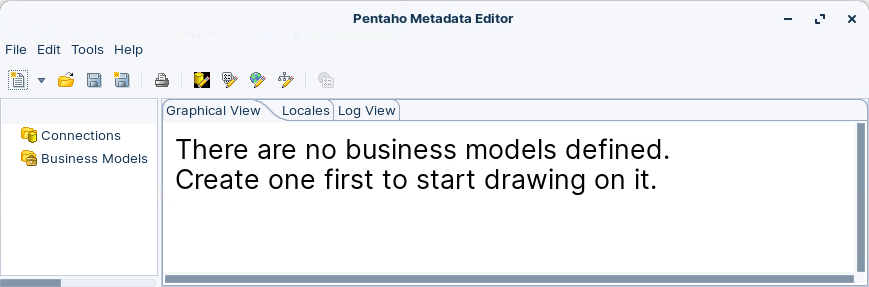
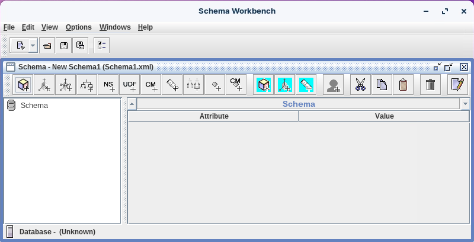
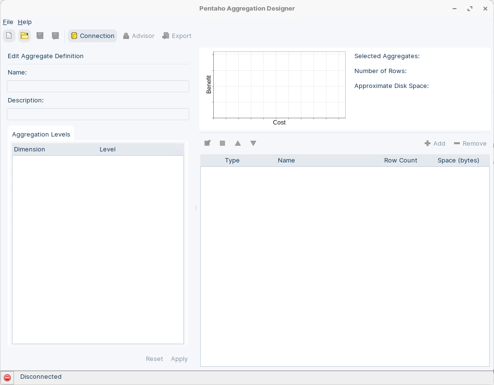

# Client Plugins

> **Warning:**
>
> #### Workshop - Client Plugins
>
> Install the Pentaho design tools on a Linux desktop from their archives: Pentaho Data Integration (Spoon), Metadata Editor, Schema Workbench, Aggregation Designer and Report Designer.
>
> **What you'll do**
>
> * Install the full Java 21 runtime that the desktop tools need
> * Unpack each client tool under `~/Pentaho/design-tools`
> * Start each tool and check that it opens
>
> **Prerequisites:**
>
> * Java 21 and `unzip`, from [Prepare Environment](../05-installation-archive-prepare-environment/guide.md)
> * The five client tool archives, from [Pentaho Support Portal](../02-installation-getting-started-pentaho-support-portal/guide.md)
> * A desktop session on Ubuntu 24.04 LTS
>
> **Estimated time:** 20 minutes

---

> **Note:**
>
> #### Pentaho Client Tools
>
> There are two ways to install the Business Analytics (BA) design tools: the Pentaho Business Analytics Evaluation Wizard, on a Windows desktop, or each tool by hand, on Linux or Windows. The Evaluation Wizard installs the design tools, utilities and plugins on a workstation for you; a manual installation lets you place each tool where you need it. Choose the deployment that fits your DevOps and desktop constraints.
>
> This lab installs each tool by hand on a Linux desktop, with Ubuntu 24.04 LTS and Java 21 (OpenJDK) as the baseline. For Windows, see the Windows evaluation installation in the Pentaho documentation.

<div align="center">
<figure>

<figcaption>Pentaho Data Integration Carte: tools, sources, targets and storage</figcaption>
</figure>
</div>

Each tool comes as a ZIP archive that you unpack with `unzip`, which needs no full JDK (the JRE has no `jar` tool):

| Archive | Tool | Folder it creates | Launcher |
| --- | --- | --- | --- |
| `pdi-ee-client-11.0.0.0-237.zip` | Pentaho Data Integration (Spoon) | `data-integration`, with `jdbc-distribution` and `license-installer` beside it | `spoon.sh` |
| `pme-ee-11.0.0.0-237.zip` | Pentaho Metadata Editor | `metadata-editor` | `metadata-editor.sh` |
| `psw-ee-11.0.0.0-237.zip` | Pentaho Schema Workbench | `schema-workbench` | `workbench.sh` |
| `pad-ee-11.0.0.0-237.zip` | Pentaho Aggregation Designer | `aggregation-designer` | `startaggregationdesigner.sh` |
| `prd-ee-11.0.0.0-237.zip` | Pentaho Report Designer | `report-designer` | `report-designer.sh` |

## 1. Prepare the Desktop

1. Install the full Java 21 runtime. The desktop tools need it as well as the headless one that **Prepare Environment** installed on the server:

```bash
sudo apt install -y openjdk-21-jre
```

> **Under the hood:**
>
> #### The desktop tools need the full JRE's X11 libraries
>
> `openjdk-21-jre-headless` is Java without a display: it has no `libawt_xawt.so`, the library through which Java's Swing and AWT toolkits draw windows on an X11 desktop. Schema Workbench, Aggregation Designer and Report Designer are Swing applications, so on the headless runtime they cannot open a window. `openjdk-21-jre` adds the display libraries to the same Java 21 in `/usr/lib/jvm/java-21-openjdk-amd64`, so `PENTAHO_JAVA_HOME` stays as it is.
>
> **Why it matters:** the server needs no display, so the headless runtime is enough there; a workstation needs the full one. A tool that starts and then fails with an AWT or `libawt_xawt.so` error is running on a headless Java.

2. Make sure `unzip` is installed:

```bash
sudo apt update -y && sudo apt install -y unzip
```

3. Create the base directory for the design tools:

```bash
mkdir -p ~/Pentaho/design-tools
```

When you finish this lab, it holds one folder per tool:

```text
~/Pentaho/design-tools
├── data-integration
├── metadata-editor
├── schema-workbench
├── aggregation-designer
└── report-designer
```

## 2. Install the Client Tools

::: tabs

### 1. Data Integration

> **Note:**
>
> #### Pentaho Data Integration
>
> Pentaho Data Integration provides extract, transform and load (ETL) capabilities for capturing, cleansing and transforming data.
>
> Some legacy UI components in Spoon may need GTK or WebKit libraries that vary by desktop flavor. If Spoon reports missing GTK or WebKit modules on Ubuntu 24.04, see **Missing GTK/WebKit modules** under Troubleshooting, below.

1. Find the Pentaho Data Integration client archive:

```bash
ls -1 ~/Downloads/'Client Tools'/'PDI (Spoon)'
```

> **Success:** Checkpoint: `pdi-ee-client-11.0.0.0-237.zip`.

2. Unpack it into `~/Pentaho/design-tools`. If you saved the archive somewhere else, change the path.

```bash
cd ~/Pentaho/design-tools
unzip ~/Downloads/'Client Tools'/'PDI (Spoon)'/pdi-ee-client-11.0.0.0-237.zip
```

3. Make the `.sh` files executable:

```bash
cd ~/Pentaho/design-tools
find . -iname "*.sh" -exec chmod +x {} \;
```

4. Check the folder:

```bash
ls ~/Pentaho/design-tools
```

> **Success:** Checkpoint: `data-integration`, `jdbc-distribution` and `license-installer`.

5. Start Pentaho Data Integration (Spoon):

```bash
cd ~/Pentaho/design-tools/data-integration
./spoon.sh
```

<div align="center">
<figure>

<figcaption>Spoon's Welcome page</figcaption>
</figure>
</div>

> **Success:** Checkpoint: the **Spoon - Welcome!** window opens on **Welcome to Pentaho Data Integration**, with the **OPEN**, **CREATE**, **LEARN** and **EXTEND** panels.

### 2. Metadata Editor

> **Note:**
>
> #### Pentaho Metadata Editor (PME)
>
> Pentaho Metadata Editor creates and manages business-friendly semantic models.

1. Find the Metadata Editor archive:

```bash
ls -1 ~/Downloads/'Client Tools'/'Metadata Editor'
```

> **Success:** Checkpoint: `pme-ee-11.0.0.0-237.zip`.

2. Unpack it into `~/Pentaho/design-tools`. If you saved the archive somewhere else, change the path.

```bash
cd ~/Pentaho/design-tools
unzip ~/Downloads/'Client Tools'/'Metadata Editor'/pme-ee-11.0.0.0-237.zip
```

3. Make the `.sh` files executable:

```bash
cd ~/Pentaho/design-tools
find . -iname "*.sh" -exec chmod +x {} \;
```

4. Check the folder:

```bash
ls ~/Pentaho/design-tools
```

> **Success:** Checkpoint: `metadata-editor` beside the Pentaho Data Integration folders, `data-integration`, `jdbc-distribution` and `license-installer`.

5. Start the Metadata Editor:

```bash
cd ~/Pentaho/design-tools/metadata-editor
./metadata-editor.sh
```

<div align="center">
<figure>

<figcaption>Pentaho Metadata Editor</figcaption>
</figure>
</div>

> **Success:** Checkpoint: the **Pentaho Metadata Editor** window opens, and its **Graphical View** reads *There are no business models defined.*

### 3. Schema Workbench

> **Note:**
>
> #### Schema Workbench (PSW)
>
> Schema Workbench creates and tests Mondrian OLAP cube schemas.

1. Find the Schema Workbench archive:

```bash
ls -1 ~/Downloads/'Client Tools'/'Schema Workbench'
```

> **Success:** Checkpoint: `psw-ee-11.0.0.0-237.zip`.

2. Unpack it into `~/Pentaho/design-tools`. If you saved the archive somewhere else, change the path.

```bash
cd ~/Pentaho/design-tools
unzip ~/Downloads/'Client Tools'/'Schema Workbench'/psw-ee-11.0.0.0-237.zip
```

3. Make the `.sh` files executable:

```bash
cd ~/Pentaho/design-tools
find . -iname "*.sh" -exec chmod +x {} \;
```

4. Check the folder:

```bash
ls ~/Pentaho/design-tools
```

> **Success:** Checkpoint: `schema-workbench` beside the folders of the tools you already installed.

5. Start Schema Workbench:

```bash
cd ~/Pentaho/design-tools/schema-workbench
./workbench.sh
```

<div align="center">
<figure>

<figcaption>Schema Workbench</figcaption>
</figure>
</div>

> **Success:** Checkpoint: **Schema Workbench** opens with an empty schema, **Schema - New Schema1 (Schema1.xml)**, and **Database - (Unknown)** in its status bar.

### 4. Aggregation Designer

> **Note:**
>
> #### Aggregation Designer (PAD)
>
> Aggregation Designer recommends and builds aggregate tables that speed up Analyzer queries.

1. Unpack `pad-ee-11.0.0.0-237.zip` into `~/Pentaho/design-tools`. If you saved the archive somewhere else, change the path.

```bash
cd ~/Pentaho/design-tools
unzip ~/Downloads/'Client Tools'/'Aggregation Designer'/pad-ee-11.0.0.0-237.zip
```

2. Make the `.sh` files executable:

```bash
cd ~/Pentaho/design-tools
find . -iname "*.sh" -exec chmod +x {} \;
```

3. Check the folder:

```bash
ls ~/Pentaho/design-tools
```

> **Success:** Checkpoint: `aggregation-designer` beside the folders of the tools you already installed.

4. Start Aggregation Designer:

```bash
cd ~/Pentaho/design-tools/aggregation-designer
./startaggregationdesigner.sh
```

<div align="center">
<figure>

<figcaption>Aggregation Designer</figcaption>
</figure>
</div>

> **Success:** Checkpoint: **Pentaho Aggregation Designer** opens, with **Disconnected** in its status bar: it has no connection yet.

### 5. Report Designer

> **Note:**
>
> #### Report Designer (PRD)
>
> Report Designer builds pixel-perfect, banded reports (`.prpt`) that you publish to the Pentaho Server.

1. Unpack `prd-ee-11.0.0.0-237.zip` into `~/Pentaho/design-tools`. It creates a single `report-designer` folder. If you saved the archive somewhere else, change the path.

```bash
cd ~/Pentaho/design-tools
unzip ~/Downloads/'Client Tools'/'Report Designer'/prd-ee-11.0.0.0-237.zip
```

2. Make the `.sh` files executable:

```bash
cd ~/Pentaho/design-tools
find . -iname "*.sh" -exec chmod +x {} \;
```

3. Check the folder:

```bash
ls ~/Pentaho/design-tools
```

> **Success:** Checkpoint: `report-designer` beside the folders of the tools you already installed: seven folders in all, the five tools plus `jdbc-distribution` and `license-installer`.

4. Start Report Designer:

```bash
cd ~/Pentaho/design-tools/report-designer
./report-designer.sh
```

> **Success:** Checkpoint: the Pentaho Report Designer window opens.

:::

## Troubleshooting <!-- no-step -->

<details>
<summary>Spoon fails to start, or shows GTK or WebKit errors</summary>

Install the GTK and WebKit libraries (see **Missing GTK/WebKit modules**, below) and try again. If needed, start Spoon with additional SWT or GTK flags, or test on a different desktop flavor.

</details>

<details>
<summary>Fonts or the UI render badly on a HiDPI display</summary>

Start the tool with `GDK_SCALE=2 ./spoon.sh`, or change your desktop's scaling.

</details>

<details>
<summary>A client tool can't find a JDBC driver</summary>

Copy the driver JARs the tool needs into its own driver folder (see the driver locations in [Install Pentaho Server](../06-installation-archive-pentaho-server/guide.md)), and restart the tool.

</details>

<details>
<summary>License prompts, or a feature is disabled</summary>

Make sure the License Manager has activated the client entitlements, and check `PENTAHO_LICENSE_INFORMATION_PATH` if you set it.

</details>

<details>
<summary>Slow startup, or out-of-memory errors</summary>

Raise `-Xms` and `-Xmx` in the tool's `*.ini` file or startup script.

</details>

<details>
<summary>Missing GTK/WebKit modules</summary>

Add the package from the Ubuntu 18.04 (bionic) archive.

1. Install the package that manages repositories:

```bash
sudo apt-get install -qq software-properties-common
```

2. Add the repository entry:

```bash
sudo apt-key adv --keyserver keyserver.ubuntu.com --recv-keys 3B4FE6ACC0B21F32
sudo add-apt-repository 'deb [trusted=yes] http://cz.archive.ubuntu.com/ubuntu bionic main universe'
```

3. Update the package lists:

```bash
sudo apt-get update
```

4. Install the packages:

```bash
sudo apt-get install -qq libwebkitgtk-1.0-0
```

```bash
sudo apt-get install libcanberra-gtk-module
```

5. Start Pentaho Data Integration:

```bash
cd ~/Pentaho/design-tools/data-integration
./spoon.sh
```

</details>

## Lab Files

_No bundled files for this lab._
