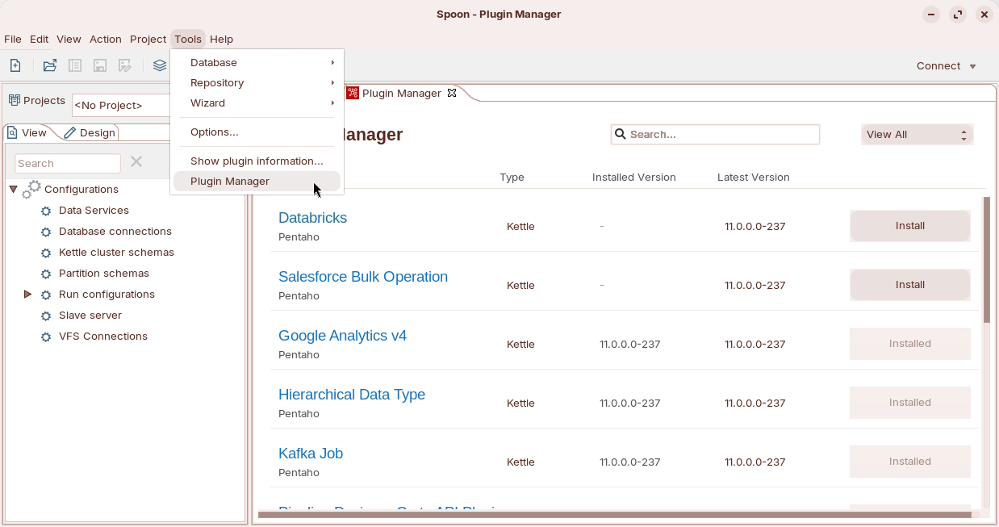
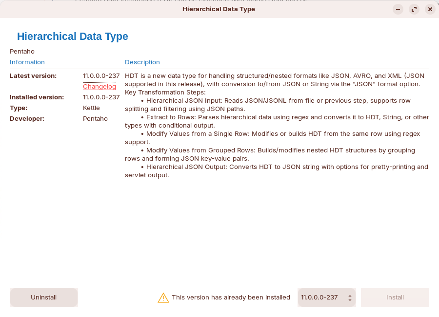

# Kettle Plugins

> **Warning:**
>
> #### Workshop - Kettle Plugins
>
> Enterprise plugins add steps and job entries to Pentaho Data Integration. In 11.0 you install, update and remove them with the Plugin Manager, in the Pentaho Data Integration client and in the Pentaho User Console.
>
> **What you'll do**
>
> * Open the Plugin Manager in Spoon
> * Find a plugin and install its latest version, or an earlier one
> * Restart Spoon and check the installed version
> * See where the Plugin Manager records what it installed
>
> **Prerequisites:**
>
> * Spoon, from [Client Plugins](../10-installation-client-tools/guide.md)
> * Outbound HTTPS to `download.pentaho.com`, where the Plugin Manager downloads plugins
>
> **Estimated time:** 15 minutes

<figure>

<figcaption class="pcm-video-caption">Walkthrough: coming soon</figcaption>

</figure>

---

> **Note:**
>
> #### Pentaho Data Integration Plugin Manager
>
> Plugins extend Pentaho Data Integration with new steps, job entries and other functionality. Manage them with the Plugin Manager, in both the Pentaho Data Integration client and the Pentaho User Console (PUC): it installs new plugins, updates installed ones to their latest versions, and removes the ones you no longer use.
>
> You can install a plugin by hand, but it isn't recommended: a plugin installed by hand doesn't show up in the Plugin Manager, so you handle its updates and removal yourself. A plugin installed in Spoon is for the Pentaho Data Integration client; the server's own Pentaho Data Integration engine, which runs Pipeline Designer and scheduled work, gets its Kettle plugins from the User Console's Plugin Manager, which lists the same plugins with the type `KETTLE`.

:::: tabs

### 1. Install a Plugin

1. Start Spoon from a terminal:

::: tabs

### Windows (PowerShell)

```powershell
Set-Location C:\Pentaho\design-tools\data-integration
.\spoon.bat
```

### macOS / Linux

```bash
cd ~/Pentaho/design-tools/data-integration
./spoon.sh
```

:::

2. Select **Tools > Plugin Manager**. (On the **Welcome!** page, **Plugin Manager** under **EXTEND** opens it too.)

<div align="center">
<figure>

<figcaption>Tools > Plugin Manager in Spoon</figcaption>
</figure>
</div>

> **Success:** Checkpoint: a **Plugin Manager** tab opens. Each plugin shows its **Type**, **Installed Version** and **Latest Version**, and an **Install** button, or **Installed** if it is already there.

3. Find the plugin you want: type its name in **Search...**, or change **View All** to **Not Installed**.
4. To install the latest version, select the plugin's **Install** button.
5. To install an earlier version instead, select the plugin's name. In its details window, select the version in the version list, then select **Install**.

<div align="center">
<figure>

<figcaption>A plugin's details: version, description, Install and Uninstall</figcaption>
</figure>
</div>

6. When Spoon asks **Do you want to install?**, confirm.

> **Success:** Checkpoint: a **Successful installation** message says that the plugin *is now installed*, and asks you to *restart Pentaho Data Integration to use the plugin*.

7. Restart Spoon: select **File > Exit**, then start Spoon again from the terminal.
8. Select **Tools > Plugin Manager**, and find the plugin again.

> **Success:** Checkpoint: the plugin shows **Installed**, and its **Installed Version** is the version you chose, for example `11.0.0.0-237`.

9. In a terminal, look at the Plugin Manager's record of the plugins it installed:

```bash
cat ~/Pentaho/design-tools/data-integration/plugins/plugin-manifest.json
```

> **Under the hood:**
>
> #### The Plugin Manager keeps its own record of what it installed
>
> Pentaho Data Integration's plugins live in `data-integration/plugins`. The Plugin Manager installs a plugin there, and records its name, plugin ID and version in `plugins/plugin-manifest.json`, whose `containerType` is `KETTLE`. The Plugin Manager is itself the first entry, `Plugin Manager - PDI`. A plugin copied into `plugins` by hand has no entry in that file, and it doesn't show up in the Plugin Manager.
>
> **Why it matters:** the manifest is your list of what to reinstall after an upgrade (see [Pentaho Upgrade & Patches](../09-installation-upgrade-and-patches/guide.md)), and the reason to install through the Plugin Manager: a plugin it doesn't know about is one you update and remove by hand.

::::

## Plugin Matrix <!-- no-step -->

| Plugin | Adds | What it does |
| --- | --- | --- |
| Databricks | A job entry, **Bulk load into Databricks** | Loads large volumes of data from cloud storage files into Databricks tables, with Databricks' [COPY INTO](https://docs.databricks.com/aws/en/sql/language-manual/delta-copy-into) command. |
| Salesforce Bulk Operation | A step, **Salesforce bulk operation** | Inserts, updates, upserts and deletes Salesforce objects at scale through the Salesforce Bulk API 2.0. It reads the input stream, writes a CSV file of the changes and runs the bulk job; afterwards it can send the successful, unprocessed and failed records to separate output streams. It needs a Salesforce Client ID and Client Secret. |
| Google Analytics v4 | A step, **Google Analytics v4** | Retrieves data from your Google Analytics account for reporting or data warehousing: it queries Google Analytics properties through the [Google Analytics API](https://developers.google.com/analytics/devguides/reporting/data/v1) and sends the dimension and metric values to the output stream. |
| Hierarchical Data Type | A data type and five steps | Adds the hierarchical data type (HDT), for nested data built from objects and arrays, and five steps for it: **Hierarchical JSON Input**, **Extract to Rows**, **Modify Values from a Single Row**, **Modify Values from Grouped Rows** and **Hierarchical JSON Output**. They convert between HDT fields and formatted strings and reach nested array indices and keys directly, which performs better than handling hierarchical data as plain strings. |

## Lab Files

_No bundled files for this lab._
