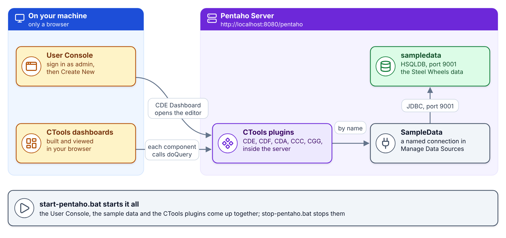

# Before You Start

> **Note:**
>
> Welcome! This first lab shows you how to work with this guide.
> Five minutes here makes every later lab smoother.

## Meet your lab guide

This panel stays beside your tools for the whole workshop:

- **Float or dock** — drag the title bar to move the window anywhere
  (any monitor), or use the dock button to pin it to the right edge of
  the screen so maximised apps make room for it.
- **The sidebar** lists every section and lab. A <span data-icon="video"></span> badge means the lab
  includes a video; the `~15 min` tag is a time estimate.
- Use the **font-size** and **reading-mode** controls in the toolbar if
  you're on a small VM screen.

## Track your progress

Each workshop's steps sit in a numbered row at the top of the lab, one
dot per step. Work through them in order: the button at the end of a
step names the next one, and moving on puts a check mark on the step
you leave. Your progress is saved on this machine and survives
restarts, so you can pick up exactly where you left off. (This page has
no steps: tracking starts in the first workshop.)

## Copy code with one click

Every code block has a **copy button** — hover over the block and click
it, then paste into your tool. Try it:

```sql
SELECT 'hello from the lab guide' AS greeting;
```

## Set up your environment

Launch your main tool straight from the guide:

<button data-launch="puc">Start the Pentaho User Console</button>

If it is already open from a previous session, the button focuses
the running window instead of starting a second copy.

<div align="center">
<figure>

<figcaption>Your browser, the Pentaho Server with the CTools plugins, and the sample data</figcaption>
</figure>
</div>

Read the diagram from the left. Your machine needs only a browser: the User Console opens the CDE editor through **Create New**, and the dashboards you build run in the same browser, each component asking the server for its data with a `doQuery` request. On the server, the CTools plugins reach the data by a connection's name, **SampleData** in **Manage Data Sources**, and the server opens the HSQLDB `sampledata` database on port 9001 behind it. The start script at the bottom brings all of it up together, so there is nothing else to start.

### Do you need to set anything up?

:::: tabs

### I'm using a lab VM

Nothing to do. Everything is installed and running already, and it
starts with the machine.

If something looks wrong later, tell your instructor rather than
reinstalling anything.

### I'm installing on my own machine

Everything here is a **one-off setup** for your own laptop. Work through
the tabs in order — the last one is a reference card of ports and
logins, for when you come back to it later.

> **Note:** This course needs no containers, no MySQL and no desktop
> design tool — the CTools (CDE, CDF, CDA and the CCC charts) are
> plugins that live **inside the Pentaho Server**, and every dashboard
> in this course is built in the browser.

::: tabs

### 1. Start the Pentaho Server

The server ships with Pentaho, so there is nothing to install — you
just start it. It brings up the User Console, the sample data and the
CTools plugins together.

1. Open PowerShell and run the start script from your Pentaho install:

   ```powershell
   C:\Pentaho\server\pentaho-server\start-pentaho.bat
   ```

2. Wait for it to finish booting. The first start takes a few minutes;
   leave the window open, as closing it stops the server.

3. Confirm it is up by browsing to **http://localhost:8080/pentaho**.
   You should get a sign-in page.

To shut it down later, run `stop-pentaho.bat` from the same folder.

<details>
<summary>Troubleshooting</summary>

**The browser cannot reach localhost:8080.** The server is still
starting, or it stopped. Watch the console window for
`Server startup in ... ms`, then retry.

**"Port 8080 already in use".** Something else has the port — often a
second Pentaho Server, or another Tomcat. Stop it, or change the
port in `tomcat\conf\server.xml`.

**The window closes immediately.** Almost always `JAVA_HOME` is unset
or points at the wrong JDK. Check it with `echo $env:JAVA_HOME`, and
see `set-pentaho-env.bat` in the same folder for what the server
expects.

</details>

### 2. Sign in and find the CTools

1. Open the User Console — use the button at the top of this page, or
   browse to **http://localhost:8080/pentaho**.

2. Sign in as **`admin`** with the password **`password`** — use
   `admin` for every lab in this course.

3. Confirm the CTools are present: **Create New** should offer
   **CDE Dashboard**. The labs also use CDA data sources and CCC
   charts from inside the editor.

<details>
<summary>Troubleshooting</summary>

**Create New shows no CDE Dashboard.** That is how Pentaho 11 ships:
the CTools plugins are installed, but their User Console entries are
commented out. The [Getting Started](../01-getting-started/guide.md)
page's **Enable CDE & CDA** tab shows the three files and what to
uncomment; then restart the server. The **CDE in the User Console** row
in the panel below checks it.

**Dashboards render blank after edits.** Clear the server's CDE cache
from Tools ▸ Refresh ▸ CDA cache / repository cache, then reload.

</details>

### 3. Ports and logins

Everything this course uses, in one place. All of it is local to your
machine.

| Service               | Address                                | Username       | Password   |
| --------------------- | -------------------------------------- | -------------- | ---------- |
| Pentaho User Console  | http://localhost:8080/pentaho          | `admin`        | `password` |
| HSQLDB `sampledata`   | `jdbc:hsqldb:hsql://localhost/sampledata` | `pentaho_user` | `password` |
| Ollama — the Chat tab | `127.0.0.1:11434`                      | *none*         | *none*     |

The Steel Wheels sample data lives in the bundled HSQLDB and starts
with the server — the CDA data sources in these labs reach it through
the server's own connections.

> **Caution:** These are the stock Pentaho workshop credentials and are
> widely known. Change them on any server that is reachable beyond
> your own machine.

:::

The panel below probes this machine live, checking what this course's
labs need. Each row reports one of four states:

* **<span class="pcm-c-ok">Green</span>** — the check passed; that piece is present and answering.
* **<span class="pcm-c-warn">Amber</span>** — usable, but worth tidying before the session.
* **<span class="pcm-c-danger">Red</span>** — it will block a lab, and the row tells you the exact fix.
* **<span class="pcm-c-muted">Grey</span>** — skipped, because this course doesn't use it.

<div data-env-check="server"></div>

Nothing else is required.

::::

## Ask the AI assistant

The **Chat** tab in the bottom panel answers questions about Pentaho,
grounded in the official docs — ask it anything from "what does this
step do?" to "why did my transformation fail?". It runs on a local
model, so it works even when the VM is offline.

## How this course is organized

Each section starts with an **overview page** (<span data-icon="page"></span> — background reading,
no checkboxes) followed by **hands-on workshops** (<span data-icon="workshop"></span> — tracked steps).
Head to the first section whenever you're ready.

---

> **Tip:** You can revisit this lab any time from the sidebar.
