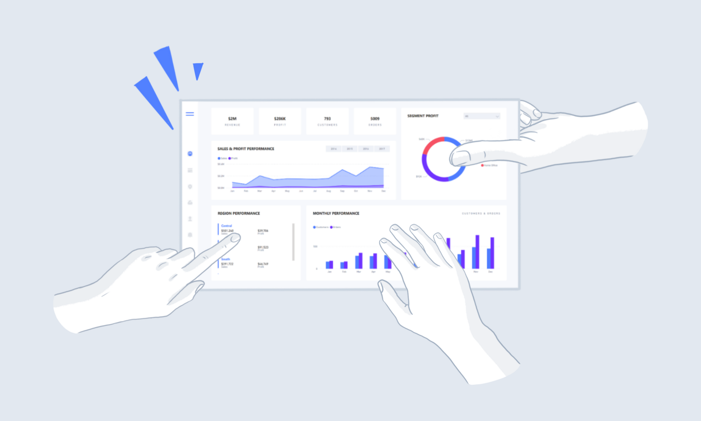
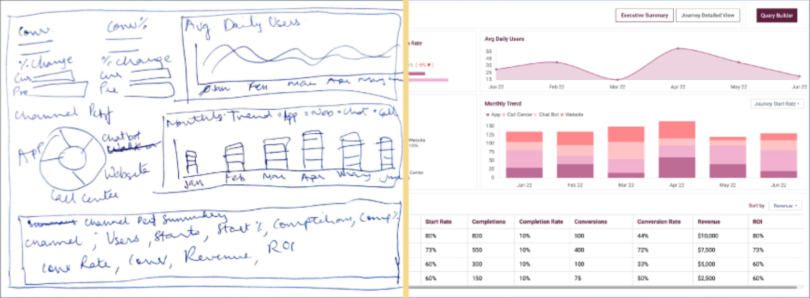
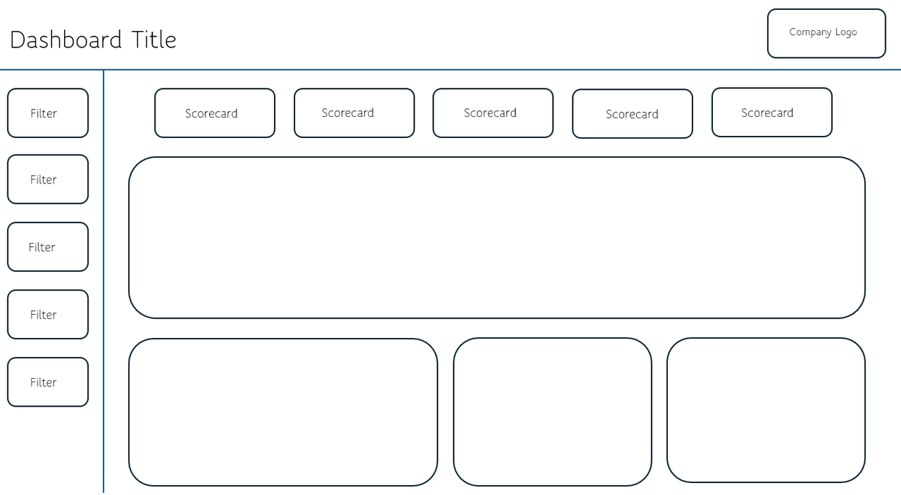

# First Steps

> **Warning:**
>
> #### Workshop - First Steps
>
> Before you build a dashboard, gather the requirements, choose the visualizations, sketch a mock-up and break the design down into components, queries and parameters. This workshop walks you through that groundwork, so that what you build in CDE is what the stakeholders need.
>
> **What you'll do**
>
> * Identify the stakeholder groups and the information each one needs
> * Review existing reports and agree the design rules: content, detail, filters and visualizations
> * Sketch a mock-up that previews the finished dashboard
> * Produce a functional breakdown that lists components, queries and parameters
>
> **Prerequisites:** Access to the Pentaho User Console; a web browser; familiarity with dashboards and business reporting
>
> **Estimated time:** 30 minutes

<figure>

<figcaption>A dashboard puts key figures and trends on one interactive screen</figcaption>
</figure>

***

:::: tabs

### 1. Requirements

> **Note:**
>
> #### Requirements
>
> An effective dashboard starts with the people who will use it. Sit down with the stakeholders to understand their needs and pain points, then decide which displays tell their story best.

Work through these points with your stakeholders.

#### Target Audience

Different stakeholders need different levels of information:

* **Executives** need high-level metrics and trends for quick decisions.
* **Department managers** want company-wide figures and the detail for their own area.
* **Technical staff** need granular, detailed information for operational tasks.

#### User Expectations

Deliver the right information to the right people. Ask:

* Which metrics matter most to each user group?
* How will they use this information in their daily work?
* Which format and level of detail serves them best?

#### Existing Systems

When the dashboard replaces current reporting tools:

* Obtain copies of the existing reports and dashboards.
* Analyze their format, content and usage.
* Identify opportunities for improvement.
* Use the current reports as a baseline for the data requirements.

#### Dashboard Design

> **Note:**
>
> #### Key Dashboard Design Considerations
>
> * **UI consistency** - follow the company's UI guidelines for colors, fonts and layout where they exist, so users focus on the data rather than on a new design.
> * **Content strategy** - show the essential KPIs, insights and trends first. The dashboard is an overview of the critical metrics.
> * **Data granularity and interaction**
>   * Decide the level of detail each section shows.
>   * Offer drill-down for deeper analysis, for example to investigate declining sales.
>   * Weigh the performance cost of each level of detail.
>   * Make click-through to more information intuitive.
> * **Filtering framework**
>   * Dashboard-wide filters for consistent views of the data.
>   * Section-specific filters where needed.
>   * Time range controls, for example the last hour, 7 days or 30 days.
>   * Filters that match the granularity of the data.
> * **Visualization selection** - choose each chart for the data volume and complexity, the message, how quickly users must read it, the information density, and the roles of the people who see it.
>
> Aim for an interface users understand and act on without training.

1. List the stakeholder groups for the dashboard you plan to build, and for each one the three metrics it needs most.
2. Collect the reports the dashboard replaces, and note which of their figures it must show.

### 2. Mock-up

> **Note:**
>
> #### Mock-up
>
> A dashboard mock-up shows how the dashboard will look and behave before development begins. It lets stakeholders see the result, arrange the elements and iterate on the design without spending development time. A good mock-up places each visualization, follows the user's workflow, sets the information hierarchy and marks the interactive elements.

<figure>

<figcaption>Dashboard - Mock up</figcaption>
</figure>

Tools for dashboard mock-ups include:

* [Figma](https://www.figma.com/) - a design tool with real-time collaboration
* [PowerMockup](https://www.powermockup.com/) - a PowerPoint add-in
* [Balsamiq](https://balsamiq.com/) - quick, low-fidelity wireframes

1. Sketch a mock-up of your dashboard, on paper or in one of these tools: the filters, the KPIs, each chart and table, and where each one sits.
2. Review the mock-up with the stakeholders and agree it before you build anything.

### 3. Functional Breakdown

> **Note:**
>
> #### Functional Breakdown
>
> With the design agreed, write a functional breakdown: for each section of the dashboard, its components, queries and parameters, with an estimated development time for each task. It tracks planned against completed work, specifies each query's columns and data types, and surfaces questions early. On a team project it tells everyone what they build.

<figure>

<figcaption>Functional breakdown</figcaption>
</figure>

1. For each element of your mock-up, write one line in the breakdown: the component (a chart, a table, a selector), the query that feeds it with its columns and data types, the parameters it reads or sets, and an estimate in hours.

> **Under the hood:**
>
> #### Every line of the breakdown becomes a CTools object
>
> The breakdown maps one to one onto what you build in the Community
> Dashboard Editor (CDE). Each query becomes a data source in the Data
> Sources perspective, which CDE writes into the dashboard's `.cda`
> file; each component becomes an entry in the Components perspective,
> saved in the `.cdfde` file with its HtmlObject, Datasource and
> Listeners; each parameter becomes a parameter component that other
> components list as listeners. A query's column list and data types
> are what a chart or table expects to receive.
>
> **Why it matters:** a breakdown written this way is the build list
> for the editor. A component with no query, or a query whose columns
> don't match the chart, shows up on paper instead of in a broken
> dashboard.

::::

<button data-launch="puc">Open Pentaho User Console</button>

## Lab Files

_No bundled files for this lab._
