# My First Dashboard

> **Warning:**
>
> #### Workshop - My First Dashboard
>
> Build your first dashboard in the Community Dashboard Editor (CDE): a Two x One layout with a styled header and footer, and three charts on the Steel Wheels OLAP cube made with the OLAP Chart Wizard. Along the way you meet CDE's three perspectives - Layout, Components and Data Sources.
>
> **What you'll do**
>
> * Create a CDE dashboard from the Two x One template and save it to the repository
> * Style the header and footer rows with HTML and a background color
> * Add a pie, a line and a bar chart with the OLAP Chart Wizard
> * Set the charts' titles, heights and legends, and adjust the layout to fit them
> * Check the SampleData connection that the charts' cube reads from
>
> **Prerequisites:** The Pentaho Server with CDE enabled, as in [Getting Started](../01-getting-started/guide.md); the SteelWheels sample schema and SampleData, which ship with the server; [First Steps](../02-getting-started-first-steps/guide.md)
>
> **Estimated time:** 30 minutes

<div align="center">
<figure>
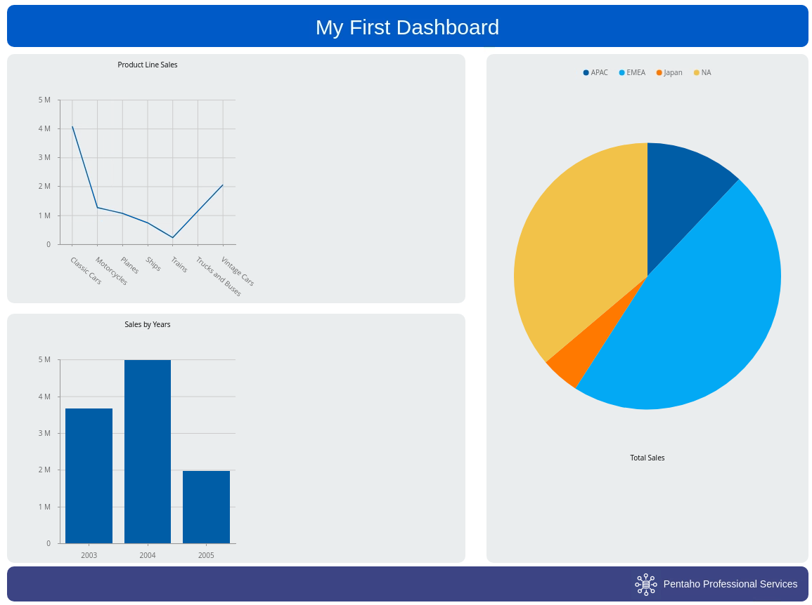
<figcaption>My First dashboard</figcaption>
</figure>
</div>

***

:::: tabs

### 1. CDE - Layout

> **Note:**
>
> #### Create a New Dashboard
>
> Create the dashboard from a template, save it, and preview it. Don't worry about every feature and option yet: the next workshops cover each perspective.

1. Make sure the Pentaho Server is running. On a lab VM it already is; on your own machine start it as in [Before You Start](../00-before-you-start/guide.md):

```powershell
C:\Pentaho\server\pentaho-server\start-pentaho.bat
```

It takes a few minutes; the console is ready when http://localhost:8080/pentaho opens the login page.

2. Open the Pentaho User Console (PUC) with the button below and sign in as `admin`.

<button data-launch="puc">Open Pentaho User Console</button>

3. Select **Browse Files**. Under **Folders**, select **Public**.
4. Under **Folder Actions**, select **New Folder...**, enter `CTools-Dashboard` and select **OK**. The later workshops keep their files in this folder too.
5. Select **CTools-Dashboard** and create the folder `My-First-Dashboard` inside it the same way.
6. On the **Home** page, select **Create New > CDE Dashboard**. **File > New > CDE Dashboard** does the same.

<div align="center">
<figure>
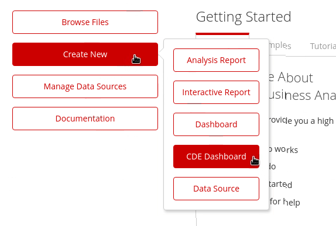
<figcaption>New CDE Dashboard</figcaption>
</figure>
</div>

7. In the **Layout Structure** toolbar, select the **Apply Template** icon.

<div align="center">
<figure>
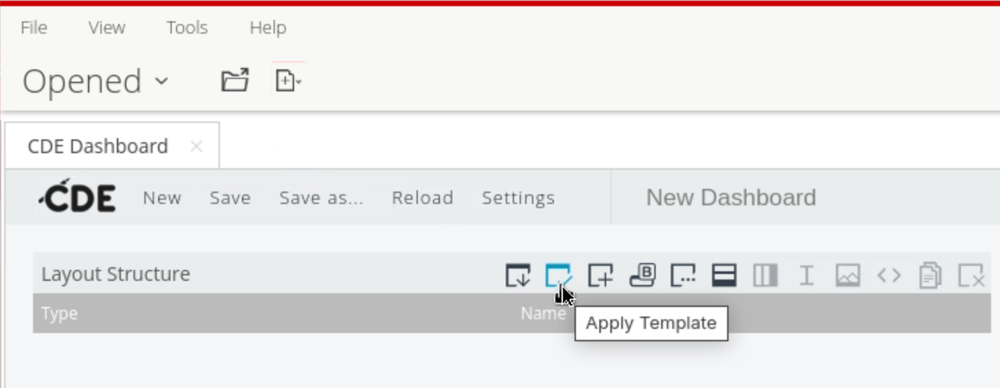
<figcaption>Apply a Template</figcaption>
</figure>
</div>

8. In **Apply Template**, select **Two x One Template** and select **Ok**. When CDE asks whether you are sure you want to load the template, select **Ok**.

<div align="center">
<figure>
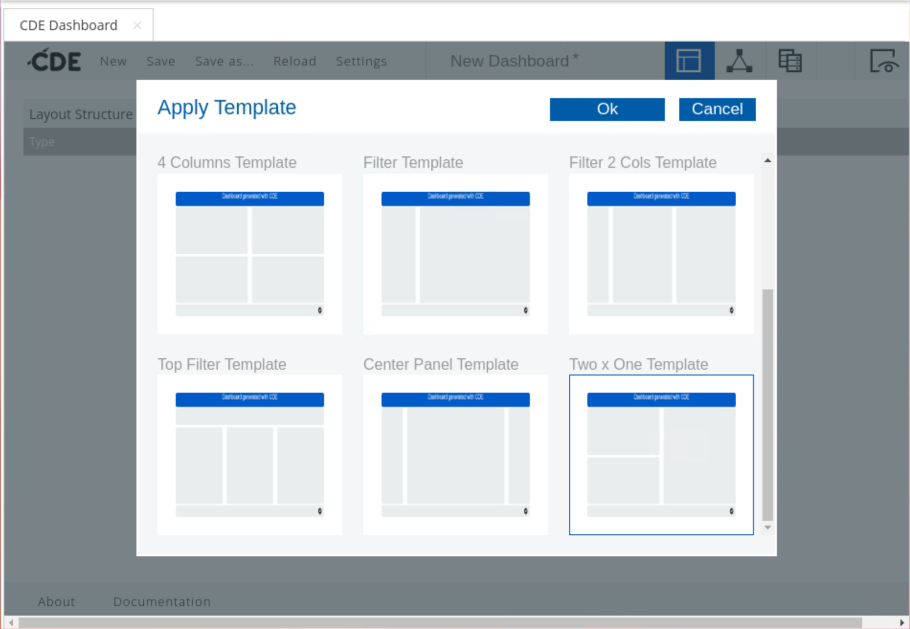
<figcaption>Apply a Template - Two x One</figcaption>
</figure>
</div>

The template's layout has five main rows: **Header**, **Spacer**, **Body**, **Small_Space** and **Footer**. **Body** is split into two columns. The first column holds three rows: one with the column **Panel_1**, then **Spacer_2**, then one with the column **Panel_2**. The second column is **Panel_3**.

<div align="center">
<figure>
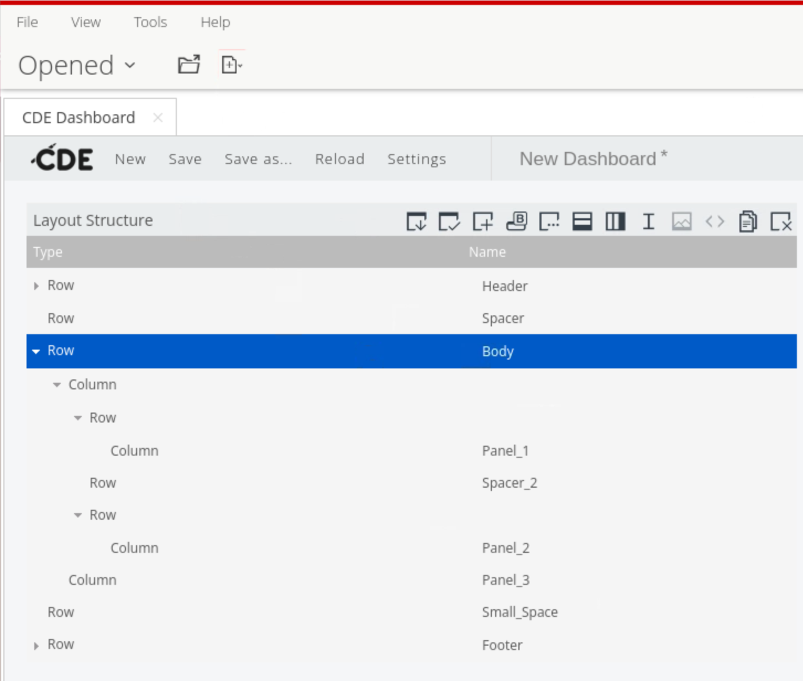
<figcaption>CDE Layout - Two x One</figcaption>
</figure>
</div>

9. On the CDE toolbar, select **Save as...**. In **Save as**, set these values and select **Ok**:

| Setting | Value |
| --- | --- |
| **Choose Format** | **Dashboard** |
| **Choose Folder** | public > CTools-Dashboard > My-First-Dashboard |
| **File Name** | `my-first-dashboard` |
| **Title** | `My First Dashboard` |

<div align="center">
<figure>
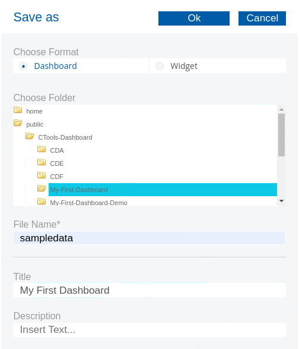
<figcaption>Save as ..</figcaption>
</figure>
</div>

10. Select **Preview your Dashboard**, the icon at the top right of the editor.

<div align="center">
<figure>
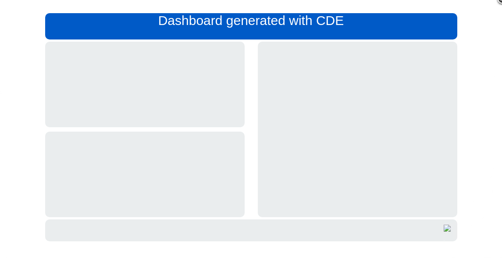
<figcaption>Dashboard template - preview</figcaption>
</figure>
</div>

> **Success:** Checkpoint: the template as it ships: a blue header reading **Dashboard generated with CDE**, three empty gray panels, and a footer with a broken image icon, because the template's footer points at an image your server doesn't have.

11. Close the preview.

> **Under the hood:**
>
> #### A CDE dashboard is three files
>
> Save as wrote the dashboard into the repository as files: a .wcdf with
> its title and settings, and a .cdfde holding everything the editor
> shows (layout, components and data sources) as JSON. Once the
> dashboard has data sources, every save also generates a .cda from the
> Data Sources panel; with none, CDE deletes it.
>
> Preview saves throwaway _tmp copies of the files and renders those, so
> previewing never overwrites what you saved; the editor deletes them
> afterwards.
>
> **Why it matters:** the files are what you move between servers, back
> up and compare. Preview never touches them, so you can try a change
> and look at it before you decide to keep it.

### 2. Header & Footer rows

> **Note:**
>
> #### Header & Footer rows
>
> Replace the template's header text and footer image with your own HTML, and color the footer.

#### Header Row

1. In **Layout Structure**, expand the **Header** row and the column under it, and select the **Html** element.
2. In **Properties**, select the **...** button in the **HTML** value. In **Edit**, replace the HTML with the following, which adds padding to align the text, and select **Ok**:

```html
<h2 style="color:#FFFFFF; padding: 15px 0">My First Dashboard</h2>
```

3. Select **Save**, then **Preview your Dashboard**.

<div align="center">
<figure>
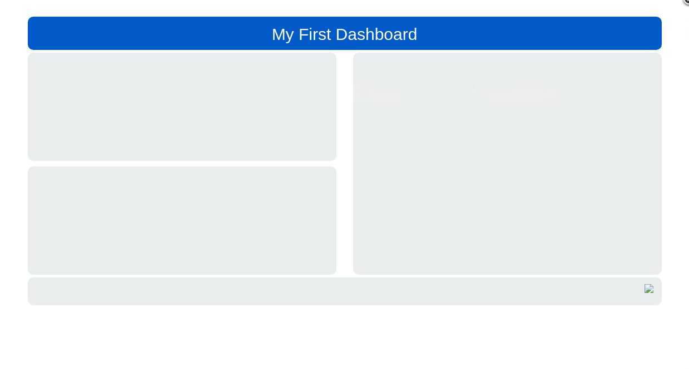
<figcaption>Preview dashboard</figcaption>
</figure>
</div>

> **Success:** Checkpoint: the header reads **My First Dashboard**; the footer still shows the broken image.

4. Close the preview.

***

#### Footer

The footer shows a logo from a folder beside the dashboard. This lab ships no logo file: use any small PNG image of your own and name it `logo_pentaho.png`.

5. In the PUC, open **Browse Files** and select **My-First-Dashboard**. Under **Folder Actions**, select **New Folder...**, enter `resources` and select **OK**.
6. Select **resources** and create the folder `img` inside it the same way.
7. Select **img**. Under **Folder Actions**, select **Upload...**. Select **Browse...**, choose `logo_pentaho.png`, and select **OK**.
8. Return to the editor tab. In **Layout Structure**, expand the **Footer** row and its column **Footer_Image**, and select the **Html** element under it.
9. In **Properties**, select the **...** button in the **HTML** value, replace the HTML with the following, and select **Ok**:

```html
<a style="position:relative;top:5px; right:15px; float:right; color:#FFFFFF;" border="0" title="Pentaho Professional Services" href="https://pentaho.com/pentaho-professional-services/">
    Pentaho Professional Services</a>
```

10. Select the **Footer_Image** column. In **Properties**, select the **BackgroundColor** check box, enter `#3c4484` in its value, and select the color wheel button in the corner of the color picker to apply the color.

<div align="center">
<figure>
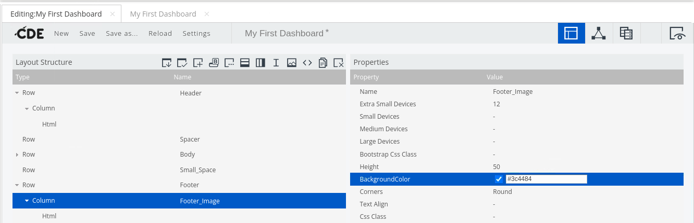
<figcaption>Footer_Image column with its background color set to #3c4484</figcaption>
</figure>
</div>

> **Warning:** The color applies only when you select the color wheel button: a value typed without it is not kept.

<div align="center">
<figure>
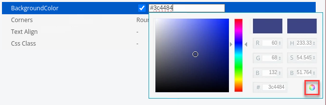
<figcaption>Color picker</figcaption>
</figure>
</div>

11. Select **Save**, then **Preview your Dashboard**.

<div align="center">
<figure>
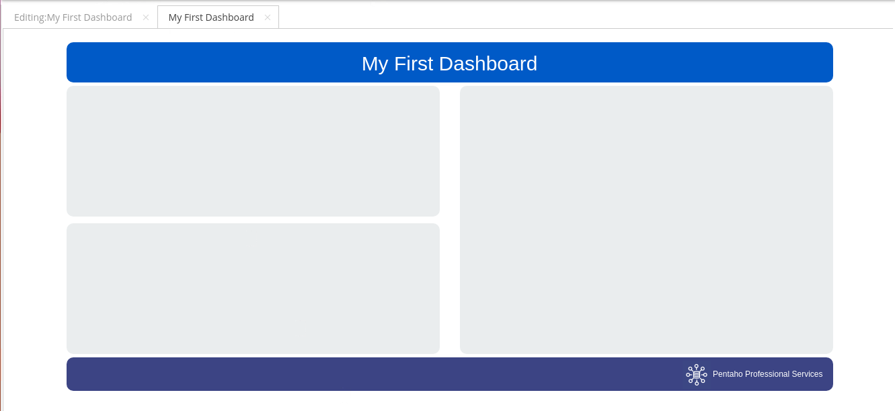
<figcaption>Dashboard Layout - Header & Footer</figcaption>
</figure>
</div>

> **Success:** Checkpoint: a dark blue footer with your logo and the link **Pentaho Professional Services** at the right.

12. Close the preview.

### 3. Charts

> **Note:**
>
> #### Charts
>
> The charts read the SteelWheels OLAP cube. Schema Workbench is the Pentaho design tool that defines a multidimensional (MDX) schema:
>
> * A cube is built on the fact table of a star schema.
> * Dimensions map to the database tables.
> * Levels map to columns of those tables. Their order defines the paths you can take to slice and dice the data.

<div align="center">
<figure>
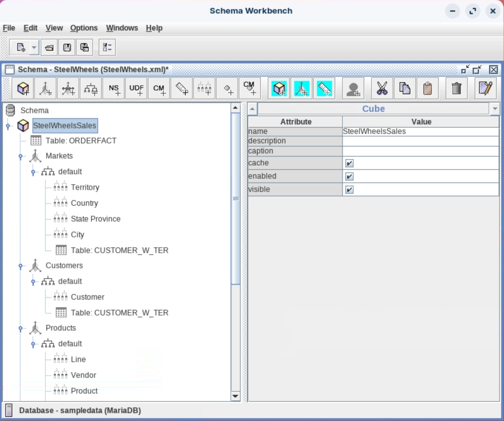
<figcaption>SteelWheelsSales OLAP Schema</figcaption>
</figure>
</div>

The OLAP Chart Wizard builds its queries on a schema published to the server, here SteelWheels, which reads the SampleData database. In Schema Workbench you can test MDX queries against a cube before you use them in a dashboard:

<div align="center">
<figure>
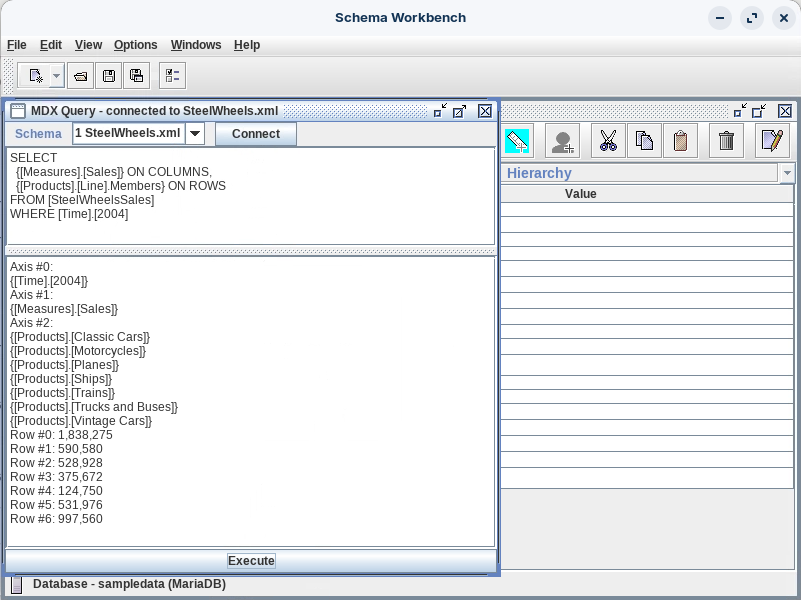
<figcaption>MDX Query</figcaption>
</figure>
</div>

***

#### Add a Chart

1. Select **Datasources Panel**, the perspective icon at the top right. In the list on the left, expand **Wizards** and select **OLAP Chart Wizard**.

<div align="center">
<figure>
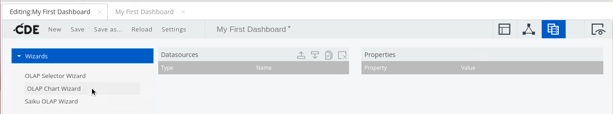
<figcaption>Data Sources perspective - Wizards</figcaption>
</figure>
</div>

2. In **OLAP Wizard**, set **Catalog** to `SteelWheels` and **Cube** to `SteelWheelsSales`.
3. Set **Name** to `Total_Sales`, **Html Object** to `Panel_3` and **Chart Type** to `Pie Chart`.
4. Under **Dimensions**, expand **Markets** and drag **Territory** to **Rows**. Under **Measures**, drag **Sales** to **Columns**. The **Preview Area** draws the chart.

<div align="center">
<figure>
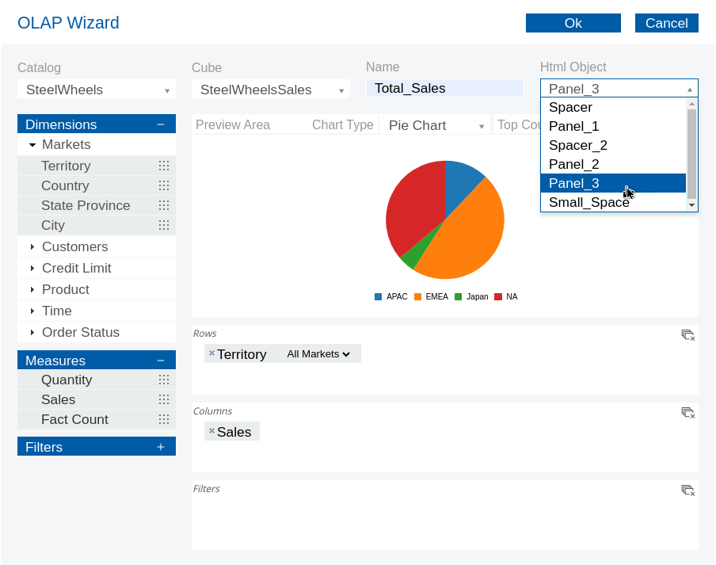
<figcaption>Pie Chart - Total Sales</figcaption>
</figure>
</div>

5. Select **Ok**.
6. Select **Save**, then **Preview your Dashboard**.

<div align="center">
<figure>
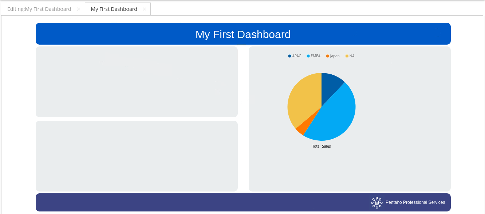
<figcaption>Panel_3 - Total sales</figcaption>
</figure>
</div>

> **Success:** Checkpoint: the **Total_Sales** pie chart in the right-hand panel, one slice per territory: `APAC`, `EMEA`, `Japan` and `NA`. The two left panels are still empty.

7. Close the preview. The chart needs a few adjustments, which come after the other two charts.
8. Open **OLAP Chart Wizard** again and build the second chart with these values, then select **Ok**:

| Setting | Value |
| --- | --- |
| **Catalog** | `SteelWheels` |
| **Cube** | `SteelWheelsSales` |
| **Name** | `Line_Sales` |
| **Html Object** | `Panel_1` |
| **Chart Type** | `Line Chart` |
| **Rows** | **Line**, from the **Products** dimension |
| **Columns** | **Sales**, from **Measures** |

<div align="center">
<figure>
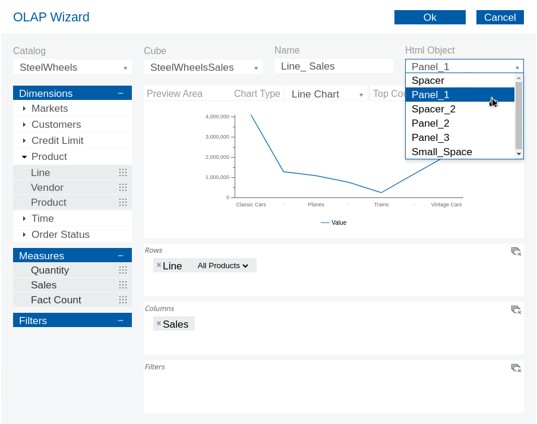
<figcaption>Line Chart - Line sales</figcaption>
</figure>
</div>

9. Select **Save**.
10. Open **OLAP Chart Wizard** again and build the third chart, then select **Ok**:

| Setting | Value |
| --- | --- |
| **Catalog** | `SteelWheels` |
| **Cube** | `SteelWheelsSales` |
| **Name** | `Years_Sales` |
| **Html Object** | `Panel_2` |
| **Chart Type** | `Bar Chart` |
| **Rows** | **Years**, from the **Time** dimension |
| **Columns** | **Sales**, from **Measures** |

11. Select **Save**, then **Preview your Dashboard**.

<div align="center">
<figure>
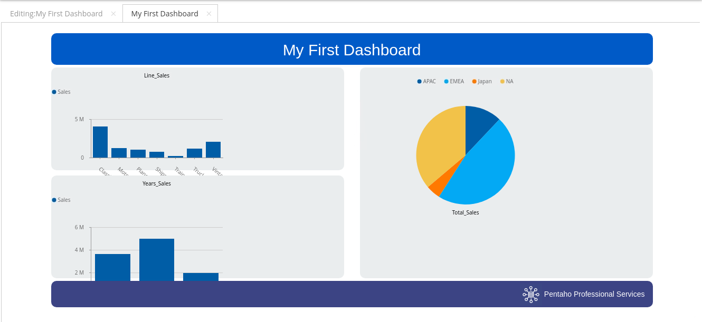
<figcaption>My First Dashboard</figcaption>
</figure>
</div>

> **Success:** Checkpoint: three charts: **Line_Sales** over the seven product lines at the top left, **Years_Sales** with one bar each for `2003`, `2004` and `2005` at the bottom left, and **Total_Sales** on the right. The left-hand charts don't fit their panels yet.

12. Close the preview.

***

#### Chart Component

Each chart is a component, configured with a set of properties.

13. Select **Components Panel**, the perspective icon at the top right, and expand **Charts** in the **Components** list.

<div align="center">
<figure>
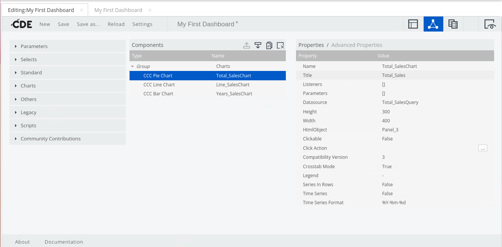
<figcaption>Chart Components</figcaption>
</figure>
</div>

> **Success:** Checkpoint: the wizard added three chart components, each named after its chart with `Chart` appended: **Total_SalesChart** (CCC Pie Chart), **Line_SalesChart** (CCC Line Chart) and **Years_SalesChart** (CCC Bar Chart).

14. Select **Total_SalesChart**. In **Properties**, its **Datasource** is `Total_SalesQuery` and its **HtmlObject** is `Panel_3`.

> **Under the hood:**
>
> #### The wizard writes a query and a chart, joined by name
>
> For each chart the OLAP Chart Wizard created two things: an "mdx over
> mondrianJndi" data source named after the chart with Query appended
> (Total_SalesQuery), holding the JNDI connection, the SteelWheels
> catalog and an MDX query built from your dimension and measure; and a
> CCC chart component whose Datasource property names that query.
>
> The Html Object is the other half of the wiring. CDE renders every
> layout row and column as a div whose id is the element's Name, and a
> component draws into the element whose id matches its Html Object.
> That is why Years_Sales goes into Panel_2: a name with no matching
> layout element leaves the chart nowhere to draw.
>
> **Why it matters:** a chart that draws nothing is almost always a
> broken name: a Datasource that names no query, or an HtmlObject that
> names no layout element. Those are the first two properties to check.

15. Set these properties, selecting each component in turn:

| Component | Property | Value |
| --- | --- | --- |
| **Total_SalesChart** | **Title** | `Total Sales` |
| **Total_SalesChart** | **Height** | `400` |
| **Line_SalesChart** | **Title** | `Product Line Sales` |
| **Line_SalesChart** | **Legend** | `False` |
| **Years_SalesChart** | **Title** | `Yearly Sales` |
| **Years_SalesChart** | **Legend** | `False` |

16. Select **Save**, then **Preview your Dashboard**.

> **Success:** Checkpoint: each chart shows its new title, and the line and bar charts have no legend.

17. Close the preview.

### 4. Final Layout

> **Note:**
>
> #### Final Layout
>
> The template's panels are sized for its own sample content. Make them tall enough for your charts.

1. Select **Layout Panel**, the perspective icon at the top right.
2. In **Layout Structure**, select each element and set its property:

| Element | Property | Value |
| --- | --- | --- |
| **Body** row | **Height** | `720` |
| The row in Body's first column that holds **Panel_1** | **Height** | `360` |
| **Panel_1** column | **Height** | `355` |
| The row in Body's first column that holds **Panel_2** | **Height** | `360` |
| **Panel_2** column | **Height** | `355` |
| **Panel_3** column | **Height** | `725` |
| **Panel_3** column | **Text Align** | **Center** |

3. Select **Save**, then **Preview your Dashboard**.

> **Success:** Checkpoint: the dashboard from the top of this page: the panels are taller, and each chart sits inside its panel.

4. Close the preview.

### 5. JDBC Connection

> **Note:**
>
> #### JDBC Connection
>
> The Steel Wheels sample data behind the SteelWheels cube lives in the `sampledata` HSQLDB database that starts with the Pentaho Server. The diagram shows its main tables: orders, order details, products and product lines, customers, employees, offices and payments.

<div align="center">
<figure>
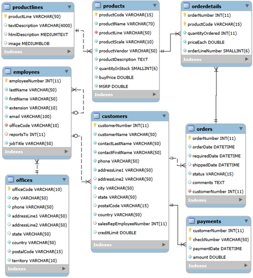
<figcaption>ER - sampledata</figcaption>
</figure>
</div>

The server reaches the database through a named connection, **SampleData**. Open it and test it.

1. In the PUC, open **Home** and select **Manage Data Sources**.
2. Select **SampleData** (type **JDBC**), select the cog wheel, and select **Edit...** in its menu.

<div align="center">
<figure>
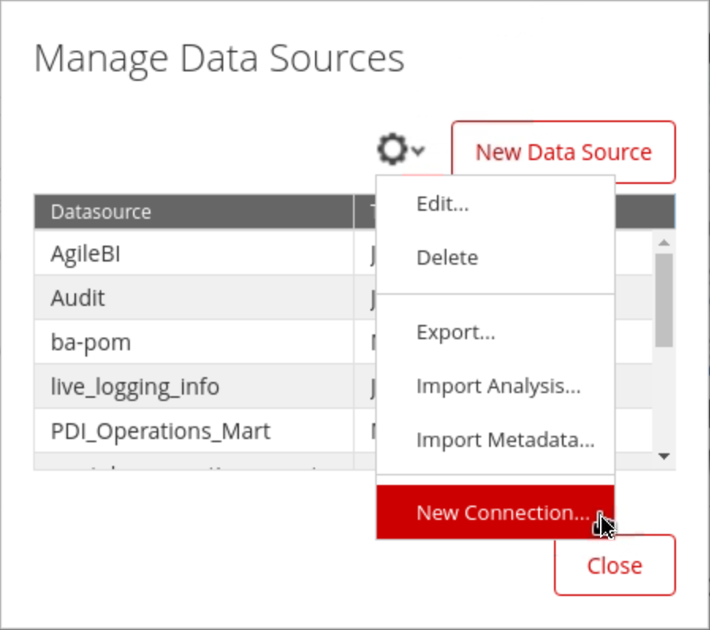
<figcaption>The cog wheel menu</figcaption>
</figure>
</div>

3. Compare the **Database Connection** dialog with this table:

| Setting | Value |
| --- | --- |
| **Connection Name** | `SampleData` |
| **Database Type** | **Hypersonic** |
| **Access** | **Native (JDBC)** |
| **Host Name** | `localhost` |
| **Database Name** | `sampledata` |
| **Port Number** | `9001` |

4. Select **Test**.

<div align="center">
<figure>
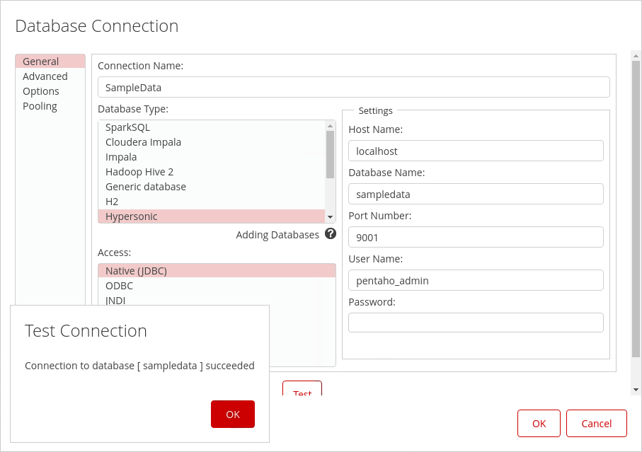
<figcaption>Database connection - SampleData</figcaption>
</figure>
</div>

> **Success:** Checkpoint: **Test Connection** reports that the connection to database `sampledata` succeeded.

5. Close the message, select **Cancel** to leave the connection unchanged, and close **Manage Data Sources**.

> **Under the hood:**
>
> #### The dashboard names a connection; the server holds it
>
> A JNDI data source such as "mdx over mondrianJndi" stores only the
> connection's name in the generated .cda, never a URL or a password.
> When a query runs, the server looks that name up among the connections
> in Manage Data Sources and opens the database itself, which is why a
> JDBC driver goes into the server's tomcat/lib and nowhere near the
> browser.
>
> The schema is published against a named connection too, so the two
> names must match for MDX queries to reach the database.
>
> **Why it matters:** a dashboard moves between servers unchanged; each
> server supplies its own database behind the same connection name, and
> no credentials ever reach the browser.

::::

## Lab Files

_No bundled files for this lab._
