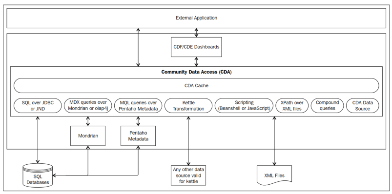
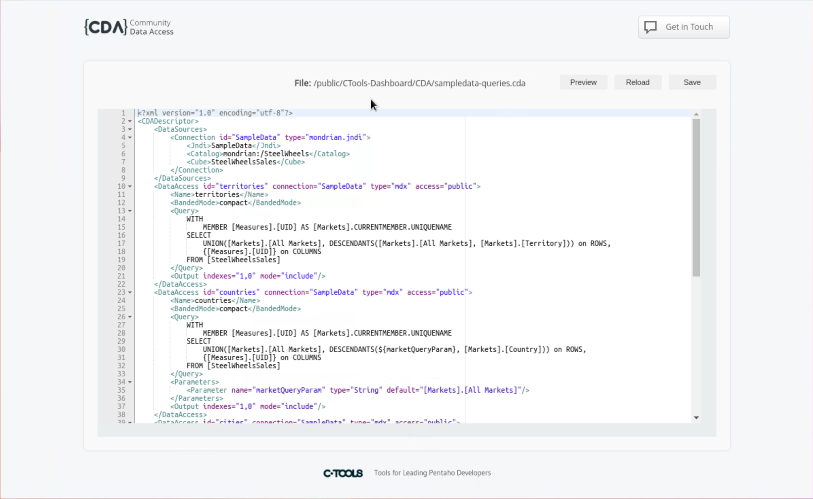

# Creating a CDA

> **Warning:**
>
> #### Workshop - Creating a CDA
>
> Community Data Access (CDA) is the CTools data layer: a `.cda` file defines connections and queries, and the server runs them for dashboards and for any application that calls CDA's web API. In this workshop you learn the anatomy of a `.cda` file, author one by hand, preview its query, and call it over the API.
>
> **What you'll do**
>
> * Learn how a `.cda` file is structured: connections, data accesses and their attributes
> * Author a `.cda` file by hand, upload it and preview its query
> * Compare the connection types: SQL, MDX, metadata, Kettle, scripting, XPath and compound queries
> * Make a query dynamic with `${parameter}` and the parameter types
> * Call the query over the CDA web API (`listQueries`, `listParameters`, `doQuery`)
>
> **Prerequisites:** A running Pentaho Server with the CTools plugins; [My First Dashboard](../03-getting-started-my-first-dashboard/guide.md), which creates the `CTools-Dashboard` folder; a text editor; basic SQL and MDX
>
> **Estimated time:** 45 minutes

<div align="center">
<figure>

<figcaption>Community Data Access</figcaption>
</figure>
</div>

> **Note:**
>
> #### How CDA serves data
>
> When a dashboard (CDF or CDE) or an external application requests data through CDA's endpoints, CDA first checks whether the query is cached. If it is, and the cached result for that query and those parameter values is still valid, CDA returns it. Only when no valid cached result exists does CDA query the data source.
>
> The data sources CDA can query are:
>
> * SQL over JDBC or JNDI
> * MDX queries over Mondrian or olap4j
> * MQL queries over a Pentaho metadata connection
> * Kettle transformations
> * Scripting (Beanshell and JavaScript)
> * XPath over XML files
> * Compound queries, which join or union other queries

There are two ways to create CDA data sources. In CDE you create them in the Data Sources perspective, with no XML to write; the CDE workshops do that. The other way is to edit the `.cda` file by hand, which is what this workshop does.

***

:::: tabs

### 1. Create the CDA

> **Note:**
>
> #### Create the CDA
>
> A CDA file is an XML file with a `.cda` extension. Pentaho recognizes the extension, so the User Console can open the file in the CDA previewer. The main structure of a CDA file is:

```xml
<?xml version="1.0" encoding="UTF-8"?>
<CDADescriptor>
   <DataSources>
      <!-- HERE LIVES EACH ONE OF <Connection> -->
   </DataSources>
   <!-- HERE LIVES EACH ONE OF <DataAccess> -->
</CDADescriptor>
```

The file starts with an XML declaration. The root element is `CDADescriptor`. Its `DataSources` element holds the connections, so that several queries can share one connection instead of each defining its own. After it come the data accesses: the queries, each with its required attributes.

#### Mandatory Connection Attributes

* **id** - a unique identifier, which the data accesses use to refer to the connection.
* **type** - the connection type, which determines the elements inside the connection. In CDE it is set for you from the data source you choose.

#### Creating Data Access

With the connections defined, create the data accesses. Each one follows this structure:

```xml
<DataAccess id="1" connection="1" type="sql" access="private"
            cache="true" cacheDuration="300">
   ...
</DataAccess>
```

| Attribute | Description |
| --- | --- |
| id | The data access identifier that components use. |
| connection | The id of a connection defined in `DataSources`. Several data accesses can share one connection. |
| access | Whether the data access is visible: `public` or `private`. A private data access is used only inside compound queries, for joins and unions. |
| cache | Whether the query's results are cached: `true` or `false`. The default is `false`: without this attribute or a `<Cache>` element, the query is not cached. |
| cacheDuration | How long, in seconds, a cached result is kept before the query runs again. Ignored when `cache` is `false`. The default is `3600`, one hour. |
| type | The query type, which must suit the connection's type. |

Here is a connection and a data access for a JSON query:

```xml
<?xml version="1.0" encoding="UTF-8"?>
<CDADescriptor>
   <DataSources>
      <Connection id="query" type="scripting.scripting">
         <Initscript></Initscript>
         <Language>beanshell</Language>
      </Connection>
   </DataSources>
   <DataAccess access="public" connection="query"
               id="query" type="jsonScriptable">
      <Cache duration="3600" enabled="true"/>
      <Columns/>
      <Parameters/>
      <Query>{
            "resultset":[["row1", 0]],
            "metadata":[
               {"colIndex":0,"colType":"String","colName":"value"},
               {"colIndex":1,"colType":"Integer","colName":"name2"}
            ]}
      </Query>
   </DataAccess>
</CDADescriptor>
```

#### SQL

> **Note:**
>
> #### SQL connections
>
> Use a SQL connection to get data from any source that speaks Structured Query Language (SQL) and that the server reaches through a JNDI connection or a JDBC driver. There are two types:
>
> * `sql.jdbc` - SQL over JDBC
> * `sql.jndi` - SQL over JNDI
>
> A `sql.jdbc` connection also needs:
>
> * **Driver** - the Java class name of the driver, for example `org.postgresql.Driver`
> * **URL** - the URL to connect to, for example `jdbc:postgresql://localhost:5432/database`
> * **User** - the user name
> * **Pass** - the user's password

```xml
<?xml version="1.0" encoding="utf-8"?>
<CDADescriptor>
    <DataSources>
        <Connection id="1" type="sql.jdbc">
            <Driver>org.hsqldb.jdbcDriver</Driver>
            <Url>jdbc:hsqldb:mem:SampleData</Url>
            <User>sa</User>
            <Pass></Pass>
        </Connection>
    </DataSources>
    <DataAccess id="1" connection="1" type="sql" access="public" cache="true" cacheDuration="300">
        <Name>Sql Query on SampleData - Jdbc</Name>
        <Query>
            select o.YEAR_ID, o.STATUS, sum(o.TOTALPRICE) as price from orderfact o
            where o.STATUS = ${status} and o.ORDERDATE &gt; ${orderDate}
            group by o.YEAR_ID, o.STATUS
        </Query>
        <Parameters>
            <Parameter name="status" type="String" default="Shipped"/>
            <Parameter name="orderDate" type="Date" pattern="yyyy-MM-dd" default="2003-03-01"/>
        </Parameters>
        <Columns>
            <Column idx="0">
                <Name>Year</Name>
            </Column>
            <CalculatedColumn>
                <Name>PriceInK</Name>
                <Formula>=[PRICE]/1000000</Formula>
            </CalculatedColumn>
        </Columns>
        <Settings>
            <Export type="csv" includeTotals="true">
                <Column idx="0" aggregator="None"/>
                <Column idx="1" aggregator="Average"/>
            </Export>
        </Settings>
        <Output indexes="1,0,2,3"/>
    </DataAccess>
</CDADescriptor>
```

A `sql.jndi` connection needs one property, **Jndi**: the connection's name as the server defines it (in `context.xml`). This is the file you build next:

```xml
<?xml version="1.0" encoding="utf-8"?>
<CDADescriptor>
    <DataSources>
        <Connection id="1" type="sql.jndi">
            <Jndi>SampleData</Jndi>
        </Connection>
    </DataSources>
    <DataAccess id="1" connection="1" type="sql" access="public" cache="true" cacheDuration="3600">
        <Name>Sql Query on SampleData - Jndi</Name>
        <Query>
            select o.YEAR_ID, o.STATUS, sum(o.TOTALPRICE) as price from orderfact o
            where o.STATUS = ${status} and o.ORDERDATE &gt; ${orderDate}
            group by o.YEAR_ID, o.STATUS
        </Query>
        <Parameters>
            <Parameter name="status" type="String" default="Shipped"/>
            <Parameter name="orderDate" type="Date" pattern="yyyy-MM-dd" default="2004-03-01"/>
        </Parameters>
        <Columns>
            <Column idx="0">
                <Name>Year</Name>
            </Column>
            <CalculatedColumn>
                <Name>PriceInK</Name>
                <Formula>=[PRICE]/1000000</Formula>
            </CalculatedColumn>
        </Columns>
        <Settings>
            <Export type="csv" includeTotals="true">
                <Column idx="0" aggregator="None"/>
                <Column idx="1" aggregator="Average"/>
            </Export>
        </Settings>
        <Output indexes="1,0,2,3"/>
        <Output id="2" indexes="0,1,3"/>
        <Output id="3" indexes="1,0,2"/>
    </DataAccess>
</CDADescriptor>
```

#### Build and Preview sql-jndi.cda

1. Make sure the Pentaho Server is running. On a lab VM it already is; on your own machine start it as in [Before You Start](../00-before-you-start/guide.md):

```powershell
C:\Pentaho\server\pentaho-server\start-pentaho.bat
```

It takes a few minutes; the console is ready when http://localhost:8080/pentaho opens the login page.

2. Open the Pentaho User Console (PUC) with the button below and sign in as `admin`.

<button data-launch="puc">Open Pentaho User Console</button>

3. Select **Browse Files**. Under **Folders**, expand **Public** and select **CTools-Dashboard**. If it isn't there, select **Public**, select **New Folder...** under **Folder Actions**, and create it.
4. Under **Folder Actions**, select **New Folder...**, enter `CDA` and select **OK**.
5. In a text editor, paste the `sql.jndi` listing above and save it as `sql-jndi.cda`.
6. In the PUC, select the **CDA** folder. Under **Folder Actions**, select **Upload...**. Select **Browse...**, choose `sql-jndi.cda`, and select **OK**.
7. If the file is not listed under **Files** yet, select the **Refresh** icon beside **Folders**.
8. Under **Files**, select **sql-jndi**, and under **File Actions** select **Open**. The CDA previewer opens in a new tab.
9. In the **Data Access** list, select **Sql Query on SampleData - Jndi**. The previewer shows the query's parameters, `status` and `orderDate`, with their defaults, and runs the query.

> **Success:** Checkpoint: 2 rows, both `Shipped`: one for 2004 and one for 2005. The columns come in the order `<Output indexes="1,0,2,3"/>` sets: the status, `Year`, the price total and `PriceInK`. The 2004 total is about 4.11 million and the 2005 total about 1.51 million, so `PriceInK` is about 4.11 and 1.51.

10. Select **Query URL**. The **Query Execution URL** dialog shows the `doQuery` call the previewer made. Select **Close**.

> **Under the hood:**
>
> #### CDA runs your SQL through the reporting engine
>
> A DataAccess of type sql is handed to Pentaho Reporting's
> SQLReportDataFactory, the same code Report Designer uses. It replaces
> every ${status} with a JDBC bind marker, ?, and sends the value
> separately on a prepared statement, so a parameter is always a value
> and can never become SQL.
>
> The rows that come back are then reshaped in order: Column entries
> rename columns by position, CalculatedColumn formulas (OpenFormula, as
> in Report Designer) add new ones, and Output picks and orders what is
> returned, so indexes 1,0,2,3 puts STATUS first. With no cache
> attribute and no Cache element, CDA does not cache the result at all.
>
> **Why it matters:** the query, the column names and the column order
> are set once, in the file, for every dashboard and application that
> uses it. Changing the order is an Output line, not a new query.

#### Mondrian

When you set the type of an MDX connection, these types are available:

* `mondrian.jdbc` - MDX over JDBC
* `mondrian.jndi` - MDX over JNDI
* `olap4j.defaultolap4j` - MDX over olap4j

A `mondrian.jdbc` connection needs:

* **Driver** - the Java class name of the driver, for example `org.postgresql.Driver`
* **URL** - the URL to connect to, for example `jdbc:postgresql://localhost:5432/database`
* **User** - the user name
* **Pass** - the user's password
* **Catalog** - the Mondrian schema to use

```xml
<?xml version="1.0" encoding="utf-8"?>
<CDADescriptor>
    <DataSources>
        <Connection id="1" type="mondrian.jdbc">
            <Driver>org.hsqldb.jdbcDriver</Driver>
            <Url>jdbc:hsqldb:mem:SampleData</Url>
            <User>sa</User>
            <Pass></Pass>
            <Catalog>mondrian:/SteelWheels</Catalog>
            <Cube>SteelWheelsSales</Cube>
        </Connection>
    </DataSources>
    <DataAccess id="1" connection="1" type="mdx" access="public">
        <Name>Mdx Query on SampleData - Jdbc</Name>
        <Query>
            select {[Measures].[Sales], [Measures].[Quantity]} ON COLUMNS,
            NON EMPTY  [Time].Children ON ROWS
            from [SteelWheelsSales]
            where ([Order Status].[${status}])
        </Query>
        <Parameters>
            <Parameter name="status" type="String" default="Shipped"/>
        </Parameters>
    </DataAccess>
</CDADescriptor>
```

A `mondrian.jndi` connection needs:

* **Jndi** - the JNDI name of the connection
* **Catalog** - the Mondrian schema to use

```xml
<?xml version="1.0" encoding="utf-8"?>
<CDADescriptor>
    <DataSources>
        <Connection id="1" type="mondrian.jndi">
            <Jndi>SampleData</Jndi>
            <Catalog>mondrian:/SteelWheels</Catalog>
            <Cube>SteelWheelsSales</Cube>
        </Connection>
    </DataSources>
    <DataAccess id="1" connection="1" type="mdx" access="public">
        <Name>Mdx Query on SampleData - Jndi</Name>
        <Query>
            select {[Measures].[Sales]} ON COLUMNS,
            NON EMPTY  [Time].Children ON ROWS
            from [SteelWheelsSales]
            where ([Order Status].[${status}])
        </Query>
        <Parameters>
            <Parameter name="status" type="String" default="Shipped"/>
        </Parameters>
        <Columns>
            <Column idx="1">
                <Name>Year</Name>
            </Column>
            <Column idx="2">
                <Name>price</Name>
            </Column>
            <CalculatedColumn>
                <Name>PriceInK</Name>
                <Formula>=[price]/1000000</Formula>
            </CalculatedColumn>
        </Columns>
    </DataAccess>
</CDADescriptor>
```

An `olap4j.defaultolap4j` connection uses:

* **Driver** - the Java class name of the driver, for example `mondrian.olap4j.MondrianOlap4jDriver`
* **URL** - the URL used to call the driver class, for example `jdbc:mondrian:`
* **JDBCUser** - the user name for the database, for example `pentaho_user`
* **JDBCPassword** - the password for the database user
* **JDBCDriver** - the database's JDBC driver, for example `org.hsqldb.jdbcDriver`
* **JDBC** - the URL of the database, for example `jdbc:hsqldb:hsql://localhost:9001/Sampledata`
* **Catalog** - the path to the Mondrian schema, for example `mondrian:/SteelWheels`

#### Metadata

A Pentaho metadata data source gets its data through a Pentaho Metadata model, with an MQL query, so a dashboard can use the same business model as the reporting tools. Its connection type is `metadata.metadata`, with these properties:

* **DomainId** - the domain of the metadata model
* **XmiFile** - the path and name of the metadata model's file

The data access needs a **Query**: a valid MQL query.

```xml
<?xml version="1.0" encoding="utf-8"?>
<CDADescriptor>
    <DataSources>
        <Connection id="1" type="metadata.metadata">
            <DomainId>steel-wheels</DomainId>
            <XmiFile>metadata.xml</XmiFile>
        </Connection>
    </DataSources>
    <DataAccess id="1" connection="1" type="mql" access="public">
        <Name>Mql on SampleData - Metadata</Name>
        <Query><![CDATA[<?xml version="1.0" encoding="UTF-8"?>
            <mql>
                <domain_type>relational</domain_type>
                <domain_id>steel-wheels</domain_id>
                <model_id>BV_ORDERS</model_id>
                <model_name>Orders</model_name>
                <selections>
                    <selection>
                        <view>CAT_ORDERS</view>
                        <column>BC_ORDERS_ORDERDATE</column>
                    </selection>
                    <selection>
                        <view>CAT_ORDERS</view>
                        <column>BC_ORDERS_ORDERNUMBER</column>
                    </selection>
                    <selection>
                        <view>CAT_ORDERS</view>
                        <column>BC_ORDER_DETAILS_QUANTITYORDERED</column>
                    </selection>
                </selections>
                <constraints>
                    <constraint>
                        <operator>AND</operator>
                        <condition>[CAT_ORDERS.BC_ORDERDETAILS_QUANTITYORDERED] &gt;70</condition>
                    </constraint>
                    <constraint>
                        <operator>AND</operator>
                        <condition>[CAT_ORDERS.BC_ORDERS_ORDERDATE] &gt; "2003-12-31 00:00:00.0"</condition>
                    </constraint>
                </constraints>
                <orders/>
            </mql>]]>
        </Query>
        <Parameters>
            <Parameter name="status" type="String" default="Shipped"/>
        </Parameters>
    </DataAccess>
</CDADescriptor>
```

#### Transformations

A Kettle transformation is a data source too: it can read and combine data from many sources, and its last step's rows become the query's result. The connection type is `kettle.TransFromFile`, with two properties: **KtrFile**, the path to the transformation, and **variables**, which map dashboard parameters to the transformation's own parameters.

```xml
<?xml version="1.0" encoding="utf-8"?>
<CDADescriptor>
    <DataSources>
      <Connection id="1" type="kettle.TransFromFile">
        <KtrFile>sample-trans.ktr</KtrFile>
        <variables datarow-name="myRadius"/>
        <variables datarow-name="ZipCode" variable-name="myZip"/>
      </Connection>
    </DataSources>
    <DataAccess id="1" connection="1" type="kettle" access="public" cache="true">
        <Name>Sample query on SteelWheelsSales</Name>
        <Query>Report Columns</Query>
        <Parameters>
          <Parameter name="myRadius" type="Integer" default="30"/>
          <Parameter name="ZipCode" type="Integer" default="32771"/>
        </Parameters>
    </DataAccess>
</CDADescriptor>
```

#### Scripting

A scriptable data source returns rows from a script instead of a database. It lets dashboard work start before the real queries exist, which is common when front-end and back-end development run side by side: an MDX query, for example, may wait on a Mondrian schema, a data warehouse and its ETL. The connection type is `scripting.scripting`, with the language `beanshell` or `JavaScript`.

```xml
<?xml version="1.0" encoding="utf-8"?>
<CDADescriptor>
    <DataSources>
        <Connection id="1" type="scripting.scripting">
            <Language>beanshell</Language>
            <InitScript/>
        </Connection>
    </DataSources>
    <DataAccess id="1" connection="1" type="scriptable" access="public">
        <Name>Sample query on SteelWheelsSales</Name>
        <Query>
import org.pentaho.reporting.engine.classic.core.util.TypedTableModel;

String[] columnNames = new String[5];
columnNames[0] = "Region";
columnNames[1] = "Q1";
columnNames[2] = "Q2";
columnNames[3] = "Q3";
columnNames[4] = "Q4";
Class[] columnTypes = new Class[5];
columnTypes[0] = String.class;
columnTypes[1] = Integer.class;
columnTypes[2] = Integer.class;
columnTypes[3] = Integer.class;
columnTypes[4] = Integer.class;

TypedTableModel model = new TypedTableModel(columnNames, columnTypes);
model.addRow(new Object[]{ new String("East"), new Integer(10), new Integer(10), new Integer(14), new Integer(21)});
model.addRow(new Object[]{ new String("West"), new Integer(14), new Integer(34), new Integer(10), new Integer(12)});
model.addRow(new Object[]{ new String("South"), new Integer(10), new Integer(11), new Integer(14), new Integer(15)});
model.addRow(new Object[]{ dataRow.get("status"), new Integer(10), new Integer(11), new Integer(14), new Integer(15)});
return model;
        </Query>
        <Parameters>
            <Parameter name="status" type="String" default="In Process"/>
        </Parameters>
    </DataAccess>
</CDADescriptor>
```

> **Warning:**
>
> Use scripting data sources with care, for two reasons. They return instantly, which hides the performance problems a real query would show. And they return static results that don't respond to parameters the way a real query does, so they can't show how the dashboard behaves as the data changes. Move to the real data sources as early as you can.

#### XPath

An XPath data source reads nodes from an XML file. Its connection type is `xpath.xPath`.

```xml
<?xml version="1.0" encoding="utf-8"?>
<CDADescriptor>
  <DataSources>
    <Connection id="1" type="xpath.xPath">
      <DataFile>customer.xml</DataFile>
    </Connection>
  </DataSources>
  <DataAccess id="1" connection="1" type="xPath" access="public">
    <Name>Sample query on SteelWheelsSales</Name>
    <Query>/*/*[CUSTOMERS_CUSTOMERNUMBER=103]</Query>
    <Parameters>
      <Parameter name="status" type="String" default="In Process"/>
    </Parameters>
  </DataAccess>
</CDADescriptor>
```

#### Compound Queries

A compound query combines the results of other data accesses with a join or a union. It needs no connection of its own. The data accesses it combines are often `private`: they don't show in the previewer, but the compound query can use them.

The compound data access's type is `join` or `union`. A join needs **Left** and **Right**, each naming a data access id and its key columns, and takes an optional **JoinType** element: `INNER`, `LEFT_OUTER`, `RIGHT_OUTER` or `FULL_OUTER` (the default when it is left out). A union needs **Top** and **Bottom**, the queries for the top and bottom parts, and both must return the same number of columns.

For more complex combinations, use a Kettle transformation that reads the sources and combines them before it returns the rows to CDA.

**Compound Join**

```xml
<?xml version="1.0" encoding="utf-8"?>
<CDADescriptor>
    <DataSources>
        <Connection id="1" type="sql.jdbc">
            <Driver>org.hsqldb.jdbcDriver</Driver>
            <Url>jdbc:hsqldb:mem:SampleData</Url>
            <User>sa</User>
            <Pass></Pass>
        </Connection>
    </DataSources>
    <DataAccess id="1" connection="1" type="sql" access="private" cache="true" cacheDuration="300">
        <Name>Sql Query on SampleData - Jdbc</Name>
        <Query>
            select o.YEAR_ID, o.STATUS as status, sum(o.TOTALPRICE) as totalprice from orderfact o
            group by o.YEAR_ID, o.STATUS
        </Query>
        <Settings>
            <Export type="csv" includeTotals="true">
                <Column idx="0" aggregator="None"/>
                <Column idx="1" aggregator="Average"/>
            </Export>
        </Settings>
        <Output indexes="0,1,2"/>
    </DataAccess>
    <DataAccess id="2" connection="1" type="sql" access="public" cache="true" cacheDuration="5">
        <Name>Sql Query on SampleData</Name>
        <Query>
            select o.YEAR_ID, o.status, sum(o.TOTALPRICE * 3) as tripleprice from orderfact o
            where o.STATUS = ${status} and o.ORDERDATE &gt; ${orderDate}
            group by o.YEAR_ID, o.STATUS
            order by o.YEAR_ID DESC, o.STATUS
        </Query>
        <Parameters>
            <Parameter name="status" type="String" default="Shipped"/>
            <Parameter name="orderDate" type="Date" pattern="yyyy-MM-dd" default="2003-03-01"/>
        </Parameters>
        <Columns>
            <Column idx="0">
                <Name>Year</Name>
            </Column>
        </Columns>
    </DataAccess>
    <CompoundDataAccess id="3" type="join">
        <Left id="1" keys="0,1"/>
        <Right id="2" keys="0,1"/>
        <Columns>
            <CalculatedColumn>
                <Name>PriceDiff</Name>
                <Formula>=[TRIPLEPRICE]-[TOTALPRICE]</Formula>
            </CalculatedColumn>
        </Columns>
        <Parameters>
            <Parameter name="status" type="String" default="Shipped"/>
            <Parameter name="orderDate" type="Date" pattern="yyyy-MM-dd" default="2003-03-01"/>
        </Parameters>
        <Output indexes="0,1,2,5,6"/>
    </CompoundDataAccess>
</CDADescriptor>
```

> **Under the hood:**
>
> #### A compound join is a small Kettle transformation
>
> CDA runs both queries and then joins their results by building a
> Kettle transformation in memory: two injector steps take the left and
> right rows, a Sort rows step orders each side on its keys, and a Merge
> join step combines them. This example has no JoinType element, so it
> gets a FULL_OUTER join.
>
> Because the join happens after both queries have run, the two sides
> can come from different connections, or from different kinds of source
> altogether.
>
> **Why it matters:** a dashboard can combine figures from two systems,
> a SQL database and an OLAP cube for example, without a data warehouse
> that holds both.

**Compound Union**

```xml
<?xml version="1.0" encoding="utf-8"?>
<CDADescriptor>
    <DataSources>
        <Connection id="1" type="sql.jdbc">
            <Driver>org.hsqldb.jdbcDriver</Driver>
            <Url>jdbc:hsqldb:mem:SampleData</Url>
            <User>sa</User>
            <Pass/>
        </Connection>
    </DataSources>
    <DataAccess id="1" connection="1" type="sql" access="private" cache="true" cacheDuration="300">
        <Name>Sql Query on SampleData - Jdbc</Name>
        <Query>
            select o.YEAR_ID, sum(o.TOTALPRICE/1000) as totalprice from orderfact o
            where o.YEAR_ID = ${year}
            group by o.YEAR_ID
        </Query>
        <Parameters>
            <Parameter name="year" type="Numeric" default="2003"/>
        </Parameters>
        <Settings>
            <Export type="csv" includeTotals="true">
                <Column idx="0" aggregator="None"/>
                <Column idx="1" aggregator="Average"/>
            </Export>
        </Settings>
        <Output indexes="0,1"/>
    </DataAccess>
    <DataAccess id="2" connection="1" type="sql" access="public" cache="true" cacheDuration="5">
        <Name>Sql Query on SampleData</Name>
        <Query>
            select o.YEAR_ID, sum(o.TOTALPRICE/500) as price from orderfact o
            group by o.YEAR_ID
            order by o.YEAR_ID DESC
        </Query>
        <Parameters>
            <Parameter name="orderDate" type="Date" pattern="yyyy-MM-dd" default="2003-03-01"/>
        </Parameters>
        <Columns>
            <Column idx="0">
                <Name>Year</Name>
            </Column>
            <CalculatedColumn>
                <Name>PriceInK</Name>
                <Formula>=[PRICE]/1000000</Formula>
            </CalculatedColumn>
        </Columns>
        <Output indexes="0,2"/>
    </DataAccess>
    <CompoundDataAccess id="3" type="union">
        <Top id="2"/>
        <Bottom id="1"/>
        <Parameters>
            <Parameter name="year" type="Numeric" default="2004"/>
        </Parameters>
    </CompoundDataAccess>
</CDADescriptor>
```

#### Common Properties

These elements can be used in any data access:

* **Cache** - the cache defined as an element, with two attributes: `duration`, how long the result stays cached after the query last ran, and `enabled`, `true` or `false`.
* **Name** - the data access's friendly name, which the previewer lists.
* **Columns** - renames columns or adds calculated ones. To rename a column, give its index, starting from 0, and the new name:

```xml
<Column idx="0">
   <Name>Region</Name>
</Column>
<Column idx="1">
   <Name>Quantity</Name>
</Column>
<Column idx="2">
   <Name>TotalPrice</Name>
</Column>
```

A calculated column has a name and a formula, written in OpenFormula:

```xml
<CalculatedColumn idx="0">
   <Name>Unit Price</Name>
   <Formula>=[TotalPrice]/[Quantity]</Formula>
</CalculatedColumn>
```

* **Query** - the query itself; almost every data access type has one. Each data source type above shows its own.
* **Parameters** - the parameters the query uses, with their types and defaults. The next tab covers them.

### 2. Parameters

> **Note:**
>
> #### Parameters
>
> A parameter is a variable in a query: instead of a hard-coded value, the query takes a value each time it runs, so one query serves many filters without changing its structure. Parameters use the syntax `${parameterName}`.

```sql
-- Static query
select * from customers where country in ('USA');

-- Parameterized query
select * from customers where country in (${country});
```

#### SQL

In a CDA file, the parameters are defined in a `Parameters` element:

```xml
<Parameters>
    <Parameter default="USA" name="country" type="String"/>
</Parameters>
```

The parameter's `name` must match the name in the query:

```xml
<?xml version="1.0" encoding="UTF-8"?>
<CDADescriptor>
   <DataSources>
      <Connection id="sqlSample" type="sql.jndi">
         <Jndi>SampleData</Jndi>
      </Connection>
   </DataSources>
   <DataAccess access="public" connection="sqlSample" id="sqlSample" type="sql">
      <Cache duration="3600" enabled="true"/>
      <Columns/>
      <Parameters>
         <Parameter default="USA" name="country" type="StringArray"/>
      </Parameters>
      <Query>select * from customers where country in (${country})</Query>
   </DataAccess>
</CDADescriptor>
```

For SQL, CDA uses prepared statements: each parameter is replaced by a placeholder, and the value travels separately. Where the JDBC driver supports it, the database precompiles the statement when it is prepared, and can reuse the access plan for later runs. And because a value never becomes part of the SQL text, a prepared statement protects against SQL injection.

##### Defining Multiple Parameters in a Query

A query can use several parameters, each with its own `Parameter` element and three key attributes:

* **name** - must match the reference in the query
* **default** - the value used when no other value is passed
* **type** - the kind of value the parameter accepts

| Single value types | Array types, for `IN` conditions |
| --- | --- |
| `String` - text | `StringArray` - several text values |
| `Integer` - whole numbers, for example 10 or 365 | `IntegerArray` - several whole numbers |
| `Numeric` - numbers with decimals, for example 15.39 | `NumericArray` - several decimal numbers |
| `Date` - dates | `DateArray` - several dates |

1. In the CDA previewer tab from the first tab, set **status** to `Cancelled` and select the refresh button to the right of the **Data Access** list. If you closed the tab, open **sql-jndi** again from **Browse Files** and select **Sql Query on SampleData - Jndi** first.

> **Success:** Checkpoint: 1 row: `Cancelled` for 2004, with a total of about 187,195. No order in 2005 is `Cancelled`.

2. Set **status** back to `Shipped` and select the refresh button.

#### MDX

```sql
SELECT
NON EMPTY {[Measures].[Quantity]} ON COLUMNS,
NON EMPTY {[Markets].[${markets}].Members} ON ROWS
FROM [SteelWheelsSales]
```

MDX parameterization works differently from SQL. CDA can't bind an MDX parameter as a placeholder, so it writes the value into the query text before Mondrian parses it. A parameter can therefore stand for any part of the query, or for the entire query.

What keeps that safe is MDX itself and Mondrian's security: MDX can only read, and Mondrian applies the schema's roles to every query it runs, so a role-restricted user gets only what their role allows. A schema with no roles restricts nothing, and then a crafted query can read the whole cube.

```xml
<Parameters>
    <Parameter name="markets" default="Territory" type="String"/>
</Parameters>
<Query>
SELECT
NON EMPTY {[Measures].[Quantity]} ON COLUMNS,
NON EMPTY {[Markets].[${markets}].Members} ON ROWS
FROM [SteelWheelsSales]
</Query>
</DataAccess>
</CDADescriptor>
```

This query has one parameter, `markets`, with the default `Territory`. It returns the Quantity measure on the columns axis and the members of one level of the Markets dimension on the rows, from the `SteelWheelsSales` cube. Set `markets` to `Country`, `State Province` or `City` and the same query returns a different level of detail, with no second query to maintain.

A parameter can even be the entire query:

```xml
<DataAccess access="public" connection="mk" id="mk" type="mdx">
<BandedMode>compact</BandedMode>
<Parameters>
      <Parameter name="myQuery" default="SELECT {[Measures].[Sales]} ON COLUMNS FROM [SteelWheelsSales]" type="String"/>
</Parameters>
<Query>
    ${myQuery}
</Query>
</DataAccess>
```

#### Kettle

A Kettle query needs no query in the CDA file, though the transformation may run one of its own. Instead, CDA passes parameters to the transformation:

```xml
<?xml version="1.0" encoding="utf-8"?>
<CDADescriptor>
<DataSources>
      <Connection id="1" type="kettle.TransFromFile">
        <KtrFile>sample-trans.ktr</KtrFile>
        <variables datarow-name="myRadius"/>
        <variables datarow-name="ZipCode" variable-name="myZip"/>
      </Connection>
    </DataSources>
<DataAccess id="1" connection="1" type="kettle" access="public" cache="true">
    <Name>Sample query on SteelWheelsSales</Name>
        <Query>Report Columns</Query>
        <Parameters>
          <Parameter name="myRadius" type="Integer" default="30"/>
          <Parameter name="ZipCode" type="Integer" default="32771"/>
        </Parameters>
    </DataAccess>
</CDADescriptor>
```

When a parameter has the same name in CDA and in the transformation, CDA passes it straight through. When the names differ, map them in the connection with `datarow-name` (the CDA name) and `variable-name` (the transformation's name). Here the transformation's parameter `myZip` is `ZipCode` in CDA: `<variables datarow-name="ZipCode" variable-name="myZip"/>`. Both parameters must also be defined in the data access.

#### Private

A private parameter is a server-side value that a client can't override. That matters for security, for example with the logged-in user's name: with `${[security:principalName]}` as a private parameter's default, the query always gets the logged-in user's name, whatever value a request sends. Nobody can query as someone else by changing a parameter. The parameter is defined with `access="private"`:

```xml
<Parameters>
    <Parameter default="${[security:principalName]}" name="username" type="String" access="private"/>
</Parameters>
<Query>SELECT * from Employee where id=${username}</Query>
```

> **Under the hood:**
>
> #### SQL binds a parameter; MDX pastes it
>
> In SQL, ${country} becomes a ? and the value is bound, so it can only
> ever be data. A StringArray parameter becomes one ? per element; a
> request sends the elements separated by semicolons (USA;France), the
> separator set in cda.properties.
>
> MDX has no bind markers, so CDA's MDX factory writes the value into
> the query text before Mondrian parses it. That is what lets ${markets}
> stand for a level, or ${myQuery} for a whole query, and it is also why
> a client can send any MDX it likes: what protects the data is the
> schema's roles, which Mondrian applies to every query.
>
> A private parameter is never read from the request. CDA takes a passed
> value only for a public parameter, so a private
> ${[security:principalName]} is always the logged-in user.
>
> **Why it matters:** in SQL a parameter can't be used for injection; in
> MDX it can rewrite the query, so a cube that holds data some users
> must not see needs Mondrian roles, not trust in the dashboard.

### 3. CDA API

> **Note:**
>
> #### CDA API
>
> CDA's web API lets any application use the queries in a `.cda` file, with or without CDE and CDF. Requests go to this base URL, where `$BASE_URL` is the protocol, host name and port, and `$WEBAPP` is the web application's name (`pentaho` by default):

```text
$BASE_URL/$WEBAPP/plugin/cda/api/
```

Open each URL below in the browser where you are signed in to the PUC. The examples use the file you built in the first tab, whose data access id is `1`.

#### getCdaList

`getCdaList` lists every CDA file in the repository. It takes no parameters.

1. Open:

```text
http://localhost:8080/pentaho/plugin/cda/api/getCdaList
```

> **Success:** Checkpoint: a list of the CDA files in the repository; `sql-jndi.cda` in `CTools-Dashboard/CDA` is among them.

#### listQueries

`listQueries` lists the queries in a CDA file. It takes `path` (required), the file's location, and `outputType` (optional): `json`, the default, or `xml`.

2. Open:

```text
http://localhost:8080/pentaho/plugin/cda/api/listQueries?path=/public/CTools-Dashboard/CDA/sql-jndi.cda
```

> **Success:** Checkpoint: one query, with the id `1` and the name `Sql Query on SampleData - Jndi`.

#### listParameters

`listParameters` lists the parameters of one query. It takes `path` and `dataAccessId` (both required), and `outputType` (optional): `json`, the default, or `xml`.

3. Open:

```text
http://localhost:8080/pentaho/plugin/cda/api/listParameters?path=/public/CTools-Dashboard/CDA/sql-jndi.cda&dataAccessId=1
```

> **Success:** Checkpoint: two parameters, `status` with the default `Shipped` and `orderDate` with the default `2004-03-01`.

#### doQuery

`doQuery` runs a query and returns its results. It needs `path`, the file with the connection and the query, and `dataAccessId`, the data access to run. Pass each parameter as `param` followed by the parameter's name, for example `paramstatus=Cancelled`. The optional `outputType` sets the format: `json`, the default, `xml`, `csv`, `xls` or `html`.

For pagination and sorting, `doQuery` also takes:

* `paginateQuery` (true or false) - turns pagination on or off
* `pageStart` - the first row to return
* `pageSize` - the number of rows per page
* `bypassCache` (true or false) - with `true`, runs the query against the database instead of using a cached result
* `sortBy` - the column or columns to sort the results by

4. Open:

```text
http://localhost:8080/pentaho/plugin/cda/api/doQuery?path=/public/CTools-Dashboard/CDA/sql-jndi.cda&dataAccessId=1
```

> **Success:** Checkpoint: JSON with a `metadata` list, one entry per column, and a `resultset` of 2 rows: `Shipped` for 2004 and for 2005, the same rows as the previewer.

5. Open it again with a parameter value:

```text
http://localhost:8080/pentaho/plugin/cda/api/doQuery?path=/public/CTools-Dashboard/CDA/sql-jndi.cda&dataAccessId=1&paramstatus=Cancelled
```

> **Success:** Checkpoint: a `resultset` of 1 row: `Cancelled` for 2004, the row the previewer showed for the same value.

6. In the same URL, replace `paramstatus=Cancelled` with `outputType=xml` and open it. The 2 `Shipped` rows come back as XML instead of JSON.

> **Under the hood:**
>
> #### A dashboard's data arrives through doQuery
>
> Every CDF and CDE component fetches its data with this endpoint. Its
> request carries path and dataAccessId, one param<name>=<value> pair
> for each entry in the component's Parameters property
> (paramstatus=Shipped), and pageSize, pageStart and sortBy when a table
> pages or sorts. The Export button makes the same call with
> outputType=csv or xls.
>
> Sorting happens on the server, through Kettle by default
> (pt.webdetails.cda.SortingType in cda.properties), and any query that
> takes longer than 10 seconds is written to the server log
> (pt.webdetails.cda.QueryTimeThreshold).
>
> **Why it matters:** what a dashboard does, any application can do with
> one HTTP request, and a slow dashboard query shows up in the server
> log by name.

#### previewQuery

`previewQuery` opens the CDA previewer for a file.

7. Open:

```text
http://localhost:8080/pentaho/plugin/cda/api/previewQuery?path=/public/CTools-Dashboard/CDA/sql-jndi.cda
```

> **Success:** Checkpoint: the previewer you opened from **Browse Files**, with the **Data Access** list.

#### editFile

`editFile` opens the CDA file editor. It takes `path`, the location of the CDA file.

8. Open:

```text
http://localhost:8080/pentaho/plugin/cda/api/editFile?path=/public/CTools-Dashboard/CDA/sql-jndi.cda
```

<div align="center">
<figure>

<figcaption>Edit CDA</figcaption>
</figure>
</div>

> **Success:** Checkpoint: the editor shows the XML of `sql-jndi.cda`, with **Save**, **Reload** and **Preview** above it. The picture shows a different file in the same editor.

9. Close the editor tab without saving.

::::

<button data-launch="puc">Open Pentaho User Console</button>

## Lab Files

_No bundled files for this lab._
