# CDA Data Sources

> **Warning:**
>
> #### Workshop - CDA Data Sources
>
> Work with a CDA file of MDX queries on the SteelWheels cube: create it, preview each query, get its API call, edit it in the CDA editor, and cache a query on a schedule. The later workshops use these queries in dashboards.
>
> **What you'll do**
>
> * Create `sampledata-queries.cda`, with four MDX queries on the SteelWheels cube, and upload it
> * Preview each query in the CDA previewer
> * Get a query's API call with **Query URL**, and open the file in the CDA editor
> * Turn on caching for a query, schedule it, and check it in the CDA Cache Manager
>
> **Prerequisites:** A running Pentaho Server with the CTools plugins; [Creating a CDA](../05-community-data-access-creating-a-cda/guide.md), which creates the `CTools-Dashboard/CDA` folder; a text editor
>
> **Estimated time:** 25 minutes

<div align="center">
<figure>
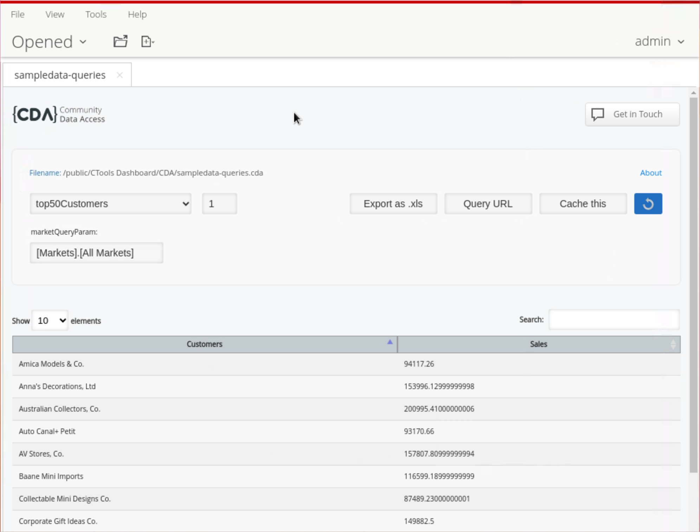
<figcaption>CDA Dashboard - Top 50 customers</figcaption>
</figure>
</div>

***

:::: tabs

### 1. CDA

> **Note:**
>
> #### The CDA folder
>
> The CDA files for these workshops live in **Public > CTools-Dashboard > CDA** in the Pentaho repository.

1. Make sure the Pentaho Server is running. On a lab VM it already is; on your own machine start it as in [Before You Start](../00-before-you-start/guide.md):

```powershell
C:\Pentaho\server\pentaho-server\start-pentaho.bat
```

It takes a few minutes; the console is ready when http://localhost:8080/pentaho opens the login page.

2. Open the Pentaho User Console (PUC) with the button below and sign in as `admin`.

<button data-launch="puc">Open Pentaho User Console</button>

3. Select **Browse Files**. Under **Folders**, expand **Public > CTools-Dashboard** and select **CDA**.

<div align="center">
<figure>
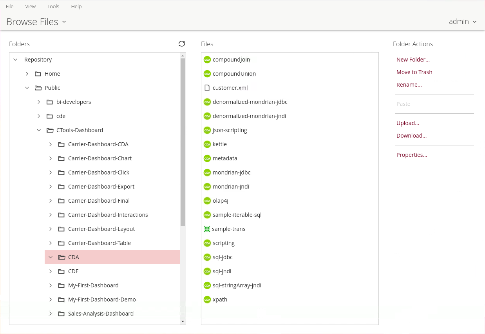
<figcaption>CDA samples</figcaption>
</figure>
</div>

> **Success:** Checkpoint: **Files** lists **sql-jndi**, the file from [Creating a CDA](../05-community-data-access-creating-a-cda/guide.md). The picture shows the folder on a server where the CDA sample files were copied into it too.

### 2. CDA - sampledata

> **Note:**
>
> #### sampledata-queries.cda
>
> This file defines one connection, to the SteelWheels cube on the SampleData database that ships with the server, and four MDX queries. The first three return the unique members of the territories, the countries and the cities, and reorder the columns from 0, 1 to 1, 0. The last returns the top 50 customers by Sales across the markets. It takes a parameter, `${marketQueryParam}`, whose default is all markets, and which could filter for one market.

```xml
<?xml version="1.0" encoding="utf-8"?>
<CDADescriptor>
    <DataSources>
        <Connection id="SampleData" type="mondrian.jndi">
            <Jndi>SampleData</Jndi>
            <Catalog>mondrian:/SteelWheels</Catalog>
            <Cube>SteelWheelsSales</Cube>
        </Connection>
    </DataSources>
    <DataAccess id="territories" connection="SampleData" type="mdx" access="public">
        <Name>territories</Name>
        <BandedMode>compact</BandedMode>
        <Query>
            WITH 
                MEMBER [Measures].[UID] AS [Markets].CURRENTMEMBER.UNIQUENAME
            SELECT 
                UNION([Markets].[All Markets], DESCENDANTS([Markets].[All Markets], [Markets].[Territory])) on ROWS,
                {[Measures].[UID]} on COLUMNS
            FROM [SteelWheelsSales]
        </Query>
        <Output indexes="1,0" mode="include"/>
    </DataAccess>   
    <DataAccess id="countries" connection="SampleData" type="mdx" access="public">
        <Name>countries</Name>
        <BandedMode>compact</BandedMode>
        <Query>
            WITH 
                MEMBER [Measures].[UID] AS [Markets].CURRENTMEMBER.UNIQUENAME
            SELECT 
                UNION([Markets].[All Markets], DESCENDANTS(${marketQueryParam}, [Markets].[Country])) on ROWS,
                {[Measures].[UID]} on COLUMNS
            FROM [SteelWheelsSales]
        </Query>
        <Parameters>
            <Parameter name="marketQueryParam" type="String" default="[Markets].[All Markets]"/>
        </Parameters>
        <Output indexes="1,0" mode="include"/>
    </DataAccess>   
    <DataAccess id="cities" connection="SampleData" type="mdx" access="public">
        <Name>cities</Name>
        <BandedMode>compact</BandedMode>
        <Query>
            WITH 
                MEMBER [Measures].[UID] AS [Markets].CURRENTMEMBER.UNIQUENAME
            SELECT 
                UNION([Markets].[All Markets], DESCENDANTS(${marketQueryParam}, [Markets].[City])) on ROWS,
                {[Measures].[UID]} on COLUMNS
            FROM [SteelWheelsSales]
        </Query>
        <Parameters>
            <Parameter name="marketQueryParam" type="String" default="[Markets].[All Markets]"/>
        </Parameters>
        <Output indexes="1,0" mode="include"/>
    </DataAccess>   
    <DataAccess id="top50Customers" connection="SampleData" type="mdx" access="public">
        <Name>top50Customers</Name>
        <BandedMode>compact</BandedMode>
        <Query>
            WITH 
                SET CUSTOMERS AS TopCount([Customers].Children, 50.0, [Measures].[Sales])
            SELECT 
                NON EMPTY {[Measures].[Sales]} ON COLUMNS,
                NON EMPTY CUSTOMERS ON ROWS 
            FROM [SteelWheelsSales]
            WHERE ${marketQueryParam}
        </Query>
        <Parameters>
            <Parameter name="marketQueryParam" type="String" default="[Markets].[All Markets]"/>
        </Parameters>
    </DataAccess>

</CDADescriptor>
```

This file is not installed on your server: create it from the listing. The dashboard workshops use queries like these.

1. In a text editor, paste the listing above and save it as `sampledata-queries.cda`.
2. In the PUC, select the **CDA** folder. Under **Folder Actions**, select **Upload...**. Select **Browse...**, choose `sampledata-queries.cda`, and select **OK**.
3. If the file is not listed under **Files** yet, select the **Refresh** icon beside **Folders**.

***

#### Preview Results

4. Under **Files**, select **sampledata-queries**, and under **File Actions** select **Open**. The CDA previewer opens in a new tab.

<div align="center">
<figure>
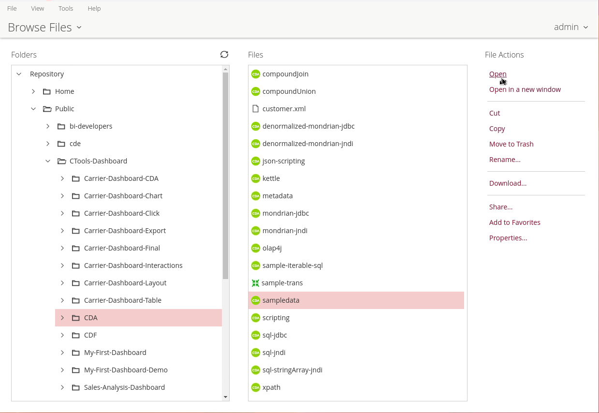
<figcaption>Open under File Actions</figcaption>
</figure>
</div>

5. In the **Data Access** list, select **territories**.

> **Success:** Checkpoint: two columns, **UID** first: each row holds a member's unique name, such as `[Markets].[All Markets]`, and its name. There is one row for All Markets and one for each territory.

6. Select **cities** in the **Data Access** list. The previewer shows the **marketQueryParam** parameter with its default, `[Markets].[All Markets]`.

<div align="center">
<figure>
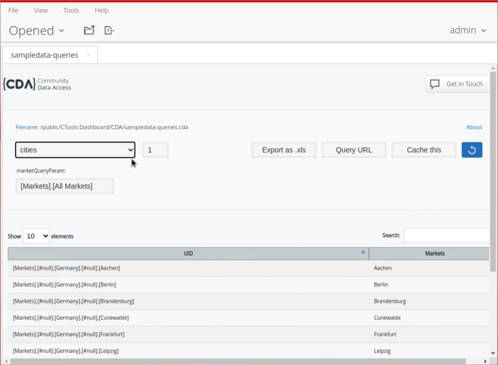
<figcaption>sampledata-queries.cda - cities query</figcaption>
</figure>
</div>

> **Success:** Checkpoint: one row per city, plus All Markets, with each city's unique name in **UID** and its name beside it. The previewer shows 10 rows per page.

7. Select **top50Customers** in the **Data Access** list.

> **Success:** Checkpoint: 50 rows of customers with their **Sales**, 10 per page. Of the 98 customers with orders in SampleData, the query keeps the 50 with the highest sales.

8. Select **countries** in the **Data Access** list, set **marketQueryParam** to `[Markets].[EMEA]`, and select the refresh button to the right of the **Data Access** list. Only All Markets and the countries of the EMEA territory remain.

> **Under the hood:**
>
> #### compact mode, and why the columns are swapped
>
> BandedMode compact returns the plain result set: one column for the
> row members and one per measure (classic, the original mode, returns
> every hierarchy with its fully qualified name). For these queries that
> is the member's name in column 0 and its unique name, the UID measure,
> in column 1.
>
> Output indexes="1,0" puts the unique name first because CDF's Filter
> component, the selector workshop 12 uses, takes each option's value
> from column 0 and its label from column 1. The value a user picks is
> then a unique name such as [Markets].[EMEA], which CDA writes into
> DESCENDANTS(${marketQueryParam}, [Markets].[Country]) in the next
> query.
>
> **Why it matters:** one query feeds a selector with ready-made values,
> and the value the user picks drops straight into the next query's MDX.
> The dashboard needs no code to translate between the two.

***

#### Previewer

9. Select **Query URL**.

<div align="center">
<figure>
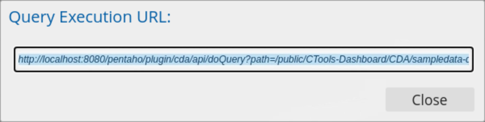
<figcaption>Query Execution URL for the selected query</figcaption>
</figure>
</div>

> **Success:** Checkpoint: **Query Execution URL** shows the `doQuery` call for the selected query, with its `path`, `dataAccessId` and parameter values.

10. Select **Close**.
11. In a new browser tab, open the CDA editor for the file with this URL:

```text
http://localhost:8080/pentaho/plugin/cda/api/editFile?path=/public/CTools-Dashboard/CDA/sampledata-queries.cda
```

<div align="center">
<figure>
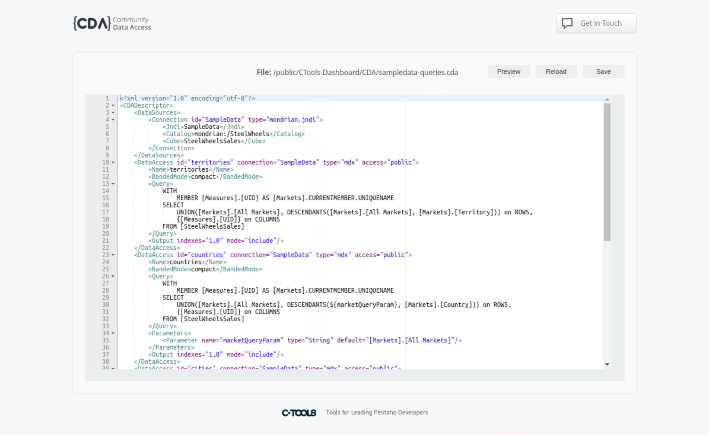
<figcaption>CDA editor</figcaption>
</figure>
</div>

> **Success:** Checkpoint: the editor shows the file's XML. Above it on the right are three buttons:
>
> * **Save** - saves your changes to the file
> * **Reload** - reloads the file as last saved
> * **Preview** - opens the CDA previewer for the file

12. Leave the editor open for the next tab.

### 3. CDA - Cache

> **Note:**
>
> #### CDA - Cache
>
> CDA can cache the results of the queries it runs, for the time the data access defines, so that the next request with the same parameter values doesn't go to the database. The Optimization topics return to this.

Caching is set on the `DataAccess` element:

```xml
<DataAccess id="your_query_id" cache="true" cacheDuration="3600">
```

* `cache="true"` turns caching on. Without it, or a `<Cache>` element, a query is not cached.
* `cacheDuration="3600"` sets how long a result stays cached, in seconds (3600 is 1 hour).
* A `<Cache>` element inside the data access overrides both attributes, `<Cache enabled="true" duration="3600"/>`, and can carry extra cache keys, `<Key name="..." value="..."/>`, that become part of the cache key.

Two related names are not DataAccess attributes: `executeAtStart`, which runs cached queries when the server starts, is a server-wide property (`pt.webdetails.cda.cache.executeAtStart` in `cda.properties`, `false` by default), and `outputIndexId` is a `doQuery` URL parameter that picks which `<Output>` element shapes the result.

A complete cached query looks like this:

```xml
<CDADescriptor>
  <DataAccess id="myQuery" 
              connection="myConnection"
              type="sql" 
              cache="true"
              cacheDuration="3600">
    <Name>My Cached Query</Name>
    <Query>
      SELECT * FROM my_table
    </Query>
  </DataAccess>
</CDADescriptor>
```

The queries in `sampledata-queries.cda` have no cache attribute, so CDA doesn't cache them. Turn caching on for **cities**.

1. In the CDA editor, change the `cities` data access's first line to:

```xml
<DataAccess id="cities" connection="SampleData" type="mdx" access="public" cache="true" cacheDuration="3600">
```

2. Select **Save**, then **Preview**. The previewer opens for the file.
3. In the **Data Access** list, select **cities**. CDA runs the query and caches the result.
4. Select **Cache this**.

<div align="center">
<figure>
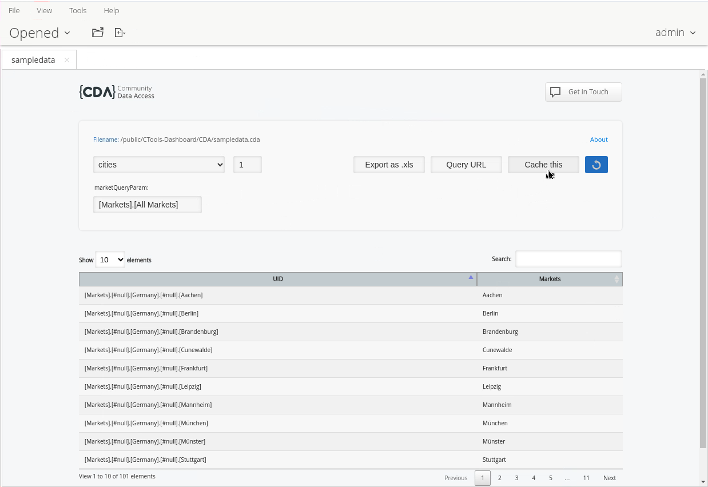
<figcaption>Cache this button for the cities query</figcaption>
</figure>
</div>

5. CDA asks what schedule this query should run on. Select **every week**, enter `1` in the field after **on the** (the day of the week, from 1 to 7), and select **Ok**.

<div align="center">
<figure>
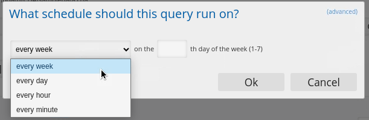
<figcaption>Set a schedule</figcaption>
</figure>
</div>

To enter a cron expression instead, select **(advanced)** at the top right of the dialog and enter it in **Cron Expression**.

<div align="center">
<figure>
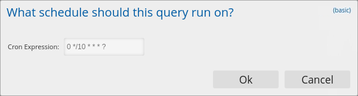
<figcaption>CRON</figcaption>
</figure>
</div>

6. Open the CDA Cache Manager with this URL:

```text
http://localhost:8080/pentaho/plugin/cda/api/manageCache
```

7. Select **Scheduled Queries**.

<div align="center">
<figure>
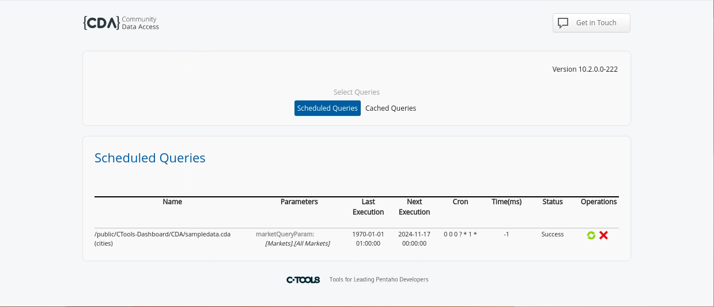
<figcaption>Cache Manager</figcaption>
</figure>
</div>

> **Success:** Checkpoint: a row for the **cities** query of `sampledata-queries.cda`, with its parameter, its cron expression and its next execution.

8. Select **Cached Queries**.

<div align="center">
<figure>
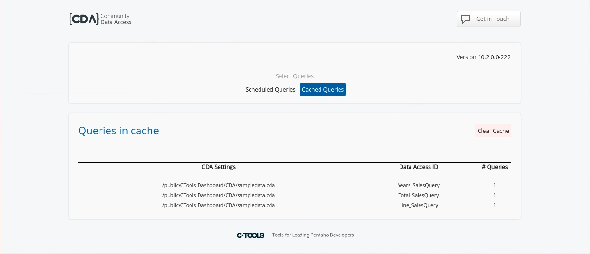
<figcaption>Cached Queries</figcaption>
</figure>
</div>

> **Success:** Checkpoint: **Queries in cache** has a row for `sampledata-queries.cda` with the **Data Access ID** `cities`. The picture shows the cached queries of another file.

9. Select the row. The cache entries for **cities** open below it, with their **Parameters**, **Rows**, **Mem.Size** and **# Hits**.

> **Under the hood:**
>
> #### What goes into a cache key
>
> CDA keys a cached result on the connection, the query text, its type
> and every parameter value, sorted by name, plus any Key entries from a
> Cache element. Requests that differ in any parameter are separate
> cache entries; identical ones share one.
>
> For MDX, CDA adds the Mondrian role to the key, so users whose roles
> see different data never share a cached result. A SQL key carries no
> user at all: if a query's rows depend on who is asking, put the user
> into a parameter or a Key, such as <Key name="user"
> value="${[security:principalName]}"/>, or every user gets whoever ran
> it first.
>
> Cache this schedules the query to run on your cron and refill the
> cache, so the first user of the day doesn't wait for the database.
>
> **Why it matters:** caching makes repeat requests free, but only for
> queries whose results are the same for everyone who shares a key.

***

**Clear Cache** removes cached entries. When the cache is empty, **Queries in cache** says so:

<div align="center">
<figure>
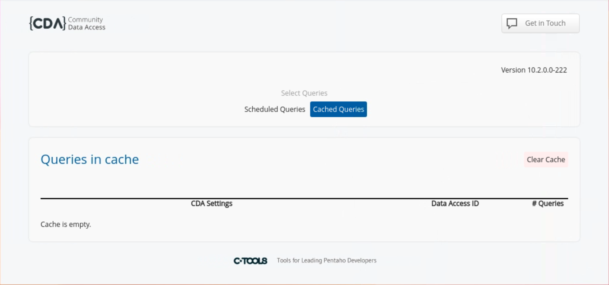
<figcaption>Cache Manager with an empty cache</figcaption>
</figure>
</div>

::::

<button data-launch="puc">Open Pentaho User Console</button>

## Lab Files

_No bundled files for this lab._
