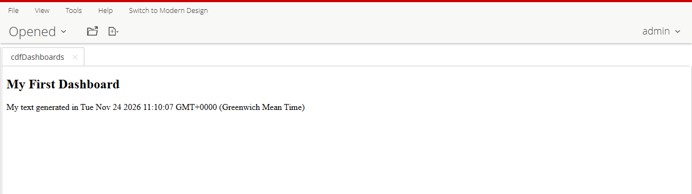

# CDF Dashboards

> **Warning:**
>
> #### Workshop - CDF Dashboards
>
> The Community Dashboard Framework (CDF) is the code-first foundation beneath every CTools dashboard. Where the Community Dashboard Editor (CDE) hands you a graphical grid, CDF has you assemble a dashboard the way a web developer would, from two plain files that you author and upload yourself: an XCDF descriptor and an HTML template. In this workshop you build a CDF dashboard whose template loads CDF through RequireJS and adds a component, so you can read, debug and extend what CDE generates.
>
> **What you'll do**
>
> * Create an XCDF descriptor and learn how `title`, `template`, `style` and `require` drive the dashboard
> * Author an HTML template with a container element for a component
> * Add a RequireJS script that creates the dashboard and a Text component
> * Upload both files and open the dashboard in the Pentaho User Console
>
> **Prerequisites:** [CDF Dashboard](../08-community-dashboard-framework-cdf-dashboard/guide.md), which creates the `CTools-Dashboard/CDF` folder; basic HTML, CSS and JavaScript; a text editor; a running Pentaho Server
>
> **Estimated time:** 25 minutes

A CDF dashboard is built from two mandatory files:

| File | Role |
| --- | --- |
| **XCDF** | The descriptor that identifies the file as a CDF dashboard inside Pentaho, and holds the general settings: title, template, style. Written in XML. |
| **HTML** | The template file whose HTML the components render into. |

***

:::: tabs

### 1. XCDF

> **Note:**
>
> #### The XCDF descriptor
>
> The `.xcdf` file is the root of the dashboard. It identifies the file to Pentaho as a CDF dashboard and names, in its `<template>` element, the HTML file that holds the markup. It is the file you see in the PUC's file browser; opening it renders the dashboard.

1. In a text editor, create a file named `cdfDashboards.xcdf` with this content, or download [cdfDashboards.xcdf](./files/cdfDashboards.xcdf) from **Lab Files** at the end of this page:

```xml
<?xml version="1.0" encoding="UTF-8"?>
<cdf>
  <title>CDF Dashboards</title>
  <author>My Name</author>
  <description>A CDF dashboard with a Text component</description>
  <icon></icon>
  <template>cdfDashboards.html</template>
  <style>clean</style>
  <require>true</require>
</cdf>
```

The root element is `<cdf>`, with these child elements:

| Element | Description |
| --- | --- |
| `<title>` | The title displayed in the Pentaho User Console (PUC). |
| `<author>` | The author of the file, displayed in the PUC. |
| `<description>` | The description displayed in the PUC and in the browser. |
| `<icon>` | The icon to display. |
| `<template>` | The HTML template file the components render into: here `cdfDashboards.html`. |
| `<style>` | The dashboard style applied around the template, for example `clean`. |
| `<require>` | Whether the dashboard uses RequireJS (AMD) module loading. |

The `<template>` value is a relative reference to an HTML file in the same repository folder, so keep the `.xcdf` file and its template together.

### 2. HTML

> **Note:**
>
> #### The HTML template
>
> The HTML file supplies the layout and the container elements that components target by id. Each component declares an `htmlObject` that must match the `id` of an element in the template: that is how CDF knows where on the page to render it.

1. In the same folder as `cdfDashboards.xcdf`, create `cdfDashboards.html` with this layout:

```html
<div class="dashboard">
  <h2>My First Dashboard</h2>
  <div id="panel_1"></div>
</div>
```

The element with `id="panel_1"` is the htmlObject that a component renders into. In the next tab you add a component whose `htmlObject` is `panel_1`.

### 3. RequireJS

> **Note:**
>
> #### Opting into AMD
>
> `<require>true</require>` in the XCDF descriptor opts the dashboard into RequireJS, CDF's implementation of Asynchronous Module Definition (AMD). CDF then loads its modules, and your components, through RequireJS, which keeps code out of the global namespace and loads the dependencies in the right order.

With `require` on, the template creates the dashboard itself, in a script that names the modules it needs. CDF's own samples are written this way.

1. Add this script to the end of `cdfDashboards.html` and save the file. [cdfDashboards.html](./files/cdfDashboards.html) in **Lab Files** is the finished template, with the script in place:

```html
<script type="text/javascript">
require([
  'cdf/Dashboard.Clean',
  'cdf/components/TextComponent'
], function(Dashboard, TextComponent) {
  var dashboard = new Dashboard();
  dashboard.addComponent(new TextComponent({
    name: "textGenerator",
    type: "textComponent",
    listeners: [],
    expression: function() {
      return "My text generated in " + new Date();
    },
    htmlObject: "panel_1",
    executeAtStart: true
  }));
  dashboard.init();
});
</script>
```

The script loads two modules, the clean dashboard type and the Text component. It creates the dashboard, adds a Text component that writes the result of its `expression` into `panel_1`, and starts the dashboard with `init()`. Because the dependencies are declared, not taken from globals, the same structure lets you embed a CDF dashboard in another application.

> **Under the hood:**
>
> #### require moves the loading into your template
>
> With require on, CDF puts no CDF scripts in the page head. Your
> template's own require([...]) call loads cdf/Dashboard.Clean and each
> component module it lists, on demand, then creates the dashboard
> object, adds the components and calls init(). CDF's own samples are
> written exactly this way.
>
> With require off, the renderer scans your HTML for the components it
> uses and writes a script and stylesheet tag for each into the head
> before the page loads. Either way, the style element still picks the
> wrapper page: clean here, mantle when it is left out.
>
> **Why it matters:** the page loads only the modules the dashboard
> names, and everything the dashboard depends on is written in its own
> template, where you can read it.

### 4. Upload & Preview

> **Note:**
>
> #### Upload and preview the dashboard
>
> Upload both files to the same folder of the Pentaho repository and let CDF render the dashboard.

1. Make sure the Pentaho Server is running. On a lab VM it already is; on your own machine start it as in [Before You Start](../00-before-you-start/guide.md):

```powershell
C:\Pentaho\server\pentaho-server\start-pentaho.bat
```

It takes a few minutes; the console is ready when http://localhost:8080/pentaho opens the login page.

2. Open the Pentaho User Console (PUC) with the button below and sign in as `admin`.

<button data-launch="puc">Open Pentaho User Console</button>

3. Select **Browse Files**. Under **Folders**, expand **Public > CTools-Dashboard** and select **CDF**.
4. Under **Folder Actions**, select **Upload...**. Select **Browse...**, choose `cdfDashboards.xcdf`, and select **OK**.
5. Upload `cdfDashboards.html` to the same folder the same way.
6. If the files are not listed under **Files** yet, select the **Refresh** icon beside **Folders**.
7. Under **Files**, double-click **cdfDashboards**, the XCDF file, not the HTML template.

<div align="center">
<figure>

<figcaption>The Text component writes into panel_1</figcaption>
</figure>
</div>

> **Success:** Checkpoint: the dashboard opens in a new **cdfDashboards** tab in the User Console with the heading **My First Dashboard** and, under it, the line `My text generated in` followed by the date and time the page loaded.

8. Close the dashboard's tab.

> **Note:** Because `<template>` resolves relative to the `.xcdf` file, both files must be in the same folder. If the dashboard renders blank, check that the template file name in the XCDF matches the uploaded HTML file exactly. A change to either file takes effect on the next render: open the `.xcdf` again, or refresh the browser, after you upload it.

::::

## Lab Files

Click a file to download. Every file is also on disk in this workshop's folder, `C:\Workshop-CT-Associate\03-community-dashboard-framework\09-community-dashboard-framework-cdf-dashboards`.

The XCDF descriptor from the first tab:

[cdfDashboards.xcdf](./files/cdfDashboards.xcdf)

The finished HTML template, with the RequireJS script from the third tab:

[cdfDashboards.html](./files/cdfDashboards.html)
