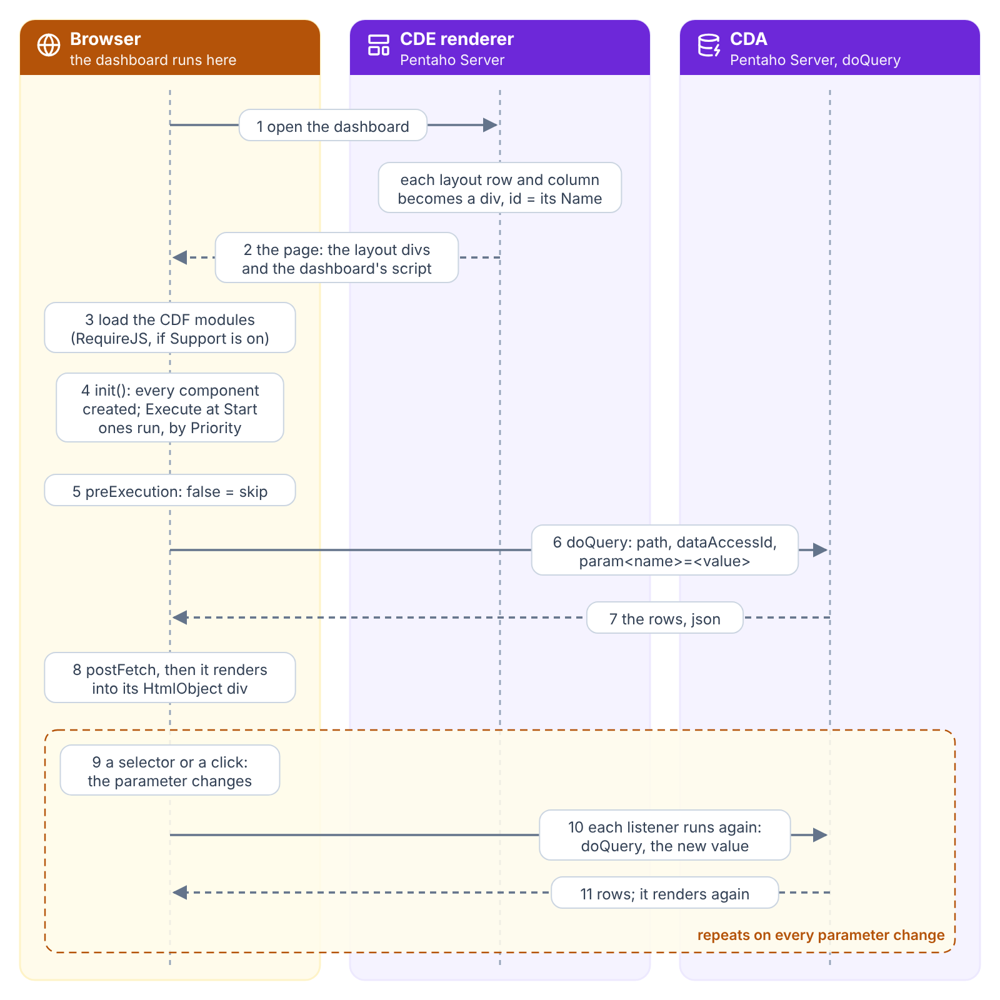

# Overview of Community Dashboard Editor

The **Community Dashboard Editor (CDE)** is a graphical dashboard editor that sits on top of CDF. Instead of hand-coding the framework, you build dashboards through a guided **Layout → Components → Data Sources** workflow — designing responsive layouts, wiring up charts and selectors, and connecting them to live data, all from a visual interface.

While the previous **Community Dashboard Framework (CDF)** covered creating dashboards through code, this chapter introduces a faster, more user-friendly approach using **CDE**. CDE is a Pentaho server plugin that simplifies dashboard creation through its graphical interface, eliminating the need for extensive manual coding.

## What this chapter covers

This chapter focuses on:

- Creating dashboards using a graphical user interface
- Building responsive layouts
- Adding and configuring components
- Incorporating custom code and resources (JavaScript/CSS)
- Managing data sources through the interface

> **Note:**
>
> #### CDF still matters
>
> Although CDE builds on the **CDF** foundation covered previously, you don't need to write CDF code directly. However, understanding CDF's core concepts — especially dashboard and component **lifecycles** — remains crucial for maximizing CDE's potential. This knowledge will help you create more sophisticated dashboards even when using the graphical interface exclusively.

Through CDE, you'll significantly reduce development time while maintaining full control over your dashboard's functionality. The visual approach makes dashboard creation more accessible without sacrificing the power and flexibility of the underlying framework.

<figure>

<figcaption>The lifecycle of a CDE dashboard, from the page request to the interaction loop</figcaption>
</figure>

Read the diagram from the top. Opening the dashboard asks the CDE renderer on the Pentaho Server for a page, and CDE writes every layout row and column into it as a div whose id is the element's Name, together with the dashboard's script. In the browser that script loads the CDF modules, through RequireJS when the dashboard's **RequireJS Support** setting is on, and `init()` creates every component; those with **Execute at Start** set run in **Priority** order, unless their `preExecution` returns false. Each running component asks CDA for its rows with `doQuery`, passes them to `postFetch` and then renders into the div its **HtmlObject** names. The band at the bottom repeats for as long as the dashboard is open: a selector or a click changes a parameter, and every component listening to it queries CDA again and renders again.
