# Carrier Dashboard

> **Warning:**
>
> #### Workshop - Carrier Dashboard
>
> Build the Wireless Carrier dashboard in the Community Dashboard Editor (CDE): first the **Layout** (CSS styling and the CDA data sources), then the **Components** that make it interactive. It tracks call traffic by region, platform and plan, month over month, from MDX queries on a Mondrian cube.
>
> **What you'll do**
>
> * Connect the server to the `baseline_demo` PostgreSQL database and import the Wireless Carrier Mondrian schema
> * Style the dashboard layout with an external CSS file
> * Create MDX data sources with parameters, output columns and column names
> * Add a Table Component and CCC pie, line and bar charts, with colors and extension points
> * Make the dashboard interactive with parameters, listeners, Filter selectors and a pie chart click action
> * Add exports and expandable table rows
>
> **Prerequisites:**
>
> * [My First Dashboard](../03-getting-started-my-first-dashboard/guide.md) and [CDA Data Sources](../06-community-data-access-cda-data-sources/guide.md)
> * The `baseline_demo` PostgreSQL database, the schema file `Wireless Carrier.mondrian.xml`, the stylesheet `dashstyle.css`, and the starting dashboards in **Public > CTools-Dashboard** (`Carrier-Dashboard-Layout`, `Carrier-Dashboard-CDA`). This course does not install them.
> * Schema Workbench, which ships with Pentaho; some JavaScript for the functions
>
> **Estimated time:** 90 minutes

<div align="center">
<figure>
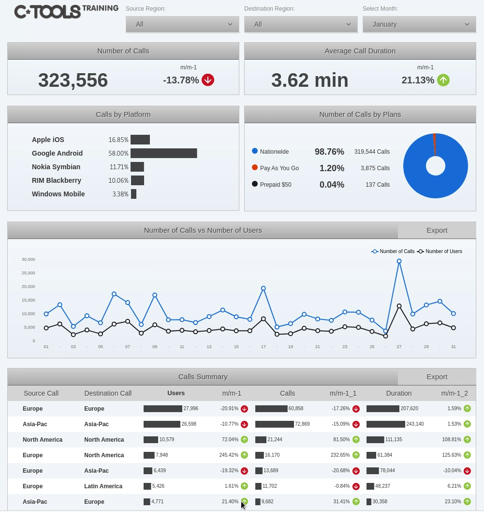
<figcaption>Wireless Carrier Dashboard</figcaption>
</figure>
</div>

***

:::: tabs

### 1. Layout

> **Note:**
>
> #### Layout
>
> Before you build the dashboard, look at its data: the `baseline_demo` database and the Mondrian schema on top of it. Then configure both on the Pentaho Server, and style the layout.

#### Prerequisites

<div align="center">
<figure>
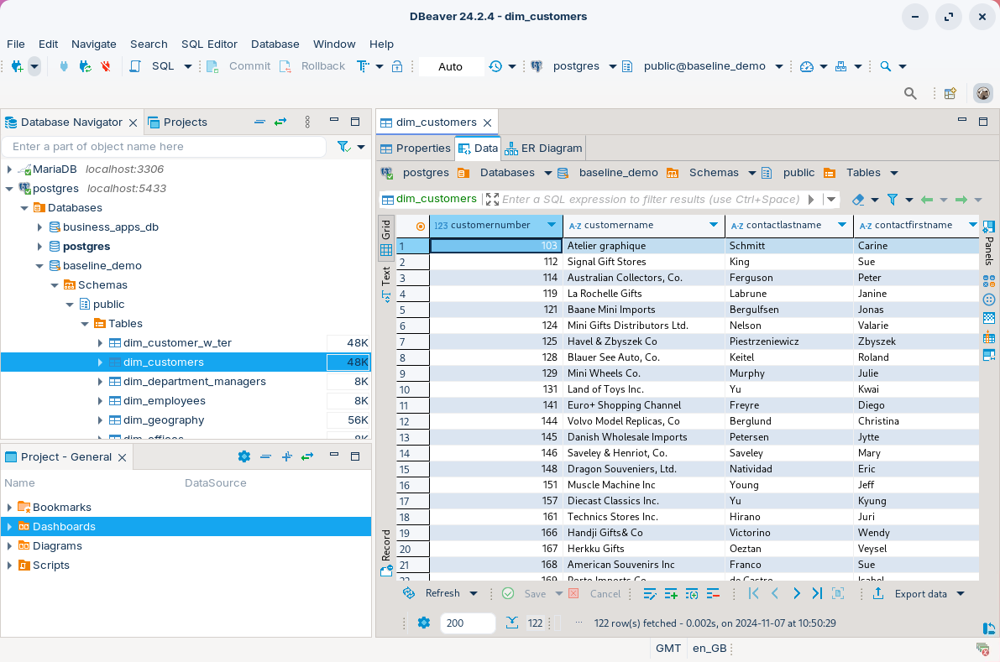
<figcaption>baseline_demo database</figcaption>
</figure>
</div>

1. Make sure the Pentaho Server is running. On a lab VM it already is; on your own machine start it as in [Before You Start](../00-before-you-start/guide.md):

```powershell
C:\Pentaho\server\pentaho-server\start-pentaho.bat
```

It takes a few minutes; the console is ready when http://localhost:8080/pentaho opens the login page.

2. In DBeaver, or another SQL client, open the `baseline_demo` PostgreSQL database and look at its tables.

The `baseline_demo` database has central fact tables, dimension tables (sometimes called lookup tables), simple join paths and a denormalized structure. Pentaho Schema Workbench maps these tables into the Wireless Carrier schema.

3. Schema Workbench loads JDBC drivers from its `drivers` folder. Copy the PostgreSQL driver there from the Pentaho Server. In PowerShell, run:

```powershell
Copy-Item C:\Pentaho\server\pentaho-server\tomcat\lib\postgresql-*.jar C:\Pentaho\design-tools\schema-workbench\drivers\
```

4. Start Schema Workbench:

::: tabs

### Windows (PowerShell)

```powershell
Set-Location C:\Pentaho\design-tools\schema-workbench
.\workbench.bat
```

### macOS / Linux

```bash
cd ~/Pentaho/design-tools/schema-workbench
./workbench.sh
```

:::

5. Select **File > Open...** and open `Wireless Carrier.mondrian.xml`.
6. Expand the **Retail Sales** and **Call Corridor** cubes: the dashboard's data comes from them.

<div align="center">
<figure>
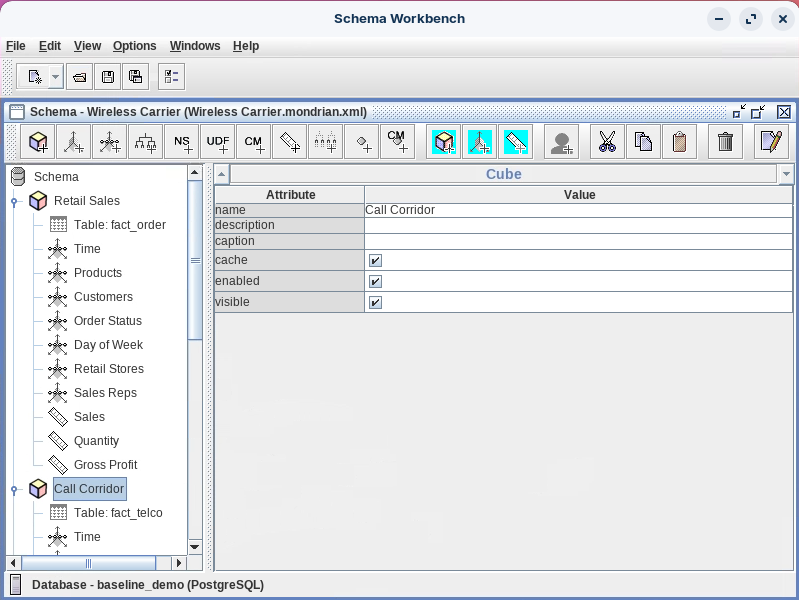
<figcaption>Wireless Carrier Mondrian Schema</figcaption>
</figure>
</div>

You can test the MDX queries that will populate the dashboard before you use them.

7. Select **File > New > MDX Query**.
8. Paste this query and select **Execute**:

```text
WITH 
 MEMBER [Measures].[Source Member Name] AS [Call Source].currentmember.uniquename
SELECT 
 [Measures].[Source Member Name]  ON 0,
 {[Call Source].[All], [Call Source].[Source Region].Members} ON 1
FROM 
 [Call Corridor]
```

<div align="center">
<figure>
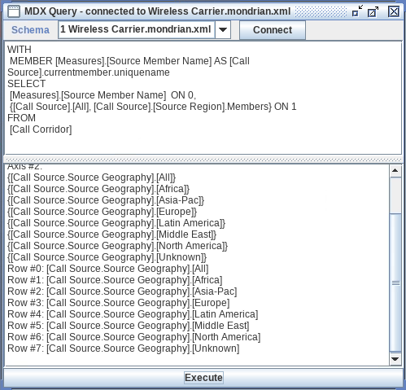
<figcaption>MDX query - All Call Regions</figcaption>
</figure>
</div>

> **Success:** Checkpoint: one row for the **All** member and one for each source region, each with its unique name in **Source Member Name**.

9. Close Schema Workbench.

***

#### Server Connection and Schema

On the Pentaho Server, define a connection to the `baseline_demo` database and upload the Wireless Carrier schema. The dashboard's MDX data sources name both.

1. In the Pentaho User Console (PUC), sign in as `admin`, open **Home**, and select **Manage Data Sources**.

<button data-launch="puc">Open Pentaho User Console</button>

2. Select the cog wheel and select **New Connection...**.

<div align="center">
<figure>
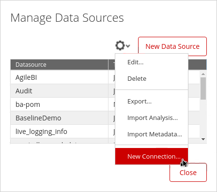
<figcaption>New JDBC connection</figcaption>
</figure>
</div>

3. In **Database Connection**, set these values. **Port Number**, **User Name** and **Password** are those of your `baseline_demo` database; the pictures use port `5433`.

| Setting | Value |
| --- | --- |
| **Connection Name** | `BaselineDemo` |
| **Database Type** | **PostgreSQL** |
| **Access** | **Native (JDBC)** |
| **Host Name** | `localhost` |
| **Database Name** | `baseline_demo` |
| **Port Number** | your database's port |
| **User Name** and **Password** | a user that can read `baseline_demo` |

4. Select **Test**.

<div align="center">
<figure>
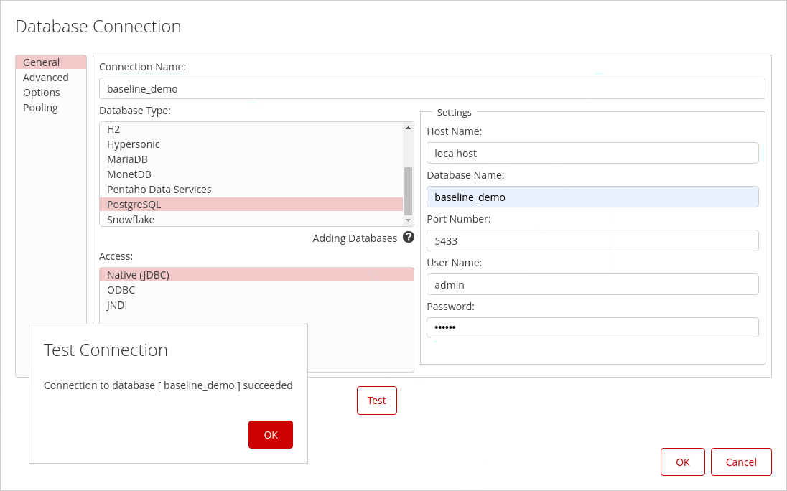
<figcaption>baseline_demo connection details</figcaption>
</figure>
</div>

> **Success:** Checkpoint: **Test Connection** reports that the connection to database `baseline_demo` succeeded.

5. Close the message and select **OK**.
6. Select the cog wheel and select **Import Analysis...**.
7. In **Import Analysis**, select the **...** button beside **Mondrian File** and choose `Wireless Carrier.mondrian.xml`. Select **Select from available data sources.**, set **Data Source** to `BaselineDemo`, and select **Import**.

<div align="center">
<figure>
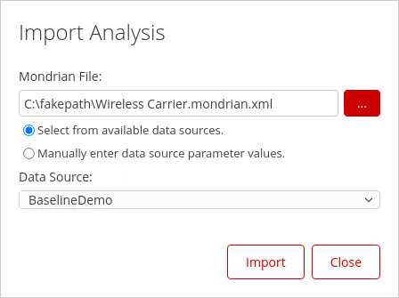
<figcaption>Import Analysis with the Wireless Carrier schema file</figcaption>
</figure>
</div>

<div align="center">
<figure>
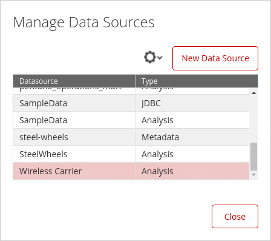
<figcaption>Wireless Carrier schema</figcaption>
</figure>
</div>

> **Success:** Checkpoint: **Manage Data Sources** lists **Wireless Carrier** with the type **Analysis**. The dashboard's `mdx over mondrianJndi` data sources can now use it.

8. Close **Manage Data Sources**.

***

#### Layout & Style

The starting dashboard assumes the groundwork from [First Steps](../02-getting-started-first-steps/guide.md) is done: the connections are tested, the layout is agreed, the chart content and types are agreed, and the dashboard's functions are listed, here exporting charts and tables.

<div align="center">
<figure>
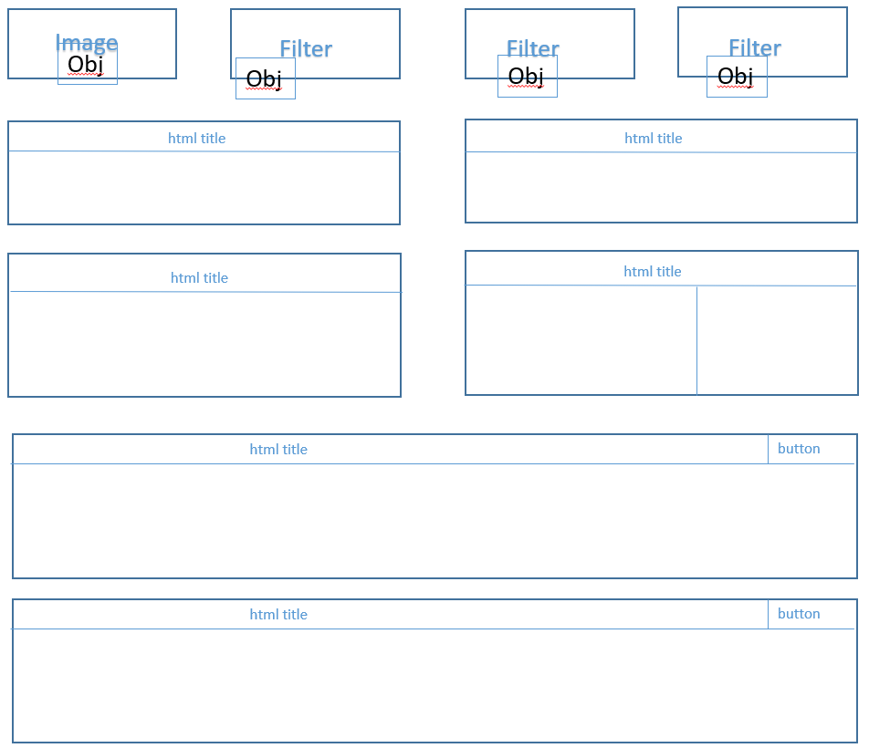
<figcaption>Dashboard layout</figcaption>
</figure>
</div>

The layout has five main rows:

* The first row has four columns: one with the logo, and three with the selectors.
* The second row has two columns with the main KPIs: Number of Calls and Average Call Duration. Each column holds two rows, one for the header and one for the data.
* The third row has two columns, each with two rows.
* The fourth and fifth rows have one column holding two rows. The first of those rows is split into two columns: a title and an Export button.

1. In the PUC, select **Browse Files**. Under **Folders**, expand **Public > CTools-Dashboard** and select **Carrier-Dashboard-Layout**.
2. Under **Files**, select **Layout**, and under **File Actions** select **Edit**. The dashboard opens in CDE.

<div align="center">
<figure>
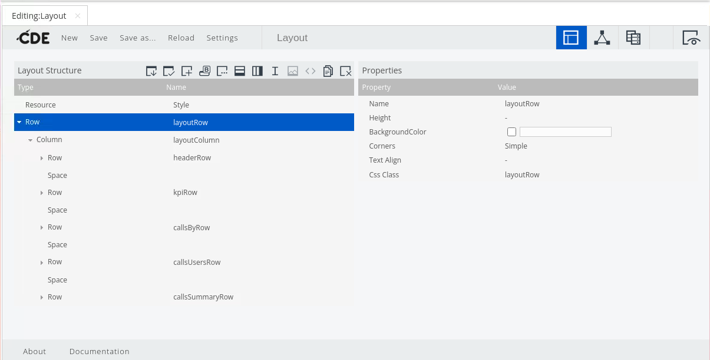
<figcaption>Layout Structure of the Layout dashboard</figcaption>
</figure>
</div>

Keep this dashboard open in its own tab: it shows each layout element's properties. Its structure, with each element's name and span:

```text
Root Container
│
└── Layout Row (id: layoutRow)
    └── Layout Column (id: layoutColumn span:12)
        └── Header Row (id: headerRow)
            ├── CTools Logo Column (id: ctoolsLogo span:3)
            ├── sourceObj Column (id: sourceOBj span:3)
            ├── destinationObj Column (id: destinationObj span:3)
            └── monthObj Column (id: monthObj span:3)
    Space
        └── KPI Row (id: kpiRow)
            └── Total Calls Column (id: totalCallsCol span:6)
                └── Total Calls Title Row (id: totalCallsTitle)
                    └── Total Calls Title Column (id: totalCallsTitle span:12)
                        └── HTML Number of Calls
                    Total Calls Row (id: totalCallsRow)
                    └── Total Calls Obj Column (id: totalCallsObj span:12)
                    
             └── Average Calls Time Column (id: totalCallsCol span:6)
                 └── Average Calls Total Title Row (id: averageCallsTimeTitleRow)
                     └── Average Calls Time Title Column (id: averageCallsTimeTitle span:12)
                         └── HTML Call Duration
                     Average Calls Time Row (id: averageCallsTimeRow)
                     └── Total Calls Time Obj Column (id: averageCallsTimeObj span:12)
    Space
        └── Calls By Row (id: callsByRow)
            └── Horizontal Bar Chart Column (id: horizontalBarChartCol span:6)
                └── Horizontal Bar Chart Title Row (id: horizontalBarChartTitleRow)
                    └── Horizontal Bar Chart Title Column (id: horizontalBarChartTitle span:12)
                        └── HTML Calls by Platform
                    Horizontal Bar Chart Row (id: horizontalBarChartRow)
                    └── Horizontal Bar Chart Obj Column (id: horizontalBarChartObj span:12)

            └── Pie Chart Title Column (id: pieChartTitleCol span:6)
                └── Pie Chart Total Title Row (id: pieChartTitleRow)
                    └── Pie Chart Title Column (id: averageCallsTimeTitle span:12)
                        └── HTML Number of Calls
                    Pie Chart Row (id: pieChartRow)
                    └── Pie Chart Table Obj Column (id: pieChartTableObj span:8)
                    └── Pie Chart Obj Column (id: pieChartObj span:4)
    Space
        └── Calls Summary Row (id: callsSummaryRow)
            └── Calls Summary Column (id: callsSummaryCol span:12)
                └──Table Title Row (id: tableTitleRow)
                   └── Table Title Column (id: tableTitle span:10)
                       └── HTML Calls Summary
                   └── Export Table Button Obj (id: exportTableButtonObj span:2)
                   Main Table Row (id: mainTableRow)
                   └── Main Table Obj Column (id: mainTableObj span:12)
```

> **Tip:** For practice, build this structure yourself in a new CDE dashboard in a folder of your own: use **Add Row** and **Add Columns** in the **Layout Structure** toolbar, and give each element the name and span in the tree.

Most layouts today are styled with Cascading Style Sheets (CSS). Add the dashboard's stylesheet as a resource.

3. In the **Layout Structure** toolbar, select the **Add Resource** icon.

<div align="center">
<figure>
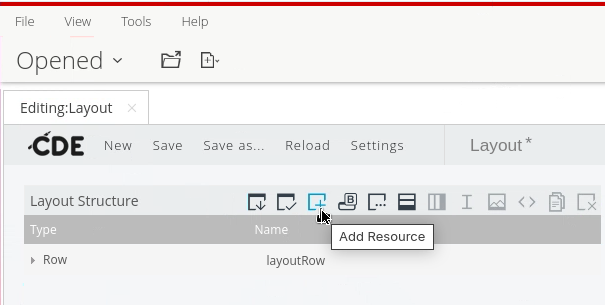
<figcaption>Add Resource</figcaption>
</figure>
</div>

4. In **Add Resource**, set **Resource Type** to **Css** and **Resource Source** to **External File**, and select **Ok**.

<div align="center">
<figure>
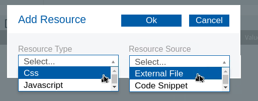
<figcaption>CSS External File</figcaption>
</figure>
</div>

5. Select the **^** button in the **Resource file** value. Browse to **Carrier-Dashboard-Layout > resources > css**, select `dashstyle.css`, and select **Ok**.

<div align="center">
<figure>
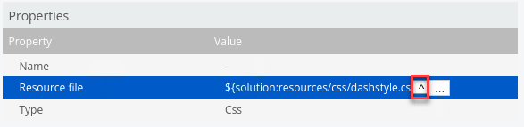
<figcaption>Add dashstyle.css</figcaption>
</figure>
</div>

<div align="center">
<figure>
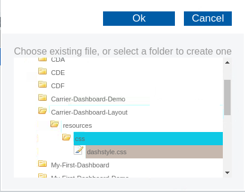
<figcaption>dashstyle.css</figcaption>
</figure>
</div>

6. In **Properties**, set **Name** to `Style`.

<div align="center">
<figure>
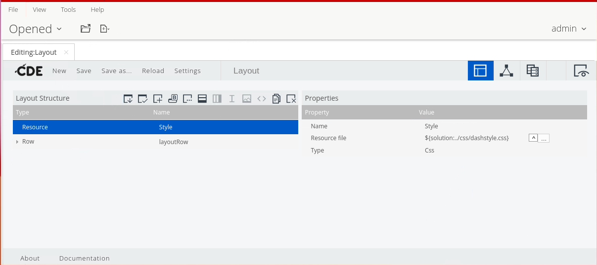
<figcaption>Add a Resource - CSS</figcaption>
</figure>
</div>

> **Success:** Checkpoint: **Layout Structure** lists a **Resource** named **Style**, whose **Type** is **Css** and whose **Resource file** points at `dashstyle.css`.

7. Select **Save**, then **Preview your Dashboard**.

<div align="center">
<figure>
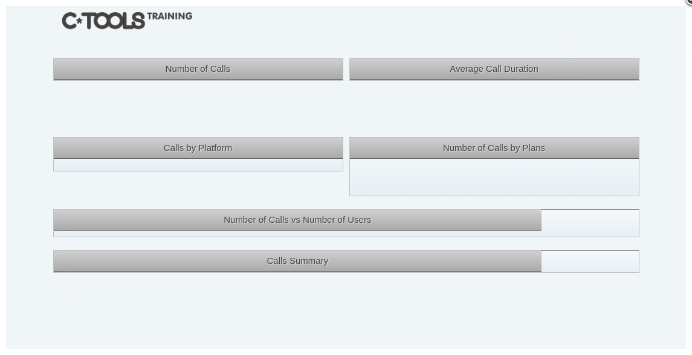
<figcaption>Layout</figcaption>
</figure>
</div>

> **Success:** Checkpoint: the layout styled by `dashstyle.css`: the logo and the panel headers, with no data in the panels yet.

8. Close the preview.

A finished version of this part is **Layout** in **Public > CTools-Dashboard > Carrier-Dashboard-Layout**.

#### CDA - sourceSelectorQuery

All the data in this dashboard comes from ten MDX queries. The three selectors, Source Region, Destination Region and Month, are filled by MDX queries, as are the tables and charts. Here you add the first queries: one returns the values for the Source Region selector, the next the rows of the main table, with several parameters.

<div align="center">
<figure>
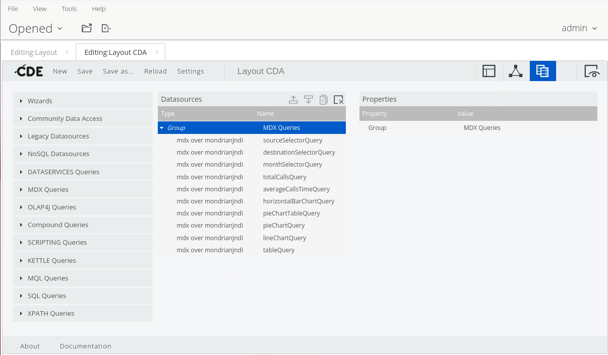
<figcaption>MDX Data Sources</figcaption>
</figure>
</div>

Start with the MDX query that returns the list of regions.

1. In **Browse Files**, select **Public > CTools-Dashboard > Carrier-Dashboard-CDA**. Under **Files**, select **Layout**, and under **File Actions** select **Edit**.

<div align="center">
<figure>
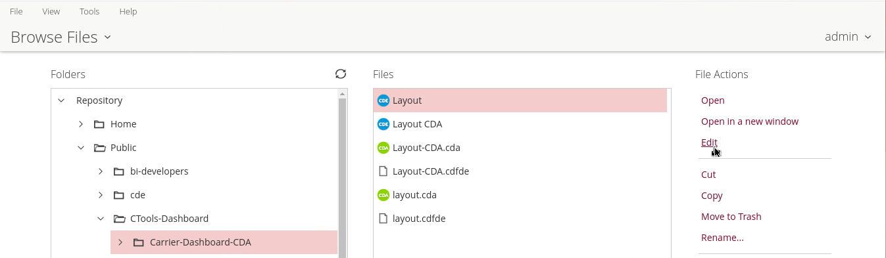
<figcaption>Layout Dashboard</figcaption>
</figure>
</div>

2. Select **Datasources Panel**, the perspective icon at the top right.
3. In the list on the left, expand **MDX Queries** and select **mdx over mondrianJndi**.

<div align="center">
<figure>
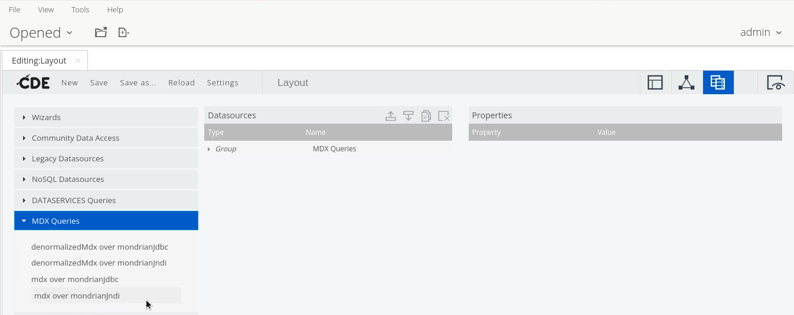
<figcaption>mdx over mondrianjndi</figcaption>
</figure>
</div>

4. In **Properties**, set **Name** to `sourceSelectorQuery`. Ending a data source's name with `Query` is good practice.
5. Click in the **Jndi** value and select `BaselineDemo` from its list.
6. Click in the **Mondrian schema** value and select `Wireless Carrier`.
7. Select the **...** button in the **Query** value. In **MDX Editor**, enter this query and select **Ok**:

```text
WITH 
 MEMBER [Measures].[Source Member Name] AS [Call Source].currentmember.uniquename
SELECT 
 [Measures].[Source Member Name]  ON 0,
 {[Call Source].[All], [Call Source].[Source Region].Members} ON 1
FROM 
 [Call Corridor]
```

The query creates a calculated member, Source Member Name, and returns the list of source regions from the Call Source dimension.

<div align="center">
<figure>
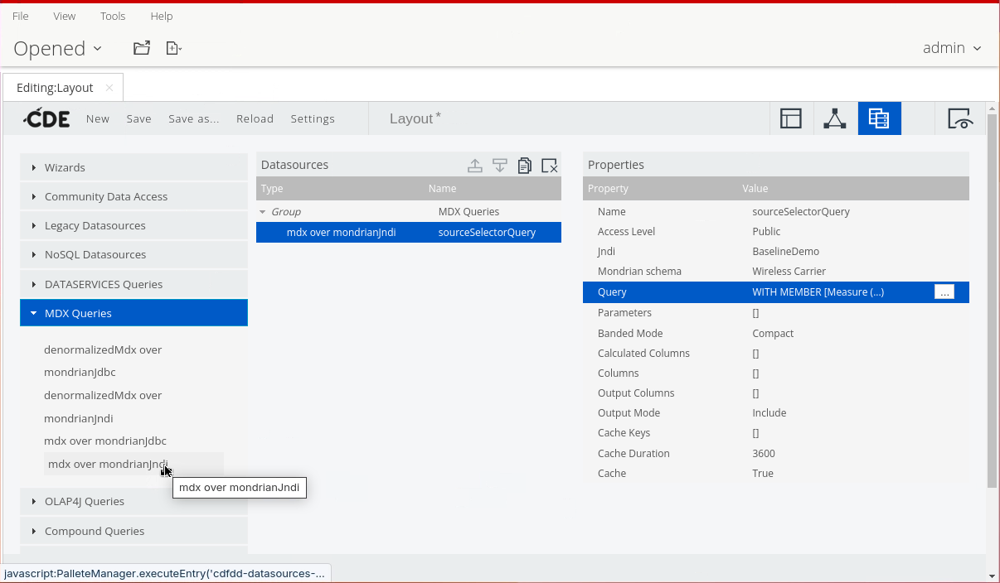
<figcaption>sourceSelectorQuery</figcaption>
</figure>
</div>

8. Select **Save**. CDE writes the data sources to `layout.cda`, beside the dashboard.
9. In **Browse Files**, select `layout.cda` in **Carrier-Dashboard-CDA** and select **Open** under **File Actions**. In the CDA previewer, select **sourceSelectorQuery** in the **Data Access** list.

<div align="center">
<figure>
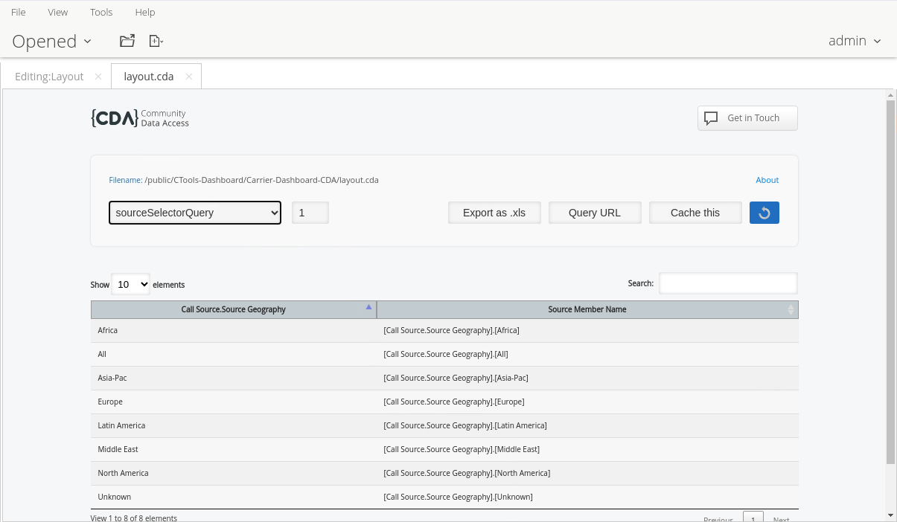
<figcaption>Layout.cda</figcaption>
</figure>
</div>

> **Success:** Checkpoint: one row per source region plus All, with the region's name in the first column and its unique name, **Source Member Name**, in the second. That is the wrong way round for a selector.

10. Return to the editor tab. Click in the **Output Columns** value. In **Output Columns**, select **Add** until there are two rows, enter `1` in the first and `0` in the second, and select **Ok**.

<div align="center">
<figure>
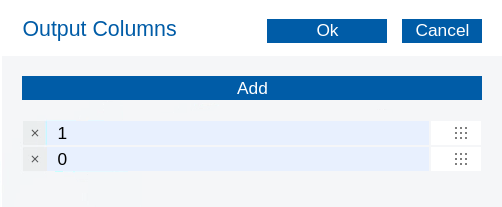
<figcaption>Change the column order</figcaption>
</figure>
</div>

11. Select **Save**. In the `layout.cda` tab, select the refresh button to the right of the **Data Access** list.

<div align="center">
<figure>
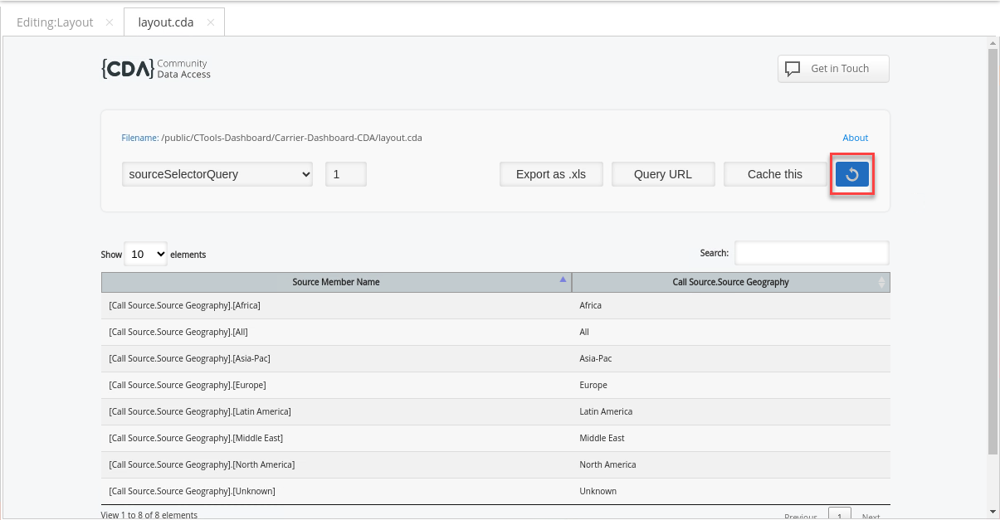
<figcaption>Refresh CDA Dashboard</figcaption>
</figure>
</div>

> **Success:** Checkpoint: **Source Member Name** is now the first column. If the list includes an `Unknown` region, the geography data in `baseline_demo` has rows with no region.

12. Return to the editor tab.

> **Under the hood:**
>
> #### Save rebuilds the .cda; selectors read column 0
>
> Every save writes the Data Sources panel out as layout.cda beside the
> dashboard, and that file is what the CDA previewer opens, which is why
> the column swap only shows after saving and refreshing. Output Columns
> 1,0 becomes <Output indexes="1,0"/> in it.
>
> The swap matters because the Filter component that will use this query
> takes each option's value from column 0 and its label from column 1.
> After the swap the value is the member's unique name, which the
> dashboard passes into the other queries' MDX, and the label is the
> readable region name.
>
> **Why it matters:** the `.cda` is generated, never edited by hand
> here: change the data source in CDE and save, or your edit is lost at
> the next save.

#### CDA - tableQuery

The next MDX query fills the main dashboard table. It has parameters.

1. Select **sourceSelectorQuery** in the **Datasources** list and select the **Duplicate datasource** icon. Set the copy's **Name** to `tableQuery`.

<div align="center">
<figure>
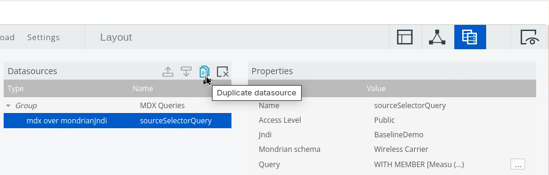
<figcaption>Duplicate Query</figcaption>
</figure>
</div>

2. Click in the **Output Columns** value, remove both rows, and select **Ok**.

<div align="center">
<figure>
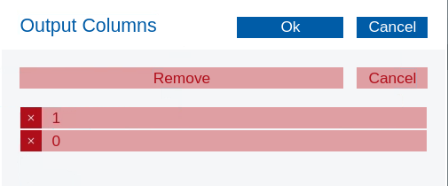
<figcaption>Delete Output Columns</figcaption>
</figure>
</div>

3. Select the **...** button in the **Query** value. In **MDX Editor**, replace the query with this one and select **Ok**:

```text
WITH
 MEMBER [Measures].[usersCurrentMonth] AS '([Measures].[Users], ${monthParameter})'
 MEMBER [Measures].[usersLastMonth] AS '([Measures].[Users], ${monthParameter}.Lag(1))'
 MEMBER [Measures].[usersDifference] AS 'IIf(IsEmpty([Measures].[usersCurrentMonth]), NULL, (([Measures].[usersCurrentMonth] / [Measures].[usersLastMonth])-1)*100)'
 MEMBER [Measures].[callsCurrentMonth] AS '([Measures].[Calls], ${monthParameter})'
 MEMBER [Measures].[callsLastMonth] AS '([Measures].[Calls], ${monthParameter}.LAG(1))'
 MEMBER [Measures].[callsDifference] AS 'IIf(IsEmpty([Measures].[callsCurrentMonth]), NULL, (([Measures].[callsCurrentMonth] / [Measures].[callsLastMonth])-1)*100)'
 MEMBER [Measures].[timeCurrentMonth] AS '([Measures].[Duration in Minutes], ${monthParameter})'
 MEMBER [Measures].[timeLastMonth] AS '([Measures].[Duration in Minutes],${monthParameter}.LAG(1))'
 MEMBER [Measures].[timeDifference] AS 'IIf(IsEmpty([Measures].[timeCurrentMonth]), NULL, (([Measures].[timeCurrentMonth] / [Measures].[timeLastMonth])-1)*100)'

SELECT {[Measures].[usersCurrentMonth], [Measures].[usersDifference], [Measures].[callsCurrentMonth], [Measures].[callsDifference], [Measures].[timeCurrentMonth],[Measures].[timeDifference]} ON COLUMNS,
 CROSSJOIN(${sourceCallParameter}${sourceChildren}, ${destinationCallParameter}${destinationChildren}) ON ROWS

FROM 
 [Call Corridor]
```

Explaining MDX is outside this workshop's scope, but here is what the query's parts do.

**Calculated members.** The query defines three groups of calculated members, users, calls and time, each following the same pattern:

| Group | Current month | Last month | Difference |
| --- | --- | --- | --- |
| Users | `usersCurrentMonth`: the Users measure for the month in `monthParameter` | `usersLastMonth`: the month before, with `LAG(1)` | `usersDifference`: the percentage change, `((current / last) - 1) * 100` |
| Calls | `callsCurrentMonth` | `callsLastMonth` | `callsDifference` |
| Duration | `timeCurrentMonth`: Duration in Minutes | `timeLastMonth` | `timeDifference` |

**The IIf logic.** Each difference uses `IIf(IsEmpty())`, so it returns NULL when the current month has no data instead of dividing by an empty value:

```text
IIf(IsEmpty([Measures].[currentMonth]), NULL, (([currentMonth] / [lastMonth])-1)*100)
```

**SELECT.** The columns axis has the current values and their percentage changes for users, calls and duration. The rows axis uses `CROSSJOIN` to combine the source regions, `${sourceCallParameter}${sourceChildren}`, with the destination regions, `${destinationCallParameter}${destinationChildren}`.

**Parameters.** `${monthParameter}` is the current month; `${sourceCallParameter}` and `${destinationCallParameter}` are the source and destination members; `${sourceChildren}` and `${destinationChildren}` add `.Children` to them, or nothing.

**FROM.** The data comes from the `[Call Corridor]` cube, which tracks call metrics between locations.

The query returns month-over-month comparisons of users, calls and total call duration, each with its percentage change, broken down by source and destination.

4. Click in the **Parameters** value. In **Parameters**, select **Add** five times, fill in **Name** and **Value** as below, and select **Ok**:

| Name | Value |
| --- | --- |
| `destinationCallParameter` | `[Call Destination.Destination Geography].[All]` |
| `sourceCallParameter` | `[Call Source.Source Geography].[All]` |
| `monthParameter` | `[Time.Standard Time].[2011].[Q1 2011].[January]` |
| `sourceChildren` | `.Children` |
| `destinationChildren` | `.Children` |

`.Children` returns the direct children of a member. With the defaults, the CROSSJOIN pairs every source region with every destination region.

5. Select **Save**. In the PUC's **Opened** view, right-click the `layout.cda` tab and select **Reload Tab**. In **Confirm Reload**, select **Yes**.
6. In the **Data Access** list, select **tableQuery**.

<div align="center">
<figure>
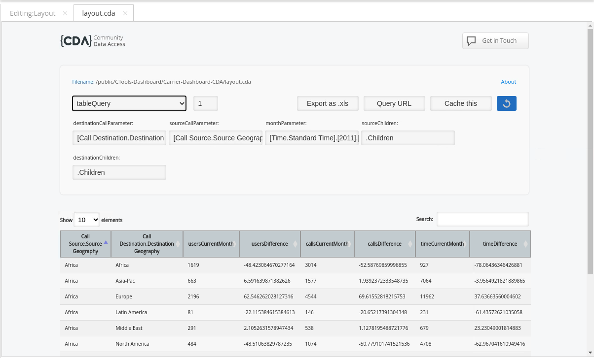
<figcaption>tableQuery</figcaption>
</figure>
</div>

> **Success:** Checkpoint: the previewer shows the five parameters with their defaults, and one row per pair of source and destination regions, in eight columns: the two regions, then `usersCurrentMonth`, `usersDifference`, `callsCurrentMonth`, `callsDifference`, `timeCurrentMonth` and `timeDifference`.

The column names and number formats are not ideal. The table component improves the formats later; rename the columns now.

7. Return to the editor tab. Click in the **Columns** value. In **Columns**, select **Add** eight times, fill in **Index** and **Name** as below, and select **Ok**:

| Index | Name |
| --- | --- |
| 0 | `Source Call` |
| 1 | `Destination Call` |
| 2 | `Users` |
| 3 | `m/m-1` |
| 4 | `Calls` |
| 5 | `m/m-1` |
| 6 | `Duration` |
| 7 | `m/m-1` |

<div align="center">
<figure>
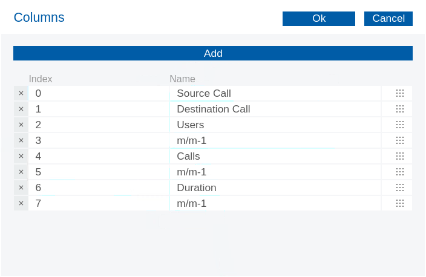
<figcaption>Rename Columns</figcaption>
</figure>
</div>

8. Select **Save**, and refresh the `layout.cda` tab.

<div align="center">
<figure>
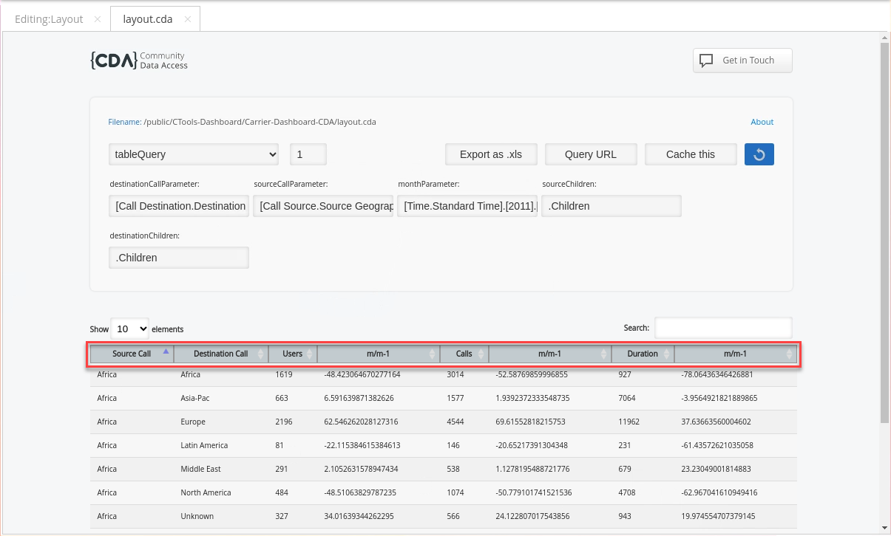
<figcaption>Column Names</figcaption>
</figure>
</div>

> **Success:** Checkpoint: the headers read **Source Call**, **Destination Call**, **Users**, **m/m-1**, **Calls**, **m/m-1**, **Duration** and **m/m-1**.

#### CDA - lineChartQuery

1. Return to the editor tab. Select **tableQuery**, select the **Duplicate datasource** icon, and set the copy's **Name** to `lineChartQuery`.

<div align="center">
<figure>
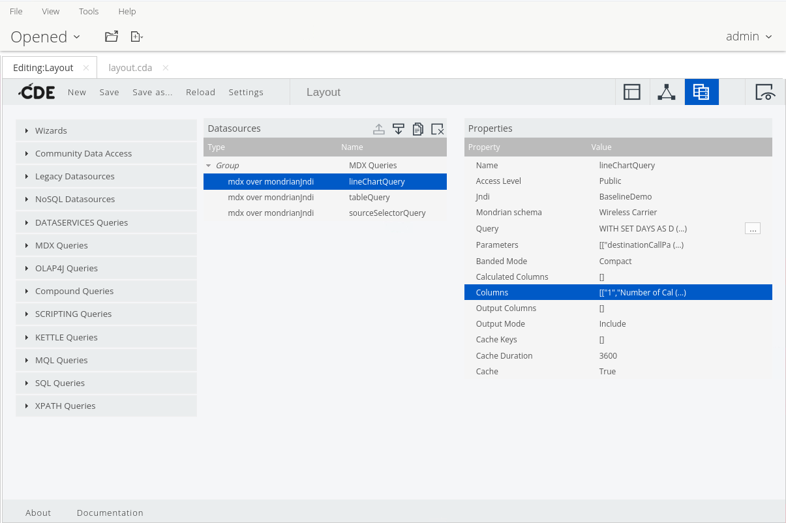
<figcaption>lineChartQuery</figcaption>
</figure>
</div>

2. Replace the query in **MDX Editor** with this one and select **Ok**:

```text
WITH 
 SET DAYS AS DESCENDANTS(${monthParameter}, 1) 
SELECT
 DAYS ON 1,
 {[Measures].[Calls], [Measures].[Users]} ON 0
FROM 
 [Call Corridor]
WHERE 
 (${sourceCallParameter}, ${destinationCallParameter})
```

3. Click in the **Columns** value. Remove the rows so that only these two remain, and select **Ok**:

| Index | Name |
| --- | --- |
| 1 | `Number of Calls` |
| 2 | `Number of Users` |

<div align="center">
<figure>
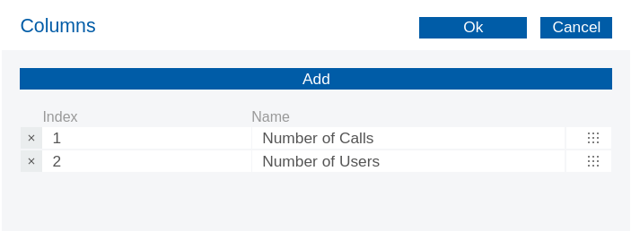
<figcaption>Change column names</figcaption>
</figure>
</div>

4. Select **Save**, refresh the `layout.cda` tab, and select **lineChartQuery** in the **Data Access** list.

<div align="center">
<figure>
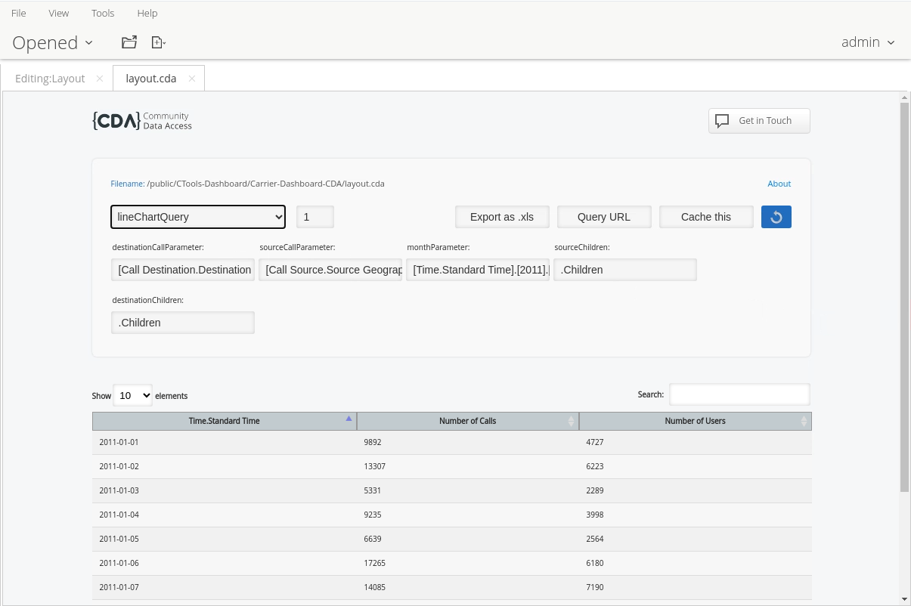
<figcaption>lineChartQuery</figcaption>
</figure>
</div>

> **Success:** Checkpoint: one row per day of the month in **monthParameter**, January 2011 by default, with the columns **Number of Calls** and **Number of Users**.

A finished version of this part is **Layout CDA** in **Public > CTools-Dashboard > Carrier-Dashboard-Layout**.

### 2. Components

> **Note:**
>
> #### Components
>
> Components turn the layout and its data into a dashboard. Here you add the table, the charts, the interactions (parameters, listeners, selectors and a click action), the exports and the expandable rows.

<div align="center">
<figure>

<figcaption>Wireless Carrier Dashboard</figcaption>
</figure>
</div>

#### Table - mainTable

<div align="center">
<figure>
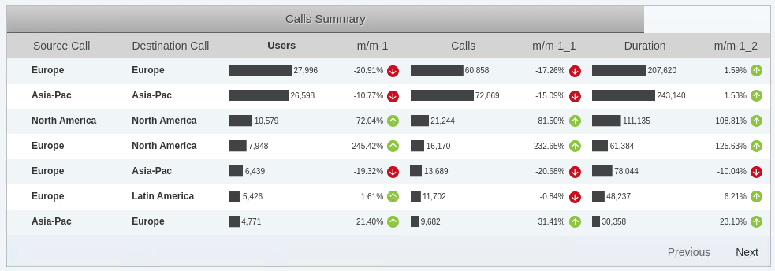
<figcaption>mainTable, as it looks at the end of this section</figcaption>
</figure>
</div>

1. In **Browse Files**, select **Public > CTools-Dashboard > Carrier-Dashboard-CDA**. Under **Files**, select **Layout**, and under **File Actions** select **Edit**.

<div align="center">
<figure>

<figcaption>Select the Layout file and Edit under File Actions</figcaption>
</figure>
</div>

2. Select **Components Panel**, the perspective icon at the top right.
3. In the list on the left, expand **Standard** and select **Table Component**.
4. In **Properties**, set **Name** to `mainTable`.
5. Click in the **Datasource** value and select `tableQuery`.

<div align="center">
<figure>
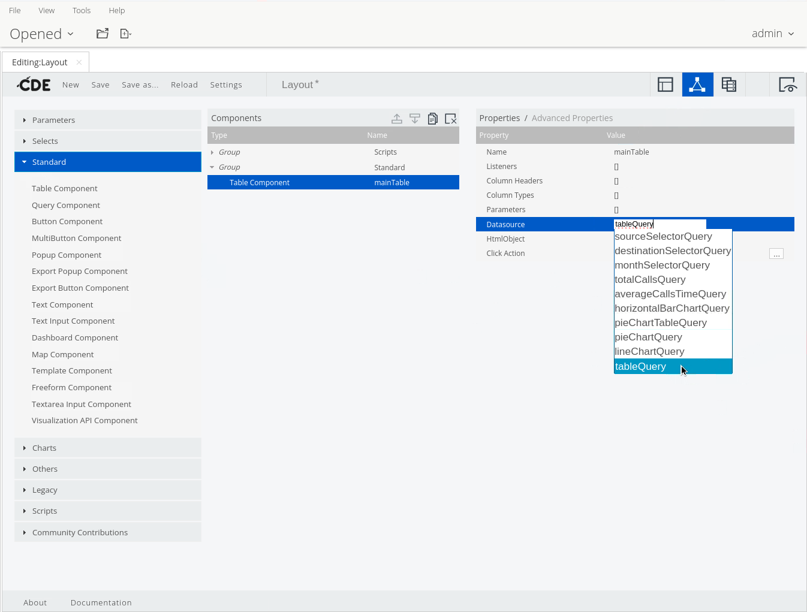
<figcaption>Select tableQuery as Datasource</figcaption>
</figure>
</div>

6. Click in the **HtmlObject** value and select `mainTableObj`.

<div align="center">
<figure>
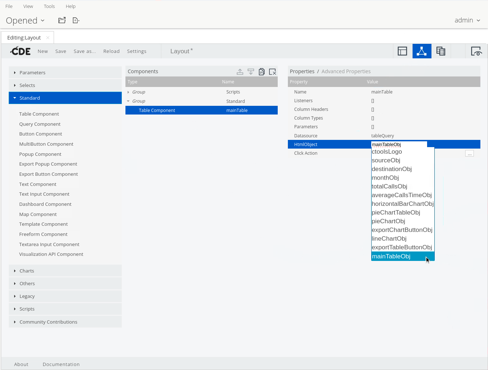
<figcaption>Select mainTableObj</figcaption>
</figure>
</div>

7. Select **Save**, then **Preview your Dashboard**.

<div align="center">
<figure>
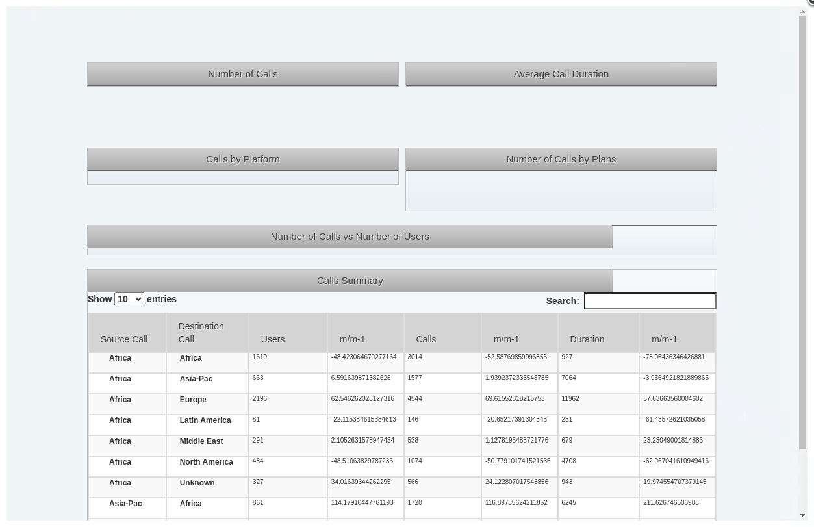
<figcaption>Save &#x26; Preview</figcaption>
</figure>
</div>

> **Success:** Checkpoint: the **Calls Summary** table, with raw numbers and long decimal percentages, 10 rows per page. The other panels are still empty.

8. Close the preview.

***

#### Advanced Properties

The table doesn't look like the one in the finished dashboard yet. Its advanced properties set the display options, the page length, the trend arrows and data bars, and the column formats. Advanced properties also extend a component in other ways: parameters passed between components, JavaScript functions for calculations, functions that run after the component executes, and queries parameterized with variables and JavaScript expressions.

1. In **Properties**, select **Advanced Properties**.

<div align="center">
<figure>
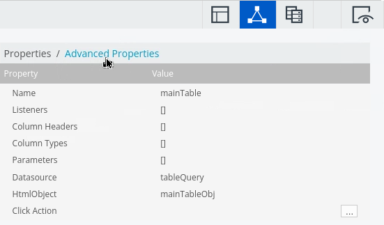
<figcaption>Advanced Properties</figcaption>
</figure>
</div>

2. Set these properties:

| Property | Value |
| --- | --- |
| **Show Filter** | `False` |
| **Info Filter** | `False` |
| **Page Length** | `7` |
| **Length Change** | `False` |
| **Pagination Type** | `Simple` |

<div align="center">
<figure>
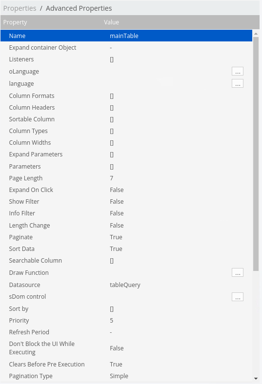
<figcaption>Advanced Properties</figcaption>
</figure>
</div>

3. Click in the **Column Types** value. In **Column Types**, select **Add** six times, enter these types in order, and select **Ok**. Type the first few letters of each, and CDE offers the name.

| Row | Type |
| --- | --- |
| 1 | `string` |
| 2 | `string` |
| 3 | `dataBar` |
| 4 | `trendArrow` |
| 5 | `dataBar` |
| 6 | `trendArrow` |

<div align="center">
<figure>
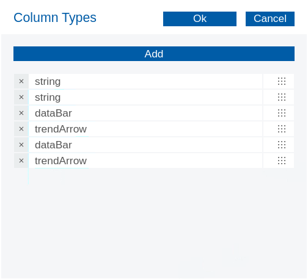
<figcaption>Column types entered for the summary table columns</figcaption>
</figure>
</div>

4. Select **Save**, then **Preview your Dashboard**.

<div align="center">
<figure>
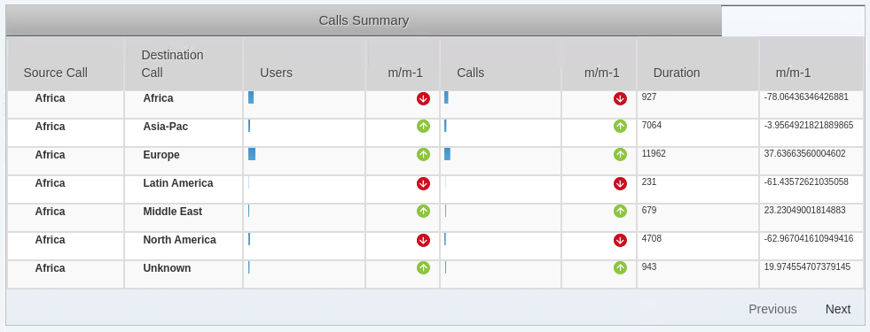
<figcaption>Summary table - would be nice to have values next to Bar Chart ..</figcaption>
</figure>
</div>

> **Success:** Checkpoint: **Users** and **Calls** show data bars and their **m/m-1** columns show trend arrows, but without their values.

5. Close the preview.
6. To show the values next to the data bars and arrows, select the **...** button in the **Pre Execution** value. In **Javascript Wizard**, enter this code and select **Ok**:

```javascript
function f() {

    this.setAddInOptions("colType","trendArrow",   
    {
        includeValue: true,
        good: true
    });
    
    this.setAddInOptions("colType","dataBar",   
    {
        includeValue: true,
        width: 80,
        startColor: "#414344",
        endColor: "#414344" 
    });
}
```

<div align="center">
<figure>
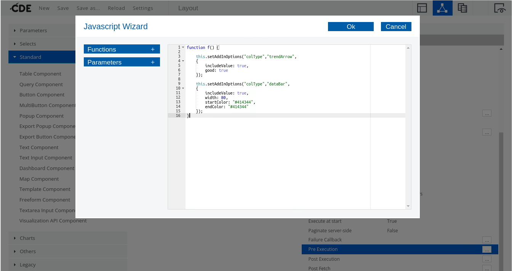
<figcaption>Javascript</figcaption>
</figure>
</div>

7. Select **Save**, then **Preview your Dashboard**.

<div align="center">
<figure>
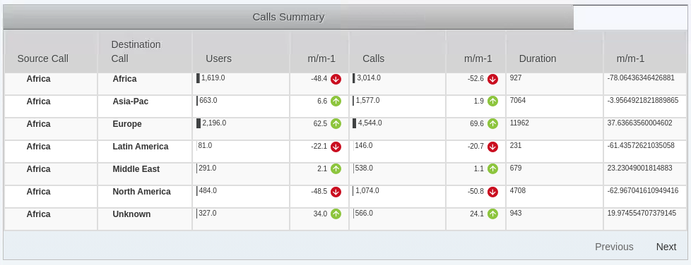
<figcaption>Bar Chart data</figcaption>
</figure>
</div>

> **Success:** Checkpoint: the data bars and trend arrows now show their values, still unformatted. Rows with an `Unknown` region are a data quality question for `baseline_demo`.

8. Close the preview.
9. Click in the **Column Formats** value. In **Column Formats**, select **Add** eight times, enter these sprintf formats in order, and select **Ok**:

| Row | Format |
| --- | --- |
| 1 | `%s` |
| 2 | `%s` |
| 3 | `%.0f` |
| 4 | `%.2f%` |
| 5 | `%.0f` |
| 6 | `%.2f%` |
| 7 | `%.0f` |
| 8 | `%.2f%` |

<div align="center">
<figure>
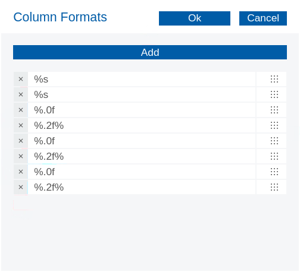
<figcaption>Format Columns</figcaption>
</figure>
</div>

10. Click in the **Sort by** value. In **Sort By**, select **Add**, set **Index** to `2` and **Order** to `desc`, and select **Ok**.

<div align="center">
<figure>
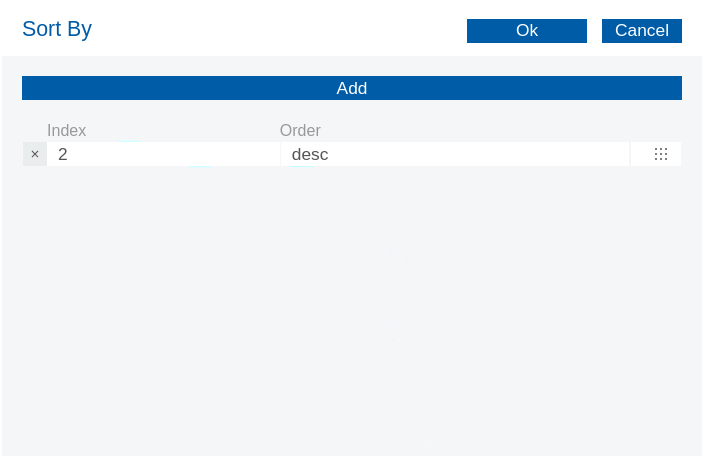
<figcaption>Sort By</figcaption>
</figure>
</div>

11. Select **Save**, then **Preview your Dashboard**.

> **Success:** Checkpoint: the table at the top of this section: whole numbers, percentages with two decimals, and the rows sorted by **Users**, largest first.

12. Close the preview.

> **Under the hood:**
>
> #### The table is DataTables, formatted cell by cell
>
> CDF's Table Component renders with the DataTables library it bundles.
> Each Column Format is applied with sprintf to every value in that
> column as the cell is drawn, so formatting never changes the data the
> query returned.
>
> Sort Order is not applied in the browser at first: CDF turns it into
> CDA's sortBy option, a column index plus A or D (desc on column 2
> becomes 2D), and CDA sorts the result on the server, through Kettle by
> default, before sending it.
>
> **Why it matters:** the same query can feed a table, a chart and an
> export unchanged; each component formats what it shows.

#### Charts - Pie Chart

Time for the charts, starting with the pie chart.

<div align="center">
<figure>
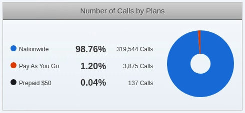
<figcaption>Finished pie chart with its bullet legend</figcaption>
</figure>
</div>

1. In the list on the left, expand **Charts** and select **CCC Pie Chart**.
2. In **Properties**, set these properties. For **Datasource** and **HtmlObject**, click in the value and select from the list:

| Property | Value |
| --- | --- |
| **Name** | `pieChart` |
| **Datasource** | `pieChartQuery` |
| **HtmlObject** | `pieChartObj` |
| **Width** | `140` |
| **Height** | `140` |
| **Compatibility Version** | `2` |

The **Compatibility Version** must be set because the latest version of CCC has a different set of default properties.

3. Select **Advanced Properties**.
4. Click in the **colors** value. In **String Array**, select **Add** until there are three rows, enter these colors, and select **Ok**:

```text
#176ad6
#de3700
#191b1e
```

<div align="center">
<figure>
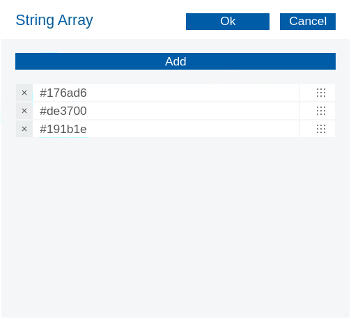
<figcaption>Pie Chart colors</figcaption>
</figure>
</div>

5. Set **Values Visible** to `False`.

***

#### Extension Points

Extension points are hooks in the CTools framework where you add your own behavior without changing the framework's code. In a CCC chart, the **Extension points** property reaches inside the chart: each **Arg** names one of the chart's marks and a property of that mark, and its **Value** overrides what CCC would otherwise set.

6. Click in the **Extension points** value. In **Extension Points**, select **Add**, set **Arg** to `slice_innerRadiusEx` and **Value** to `30%`, and select **Ok**.

<div align="center">
<figure>
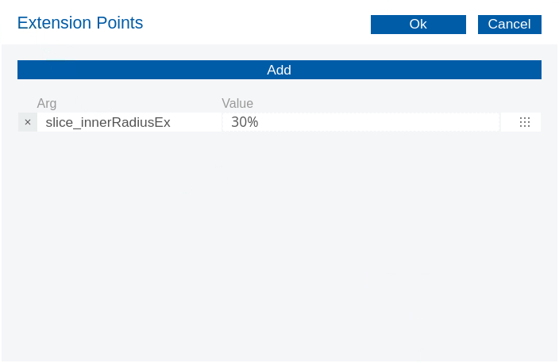
<figcaption>Slice Pie Chart - Donut</figcaption>
</figure>
</div>

7. Select **Save**, then **Preview your Dashboard**.

> **Success:** Checkpoint: the plans chart is a donut in three colors, with no values on the slices.

8. Close the preview.

> **Under the hood:**
>
> #### An extension point is a mark and a property
>
> slice_innerRadiusEx reads as two parts: slice, the pie chart's wedge
> mark, and innerRadiusEx, one of its properties. CCC resolves the
> percentage against the pie's outer radius and sets the protovis
> innerRadius from it, so 30% leaves a hole whose radius is 30% of the
> pie's: a donut.
>
> Every CCC chart exposes its marks this way (dot_, line_, xAxisLabel_
> and xAxisRule_ on the line chart below), and a value can be a function
> of the data instead of a constant, as the xAxisLabel_text function
> shows.
>
> **Why it matters:** anything CCC draws can be restyled from the
> dashboard, with no change to the chart library.

***

#### Resources

Finally, add a script that draws a colored bullet before each value in the plans table beside the pie chart, so the table works as the chart's legend.

9. Select **Layout Panel**. In the **Layout Structure** toolbar, select the **Add Resource** icon.
10. In **Add Resource**, set **Resource Type** to **Javascript** and **Resource Source** to **Code Snippet**, and select **Ok**.
11. Set **Name** to `bulletLegend`. Select the **...** button in the **Resource code** value, paste this script, and select **Ok**:

```javascript
 require([
    'cdf/AddIn',
    'cdf/Logger',
    'cdf/Dashboard.Clean',
    'cdf/lib/jquery',
], function(AddIn,Logger, Dashboard, $) {
    var bulletLegend = {
        name:"bulletLegend",
        label:"Bullet Legend",
        defaults: {
            /* default colors, replace in preExecution */
            colors: ["#F00", "#0F0", "#00F"] 
        },
        implementation: function(tgt,st,opt){
            
            Logger.log("Starting addin");
            
            var color = opt.colors[ st.rowIdx % opt.colors.length ],
                container = $('<div/>').addClass('bulletContainer'),
                bullet = $('<div/>').addClass('bullet').css('background-color' , color),
                //text = opt.textFormat.call(this, st.value, st, opt);
                text = st.value;
                container.append(bullet).append(text);
                $(tgt).empty().append(container);            
                        
        }
                
    };    
    Dashboard.registerGlobalAddIn("Table", "colType", new AddIn(bulletLegend));
});
```

The script uses CDF's own modules to register a table add-in, `bulletLegend`, which puts each value in a `div` container after a colored bullet. If you change the chart's colors, change the table's colors to match.

12. Select **Save**, then **Reload**.
13. Select **Preview your Dashboard**.

> **Success:** Checkpoint: the picture at the top of this section: a colored bullet before each plan in the table beside the donut.

14. Close the preview.

#### Charts - Line Chart

<div align="center">
<figure>
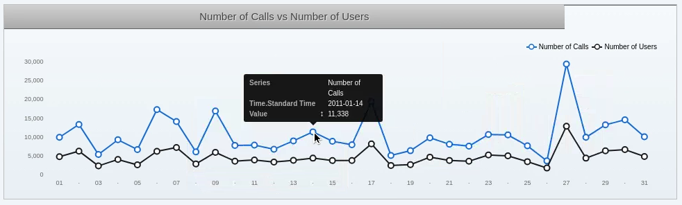
<figcaption>Line chart, as it looks at the end of this section</figcaption>
</figure>
</div>

1. Select **Components Panel**. In the list on the left, expand **Charts** and select **CCC Line Chart**.
2. Set these properties:

| Property | Value |
| --- | --- |
| **Name** | `lineChart` |
| **Datasource** | `lineChartQuery` |
| **HtmlObject** | `lineChartObj` |
| **Height** | `220` |
| **Width** | empty: delete the value and press `Enter` |
| **Compatibility Version** | `2` |

Deleting the width doesn't change the chart on the dashboard, but it does change other renderings of it.

3. Select **Save**, then **Preview your Dashboard**.

<div align="center">
<figure>
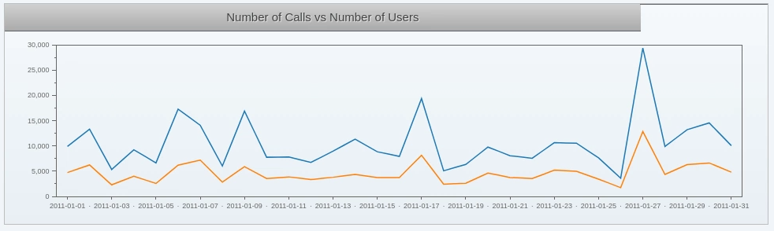
<figcaption>Line Chart</figcaption>
</figure>
</div>

> **Success:** Checkpoint: a line chart with one line for calls and one for users, with the full date on each axis label.

4. Close the preview.
5. Select **Advanced Properties**. Click in the **colors** value, enter these two colors in **String Array**, and select **Ok**:

```text
#176ad6
#191b1e
```

<div align="center">
<figure>
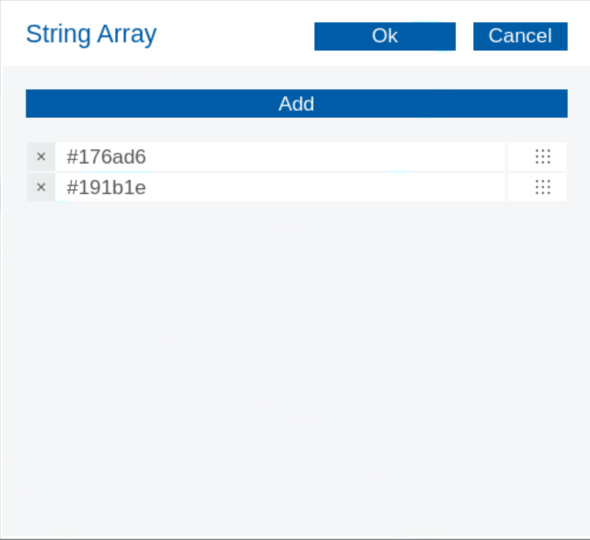
<figcaption>Line Chart colors</figcaption>
</figure>
</div>

6. Set these advanced properties:

| Property | Value |
| --- | --- |
| **Dots Visible** | `True` |
| **Legend** | `True` |
| **Legend Align** | `Right` |
| **Legend Position** | `Top` |
| **Plot Frame Visible** | `False` |

7. Select **Save**, then **Preview your Dashboard**.

<div align="center">
<figure>
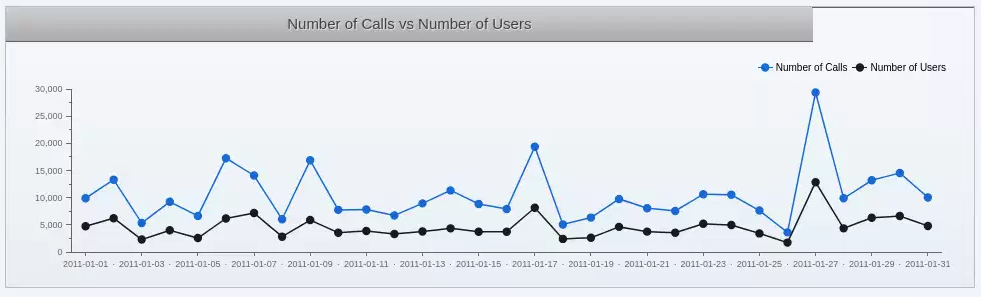
<figcaption>Line chart with the advanced properties set</figcaption>
</figure>
</div>

> **Success:** Checkpoint: blue and black lines with a dot on each value, the legend at the top right, and no frame around the plot.

8. Close the preview.

***

#### Extension Point

9. Click in the **Extension points** value. In **Extension Points**, select **Add** seven times, fill in **Arg** and **Value** as below, and select **Ok**:

| Arg | Value |
| --- | --- |
| `dot_fillStyle` | `#fff` |
| `dot_shapeRadius` | `4` |
| `xAxisLabel_text` | the function below |
| `line_lineWidth` | `2` |
| `dot_lineWidth` | `2` |
| `yAxisRule_strokeStyle` | `rgba(0,0,0,0)` |
| `xAxisRule_strokeStyle` | `rgba(0,0,0,0)` |

```javascript
function(d) {
    var fin = pv.Format.date('%y-%m-%d'), 
        fout = pv.Format.date('%d');
    
    return fout.format( fin.parse(d.vars.tick.value) );
}
```

<div align="center">
<figure>

<figcaption>Extension Points for the line chart</figcaption>
</figure>
</div>

10. Select **Save**, then **Preview your Dashboard**.

> **Success:** Checkpoint: the chart at the top of this section: hollow dots, thicker lines, the day of the month as each axis label, and no axis rules.

11. Close the preview.

#### Interactions - Parameters & Listeners

The dashboard is static so far. Users need to filter it, drill down and see it update. Say a list of regions should update the table when a user picks one. In CDF terms, a parameter holds the selected region, and a component that lists the parameter in its **Listeners** property, here the table, is updated whenever the parameter changes. A component can listen to several parameters, and several components can listen to one parameter.

Here you add parameter components, set the parameters and listeners of the dashboard's components, and add Filter components as selectors. Start with the parameters of the `pieChartQuery` data source.

1. Select **Datasources Panel**. In the **Datasources** list, expand **MDX Queries** and select **pieChartQuery**.

<div align="center">
<figure>

<figcaption>pieChartQuery</figcaption>
</figure>
</div>

2. Click in the **Parameters** value, note its three parameters, `destinationCallParameter`, `sourceCallParameter` and `monthParameter`, and select **Cancel**.

<div align="center">
<figure>

<figcaption>pieChartQuery - parameters</figcaption>
</figure>
</div>

3. Select **Components Panel**. In the list on the left, expand **Parameters** and select **Custom Parameter**.

<div align="center">
<figure>

<figcaption>Custom Parameter sourceCallParameter added to the Parameters group</figcaption>
</figure>
</div>

4. Set **Name** to `sourceCallParameter`. Select the **...** button in the **Javascript code** value, enter the default value below in **Javascript Wizard**, and select **Ok**:

```text
["[Call Source.Source Geography].[All]"] 
```

<div align="center">
<figure>

<figcaption>Default value for sourceCallParameter in the Javascript Wizard</figcaption>
</figure>
</div>

5. Add two more Custom Parameters the same way:

| Name | Javascript code |
| --- | --- |
| `destinationCallParameter` | `["[Call Destination.Destination Geography].[All]"]` |
| `monthParameter` | `["[Time.Standard Time].[2011].[Q1 2011].[January]"]` |

6. In the list on the left, expand **Parameters** and select **Simple Parameter**. Set **Name** to `sourceChildren` and **Property value** to `.Children`.
7. Add a second Simple Parameter, `destinationChildren`, with the **Property value** `.Children`. The selectors set these two parameters, and `tableQuery` reads them.

***

#### Listener

Set the parameters and listeners for the dashboard's components, starting with the pie chart.

1. In the components grid, expand **Charts** and select **pieChart**.

<div align="center">
<figure>

<figcaption>Add parameters to pieChart component</figcaption>
</figure>
</div>

2. Click in the **Parameters** value. In **Parameters**, select **Add** three times. In each row, enter the parameter's name in **Arg**, and in **Value** type its first few letters and select it:

| Arg | Value |
| --- | --- |
| `monthParameter` | `monthParameter` |
| `destinationCallParameter` | `destinationCallParameter` |
| `sourceCallParameter` | `sourceCallParameter` |

3. Select **Ok**.
4. Click in the **Listeners** value, select the drop-down arrow, select **Select All**, and select **OK**.

<div align="center">
<figure>

<figcaption>Add Listeners</figcaption>
</figure>
</div>

5. Select **lineChart** and set the same three **Parameters** and **Listeners**.
6. In the components grid, select **mainTable**. Set its **Parameters** and **Listeners** to the five parameters of `tableQuery`: `monthParameter`, `sourceCallParameter`, `destinationCallParameter`, `sourceChildren` and `destinationChildren`.

#### Interactions - Selectors

CTools selectors are input components, such as drop-down lists, check boxes and radio buttons, that users filter the dashboard with. A selector stores the user's choice in a parameter, and every component that listens to the parameter updates. A selector can be a text box for free text, or a select list, radio buttons or a date picker.

<div align="center">
<figure>

<figcaption>Selectors</figcaption>
</figure>
</div>

1. In the list on the left, expand **Selects** and select **Filter Component**.
2. Set these properties of the source selector; most are under **Advanced Properties**:

| Property | Value |
| --- | --- |
| **Name** | `sourceSelector` |
| **Title** | `Source Region:` |
| **Parameter** | `sourceCallParameter` |
| **Value as id** | `False` |
| **Datasource** | `sourceSelectorQuery` |
| **Show Icons** | `False` |
| **Show "Only" Button** | `False` |
| **Show Search Filter** | `False` |
| **HtmlObject** | `sourceObj` |
| **Execute at start** | `True` |
| **Pre Change** | the function below |

```javascript
 function f(selectedItem) {
    // Get ".children" on MDX if member "All" is selected 
    if (selectedItem.toString() ===  "[Call Source.Source Geography].[All]")
        this.dashboard.setParameter('sourceChildren', '.Children');
    else
        this.dashboard.setParameter('sourceChildren', '');
}
```

3. Add a second **Filter Component** for the destination, with the same settings except these:

| Property | Value |
| --- | --- |
| **Name** | `destinationSelector` |
| **Title** | `Destination Region:` |
| **Parameter** | `destinationCallParameter` |
| **Datasource** | `destinationSelectorQuery` |
| **HtmlObject** | `destinationObj` |
| **Pre Change** | the function below |

```javascript
function f(selectedItem) {
    if (selectedItem.toString() === "[Call Destination.Destination Geography].[All]")
        this.dashboard.setParameter('destinationChildren', '.Children');
    else
        this.dashboard.setParameter('destinationChildren', '');
}
```

4. Add a third **Filter Component** for the month:

| Property | Value |
| --- | --- |
| **Name** | `monthSelector` |
| **Title** | `Select Month:` |
| **Parameter** | `monthParameter` |
| **Datasource** | `monthSelectorQuery` |
| **HtmlObject** | `monthObj` |

5. Select **Save**, then **Preview your Dashboard**.

<div align="center">
<figure>

<figcaption>Selectors</figcaption>
</figure>
</div>

> **Success:** Checkpoint: three selectors at the top, **Source Region:**, **Destination Region:** and **Select Month:**. Picking a region or a month updates the pie chart, the line chart and the table.

6. Close the preview.

#### Interactions - clickAction

Next, use the pie chart's **Click Action** to set one parameter, `planTypeParameter`, which triggers an update of another component, `lineChart`.

<div align="center">
<figure>

<figcaption>Click pieChart to update lineChart</figcaption>
</figure>
</div>

1. In the list on the left, expand **Parameters** and select **Simple Parameter**.
2. Set **Name** to `planTypeParameter` and **Property value** to `All`.
3. Select **Save**.

<div align="center">
<figure>

<figcaption>Add planTypeParameter</figcaption>
</figure>
</div>

Now add the parameter to `lineChartQuery`.

4. Select **Datasources Panel**. In the **Datasources** list, expand **MDX Queries** and select **lineChartQuery**.
5. Select the **...** button in the **Query** value. In **MDX Editor**, replace the query with this one and select **Ok**:

```text
WITH 
 SET DAYS AS DESCENDANTS(${monthParameter}, 1) 
MEMBER [Calling Plan].[Selected Plan Type] as Aggregate( [Calling Plan].[${planTypeParameter}] )
SELECT
 DAYS ON 1,
 {[Measures].[Calls], [Measures].[Users]} ON 0
FROM 
 [Call Corridor]
WHERE 
(${sourceCallParameter}, ${destinationCallParameter}, [Calling Plan].[Selected Plan Type])
```

6. Click in the **Parameters** value. In **Parameters**, select **Add**, set **Name** to `planTypeParameter` and **Value** to `All`, and select **Ok**.

Three steps remain: make the pie chart clickable, give it a click action, and make the line chart listen to the new parameter.

7. Select **Components Panel**. In the components grid, expand **Charts** and select **pieChart**.
8. Set **Clickable** to `True`.

<div align="center">
<figure>

<figcaption>Clickable</figcaption>
</figure>
</div>

9. Select the **...** button in the **Click Action** value. In **Javascript Wizard**, enter this code and select **Ok**:

```javascript
function f(scene) {
    var vars = scene.vars;
    var c = vars.category.value;
    var v = vars.value.value;
    Logger.log("Clicked on Category '" + c + "' , which has a Value of: " + v);
    dashboard.fireChange('${p:planTypeParameter}', c);
}
```

The click action calls `dashboard.fireChange(param, value)` with the name of the parameter to change and its new value. When a user clicks a mark, here a slice of the pie, the function runs, and every component that listens to that parameter updates.

10. In the components grid, select **lineChart**. Click in the **Listeners** value, select the drop-down arrow, select **planTypeParameter** as well, and select **OK**.

<div align="center">
<figure>

<figcaption>Add planTypeParameter listener</figcaption>
</figure>
</div>

11. Click in the **Parameters** value. In **Parameters**, select **Add**, enter `planTypeParameter` in **Arg** and select `planTypeParameter` in **Value**, and select **Ok**.

<div align="center">
<figure>

<figcaption>Add planTypeParameter to lineChart</figcaption>
</figure>
</div>

12. Select **Save**, then **Preview your Dashboard**, and select a slice of the pie chart.

<div align="center">
<figure>

<figcaption>Interactive pieChart</figcaption>
</figure>
</div>

> **Success:** Checkpoint: the line chart redraws with the calls and users of the plan you selected.

13. Close the preview.

> **Under the hood:**
>
> #### fireChange updates listeners; parameters carry values
>
> dashboard.fireChange sets the parameter, raises a cdf
> planTypeParameter:fireChange event, then updates every enabled
> component whose Listeners include planTypeParameter. Listening is what
> makes the line chart run again; its Parameters entry is what passes
> the new value to its query, as paramplanTypeParameter on the CDA
> request. A component that should follow a parameter needs both.
>
> ${p:planTypeParameter} is not resolved in the browser: CDE replaces it
> when it writes the dashboard, with planTypeParameter here, or with an
> alias-prefixed name when the dashboard runs as a widget inside
> another, so the click keeps working either way.
>
> **Why it matters:** a component that updates but shows the old data
> is missing its Parameters entry; one that never updates is missing its
> listener.

#### Export - Button & Popup

The last part uses CDE's export components to export the charts and the main table. Data can be exported as CSV, XLS, XML or JSON, through CDA calls made in the background. CCC charts can also be exported as PNG or SVG images, through the Community Graphics Generator (CGG). There are two components:

* **Export Button Component** - exports the data of one component in one format (CSV, XLS, XML or JSON).
* **Export Popup Component** - exports chart images (PNG or SVG), or data in more than one format.

<div align="center">
<figure>

<figcaption>The Calls Summary table with its Export button</figcaption>
</figure>
</div>

1. In the list on the left, expand **Standard** and select **Export Button Component**.

<div align="center">
<figure>

<figcaption>Export Button Component</figcaption>
</figure>
</div>

2. Set these properties:

| Property | Value |
| --- | --- |
| **Name** | `exportTableButton` |
| **Label** | `Export` |
| **Component Name** | `mainTable` |
| **HtmlObject** | `exportTableButtonObj` |

**Output Type** keeps its default, `csv`.

3. Select **Save**, then **Preview your Dashboard**.

> **Success:** Checkpoint: an **Export** button in the **Calls Summary** title bar. Selecting it downloads the table's data as a CSV file.

4. Close the preview.

***

**Export Popup**

Now add an Export Popup Component that exports the Number of Calls vs Number of Users chart, `lineChart`, as an image and its data as a file.

5. In the list on the left, expand **Standard** and select **Export Popup Component**.

<div align="center">
<figure>

<figcaption>exportChartPopup Component</figcaption>
</figure>
</div>

6. Set these properties:

| Property | Value |
| --- | --- |
| **Name** | `exportChartPopup` |
| **Title** | `Export` |
| **Chart Component to Export** | `lineChart` |
| **Data Component to Export** | `lineChart` |
| **HtmlObject** | `exportChartButtonObj` |

7. Select **Save**.

The export popup works when you open the dashboard itself, not in Preview.

8. In **Browse Files**, double-click the dashboard to open it. Select **Export** above the line chart.

<div align="center">
<figure>

<figcaption>Export - Chart or Table</figcaption>
</figure>
</div>

> **Success:** Checkpoint: the popup offers **Export Chart** and **Export Table**, the default labels. **Export Chart** opens **Export Options**, with the sizes **Small**, **Medium**, **Large** and **Custom**, **Width** and **Height**, and an **Export** button.

<div align="center">
<figure>

<figcaption>Export Chart</figcaption>
</figure>
</div>

The table data is exported as `.xls` by default. Change it to `.csv`, and give the options clearer labels.

9. Close the dashboard's tab and return to the editor. Select **exportChartPopup**, select **Advanced Properties**, and set:

| Property | Value |
| --- | --- |
| **Chart Export Label** | `Export PNG` |
| **Data Export Type** | `csv` |
| **Data Export Label** | `Export CSV` |
| **Name for Data Export attachment** | `NrofCallsVsUsers` |
| **Post Execution** | the function below |

```javascript
function f() {
  // Remove the arrow element
$('.popupComponent div.arrow').remove();
}
```

10. Select **Save**, and open the dashboard from **Browse Files** again. Select **Export** above the line chart.

<div align="center">
<figure>

<figcaption>Export - PNG &#x26; CSV</figcaption>
</figure>
</div>

> **Success:** Checkpoint: the popup offers **Export PNG** and **Export CSV**. **Export CSV** downloads the chart's data as a CSV file named after `NrofCallsVsUsers`.

11. Close the dashboard's tab.

> **Under the hood:**
>
> #### Two exports, two engines
>
> The Export Button re-runs its table's CDA query with outputType=csv
> (or xls), current parameter values included, and the browser downloads
> what CDA returns. The Export Popup's data export works the same way;
> its chart export goes to CGG instead.
>
> Choosing lineChart in the popup's chart property switched on that
> chart's CGG flag, so the next save also wrote a script beside the
> dashboard, Layout_lineChart.js, holding the chart's definition and its
> data source. Export PNG asks CGG to run that script on the server,
> passing the chart's parameter values as param<name>; workshop 14
> builds on that.
>
> **Why it matters:** an export always matches what the user filtered,
> because it re-runs the same query with the same parameter values.

#### Expand - Expandable Rows

A table row can expand to show more content. Here, clicking a row in `mainTable` opens it to show a bar chart, Calls by Platform, for that row's source and destination. The bar chart has three parameters and listeners: `monthParameter`, `tableSourceParameter` and `tableDestinationParameter`.

<div align="center">
<figure>

<figcaption>Expand a record</figcaption>
</figure>
</div>

1. Select **Layout Panel**. In **Layout Structure**, select the **layoutColumn** column under the **layoutRow** row, and select the **Add Row** icon. This row holds the content of the expanded row.
2. Set **Name** to `expandedContent` and **Css Class** to `WDhidden expandedContent`.

<div align="center">
<figure>

<figcaption>Add row - expandedContent</figcaption>
</figure>
</div>

3. With **expandedContent** selected, select the **Add Columns** icon, and set the new column's **Name** to `barChartObj`.

***

#### Data Source

Create `barChartQuery`, the data source of the bar chart.

<div align="center">
<figure>

<figcaption>barChartQuery</figcaption>
</figure>
</div>

1. Select **Datasources Panel**. In the list on the left, expand **MDX Queries** and select **mdx over mondrianJndi**.
2. Set **Name** to `barChartQuery`, **Jndi** to `BaselineDemo` and **Mondrian schema** to `Wireless Carrier`.
3. Select the **...** button in the **Query** value. In **MDX Editor**, enter this query and select **Ok**:

```text
SELECT
	Measures.[Calls] on 0, 
	[Platform].[Platform].members on 1  
FROM [Call Corridor]
WHERE 
(
${monthParameter}, 
	[Call Source.Source Geography].[${tableSourceParameter}], 
	[Call Destination.Destination Geography].[${tableDestinationParameter}]
)
```

4. Click in the **Parameters** value. In **Parameters**, select **Add** three times, fill in the rows as below, and select **Ok**. The parameters filter the chart by source, destination and month.

| Name | Value | Type |
| --- | --- | --- |
| `tableSourceParameter` | `All` | `String` |
| `tableDestinationParameter` | `All` | `String` |
| `monthParameter` | `[Time.Standard Time].[2011].[Q1 2011].[January]` | `StringArray` |

<div align="center">
<figure>

<figcaption>Parameters - barChart</figcaption>
</figure>
</div>

5. Select **Save**.

***

#### Parameters

1. Select **Components Panel**. In the list on the left, expand **Parameters** and select **Simple Parameter**.
2. Set **Name** to `tableSourceParameter` and **Property value** to `All`.
3. Add a second **Simple Parameter**, `tableDestinationParameter`, with the **Property value** `All`.
4. Select **Save**.

<div align="center">
<figure>

<figcaption>The two table parameters</figcaption>
</figure>
</div>

***

#### Chart

Configure the chart, its parameters and its listeners.

1. In the list on the left, expand **Charts** and select **CCC Bar Chart**.
2. Set these properties:

| Property | Value |
| --- | --- |
| **Name** | `barChart` |
| **Title** | `Calls by Platform` |
| **Datasource** | `barChartQuery` |
| **Height** | `200` |
| **Width** | `500` |
| **Compatibility Version** | `2` |
| **HtmlObject** | `barChartObj` |
| **Legend** | `False` |

3. Click in the **Listeners** value, select the drop-down arrow, select **monthParameter**, **tableSourceParameter** and **tableDestinationParameter**, and select **OK**.

<div align="center">
<figure>

<figcaption>Add Listeners</figcaption>
</figure>
</div>

4. Click in the **Parameters** value. In **Parameters**, select **Add** three times, map each parameter to itself as below, and select **Ok**:

| Arg | Value |
| --- | --- |
| `monthParameter` | `monthParameter` |
| `tableSourceParameter` | `tableSourceParameter` |
| `tableDestinationParameter` | `tableDestinationParameter` |

<div align="center">
<figure>

<figcaption>Parameters to pass to datasource</figcaption>
</figure>
</div>

<div align="center">
<figure>

<figcaption>Properties</figcaption>
</figure>
</div>

***

#### Advanced Properties

5. Select **Advanced Properties** and set **Execute at start** to `False`.

When a dashboard loads, all its components are created, and **Execute at start** decides whether each one runs then. A component with **Execute at start** set to `False` doesn't render until a parameter it listens to changes.

6. Select **Save**.

***

#### Enable mainTable

Finally, turn on row expansion in `mainTable`.

<div align="center">
<figure>

<figcaption>Enable mainTable</figcaption>
</figure>
</div>

1. In the components grid, expand **Others** and select **mainTable**.
2. Select **Advanced Properties** and set:

| Property | Value |
| --- | --- |
| **Expand On Click** | `True` |
| **Expand container Object** | `expandedContent` |

3. Click in the **Expand Parameters** value. In **Parameters**, select **Add** twice, fill in **Arg** and **Value** as below, and select **Ok**. **Arg** is a column index, and **Value** is the parameter that receives that column's value.

| Arg | Value |
| --- | --- |
| `0` | `tableSourceParameter` |
| `1` | `tableDestinationParameter` |

<div align="center">
<figure>

<figcaption>Expand parameters: Arg 0 sets tableSourceParameter, Arg 1 sets tableDestinationParameter</figcaption>
</figure>
</div>

4. Select **Save**, then **Preview your Dashboard**, and select a row of the **Calls Summary** table.

<div align="center">
<figure>

<figcaption>Calls by Platform</figcaption>
</figure>
</div>

> **Success:** Checkpoint: the row opens, and the **Calls by Platform** bar chart inside it shows the calls of that source and destination by platform.

5. Close the preview.

> **Under the hood:**
>
> #### A row click is a fireChange too
>
> With Expand on Click set, clicking a row copies that row's column
> values into the expand parameters, setting all but the first quietly,
> then calls fireChange on the first. The bar chart, which listens to
> them and has Execute at Start off, runs only then, while the table
> opens a detail row and moves the expandedContent element into it, so
> the chart draws inside the opened row.
>
> Each time the table itself renders, it resets the expand parameters to
> empty.
>
> **Why it matters:** the detail chart costs nothing until a user asks
> for it: its query runs only for the row that was clicked.

### 3. Preview

> **Note:**
>
> #### Preview
>
> With the layout built, the CDA data sources defined, the components configured and the interactions in place, open the finished dashboard and check it end to end.

1. In **Browse Files**, double-click the dashboard to open it.

<div align="center">
<figure>

<figcaption>Wireless Carrier Dashboard</figcaption>
</figure>
</div>

> **Success:** Checkpoint: the finished Carrier Dashboard:
>
> * The three selectors, Source Region, Destination Region and Month, filter the data.
> * The KPI panels show Number of Calls and Average Call Duration.
> * The donut chart is clickable, and a click redraws the line chart through `planTypeParameter`.
> * The line chart shows Number of Calls vs Number of Users, styled by its extension points.
> * `mainTable` shows trend arrows and data bars, and clicking a row opens the Calls by Platform bar chart.
> * The Export button exports the table as CSV; the Export popup exports the line chart as PNG and its data as CSV.

2. Close the dashboard's tab.

A finished version of the whole workshop is in **Public > CTools-Dashboard > Carrier-Dashboard-Export**.

::::

## Lab Files

_No bundled files for this lab._
