# Sales Dashboard

> **Warning:**
>
> #### Workshop - Sales Dashboard
>
> Build the Steel Wheels Sales dashboard in the Community Dashboard Editor (CDE), on the SteelWheels Mondrian cube that ships with the Pentaho Server. You start from a ready-made layout, add the MDX data sources, then the components: three selectors, a sales table with data bars and trend arrows, a clickable donut chart, a line chart that compares this year with last year, exports, and table rows that open a chart.
>
> **What you'll do**
>
> * Upload the starting dashboard and style its layout with an external CSS file
> * Create MDX data sources on the SteelWheels cube, with parameters and output columns
> * Add parameters and Filter components that select a territory, a year and an order status
> * Add a Table Component with data bars, trend arrows and column formats, and CCC pie and line charts with colors and extension points
> * Make the dashboard interactive with listeners, parameters and a pie chart click action
> * Add an Export button, an Export popup and expandable table rows
>
> **Prerequisites:** [My First Dashboard](../03-getting-started-my-first-dashboard/guide.md) and [CDA Data Sources](../06-community-data-access-cda-data-sources/guide.md); the SteelWheels schema and the SampleData connection, which ship with the server; some JavaScript for the functions
>
> **Estimated time:** 60 minutes

<div align="center">
<figure>
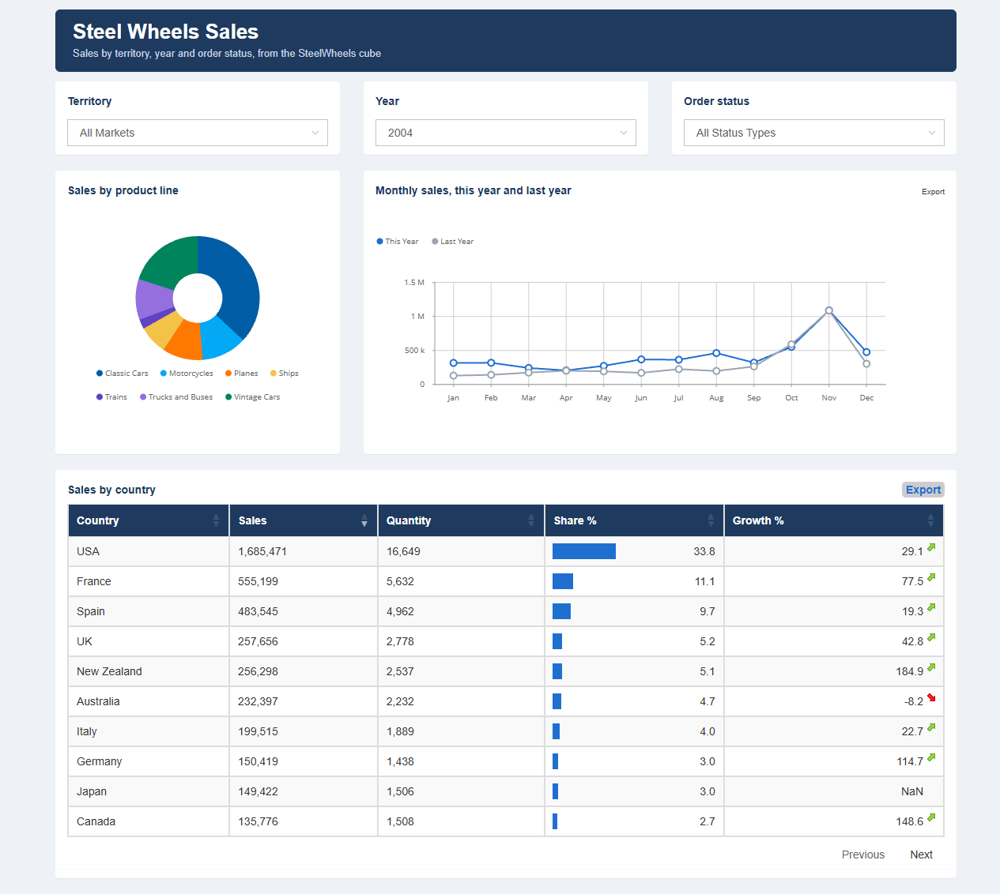
<figcaption>The Steel Wheels Sales dashboard you build</figcaption>
</figure>
</div>

***

:::: tabs

### 1. Layout & Data

> **Note:**
>
> #### Layout and data
>
> The dashboard's layout is ready-made: a header, three selector panels, a chart row and a table panel, each panel with a named column for a component to draw into. Upload it, style it, then give it its data: seven MDX queries on the SteelWheels cube.

#### The starting dashboard

1. Make sure the Pentaho Server is running. On a lab VM it already is; on your own machine start it as in [Before You Start](../00-before-you-start/guide.md):

```powershell
C:\Pentaho\server\pentaho-server\start-pentaho.bat
```

It takes a few minutes; the console is ready when http://localhost:8080/pentaho opens the login page.

2. Open the Pentaho User Console (PUC) with the button below and sign in as `admin`.

<button data-launch="puc">Open Pentaho User Console</button>

3. Download [sales-dashboard-start.zip](./files/sales-dashboard-start.zip) from **Lab Files** at the end of this page.
4. Select **Browse Files**, expand **Public** and select **CTools-Dashboard**. Under **Folder Actions**, select **Upload...**. Select **Browse...**, choose `sales-dashboard-start.zip`, and select **OK**.

<div align="center">
<figure>
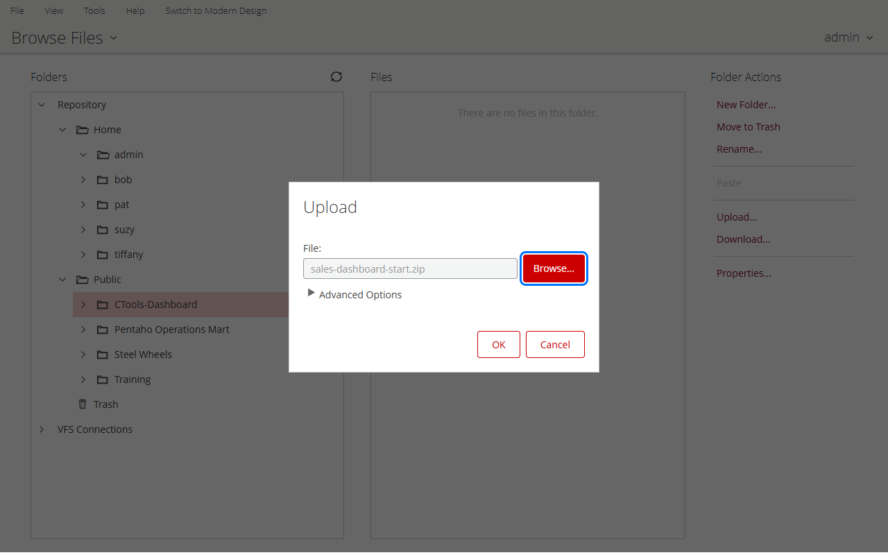
<figcaption>Upload the starting dashboard into CTools-Dashboard</figcaption>
</figure>
</div>

The server unpacks the zip into a new folder, **Sales-Dashboard**: the dashboard `sales-dashboard` and its stylesheet, `resources/css/dashstyle.css`.

5. If **Sales-Dashboard** is not listed yet, select the **Refresh** icon beside **Folders**. Select **Sales-Dashboard**, select **Steel Wheels Sales** under **Files**, and under **File Actions** select **Edit**. The dashboard opens in CDE, in the **Layout** perspective.
6. In **Layout Structure**, expand the rows and look at the layout.

<div align="center">
<figure>
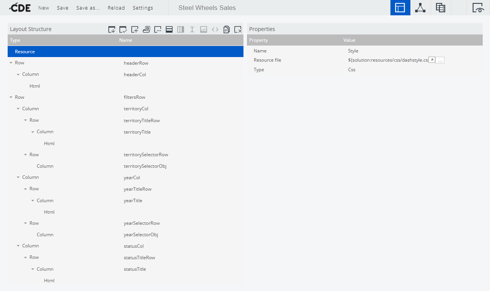
<figcaption>The starting layout</figcaption>
</figure>
</div>

The layout has four main rows. The columns whose names end in `Obj` are empty: they are the HTML objects your components draw into.

```text
headerRow          the title
filtersRow         territorySelectorObj | yearSelectorObj | statusSelectorObj
chartsRow          pieChartObj | lineChartObj, with exportChartButtonObj above it
tableRow           mainTableObj, with exportTableButtonObj above it
```

#### Style

The panels and colors come from `dashstyle.css`. A dashboard reads a stylesheet only when the layout includes it as a resource.

7. In the **Layout Structure** toolbar, select the **Add Resource** icon. In **Add Resource**, set **Resource Type** to **Css** and **Resource Source** to **External File**, and select **Ok**.

<div align="center">
<figure>
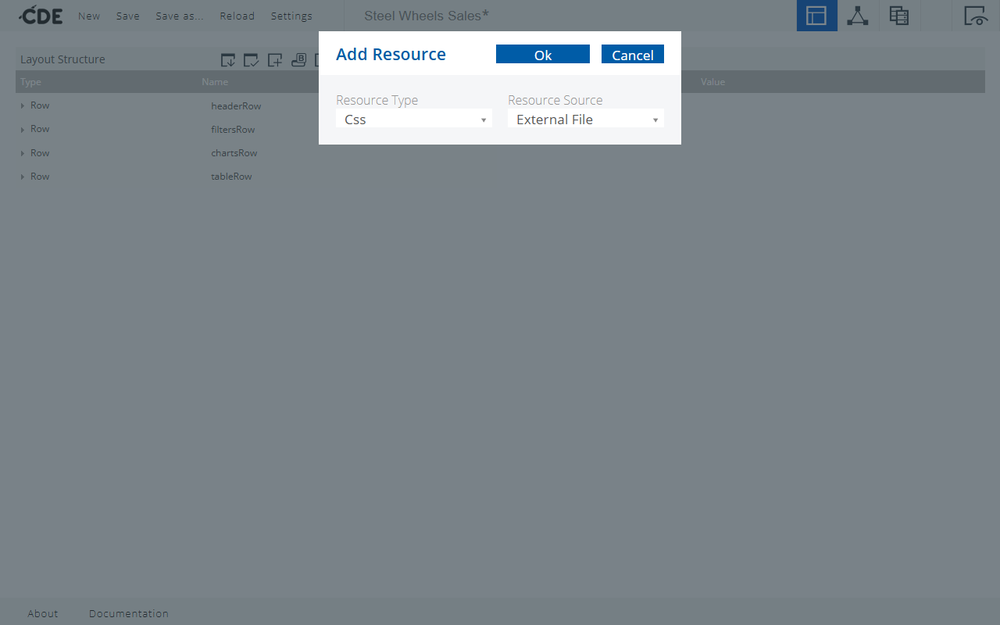
<figcaption>Add Resource: an external CSS file</figcaption>
</figure>
</div>

8. Select the **^** button in the **Resource file** value. Expand **public > CTools-Dashboard > Sales-Dashboard > resources > css**, select `dashstyle.css`, and select **Ok**.

<div align="center">
<figure>
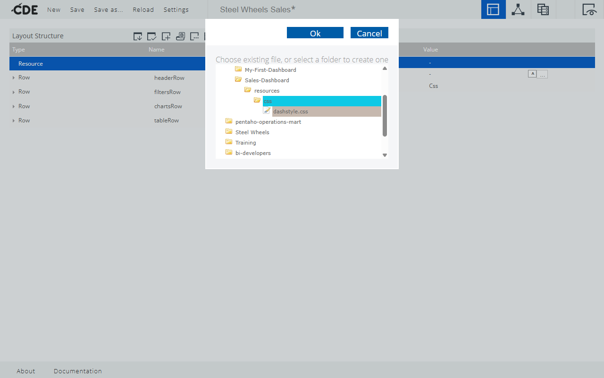
<figcaption>Choose dashstyle.css</figcaption>
</figure>
</div>

9. In **Properties**, set **Name** to `Style`.

<div align="center">
<figure>
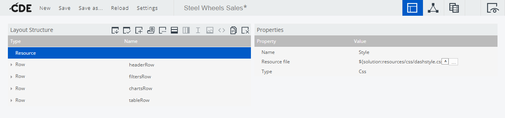
<figcaption>The Style resource</figcaption>
</figure>
</div>

10. Select **Save**, then **Preview your Dashboard**.

<div align="center">
<figure>
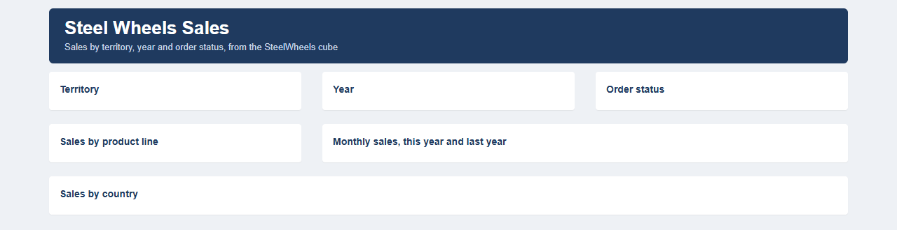
<figcaption>The styled layout, still without components</figcaption>
</figure>
</div>

> **Success:** Checkpoint: a dark blue header, **Steel Wheels Sales**, and six white panels on a grey page, each with its title and nothing in it yet.

11. Close the preview.

> **Under the hood:**
>
> #### ${solution:...} is a path relative to the dashboard
>
> The chooser wrote the file as
> ${solution:resources/css/dashstyle.css}, relative to the folder the
> dashboard is in. When the dashboard renders, CDE turns it into a link
> to the plugin's resource service,
> /pentaho/plugin/pentaho-cdf-dd/api/resources/public/CTools-Dashboard/Sales-Dashboard/resources/css/dashstyle.css,
> and the browser loads it after CDE's own styles, which is why its
> rules win.
>
> **Why it matters:** copy or upload the folder anywhere and the
> dashboard still finds its stylesheet, because the path moves with it.

#### Data source - territorySelectorQuery

Every component gets its data from a CDA query. The first one lists the territories for the territory selector: one row for All Markets and one per territory, each with the member's unique name, the value the selector stores, and its caption, the label users see.

12. Select **Datasources Panel**, the perspective icon at the top right.
13. In the list on the left, expand **MDX Queries** and select **mdx over mondrianJndi**. CDE adds the data source and puts the cursor in its **Name**.

<div align="center">
<figure>
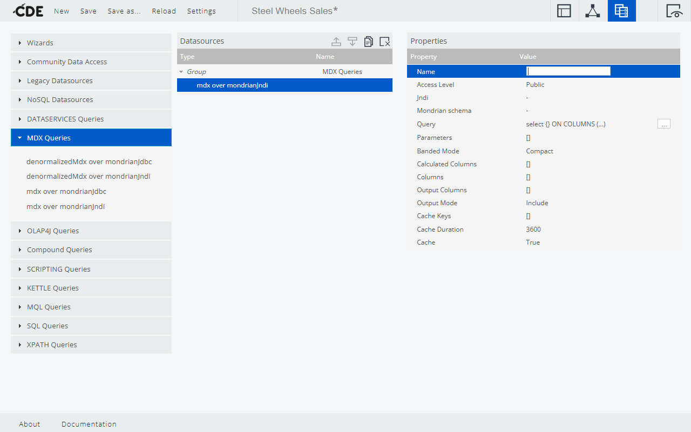
<figcaption>A new mdx over mondrianJndi data source</figcaption>
</figure>
</div>

14. Type `territorySelectorQuery` and press `Enter`. Ending a data source's name with `Query` is good practice.
15. Click in the **Jndi** value, type `Sample` and select **SampleData** from the list. Then click in the **Mondrian schema** value and select **SteelWheels**.

<div align="center">
<figure>
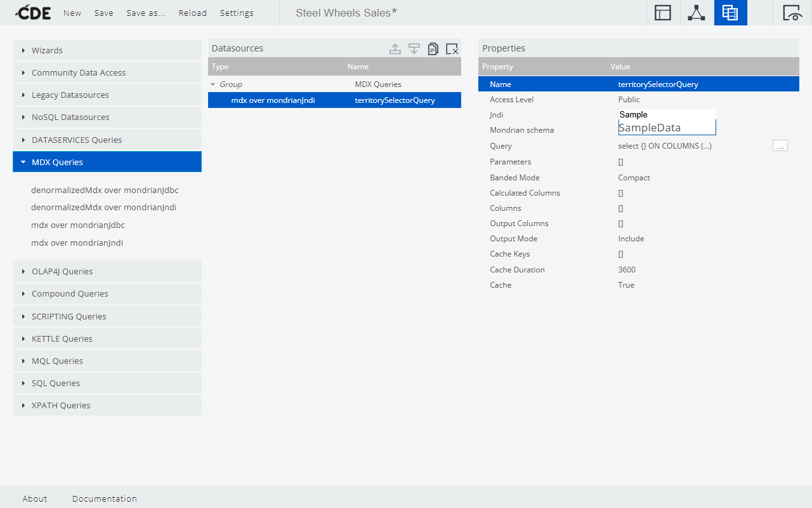
<figcaption>Jndi: the server's SampleData connection</figcaption>
</figure>
</div>

16. Select the **...** button in the **Query** value. In **MDX Editor**, replace the query with this one and select **Ok**:

```text
WITH MEMBER [Measures].[UID] AS [Markets].CurrentMember.UniqueName
SELECT {[Measures].[UID]} ON COLUMNS,
{[Markets].[All Markets], Filter([Markets].[Territory].Members, [Markets].CurrentMember.Name <> "#null")} ON ROWS
FROM [SteelWheelsSales]
```

<div align="center">
<figure>
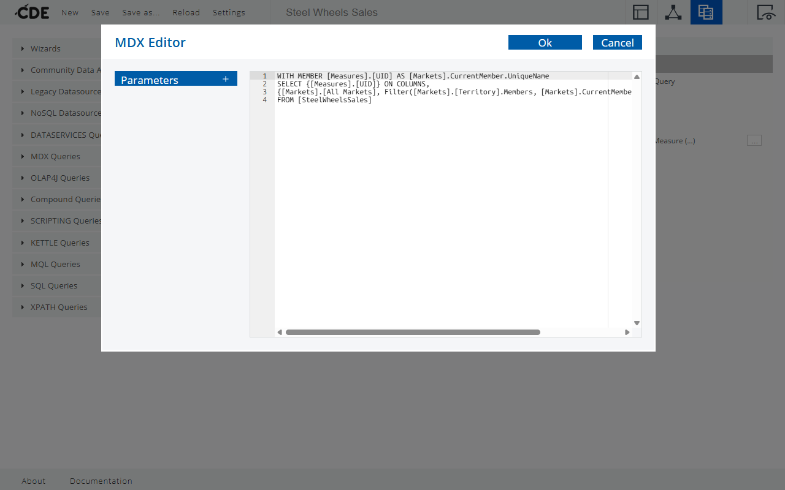
<figcaption>MDX Editor</figcaption>
</figure>
</div>

The `Filter` drops the `#null` territory: SampleData has customers with no territory, and Mondrian gathers them under a member of that name.

17. Click in the **Output Columns** value. In **Output Columns**, select **Add** twice, enter `1` in the first row and `0` in the second, and select **Ok**.

<div align="center">
<figure>
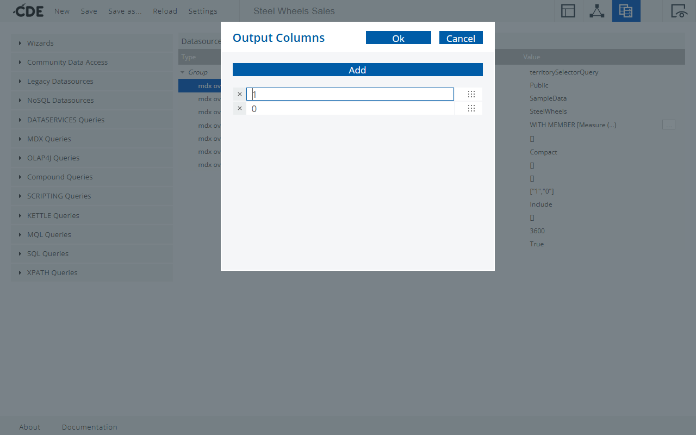
<figcaption>Output Columns: the unique name first, then the caption</figcaption>
</figure>
</div>

<div align="center">
<figure>
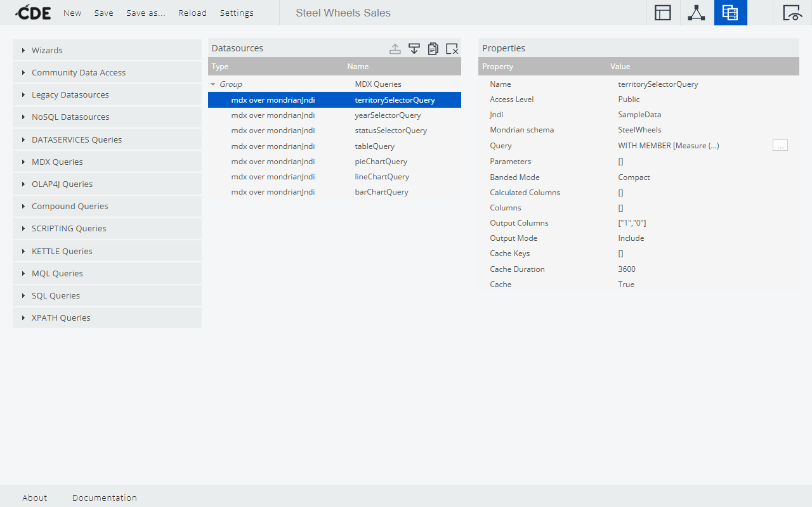
<figcaption>territorySelectorQuery. The picture also lists the queries you add next.</figcaption>
</figure>
</div>

18. Select **Save**. CDE writes the data sources to `sales-dashboard.cda`, beside the dashboard.
19. In the PUC, select **Browse Files**, select **Sales-Dashboard**, select `sales-dashboard.cda` and select **Open** under **File Actions**. In the CDA previewer, select **territorySelectorQuery** in the **Data Access** list.

<div align="center">
<figure>
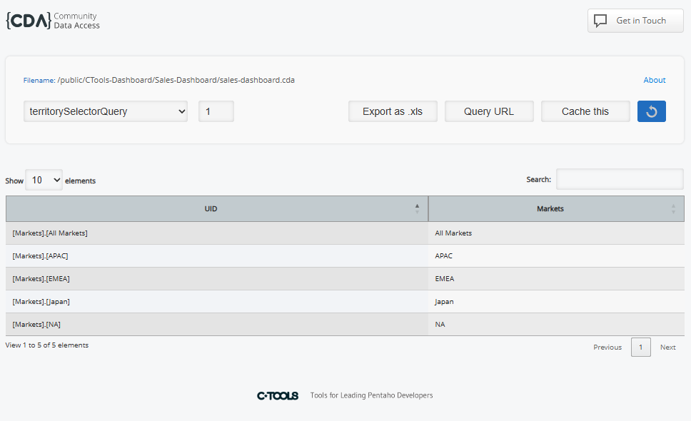
<figcaption>territorySelectorQuery in the CDA previewer</figcaption>
</figure>
</div>

> **Success:** Checkpoint: five rows, **UID** first: `[Markets].[All Markets]`, `[Markets].[APAC]`, `[Markets].[EMEA]`, `[Markets].[Japan]` and `[Markets].[NA]`, each with its caption beside it.

20. Leave the previewer tab open, and return to the editor tab.

> **Under the hood:**
>
> #### compact mode, and why the columns are swapped
>
> Banded Mode compact returns the plain result: the row member's caption
> in column 0 and each measure after it, here the UID measure in column
> 1. Output Columns 1,0 puts the unique name first, because the Filter
> component takes each option's value from column 0 and its label from
> column 1.
>
> The value a user picks is then a unique name such as [Markets].[EMEA],
> which CDA writes into the next query wherever it says
> ${territoryParameter}.
>
> **Why it matters:** one query feeds a selector with ready-made values,
> and the value a user picks drops straight into the MDX of every query
> that uses it.

#### Data source - the other selectors

21. Add two more **mdx over mondrianJndi** data sources the same way, each with **Jndi** `SampleData`, **Mondrian schema** `SteelWheels` and **Output Columns** `1` and `0`:

| Name | Query |
| --- | --- |
| `yearSelectorQuery` | the first query below |
| `statusSelectorQuery` | the second query below |

```text
WITH MEMBER [Measures].[UID] AS [Time].CurrentMember.UniqueName
SELECT {[Measures].[UID]} ON COLUMNS,
{[Time].[Years].Members} ON ROWS
FROM [SteelWheelsSales]
```

```text
WITH MEMBER [Measures].[UID] AS [Order Status].CurrentMember.UniqueName
SELECT {[Measures].[UID]} ON COLUMNS,
{[Order Status].[All Status Types], [Order Status].[Type].Members} ON ROWS
FROM [SteelWheelsSales]
```

<div align="center">
<figure>
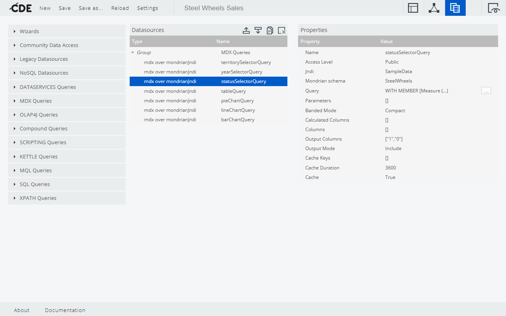
<figcaption>statusSelectorQuery</figcaption>
</figure>
</div>

#### Data source - tableQuery

The table shows one row per country of the selected territory: sales, quantity, the country's share of all sales, and its growth on the year before. The query reads three parameters, which the selectors will set.

22. Add an **mdx over mondrianJndi** data source named `tableQuery`, with **Jndi** `SampleData` and **Mondrian schema** `SteelWheels`, and this query:

```text
WITH
MEMBER [Measures].[UID] AS [Markets].CurrentMember.UniqueName
MEMBER [Measures].[Share] AS 100 * [Measures].[Sales] / ([Measures].[Sales], [Markets].[All Markets])
MEMBER [Measures].[Prior Sales] AS ([Measures].[Sales], ${yearParameter}.Lag(1))
MEMBER [Measures].[Growth] AS IIf(IsEmpty([Measures].[Prior Sales]), NULL, 100 * ([Measures].[Sales] / [Measures].[Prior Sales] - 1))
SELECT {[Measures].[UID], [Measures].[Sales], [Measures].[Quantity], [Measures].[Share], [Measures].[Growth]} ON COLUMNS,
NON EMPTY Descendants(${territoryParameter}, [Markets].[Country]) ON ROWS
FROM [SteelWheelsSales]
WHERE (${statusParameter}, ${yearParameter})
```

23. Click in the **Parameters** value. In **Parameters**, select **Add** three times, fill in **Name** and **Value** as below, leave **Type** at **String**, and select **Ok**:

| Name | Value |
| --- | --- |
| `territoryParameter` | `[Markets].[All Markets]` |
| `yearParameter` | `[Time].[2004]` |
| `statusParameter` | `[Order Status].[All Status Types]` |

<div align="center">
<figure>
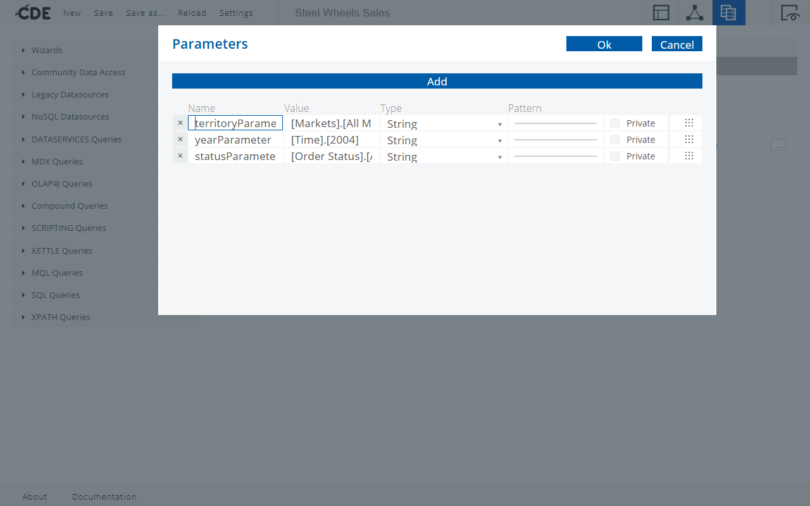
<figcaption>tableQuery's three parameters and their defaults</figcaption>
</figure>
</div>

24. Select **Save**. In the CDA previewer tab, reload the page, and select **tableQuery** in the **Data Access** list.

<div align="center">
<figure>
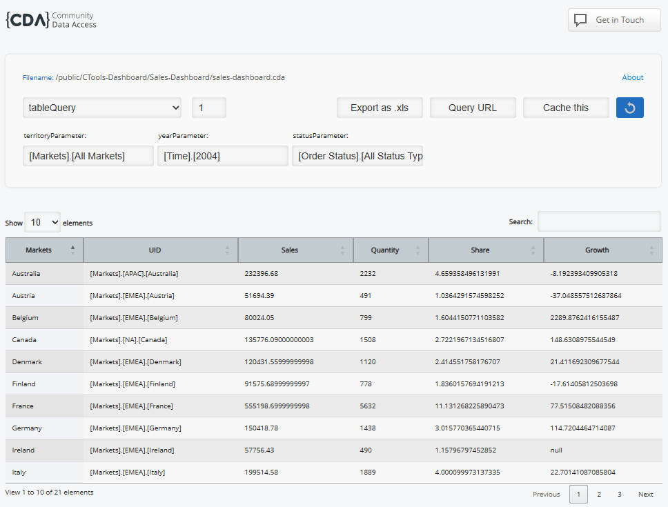
<figcaption>tableQuery with its default parameters</figcaption>
</figure>
</div>

> **Success:** Checkpoint: 21 rows, one per country with 2004 sales, in six columns: **Markets**, **UID**, **Sales**, **Quantity**, **Share** and **Growth**. Some countries, such as Ireland, show `null` growth: they had no sales in 2003.

#### Data source - the chart queries

25. Return to the editor tab and add three more **mdx over mondrianJndi** data sources, each with **Jndi** `SampleData` and **Mondrian schema** `SteelWheels`. Their **Parameters** use the same names and defaults as `tableQuery`, plus the ones in the last column:

| Name | Feeds | Parameters |
| --- | --- | --- |
| `pieChartQuery` | the donut chart: sales by product line | `territoryParameter`, `yearParameter`, `statusParameter` |
| `lineChartQuery` | the line chart: sales by month, this year and last year | the same three, and `productLineParameter`, default `[Product].[All Products]` |
| `barChartQuery` | the chart in an opened table row: a country's sales by quarter | `yearParameter`, `statusParameter`, and `countryParameter`, default `[Markets].[NA].[USA]` |

`pieChartQuery`:

```text
SELECT {[Measures].[Sales]} ON COLUMNS,
NON EMPTY [Product].[Line].Members ON ROWS
FROM [SteelWheelsSales]
WHERE (${territoryParameter}, ${statusParameter}, ${yearParameter})
```

`lineChartQuery`:

```text
WITH
MEMBER [Measures].[This Year] AS [Measures].[Sales]
MEMBER [Measures].[Last Year] AS ([Measures].[Sales], ParallelPeriod([Time].[Years], 1, [Time].CurrentMember))
SELECT {[Measures].[This Year], [Measures].[Last Year]} ON COLUMNS,
Descendants(${yearParameter}, [Time].[Months]) ON ROWS
FROM [SteelWheelsSales]
WHERE (${territoryParameter}, ${statusParameter}, ${productLineParameter})
```

`barChartQuery`:

```text
SELECT {[Measures].[Sales]} ON COLUMNS,
Descendants(${yearParameter}, [Time].[Quarters]) ON ROWS
FROM [SteelWheelsSales]
WHERE (${countryParameter}, ${statusParameter})
```

<div align="center">
<figure>
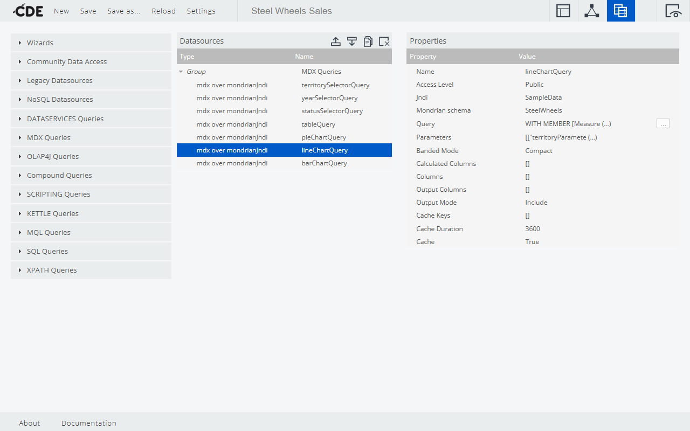
<figcaption>lineChartQuery</figcaption>
</figure>
</div>

26. Select **Save**, reload the CDA previewer tab, and select each new query in turn.

> **Success:** Checkpoint: **pieChartQuery** returns 7 product lines, Classic Cars the largest at about 1.84 million; **lineChartQuery** returns 12 months of 2004 with **This Year** and **Last Year**; **barChartQuery** returns USA's four quarters of 2004.

27. Close the previewer tab.

### 2. Components

> **Note:**
>
> #### Components
>
> With the layout and the data in place, add the components, in order: the parameters that hold the user's choices, the selectors that set them, then the table and the charts that listen to them.

<div align="center">
<figure>
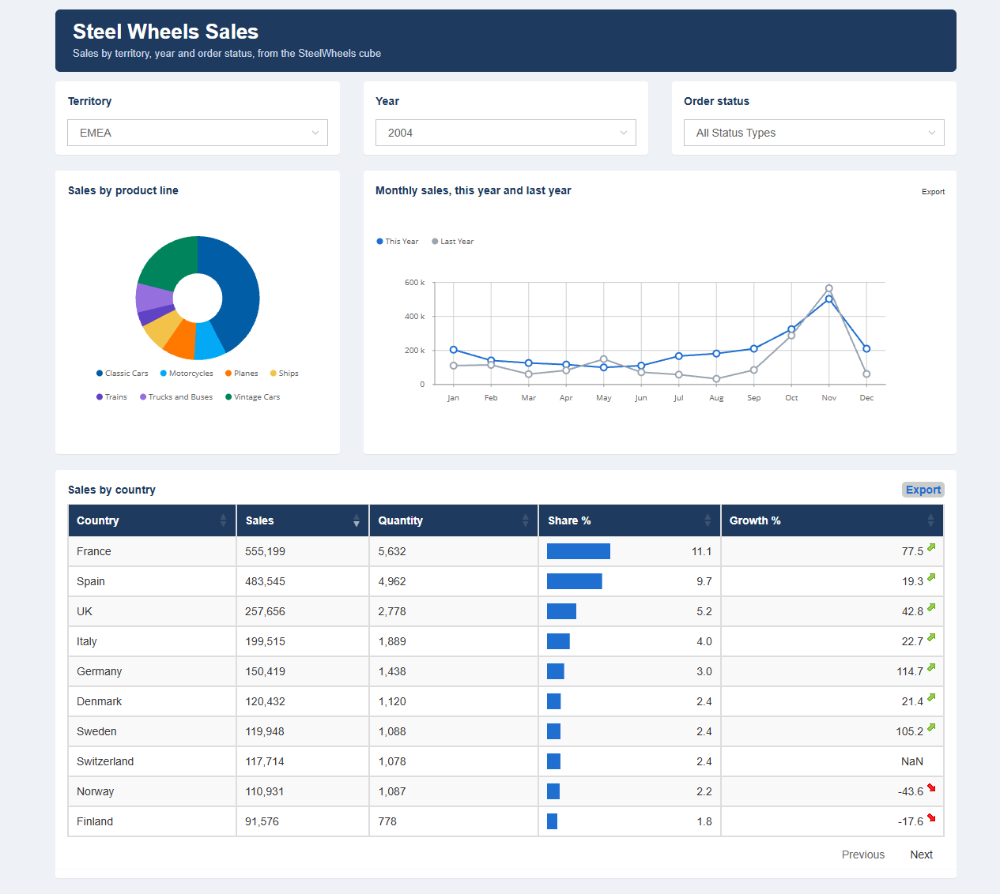
<figcaption>The finished dashboard, filtered to EMEA</figcaption>
</figure>
</div>

#### Parameters

A parameter holds a value the whole dashboard shares. The selectors need **Custom Parameters**, whose value is a JavaScript expression: the Filter component reads and writes its selection as an array. The other two parameters are **Simple Parameters**, with a plain value.

1. Select **Components Panel**, the perspective icon at the top right.
2. In the list on the left, expand **Parameters** and select **Custom Parameter**. Type `territoryParameter` as its **Name** and press `Enter`. Then select the **...** button in the **Javascript code** value. In **Javascript Wizard**, enter this default and select **Ok**:

```text
["[Markets].[All Markets]"]
```

<div align="center">
<figure>
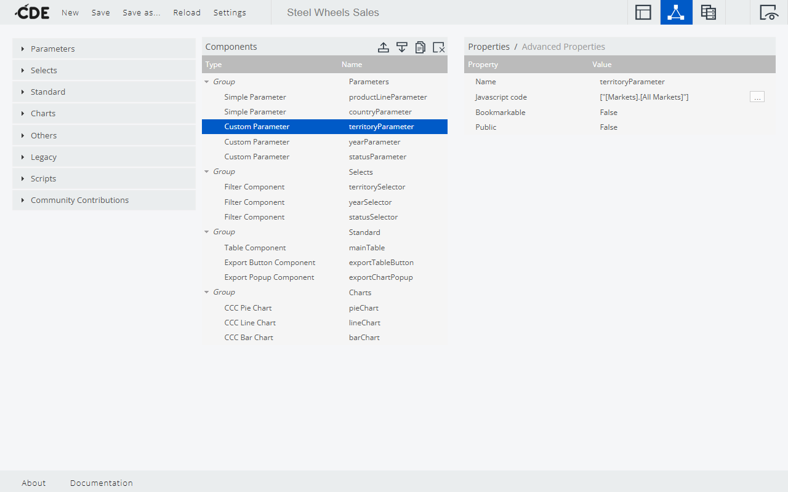
<figcaption>territoryParameter. The picture also lists the components you add next.</figcaption>
</figure>
</div>

3. Add two more Custom Parameters the same way:

| Name | Javascript code |
| --- | --- |
| `yearParameter` | `["[Time].[2004]"]` |
| `statusParameter` | `["[Order Status].[All Status Types]"]` |

4. In the list on the left, under **Parameters**, select **Simple Parameter**. Set **Name** to `productLineParameter` and **Property value** to `[Product].[All Products]`. Then add a second Simple Parameter, `countryParameter`, with the **Property value** `[Markets].[NA].[USA]`.

<div align="center">
<figure>
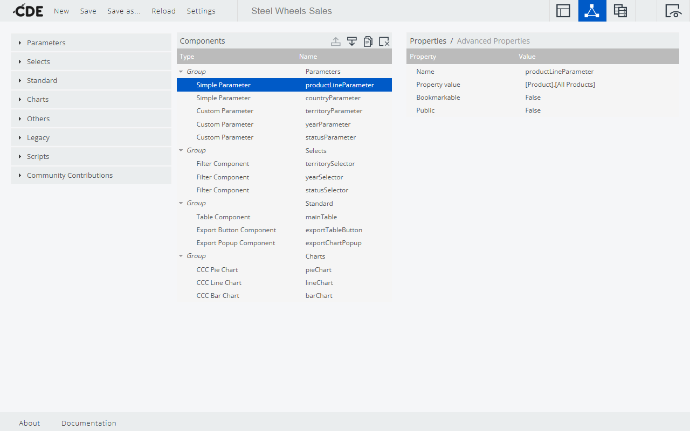
<figcaption>productLineParameter, a Simple Parameter</figcaption>
</figure>
</div>

#### Selectors

A selector shows a list from its data source, stores the user's choice in its parameter, and every component that listens to that parameter updates.

5. In the list on the left, expand **Selects** and select **Filter Component**.
6. Set these properties. For **Parameter**, **Datasource** and **HtmlObject**, click in the value and select from the list:

| Property | Value |
| --- | --- |
| **Name** | `territorySelector` |
| **Parameter** | `territoryParameter` |
| **Datasource** | `territorySelectorQuery` |
| **Multiple Selection** | `False` |
| **Show Search Filter** | `False` |
| **HtmlObject** | `territorySelectorObj` |

<div align="center">
<figure>
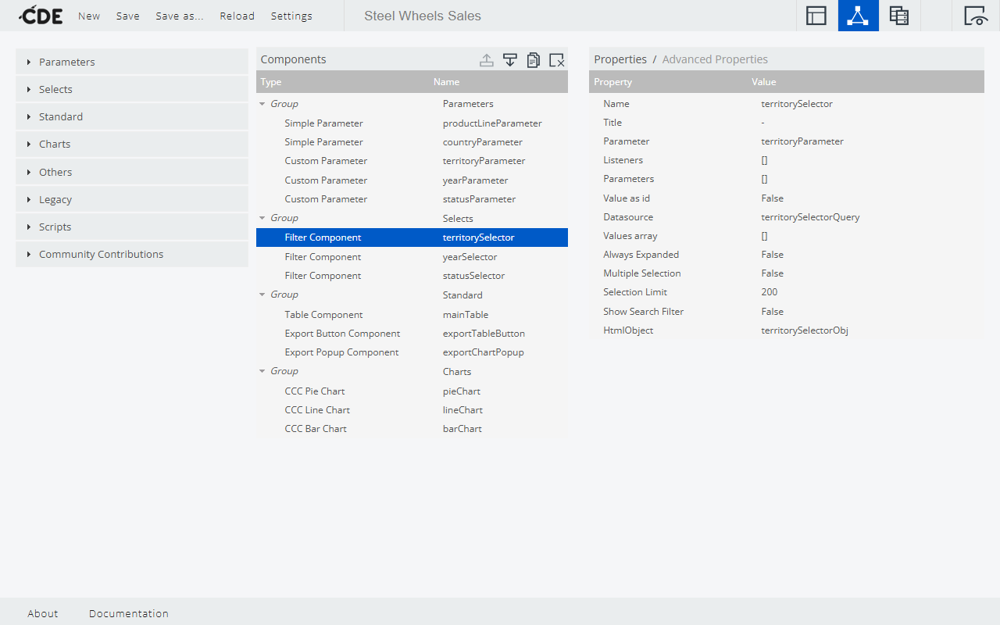
<figcaption>territorySelector</figcaption>
</figure>
</div>

7. Select **Advanced Properties**, and set **Show Icons** and **Show "Only" Button** to `False`. **Value as id** stays `False`: the value comes from column 0, the label from column 1.

<div align="center">
<figure>
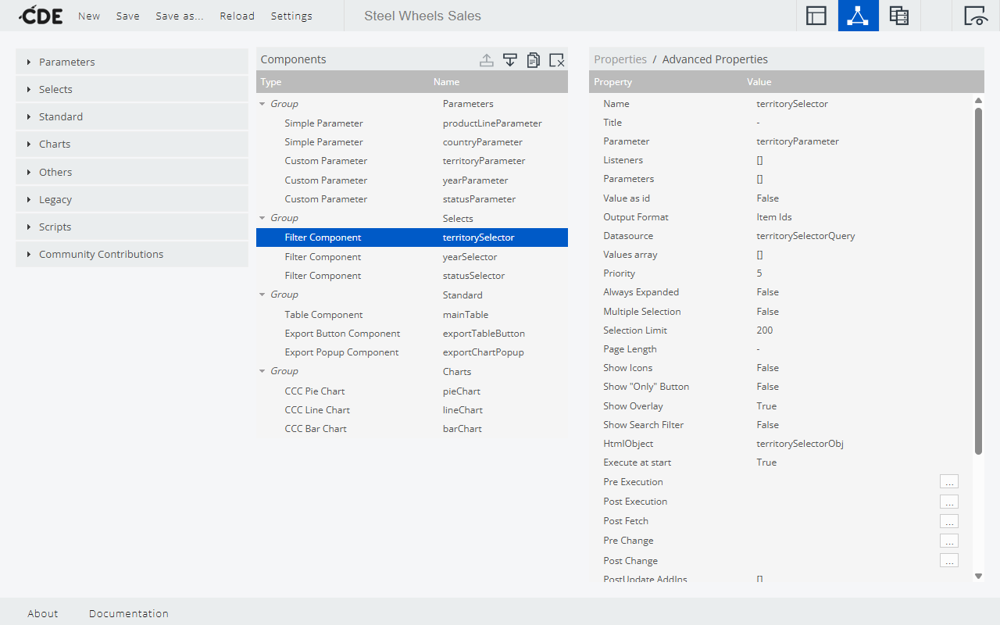
<figcaption>territorySelector, advanced properties</figcaption>
</figure>
</div>

8. Add two more Filter Components with the same settings, except these:

| Name | Parameter | Datasource | HtmlObject |
| --- | --- | --- | --- |
| `yearSelector` | `yearParameter` | `yearSelectorQuery` | `yearSelectorObj` |
| `statusSelector` | `statusParameter` | `statusSelectorQuery` | `statusSelectorObj` |

9. Select **Save**, then **Preview your Dashboard**, and open the **Territory** selector.

<div align="center">
<figure>
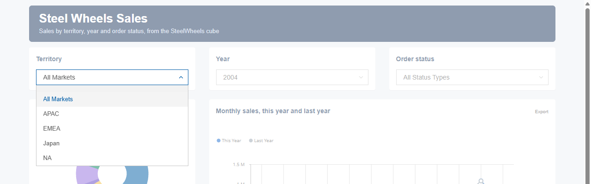
<figcaption>The three selectors, with Territory open</figcaption>
</figure>
</div>

> **Success:** Checkpoint: the selectors show their defaults, **All Markets**, **2004** and **All Status Types**, and **Territory** lists **All Markets**, **APAC**, **EMEA**, **Japan** and **NA**.

10. Close the preview.

#### Table - mainTable

11. In the list on the left, expand **Standard** and select **Table Component**.
12. Set **Name** to `mainTable`, **Datasource** to `tableQuery` and **HtmlObject** to `mainTableObj`.

<div align="center">
<figure>
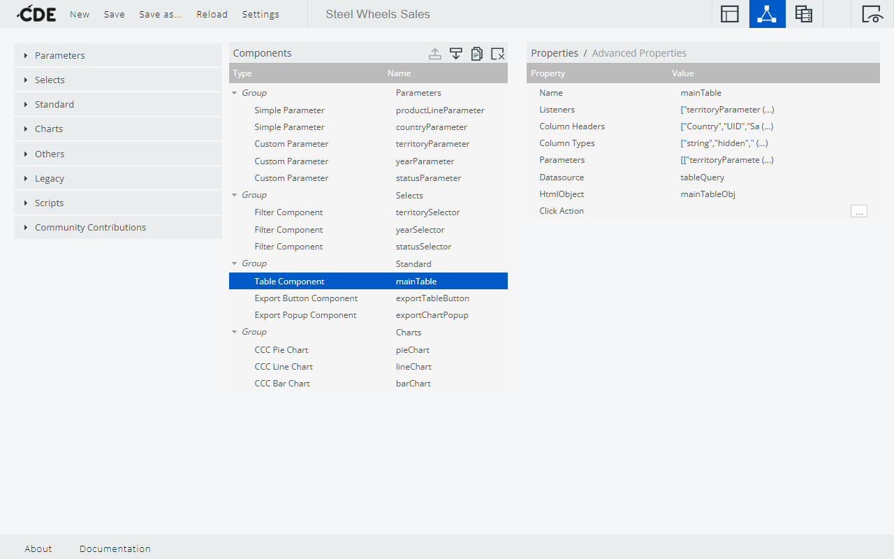
<figcaption>mainTable</figcaption>
</figure>
</div>

13. Click in the **Parameters** value. In **Parameters**, select **Add** three times; in each row, enter the parameter's name in **Arg**, and in **Value** type its first few letters and select it. Select **Ok**.

| Arg | Value |
| --- | --- |
| `territoryParameter` | `territoryParameter` |
| `yearParameter` | `yearParameter` |
| `statusParameter` | `statusParameter` |

<div align="center">
<figure>
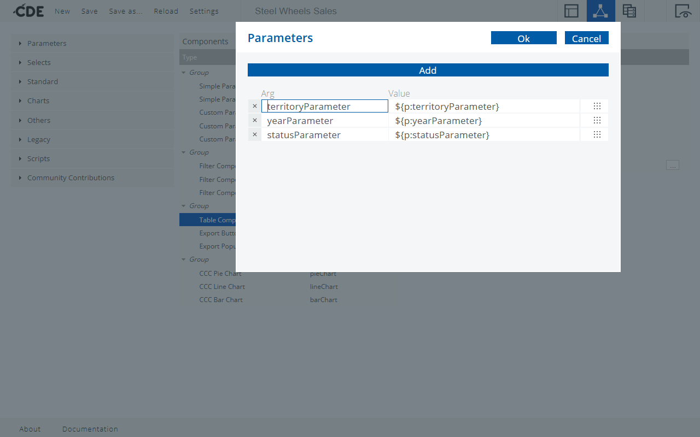
<figcaption>mainTable's Parameters: each Value shows as ${p:name}</figcaption>
</figure>
</div>

14. Click in the **Listeners** value, select the three parameters, `territoryParameter`, `yearParameter` and `statusParameter`, and select **OK**.

<div align="center">
<figure>
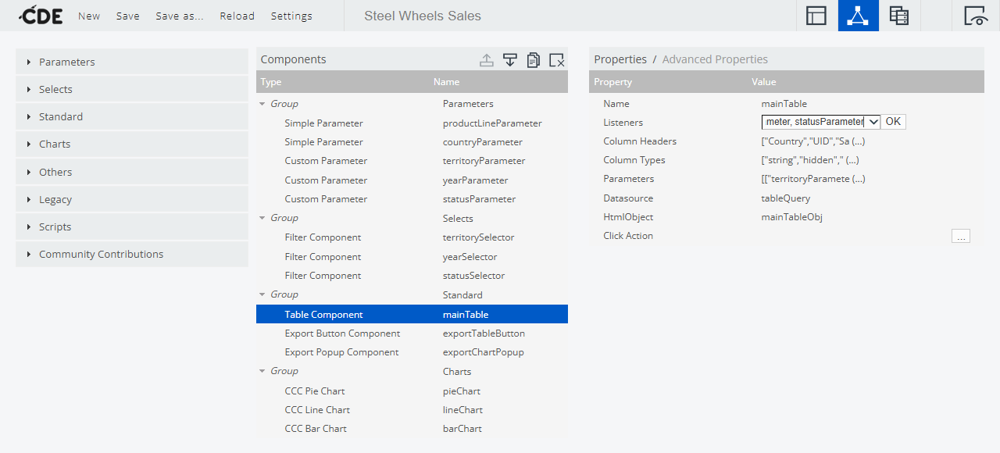
<figcaption>mainTable's Listeners</figcaption>
</figure>
</div>
15. Select **Advanced Properties** and set:

| Property | Value |
| --- | --- |
| **Column Headers** | `Country`, `UID`, `Sales`, `Quantity`, `Share %`, `Growth %` |
| **Column Types** | `string`, `hidden`, `numeric`, `numeric`, `dataBar`, `trendArrow` |
| **Column Formats** | `%s`, `%s`, `%.0f`, `%.0f`, `%.1f`, `%.1f` |
| **Sort by** | **Index** `2`, **Order** `desc` |
| **Show Filter** | `False` |
| **Info Filter** | `False` |
| **Length Change** | `False` |
| **Pagination Type** | `Simple` |

Each array value opens a dialog: select **Add** once per column, enter the values in order, and select **Ok**. Type the first few letters of a column type, and CDE offers the name.

<div align="center">
<figure>
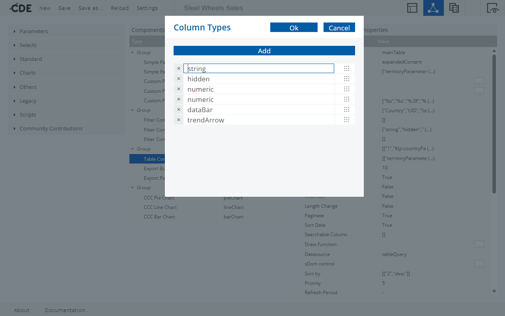
<figcaption>Column Types: one per column of tableQuery</figcaption>
</figure>
</div>

<div align="center">
<figure>
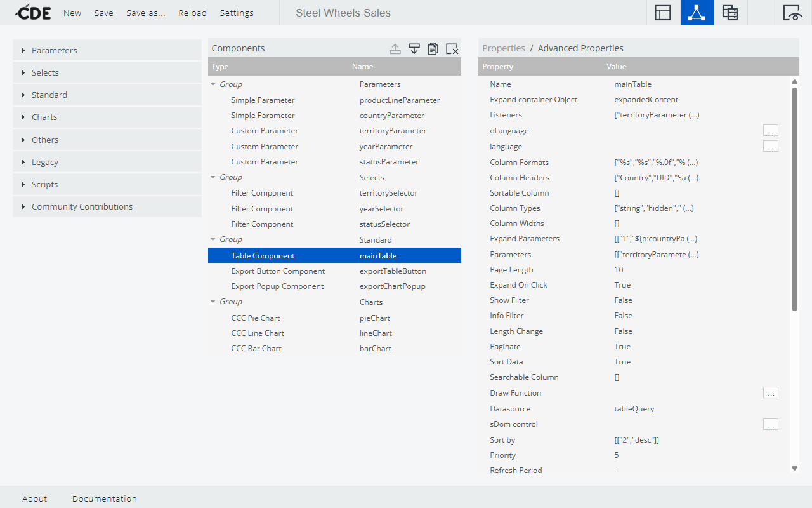
<figcaption>mainTable, advanced properties</figcaption>
</figure>
</div>

16. To show the values beside the data bars and trend arrows, select the **...** button in the **Pre Execution** value. In **Javascript Wizard**, enter this function and select **Ok**:

```javascript
function f() {
    this.setAddInOptions("colType", "trendArrow", {
        includeValue: true,
        good: true
    });
    this.setAddInOptions("colType", "dataBar", {
        includeValue: true,
        width: 80,
        startColor: "#1f6fd1",
        endColor: "#1f6fd1"
    });
}
```

17. Select **Save**, then **Preview your Dashboard**.

> **Success:** Checkpoint: the **Sales by country** table: **USA** first with sales of `1,685,471`, a data bar for each **Share %** and an arrow for each **Growth %**, green up or red down, 10 rows per page. The **UID** column is hidden. **Japan**, **Switzerland** and **Singapore** show `NaN` growth: they had no sales in 2003, so the growth has nothing to compare with.

18. Close the preview.

> **Under the hood:**
>
> #### The table is DataTables, formatted cell by cell
>
> CDF's Table Component renders with the DataTables library it bundles.
> Each Column Format is applied with sprintf to every value in that
> column as the cell is drawn, so formatting never changes the data the
> query returned, and a hidden column is still in the data: the expand
> feature at the end of this tab reads the UID from it.
>
> Sort by is not applied in the browser at first: CDF turns it into
> CDA's sortBy option, a column index plus A or D (desc on column 2
> becomes 2D), and CDA sorts the result on the server before sending
> it.
>
> **Why it matters:** the same query can feed a table, a chart and an
> export unchanged; each component formats what it shows.

#### Charts - Pie Chart

19. In the list on the left, expand **Charts** and select **CCC Pie Chart**.
20. Set these properties, and its **Parameters** and **Listeners** to the same three parameters as `mainTable`:

| Property | Value |
| --- | --- |
| **Name** | `pieChart` |
| **Datasource** | `pieChartQuery` |
| **HtmlObject** | `pieChartObj` |
| **Height** | `300` |
| **Width** | empty: delete the value and press `Enter` |

<div align="center">
<figure>
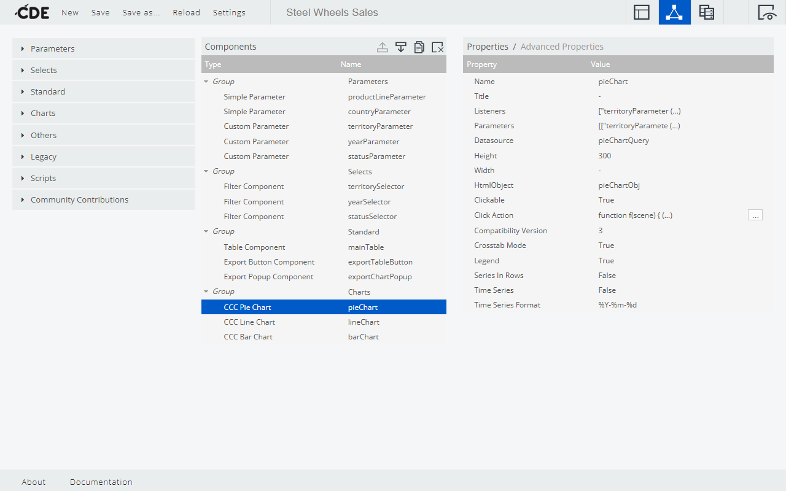
<figcaption>pieChart</figcaption>
</figure>
</div>

With no **Width**, the chart takes the width of its column, so it fits the panel on any screen.

21. Select **Advanced Properties**. Set **Values Visible** to `False` and **Legend Position** to `Bottom`.
22. Click in the **Extension points** value. In **Extension Points**, select **Add**, set **Arg** to `slice_innerRadiusEx` and **Value** to `40%`, and select **Ok**.

<div align="center">
<figure>
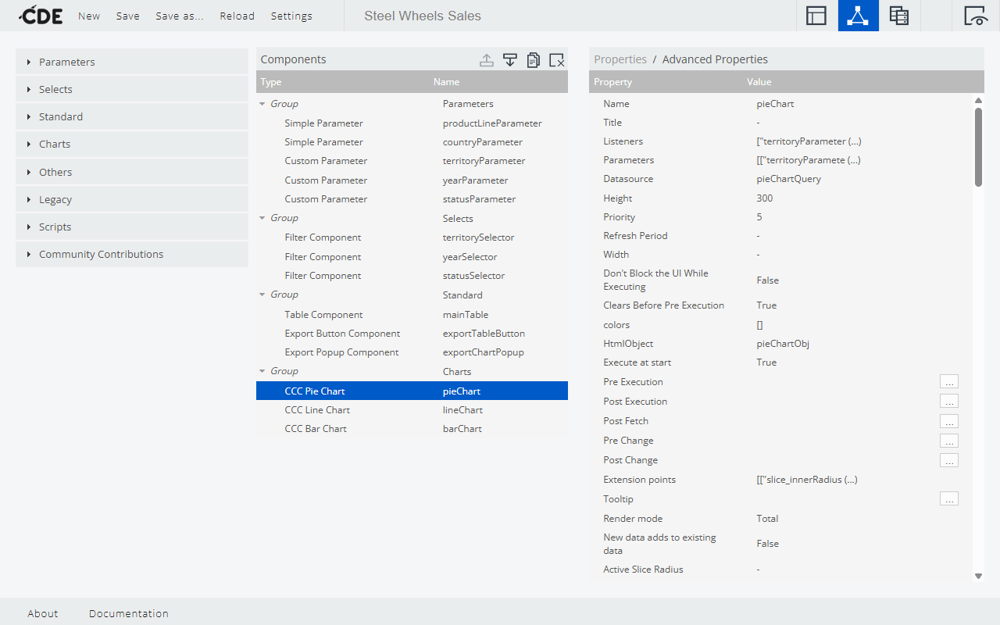
<figcaption>pieChart, advanced properties, with its extension point</figcaption>
</figure>
</div>
23. Select **Save**, then **Preview your Dashboard**.

> **Success:** Checkpoint: a donut of the seven product lines, with no values on the slices and the legend below it. **Classic Cars** is the largest slice.

24. Close the preview.

> **Under the hood:**
>
> #### An extension point is a mark and a property
>
> slice_innerRadiusEx reads as two parts: slice, the pie chart's wedge
> mark, and innerRadiusEx, one of its properties. CCC resolves the
> percentage against the pie's outer radius and sets the protovis
> innerRadius from it, so 40% leaves a hole whose radius is 40% of the
> pie's: a donut.
>
> Every CCC chart exposes its marks this way (dot_ and line_ on the line
> chart below, xAxisLabel_ and xAxisRule_ on others), and a value can be
> a function of the data instead of a constant.
>
> **Why it matters:** anything CCC draws can be restyled from the
> dashboard, with no change to the chart library.

#### Charts - Line Chart

25. In the list on the left, under **Charts**, select **CCC Line Chart**.
26. Set **Name** to `lineChart`, **Datasource** to `lineChartQuery`, **HtmlObject** to `lineChartObj`, **Height** to `300`, and delete the **Width** value. Set its **Parameters** and **Listeners** to four parameters: `territoryParameter`, `yearParameter`, `statusParameter` and `productLineParameter`.

<div align="center">
<figure>
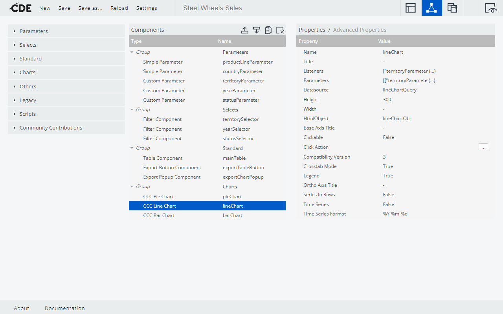
<figcaption>lineChart</figcaption>
</figure>
</div>

27. Select **Advanced Properties** and set:

| Property | Value |
| --- | --- |
| **colors** | `#1f6fd1` and `#9aa5b1`, in **String Array** |
| **Dots Visible** | `True` |
| **Legend Align** | `Left` |
| **Legend Position** | `Top` |
| **Plot Frame Visible** | `False` |
| **Extension points** | the four rows below |

| Arg | Value |
| --- | --- |
| `dot_fillStyle` | `#fff` |
| `dot_shapeRadius` | `4` |
| `line_lineWidth` | `2` |
| `dot_lineWidth` | `2` |

<div align="center">
<figure>
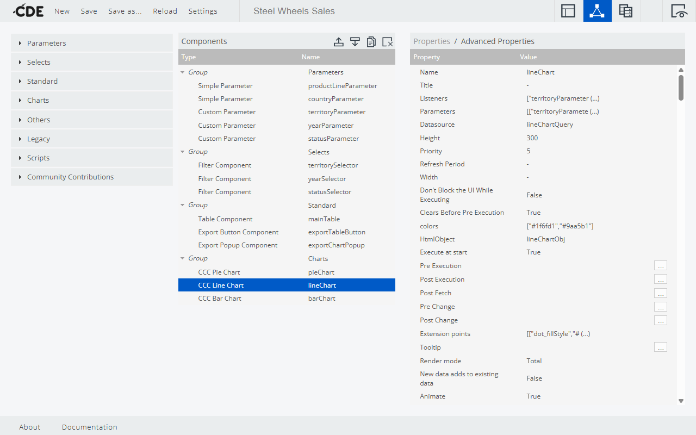
<figcaption>lineChart, advanced properties</figcaption>
</figure>
</div>

28. Select **Save**, then **Preview your Dashboard**.

> **Success:** Checkpoint: two lines over the twelve months of 2004, **This Year** in blue and **Last Year** in grey, with hollow dots and the legend at the top left. Both peak in **Nov**, this year at about 1.09 million.

29. Close the preview.

#### Interactions - clickAction

A selector changes a parameter when a user picks a value. A chart can do the same when a user clicks it: its **Click Action** calls `dashboard.fireChange` with the parameter's name and new value. Make a click on a slice show that product line in the line chart.

30. In the components grid, select **pieChart**, and select **Advanced Properties**.
31. Set **Clickable** to `True`.
32. Select the **...** button in the **Click Action** value. In **Javascript Wizard**, enter this function and select **Ok**:

```javascript
function f(scene) {
    var line = scene.vars.category.value;
    dashboard.fireChange('${p:productLineParameter}', '[Product].[' + line + ']');
}
```

<div align="center">
<figure>
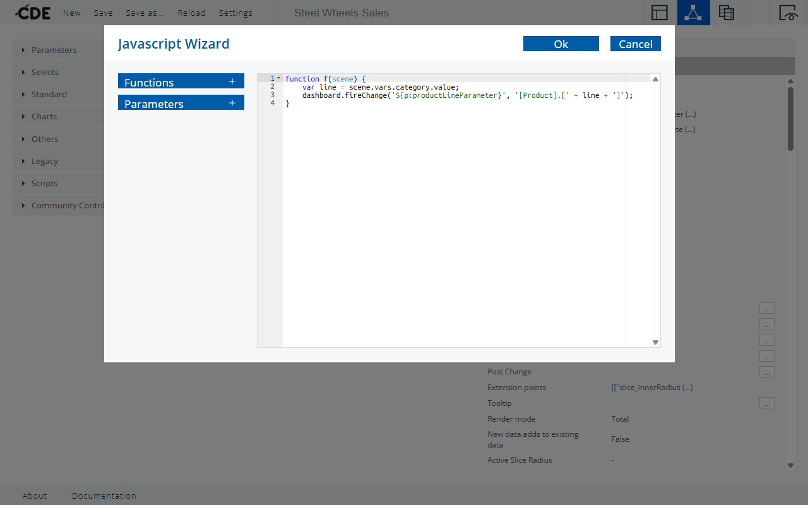
<figcaption>The pie chart's Click Action</figcaption>
</figure>
</div>

The slice's category is the product line's caption, such as `Classic Cars`; the function turns it into the member's unique name, `[Product].[Classic Cars]`, the form `lineChartQuery` needs. `lineChart` already listens to `productLineParameter`.

33. Select **Save**, then **Preview your Dashboard**, and select the **Classic Cars** slice.

<div align="center">
<figure>
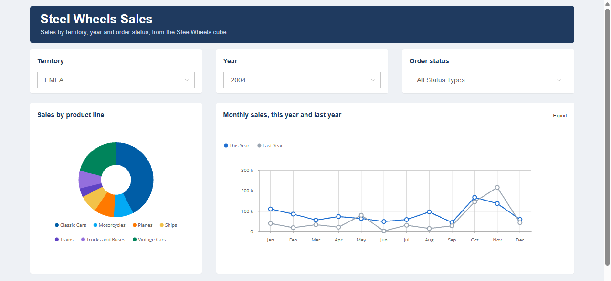
<figcaption>After a click on Classic Cars, here with Territory EMEA</figcaption>
</figure>
</div>

> **Success:** Checkpoint: the line chart redraws with the sales of Classic Cars only: its axis tops out at a few hundred thousand instead of 1.5 million.

34. Close the preview.

> **Under the hood:**
>
> #### fireChange updates listeners; parameters carry values
>
> dashboard.fireChange sets the parameter, raises a cdf
> productLineParameter:fireChange event, then updates every enabled
> component whose Listeners include productLineParameter. Listening is
> what makes the line chart run again; its Parameters entry is what
> passes the new value to its query, as paramproductLineParameter on the
> CDA request. A component that should follow a parameter needs both.
>
> ${p:productLineParameter} is not resolved in the browser: CDE replaces
> it when it writes the dashboard, with productLineParameter here, or
> with an alias-prefixed name when the dashboard runs as a widget inside
> another, so the click keeps working either way.
>
> **Why it matters:** a component that updates but shows the old data
> is missing its Parameters entry; one that never updates is missing its
> listener.

<div align="center">
<figure>
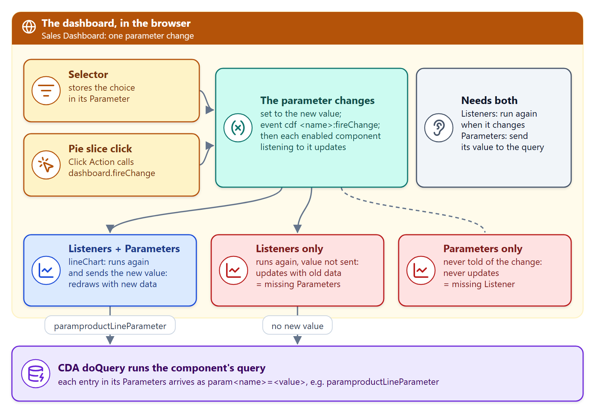
<figcaption>A parameter change: listeners decide who runs, parameters carry the value</figcaption>
</figure>
</div>

Read the diagram from the left. A selector stores the user's choice in its parameter, and a click on a pie slice calls `dashboard.fireChange`; either way the parameter changes, and every enabled component that lists it in **Listeners** updates. The three boxes below are three versions of `lineChart`. With `productLineParameter` in both **Listeners** and **Parameters**, it runs again and its `doQuery` request carries `paramproductLineParameter`, so it redraws with the new data. With the listener only, it runs again but its query never gets the new value; with the **Parameters** entry only, nothing makes it run.

#### Export - Button & Popup

CDE's export components export a component's data as CSV, XLS, XML or JSON, through CDA calls made in the background, and a CCC chart as a PNG or SVG image, through the Community Graphics Generator (CGG).

35. In the list on the left, under **Standard**, select **Export Button Component**, and set:

| Property | Value |
| --- | --- |
| **Name** | `exportTableButton` |
| **Label** | `Export` |
| **Component Name** | `mainTable` |
| **HtmlObject** | `exportTableButtonObj` |

<div align="center">
<figure>
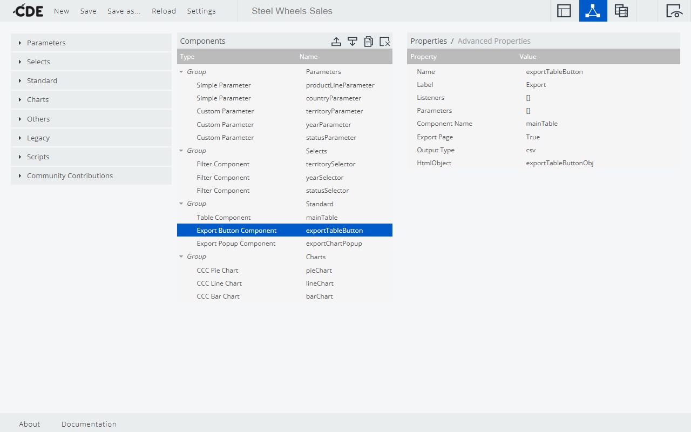
<figcaption>exportTableButton</figcaption>
</figure>
</div>

**Output Type** keeps its default, `csv`.

36. Under **Standard**, select **Export Popup Component**, and set:

| Property | Value |
| --- | --- |
| **Name** | `exportChartPopup` |
| **Title** | `Export` |
| **Chart Component to Export** | `lineChart` |
| **Data Component to Export** | `lineChart` |
| **HtmlObject** | `exportChartButtonObj` |

<div align="center">
<figure>
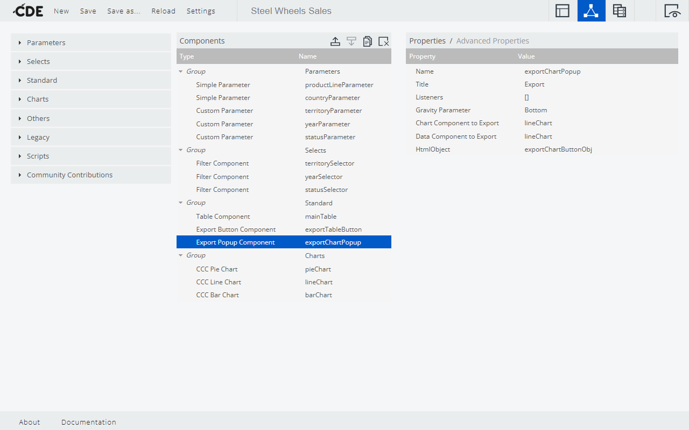
<figcaption>exportChartPopup</figcaption>
</figure>
</div>

Choosing `lineChart` from the **Chart Component to Export** list switches on that chart's CGG support, so the next save also writes a CGG script for it.

37. Select **Save**.

The export popup works when you open the dashboard itself, not in Preview.

38. In **Browse Files**, select **Sales-Dashboard** and double-click **Steel Wheels Sales**. Select **Export** above the line chart.

<div align="center">
<figure>
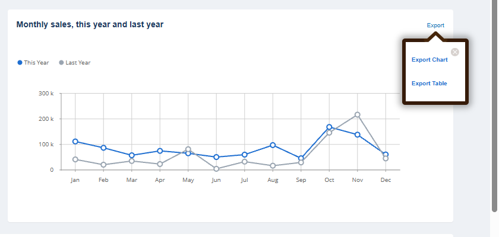
<figcaption>The Export popup</figcaption>
</figure>
</div>

> **Success:** Checkpoint: the popup offers **Export Chart** and **Export Table**. **Export Chart** opens **Export Options**, with the sizes **Small**, **Medium**, **Large** and **Custom**, **Width** and **Height**, and an **Export** button above a preview of the chart. The **Export** button above the table downloads the table's data as a CSV file.

<div align="center">
<figure>
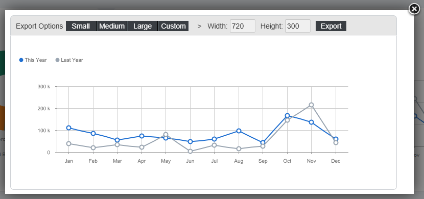
<figcaption>Export Options: the chart, drawn on the server by CGG</figcaption>
</figure>
</div>

39. Close **Export Options** and the dashboard's tab.

> **Under the hood:**
>
> #### Two exports, two engines
>
> The Export Button re-runs its table's CDA query with outputType=csv,
> current parameter values included, and the browser downloads what CDA
> returns. The Export Popup's data export works the same way; its chart
> export goes to CGG instead.
>
> The save wrote lineChart.js beside the dashboard (and a copy,
> sales-dashboard_lineChart.js): the chart's definition and its data
> source, as a script. Export Chart asks CGG to run that script on the
> server, passing the chart's parameter
> values as param&lt;name&gt; and the size you choose; workshop 14 builds
> on that.
>
> **Why it matters:** an export always matches what the user filtered,
> because it re-runs the same query with the same parameter values.

#### Expand - Expandable Rows

A table row can open to show more detail. Here a click on a country opens a bar chart of that country's sales by quarter. The chart needs a place to draw, a row that stays hidden until the table moves it into the opened row.

40. Select **Layout Panel**. In **Layout Structure**, select the **tableCol** column under **tableRow**, and select the **Add Row** icon. Set the new row's **Name** to `expandedContent` and its **Css Class** to `WDhidden expandedContent`. With **expandedContent** still selected, select the **Add Columns** icon, and set the new column's **Name** to `barChartObj`.

<div align="center">
<figure>
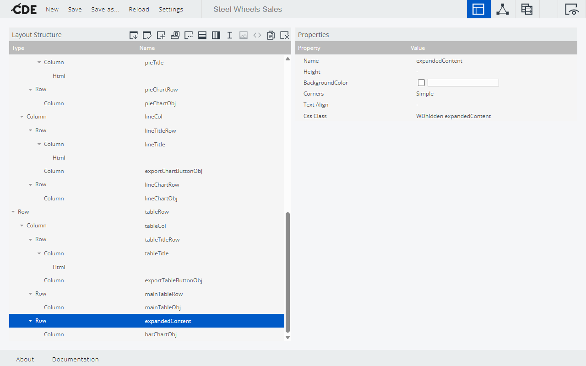
<figcaption>The hidden row for the expanded content</figcaption>
</figure>
</div>

`WDhidden` hides the row until the table needs it.

41. Select **Components Panel**. Under **Charts**, select **CCC Bar Chart**, and set:

| Property | Value |
| --- | --- |
| **Name** | `barChart` |
| **Title** | `Quarterly sales` |
| **Datasource** | `barChartQuery` |
| **HtmlObject** | `barChartObj` |
| **Height** | `220` |
| **Width** | empty |
| **Parameters** and **Listeners** | `countryParameter`, `yearParameter` and `statusParameter` |

<div align="center">
<figure>
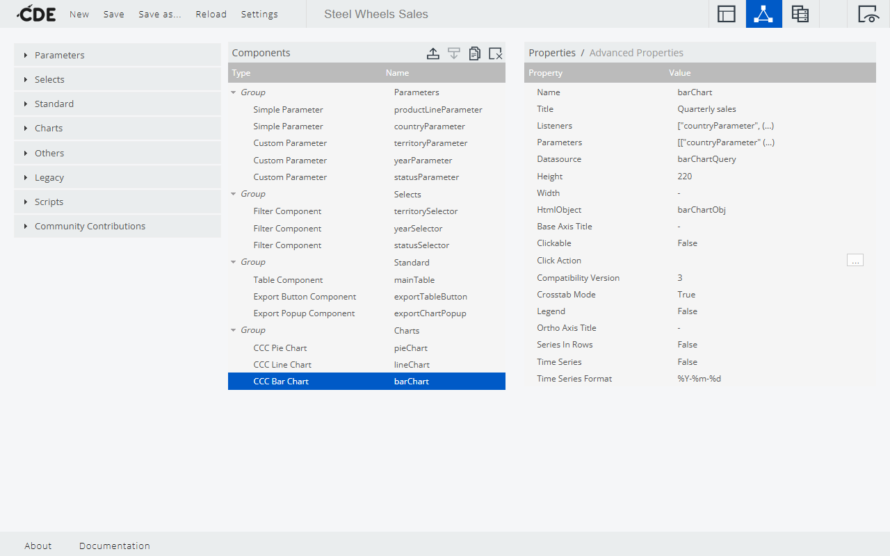
<figcaption>barChart</figcaption>
</figure>
</div>

42. Select **Advanced Properties** and set **Execute at start** to `False` and **Legend** to `False`.
43. In the components grid, select **mainTable**, select **Advanced Properties**, and set:

| Property | Value |
| --- | --- |
| **Expand On Click** | `True` |
| **Expand container Object** | `expandedContent` |
| **Expand Parameters** | **Arg** `1`, **Value** `countryParameter` |

<div align="center">
<figure>

<figcaption>mainTable's expand properties</figcaption>
</figure>
</div>

**Arg** is a column index: column 1, the hidden **UID**, holds the country's unique name, the value `barChartQuery` needs.

44. Select **Save**, then **Preview your Dashboard**, and select the **France** row of the table.

<div align="center">
<figure>
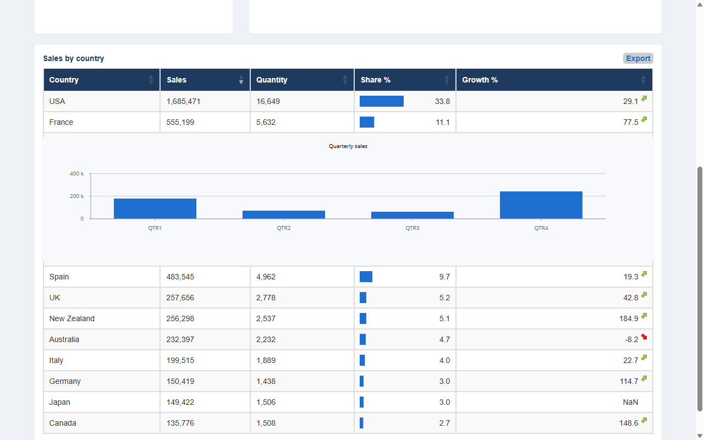
<figcaption>The France row, opened</figcaption>
</figure>
</div>

> **Success:** Checkpoint: the row opens, and the **Quarterly sales** chart inside it shows France's four quarters of 2004, the fourth the highest. Selecting the row again closes it.

45. Close the preview.

> **Under the hood:**
>
> #### A row click is a fireChange too
>
> With Expand on Click set, clicking a row copies that row's column
> values into the expand parameters, then calls fireChange on the first.
> The bar chart, which listens to countryParameter and has Execute at
> start off, runs only then, while the table opens a detail row and
> moves the expandedContent element into it, so the chart draws inside
> the opened row.
>
> **Why it matters:** the detail chart costs nothing until a user asks
> for it: its query runs only for the row that was clicked.

### 3. Preview

> **Note:**
>
> #### Preview
>
> With the layout styled, the data sources defined, the components configured and the interactions in place, open the finished dashboard and check it end to end.

1. In **Browse Files**, select **Sales-Dashboard** and double-click **Steel Wheels Sales**.

<div align="center">
<figure>

<figcaption>The finished Steel Wheels Sales dashboard</figcaption>
</figure>
</div>

> **Success:** Checkpoint: the finished dashboard:
>
> * The three selectors, **Territory**, **Year** and **Order status**, filter the donut, the line chart and the table.
> * The donut is clickable, and a click redraws the line chart for that product line through `productLineParameter`.
> * The line chart compares each month with the same month a year earlier.
> * `mainTable` shows data bars and trend arrows, and clicking a row opens the **Quarterly sales** chart.
> * The **Export** button exports the table as CSV; the **Export** popup exports the line chart as an image and its data as a file.

2. Close the dashboard's tab.

::::

## Lab Files

Click a file to download. Every file is also on disk in this workshop's folder, `C:\Workshop-CT-Associate\04-community-dashboard-editor\12-community-dashboard-editor-carrier-dashboard`.

The starting dashboard for the first tab: the layout and `dashstyle.css`. Upload it into **Public > CTools-Dashboard**, and the server unpacks it into **Sales-Dashboard**.

[sales-dashboard-start.zip](./files/sales-dashboard-start.zip)

### Solution <!-- no-step -->

The finished dashboard. Upload the zip into **Public > CTools-Dashboard** the same way; the server unpacks it into **Sales-Dashboard-Solution**, and **Steel Wheels Sales** there is the dashboard from the top of this page.

[sales-dashboard-solution.zip](./files/sales-dashboard-solution.zip)
