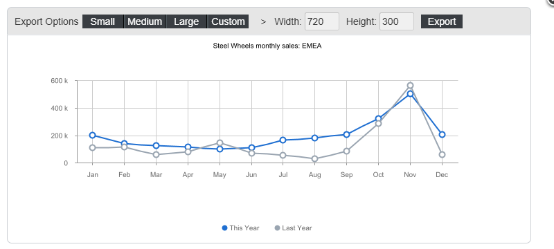
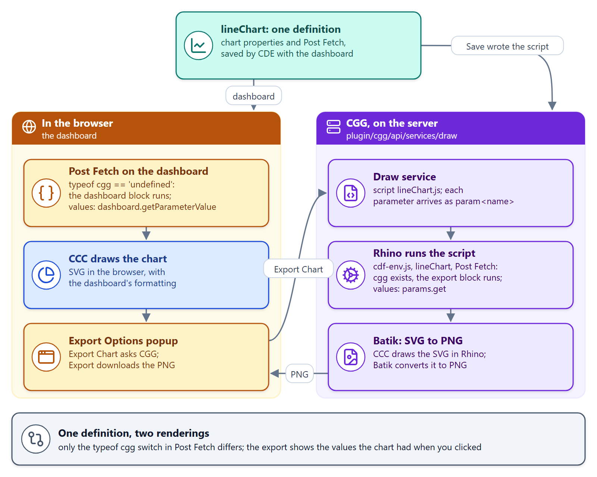
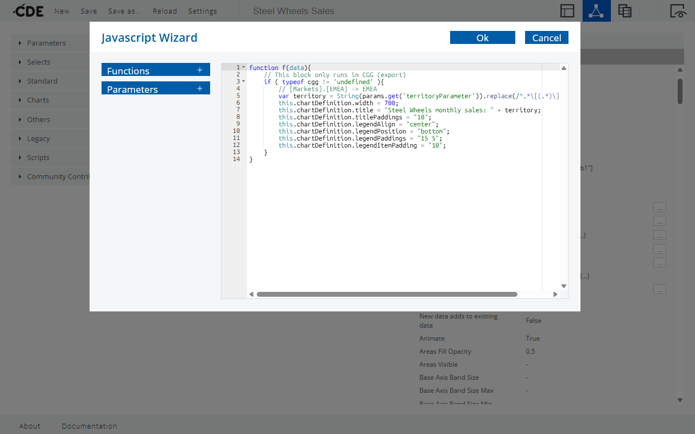

# Sales Dashboard Charts

> **Warning:**
>
> #### Workshop - Sales Dashboard CGG Charts
>
> Exported charts often need different formatting from the dashboard: a title, a fixed width, the legend in another place. In this workshop you add a Post Fetch function to the Sales Dashboard's `lineChart` so that it renders one way on screen and another when the Community Graphics Generator (CGG) exports it, with the selected territory in the exported chart's title.
>
> **What you'll do**
>
> * Tell dashboard rendering apart from CGG export with a `typeof cgg` check
> * Write a Post Fetch function that changes the chart definition only for the export
> * Read a dashboard parameter in the export with `params.get()`
> * Set export-only chart properties: width, title and padding, legend alignment and position
> * Export the chart as PNG and compare it with the dashboard
>
> **Prerequisites:** [Sales Dashboard](../12-community-dashboard-editor-carrier-dashboard/guide.md) completed, including `lineChart` and its Export Popup; JavaScript and CCC chart properties; a running Pentaho Server with CTools and CGG
>
> **Estimated time:** 15 minutes

<div align="center">
<figure>

<figcaption>The exported lineChart: its own title and legend, drawn by CGG</figcaption>
</figure>
</div>

***

## Dashboard vs. Export Visualization <!-- no-step -->

A chart can look different in the dashboard and in its export. The Post Fetch function runs in both places, so a conditional block in it can tell them apart: when the `cgg` object is undefined, the code is running in the dashboard; otherwise it is running in the export.

```javascript
if ( typeof cgg == 'undefined' ){
  
// ... This block only runs in the dashboard ... 
 } else {
  
// ... This block only runs in CGG (export) ... 
}
// ... This block runs everywhere ... 
```

<div align="center">
<figure>

<figcaption>One component definition, rendered by CCC on the dashboard and by CGG for the export</figcaption>
</figure>
</div>

Read the diagram from the definition at the top. On the dashboard, Post Fetch finds no `cgg` object, so the dashboard block runs and CCC draws the chart in the browser. **Export Chart** in the Export popup sends a request to CGG's draw service, with each of the chart's parameters and its current value; on the server, the chart's script runs again, Post Fetch finds the `cgg` object, the export block runs, and the SVG that CCC draws is turned into a PNG.

## Handling Parameters in Exports <!-- no-step -->

A CGG export script can't read the dashboard's parameters or call CDF functions such as `dashboard.getParameterValue`. What it gets is the request: the Export popup sends each of the chart's **Parameters** with its current value, as `param<name>`, and the script reads it back with `params.get('<name>')`.

```javascript
var territory = ( typeof cgg == 'undefined' ) ?
    dashboard.getParameterValue('territoryParameter') : params.get('territoryParameter');
```

The value in the export is the one the parameter had when the chart last executed. A value the chart's query doesn't use can travel the same way: add it to the component's **Parameters** with a name that starts with an underscore, such as `_title`. The underscore is a naming convention, not a requirement.

:::: tabs

### 1. lineChart

> **Note:**
>
> #### lineChart
>
> Add a Post Fetch function to `lineChart` that changes the chart definition only when CGG exports it: the width, a title with the selected territory, the title's padding, and the legend's alignment, position and padding.

1. Make sure the Pentaho Server is running. On a lab VM it already is; on your own machine start it as in [Before You Start](../00-before-you-start/guide.md):

```powershell
C:\Pentaho\server\pentaho-server\start-pentaho.bat
```

It takes a few minutes; the console is ready when http://localhost:8080/pentaho opens the login page.

2. Open the Pentaho User Console (PUC) with the button below and sign in as `admin`.

<button data-launch="puc">Open Pentaho User Console</button>

3. In **Browse Files**, select **Public > CTools-Dashboard > Sales-Dashboard**, select **Steel Wheels Sales**, and under **File Actions** select **Edit**. If you did not finish the Sales Dashboard workshop, upload its solution zip first and edit **Steel Wheels Sales** in **Sales-Dashboard-Solution**.
4. Select **Components Panel**. In the components grid, expand **Charts** and select **lineChart**.
5. Select **Advanced Properties**.
6. Select the **...** button in the **Post Fetch** value. In **Javascript Wizard**, enter this function and select **Ok**:

```javascript
function f(data){
    // This block only runs in CGG (export)
    if ( typeof cgg != 'undefined' ){
        // [Markets].[EMEA] -> EMEA
        var territory = String(params.get('territoryParameter')).replace(/^.*\[(.*)\]$/, '$1');
        this.chartDefinition.width = 700;
        this.chartDefinition.title = "Steel Wheels monthly sales: " + territory;
        this.chartDefinition.titlePaddings = "10";
        this.chartDefinition.legendAlign = "center";
        this.chartDefinition.legendPosition = "bottom";
        this.chartDefinition.legendPaddings = "15 5";
        this.chartDefinition.legendItemPadding = "10";
    }
}
```

<div align="center">
<figure>

<figcaption>Post Fetch: changes for the export only</figcaption>
</figure>
</div>

`params.get('territoryParameter')` returns the unique name, such as `[Markets].[EMEA]`; the `replace` keeps the last part, `EMEA`, for the title.

7. Select **Save**.
8. In **Browse Files**, select **Sales-Dashboard** and double-click **Steel Wheels Sales**. The Export popup works in the dashboard itself, not in Preview.
9. Set **Territory** to **EMEA**. Select **Export** above the line chart, and select **Export Chart**.

<div align="center">
<figure>

<figcaption>Export Chart, with Territory EMEA</figcaption>
</figure>
</div>

> **Success:** Checkpoint: **Export Options** shows the CGG rendering of the chart, which differs from the dashboard: the title **Steel Wheels monthly sales: EMEA** at the top and the legend centered below the chart. On the dashboard the chart has no title and its legend is at the top left.

10. Select **Export** in **Export Options** to download the PNG, and close the dashboard's tab.

> **Under the hood:**
>
> #### The export runs your chart again, on the server
>
> Export Chart calls CGG's draw service with the script CDE wrote when
> you saved: lineChart.js beside the dashboard. It loads cdf-env.js,
> rebuilds lineChart from the same definition, Post Fetch included,
> together with its data source, and ends by rendering it. CGG runs it
> in Rhino, a JavaScript engine inside the server, and converts the SVG
> that CCC draws into a PNG with Batik.
>
> That is why typeof cgg works as a switch: the variable exists only in
> that server-side run. Parameters reach it with the request: the popup
> sends each of the chart's parameters with its current value as
> param&lt;name&gt;, and params.get reads them back, which is why the
> export shows the values the chart had when you clicked. The popup also
> sends the size from Export Options; the chart's own Width is empty, so
> a draw request without a width fails with "Width (0) and height (0)
> cannot be &lt;= 0".
>
> **Why it matters:** one component definition serves the screen and
> the export, so the two never drift apart; only the switch in Post
> Fetch differs.

::::

<button data-launch="puc">Open Pentaho User Console</button>

## Lab Files

Click a file to download. Every file is also on disk in this workshop's folder, `C:\Workshop-CT-Associate\05-community-graphics-generator\14-community-graphics-generator-carrier-dashboard`.

### Solution <!-- no-step -->

The Sales Dashboard with this workshop's Post Fetch function. Upload the zip into **Public > CTools-Dashboard** in **Browse Files**; the server unpacks it into **Sales-Dashboard-Charts-Solution**.

[sales-dashboard-charts-solution.zip](./files/sales-dashboard-charts-solution.zip)
