# Sales Analysis Dashboard

> **Warning:**
>
> #### Workshop - Sales Analysis Dashboard
>
> With the building blocks in place, bring them together in an end-to-end use case that builds on [My First Dashboard](../03-getting-started-my-first-dashboard/guide.md): a Retail Sales analysis dashboard that combines a CDA data source, a CDE Bootstrap layout and CCC chart components. You map a signed-off mock-up onto a CDE layout, define a SQL data source on the sampledata database, and lay out the rows and columns for the filters, charts and table.
>
> **What you'll do**
>
> * In the Layout perspective, create the row and column structure and name the HTML objects
> * In the Data Sources perspective, create the SQL queries and test them
> * In the Components perspective, add and configure the components, link them to the HTML objects, and set up the listeners
> * Build date range, product line and country filters, a trend chart, a product distribution pie chart and a paginated table
> * Preview the dashboard, test every filter and check the chart interactions
>
> **Prerequisites:** [My First Dashboard](../03-getting-started-my-first-dashboard/guide.md); a running Pentaho Server with the CTools plugins; the SampleData connection the server already has; SQL and the CDE Layout, Data Sources and Components perspectives
>
> **Estimated time:** 45 minutes

<div align="center">
<figure>
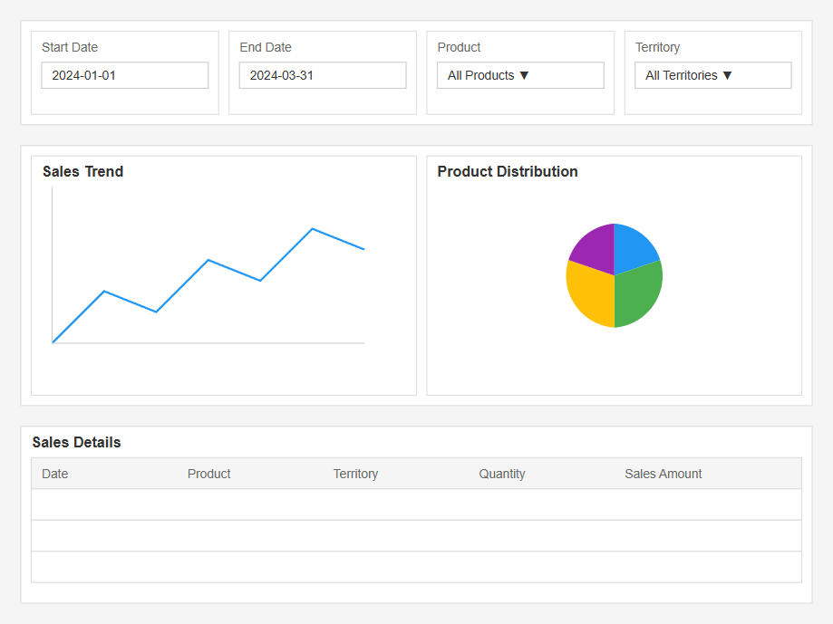
<figcaption>Sales Analysis Dashboard - mock-up</figcaption>
</figure>
</div>

The work follows CDE's three perspectives, then a test:

* **Layout:** create the row and column structure, and name the HTML objects.
* **Data Sources:** create the SQL queries, and test that they work.
* **Components:** add every component, configure its properties, link it to its HTML object, and set up its listeners.
* **Preview and test:** use **Preview your Dashboard**, test every filter, and check the chart interactions.

***

:::: tabs

### 1. Mock-up

> **Note:**
>
> #### Mock-up
>
> Assume the discovery phase is complete: after a few iterations, the dashboard design is agreed and signed off. Its key features:
>
> * Date range selection
> * Product line and country filters that take several values
> * A trend analysis chart
> * A product distribution pie chart
> * A detailed data table with pagination
> * Components that update when the filters change

1. Make sure the Pentaho Server is running. On a lab VM it already is; on your own machine start it as in [Before You Start](../00-before-you-start/guide.md):

```powershell
C:\Pentaho\server\pentaho-server\start-pentaho.bat
```

It takes a few minutes; the console is ready when http://localhost:8080/pentaho opens the login page.

2. Open the Pentaho User Console (PUC) with the button below and sign in as `admin`.

<button data-launch="puc">Open Pentaho User Console</button>

3. Select **Browse Files**. Under **Folders**, expand **Public** and select **CTools-Dashboard**.
4. Create these folders with **New Folder...** under **Folder Actions**, selecting each parent first: `Sales-Analysis-Dashboard` in **CTools-Dashboard**, `resources` in **Sales-Analysis-Dashboard**, and `css` in **resources**.

<div align="center">
<figure>
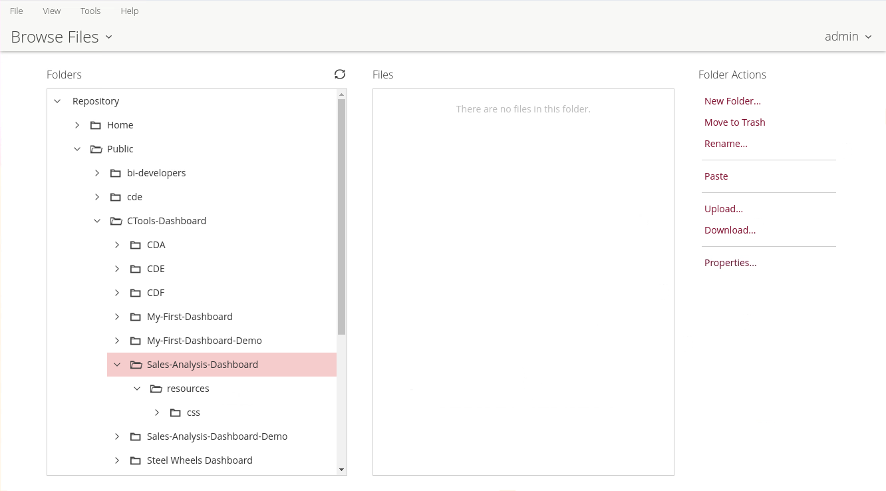
<figcaption>Sales Analysis Dashboard - Folders</figcaption>
</figure>
</div>

5. Select **File > New > CDE Dashboard**.
6. In the **Layout Structure** toolbar, select the **Apply Template** icon.
7. In **Apply Template**, select **Empty Sample** and select **Ok**. When CDE asks whether you are sure you want to load the template, select **Ok**.

<div align="center">
<figure>
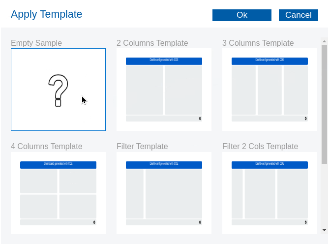
<figcaption>Empty sample</figcaption>
</figure>
</div>

8. On the CDE toolbar, select **Settings**.

<div align="center">
<figure>
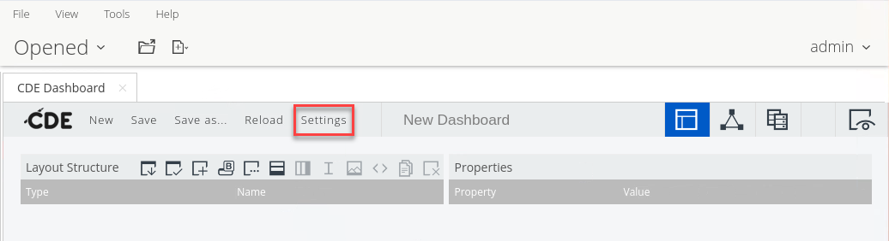
<figcaption>Settings on the CDE toolbar</figcaption>
</figure>
</div>

9. In **Settings**, set these values:

| Setting | Value |
| --- | --- |
| **Title** | `sales_analysis` |
| **Description** | `Steel Wheels sales analysis` |
| **Style** | **Clean** |
| **Dashboard Type** | **bootstrap** |
| **RequireJS Support** | selected |

<div align="center">
<figure>
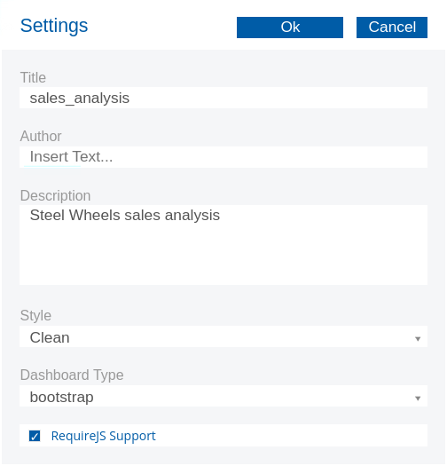
<figcaption>Dashboard settings for sales_analysis</figcaption>
</figure>
</div>

10. Select **Ok**.

11. On the CDE toolbar, select **Save as...**. Select **public > CTools-Dashboard > Sales-Analysis-Dashboard**, set **File Name** and **Title** to `sales_analysis`, and select **Ok**.

<div align="center">
<figure>
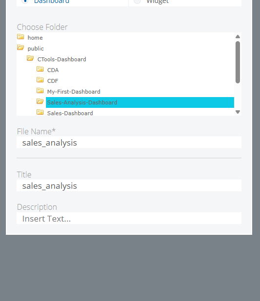
<figcaption>Save the dashboard in Sales-Analysis-Dashboard</figcaption>
</figure>
</div>

### 2. Layout

> **Note:**
>
> #### Layout
>
> Map the mock-up onto a CDE layout, using Bootstrap columns: the spans in each row add up to 12.

```text
Root Container
│
├── Filter Row (id: filterRow)
│   ├── Date Filters Column (span: 4)
│   ├── Product Filters Column (span: 4)
│   └── Additional Filters Column (span: 4)
│
├── Charts Row (id: chartsRow)
│   ├── Trend Chart Column (span: 8)
│   └── Pie Chart Column (span: 4)
│
└── Table Row (id: tableRow)
    └── Data Table Column (span: 12)
```

Build the rows and columns in **Layout Structure**. **Add Row** adds a row at the top level, after the row you have selected; **Add Columns** adds a column inside the selected row. The **Name** of each column is the HTML object a component draws into, and **Medium Devices** is its Bootstrap span.

1. Build the three rows and their columns. Select **Add Row** and name the row; with the row selected, select **Add Columns** once per column, and select each new column to set its **Name** and **Medium Devices**. Select the last row before you add the next, so that it lands after it.

| Row | Columns (Name, Medium Devices) |
| --- | --- |
| `filterRow` | `dateFilterObj` 4, `productFilterObj` 4, `countryFilterObj` 4 |
| `chartsRow` | `trendChartObj` 8, `pieChartObj` 4 |
| `tableRow` | `salesTableObj` 12 |

<div align="center">
<figure>
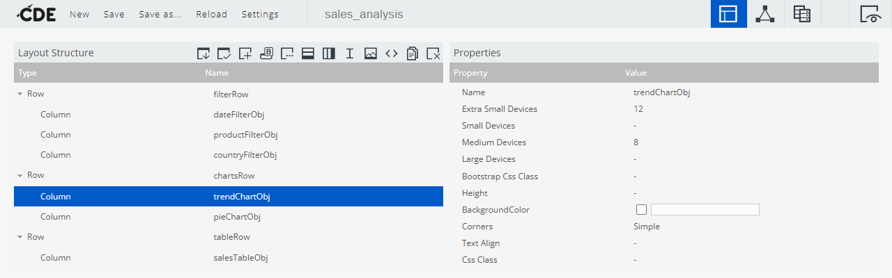
<figcaption>The layout, with trendChartObj selected</figcaption>
</figure>
</div>

2. Select **Save**.

> **Under the hood:**
>
> #### A Bootstrap column has a span per screen size
>
> CDE writes each row as a Bootstrap row and each column as a div with a
> col-md-<span> class for Medium Devices and col-xs-12 for Extra Small.
> On a laptop screen the three filters sit side by side, four twelfths
> each; on a phone each column takes the full width and they stack.
>
> **Why it matters:** one layout serves every screen size without a
> line of CSS.

### 3. Data Source

> **Note:**
>
> #### Data Source
>
> The data source is a CDA file with one SQL query on the server's **SampleData** connection, the HSQLDB `sampledata` database that starts with the Pentaho Server. A `sql.jndi` connection names that connection and nothing else: no driver, URL, user or password goes into the file.

```xml
<?xml version="1.0" encoding="UTF-8"?>
<CDADescriptor>
    <DataSources>
        <Connection id="sampledata" type="sql.jndi">
            <Jndi>SampleData</Jndi>
        </Connection>
    </DataSources>
    <DataAccess id="allYearsQuery" connection="sampledata" type="sql" access="public" cache="true" cacheDuration="3600">
        <Name>Sales Data All Years</Name>
        <Query>
            SELECT
                YEAR(o.ORDERDATE) as YEAR,
                MONTH(o.ORDERDATE) as MONTH,
                o.ORDERNUMBER,
                o.ORDERDATE,
                o.STATUS,
                o.CUSTOMERNUMBER,
                c.CUSTOMERNAME,
                c.COUNTRY,
                p.PRODUCTCODE,
                p.PRODUCTNAME,
                p.PRODUCTLINE,
                od.QUANTITYORDERED,
                od.PRICEEACH,
                (od.QUANTITYORDERED * od.PRICEEACH) as TOTAL_AMOUNT
            FROM
                ORDERS o
                JOIN ORDERDETAILS od ON o.ORDERNUMBER = od.ORDERNUMBER
                JOIN PRODUCTS p ON od.PRODUCTCODE = p.PRODUCTCODE
                JOIN CUSTOMERS c ON o.CUSTOMERNUMBER = c.CUSTOMERNUMBER
            ORDER BY
                o.ORDERDATE, o.ORDERNUMBER
        </Query>
        <Parameters></Parameters>
        <Columns></Columns>
    </DataAccess>
</CDADescriptor>
```

1. Download [sampledata.cda](./files/sampledata.cda) from **Lab Files** at the end of this page. It holds the `allYearsQuery` above and five more queries, one for each component of the dashboard.
2. In the PUC, select **Public > CTools-Dashboard > Sales-Analysis-Dashboard**. Under **Folder Actions**, select **Upload...**. Select **Browse...**, choose `sampledata.cda`, and select **OK**.

<div align="center">
<figure>
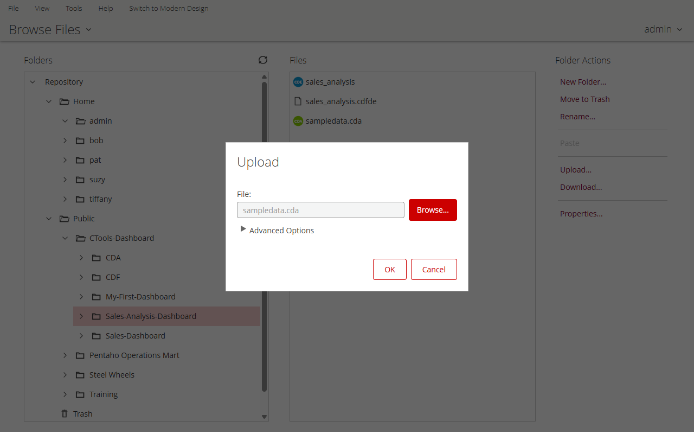
<figcaption>Upload sampledata.cda beside the dashboard</figcaption>
</figure>
</div>

The five other queries take the filters as parameters, so the database does the filtering. This is `salesTrendQuery`, the sales of each month:

```sql
SELECT 
    TO_CHAR(o.ORDERDATE, 'YYYY-MM') AS MONTH,
    SUM(od.QUANTITYORDERED * od.PRICEEACH) AS SALES
FROM 
    ORDERS o
    JOIN ORDERDETAILS od ON o.ORDERNUMBER = od.ORDERNUMBER
    JOIN PRODUCTS p ON od.PRODUCTCODE = p.PRODUCTCODE
    JOIN CUSTOMERS c ON o.CUSTOMERNUMBER = c.CUSTOMERNUMBER
WHERE o.ORDERDATE BETWEEN ${startDate} AND ${endDate}
  AND p.PRODUCTLINE IN (${productLines})
  AND c.COUNTRY IN (${countries})
GROUP BY TO_CHAR(o.ORDERDATE, 'YYYY-MM')
ORDER BY 1
```

with these parameters:

```xml
<Parameter name="startDate" type="Date" pattern="yyyy-MM-dd" default="2004-01-01"/>
<Parameter name="endDate" type="Date" pattern="yyyy-MM-dd" default="2004-12-31"/>
<Parameter name="productLines" type="StringArray" default="Classic Cars;Motorcycles;Planes;Ships;Trains;Trucks and Buses;Vintage Cars"/>
<Parameter name="countries" type="StringArray" default="Australia;Austria;...;UK;USA"/>
```

A `StringArray` parameter holds a list: CDA writes one bind marker per value into `IN (${productLines})`. The other queries share the same `WHERE` and parameters:

| Query | Returns | Feeds |
| --- | --- | --- |
| `productLinesQuery` | the 7 product lines | the product line filter |
| `countriesQuery` | the 21 countries with orders | the country filter |
| `salesTrendQuery` | sales by month | the trend chart |
| `productDistributionQuery` | sales by product line | the pie chart |
| `salesDetailsQuery` | one row per order line | the table |

Here is the SQL query in detail.

```sql
SELECT 
    -- Time-based columns for analysis
    YEAR(o.ORDERDATE) as YEAR,          -- Extracts just the year from date (e.g., 2004)
    MONTH(o.ORDERDATE) as MONTH,        -- Extracts month number (1-12)
    
    -- Order information
    o.ORDERNUMBER,                      -- Unique order identifier
    o.ORDERDATE,                        -- Full date of the order
    o.STATUS,                           -- Order status (e.g., Shipped, In Process)
    
    -- Customer information
    o.CUSTOMERNUMBER,                   -- Unique customer identifier
    c.CUSTOMERNAME,                     -- Name of the customer
    c.COUNTRY,                          -- Customer's country
    
    -- Product information
    p.PRODUCTCODE,                      -- Unique product identifier
    p.PRODUCTNAME,                      -- Name of the product
    p.PRODUCTLINE,                      -- Product category (e.g., Classic Cars)
    
    -- Order details and calculations
    od.QUANTITYORDERED,                 -- Number of items ordered
    od.PRICEEACH,                       -- Price per unit
    (od.QUANTITYORDERED * od.PRICEEACH) as TOTAL_AMOUNT  -- Calculated total for line item
```

**FROM and JOIN clauses:**

```sql
FROM 
    ORDERS o                                    -- Main orders table with alias 'o'
    JOIN ORDERDETAILS od                        -- Table containing line items for each order
        ON o.ORDERNUMBER = od.ORDERNUMBER       -- Links orders to their details
    JOIN PRODUCTS p                             -- Product information table
        ON od.PRODUCTCODE = p.PRODUCTCODE       -- Links order details to specific products
    JOIN CUSTOMERS c                            -- Customer information table
        ON o.CUSTOMERNUMBER = c.CUSTOMERNUMBER  -- Links orders to customer info
```

**Table relationships:**

| Table | Key | Contains |
| --- | --- | --- |
| `ORDERS` (o) - the order headers | Primary key `ORDERNUMBER` | `ORDERDATE`, `STATUS`, `CUSTOMERNUMBER` |
| `ORDERDETAILS` (od) - the order lines | Composite key `ORDERNUMBER`, `PRODUCTCODE` | `QUANTITYORDERED`, `PRICEEACH` |
| `PRODUCTS` (p) - the product catalog | Primary key `PRODUCTCODE` | `PRODUCTNAME`, `PRODUCTLINE` |
| `CUSTOMERS` (c) - the customers | Primary key `CUSTOMERNUMBER` | `CUSTOMERNAME`, `COUNTRY` |

**Ordering:** the results are sorted by order date, then by order number for orders on the same date.

```sql
ORDER BY 
    o.ORDERDATE, o.ORDERNUMBER
```

***

Finally, test the `sampledata.cda` connection.

3. Under **Files**, select **sampledata**, and under **File Actions** select **Open**. In the CDA previewer, select **Sales Data All Years** in the **Data Access** list.

> **Success:** Checkpoint: one row per order line, from the first order date onward, with the 14 columns of the query from `YEAR` to `TOTAL_AMOUNT`.

4. Close the previewer tab.

> **Under the hood:**
>
> #### One query, cached once for everyone
>
> Against SampleData this join returns 2,996 order lines: every line of
> every order from 2003 to 2005. It has no parameters, so its cache key
> is only the connection and the query text. With cache="true" the first
> request runs the four-table join, and every request after it, from any
> user, gets the same rows from memory for the next 3,600 seconds.
>
> Filters applied to those rows in the browser cost no database trips,
> but every user downloads all 2,996 rows. Filters passed to the query
> as parameters go to the database instead, with a cache entry for each
> combination of values. Which suits a dashboard depends on how large
> the unfiltered result is.
>
> **Why it matters:** where the filtering happens decides both the
> database load and what each browser downloads; choose it per
> dashboard, before you build the filters.

#### CDA data sources in CDE

The dashboard reads its data from the uploaded file. A **CDA Data Source** points a CDE data source at one query of an existing `.cda` file.

5. Return to the editor tab. Select **Datasources Panel**. In the list on the left, expand **Community Data Access** and select **CDA Data Source**.
6. Type `productLinesQuery` as its **Name** and press `Enter`. Set **DataAccess ID** to `productLinesQuery`. Then select the **^** button in the **Path** value, expand **public > CTools-Dashboard > Sales-Analysis-Dashboard**, select `sampledata.cda`, and select **Ok**.

<div align="center">
<figure>
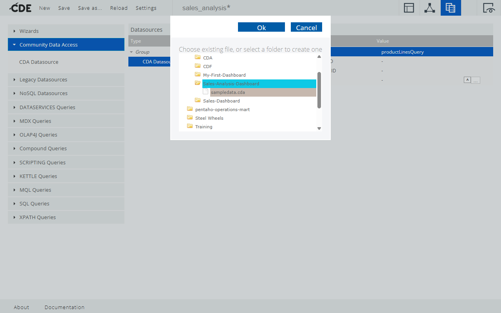
<figcaption>The CDA Data Source's Path: sampledata.cda</figcaption>
</figure>
</div>

7. Add four more **CDA Data Sources** the same way, each with the same **Name** and **DataAccess ID** and **Path** `sampledata.cda`: `countriesQuery`, `salesTrendQuery`, `productDistributionQuery` and `salesDetailsQuery`.

<div align="center">
<figure>
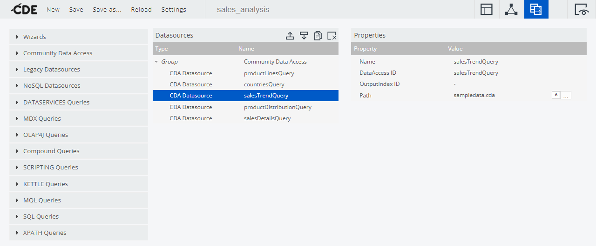
<figcaption>Five CDA Data Sources, all in sampledata.cda</figcaption>
</figure>
</div>

8. Select **Save**.

### 4. Components

> **Note:**
>
> #### Components
>
> Add the parameters the filters set, the filters themselves, and the chart and table components that listen to them.

#### Parameters

1. Select **Components Panel**. In the list on the left, expand **Parameters** and select **Simple Parameter**. Set **Name** to `startDate` and **Property value** to `2004-01-01`. Then add a second Simple Parameter, `endDate`, with the **Property value** `2004-12-31`.

<div align="center">
<figure>
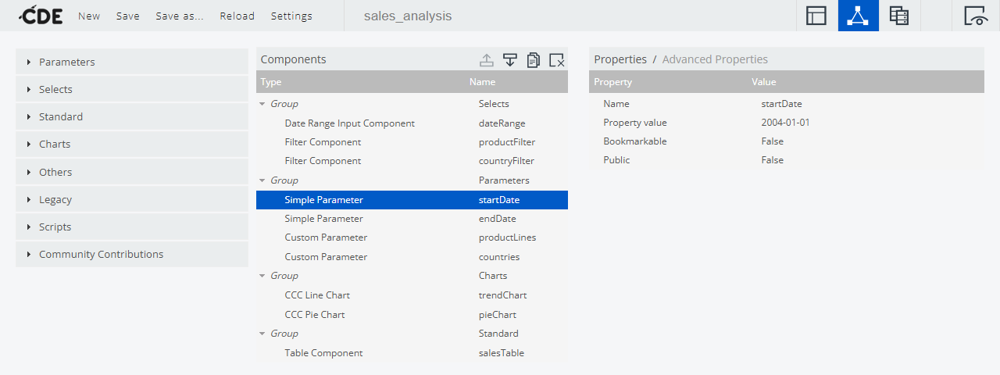
<figcaption>startDate</figcaption>
</figure>
</div>
2. Select **Custom Parameter**. Set **Name** to `productLines`, and in **Javascript code** enter the list of all seven product lines:

```text
["Classic Cars","Motorcycles","Planes","Ships","Trains","Trucks and Buses","Vintage Cars"]
```

3. Add a second Custom Parameter, `countries`, with the list of all 21 countries:

```text
["Australia","Austria","Belgium","Canada","Denmark","Finland","France","Germany","Hong Kong","Ireland","Italy","Japan","New Zealand","Norway","Philippines","Singapore","Spain","Sweden","Switzerland","UK","USA"]
```

<div align="center">
<figure>
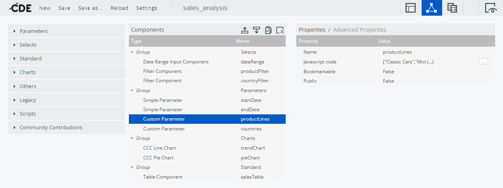
<figcaption>productLines: every line selected to begin with</figcaption>
</figure>
</div>

#### Filters

4. Expand **Selects** and select **Date range input Component**. Set **Name** to `dateRange` and **HtmlObject** to `dateFilterObj`, and click in the **Parameters** value and select `startDate` and `endDate`, in that order. Then select **Advanced Properties**, and set **Earliest Date** to `2003-01-01` and **Latest Date** to `2005-12-31`. The defaults, a year either side of today, would miss the sample data's years.

<div align="center">
<figure>
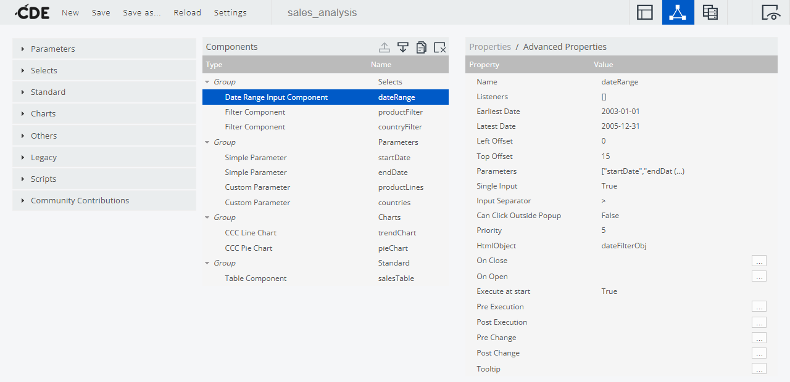
<figcaption>dateRange</figcaption>
</figure>
</div>

5. Select **Filter Component** and set:

| Property | Value |
| --- | --- |
| **Name** | `productFilter` |
| **Title** | `Product line` |
| **Parameter** | `productLines` |
| **Datasource** | `productLinesQuery` |
| **Multiple Selection** | `True` |
| **Show Search Filter** | `False` |
| **HtmlObject** | `productFilterObj` |

<div align="center">
<figure>
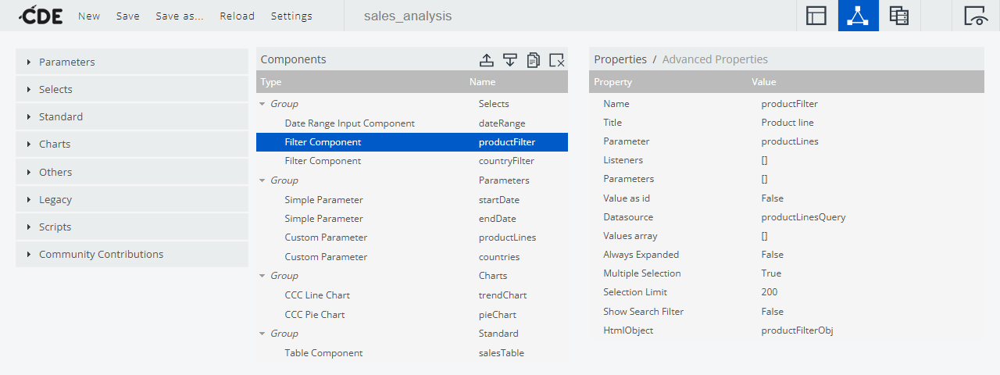
<figcaption>productFilter: a multiple selection</figcaption>
</figure>
</div>

6. Add a second Filter Component, `countryFilter`, with **Title** `Country`, **Parameter** `countries`, **Datasource** `countriesQuery`, **Multiple Selection** `True`, **Show Search Filter** `True` and **HtmlObject** `countryFilterObj`. With 21 countries, the search box helps.

<div align="center">
<figure>
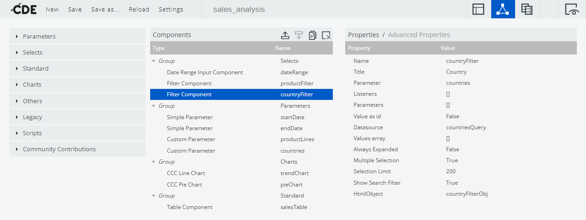
<figcaption>countryFilter</figcaption>
</figure>
</div>

#### Charts and table

The three data components read the same four parameters. Each needs them in both **Parameters**, mapping each query parameter to the dashboard parameter of the same name, and **Listeners**.

7. Expand **Charts**, select **CCC Line Chart** and set **Name** `trendChart`, **Title** `Sales trend`, **Datasource** `salesTrendQuery`, **HtmlObject** `trendChartObj`, **Height** `300`, and an empty **Width**. Set **Parameters** and **Listeners** to `startDate`, `endDate`, `productLines` and `countries`, and in **Advanced Properties** set **Legend** to `False`.

<div align="center">
<figure>
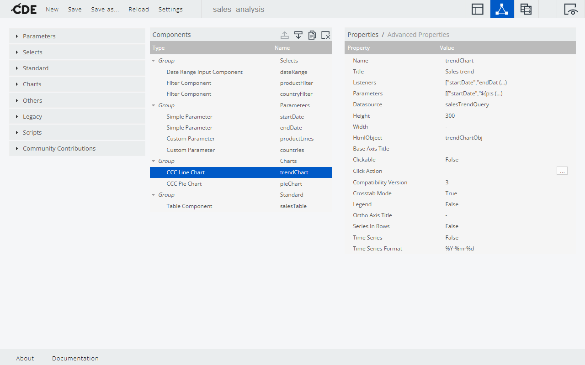
<figcaption>trendChart</figcaption>
</figure>
</div>

8. Select **CCC Pie Chart** and set **Name** `pieChart`, **Title** `Product distribution`, **Datasource** `productDistributionQuery`, **HtmlObject** `pieChartObj`, **Height** `300`, an empty **Width**, the same four **Parameters** and **Listeners**, and in **Advanced Properties** **Legend Position** `Bottom`.
9. Expand **Standard**, select **Table Component** and set **Name** `salesTable`, **Datasource** `salesDetailsQuery`, **HtmlObject** `salesTableObj`, and the same four **Parameters** and **Listeners**. In **Advanced Properties** set:

| Property | Value |
| --- | --- |
| **Column Headers** | `Date`, `Order`, `Customer`, `Country`, `Product line`, `Product`, `Quantity`, `Amount` |
| **Column Types** | `string` six times, then `numeric` twice |
| **Column Formats** | `%s` six times, then `%d` and `%.0f` |
| **Show Filter** | `False` |
| **Length Change** | `False` |

<div align="center">
<figure>
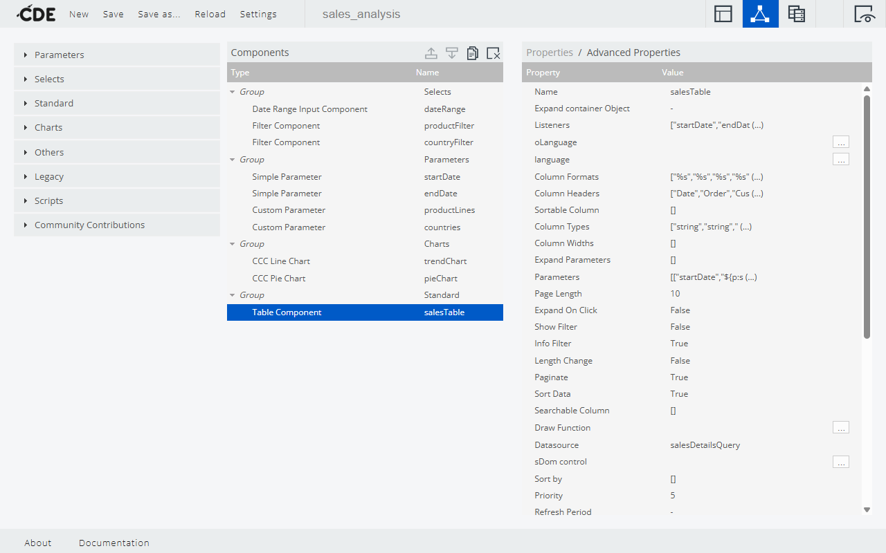
<figcaption>salesTable, advanced properties</figcaption>
</figure>
</div>

**Paginate** is on by default, with 10 rows per page.

10. Select **Save**.

> **Under the hood:**
>
> #### The filtering happens in the database
>
> Every component sends its query's parameters with each request, so a
> filter change makes three doQuery calls, each with the new values: the
> two lists as one paramproductLines and one paramcountries entry per
> selected value, the dates as yyyy-MM-dd strings. CDA binds them into
> the SQL, and the database returns only the rows that match.
>
> The table still pages in the browser: it receives every matching row,
> 1,421 for 2004, and DataTables shows ten at a time.
>
> **Why it matters:** the browser downloads what the filters select,
> not the whole order history; with millions of rows, the table's
> server-side pagination is the next step.

### 5. Preview & Test

> **Note:**
>
> #### Preview and test
>
> Open the dashboard and check every filter and component against the requirements of the mock-up.

1. Select **Preview your Dashboard**.

<div align="center">
<figure>
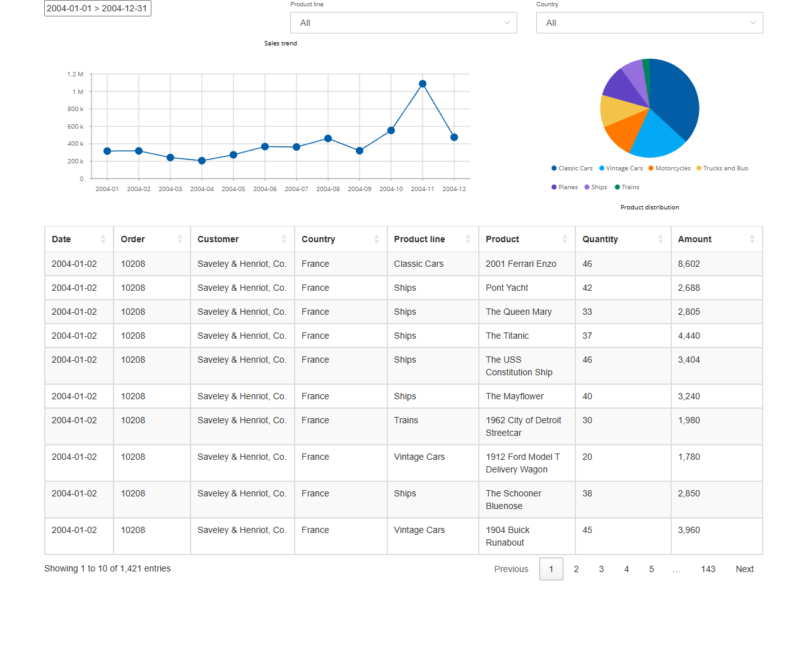
<figcaption>The Sales Analysis Dashboard</figcaption>
</figure>
</div>

> **Success:** Checkpoint: the date range shows `2004-01-01 > 2004-12-31`, both filters show **All**, the trend chart has the twelve months of 2004 with its peak in `2004-11`, **Classic Cars** is the largest slice, and the table shows **Showing 1 to 10 of 1,421 entries**.

2. Open the **Product line** filter, select **All** to clear it, select **Ships** and **Trains**, and select **Apply**.

<div align="center">
<figure>
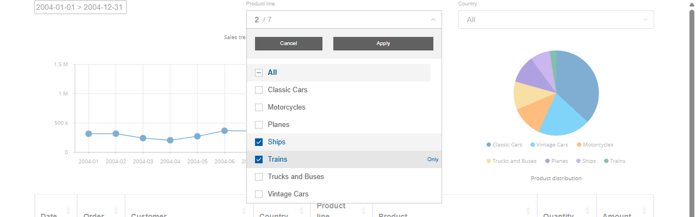
<figcaption>Ships and Trains selected</figcaption>
</figure>
</div>

> **Success:** Checkpoint: the filter reads **2 / 7**, the pie chart has two slices, **Ships** and **Trains**, the trend chart redraws, and the table shows **167** entries.

3. Select the date range box. The picker offers ready-made ranges and **Date Range**, which opens two calendars; choose a range inside 2003 to 2005.

<div align="center">
<figure>
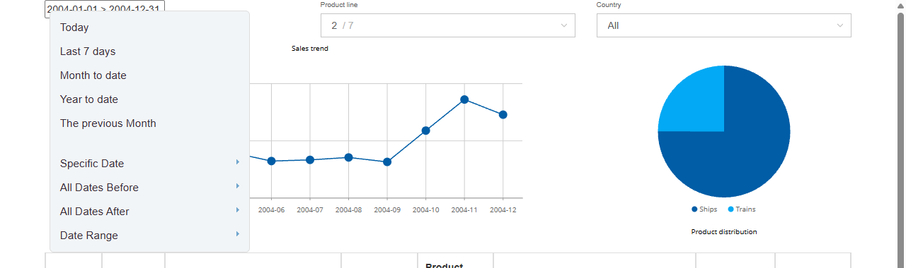
<figcaption>The date range picker</figcaption>
</figure>
</div>

> **Success:** Checkpoint: every component redraws for the dates you chose, still filtered to Ships and Trains.

4. Close the preview.

The finished dashboard is in **Lab Files**, as a zip to upload into **Public > CTools-Dashboard**.

::::

## Lab Files

Click a file to download. Every file is also on disk in this workshop's folder, `C:\Workshop-CT-Associate\06-use-cases\15-use-cases-sales-analysis-dashboard`.

The CDA file from the third tab: `allYearsQuery` and the five queries the dashboard's components use.

[sampledata.cda](./files/sampledata.cda)

### Solution <!-- no-step -->

The finished dashboard, with its `sampledata.cda`. Upload the zip into **Public > CTools-Dashboard** in **Browse Files**; the server unpacks it into **Sales-Analysis-Dashboard-Solution**, and **sales_analysis** there is the dashboard from the last tab.

[sales-analysis-solution.zip](./files/sales-analysis-solution.zip)
