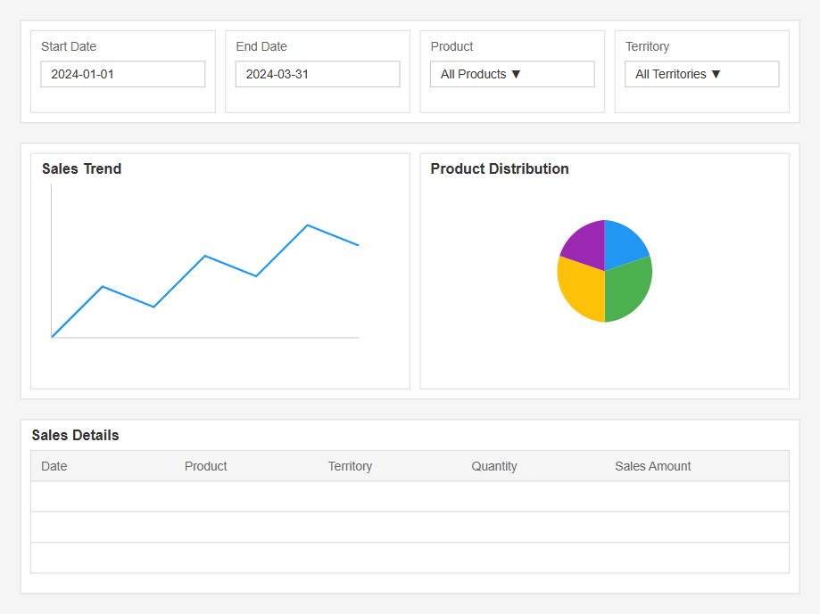
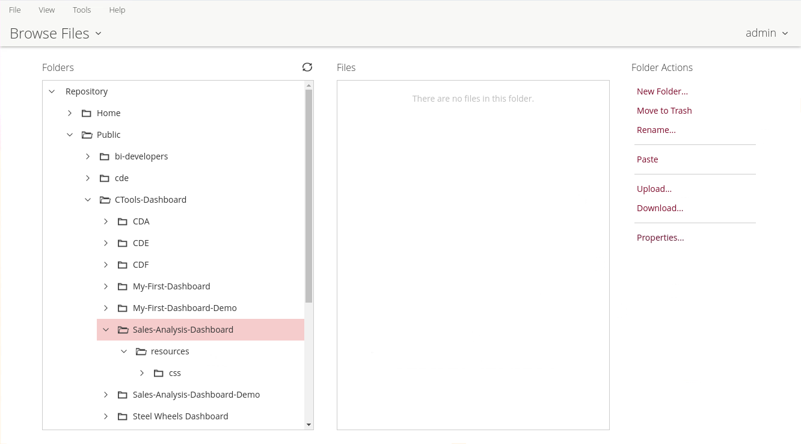
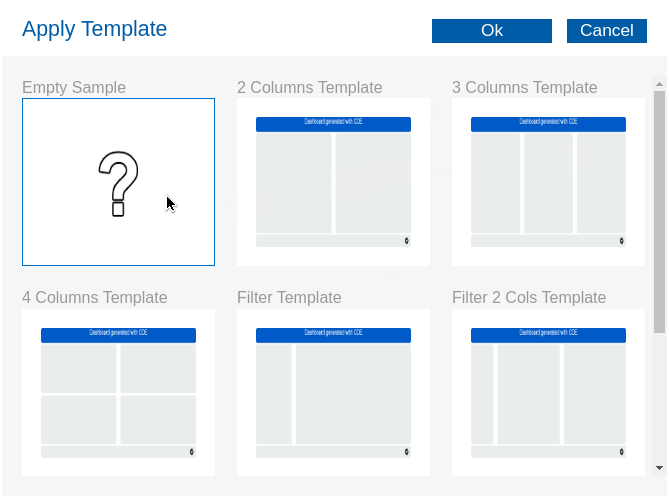
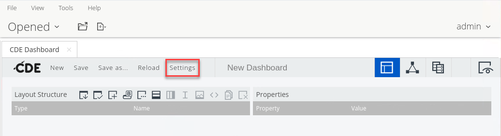
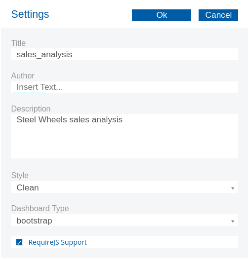

# Sales Analysis Dashboard

> **Warning:**
>
> #### Workshop - Sales Analysis Dashboard
>
> With the building blocks in place, bring them together in an end-to-end use case that builds on [My First Dashboard](../03-getting-started-my-first-dashboard/guide.md): a Retail Sales analysis dashboard that combines a CDA data source, a CDE Bootstrap layout and CCC chart components. You map a signed-off mock-up onto a CDE layout, define a SQL data source on the sampledata database, and lay out the rows and columns for the filters, charts and table.
>
> **What you'll do**
>
> * In the Layout perspective, create the row and column structure and name the HTML objects
> * In the Data Sources perspective, create the SQL queries and test them
> * In the Components perspective, add and configure the components, link them to the HTML objects, and set up the listeners
> * Build date range, product line and country filters, a trend chart, a product distribution pie chart and a paginated table
> * Preview the dashboard, test every filter and check the chart interactions
>
> **Prerequisites:** [My First Dashboard](../03-getting-started-my-first-dashboard/guide.md); a running Pentaho Server with the CTools plugins; the sampledata database on MariaDB, reachable over JDBC; SQL and the CDE Layout, Data Sources and Components perspectives
>
> **Estimated time:** 45 minutes

<div align="center">
<figure>

<figcaption>Sales Analysis Dashboard - mock-up</figcaption>
</figure>
</div>

The work follows CDE's three perspectives, then a test:

* **Layout:** create the row and column structure, and name the HTML objects.
* **Data Sources:** create the SQL queries, and test that they work.
* **Components:** add every component, configure its properties, link it to its HTML object, and set up its listeners.
* **Preview and test:** use **Preview your Dashboard**, test every filter, and check the chart interactions.

***

:::: tabs

### 1. Mock-up

> **Note:**
>
> #### Mock-up
>
> Assume the discovery phase is complete: after a few iterations, the dashboard design is agreed and signed off. Its key features:
>
> * Date range selection
> * Product line and country filters that take several values
> * A trend analysis chart
> * A product distribution pie chart
> * A detailed data table with pagination
> * Components that update when the filters change

1. Make sure the Pentaho Server is running. On a lab VM it already is; on your own machine start it as in [Before You Start](../00-before-you-start/guide.md):

```powershell
C:\Pentaho\server\pentaho-server\start-pentaho.bat
```

It takes a few minutes; the console is ready when http://localhost:8080/pentaho opens the login page.

2. Open the Pentaho User Console (PUC) with the button below and sign in as `admin`.

<button data-launch="puc">Open Pentaho User Console</button>

3. Select **Browse Files**. Under **Folders**, expand **Public** and select **CTools-Dashboard**.
4. Create these folders with **New Folder...** under **Folder Actions**, selecting each parent first: `Sales-Analysis-Dashboard` in **CTools-Dashboard**, `resources` in **Sales-Analysis-Dashboard**, and `css` in **resources**.

<div align="center">
<figure>

<figcaption>Sales Analysis Dashboard - Folders</figcaption>
</figure>
</div>

5. Select **File > New > CDE Dashboard**.
6. In the **Layout Structure** toolbar, select the **Apply Template** icon.
7. In **Apply Template**, select **Empty Sample** and select **Ok**. When CDE asks whether you are sure you want to load the template, select **Ok**.

<div align="center">
<figure>

<figcaption>Empty sample</figcaption>
</figure>
</div>

8. On the CDE toolbar, select **Settings**.

<div align="center">
<figure>

<figcaption>Settings on the CDE toolbar</figcaption>
</figure>
</div>

9. In **Settings**, set these values:

| Setting | Value |
| --- | --- |
| **Title** | `sales_analysis` |
| **Description** | `Steel Wheels sales analysis` |
| **Style** | **Clean** |
| **Dashboard Type** | **bootstrap** |
| **RequireJS Support** | selected |

<div align="center">
<figure>

<figcaption>Dashboard settings for sales_analysis</figcaption>
</figure>
</div>

10. Select **Ok**.

### 2. Layout

> **Note:**
>
> #### Layout
>
> Map the mock-up onto a CDE layout, using Bootstrap columns: the spans in each row add up to 12.

```text
Root Container
│
├── Filter Row (id: filterRow)
│   ├── Date Filters Column (span: 4)
│   ├── Product Filters Column (span: 4)
│   └── Additional Filters Column (span: 4)
│
├── Charts Row (id: chartsRow)
│   ├── Trend Chart Column (span: 8)
│   └── Pie Chart Column (span: 4)
│
└── Table Row (id: tableRow)
    └── Data Table Column (span: 12)
```

### 3. Data Source

> **Note:**
>
> #### Data Source
>
> The data source follows the CDA structure for a connection of type `sql.jdbc`, on the sampledata database.

The connection uses the sampledata database's user:

```xml
<User>pentaho_admin</User>
<Pass>password</Pass>
```

```xml
<?xml version="1.0" encoding="UTF-8"?>
<CDADescriptor>
    <DataSources>
        <Connection id="mariadb_connection" type="sql.jdbc">
            <Driver>org.mariadb.jdbc.Driver</Driver>
            <Url>jdbc:mariadb://localhost:3306/sampledata</Url>
            <User>your_username</User>
            <Pass>your_password</Pass>
        </Connection>
    </DataSources>

    <DataAccess id="allYearsQuery" connection="mariadb_connection" type="sql" access="public" cache="true" cacheDuration="3600">
        <Name>Sales Data All Years</Name>
        <Query>
            SELECT 
                YEAR(o.ORDERDATE) as YEAR,
                MONTH(o.ORDERDATE) as MONTH,
                o.ORDERNUMBER,
                o.ORDERDATE,
                o.STATUS,
                o.CUSTOMERNUMBER,
                c.CUSTOMERNAME,
                c.COUNTRY,
                p.PRODUCTCODE,
                p.PRODUCTNAME,
                p.PRODUCTLINE,
                od.QUANTITYORDERED,
                od.PRICEEACH,
                (od.QUANTITYORDERED * od.PRICEEACH) as TOTAL_AMOUNT
            FROM 
                ORDERS o
                JOIN ORDERDETAILS od ON o.ORDERNUMBER = od.ORDERNUMBER
                JOIN PRODUCTS p ON od.PRODUCTCODE = p.PRODUCTCODE
                JOIN CUSTOMERS c ON o.CUSTOMERNUMBER = c.CUSTOMERNUMBER
            ORDER BY 
                o.ORDERDATE, o.ORDERNUMBER
        </Query>
        <Parameters></Parameters>
        <Columns></Columns>
    </DataAccess>
</CDADescriptor>
```

1. In a text editor, paste the listing, replace `your_username` and `your_password` with the database user above, and save it as `sampledata.cda`.
2. In the PUC, select **Public > CTools-Dashboard > Sales-Analysis-Dashboard**. Under **Folder Actions**, select **Upload...**. Select **Browse...**, choose `sampledata.cda`, and select **OK**.

Here is the SQL query in detail.

```sql
SELECT 
    -- Time-based columns for analysis
    YEAR(o.ORDERDATE) as YEAR,          -- Extracts just the year from date (e.g., 2004)
    MONTH(o.ORDERDATE) as MONTH,        -- Extracts month number (1-12)
    
    -- Order information
    o.ORDERNUMBER,                      -- Unique order identifier
    o.ORDERDATE,                        -- Full date of the order
    o.STATUS,                           -- Order status (e.g., Shipped, In Process)
    
    -- Customer information
    o.CUSTOMERNUMBER,                   -- Unique customer identifier
    c.CUSTOMERNAME,                     -- Name of the customer
    c.COUNTRY,                          -- Customer's country
    
    -- Product information
    p.PRODUCTCODE,                      -- Unique product identifier
    p.PRODUCTNAME,                      -- Name of the product
    p.PRODUCTLINE,                      -- Product category (e.g., Classic Cars)
    
    -- Order details and calculations
    od.QUANTITYORDERED,                 -- Number of items ordered
    od.PRICEEACH,                       -- Price per unit
    (od.QUANTITYORDERED * od.PRICEEACH) as TOTAL_AMOUNT  -- Calculated total for line item
```

**FROM and JOIN clauses:**

```sql
FROM 
    ORDERS o                                    -- Main orders table with alias 'o'
    JOIN ORDERDETAILS od                        -- Table containing line items for each order
        ON o.ORDERNUMBER = od.ORDERNUMBER       -- Links orders to their details
    JOIN PRODUCTS p                             -- Product information table
        ON od.PRODUCTCODE = p.PRODUCTCODE       -- Links order details to specific products
    JOIN CUSTOMERS c                            -- Customer information table
        ON o.CUSTOMERNUMBER = c.CUSTOMERNUMBER  -- Links orders to customer info
```

**Table relationships:**

| Table | Key | Contains |
| --- | --- | --- |
| `ORDERS` (o) - the order headers | Primary key `ORDERNUMBER` | `ORDERDATE`, `STATUS`, `CUSTOMERNUMBER` |
| `ORDERDETAILS` (od) - the order lines | Composite key `ORDERNUMBER`, `PRODUCTCODE` | `QUANTITYORDERED`, `PRICEEACH` |
| `PRODUCTS` (p) - the product catalog | Primary key `PRODUCTCODE` | `PRODUCTNAME`, `PRODUCTLINE` |
| `CUSTOMERS` (c) - the customers | Primary key `CUSTOMERNUMBER` | `CUSTOMERNAME`, `COUNTRY` |

**Ordering:** the results are sorted by order date, then by order number for orders on the same date.

```sql
ORDER BY 
    o.ORDERDATE, o.ORDERNUMBER
```

***

Finally, test the `sampledata.cda` connection.

3. Under **Files**, select **sampledata**, and under **File Actions** select **Open**. In the CDA previewer, select **Sales Data All Years** in the **Data Access** list.

> **Success:** Checkpoint: one row per order line, from the first order date onward, with the 14 columns of the query from `YEAR` to `TOTAL_AMOUNT`.

4. Close the previewer tab.

> **Under the hood:**
>
> #### One query, cached once for everyone
>
> Against SampleData this join returns 2,996 order lines: every line of
> every order from 2003 to 2005. It has no parameters, so its cache key
> is only the connection and the query text. With cache="true" the first
> request runs the four-table join, and every request after it, from any
> user, gets the same rows from memory for the next 3,600 seconds.
>
> Filters applied to those rows in the browser cost no database trips,
> but every user downloads all 2,996 rows. Filters passed to the query
> as parameters go to the database instead, with a cache entry for each
> combination of values. Which suits a dashboard depends on how large
> the unfiltered result is.
>
> **Why it matters:** where the filtering happens decides both the
> database load and what each browser downloads; choose it per
> dashboard, before you build the filters.

With the layout mapped and the SQL data source defined and tested, the Sales Analysis Dashboard is ready to assemble in the Pentaho User Console.

::::

## Lab Files

_No bundled files for this lab._
