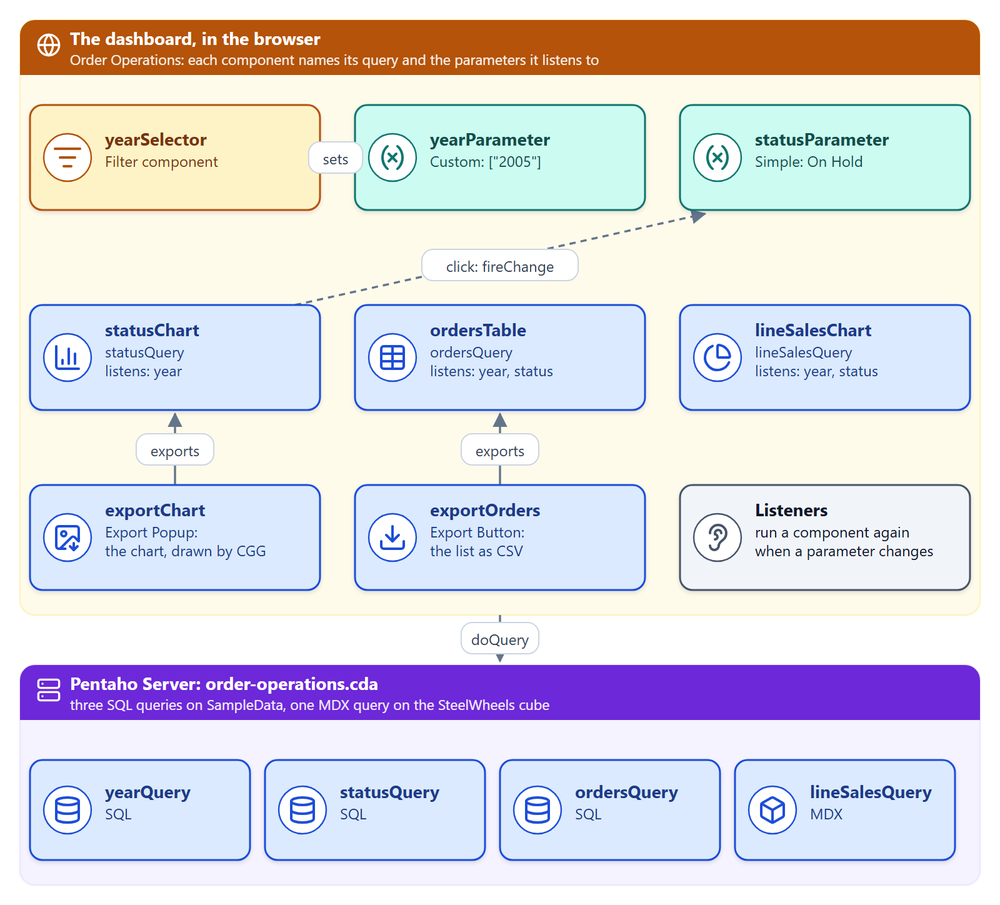
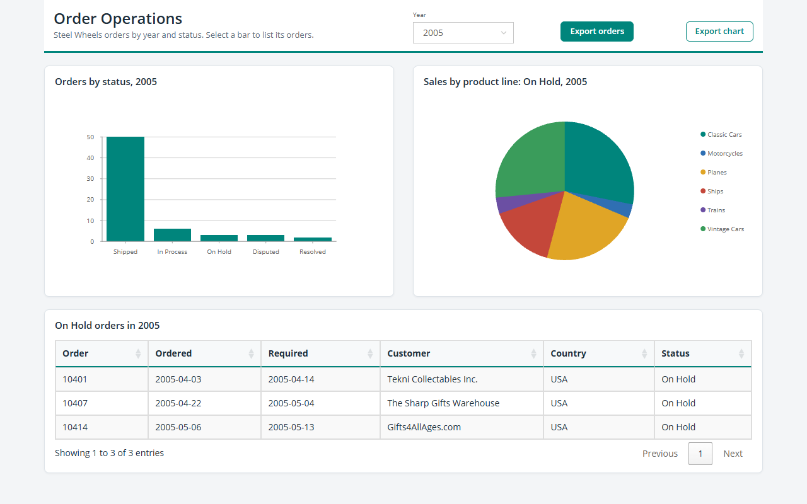

# Capstone: Order Operations

> **Capstone Project — bring it all together.**

Steel Wheels' operations team chases the orders that have not shipped:
orders on hold, in dispute or still in process. Today they ask IT for a
list every morning. They want a dashboard instead: pick a year, see how
many orders sit in each status, click a status to list its orders and
see which product lines they hold, and export both the list and the
chart to work through them and to pass on.

You build that dashboard in the Community Dashboard Editor, from an
empty dashboard to a finished one, on the Steel Wheels `sampledata`
database and the SteelWheels cube built on it. Every stage uses a workshop from this course, named beside its
heading in case you want to look back.

> **Objectives:**
>
> - Write your own SQL data sources over the server's SampleData connection, with parameters, and an MDX data source on the SteelWheels cube.
> - Lay out a dashboard with Bootstrap rows and columns.
> - Drive it with a year selector, and make a chart click set the status the table and a pie chart show.
> - Give the operations team an export of the list, and the chart as an image drawn on the server by CGG.
> - Hand in the dashboard the way the checks read it: downloaded from the User Console into your capstone folder.
>
> **Prerequisites:** Workshops 03 to 15; the Pentaho Server with the CTools enabled.
>
> **Estimated time:** 90 hours.

---

> **Warning:**
>
> #### Required for your course accreditation: ten checks on your own folder
>
> The course accreditation is issued only when all ten of these checks
> pass. They read your workshop folder, so put your work in exactly
> this place **before you take the exam**:
>
> | # | What must be there | Where |
> | --- | --- | --- |
> | 1 | Your dashboard's CDA, with the `statusQuery` data source | `C:\Workshop-CT-Associate\capstone\solution\Order-Operations\order-operations.cda` |
> | 2 | In it, the `ordersQuery` data source | the same file |
> | 3 | Your dashboard, with the `statusChart` component | `C:\Workshop-CT-Associate\capstone\solution\Order-Operations\order-operations.cdfde` |
> | 4 | In it, a click action that calls `fireChange` | the same file |
> | 5 | In it, the `ordersTable` component | the same file |
> | 6 | In it, the `exportOrders` component | the same file |
> | 7 | In the CDA, the `lineSalesQuery` data source, an MDX query on a Mondrian JNDI connection | `...\Order-Operations\order-operations.cda` |
> | 8 | In the dashboard, the `lineSalesChart` component | `...\Order-Operations\order-operations.cdfde` |
> | 9 | In the dashboard, the `exportChart` component | the same file |
> | 10 | The CGG script CDE writes for `statusChart` | `...\Order-Operations\statusChart.js` |
>
> All the files arrive together when you download your `Order-Operations`
> folder from the User Console and extract the zip into
> `capstone\solution\` (stage 6). Use the folder, file and component
> names exactly: the checks look for them. Select **Run checks** under
> **Verification checks** to see where you stand.

## Inputs

There is nothing to download. Everything is already on your Pentaho
Server:

| Source | What it is | Where you use it |
| --- | --- | --- |
| **SampleData** | The server's JNDI connection to the HSQLDB `sampledata` database | Every data source |
| `ORDERS` | One row per order: `ORDERNUMBER`, `ORDERDATE`, `REQUIREDDATE`, `SHIPPEDDATE`, `STATUS`, `COMMENTS`, `CUSTOMERNUMBER` | All three queries |
| `CUSTOMERS` | One row per customer: `CUSTOMERNUMBER`, `CUSTOMERNAME`, `COUNTRY` and more | The order list |
| **SteelWheels** | The Mondrian schema on SampleData: the `SteelWheelsSales` cube, with `[Time]`, `[Product].[Line]` and `[Order Status]` | The pie chart |
| **Public > CTools-Dashboard** | The folder you made in [My First Dashboard](../03-getting-started-my-first-dashboard/guide.md) | Holds your `Order-Operations` folder |

`STATUS` is one of `Shipped`, `In Process`, `On Hold`, `Disputed`,
`Resolved` and `Cancelled`. The orders run from 2003 to May 2005.

---

## Required behavior

Build the dashboard in the stages of the outline below. What it must
deliver:

1. **Home:** a folder **Public > CTools-Dashboard > Order-Operations**,
   holding a CDE dashboard saved as `order-operations` with the title
   `Order Operations`.
2. **Layout:** three rows. The first is the header: the dashboard's
   title, the year selector and the two exports; the second holds the
   status chart and, beside it, the pie chart, half the width each; the
   third holds the order list across the full width.
3. **Data sources:** three **sql over sqlJndi** on **SampleData**, and one
   **mdx over mondrianJndi**:
   - `yearQuery`: the years that have orders, as text, for the selector.
   - `statusQuery`: for the year in `yearParameter`, the number of
     orders in each status, largest first.
   - `ordersQuery`: for `yearParameter` and `statusParameter`, one row
     per order: order number, order date, required date, customer,
     country and status, oldest first.
   - `lineSalesQuery`: on the SteelWheels schema, the sales of each
     product line for the year in `yearParameter` and the status in
     `statusParameter`, lines with no sales left out.
4. **Parameters:** `yearParameter`, defaulting to `2005`, which the
   selector sets; and `statusParameter`, defaulting to `On Hold`, which
   the chart sets. Not every year has every status: 2003 has no `On Hold`
   orders. When the year changes to one without the chosen status,
   `statusParameter` falls back to that year's largest status, so the
   list and the pie are never left empty.
5. **Components:**
   - `yearSelector`: a Filter component for the year.
   - `statusChart`: a CCC Bar Chart of `statusQuery`, redrawn when the
     year changes, whose click sets `statusParameter` to the status of
     the bar, and which applies the fallback of requirement 4.
   - `ordersTable`: a Table Component of `ordersQuery`, redrawn when
     the year or the status changes.
   - `exportOrders`: an Export Button Component, labeled
     `Export orders`, that exports `ordersTable` as CSV.
   - `lineSalesChart`: a CCC Pie Chart of `lineSalesQuery`, redrawn
     when the year or the status changes.
   - `exportChart`: an Export Popup Component, titled `Export chart`,
     that exports `statusChart` as an image and its data.
6. **Handed in:** the `Order-Operations` folder downloaded from Browse
   Files and extracted into `capstone\solution\`, with the CGG scripts
   CDE wrote for `statusChart`.

---

## Suggested shape

<div align="center">
<figure>

<figcaption>What you build: four queries, two parameters, six components</figcaption>
</figure>
</div>

Read the diagram from the top. The two parameters in the middle are the
dashboard's state: the year selector writes `yearParameter`, and a click
on a bar fires `statusParameter`. Each component below lists the
parameters it listens to, and passes them to its query; the two exports
read the component they name. The four queries at the bottom run on the
server: three SQL queries through the SampleData connection, and one MDX
query on the SteelWheels cube.

One finished build, in the browser, for 2005 and **On Hold**:

<div align="center">
<figure>

<figcaption>One finished build: a header, two chart cards and the order list</figcaption>
</figure>
</div>

The look is yours to choose. The three rows, and what each card shows,
are the requirement; the colors, the cards and their titles are one
way to dress them (see **Polish** under the hints).

Your capstone folder, where the accreditation checks look:

```text
C:\Workshop-CT-Associate\capstone\    (your machine)
└── solution\
    ├── exportManifest.xml                      from the download
    └── Order-Operations\
        ├── order-operations.wcdf               the dashboard's settings
        ├── order-operations.cdfde              its layout, components and data sources
        ├── order-operations.cda                the queries CDE wrote from the data sources
        └── statusChart.js                      the chart's CGG script (and order-operations_statusChart.js)
```

The installer makes `capstone\solution\` for you, empty. If
`C:\Workshop-CT-Associate\` has no `capstone` folder, create
`capstone\solution\` there yourself.

---

## Hints for the tricky bits

- **A year as text.** The Filter component stores what it picks as text, and `YEAR(ORDERDATE)` is a number. Return the year as text in `yearQuery`, and give `yearParameter` the type **Integer** in the queries that compare it with `YEAR(ORDERDATE)`: CDA converts the text for you.
- **A Filter component's parameter** holds an array, so `yearParameter` is a **Custom Parameter** whose code is an array with one value, as in [Sales Dashboard](../12-community-dashboard-editor-carrier-dashboard/guide.md).
- **Which bar was clicked.** A chart's click action receives the clicked `scene`; the bar's category, here the status, is `scene.vars.category.value`. The pie chart's click action in the Sales Dashboard workshop is the model.
- **Redrawing and receiving.** A component needs a parameter in **Listeners** to run again when it changes, and in **Parameters** to send its value to the query; see the Under the hood after the pie chart's click action.
- **A status the year does not have.** The chart's **Post Fetch** receives the year's statuses before it draws them, `data.resultset`, one row per status, largest first. When `statusParameter` is not among them, set it to the first with `dashboard.setParameter`, which changes the value without firing it. For the list and the pie to read the new value, the chart must fetch first: give it a lower **Priority** (for example `4`) than theirs (`5`, the default), and the dashboard runs it a turn ahead of them. Calling `fireChange` here does nothing: the dashboard is still busy with the year's change and ignores it.
- **A parameter inside MDX.** CDA writes a parameter's value into the query as text, so `[Time].[${yearParameter}]` becomes `[Time].[2005]` and `[Order Status].[${statusParameter}]` becomes `[Order Status].[On Hold]`. Give both parameters the type **String** in `lineSalesQuery`.
- **The CGG script.** Choose the chart from the Export Popup's **Chart Component to Export** list: that switches on the chart's CGG support, and the next **Save** writes `statusChart.js` beside the dashboard, as in [Sales Dashboard](../12-community-dashboard-editor-carrier-dashboard/guide.md). Typing the name does not.
- **Dates on screen.** HSQLDB's `TO_CHAR(date, 'YYYY-MM-DD')` gives a date without the time.
- **The download.** **Download...** on a folder writes a zip with the folder inside it and an `exportManifest.xml` beside it. Extract it as it is into `capstone\solution\`.
- **Polish (optional).** An **Html** element in the header's first column holds the title. **Add Resource** with the type **Css** and **Code Snippet** styles the page; a column's **Name** is the `id` of the element a component draws into, so `#statusChartObj` styles the chart's card. A card title that names the year and status can come from each component's **Pre Execution**: `this.placeholder().attr('data-title', ...)`, shown by a CSS rule with `content: attr(data-title)`. A chart's **Colors** take a list such as `["#00857c"]`.

---

## Build outline and hints <!-- no-step -->

One section per stage, in the order you build them. Each says what the
stage must do and what a correct build shows. The hints name a dialog or
a technique; the settings are yours to work out.

:::: tabs

### 1. Home and dashboard

**Must do:** requirement 1. *(My First Dashboard)*

> **Success:** Checkpoint: **Browse Files** shows **Order Operations** in **Public > CTools-Dashboard > Order-Operations**.

<details>
<summary>Hints</summary>

- **New Folder...** under **Folder Actions**, then **Create New > CDE Dashboard** and **Save as...**.
- The **File Name** and the **Title** are two different fields of **Save as**.

</details>

### 2. Layout

**Must do:** requirement 2. *(Sales Analysis Dashboard)*

> **Success:** Checkpoint: **Layout Structure** shows three rows: the header, with a column for the title, the selector and each export; the charts row, with two columns; and the list row, with one. The columns of each row add up to 12.

<details>
<summary>Hints</summary>

- **Add Row**, then **Add Columns** with the row selected; a column's **Name** is the HTML object a component draws into, and **Medium Devices** its span.
- A column's **Text Align** can put the export buttons at the right.

</details>

### 3. Data sources

**Must do:** requirement 3. *(CDA Data Sources, Sales Analysis Dashboard)*

> **Success:** Checkpoint: in the CDA previewer for `order-operations.cda`, **yearQuery** returns three years; **statusQuery** returns five statuses for 2005, `Shipped` first with 50 orders; **ordersQuery** returns the three 2005 orders that are `On Hold`.

<details>
<summary>Hints</summary>

- **Datasources Panel > SQL Queries > sql over sqlJndi**, with **Jndi** `SampleData`.
- A query's **Parameters** dialog sets each parameter's name, default and type.
- The previewer opens from **Browse Files**: select `order-operations.cda` and **Open**. Save the dashboard first: CDE writes the `.cda` when it saves.

</details>

### 4. Selector, chart and click action

**Must do:** requirements 4 and 5, for `yearSelector` and `statusChart`. *(Sales Dashboard)*

> **Success:** Checkpoint: in the preview the selector shows **2005** and the chart has five bars; picking **2004** redraws it with four.

<details>
<summary>Hints</summary>

- Add the two parameters before the components that use them, so the components' lists offer them.
- The chart needs **Clickable** set as well as a **Click Action**, the function that runs when a user selects a bar.

</details>

### 5. List and export

**Must do:** requirement 5, for `ordersTable` and `exportOrders`, and the fallback of requirement 4. *(Sales Dashboard)*

> **Success:** Checkpoint: the table lists the three **On Hold** orders of 2005; selecting the **In Process** bar lists six, the first `10420`; picking **2003** lists its 108 **Shipped** orders, the year's largest status, because 2003 has no **In Process** orders; **Export orders** downloads the list as a CSV file.

<details>
<summary>Hints</summary>

- The table listens to both parameters and passes both to its query.
- The fallback of requirement 4 lives in the chart: see **A status the year does not have** under the hints.
- The Export Button's **Component Name** is the table's name.

</details>

### 6. Product lines and the chart export

**Must do:** requirements 3 and 5, for `lineSalesQuery`, `lineSalesChart` and `exportChart`. *(Sales Dashboard, Sales Dashboard Charts)*

> **Success:** Checkpoint: for 2005 and **On Hold** the pie has six slices, **Classic Cars** the largest; selecting the **In Process** bar leaves three, **Classic Cars**, **Trucks and Buses** and **Vintage Cars**. In the dashboard itself, not the preview, **Export chart > Export Chart** shows the status chart drawn by CGG.

<details>
<summary>Hints</summary>

- **MDX Queries > mdx over mondrianJndi**, with **Jndi** `SampleData` and **Mondrian schema** `SteelWheels`.
- The pie listens to and passes both parameters, as the table does.
- See **Hints for the tricky bits** for the parameters inside MDX and for the CGG script.

</details>

### 7. Hand in

**Must do:** requirement 6.

1. In **Browse Files**, select your **Order-Operations** folder and, under **Folder Actions**, select **Download...**.
2. Extract the downloaded zip into `C:\Workshop-CT-Associate\capstone\solution\`, so that the three files sit in `solution\Order-Operations\`.
3. Under **Verification checks**, select **Run checks**.

> **Success:** Checkpoint: all ten checks pass.

::::

---

## Lab Files

_No bundled files for this lab._ The data is the server's `sampledata`
database, your dashboard is built from nothing in CDE, and the
accreditation checks read `C:\Workshop-CT-Associate\capstone\`.

---

## Verification checks

> **Warning:** These ten checks decide your course accreditation, and
> they look only in `C:\Workshop-CT-Associate\capstone\solution\Order-Operations\`:
> the `statusQuery`, `ordersQuery` and MDX `lineSalesQuery` data sources
> in `order-operations.cda`; the `statusChart`, its `fireChange` click
> action, `ordersTable`, `exportOrders`, `lineSalesChart` and
> `exportChart` in `order-operations.cdfde`; and `statusChart.js`, the
> chart's CGG script. Download your folder there before you take the
> exam.

The checks confirm that the files exist and hold those parts. Check the
numbers yourself in your dashboard:

| Year | Orders by status |
| --- | --- |
| 2003 | `Shipped` 108, `Cancelled` 2, `Resolved` 1 |
| 2004 | `Shipped` 145, `Cancelled` 4, `Resolved` 1, `On Hold` 1 |
| 2005 | `Shipped` 50, `In Process` 6, `On Hold` 3, `Disputed` 3, `Resolved` 2 |

| 2005, status | Orders listed |
| --- | --- |
| On Hold | 10401, 10407 and 10414, all USA |
| Disputed | 10406 (Denmark), 10415 (Australia), 10417 (Spain) |
| In Process | 10420 to 10425 |

| 2005, status | Pie: sales by product line |
| --- | --- |
| On Hold | Classic Cars 42,973, Vintage Cars 40,553, Planes 34,728, Ships 23,665, Trains 5,808, Motorcycles 4,993 |
| In Process | Classic Cars 57,761, Vintage Cars 43,943, Trucks and Buses 43,026 |

## Deliverables

1. The `Order Operations` dashboard in **Public > CTools-Dashboard > Order-Operations**
2. Three sql over sqlJndi data sources on SampleData, `yearQuery`, `statusQuery` and `ordersQuery`, and the mdx over mondrianJndi `lineSalesQuery` on SteelWheels
3. A year selector, a status chart whose click sets the status, an order list and a product-line pie that follow it, giving the figures above
4. A CSV export of the list, and a CGG export of the status chart
5. `C:\Workshop-CT-Associate\capstone\solution\Order-Operations\` with the dashboard's files and the chart's CGG script

> **Warning:** Save into `capstone\solution\`, not into the course
> folder. Course content is refreshed from the repository on every
> launch, so anything you leave there will be overwritten. Reinstalling
> or upgrading the course never touches that folder.
