# SteelWheels

> **Warning:**
>
> #### Workshop - SteelWheels
>
> Explore SteelWheels, the metadata domain that ships with the Metadata Editor, before you build your own. It models Pentaho's SampleData database: 13 physical tables, three business models, and the relationships and categories that turn them into fields a report builder can use.
>
> **What you'll do**
>
> * Import the SteelWheels domain from its XMI file
> * Examine the physical layer: the connection, its 13 tables and their columns
> * Read a calculated physical column, **Total**, and its formula
> * Follow the **Orders** business model from its business tables to its relationships
> * See how the business view's categories group columns for report users
>
> **Prerequisites:**
>
> * Pentaho Metadata Editor installed in `C:\Pentaho\design-tools\metadata-editor`
> * The layers described in [Overview of Domains & Models](../02-domains-and-models/guide.md)
>
> **Estimated time:** 45 minutes

<div align="center">
<figure>
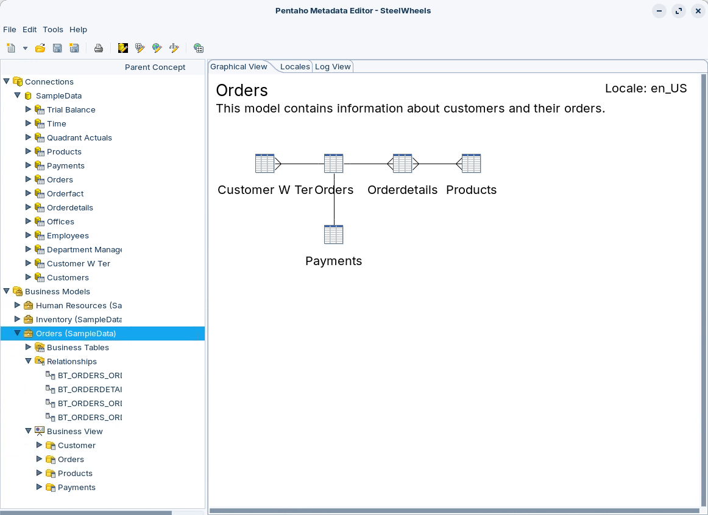
<figcaption>What you explore: the SteelWheels domain, with the Orders model expanded</figcaption>
</figure>
</div>

:::: tabs

### 1. Import

> **Note:**
>
> #### Import the SteelWheels Domain
>
> The Metadata Editor saves domains in its own repository. An XMI file is the exchange format: importing one loads the domain into the editor, and you then save it under a name of your choice.

1. Start the Metadata Editor with the **Open Metadata Editor** button below, or from a terminal:

::: tabs

### Windows (PowerShell)

```powershell
Set-Location C:\Pentaho\design-tools\metadata-editor
.\metadata-editor.bat
```

### macOS / Linux

```bash
cd ~/Pentaho/design-tools/metadata-editor
./metadata-editor.sh
```

:::

<button data-launch="metadata-editor">Open Metadata Editor</button>

<div align="center">
<figure>
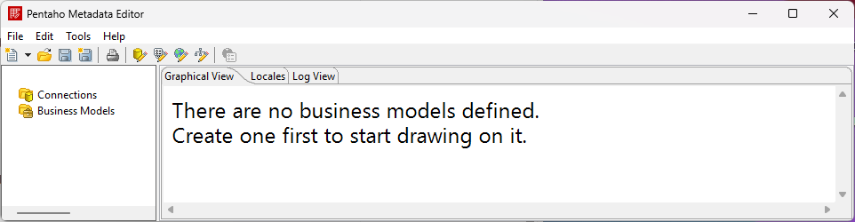
<figcaption>The Metadata Editor before you import a domain</figcaption>
</figure>
</div>

2. Select **File > Import from XMI File** (`Ctrl+I`).
3. Open `steel-wheels.xmi` from the Metadata Editor's `samples` folder: `C:\Pentaho\design-tools\metadata-editor\samples` (macOS / Linux: `~/Pentaho/design-tools/metadata-editor/samples`). The same file is under **Lab Files** below.
4. In the **Save Model** dialog, enter `SteelWheels` and select **OK**.

<div align="center">
<figure>
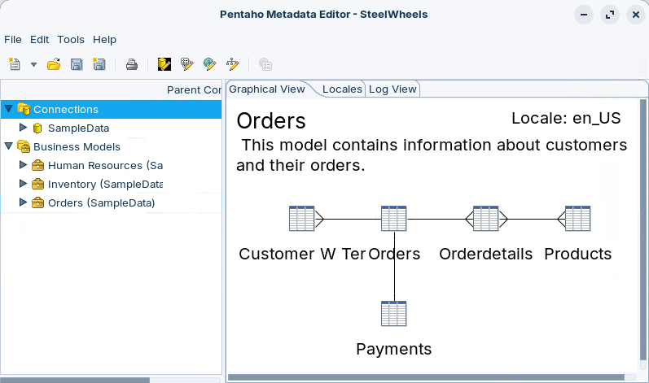
<figcaption>One connection, three business models</figcaption>
</figure>
</div>

> **Success:** Checkpoint: the title bar reads **Pentaho Metadata Editor - SteelWheels**. **Connections** holds one connection, **SampleData**, and **Business Models** lists three models: **Human Resources**, **Inventory** and **Orders**, each followed by its connection, **(SampleData)**.

### 2. Physical Layer

> **Note:**
>
> #### Physical Layer
>
> The physical layer holds the connections, the physical tables and the physical columns: the database as the domain sees it. It is not part of any business model, because a model uses only the tables it needs. A domain can hold several connections, but each business model uses exactly one, so a model never mixes tables from two connections.

1. In the tree, expand **Connections > SampleData**.

<div align="center">
<figure>
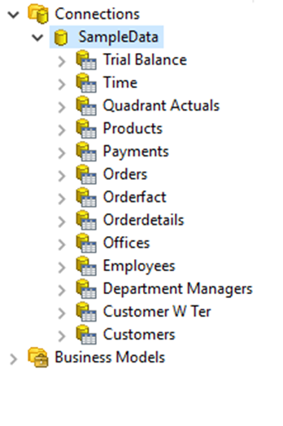
<figcaption>The physical layer: 13 tables from one connection</figcaption>
</figure>
</div>

> **Success:** Checkpoint: 13 physical tables, from **Trial Balance** to **Customers**. Each shows the name its **Name** property gives it, such as **Customer W Ter** for the `CUSTOMER_W_TER` table.

2. Expand **Products**.

<div align="center">
<figure>
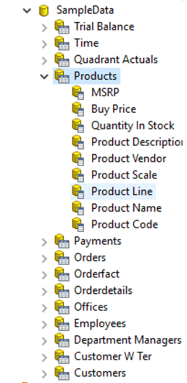
<figcaption>The Products table and its columns</figcaption>
</figure>
</div>

3. Double-click **Product Line**. The **Physical Table Properties** dialog opens with **Product Line** selected in the **Subject** pane.

<div align="center">
<figure>
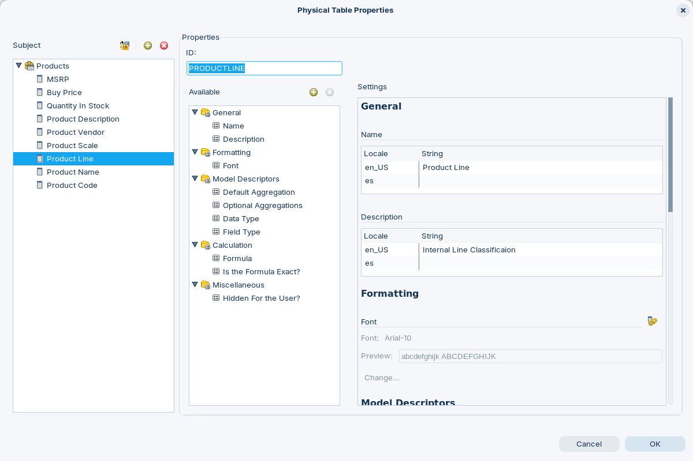
<figcaption>A physical column's properties</figcaption>
</figure>
</div>

> **Success:** Checkpoint: **ID** is `PRODUCTLINE`, the column's name in the database, and the **Name** under **General** is `Product Line`. The **Available** pane groups the properties under **General**, **Formatting**, **Model Descriptors**, **Calculation** and **Miscellaneous**; select one to scroll **Settings** to it.

Every object in a domain has an ID, and the IDs follow a pattern you meet in every workshop:

| ID | Object | Example |
| --- | --- | --- |
| `PT_` + table | Physical table | `PT_PRODUCTS` |
| The column name | Imported physical column | `PRODUCTLINE` |
| The ID you type | Physical column you add | `PC_TOTAL` |
| `BT_` + table + table | Business table | `BT_ORDERDETAILS_ORDERDETAILS` |
| `BC_` + table + column | Business column | `BC_ORDERDETAILS_PRICEEACH` |
| The ID you type | Category | `CAT_ORDERS` here; `CT_ORDERS` in the domains you build |

4. Select **Cancel**. The tree's **Parent Concept** column shows **Base** for every Products column: the concept a physical column starts from, and the one the business columns built on it inherit until they set their own.
5. Expand **Orderdetails** and double-click **Total**.

<div align="center">
<figure>
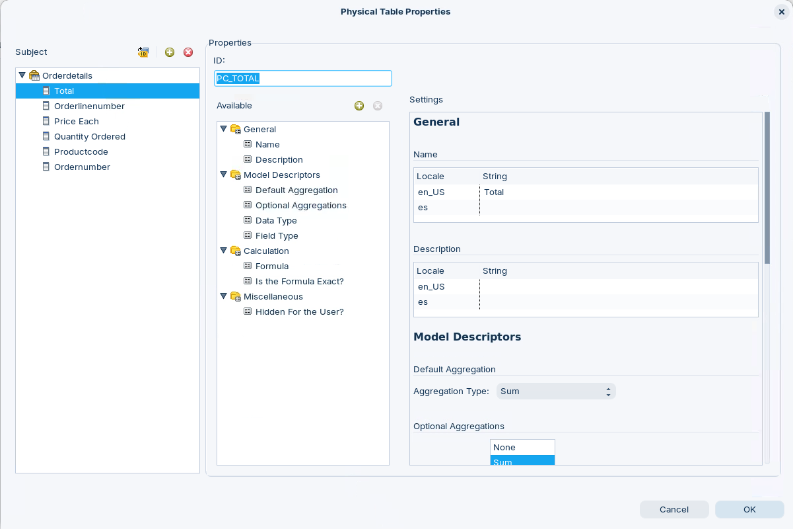
<figcaption>Total is a column the domain adds to the table</figcaption>
</figure>
</div>

6. In the **Available** pane, select **Calculation > Formula** and read the settings above it in **Settings**.

<div align="center">
<figure>
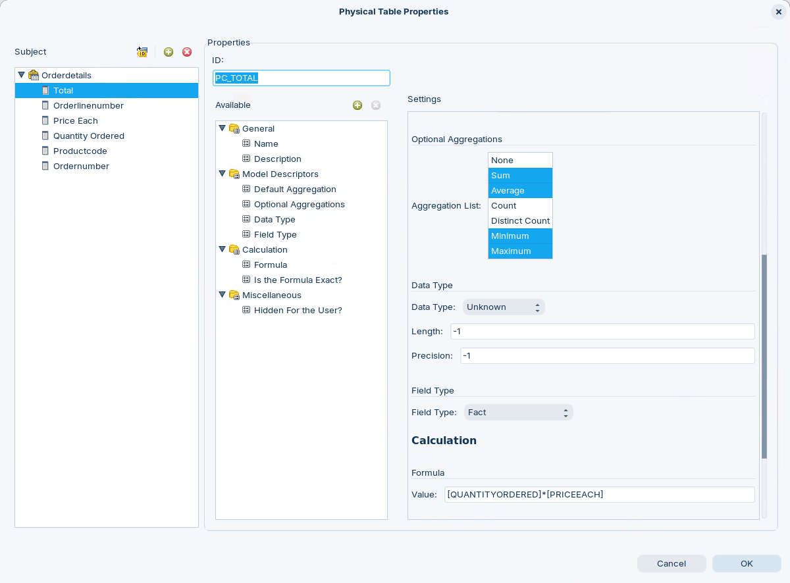
<figcaption>Total's aggregations, type and formula</figcaption>
</figure>
</div>

> **Success:** Checkpoint: **Total** (ID `PC_TOTAL`) has no column in the database. Its settings:
>
> | Property | Value |
> | --- | --- |
> | **Default Aggregation** | Sum |
> | **Optional Aggregations** | Sum, Average, Minimum, Maximum |
> | **Data Type** | Unknown |
> | **Field Type** | Fact |
> | **Formula** | `[QUANTITYORDERED]*[PRICEEACH]` |
> | **Is the Formula Exact?** | Selected |

7. Select **Cancel**.

> **Under the hood:**
>
> #### A formula column is SQL the database computes
>
> PC_TOTAL is an OpenFormula, and the metadata engine translates it into
> SQL: [QUANTITYORDERED] and [PRICEEACH] become the ORDERDETAILS
> columns, and the column's default aggregation, Sum, wraps the
> expression. Total by Product Line is generated as SUM(QUANTITYORDERED
> * PRICEEACH) grouped by PRODUCTLINE, so the multiplication runs in the
> database, row by row, before the sum: 4,090,084 for Classic Cars on
> SampleData.
>
> Sum is the default; Average, Minimum and Maximum are the alternatives
> a report can switch to.
>
> **Why it matters:** a measure the database does not store is defined
> once, in the domain, and every report built on it computes it the same
> way.

### 3. Business Models

> **Note:**
>
> #### Business Models
>
> The domain holds three business models. Each one uses the tables of the physical layer that it needs, through business tables, and the business tables are where you override what the physical columns pass down.

1. Collapse **Connections**, then expand **Business Models > Orders (SampleData) > Business Tables**.

<div align="center">
<figure>
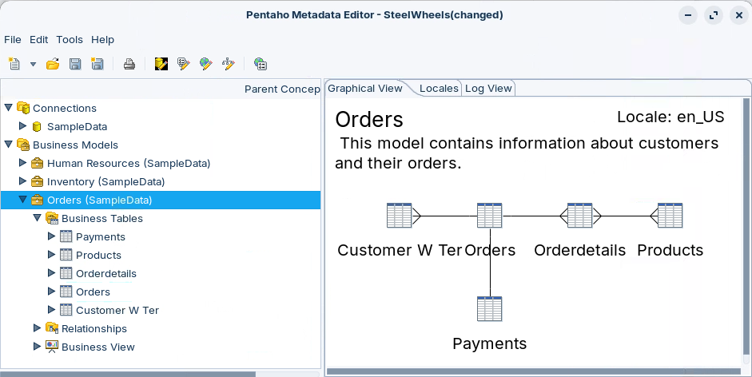
<figcaption>The Orders model's business tables</figcaption>
</figure>
</div>

> **Success:** Checkpoint: five business tables: **Payments**, **Products**, **Orderdetails**, **Orders** and **Customer W Ter**. The **Graphical View** tab draws the same five, joined by lines.

2. Expand **Orderdetails**.

<div align="center">
<figure>
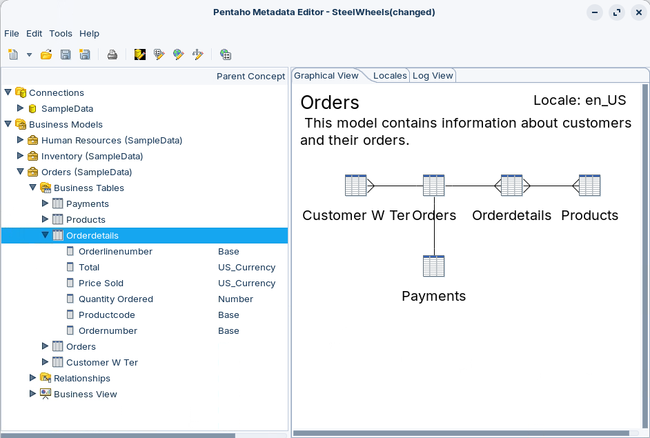
<figcaption>Business columns and their parent concepts</figcaption>
</figure>
</div>

> **Success:** Checkpoint: six business columns, each with its parent concept:
>
> | Business column | Parent Concept |
> | --- | --- |
> | Orderlinenumber | Base |
> | Total | US_Currency |
> | Price Sold | US_Currency |
> | Quantity Ordered | Number |
> | Productcode | Base |
> | Ordernumber | Base |

3. Double-click **Price Sold**. The **Business Table Properties** dialog opens.
4. In the **Available** pane, select **Miscellaneous > Mask for Number or Date**.

<div align="center">
<figure>
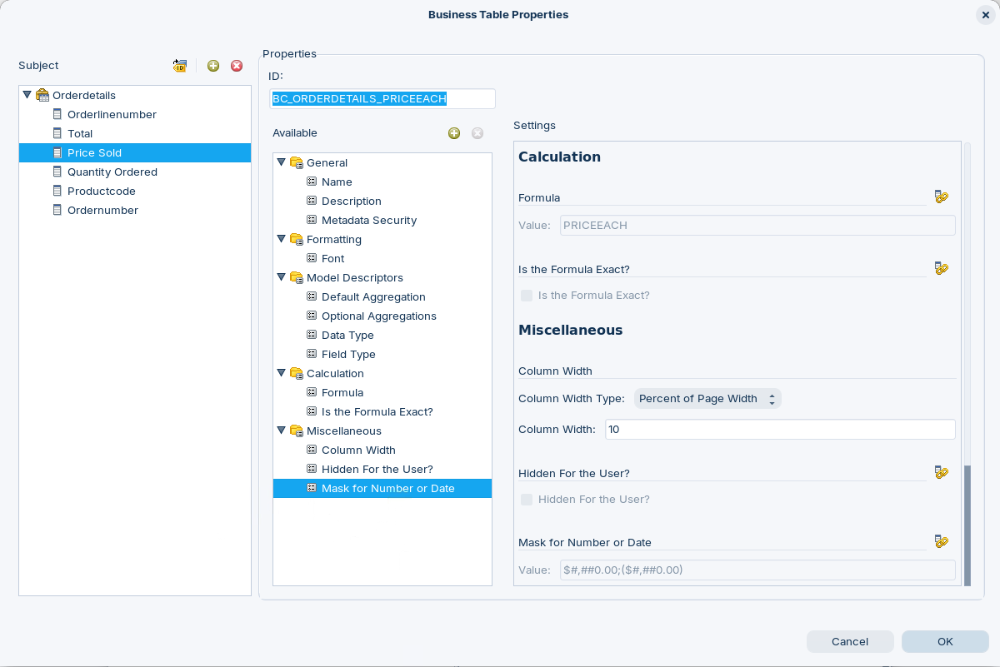
<figcaption>Price Sold's mask comes from its parent concept</figcaption>
</figure>
</div>

> **Success:** Checkpoint: **ID** is `BC_ORDERDETAILS_PRICEEACH`. The **Mask for Number or Date** value, `$#,##0.00;($#,##0.00)`, is grayed out: Price Sold doesn't set it. It inherits it from its parent concept, **US_Currency**, and the business view shows Price Sold with it.

5. Select **Cancel**.

> **Under the hood:**
>
> #### A mask is a format pattern, applied after the query
>
> Price Sold's mask is $#,##0.00;($#,##0.00): a Java number pattern
> whose part after the semicolon formats negative numbers, here in
> brackets. It changes nothing in the SQL; the reporting tool applies it
> to each value that comes back.
>
> The engine builds a column's properties in layers: what it inherits
> from its physical column, then its parent concept's (and that
> concept's own parents'), then its own overrides, each layer winning
> over the one before. That is how a mask set once on a concept reaches
> every column below it.
>
> **Why it matters:** change the concept and every currency column in
> the domain changes with it, with no column to edit one by one.

### 4. Relationships

> **Note:**
>
> #### Relationships
>
> Relationships tell the query generator how to join the business tables, much as a relational diagram shows primary and foreign keys. A relationship can join any two business tables on any two columns, and it states its kind: one to one, one to many, and so on. Before you create one, know the two business tables, the columns that link them, and the kind of relationship.

1. Expand **Business Models > Orders (SampleData) > Relationships**.

<div align="center">
<figure>
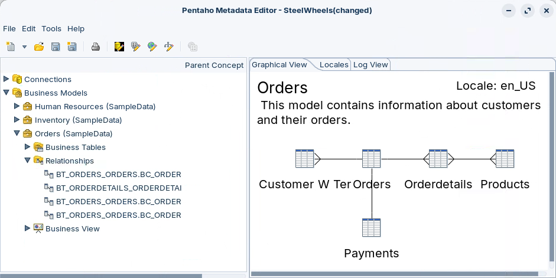
<figcaption>The Orders model's four relationships</figcaption>
</figure>
</div>

> **Success:** Checkpoint: four relationships. Each is named after its **From Table / Field**, then its **To Table / Field**:
>
> | From Table / Field | To Table / Field | Relationship |
> | --- | --- | --- |
> | `BT_ORDERS_ORDERS` / `BC_ORDERS_CUSTOMERNUMBER` | `BT_CUSTOMER_W_TER_CUSTOMER_W_TER` / `BC_CUSTOMER_W_TER_CUSTOMERNUMBER` | 1:N |
> | `BT_ORDERS_ORDERS` / `BC_ORDERS_ORDERNUMBER` | `BT_ORDERDETAILS_ORDERDETAILS` / `BC_ORDERDETAILS_ORDERNUMBER` | 1:N |
> | `BT_ORDERDETAILS_ORDERDETAILS` / `BC_ORDERDETAILS_PRODUCTCODE` | `BT_PRODUCTS_PRODUCTS` / `BC_PRODUCTS_PRODUCTCODE` | N:N |
> | `BT_ORDERS_ORDERS` / `BC_ORDERS_CUSTOMERNUMBER` | `BT_PAYMENTS_PAYMENTS` / `BC_PAYMENTS_CUSTOMERNUMBER` | 1:1 |

2. Double-click the relationship from Orders to Payments:

```text
BT_ORDERS_ORDERS.BC_ORDERS_CUSTOMERNUMBER - BT_PAYMENTS_PAYMENTS.BC_PAYMENTS_CUSTOMERNUMBER
```

<div align="center">
<figure>
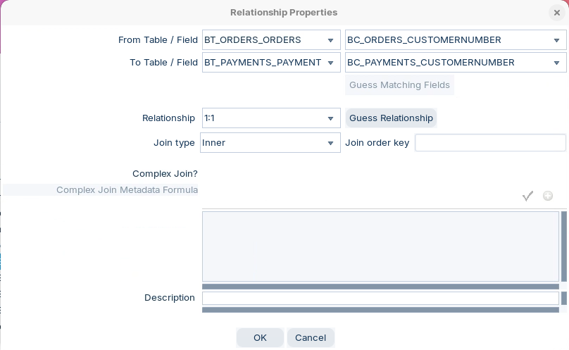
<figcaption>An inner join on the customer number, declared 1:1</figcaption>
</figure>
</div>

> **Success:** Checkpoint: **Relationship Properties** shows **Relationship** `1:1` and **Join type** `Inner`, and **Complex Join?** is cleared: the join is on the two customer number columns alone.

3. Select **Cancel**.

Wherever metadata writes a formula, such as a complex join or a calculated column, it names a business column by its business table ID and business column ID inside one pair of brackets:

```text
[BT_ORDERS_ORDERS.BC_ORDERS_CUSTOMERNUMBER]
```

> **Under the hood:**
>
> #### A relationship type is a declaration, not a check
>
> Whatever the type, the engine writes this relationship as an inner
> join on the customer number. 1:1, 1:N, N:1 and N:N all generate inner
> joins; only a 0 side changes the join: 0:N and 0:1 make a left outer
> join, N:0 and 1:0 a right outer join, and 0:0 a full outer join.
>
> Nothing checks the 1:1 against the data, and here the data disagrees:
> a customer has many orders and many payments, so the join pairs every
> order with every payment of the same customer. On SampleData, Order
> Number with Check Number returns 1,289 rows for 326 orders and 272
> payments, and summing payment amounts across the join gives 58,077,218
> instead of 9,777,415.
>
> **Why it matters:** a wrong relationship never raises an error. It
> shows up as totals that are too large, so check each relationship
> against the data before you publish a model.

### 5. Business View

> **Note:**
>
> #### Business View
>
> The business view is what report users see: categories, each holding business columns from any of the model's business tables.

1. Expand **Business View > Orders**.

<div align="center">
<figure>
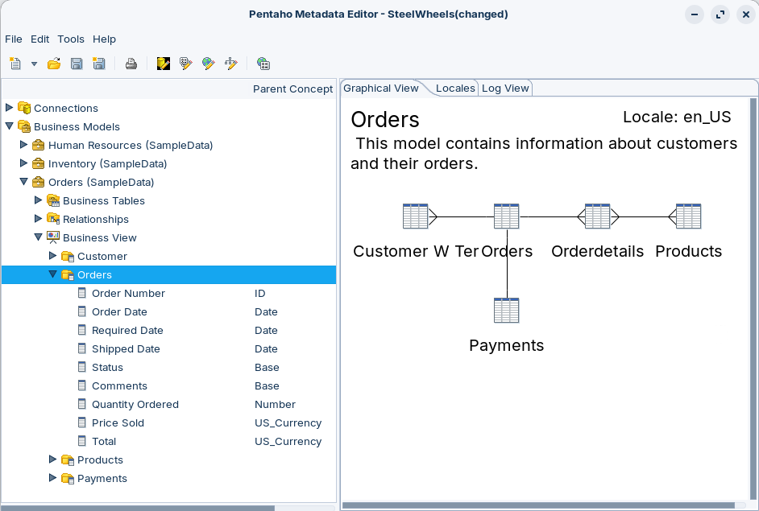
<figcaption>The Orders category and its columns' parent concepts</figcaption>
</figure>
</div>

> **Success:** Checkpoint: the **Business View** holds four categories, **Customer**, **Orders**, **Products** and **Payments**. **Orders** holds nine columns, from **Order Number** (parent concept **ID**) to **Total** (**US_Currency**).

2. Right-click **Orders** and select **Manage Categories**.

<div align="center">
<figure>
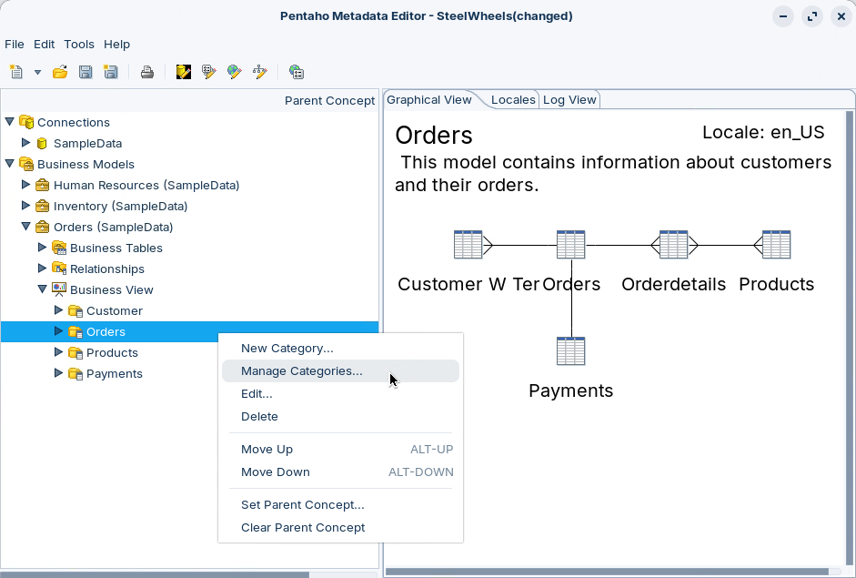
<figcaption>Manage Categories, on a category's context menu</figcaption>
</figure>
</div>

3. In the **Manage Categories** dialog, expand **Orders** under **Available Business Tables** and **Orders** under **Business View Categories**.

<div align="center">
<figure>
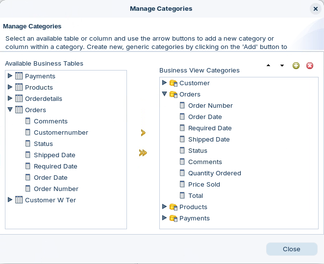
<figcaption>Business tables on the left, categories on the right</figcaption>
</figure>
</div>

> **Success:** Checkpoint: the **Orders** category's nine columns come from two business tables. Six are from **Orders** (Order Number, Order Date, Required Date, Shipped Date, Status, Comments) and three from **Orderdetails** (Quantity Ordered, Price Sold, Total).

4. Select **Close**.

> **Under the hood:**
>
> #### A category holds references, not copies
>
> A category lists business columns by id, so the same column can sit in
> several categories, and every property it shows comes from the
> business column. The Products category here even holds Comments from
> the Orders table: categories group columns for the people using them
> and need not follow the tables.
>
> Queries are written against them. An Interactive Report sends MQL
> naming each column's category and id, such as
> <view>CAT_ORDERS</view><column>BC_ORDERS_ORDERNUMBER</column>, and the
> engine works out the tables and joins from there.
>
> **Why it matters:** you can reorganize what report users see without
> touching a business table, a relationship or the database.

::::

## Lab Files

Click a file to download it.

### Solution <!-- no-step -->

The SteelWheels domain this workshop explores, the same file as the Metadata Editor's own `samples\steel-wheels.xmi`. Load it with **File > Import from XMI File**.

[steel-wheels.xmi](../_assets/files/steel-wheels.xmi)
