# OrdersME

> **Warning:**
>
> #### Workshop - OrdersME
>
> Build a metadata domain from an empty editor: OrdersME, a star-schema model of Steel Wheels orders. You connect to the sample data, import the tables, model them, group the columns for report users, publish the domain, and report on it in Interactive Reports.
>
> **What you'll do**
>
> * Create a domain and a database connection
> * Import physical tables from the sample data
> * Build a business model whose three relationships join a fact table to its dimensions
> * Group business columns into three categories
> * Publish the domain to the Pentaho Server and test it with an Interactive Report
>
> **Prerequisites:**
>
> * The [SteelWheels](../03-domains-and-models-steelwheels/guide.md) workshop
> * The Pentaho Server, running (see [Before You Start](../00-before-you-start/guide.md))
>
> **Estimated time:** 90 minutes

<figure>

<figcaption class="pcm-video-caption">Walkthrough: coming soon</figcaption>

</figure>

<div align="center">
<figure>
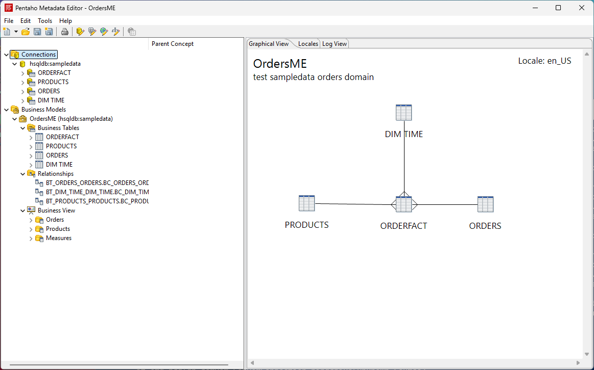
<figcaption>What you build: the OrdersME domain</figcaption>
</figure>
</div>

<div align="center">
<figure>
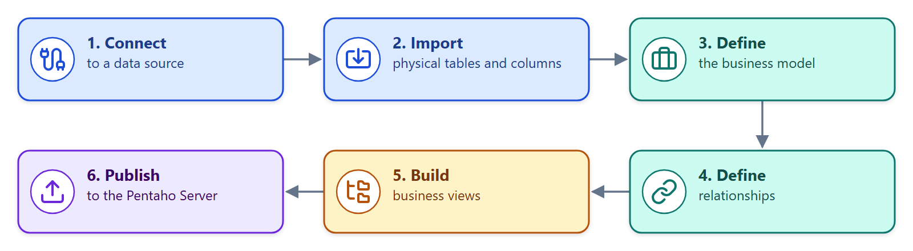
<figcaption>The stages of building a domain, one part each below</figcaption>
</figure>
</div>

Read the diagram by its numbers: the top row left to right, then down, and the bottom row back from right to left. Each stage is the part below with the same number, from **1. Connection** to **6. Publish**. Part 7 then tests the published domain in an Interactive Report.

:::: tabs

### 1. Connection

> **Note:**
>
> #### Define a Domain and a Connection
>
> A connection describes one database. It is the parent of every physical table and physical column you import from that database, so you create it first. Pentaho metadata reaches relational databases through JDBC.

1. Start the Metadata Editor with the **Open Metadata Editor** button below, or from PowerShell:

```powershell
Set-Location C:\Pentaho\design-tools\metadata-editor
.\metadata-editor.bat
```

<button data-launch="metadata-editor">Open Metadata Editor</button>

2. Make sure the Pentaho Server is running: you publish to it in part 6, and the HSQLDB sample data runs with it, on port `9001`. On a lab VM it starts with the machine. On your own machine, start it as [Before You Start](../00-before-you-start/guide.md) describes (its repository database first), and wait until **http://localhost:8080/pentaho** shows the sign-in page:

```powershell
C:\Pentaho\server\pentaho-server\start-pentaho.bat
```

3. Select **File > New > Domain File**.

<div align="center">
<figure>
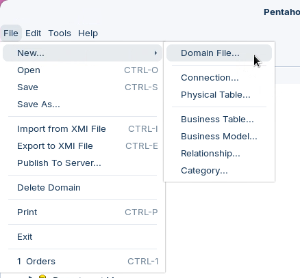
<figcaption>File > New > Domain File</figcaption>
</figure>
</div>

4. Right-click **Connections** and select **New Connection**.

<div align="center">
<figure>
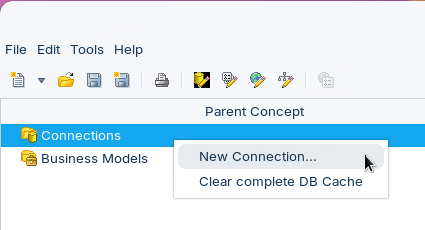
<figcaption>New Connection, on the Connections node</figcaption>
</figure>
</div>

5. In the **Database Connection** dialog, enter the settings for the sample data. It is the HSQLDB database that runs with the Pentaho Server:

| Setting | Value |
| --- | --- |
| **Connection name** | `hsqldb:sampledata` |
| **Connection type** | Hypersonic |
| **Access** | Native (JDBC) |
| **Host Name** | `localhost` |
| **Database Name** | `sampledata` |
| **Port Number** | `9001` |
| **Username** | `pentaho_admin` |
| **Password** | `password` |

<div align="center">
<figure>
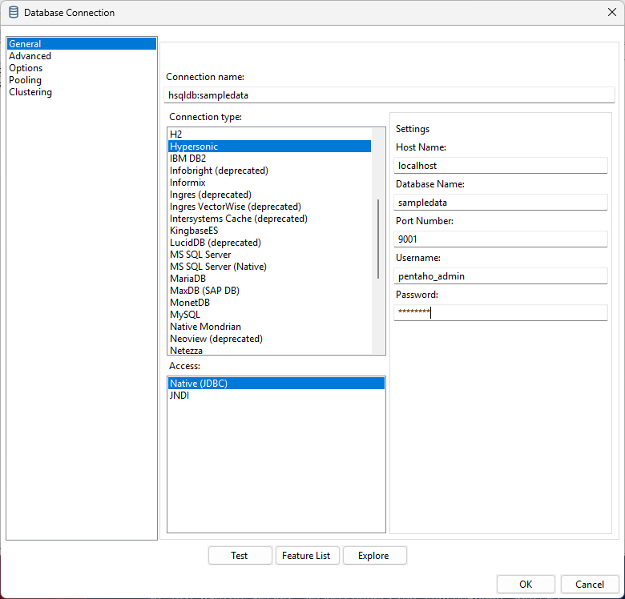
<figcaption>The native connection to the sample data</figcaption>
</figure>
</div>

> **Note:**
>
> #### For information: a JNDI connection
>
> Keep the native settings above for this workshop. The same data can also be reached by name, as the SteelWheels domain does: **Access** set to **JNDI** and **JNDI Name** to `SampleData`. The Metadata Editor and the Pentaho Server each resolve `SampleData` to their own copy of the sample data. The picture shows that dialog; the checkpoint below expects `hsqldb:sampledata`.

<div align="center">
<figure>
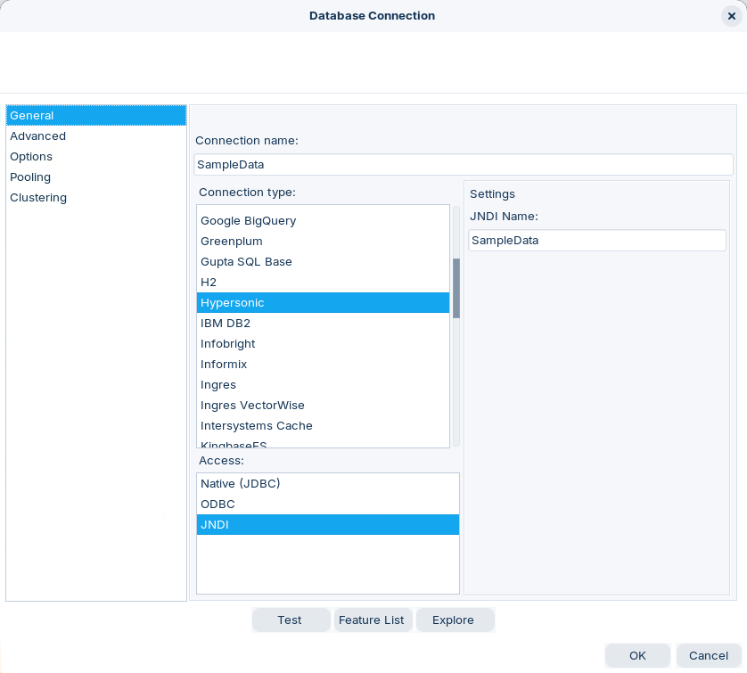
<figcaption>For information: the JNDI alternative, not used in this workshop</figcaption>
</figure>
</div>

6. Select **Test**.

> **Success:** Checkpoint: a message says the connection to `hsqldb:sampledata` was successful, followed by its host name, port and database name.

<div align="center">
<figure>
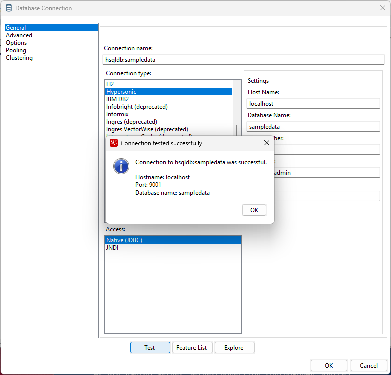
<figcaption>The test reaches the sample data</figcaption>
</figure>
</div>

7. Select **OK** to close the message, then select **OK** to close **Database Connection**. The **Import Tables** dialog opens: leave it open for part 2.

### 2. Import Tables

> **Note:**
>
> #### Import Tables
>
> Importing a physical table brings all its columns with it. OrdersME is a star schema: a central fact table of order lines, `ORDERFACT`, surrounded by dimension tables that describe each line: its product, its order and its date.

1. If **Import Tables** isn't open, right-click **hsqldb:sampledata** under **Connections** and select **Import Tables**.
2. Hold `Ctrl` and select these four tables:

| Table | Rows | What it holds |
| --- | --- | --- |
| `ORDERFACT` | 2,996 | The fact table: one row per order line, with its order, product, customer and time keys |
| `PRODUCTS` | 110 | The product catalog: product line, vendor, code, name, scale, description, quantity in stock, buy price and MSRP |
| `ORDERS` | 326 | One row per customer order: order, required and shipped dates, status and comments |
| `DIM_TIME` | 265 | The time dimension: one row per order date, rolled up to month, quarter and year |

<div align="center">
<figure>
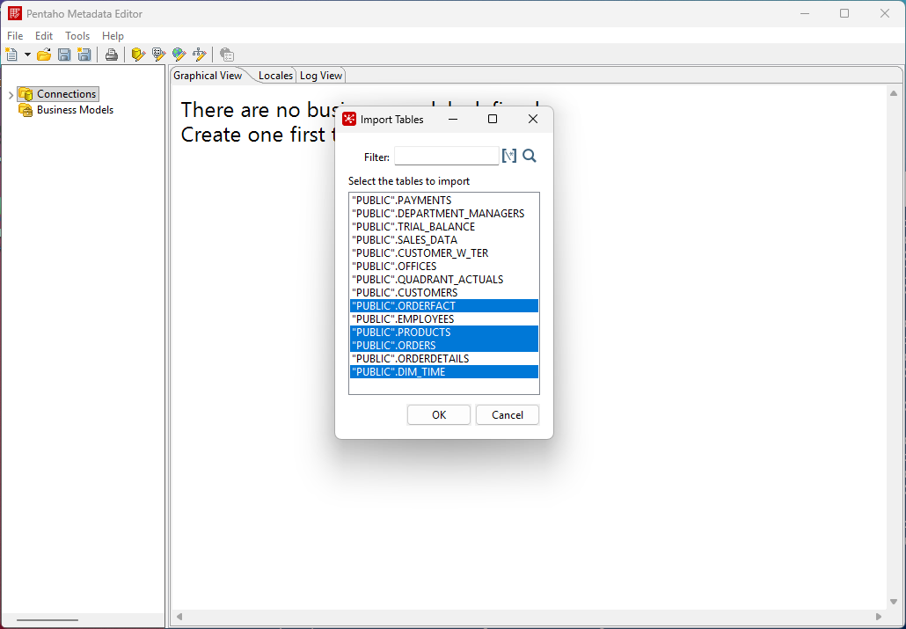
<figcaption>Four tables selected</figcaption>
</figure>
</div>

3. Select **OK**.
4. Under **Connections**, expand **hsqldb:sampledata**, then **ORDERFACT**.

<div align="center">
<figure>
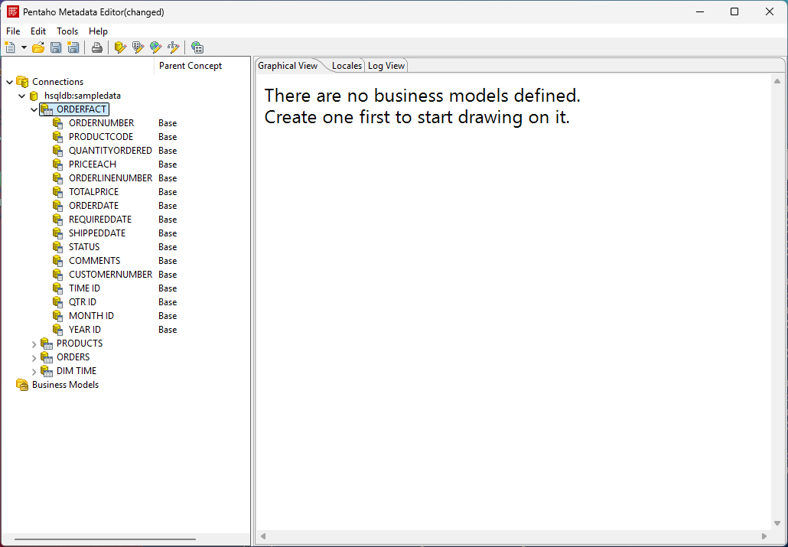
<figcaption>The physical layer after the import</figcaption>
</figure>
</div>

> **Success:** Checkpoint: four physical tables, **ORDERFACT**, **PRODUCTS**, **ORDERS** and **DIM TIME**. (`ORDERDETAILS` holds the order lines again; the model doesn't need it, since `ORDERFACT` already carries them.) **ORDERFACT** holds 16 columns, from **ORDERNUMBER** to **YEAR ID**, and each has the parent concept **Base**, which the business columns you build on them inherit until they override it.

This workshop keeps every column. To remove one you don't want, double-click its table (or right-click it and select **Edit**), select the column in the **Subject** pane of **Physical Table Properties**, select the red delete icon to the right of **Subject**, and select **OK**.

<div align="center">
<figure>
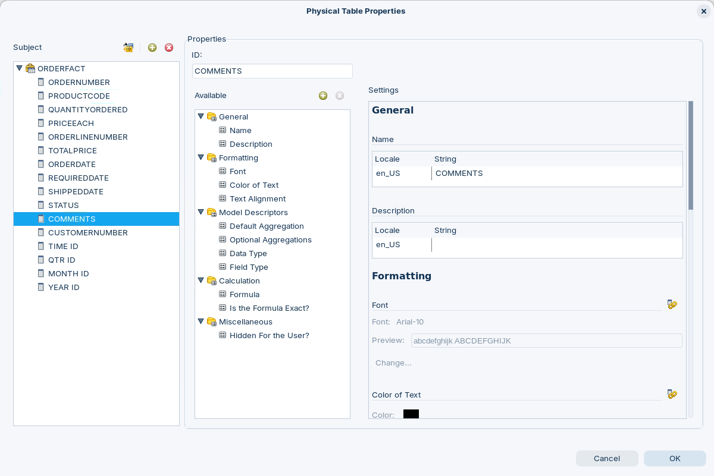
<figcaption>Removing a column: select it, then the red delete icon</figcaption>
</figure>
</div>

### 3. Business Model

> **Note:**
>
> #### Business Model and Business Tables
>
> The business model maps the physical tables into the logical model report users work with. It uses one connection, and it starts with three empty nodes: **Business Tables**, **Relationships** and **Business View**.

1. Right-click **Business Models** and select **New Business Model**.

<div align="center">
<figure>
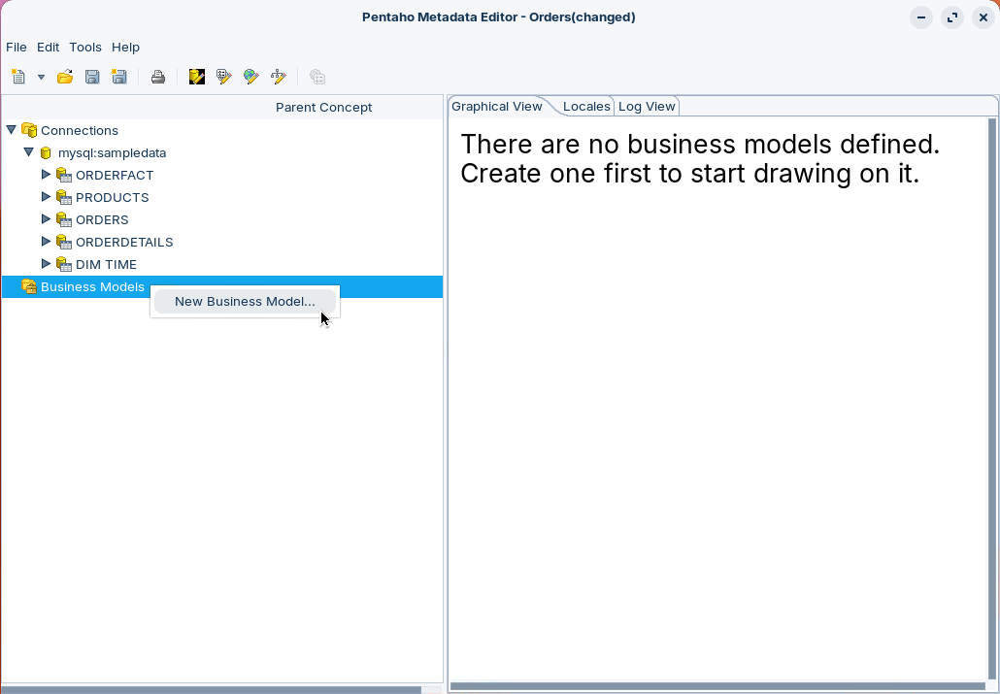
<figcaption>New Business Model</figcaption>
</figure>
</div>

2. In the **Business Model Properties** dialog, keep the **ID** the editor proposes, `BV_MODEL_1`. It must be unique among the domain's models.
3. Under **Settings**, click in the **String** cell of the `en_US` row under **Name** and enter `OrdersME`.
4. Click in the **String** cell of the `en_US` row under **Description** and enter `test sampledata orders domain`.
5. Set **Connection** to `hsqldb:sampledata`.

<div align="center">
<figure>
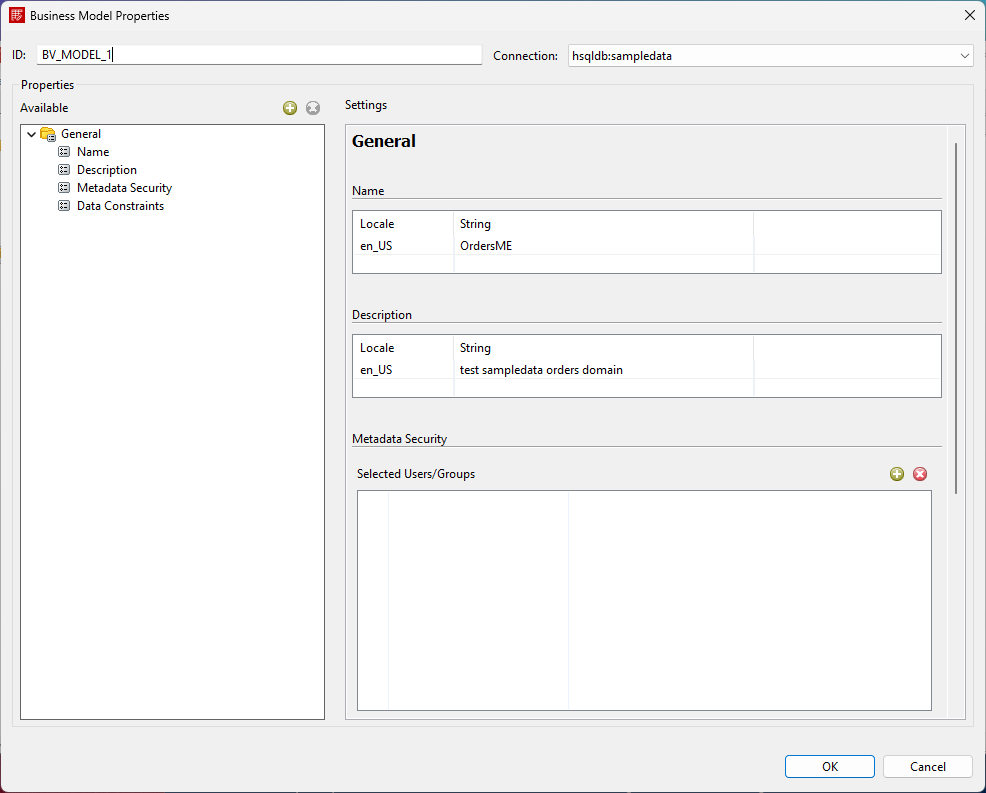
<figcaption>Name, description and connection</figcaption>
</figure>
</div>

6. Select **OK**.
7. Save the domain (`Ctrl+S`). In the **Save Domain** dialog, enter `OrdersME` and select **OK**.

<div align="center">
<figure>
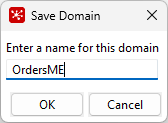
<figcaption>The domain's name in the editor</figcaption>
</figure>
</div>

> **Success:** Checkpoint: **Business Models** shows **OrdersME** followed by its connection, with three empty nodes: **Business Tables**, **Relationships** and **Business View**. The **Graphical View** shows the model's name and description.

8. Right-click **Business Tables** and select **New Business Table**.

<div align="center">
<figure>
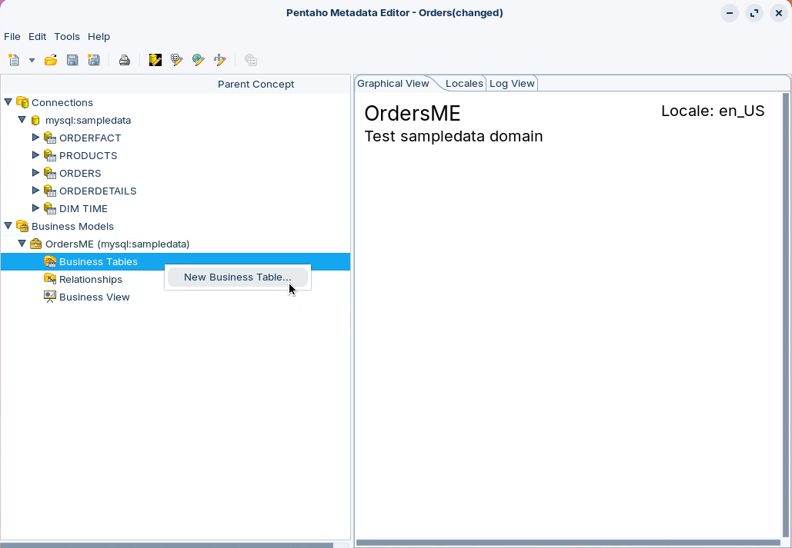
<figcaption>New Business Table</figcaption>
</figure>
</div>

9. In the **Make Selection** dialog, select `PT_ORDERFACT` and select **OK**. If the **Business Table Properties** dialog opens, select **OK**.

<div align="center">
<figure>
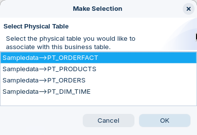
<figcaption>Each business table points at one physical table</figcaption>
</figure>
</div>

10. Repeat steps 8 and 9 for `PT_PRODUCTS`, `PT_ORDERS` and `PT_DIM_TIME`. You can also drag a physical table from **Connections** onto **Business Tables**.

<div align="center">
<figure>
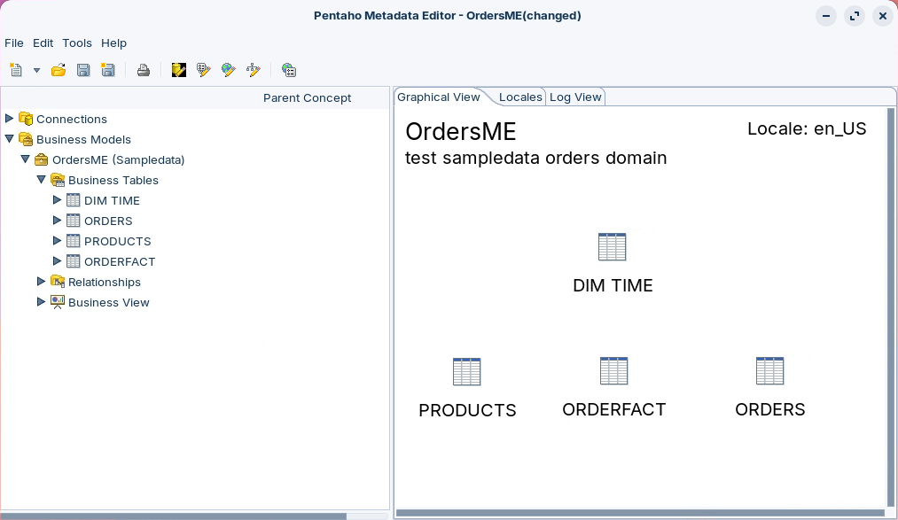
<figcaption>Four business tables, not yet related</figcaption>
</figure>
</div>

> **Success:** Checkpoint: four business tables, **DIM TIME**, **ORDERS**, **PRODUCTS** and **ORDERFACT**, drawn on the **Graphical View** with no lines between them yet. Their IDs are `BT_DIM_TIME_DIM_TIME`, `BT_ORDERS_ORDERS`, `BT_PRODUCTS_PRODUCTS` and `BT_ORDERFACT_ORDERFACT`.

11. Save the domain (`Ctrl+S`).

### 4. Relationships

> **Note:**
>
> #### Relationships
>
> Relationships tell the query generator how to join the business tables. For each one you need the two business tables, the column in each that links them, and the kind of relationship. You create the first in the tree and the next two on the **Graphical View**, which fills in the two tables you selected.

1. Under **OrdersME**, right-click **Relationships** and select **New Relationship**.
2. In the **Relationship Properties** dialog, set:

| Setting | Value |
| --- | --- |
| **From Table / Field** | `BT_DIM_TIME_DIM_TIME`, `BC_DIM_TIME_TIME_ID` |
| **To Table / Field** | `BT_ORDERFACT_ORDERFACT`, `BC_ORDERFACT_TIME_ID` |
| **Relationship** | 1:N |
| **Join type** | Inner |

Pick each table from its list, then its field from the list to the right of it. In Metadata Editor 11 the **Guess Matching Fields** button stays grayed out, so set both fields yourself.

<div align="center">
<figure>
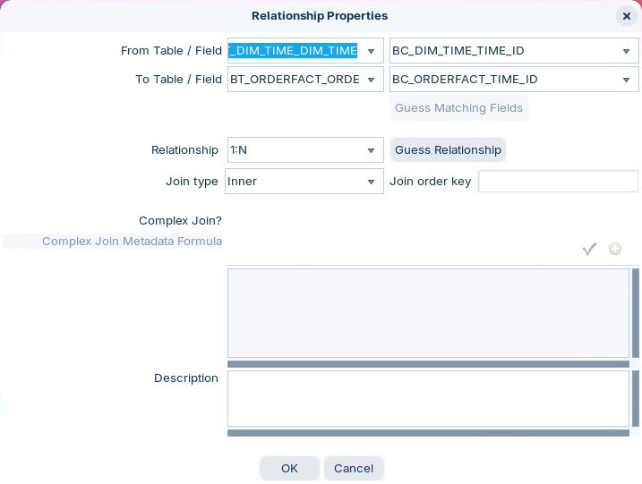
<figcaption>DIM TIME to ORDERFACT, one to many</figcaption>
</figure>
</div>

3. Select **OK**.

<div align="center">
<figure>
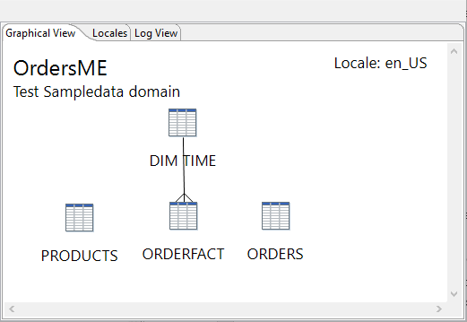
<figcaption>The first relationship</figcaption>
</figure>
</div>

> **Success:** Checkpoint: a line joins **DIM TIME** to **ORDERFACT** on the **Graphical View**, with the many end at **ORDERFACT**, and **Relationships** lists the new relationship.

4. On the **Graphical View**, select **ORDERFACT** and **PRODUCTS**: drag a rectangle around both, or hold `Ctrl+Shift` and select each.
5. Right-click one of the selected tables and select **Add Relationship**.

<div align="center">
<figure>
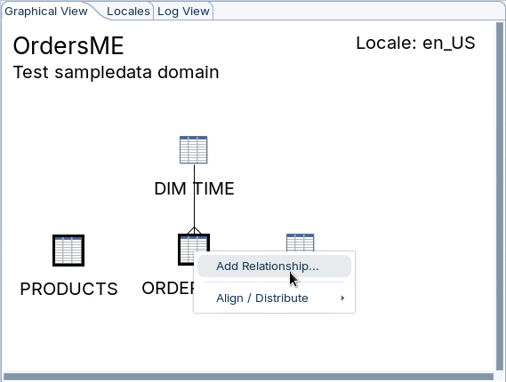
<figcaption>Add Relationship, on two selected tables</figcaption>
</figure>
</div>

6. In **Relationship Properties**, set:

| Setting | Value |
| --- | --- |
| **From Table / Field** | `BT_ORDERFACT_ORDERFACT`, `BC_ORDERFACT_PRODUCTCODE` |
| **To Table / Field** | `BT_PRODUCTS_PRODUCTS`, `BC_PRODUCTS_PRODUCTCODE` |
| **Relationship** | N:1 |
| **Join type** | Inner |

<div align="center">
<figure>
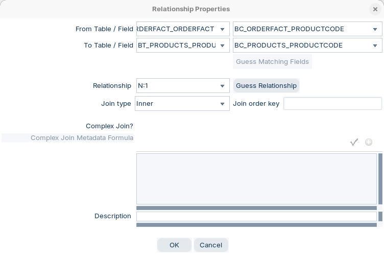
<figcaption>ORDERFACT to PRODUCTS, many to one</figcaption>
</figure>
</div>

7. Select **OK**. N:1 from **ORDERFACT** is the same join as 1:N from **PRODUCTS**; the solution stores it the second way.

<div align="center">
<figure>
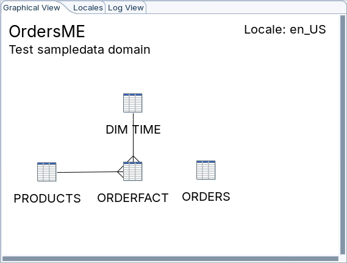
<figcaption>Two relationships</figcaption>
</figure>
</div>

8. Create the third relationship the same way, between **ORDERS** and **ORDERFACT**:

| Setting | Value |
| --- | --- |
| **From Table / Field** | `BT_ORDERS_ORDERS`, `BC_ORDERS_ORDERNUMBER` |
| **To Table / Field** | `BT_ORDERFACT_ORDERFACT`, `BC_ORDERFACT_ORDERNUMBER` |
| **Relationship** | 1:N |
| **Join type** | Inner |

<div align="center">
<figure>
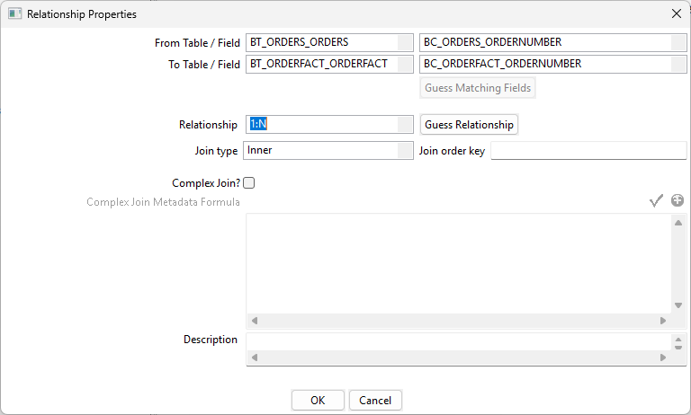
<figcaption>ORDERS to ORDERFACT, one order to many lines</figcaption>
</figure>
</div>

<div align="center">
<figure>
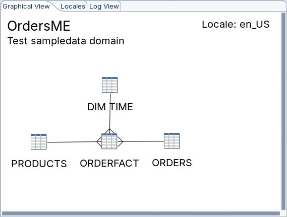
<figcaption>The star: every dimension one relationship from the fact table</figcaption>
</figure>
</div>

> **Success:** Checkpoint: **Relationships** lists three relationships, and every one joins **ORDERFACT** to a dimension: **DIM TIME** on the time ID, **PRODUCTS** on the product code and **ORDERS** on the order number.

9. Save the domain (`Ctrl+S`).

> **Under the hood:**
>
> #### From relationships to SQL
>
> When a report uses columns from PRODUCTS, ORDERS and ORDERFACT, the
> engine includes those three tables and the relationships that connect
> them, and writes each inner join as a condition in the WHERE clause:
> PRODUCTS.PRODUCTCODE = ORDERFACT.PRODUCTCODE AND ORDERS.ORDERNUMBER =
> ORDERFACT.ORDERNUMBER. DIM_TIME stays out of the SQL until a query
> asks for one of its columns.
>
> The fact table in the middle is what makes this simple: every
> dimension is one relationship away from it, so any combination of
> dimensions has a direct path.
>
> **Why it matters:** report users pick columns, never joins. The joins
> they get are the ones you declared here, so a missing or wrong
> relationship is a modeling fix, made once.

#### Complex joins

None of this model's joins needs one, but a relationship can join on more than one column. Select **Complex Join?** in **Relationship Properties** and enter a Metadata Formula in **Complex Join Metadata Formula**. Complex joins appear in the `WHERE` clause of the SQL statement, so a join that needs the `FROM` clause is not supported.

A Metadata Formula names each column by its business table ID and business column ID inside one pair of brackets, and `AND(...; ...)` joins the conditions. ORDERS and ORDERFACT share both ORDERNUMBER and CUSTOMERNUMBER, so a two-column join between them would read:

```text
AND([BT_ORDERS_ORDERS.BC_ORDERS_ORDERNUMBER]=[BT_ORDERFACT_ORDERFACT.BC_ORDERFACT_ORDERNUMBER]; [BT_ORDERS_ORDERS.BC_ORDERS_CUSTOMERNUMBER]=[BT_ORDERFACT_ORDERFACT.BC_ORDERFACT_CUSTOMERNUMBER])
```

Don't write SQL with physical table names (`ORDERS.ORDERNUMBER=ORDERFACT.ORDERNUMBER`). The Metadata Editor pastes a SQL expression into the query unchanged, the generated SQL calls each table by its business table ID, and the database answers *object not found*.

#### Relationship reference

| Relationship | Description |
| --- | --- |
| 1:N | One to many, the most common relationship: one row in the first table relates to none, one or many rows in the second. One customer, many orders. |
| N:1 | Many to one: 1:N seen from the other table. |
| 1:1 | One to one: each row on either side relates to one row, or none, on the other. Most come from business rules; without one, the two tables can usually be combined into one. |
| 0:N | Zero to many, optional: a person may have no phone, one or many, and a phone belongs to at most one person. |
| N:0 | Zero to many, seen from the other table. |
| 0:1 | Zero to one: a person may be a programmer, but a programmer must be a person. The mandatory side is the dominant one. |
| 1:0 | Zero to one, seen from the other table. |
| N:N | Many to many: each row on either side relates to any number of rows on the other. A relational database needs a third, linking table to hold it. |
| 0:0 | Zero to zero, optional on both sides: a person may have a parking space, and a space may have no person. |

### 5. Business View

> **Note:**
>
> #### Categories
>
> The business view is the part of the model report users see: one business view per model, made of categories that hold business columns. A category carries only a name, a description and **Metadata Security**, and has no tie to a business table: one category can hold columns from several tables, and one column can sit in several categories. Categories are one level deep. The **Graphical View** shows only business tables, so you build the view in the tree and in the **Manage Categories** dialog.

1. Under **OrdersME**, right-click **Business View** and select **New Category**.

<div align="center">
<figure>
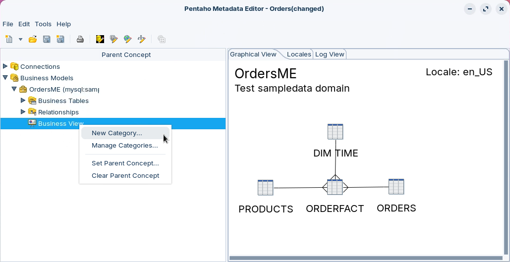
<figcaption>New Category, on the Business View node</figcaption>
</figure>
</div>

2. In the **Business Category Properties** dialog, set **ID** to `CT_ORDERS`.
3. Click in the **String** cell of the `en_US` row under **Name** and enter `Orders`. Under **Description**, enter `steel wheels orders` the same way.

<div align="center">
<figure>

<figcaption>The Orders category</figcaption>
</figure>
</div>

4. Select **OK**.
5. Right-click **Business View** and select **Manage Categories**.

<div align="center">
<figure>
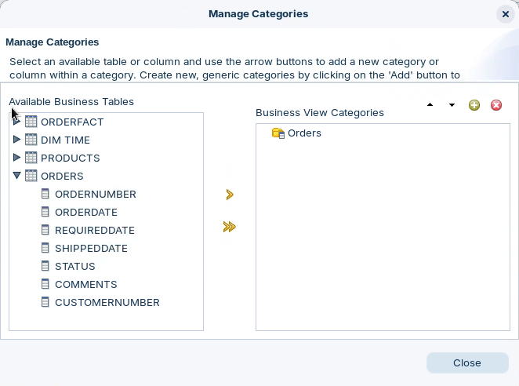
<figcaption>Manage Categories, before you add columns</figcaption>
</figure>
</div>

6. Under **Available Business Tables**, expand **ORDERS**. Hold `Ctrl` and select **ORDERNUMBER**, **ORDERDATE**, **REQUIREDDATE**, **STATUS** and **COMMENTS**.
7. Under **Business View Categories**, select **Orders**, then select **Add** (the single arrow between the panes). A column and a category must both be selected before **Add** does anything.

<div align="center">
<figure>
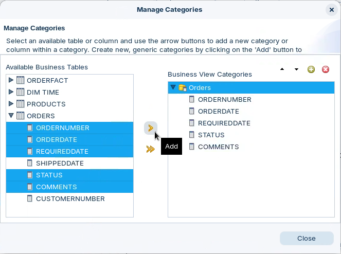
<figcaption>Five columns added to Orders</figcaption>
</figure>
</div>

8. Select **Add New Category** (the green plus icon above **Business View Categories**). The editor proposes an ID like `CT_CATEGORY1`: replace it with `CT_PRODUCTS`, enter the name `Products` and the description `steel wheels products`, and select **OK**.

<div align="center">
<figure>
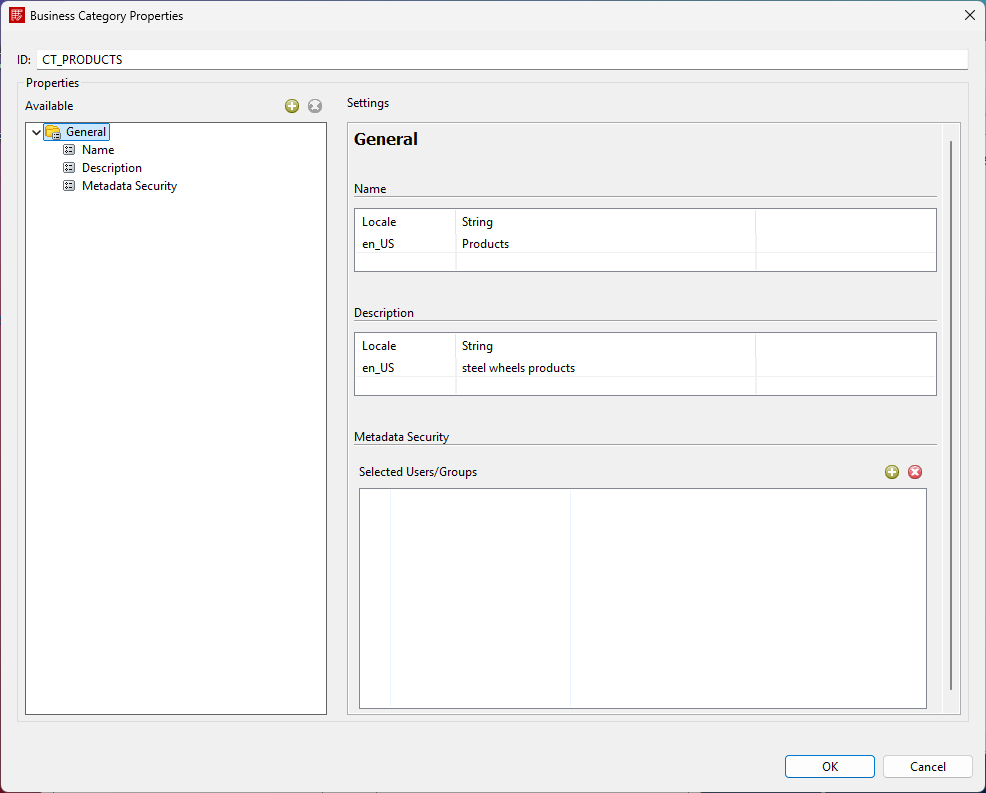
<figcaption>The Products category</figcaption>
</figure>
</div>

9. Create `CT_MEASURES` the same way, with the name `Measures` and the description `steel wheels metrics`.

<div align="center">
<figure>

<figcaption>The Measures category</figcaption>
</figure>
</div>

10. Add the rest of the columns, so the three categories match this table:

| Category | From business table | Columns |
| --- | --- | --- |
| Orders | ORDERS | ORDERNUMBER, ORDERDATE, REQUIREDDATE, STATUS, COMMENTS |
| Products | PRODUCTS | PRODUCTNAME, PRODUCTLINE, PRODUCTVENDOR, PRODUCTDESCRIPTION |
| Measures | PRODUCTS | QUANTITYINSTOCK |
| Measures | ORDERFACT | QUANTITYORDERED, PRICEEACH, TOTALPRICE |

<div align="center">
<figure>
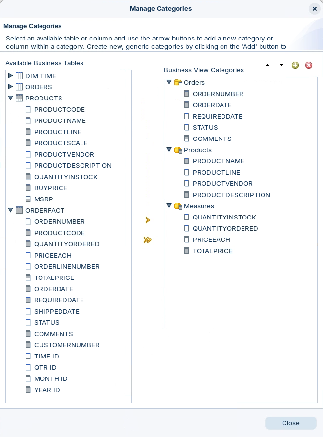
<figcaption>The finished business view</figcaption>
</figure>
</div>

> **Success:** Checkpoint: **Orders** holds 5 columns, **Products** 4 and **Measures** 4. **Measures** mixes two business tables: **QUANTITYINSTOCK** from **PRODUCTS** and the other three from **ORDERFACT**.

11. Select **Close**, then save the domain (`Ctrl+S`).

You can also add a column without the dialog: expand a business table in the tree and drag one of its columns onto a category.

<div align="center">
<figure>
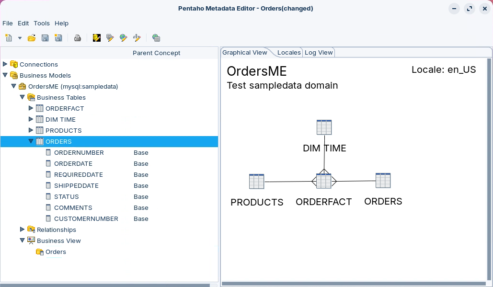
<figcaption>A business table's columns, ready to drag onto a category</figcaption>
</figure>
</div>

### 6. Publish

> **Note:**
>
> #### Publish the Domain
>
> Publishing uploads the domain to the Pentaho Server, where the reporting tools offer its business model as a data source. The server must be running.

1. Save the domain (`Ctrl+S`).
2. Select **File > Publish To Server**.
3. In the **Publish To Server** dialog, set:

| Setting | Value |
| --- | --- |
| **Web Publish URL** | `http://localhost:8080/pentaho/plugin/data-access/api/metadata/import` |
| **Server Userid** | `admin` |
| **Server Password** | `password` |
| **Domain Name** | `OrdersME` |

<div align="center">
<figure>
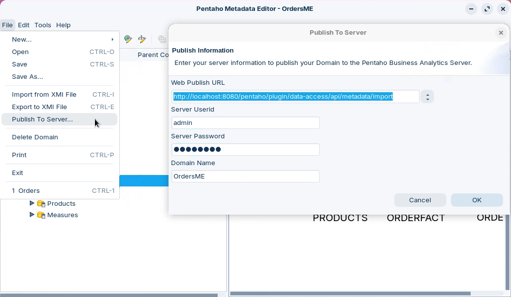
<figcaption>Publish To Server</figcaption>
</figure>
</div>

4. Select **OK**. The server can take a few seconds to answer.

<div align="center">
<figure>
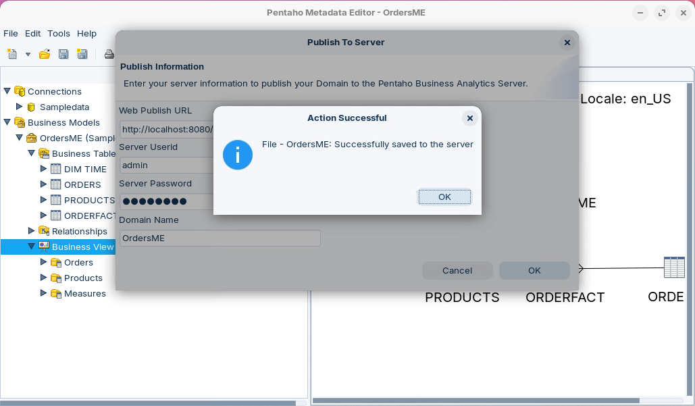
<figcaption>The domain is on the server</figcaption>
</figure>
</div>

> **Success:** Checkpoint: an **Action Successful** message reads `File - OrdersME: Successfully saved to the server`.

5. Select **OK**.

> **Under the hood:**
>
> #### The domain took its connection with it
>
> Publishing sends the whole domain to the server's metadata repository,
> connection included: the server stores `OrdersME.xmi` with
> `hsqldb:sampledata` inside it. The server has no data source of that
> name in **Manage Data Sources**, and needs none. When a report queries
> OrdersME, the metadata engine opens the connection the domain carries:
> native JDBC to `localhost:9001`, as `pentaho_admin`.
>
> **Why it matters:** a connection's settings must work from the server
> as well as from your machine. `localhost` works here because both run
> on this machine; publish to a server elsewhere and the connection must
> name a host that server can reach, or use JNDI and let each side
> resolve the name.

### 7. Test

> **Note:**
>
> #### Test with an Interactive Report
>
> Report on the published domain in Interactive Reports, as a report user would.

1. Open the Pentaho User Console with the button below and log in as `admin` (password `password`).

<button data-launch="puc">Open Pentaho User Console</button>

2. On the **Home** perspective, select **Create New > Interactive Report**.
3. In the **Select Data Source** dialog, select **OrdersME** and select **OK**.

<div align="center">
<figure>
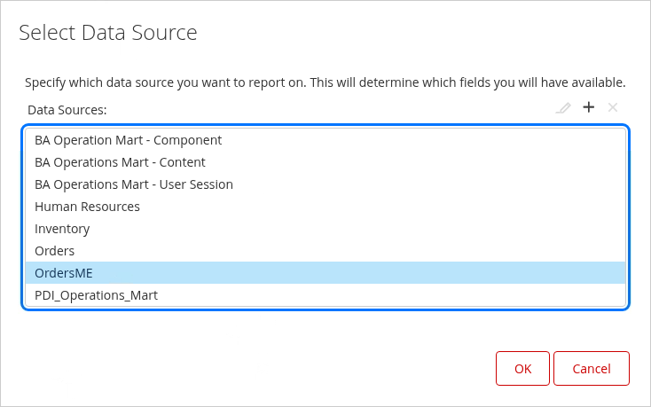
<figcaption>Your business model, listed as a data source</figcaption>
</figure>
</div>

4. On the **Data** tab, drag **PRODUCTLINE** (under **Products**) to **Groups**, then drag **PRODUCTNAME** (**Products**), **ORDERNUMBER** (**Orders**) and **TOTALPRICE** (**Measures**) to **Columns**.

<div align="center">
<figure>
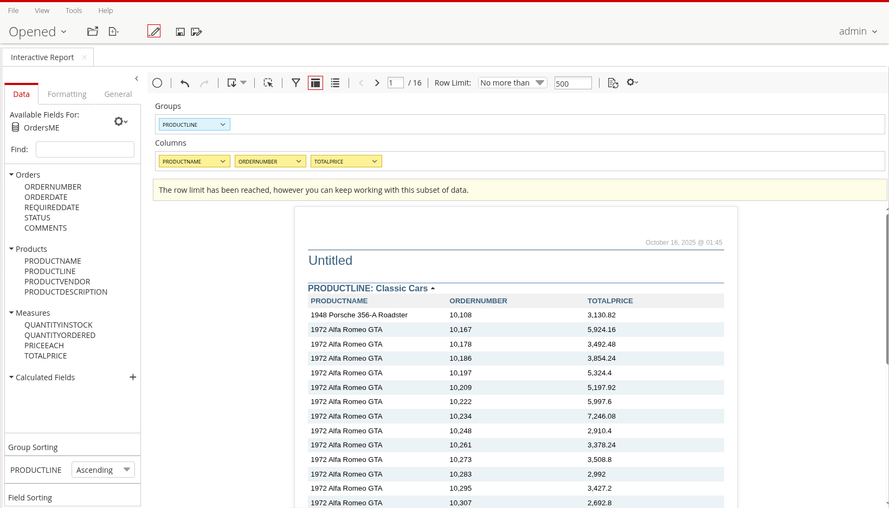
<figcaption>The test report, grouped by product line</figcaption>
</figure>
</div>

> **Success:** Checkpoint: the **Data** tab lists your three categories, **Orders**, **Products** and **Measures**, with your columns. The report groups the rows by **PRODUCTLINE**, starting with **Classic Cars**, under the message *The row limit has been reached, however you can keep working with this subset of data.* **Row Limit** is **No more than** `500`.

5. Close the **Interactive Report** tab. You don't need to save the report.

> **Under the hood:**
>
> #### What the test report sent
>
> None of the report's columns has an aggregation, so the engine writes
> SELECT DISTINCT over the three tables: 2,996 rows on SampleData, one
> per order line. Interactive Reports shows the first 500 while you
> design (design-query-limit in its settings.xml; query-limit, 10,000,
> applies when the report is viewed), which is the row-limit message in
> the screenshot. The PRODUCTLINE grouping is drawn by the report; it is
> not a GROUP BY.
>
> DISTINCT also means two identical rows would show once. That is
> harmless here, where order number and product make every row unique,
> but worth remembering when a report leaves out the column that tells
> rows apart.
>
> **Why it matters:** the row-limit message is a design-time limit, not
> lost data, and DISTINCT is the engine's choice, not yours: knowing both
> lets you tell a model fault from a report setting.

::::

## Lab Files

Click a file to download. Every file is also on disk in this workshop's folder, `C:\Workshop-ME-Practitioner\02-domains-models\04-domains-and-models-ordersme`: load a domain into Metadata Editor with **File > Import from XMI File**.

### Solution <!-- no-step -->

The finished OrdersME domain, with the `hsqldb:sampledata` connection of part 1. Open it in Metadata Editor alongside your own to compare, or publish it to see the expected result.

Also on disk at `C:\Workshop-ME-Practitioner\02-domains-models\04-domains-and-models-ordersme\solution`.

[OrdersME.xmi](./files/solution/OrdersME.xmi)
