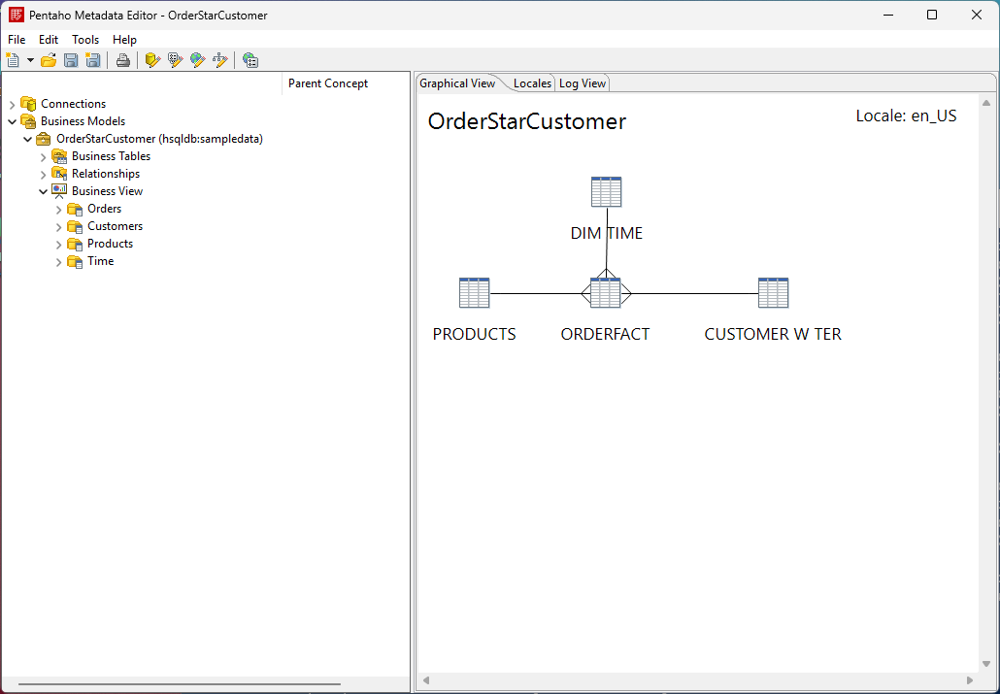
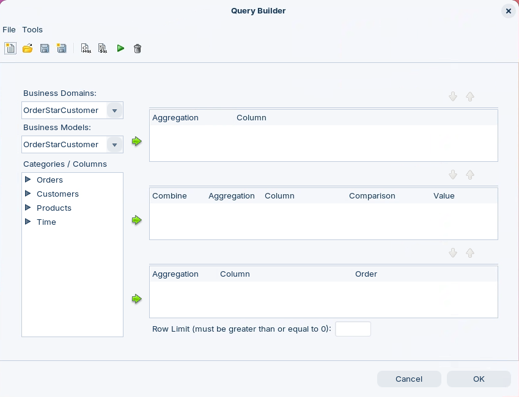
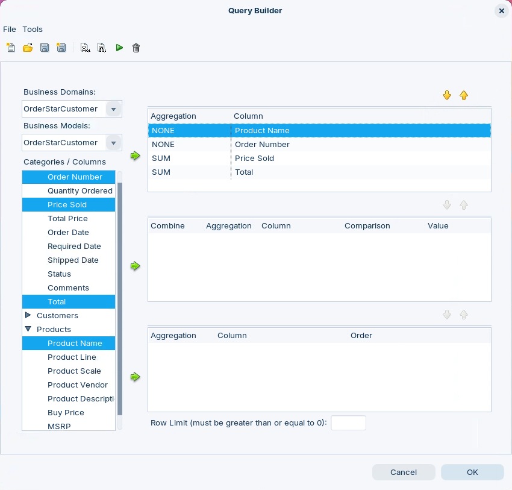
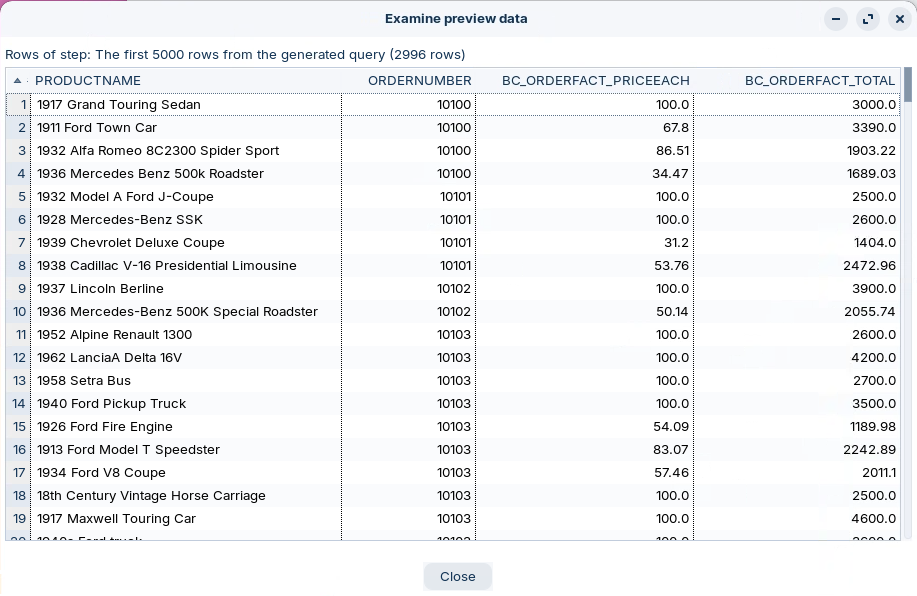
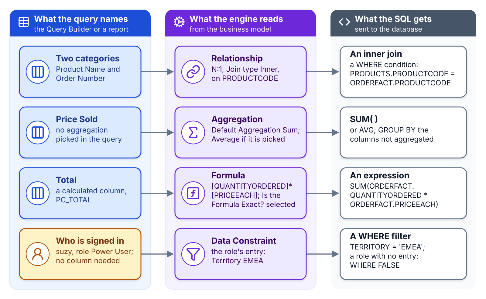

# Query Builder

> **Warning:**
>
> #### Workshop - Query Builder
>
> Test a domain before you publish it. The Metadata Editor's Query Builder runs a query against a business model, the way a report would, and shows the rows that come back, so you can check the relationships, aggregations and formulas without leaving the editor.
>
> **What you'll do**
>
> * Import the OrderStarCustomer domain
> * Open the Query Builder on its business model
> * Select business columns from two categories
> * Run the query and read the preview data
> * See how a default aggregation changes the result
>
> **Prerequisites:**
>
> * `OrderStarCustomer.xmi`, in this workshop's folder and under **Lab Files** below. You build this domain yourself in the [OrderStarCustomer](../07-properties-orderstarcustomer/guide.md) workshop.
> * The Pentaho Server running, for its HSQLDB sample data (see [Before You Start](../00-before-you-start/guide.md))
>
> **Estimated time:** 15 minutes

<figure>

<figcaption class="pcm-video-caption">Walkthrough: coming soon</figcaption>

</figure>

:::: tabs

### 1. Open the Domain

> **Note:**
>
> #### Open the Domain
>
> The Query Builder works on the domain open in the editor. Import OrderStarCustomer, the star-schema domain this workshop queries.

1. Start the Metadata Editor with the **Open Metadata Editor** button below, or from PowerShell:

```powershell
Set-Location C:\Pentaho\design-tools\metadata-editor
.\metadata-editor.bat
```

<button data-launch="metadata-editor">Open Metadata Editor</button>

2. Select **File > Import from XMI File** (`Ctrl+I`) and open `OrderStarCustomer.xmi` from `C:\Workshop-ME-Practitioner\02-domains-models\05-domains-and-models-query-builder`, or download it from **Lab Files** below.
3. In the **Save Model** dialog, enter `OrderStarCustomer` and select **OK**.

<div align="center">
<figure>

<figcaption>The imported model and its four categories</figcaption>
</figure>
</div>

> **Success:** Checkpoint: **Business Models** shows the **OrderStarCustomer** model, whose **Business View** holds four categories: **Orders**, **Customers**, **Products** and **Time**.

### 2. Build and Run a Query

> **Note:**
>
> #### The Query Builder
>
> The Query Builder lists the business model's categories and columns, as a report user sees them. The columns you select go to the top pane, conditions to the middle one and sort orders to the bottom one.

1. Select the **Query Editor** button on the toolbar, . The **Query Builder** dialog opens.

<div align="center">
<figure>

<figcaption>The Query Builder on the OrderStarCustomer model</figcaption>
</figure>
</div>

> **Success:** Checkpoint: **Business Domains** and **Business Models** both show `OrderStarCustomer`, and **Categories / Columns** lists **Orders**, **Customers**, **Products** and **Time**.

2. Under **Categories / Columns**, expand **Orders** and **Products**.
3. Hold `Ctrl` and select **Order Number**, **Price Sold** and **Total** under **Orders**, and **Product Name** under **Products**.
4. Select the top green arrow. The four columns move to the top pane.

<div align="center">
<figure>

<figcaption>Four columns selected, two of them aggregated</figcaption>
</figure>
</div>

> **Success:** Checkpoint: the top pane lists each column with its **Aggregation**:
>
> | Aggregation | Column |
> | --- | --- |
> | NONE | Product Name |
> | NONE | Order Number |
> | SUM | Price Sold |
> | SUM | Total |

5. Select **Execute Query**, the green triangle on the Query Builder's toolbar. The **Examine preview data** dialog opens.

<div align="center">
<figure>

<figcaption>The rows the query returned</figcaption>
</figure>
</div>

> **Success:** Checkpoint: the dialog reads **The first 5000 rows from the generated query (2996 rows)**: one row per order line. The columns are **PRODUCTNAME**, **ORDERNUMBER**, **BC_ORDERFACT_PRICEEACH** and **BC_ORDERFACT_TOTAL**. Order `10100` has four lines; one is `1917 Grand Touring Sedan`, with `100.0` and `3000.0`.

6. Select **Close**.

> **Under the hood:**
>
> #### Price Sold arrives summed
>
> Price Sold and Total have a default aggregation of Sum, so the engine
> writes SUM around each and groups by the other two columns, Product
> Name and Order Number. Each order line is its own group here, so the
> sum is just the line's price, and the query returns all 2,996 lines.
> Ask for Order Number and Price Sold alone and the lines of each order
> collapse into one row: order 10103's Price Sold becomes 1,417.54, the
> sum of its 16 unit prices, a number with no meaning.
>
> A default aggregation is a modeling decision. Sum suits amounts such
> as Total; a unit price wants Average (88.60 for that order) or none.
>
> **Why it matters:** a query that looks right with every detail column
> selected can go wrong when a report drops one. Test the model with the
> few columns a summary report would use, not only with all of them.

<div align="center">
<figure>

<figcaption>What the engine writes for each part of a query</figcaption>
</figure>
</div>

Read the diagram row by row, left to right. The left column is what a query names: the columns you selected here, or the ones a user drags into an Interactive Report. The middle column is what the engine finds in the business model for them, and the right column is the part of the SQL it writes. Product Name and Order Number come from tables joined by an N:1 inner relationship, so the SQL gets a WHERE condition on the product code; Price Sold's default aggregation becomes SUM, or AVG when a report picks Average; and Total's formula, marked exact, becomes an expression. The last row names no column at all: once a model has row-level security, as in the [Row-Level Security](../11-security-and-data-access-row-level-security/guide.md) workshop, the signed-in user's role picks a Data Constraint entry, and that entry becomes a WHERE filter.

7. Select **OK** to close the Query Builder.

> **Note:** In Report Designer's Metadata Data Source Editor (not this Query Builder), you define a parameter by writing its name in curly brackets, `{Parameter Name}` for example. The name must match a parameter you created in the report. The **Default** value column is used only to preview data in the Metadata Data Source Editor.

::::

## Lab Files

Click a file to download. Every file is also on disk in this workshop's folder, `C:\Workshop-ME-Practitioner\02-domains-models\05-domains-and-models-query-builder`: load a domain into Metadata Editor with **File > Import from XMI File**.

The domain this workshop queries, the finished domain of the [OrderStarCustomer](../07-properties-orderstarcustomer/guide.md) workshop:

[OrderStarCustomer.xmi](./files/OrderStarCustomer.xmi)
