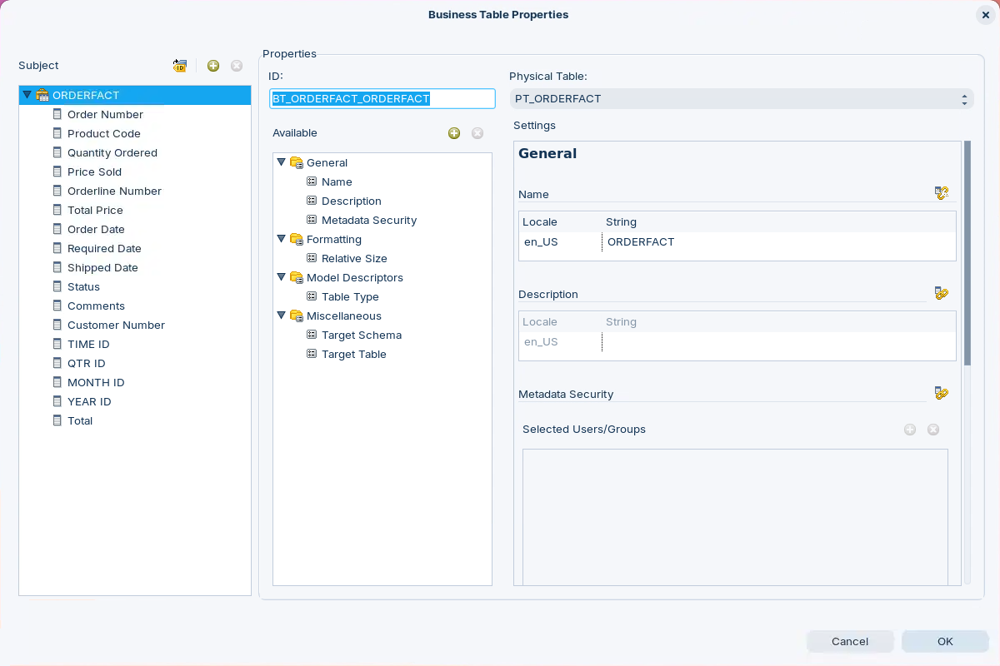
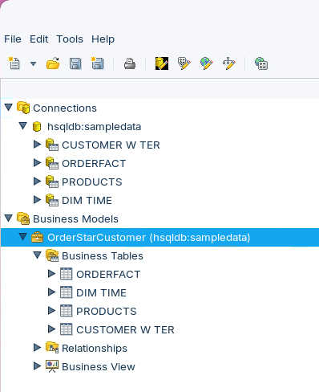
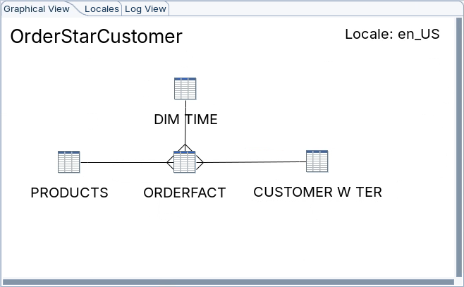
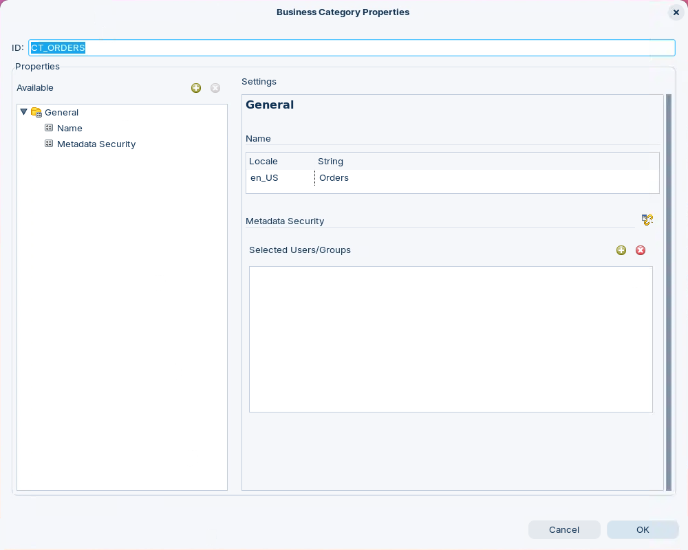
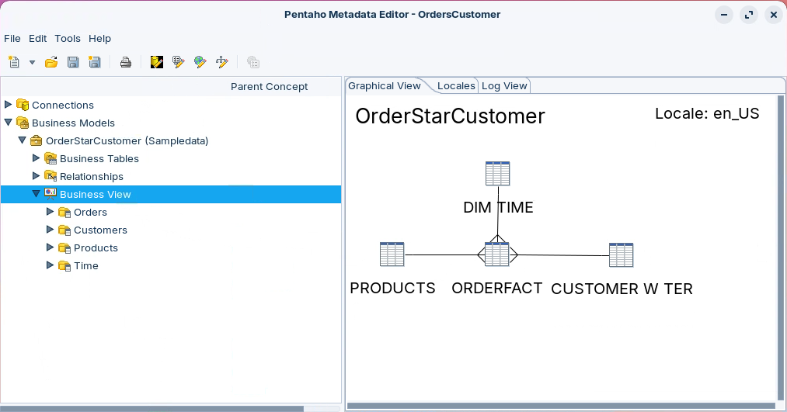

# OrderStarCustomer

> **Warning:**
>
> #### Workshop - OrderStarCustomer
>
> Build OrderStarCustomer, the star-schema domain the next workshops refine, and give it the properties that make it usable: business names, a default aggregation, a date type, and two calculated columns defined with formulas.
>
> **What you'll do**
>
> * Create a domain with a connection and four physical tables
> * Build the OrderStarCustomer business model and its three N:1 relationships
> * Override business column names, an aggregation and a data type
> * Add two calculated columns with formulas: a total and a contact name
> * Group the columns into four categories: Orders, Customers, Products and Time
>
> **Prerequisites:**
>
> * The [OrdersME](../04-domains-and-models-ordersme/guide.md) workshop
> * The Pentaho Server running, for its HSQLDB sample data (see [Before You Start](../00-before-you-start/guide.md))
>
> **Estimated time:** 45 minutes

<div align="center">
<figure>

<figcaption>What you build: business columns with business names, and a calculated Total</figcaption>
</figure>
</div>

:::: tabs

### 1. Connection & Tables

> **Note:**
>
> #### Define a Domain and a Connection
>
> Create the domain, connect it to the HSQLDB sample data that runs with the Pentaho Server, and import the four tables of the star schema: `ORDERFACT`, the fact table of order lines, and three dimensions, `PRODUCTS`, `CUSTOMER_W_TER` and `DIM_TIME`.

1. Start the Metadata Editor with the **Open Metadata Editor** button below, or from a terminal:

::: tabs

### Windows (PowerShell)

```powershell
Set-Location C:\Pentaho\design-tools\metadata-editor
.\metadata-editor.bat
```

### macOS / Linux

```bash
cd ~/Pentaho/design-tools/metadata-editor
./metadata-editor.sh
```

:::

<button data-launch="metadata-editor">Open Metadata Editor</button>

2. Make sure the Pentaho Server is running: the HSQLDB sample data runs with it. On a lab VM it is already running. On your own machine, start it:

::: tabs

### Windows (PowerShell)

```powershell
Set-Location C:\Pentaho\server\pentaho-server
.\start-pentaho.bat
```

### macOS / Linux

```bash
cd ~/Pentaho/server/pentaho-server
./start-pentaho.sh
```

:::

3. Select **File > New > Domain File**.
4. Right-click **Connections** and select **New Connection**.
5. In the **Database Connection** dialog, set:

| Setting | Value |
| --- | --- |
| **Connection name** | `hsqldb:sampledata` |
| **Connection type** | Hypersonic |
| **Access** | Native (JDBC) |
| **Host Name** | `localhost` |
| **Database Name** | `sampledata` |
| **Port Number** | `9001` |
| **Username** | `pentaho_admin` |
| **Password** | `password` |

6. Select **Test**.

> **Success:** Checkpoint: a message says the connection to `hsqldb:sampledata` was successful, followed by its host name, port and database name.

7. Select **OK** to close the message, then select **OK** to close **Database Connection**. The **Import Tables** dialog opens. If it doesn't, right-click **hsqldb:sampledata** and select **Import Tables**.
8. Hold `Ctrl` and select `PRODUCTS`, `ORDERFACT`, `DIM_TIME` and `CUSTOMER_W_TER`.
9. Select **OK**.
10. Expand **Connections > hsqldb:sampledata**.

> **Success:** Checkpoint: four physical tables, **CUSTOMER W TER**, **ORDERFACT**, **PRODUCTS** and **DIM TIME**. The editor shows each table by its **Name** property, the table name with spaces for underscores.

### 2. Business Model

> **Note:**
>
> #### Business Model and Business Tables
>
> The business model connects the physical tables to the names report users see, and holds the relationships that let the engine generate joins. You add each business table by dragging its physical table into the model.

1. Right-click **Business Models** and select **New Business Model**.
2. In the **Business Model Properties** dialog, keep the **ID**, `BV_MODEL_1`. The engine refers to the model by this ID when it generates SQL, so don't change it.
3. Under **Settings**, click in the **String** cell of the `en_US` row under **Name** and enter `OrderStarCustomer`.
4. Set **Connection** to `hsqldb:sampledata`.
5. Select **OK**.
6. Expand **Business Models > OrderStarCustomer (hsqldb:sampledata)**.
7. Drag **PRODUCTS** from **Connections > hsqldb:sampledata** onto **Business Tables**. Drag one table at a time: the tree doesn't accept a group.
8. The **Business Table Properties** dialog opens.

> **Success:** Checkpoint: **ID** is `BT_PRODUCTS_PRODUCTS` and **Physical Table** is `PT_PRODUCTS`. You could remove columns from the business table here; this workshop keeps them all.

9. Select **OK**.
10. Repeat steps 7 to 9 for **ORDERFACT**, **DIM TIME** and **CUSTOMER W TER**.

<div align="center">
<figure>

<figcaption>Four business tables in the model</figcaption>
</figure>
</div>

> **Success:** Checkpoint: **Business Tables** holds **ORDERFACT**, **DIM TIME**, **PRODUCTS** and **CUSTOMER W TER**.

11. Save the domain (`Ctrl+S`). In the **Save Domain** dialog, enter `OrderStarCustomer` and select **OK**. If you imported the Lab Files copy in the [Query Builder](../05-domains-and-models-query-builder/guide.md) workshop, the editor says the model already exists: confirm to overwrite it.

### 3. Relationships

> **Note:**
>
> #### Relationships
>
> A relationship links a column in one table to a column in another, usually a foreign key to a primary key. In this star schema each dimension row relates to many fact rows, so every relationship runs from `ORDERFACT` to a dimension as many to one (N:1). A well-structured data warehouse rarely needs a complex join with several keys.

1. Under **OrderStarCustomer**, right-click **Relationships** and select **New Relationship**.
2. In the **Relationship Properties** dialog, set:

| Setting | Value |
| --- | --- |
| **From Table / Field** | `BT_ORDERFACT_ORDERFACT`, `BC_ORDERFACT_CUSTOMERNUMBER` |
| **To Table / Field** | `BT_CUSTOMER_W_TER_CUSTOMER_W_TER`, `BC_CUSTOMER_W_TER_CUSTOMERNUMBER` |
| **Relationship** | N:1 |
| **Join type** | Inner |

**Guess Matching Fields** fills in the two fields when the column names match. Leave the other settings as they are.

3. Select **OK**. A line joins the two tables on the **Graphical View**.
4. Create the other two relationships the same way:

| From Table / Field | To Table / Field | Relationship | Join type |
| --- | --- | --- | --- |
| `BT_ORDERFACT_ORDERFACT`, `BC_ORDERFACT_PRODUCTCODE` | `BT_PRODUCTS_PRODUCTS`, `BC_PRODUCTS_PRODUCTCODE` | N:1 | Inner |
| `BT_ORDERFACT_ORDERFACT`, `BC_ORDERFACT_TIME_ID` | `BT_DIM_TIME_DIM_TIME`, `BC_DIM_TIME_TIME_ID` | N:1 | Inner |

<div align="center">
<figure>

<figcaption>Three N:1 relationships from ORDERFACT</figcaption>
</figure>
</div>

> **Success:** Checkpoint: **Relationships** lists three relationships, and the **Graphical View** draws **ORDERFACT** joined to **DIM TIME**, **PRODUCTS** and **CUSTOMER W TER**, with the many end of each line at **ORDERFACT**.

5. Save the domain (`Ctrl+S`).

> **Under the hood:**
>
> #### The join comes from the relationship type
>
> In the engine, N:1, 1:N, 1:1 and N:N all become inner joins, written
> as WHERE conditions, while a type with a 0 side becomes an outer join
> (0:N or 0:1 left outer, N:0 or 1:0 right outer). An inner join drops
> any ORDERFACT row whose customer, product or time key has no match; on
> SampleData all 2,996 fact rows match all three, so nothing is lost.
>
> **Why it matters:** if a dimension could be missing a key, an inner
> join hides those fact rows without a warning. Choose a 0 side when
> every fact row must count.

### 4. Names

> **Note:**
>
> #### Override the Names
>
> A business column inherits its properties from its physical column, including its **Name**, which the import set from the database column name. Override the **Name** on each business column to give report users a business name. The physical column keeps its own.

1. Under **Business Tables**, right-click **PRODUCTS** and select **Edit**.
2. In the **Business Table Properties** dialog, select **PRODUCTCODE** in the **Subject** pane.
3. In the **Available** pane, select **General > Name**.
4. In **Settings**, select the **Override** icon to the right of **Name**.
5. Click in the **String** cell of the `en_US` row and enter `Product Code`.
6. Rename the other columns the same way. **MSRP** keeps its name.

| Column | Name |
| --- | --- |
| PRODUCTCODE | `Product Code` |
| PRODUCTNAME | `Product Name` |
| PRODUCTLINE | `Product Line` |
| PRODUCTSCALE | `Product Scale` |
| PRODUCTVENDOR | `Product Vendor` |
| PRODUCTDESCRIPTION | `Product Description` |
| QUANTITYINSTOCK | `Quantity In Stock` |
| BUYPRICE | `Buy Price` |

7. Select **OK**, then save the domain (`Ctrl+S`).
8. Right-click **ORDERFACT**, select **Edit**, and rename these columns the same way. **PRICEEACH** gets its name in part 5; **TIME ID**, **QTR ID**, **MONTH ID** and **YEAR ID** keep theirs.

| Column | Name |
| --- | --- |
| ORDERNUMBER | `Order Number` |
| PRODUCTCODE | `Product Code` |
| QUANTITYORDERED | `Quantity Ordered` |
| ORDERLINENUMBER | `Orderline Number` |
| TOTALPRICE | `Total Price` |
| ORDERDATE | `Order Date` |
| REQUIREDDATE | `Required Date` |
| SHIPPEDDATE | `Shipped Date` |
| STATUS | `Status` |
| COMMENTS | `Comments` |
| CUSTOMERNUMBER | `Customer Number` |

9. Select **OK**, then save the domain (`Ctrl+S`).
10. Right-click **DIM TIME**, select **Edit**, and rename these columns. **MONTH ID** and **QTR ID** keep their names.

| Column | Name |
| --- | --- |
| TIME ID | `Time ID` |
| YEAR ID | `Year ID` |
| MONTH NAME | `Month Name` |
| MONTH DESC | `Month Description` |
| QTR NAME | `Qtr Name` |
| QTR DESC | `Qtr Description` |

11. Select **OK**, then save the domain (`Ctrl+S`).
12. Right-click **CUSTOMER W TER**, select **Edit**, and rename every column:

| Column | Name |
| --- | --- |
| CUSTOMERNUMBER | `Customer Number` |
| CUSTOMERNAME | `Customer Name` |
| CONTACTLASTNAME | `Contact Last Name` |
| CONTACTFIRSTNAME | `Contact First Name` |
| PHONE | `Phone` |
| ADDRESSLINE1 | `Address Line 1` |
| ADDRESSLINE2 | `Address Line 2` |
| CITY | `City` |
| STATE | `State` |
| POSTALCODE | `Postal Code` |
| COUNTRY | `Country` |
| EMPLOYEENUMBER | `Employee Number` |
| CREDITLIMIT | `Credit Limit` |
| TERRITORY | `Territory` |
| TERRITORY COLOR | `Territory Color` |

13. Select **OK**, then save the domain (`Ctrl+S`).

> **Success:** Checkpoint: expand a business table in the tree and its columns show the new names. The physical tables under **Connections** still show the database names, such as **PRODUCTCODE**.

### 5. Aggregation & Data Type

> **Note:**
>
> #### Model Descriptors
>
> The **Model Descriptors** properties control the SQL: **Default Aggregation** is the function the engine wraps around a column, **Optional Aggregations** are the ones a report may choose instead, and **Data Type** decides how the reporting tool treats the value.

1. Right-click **ORDERFACT** and select **Edit**.
2. Select **PRICEEACH** in the **Subject** pane, then override its **General > Name** with `Price Sold`, as in part 4.
3. In the **Available** pane, select **Model Descriptors > Default Aggregation**, select its **Override** icon in **Settings**, and set **Aggregation Type** to `Sum`. After **Override**, **Settings** can jump back to the top: select **Default Aggregation** again to scroll to it.
4. Select **Model Descriptors > Optional Aggregations**, select its **Override** icon, and in **Aggregation List** hold `Ctrl` and select `Average`, `Minimum` and `Maximum`.
5. Select **Order Date** in the **Subject** pane.
6. Select **Model Descriptors > Data Type**, select its **Override** icon, and set **Data Type** to `Date`.
7. Select **OK**, then save the domain (`Ctrl+S`).

> **Note:** Order Date needs the Date type for a date mask to format it, which you apply with a concept in the [Concept Editor](../09-concepts-concept-editor/guide.md) workshop. The other two dates keep the type the import gave them, so you can compare the two there.

8. Right-click **ORDERFACT**, select **Edit**, select **Price Sold** in the **Subject** pane, and select **Model Descriptors > Default Aggregation**.

> **Success:** Checkpoint: **Aggregation Type** is `Sum`, and under **Optional Aggregations** the **Aggregation List** has `Average`, `Minimum` and `Maximum` selected.

9. Select **Cancel**.

> **Under the hood:**
>
> #### Default aggregation is SQL; optional aggregations are a menu
>
> Sum becomes SUM() around the column in every query that uses Price
> Sold without choosing otherwise; workshop 05 shows the SQL. Average,
> Minimum and Maximum are only offered: when a report picks one, the
> engine writes AVG, MIN or MAX instead.
>
> **Why it matters:** the default is what every report gets unless its
> author changes it, so it has to be right for the column: Sum for an
> amount, never for a unit price.

### 6. Calculated Columns

> **Note:**
>
> #### Calculated Columns and Formulas
>
> A formula can define a column that the database doesn't store, by combining columns that it does. Pentaho reads formulas in OpenFormula syntax, through the reporting engine's libFormula, and converts them into SQL for the database. Formulas also define constraints in queries, multi-key joins and row-level security.

<div class="pcm-embed-card" data-href="https://www.loom.com/share/91b0ceedd4ef475f933ff31d4627bc91?hideEmbedTopBar=true&amp;hide_share=true&amp;hide_title=true&amp;sid=8b7b1cee-9d53-48e8-9df6-c88d1ec7f531?hide_owner=true" data-title="Building a Data Model: Adding Calculated Values and Formulas" data-description="In this video, I walk you through the process of adding calculated values at the metadata level in our data model, specifically how to calculate the total by multiplying the quantity ordered by the price each. I demonstrate how to add a new column for this calculation in the order fact table and ensure it has the correct properties, including setting the default aggregation to Sum. After adding the total column to the physical layer, I show you how to bring it into the business layer for user access. Please make sure to follow along and replicate these steps in your own models, as we will build on this in the next demonstrations." data-thumb="../_assets/embeds/125979ecbc12.png"></div>

1. Under **Connections > hsqldb:sampledata**, right-click **ORDERFACT** and select **Edit**.
2. In the **Physical Table Properties** dialog, select **Add New Column**, the green plus icon to the right of **Subject**.
3. In the **New Column** dialog, enter `PC_TOTAL` and select **OK**. The editor names the column from its ID: **Total** appears in the **Subject** pane.
4. With **Total** selected, set these properties. Select each one in the **Available** pane to scroll **Settings** to it.

| Property | Setting |
| --- | --- |
| **Model Descriptors > Default Aggregation** | **Aggregation Type** `Sum` |
| **Model Descriptors > Optional Aggregations** | **Aggregation List** `Average`, `Minimum` and `Maximum` (hold `Ctrl`) |
| **Model Descriptors > Data Type** | **Data Type** `Numeric` |
| **Calculation > Formula** | **Value** `[QUANTITYORDERED]*[PRICEEACH]` |
| **Calculation > Is the Formula Exact?** | Selected |

5. Select **OK**.

> **Under the hood:**
>
> #### Is the Formula Exact? tells the engine it is a formula
>
> With the box selected, the engine parses [QUANTITYORDERED]*[PRICEEACH]
> as OpenFormula and translates it, so Total is generated as
> SUM(ORDERFACT.QUANTITYORDERED * ORDERFACT.PRICEEACH). Left cleared,
> the text is taken as a column name, which is what every imported
> column's formula is: QUANTITYORDERED, PRICEEACH and the rest.
>
> **Why it matters:** forget the check box and the database is asked for
> a column called `[QUANTITYORDERED]*[PRICEEACH]`, which it doesn't
> have.

6. Under **Business Models > OrderStarCustomer > Business Tables**, right-click **ORDERFACT** and select **Edit**.
7. In the **Business Table Properties** dialog, select **Add New Column** (the green plus icon to the right of **Subject**). In the list of physical columns that opens, select **Total** and select **OK**.
8. Select **OK**, then save the domain (`Ctrl+S`).

> **Success:** Checkpoint: the **ORDERFACT** business table ends with a **Total** column, as in the figure at the top of this page.

9. Under **Connections > hsqldb:sampledata**, right-click **CUSTOMER W TER** and select **Edit**.
10. Select **Add New Column**, enter `PC_CONTACT` in the **New Column** dialog, and select **OK**. The new column is named **Contact**.
11. With **Contact** selected, set:

| Property | Setting |
| --- | --- |
| **General > Name** | **String** `Contact Name` |
| **Calculation > Formula** | **Value** `[CONTACTLASTNAME]+", "+[CONTACTFIRSTNAME]` |
| **Calculation > Is the Formula Exact?** | Selected |

12. Select **OK**.
13. Under **Business Tables**, right-click **CUSTOMER W TER**, select **Edit**, select **Add New Column**, select **Contact Name**, and select **OK**.
14. Select **OK**, then save the domain (`Ctrl+S`).

> **Under the hood:**
>
> #### + goes to the database as written
>
> The engine passes + straight through: Contact Name becomes
> (CONTACTLASTNAME + ', ' + CONTACTFIRSTNAME) in the SQL. Hypersonic,
> which this domain uses, concatenates strings with +, giving "Ferguson,
> Peter". The same formula against MySQL would be generated identically,
> and MySQL treats + as numeric addition.
>
> OpenFormula's own string operator, &, doesn't help: the SQL translator
> rejects it (SqlOpenFormula.ERROR_0021, "The operator & is not
> supported"). A formula like this is tied to its database.
>
> **Why it matters:** a domain that moves to another database needs its
> formulas checked, not only its connection. The [Capstone](../12-capstone-trailhead-outfitters/guide.md) writes this one for MySQL.

### 7. Business View

> **Note:**
>
> #### Business View
>
> Group the business columns into four categories that report users will recognize: Orders, Customers, Products and Time.

1. Under **OrderStarCustomer**, right-click **Business View** and select **New Category**.
2. In the **Business Category Properties** dialog, set **ID** to `CT_ORDERS`.
3. Click in the **String** cell of the `en_US` row under **Name** and enter `Orders`.

<div align="center">
<figure>

<figcaption>The Orders category; you set its Metadata Security in the Row-Level Security workshop</figcaption>
</figure>
</div>

4. Select **OK**.
5. Right-click **Business View** and select **Manage Categories**.
6. Select **Add New Category** (the green plus icon above **Business View Categories**), set **ID** to `CT_CUSTOMERS` and **Name** to `Customers`, and select **OK**.
7. Create `CT_PRODUCTS` (**Name** `Products`) and `CT_TIME` (**Name** `Time`) the same way.
8. Add the columns to the categories. For each one, select the column under **Available Business Tables** (hold `Ctrl` for several), select the category under **Business View Categories**, and select **Add** (the single arrow between the panes):

| Category | From business table | Columns |
| --- | --- | --- |
| Orders | ORDERFACT | Order Number, Quantity Ordered, Price Sold, Total Price, Order Date, Required Date, Shipped Date, Status, Comments, Total |
| Customers | CUSTOMER W TER | Customer Number, Customer Name, Phone, Address Line 1, Address Line 2, City, State, Postal Code, Country, Employee Number, Credit Limit, Territory, Contact Name |
| Products | PRODUCTS | Product Code, Product Name, Product Line, Product Scale, Product Vendor, Product Description, Buy Price, MSRP |
| Time | DIM TIME | Time ID, Year ID, Month Name, Month Description, Qtr Name, Qtr Description |

9. Select **Close**.

<div align="center">
<figure>

<figcaption>The finished business view</figcaption>
</figure>
</div>

> **Success:** Checkpoint: **Business View** holds four categories: **Orders** with 10 columns, **Customers** with 13, **Products** with 8 and **Time** with 6.

10. Save the domain (`Ctrl+S`) and leave the Metadata Editor open. You publish the domain after the [Concept Editor](../09-concepts-concept-editor/guide.md) workshop adds its formatting.

::::

## Lab Files

Click a file to download it.

### Solution <!-- no-step -->

The finished OrderStarCustomer domain, before the Concept Editor workshop adds concepts. Load it with **File > Import from XMI File**.

[OrderStarCustomer.xmi](../_assets/files/OrderStarCustomer.xmi)
