# Concept Editor

> **Warning:**
>
> #### Workshop - Concept Editor
>
> Define formatting once and reuse it. You create five concepts in the Concept Editor, a hierarchy of number, currency, ID, hidden and date formats, apply them to the OrderStarCustomer business columns, publish the domain, and check the result in an Interactive Report.
>
> **What you'll do**
>
> * Create the concepts Number, USCurrency, ID, Hidden and Date, each inheriting from its parent
> * Give them masks, a text alignment and the **Hidden For the User?** flag
> * Set the parent concept of business columns in the Orders, Customers and Products categories
> * Publish the domain to the Pentaho Server
> * Check the formatting, and the hidden column, in an Interactive Report
>
> **Prerequisites:**
>
> * The [OrderStarCustomer](../07-properties-orderstarcustomer/guide.md) workshop, or `OrderStarCustomer.xmi` from **Lab Files** below
> * The Pentaho Server running (see [Before You Start](../00-before-you-start/guide.md))
>
> **Estimated time:** 60 minutes

<div align="center">
<figure>
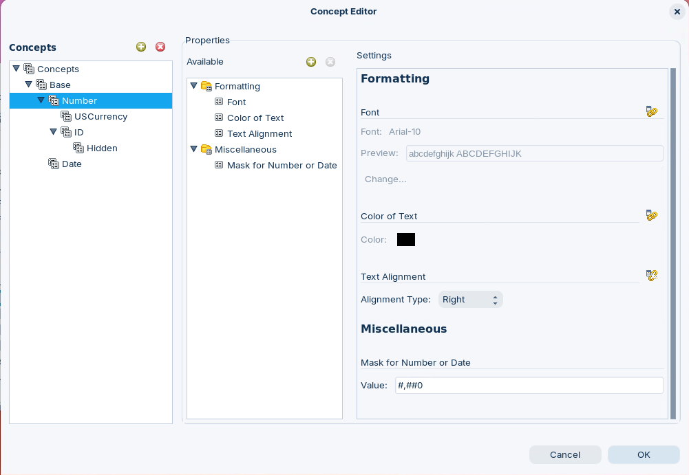
<figcaption>What you build: five concepts below Base</figcaption>
</figure>
</div>

:::: tabs

### 1. Define Concepts

> **Note:**
>
> #### Define Concepts
>
> A concept is a reusable bundle of properties. A concept starts from its parent's properties and adds or overrides its own, and every business column whose parent concept it is takes them all. A new concept's parent is the concept selected when you create it.

<div class="pcm-embed-card" data-href="https://www.loom.com/share/c53a49ad5f204a29818000b69e47f7c8?hideEmbedTopBar=true&amp;hide_share=true&amp;hide_title=true&amp;sid=c43fa08d-06b6-4b14-8658-993775337ca4?hide_owner=true" data-title="Creating and Applying Metadata Concepts for Business Objects 💻" data-description="In this video, I demonstrate how to create and apply metadata concepts for formatting business columns, specifically for numbers, currency, and dates. I walk you through accessing the Concept Editor, where I start by modifying the base concept to create a number concept with right alignment and comma formatting. Next, I create a currency concept inheriting from the number concept, adding a dollar sign and two decimal places. Finally, I establish a date concept with a specific Java date format. Please be prepared to apply these concepts to the business columns in the next demonstration." data-thumb="../_assets/embeds/125979ecbc12.png"></div>

1. Start the Metadata Editor with the **Open Metadata Editor** button below, or from a terminal:

::: tabs

### Windows (PowerShell)

```powershell
Set-Location C:\Pentaho\design-tools\metadata-editor
.\metadata-editor.bat
```

### macOS / Linux

```bash
cd ~/Pentaho/design-tools/metadata-editor
./metadata-editor.sh
```

:::

<button data-launch="metadata-editor">Open Metadata Editor</button>

2. Make sure the Pentaho Server is running: you publish to it in part 3. On a lab VM it is already running. On your own machine, start it:

::: tabs

### Windows (PowerShell)

```powershell
Set-Location C:\Pentaho\server\pentaho-server
.\start-pentaho.bat
```

### macOS / Linux

```bash
cd ~/Pentaho/server/pentaho-server
./start-pentaho.sh
```

:::

3. Select **File > Open** (`Ctrl+O`), select **OrderStarCustomer** in the **Select a Domain** dialog, and select **OK**. Starting from the Lab Files instead? Select **File > Import from XMI File** (`Ctrl+I`), open `OrderStarCustomer.xmi`, and in the **Save Model** dialog enter `OrderStarCustomer` and select **OK**.
4. Select **Tools > Concept Editor**.
5. Under **Concepts**, select **Base**, then select the green plus icon above the tree, .
6. In the **New Concept** dialog, enter `Number` and select **OK**.

<div align="center">
<figure>
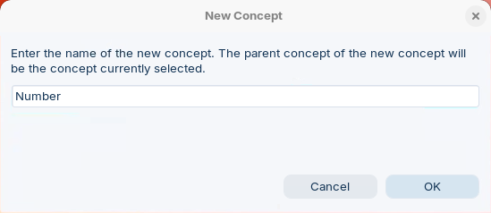
<figcaption>The new concept's parent is the selected one</figcaption>
</figure>
</div>

7. Select **Number**. To the right of **Available**, select the green plus icon. The **Add New Property** dialog opens.
8. Keep **Add a pre-defined property** selected, select **Miscellaneous > Mask for Number or Date**, and select **OK**.

<div align="center">
<figure>
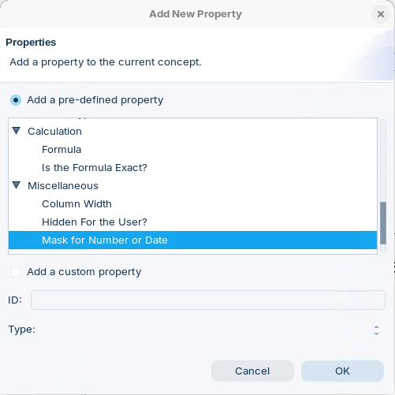
<figcaption>Add the mask property to the concept</figcaption>
</figure>
</div>

9. In the **Available** pane, select **Formatting > Text Alignment**. In **Settings**, select the **Override** icon to the right of **Text Alignment** and set **Alignment Type** to `Right`.
10. Select **Miscellaneous > Mask for Number or Date** and set **Value** to `#,##0`.

<div align="center">
<figure>
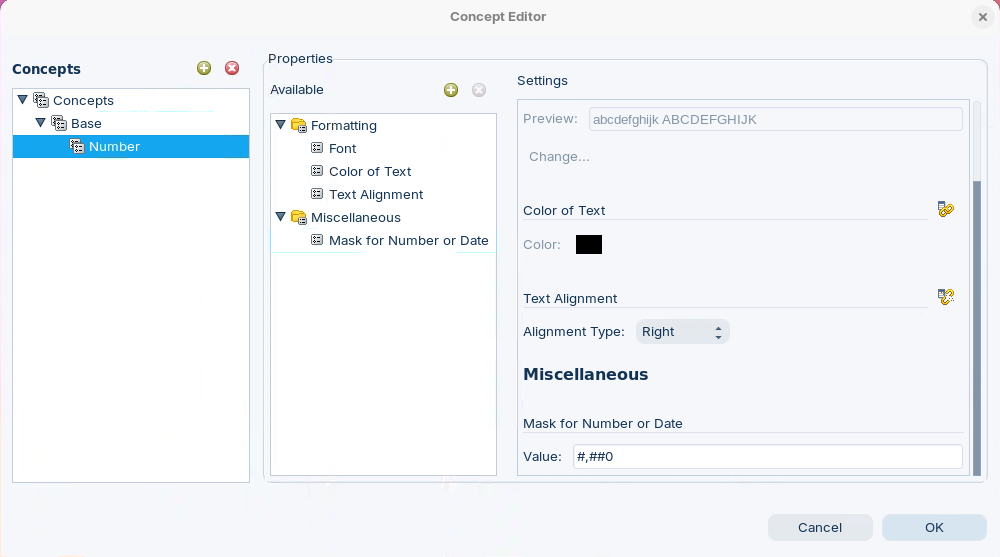
<figcaption>Number: right-aligned, with a thousands separator</figcaption>
</figure>
</div>

11. Select **Number** and select the green plus icon above **Concepts**. In **New Concept**, enter `USCurrency` and select **OK**.
12. Select **USCurrency**, then select **Miscellaneous > Mask for Number or Date**. The mask it inherited from Number is grayed out.
13. Select the **Override** icon to the right of **Mask for Number or Date** and set **Value** to `$#,##0.00;($#,##0.00)`.

<div align="center">
<figure>
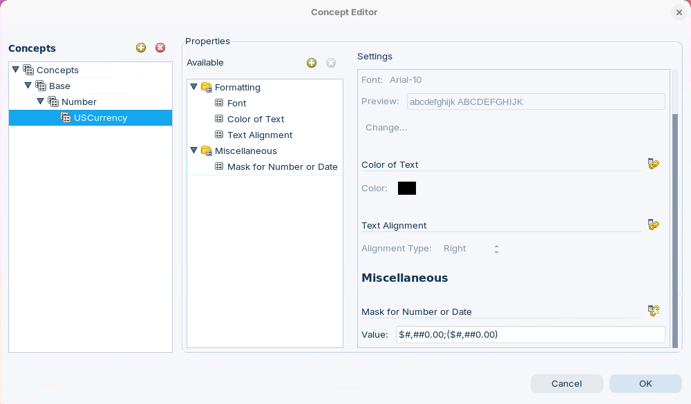
<figcaption>USCurrency overrides only the mask</figcaption>
</figure>
</div>

14. Select **Number**, create the concept `ID` the same way, override its **Mask for Number or Date**, and set **Value** to `#`.
15. Select **ID** and create the concept `Hidden`.
16. Select **Hidden** and the green plus icon to the right of **Available**. In **Add New Property**, select **Miscellaneous > Hidden For the User?** and select **OK**.

<div align="center">
<figure>
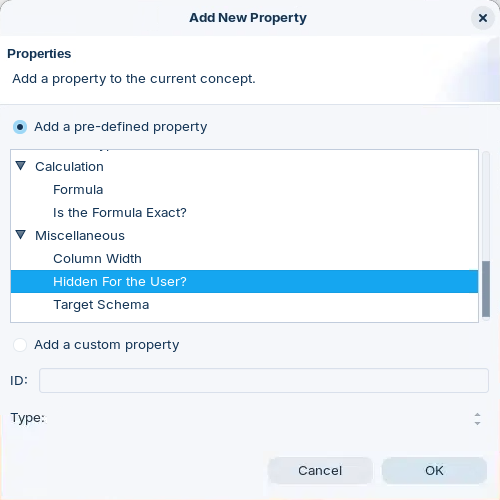
<figcaption>Add Hidden For the User? to the Hidden concept</figcaption>
</figure>
</div>

17. Select **Miscellaneous > Hidden For the User?** and select the **Hidden For the User?** check box in **Settings**.

<div align="center">
<figure>
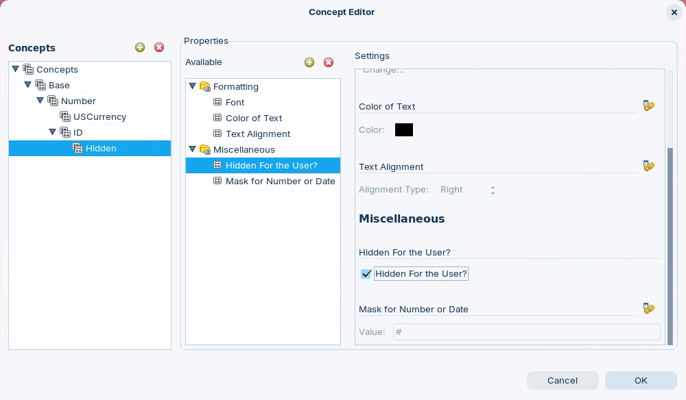
<figcaption>Hidden: inherits the ID mask and hides the column</figcaption>
</figure>
</div>

18. Select **Base** and create the concept `Date`. Add **Miscellaneous > Mask for Number or Date** to it, as in step 8, and set **Value** to `MM-dd-yyyy`.

<div align="center">
<figure>
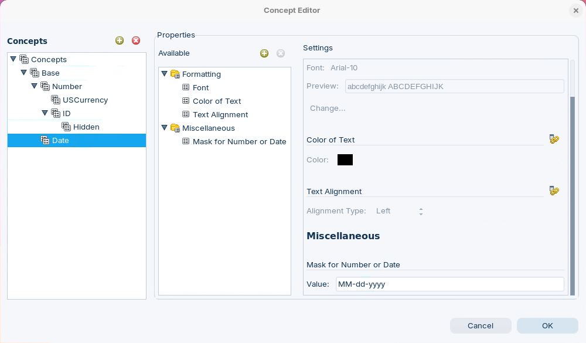
<figcaption>Date: a child of Base, not of Number</figcaption>
</figure>
</div>

> **Success:** Checkpoint: the **Concepts** tree reads **Base**, with **Number** and **Date** below it; **USCurrency** and **ID** below **Number**; and **Hidden** below **ID**. Their own settings:
>
> | Concept | Parent | Own settings |
> | --- | --- | --- |
> | Number | Base | **Text Alignment** `Right`, **Mask for Number or Date** `#,##0` |
> | USCurrency | Number | **Mask for Number or Date** `$#,##0.00;($#,##0.00)` |
> | ID | Number | **Mask for Number or Date** `#` |
> | Hidden | ID | **Hidden For the User?** selected |
> | Date | Base | **Mask for Number or Date** `MM-dd-yyyy` |

19. Select **OK** to close the Concept Editor, then save the domain (`Ctrl+S`).

> **Under the hood:**
>
> #### Concepts inherit down a chain
>
> Hidden's parent is ID, ID's is Number and Number's is Base, and the
> engine resolves a column's properties by walking that chain: each
> concept starts from its parent's properties and adds its own. A column
> whose parent concept is Hidden therefore gets the # mask from ID, the
> alignment from Number, the font from Base, and Hidden For the User?
> from Hidden itself.
>
> A column's own overrides still win over anything a concept supplies,
> and a concept's properties win over what the column inherits from its
> physical column.
>
> **Why it matters:** change a mask on Number and every column under
> Number, USCurrency, ID and Hidden follows, unless it overrides that
> property itself.

### 2. Apply Concepts

> **Note:**
>
> #### Apply Concepts
>
> Set a business column's parent concept from the business view: right-click the column and select **Set Parent Concept**. The column then shows its concept in the tree's **Parent Concept** column.

<div class="pcm-embed-card" data-href="https://www.loom.com/share/c076e434bfad4b5e9c63e7bf2dca9ca2?hideEmbedTopBar=true&amp;hide_share=true&amp;hide_title=true&amp;sid=a323e4f4-9cf0-4441-8e64-2ed8174abbbe?hide_owner=true" data-title="Applying Concepts to Business Columns in Data Management" data-description="In this demonstration, I applied concepts for numbers, currency, and dates to various business columns. I assigned the number concept to the quantity ordered, the currency concept to the price sold and total price columns, and the date concept to the order date. I also applied the currency concept to the total column. The remaining columns utilize the base concept, and I am now finished with applying concepts. In the next demonstration, I will use the query editor to test this metadata domain, so please stay tuned for that." data-thumb="../_assets/embeds/125979ecbc12.png"></div>

1. Expand **Business Models > OrderStarCustomer > Business View > Orders**.
2. Right-click **Order Number** and select **Set Parent Concept**.

<div align="center">
<figure>
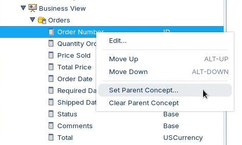
<figcaption>Set Parent Concept, on a column's context menu</figcaption>
</figure>
</div>

3. In the **Select a Parent Concept** dialog, select **ID** and select **OK**.

<div align="center">
<figure>
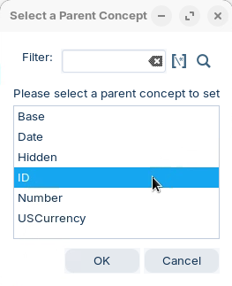
<figcaption>Pick the concept</figcaption>
</figure>
</div>

4. Set the parent concept of these columns the same way:

| Category | Column | Parent concept |
| --- | --- | --- |
| Orders | Quantity Ordered | Number |
| Orders | Price Sold | USCurrency |
| Orders | Total Price | USCurrency |
| Orders | Order Date | Date |
| Orders | Required Date | Date |
| Orders | Shipped Date | Date |
| Orders | Total | USCurrency |
| Customers | Employee Number | Hidden |
| Products | Buy Price | USCurrency |
| Products | MSRP | USCurrency |

Every other column keeps **Base**.

<div align="center">
<figure>
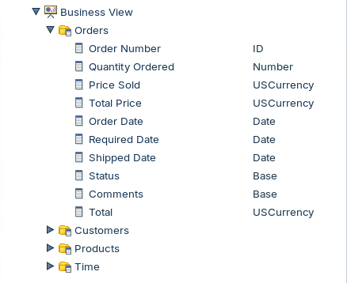
<figcaption>The Orders category's concepts</figcaption>
</figure>
</div>

> **Success:** Checkpoint: in **Orders**, only **Status** and **Comments** still show **Base**. In **Customers**, **Employee Number** shows **Hidden**; in **Products**, **Buy Price** and **MSRP** show **USCurrency**.

<div align="center">
<figure>
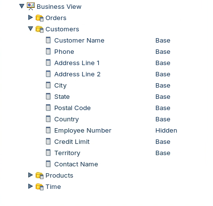
<figcaption>Customers: Employee Number is hidden</figcaption>
</figure>
</div>

<div align="center">
<figure>
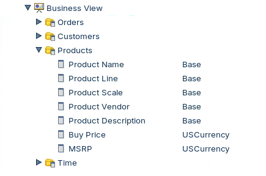
<figcaption>Products: the two prices are currency</figcaption>
</figure>
</div>

5. Save the domain (`Ctrl+S`).

### 3. Publish

> **Note:**
>
> #### Publish the Domain
>
> Publish the domain so that Interactive Reports can use the concepts. The server must be running.

1. Select **File > Publish To Server**.
2. In the **Publish To Server** dialog, set:

| Setting | Value |
| --- | --- |
| **Web Publish URL** | `http://localhost:8080/pentaho/plugin/data-access/api/metadata/import` |
| **Server Userid** | `admin` |
| **Server Password** | `password` |
| **Domain Name** | `OrdersStarCustomer` |

3. Select **OK**.

<div align="center">
<figure>
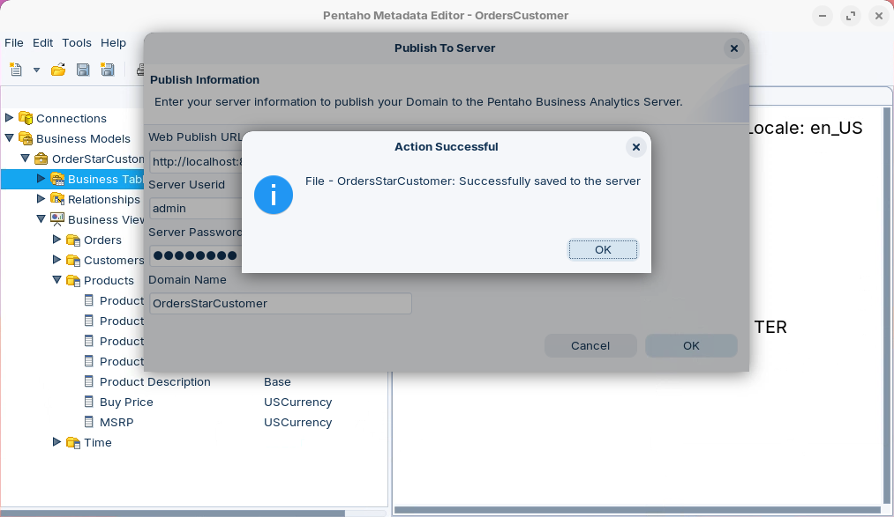
<figcaption>Published as OrdersStarCustomer</figcaption>
</figure>
</div>

> **Success:** Checkpoint: an **Action Successful** message reads `File - OrdersStarCustomer: Successfully saved to the server`.

4. Select **OK**.

### 4. Interactive Report

> **Note:**
>
> #### Check the Concepts in a Report
>
> Interactive Reports applies a column's mask, alignment and **Hidden For the User?** flag as it lists and shows the fields.

1. Open the Pentaho User Console with the button below and log in as `admin` (password `password`).

<button data-launch="puc">Open Pentaho User Console</button>

2. On the **Home** perspective, select **Create New > Interactive Report**.
3. In the **Select Data Source** dialog, select **OrderStarCustomer** and select **OK**.

<div align="center">
<figure>
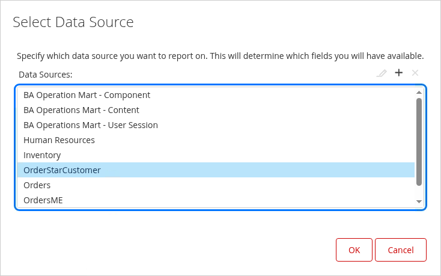
<figcaption>The data source carries the model's name</figcaption>
</figure>
</div>

> **Success:** Checkpoint: the list shows **OrderStarCustomer**, not **OrdersStarCustomer**: **Select Data Source** lists business models, and the domain you published holds a model named OrderStarCustomer. On the **Data** tab, the **Customers** category doesn't list **Employee Number**: its parent concept, Hidden, hides it.

4. On the **Data** tab, double-click **Contact Name**, **Order Date**, **Quantity Ordered**, **Price Sold** and **Total**, in that order. Each one becomes a column of the report.

<div align="center">
<figure>
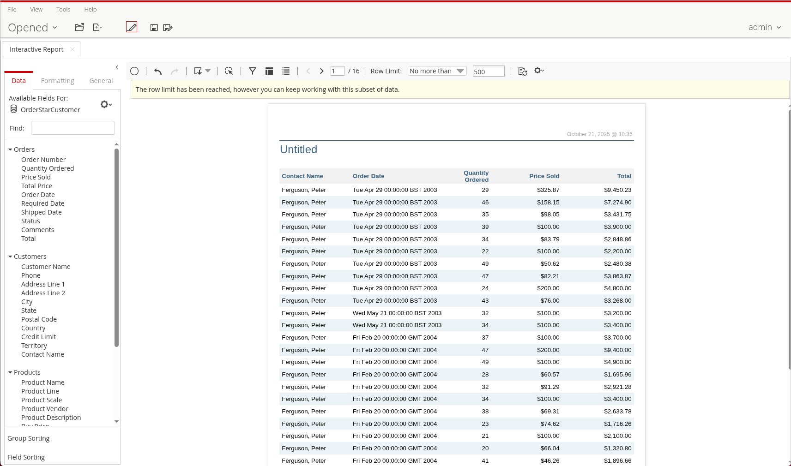
<figcaption>The concepts at work in a report</figcaption>
</figure>
</div>

> **Success:** Checkpoint: **Price Sold** and **Total** show as dollar amounts with two decimals, such as `$325.87`, and the numbers are right-aligned. **Contact Name** reads last name, then first name, such as `Ferguson, Peter`.

5. Double-click **Required Date** and compare it with **Order Date**.

> **Under the hood:**
>
> #### A mask needs a matching data type
>
> Masks are applied by the reporting tool as Java format patterns:
> MM-dd-yyyy for dates, $#,##0.00;($#,##0.00) for numbers. In this model
> Order Date's data type is Date and Required Date's is String, so the
> Date concept's mask finds a date in one and only text in the other.
> The SQL is the same either way.
>
> **Why it matters:** a concept can only format what the data type lets
> it. When a mask seems to do nothing, check the column's **Data Type**
> before the mask.

6. Close the **Interactive Report** tab. You don't need to save the report.

::::

## Lab Files

Click a file to download it.

The starting domain, the result of the [OrderStarCustomer](../07-properties-orderstarcustomer/guide.md) workshop:

[OrderStarCustomer.xmi](../_assets/files/OrderStarCustomer.xmi)

### Solution <!-- no-step -->

The finished domain, with this workshop's concepts applied. Load it with **File > Import from XMI File**.

[OrderStarCustomer-concepts.xmi](../_assets/files/OrderStarCustomer-concepts.xmi)
