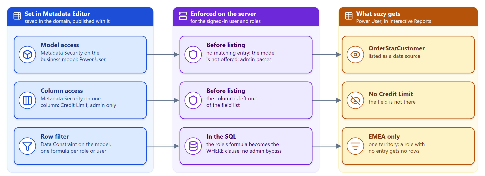

# Overview of Security & Data Access

Publishing a metadata domain for organizational use means more than building a friendly semantic layer — you must ensure that sensitive data stays protected and that users only access information appropriate to their role. **Pentaho's metadata model carries its own security** so that model-, column-, and row-level authorization is enforced automatically in the metadata layer, without database views or per-report security logic.

> **Note:**
>
> #### Metadata Security
>
> If you need to restrict access to certain portions of a metadata model that you are using as a data source, you must edit the model with **Metadata Editor** and add restrictions. The Pentaho metadata model offers **model-, column-, and row-level authorization control**. If you need to prevent certain users or roles from accessing it, you must change and **republish** the model.

## Where security lives in a domain

A Pentaho metadata model maps the physical structure of your database into a logical business model, and that same model is where security is declared. Because the rules live in the metadata layer, they are enforced consistently across every reporting tool and data-access method that queries the domain — rather than being re-implemented in each report or as separate database views.

The metadata security framework provides three complementary layers of protection, each enforced automatically once the domain is published:

| Layer | Scope | Purpose |
| --- | --- | --- |
| **Model-level security** | Entire metadata domain / business model | Controls which roles can use a domain at all. |
| **Column-level security** | Individual fields | Hides sensitive columns (e.g. Credit Limit) from unauthorized roles. |
| **Row-level security** | Rows within a table | Filters which rows a user sees, based on their role. |

The first two are checked before anything is listed; the third is written into the SQL:

<figure>

<figcaption>Where each layer is set, and how the server enforces it</figcaption>
</figure>

Read the diagram row by row, one layer per row: where you set it in Metadata Editor on the left, how the server enforces it in the middle, and what the user `suzy`, who holds the Power User role, gets in Interactive Reports on the right. The top two rows are Metadata Security, checked before anything is listed, so the model appears for her and the Credit Limit column does not; the administrator passes both checks. The bottom row is the Data Constraint, which becomes the WHERE clause of every query, so suzy gets EMEA rows only. That check has no administrator bypass: admin needs an entry of its own, and a role with no entry gets no rows.

:::: tabs

### Model-level Security

> **Note:**
>
> #### Restricting who can use a domain
>
> Model-level (domain-level) security controls which **roles** are allowed to access an entire metadata domain or business model. A user whose roles do not match the model's access list cannot use the domain as a data source at all — the model is invisible to them. This is the coarsest layer, and the natural place to start when deciding who may query a domain.

### Column-level Security

> **Note:**
>
> #### Hiding sensitive fields
>
> Column-level security restricts access to individual fields within a business table. Granting or denying a column by role lets you hide sensitive data — for example a **Credit Limit** field — from users who should not see it, while leaving the rest of the table available. Security set higher up in the model is **inherited** by its business tables and columns, so column restrictions refine that inherited access rather than starting from scratch.

### Row-level Security

> **Note:**
>
> #### Filtering rows by role
>
> Row-level security filters the **rows** returned from a table based on the user's role or department, so different users see different rows from the same table. It is configured with a **role-based MQL formula** (a data constraint) on the business model. For example, a constraint can ensure that an EMEA manager only sees customers where `Territory = "EMEA"`, while an administrator sees all data through an entry of its own (`TRUE()`): the server has no bypass for row-level security.

::::

## Row-level security in practice

> **Note:**
>
> #### EMEA managers only see EMEA rows
>
> A typical row-level rule, set on the business model, filters a business table's rows so that the rows returned depend on who is asking. Configure security so that the user `suzy` can only see customers where `Territory = "EMEA"`, while `admin` continues to see every row. The constraint is expressed as an MQL formula evaluated against the current user's roles, and Pentaho applies the appropriate filter automatically whenever the table is queried.

To make role-based constraints work, the Metadata Editor must be able to read the platform's users, roles, and security constraints. This is done by pointing the editor at the **Pentaho Server's security service** (**Tools > Security**), so that the server's users and roles are available when you author the permissions and constraint formulas.

> **Warning:** Security in the metadata model is only enforced once the domain is **published** to the server and the server caches are **refreshed**. After changing or adding restrictions, republish the model and refresh caches before testing — otherwise users will continue to see the old, unsecured view.

## From concept to workshop

This page is the concept reference for securing a Pentaho metadata domain. Put it to work in the [Row-Level Security](../11-security-and-data-access-row-level-security/guide.md) workshop, where you secure the OrderStarCustomer model one layer at a time — connecting Metadata Editor to the server's security service, applying model-level access for roles, hiding the Credit Limit column, and adding a row-level `Territory = "EMEA"` constraint — then test by logging in as different users to confirm that an administrator sees all data while a restricted user like `suzy` sees only their territory.
